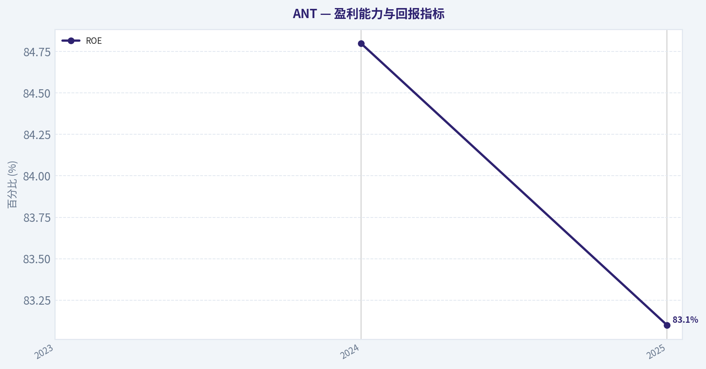
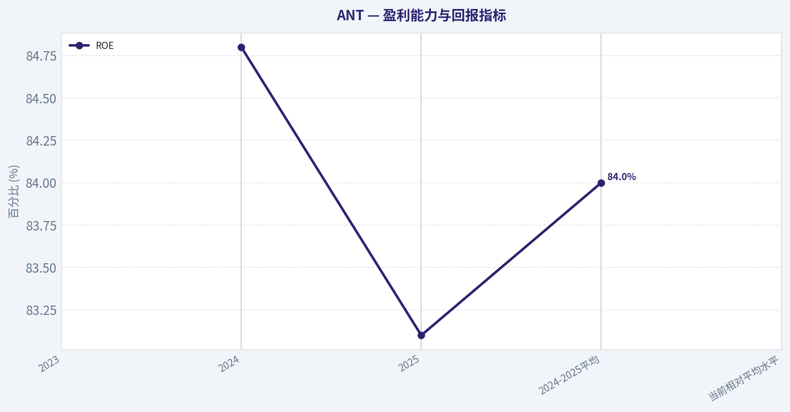
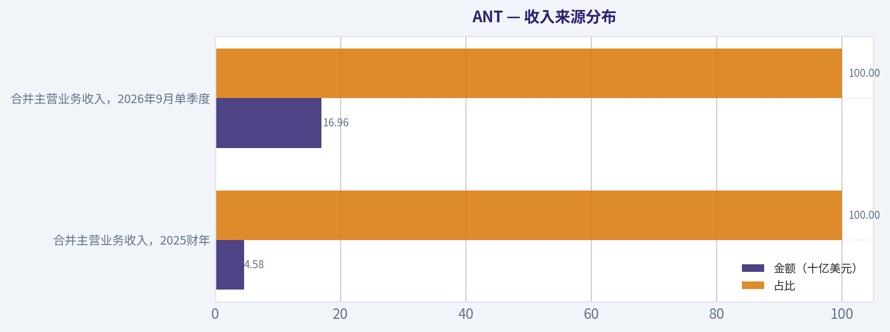
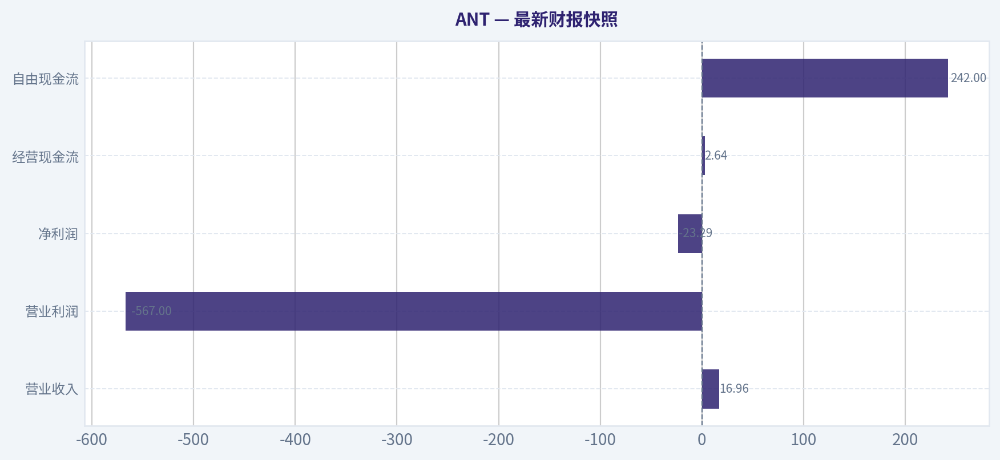
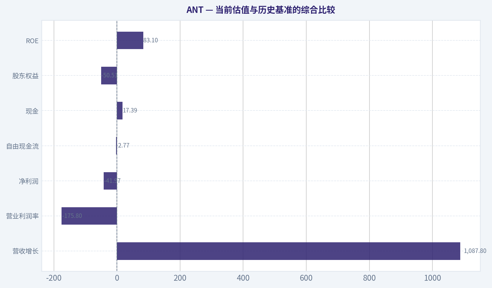
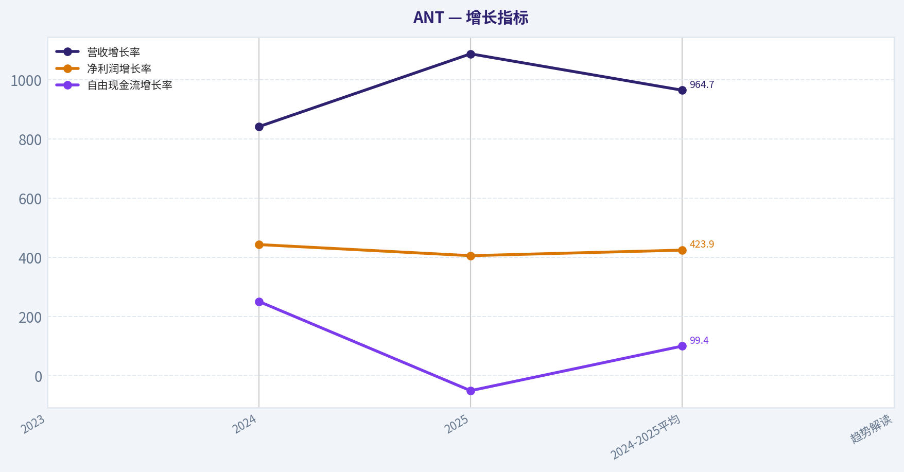
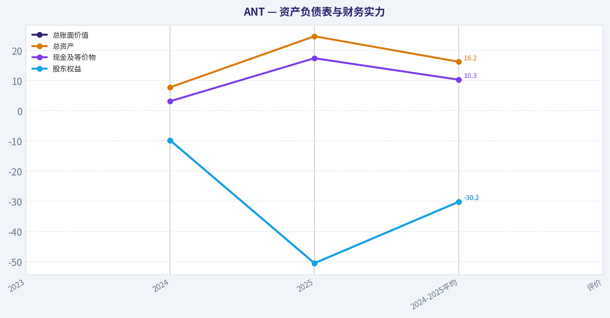
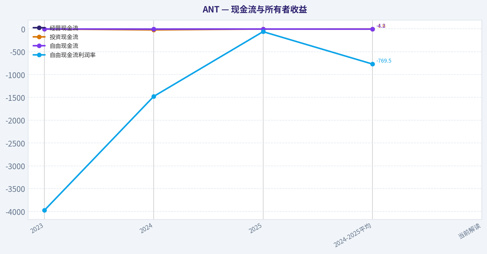

# ANT 深度价值情报

**调研日期:** 2026-11-19

## 关键免责声明

*本报告由 Deep Value Intelligence（一个基于 AI 的多智能体投资分析框架）自动生成。 仅供教育和研究用途 - 非财务建议，非财务顾问。*

---

## 目录

1. 情报摘要
2. 分析师团队报告
   - 基本面分析
   - 价值分析 (巴菲特)
   - 成长性分析 (林奇/德鲁肯米勒/费雪)
   - 市场分析
   - 期权市场分析
3. 研究团队评论
4. 投资团队评论
5. Deep Values 团队洞察

---

## 情报摘要

### 核心观点与前提条件

**核心论点:** **结论维持 中性，但理由进一步收紧。**

**主要风险:**
- **结论维持 中性，但理由进一步收紧。**
- 原计划将 Anthropic 定义为"高潜力业务尚未跨过价值证明门槛"，并采取 中性立场。综合三方辩论后，这一方向仍然合理，但应从宽泛观察调整为两个明确验证门槛：
- **中性**

**置信度:** 中

---

## 分析师团队报告

### 基本面分析

#### 最新财报快照

*以下数据基于最近一期已披露财报（2026年Q3），并尽量与上一年同期对比。*

| 指标 | 2026年Q3 | 上一年同期 | 同比变化 |
| --- | ---: | ---: | ---: |
| 营业收入 | $16.96B | N/A | N/A |
| 营业利润 | $-567.0M | N/A | N/A |
| 净利润 | $-23.29B | N/A | N/A |
| 摊薄每股收益 | N/A | N/A | N/A |
| 经营现金流 | $2.64B | N/A | N/A |
| 自由现金流 | $242.0M | N/A | N/A |

关键结论：这张快照先把最新一期财报放在桌面上，再去看长周期分析。这样读者能更清楚地区分"公司长期质量"和"这次财报发生了什么"。

#### ANT 3年财务指标

*以下数值均由原始数据确定性计算得出，并非 AI 估算。*

*发行人类型：operating company（Technology / Software - Application）。*

#### 3年财务指标
*年度行来自已披露财务报表，最后一行 TTM 由最近四个季度滚动计算得出。*

| 指标 | 2023 | 2024 | 2025 |
| --- | --- | --- | --- |
| 市场价格 | N/A | N/A | N/A |
| 总市值 | N/A | N/A | N/A |
| 市盈率 | N/A | N/A | N/A |
| 市净率 | N/A | N/A | N/A |
| ROE | N/A | 84.8% | 83.1% |
| ROIC | N/A | N/A | N/A |
| 每股收益 | $-1.42 | $-5.43 | $-23.04 |
| 营收 | $41.0M | $386.0M | $4.58B |
| 毛利润 | N/A | N/A | N/A |
| 毛利率 | N/A | N/A | N/A |
| 营业利润率 | -1343.9% | -772.0% | -175.8% |
| 净利润 | $-1.53B | $-8.31B | $-41.97B |
| 净利率 | -3734.1% | -2152.6% | -915.3% |
| 营收增长 | N/A | 841.5% | 1087.8% |
| 净利润增长 | N/A | 442.7% | 405.1% |
| 自由现金流增长 | N/A | 250.3% | -51.5% |
| 总账面价值 | N/A | $-9.80B | $-50.51B |
| 总资产 | N/A | $7.75B | $24.66B |
| 总债务 | N/A | N/A | N/A |
| 债务股权比 | N/A | N/A | N/A |
| 现金及等价物 | N/A | $3.14B | $17.39B |
| 股东权益 | N/A | $-9.80B | $-50.51B |
| 经营现金流 | $-1.63B | $-5.69B | $-2.64B |
| 投资现金流 | $-2.0M | $-22.0M | $-3.08B |
| 自由现金流 | $-1.63B | $-5.71B | $-2.77B |
| 自由现金流利润率 | -3973.2% | -1478.5% | -60.4% |
| 每股分红 | $0.00 | $0.00 | $0.00 |

#### 盈利能力指标
- 净资产收益率 (ROE): 83.1%
- 投入资本回报率 (ROIC): N/A
- 总资产收益率 (ROA): -170.2%
- 毛利率: N/A
- 营业利润率: -175.8%
- 净利率: -915.3%

#### 流动性指标
- 流动比率: 8.43
- 速动比率: 7.52

#### 杠杆指标
- 债务股权比: N/A
- 利息覆盖倍数: N/A
- 净负债: N/A

#### 增长指标（同比）
- 营收增长: 1087.8%
- 净利润增长: -405.1%
- 自由现金流增长: 51.5%
- 营收复合增长率（3年）: N/A
- 营收复合增长率（5年）: N/A

#### 估值指标
- 市盈率 (TTM): N/A
- 预期市盈率: -844.96
- 市净率: N/A
- 市销率: 36.04
- PEG 比率: N/A
- 企业价值/EBITDA: -97.29
- 自由现金流收益率: -0.2%
- 盈利收益率: N/A

#### 所有者收益（巴菲特方法，代码计算）
- 净利润: $-41.97B
- + 折旧与摊销: $40.0M
- - 资本开支: $-131.0M
- + 营运资本（现金流量表口径；负数=占用现金）: $3.27B
- = **所有者收益: $-3.19B**

#### 晚于最近年报的中期数据
- 截至 2026-09-30 的季度晚于最近年报期（2025-12-31），但数据源缺少季度，无法计算滚动十二个月（可用季度：2026-09-30, 2025-12-31, 2025-09-30）。上方年度数据已滞后，请单独考虑该季度。
- 营收: $16.96B; 营业利润: $-567.0M; 净利润: $-23.29B (非现金项目 $23.49B); 经营现金流: $2.64B; 资本开支: $-2.40B

#### 内在价值（DVI 估算 - 该股票没有 DeepValues 应用估值）
- 当前价格: $97
- 头条内在价值: 不适用 - 所有者收益为负，DCF 没有可资本化的正基数；不报告内在价值、模型区间或安全边际。请勿引用每股内在价值。

#### Piotroski F分数: 4/9
- 净利润为正: 未通过
- 经营现金流为正: 未通过
- 资产回报率改善: 未通过
- 现金流大于净利润: 通过
- 债务下降: 通过
- 流动比率改善: 未通过
- 未稀释股本: 通过
- 毛利率改善: 未通过
- 资产周转率改善: 通过

ANALYST STANCE: **看空**

#### 结论摘要

ANT（Anthropic, PBC）处于极高增长、但尚未证明可持续盈利和自由现金流创造能力的阶段。2025年营收达到45.8亿美元，同比增长1,087.8%，但净亏损419.7亿美元，自由现金流为负27.7亿美元，所有者收益为负31.9亿美元；截至2026年9月季度，营收进一步升至169.6亿美元，但净亏损仍为232.9亿美元。

当前股价为97美元，总市值约1.27万亿美元，对应市销率约36倍。由于所有者收益为负，无法建立可靠的正基数DCF内在价值；现有证据不足以支持如此高的估值水平。

#### 数据范围与口径

确定性数据集仅提供2023-2025年年度数据，另有截至2026年9月30日的单季度数据。数据集没有完整十年历史，因此无法计算严格意义上的十年平均值；下文的"历史平均"仅指数据集中可计算的2024-2025年平均值，不能视为十年平均。

2025年及更早年度财务数据与当前市场快照存在时间差异。市场价格97美元和市值1.27万亿美元属于当前研究包快照，而年度财务指标主要截至2025年。

#### 市场指标与估值

| 指标 | 当前值 | 数据集可比历史情况 | 分析 |
|---|---:|---:|---|
| 市场价格 | $97 | 2023-2025年度为N/A | 当前研究快照提供价格 |
| 总市值 | $1.27万亿美元 | 2023-2025年度为N/A | 规模已极大，但盈利基础尚未形成 |
| PE | N/A | 各年度为N/A | 净利润为负，PE没有解释力 |
| PB | N/A | 各年度为N/A | 负账面权益，PB不具备有效经济含义 |
| 市销率 | 约36.04倍 | 无完整历史序列 | 估值主要依赖未来收入和利润率扩张 |
| EV/EBITDA | 约-97.29倍 | 无完整历史序列 | EBITDA或相关盈利基础为负，不能作为正常估值倍数使用 |
| 自由现金流收益率 | -0.2% | 无完整历史序列 | 当前自由现金流仍不能支撑市值 |

**关键结论：** PE、PB和EV/EBITDA均无法作为正常估值锚。尤其是软件和AI平台类公司通常具有较少的有形资产，而ANT的股东权益已经为负，PB不仅不能用来判断便宜或昂贵，甚至没有稳定的分母；估值核心只能转向未来收入转化为利润和现金流的能力。当前约36倍市销率意味着市场已经提前计入极强的增长、毛利率改善和经营杠杆。

#### 盈利能力与经营表现

| 指标 | 2023 | 2024 | 2025 | 2024-2025平均 | 当前相对平均水平 |
|---|---:|---:|---:|---:|---|
| ROE | N/A | 84.8% | 83.1% | 84.0% | 略低于平均 |
| ROIC | N/A | N/A | N/A | N/A | 无法评估 |
| EPS | -$1.42 | -$5.43 | -$23.04 | -$14.24 | 2025年亏损显著扩大 |
| 营收 | $41M | $386M | $4.58B | $2.33B | 高于平均 |
| 营业利润率 | -1,343.9% | -772.0% | -175.8% | -473.9% | 明显改善但仍深度亏损 |
| 净利润 | -$1.53B | -$8.31B | -$41.97B | -$25.14B | 2025年亏损更大 |
| 净利率 | -3,734.1% | -2,152.6% | -915.3% | -1,534.0% | 改善但仍极端负值 |
| 毛利率 | N/A | N/A | N/A | N/A | 数据缺失 |

**关键结论：**营收增长和营业利润率方向明显改善，但盈利规模仍不足以支撑当前市值。2025年收入扩大约12倍，营业亏损率从2024年的负772.0%改善至负175.8%，说明规模效应正在出现；然而净亏损扩大至419.7亿美元，反映非经营性项目、股权相关费用或其他重大会计项目对净利润造成了严重拖累。ROE为正并不代表经营质量强，因为股东权益为负，ROE分母失真。

#### 增长指标

| 指标 | 2023 | 2024 | 2025 | 2024-2025平均 | 趋势解读 |
|---|---:|---:|---:|---:|---|
| 营收增长率 | N/A | 841.5% | 1,087.8% | 964.7% | 极高速增长，基数效应明显 |
| 净利润增长率 | N/A | 442.7% | 405.1% | 423.9% | 亏损绝对额继续恶化，不能当作改善 |
| 自由现金流增长率 | N/A | 250.3% | -51.5% | 99.4% | 2025年现金消耗重新扩大 |
| 2026年9月季度营收 | - | - | - | $16.96B | 单季度规模显著高于2025全年 |

**关键结论：**收入增长是ANT最强的基本面因素，但增长率受到极低历史基数影响，不能直接外推为长期复合增速。净利润增长率的正数实际上代表亏损扩大，不是盈利增长；自由现金流在2025年恶化，说明收入增长尚未稳定转化为现金收益。2026年9月季度收入很高，但单季度数据不足以证明年度盈利拐点已经确立。

#### 资产负债表与财务实力

| 指标 | 2023 | 2024 | 2025 | 2024-2025平均 | 评价 |
|---|---:|---:|---:|---:|---|
| 总账面价值 | N/A | -$9.80B | -$50.51B | -$30.16B | 负值且恶化 |
| 总资产 | N/A | $7.75B | $24.66B | $16.21B | 资产规模快速扩张 |
| 总债务 | N/A | N/A | N/A | N/A | 数据缺失 |
| 债务权益比 | N/A | N/A | N/A | N/A | 无法确认杠杆水平 |
| 现金及等价物 | N/A | $3.14B | $17.39B | $10.27B | 现金储备大幅增加 |
| 股东权益 | N/A | -$9.80B | -$50.51B | -$30.16B | 负权益是重大风险 |
| 流动比率 | N/A | - | 8.43 | - | 短期流动性较强 |
| 速动比率 | N/A | - | 7.52 | - | 短期偿付缓冲较高 |

**关键结论：**现金余额由2024年的31.4亿美元增至2025年的173.9亿美元，短期流动性指标也很高，降低了近期流动性风险。但股东权益从负98亿美元恶化至负505.1亿美元，意味着会计资本基础非常脆弱。总债务和债务权益比缺失，不能把高现金余额简单等同于低财务风险；未来融资、股权稀释、承诺支出和资本开支仍需持续关注。

#### 现金流与所有者收益

| 指标 | 2023 | 2024 | 2025 | 2024-2025平均 | 当前解读 |
|---|---:|---:|---:|---:|---|
| 经营现金流 | -$1.63B | -$5.69B | -$2.64B | -$4.17B | 仍为负，但2025年较2024年改善 |
| 投资现金流 | -$2M | -$22M | -$3.08B | -$1.55B | 投资支出明显扩大 |
| 自由现金流 | -$1.63B | -$5.71B | -$2.77B | -$4.24B | 尚未形成可分配现金 |
| 自由现金流利润率 | -3,973.2% | -1,478.5% | -60.4% | -769.5% | 仍为负，但相对改善 |
| 每股分红 | $0.00 | $0.00 | $0.00 | $0.00 | 无股东现金回报 |
| 所有者收益 | - | - | -$3.19B | - | DCF缺少正现金流基数 |

2025年所有者收益计算如下：

```text
净利润                         -$41.97B
加：折旧与摊销                    +$0.04B
减：资本开支                      -$0.131B
加：营运资本现金流调整             +$3.27B
------------------------------------------------
所有者收益                       -$3.19B
```

截至2026年9月30日的单季度数据为：

```text
经营现金流                       +$2.64B
资本开支                         -$2.40B
简化自由现金流                    +$0.24B
净利润                          -$23.29B
```

**关键结论：**2025年自由现金流亏损27.7亿美元，虽然比2024年亏损57.1亿美元有所改善，但仍没有形成可资本化的正所有者收益。2026年9月季度的简化自由现金流约为2.4亿美元，属于积极信号，但在只有一个季度、且净亏损仍达232.9亿美元的情况下，尚不足以确认持续性转折。公司目前没有分红，现金主要承担扩张、研发、基础设施和经营风险缓冲功能。

#### 2026年中期数据的特殊含义

2026年9月季度营收为169.6亿美元，已经远高于2025年全年45.8亿美元，显示商业化速度极快。与此同时：

- 营业利润为负5.67亿美元，营业利润率约为负3.3%，较2025年负175.8%显著改善。
- 净利润为负232.9亿美元，其中非现金项目约234.9亿美元，表明净亏损受到大额非现金项目显著影响。
- 经营现金流为正26.4亿美元，资本开支为负24.0亿美元，现金流表现首次呈现较强改善。

这组数据支持"经营规模和现金转化正在改善"的判断，但不支持直接假设全年已进入稳定盈利阶段。非现金项目规模很大，也使净利润、EPS和ROE的解释难度显著增加。

#### 收入来源分布

确定性数据集没有提供产品线、客户类型、地域或业务分部收入拆分，因此不能可靠地把收入分配到具体产品或地区。下表仅列示可验证的合并收入，避免使用未经披露的估算。

| 收入来源 | 金额（十亿美元） | 占比 |
|---|---:|---:|
| 合并主营业务收入，2025财年 | $4.58B | 100% |
| 合并主营业务收入，2026年9月单季度 | $16.96B | 100% |

**关键结论：**可确认的收入只有合并口径，缺乏产品、地域和客户集中度信息。收入快速增长是核心优势，但在没有分部毛利率、客户留存率、合同期限和单客户收入占比的情况下，无法判断增长质量及其稳定性。

#### 经营护城河与业务质量

**潜在护城河：**

1. **模型能力与研发积累。**AI基础模型需要高额研发投入、数据工程能力、人才密度和计算资源，领先企业可能形成技术、人才和生态壁垒。
2. **企业客户嵌入性。**如果模型被嵌入企业软件、开发流程和客服流程，迁移成本可能提高，收入重复性也可能改善。
3. **品牌和安全定位。**在企业客户重视安全、可靠性和合规性的场景中，品牌信任可能成为商业化优势。
4. **规模经济潜力。**2025年至2026年的收入扩张和营业亏损率改善，显示收入规模扩大可能带来经营杠杆。

**护城河尚未完全验证的地方：**

- AI模型能力迭代迅速，技术领先时间可能缩短。
- 训练和推理成本高，收入增长不一定等于高自由现金流增长。
- 大客户议价能力、云平台依赖和竞争性定价可能压缩毛利率。
- 当前缺少毛利率、客户留存率和分部利润率，无法完整判断单位经济效益。

#### 管理层资本配置与可预测性

从巴菲特式分析角度，ANT当前最重要的问题不是收入能否继续增长，而是增长能否最终转化为持续的所有者收益。

- **盈利可预测性：较弱。**2023-2025年净利润均为负，且亏损规模扩大。
- **现金流可预测性：较弱。**自由现金流连续为负，2026年9月季度虽改善，但持续时间不足。
- **资本配置：扩张导向。**投资现金流从2025年的负22亿美元扩大至负30.8亿美元，说明资源投入显著上升。
- **股东回报：尚未形成。**2023-2025年每股分红均为零。
- **ROE解释力：有限。**负股东权益使83.1%的ROE无法作为经营质量的正常证据。
- **Piotroski F分数：4/9。**净利润、经营现金流、资产回报率、流动比率和毛利率等项目未形成全面改善。

#### 三情景所有者收益DCF

确定性数据明确指出：所有者收益为负，DCF没有可资本化的正基数，因此不能报告可信的每股内在价值、模型区间或安全边际。这里可以展示计算约束，但不能把负现金流DCF结果伪装成公平价值。

采用标准参数：

```text
折现率：10%
终值增长率：2.5%
终值资本化分母：10% - 2.5% = 7.5%
当前所有者收益：-$3.19B
```

**保守情景：**

假设所有者收益以3%改善，即负值绝对额缩小3%：

```text
第1年所有者收益 = -$3.19B x 1.03 = -$3.286B
终值 = -$3.286B x 1.025 ÷ 7.5% = -$44.89B
```

该结果为负值，不是可解释的股权公平价值。

**平均情景：**

即使假设未来五年所有者收益每年改善25%，其路径仍为：

```text
第1年：-$3.19B x 1.25 = -$3.988B
第2年：-$3.988B x 1.25 = -$4.984B
第3年：-$4.984B x 1.25 = -$6.230B
第4年：-$6.230B x 1.25 = -$7.788B
第5年：-$7.788B x 1.25 = -$9.735B
```

由于负所有者收益在该定义下继续扩大负值，终值仍然没有经济解释力。即便把"改善"定义为亏损绝对额逐年减少，也必须先建立从负值到正值的明确过渡假设，而现有数据不足以支持该假设。

**乐观情景：**

2026年9月季度简化自由现金流约为正2.4亿美元。如果把这一季度视为可持续运行率，则年化简化自由现金流约为9.6亿美元。但这不是确定性数据中的年度所有者收益，且仍需扣除：

- 可能的持续研发与基础设施投入；
- 营运资本变化；
- 股权薪酬及其他非现金项目；
- 未来计算资源承诺；
- 税费和融资影响。

因此，不能直接把9.6亿美元年化数值用于正式DCF。即使暂时使用该数字，十年期、10%折现率和2.5%终值增长率的估值仍会高度依赖收入增长、利润率扩张和资本开支假设，结果对假设极其敏感。

**DCF结论：**三种情景均无法产生可信的正公平价值区间。当前资料支持的是"未来可能形成高价值现金流"的经营假设，而不是已经存在一个可验证的内在价值。研究包的DVI结论为"不适用"，原因正是所有者收益为负；这一结论不应被替换成任意的每股价值或安全边际。

#### 当前估值与历史基准的综合比较

| 维度 | 当前表现 | 可比平均或历史参考 | 偏离及含义 |
|---|---:|---:|---|
| 营收 | $4.58B，另有2026年9月季度$16.96B | 2024-2025平均$2.33B | 增长显著，但基数较低且可持续性待证 |
| 营收增长 | 1,087.8% | 2024-2025平均964.7% | 仍高于平均，包含强烈基数效应 |
| 营业利润率 | -175.8% | 平均-473.9% | 大幅改善，但仍未盈利 |
| 净利润 | -$41.97B | 平均-$25.14B | 绝对亏损恶化 |
| 自由现金流 | -$2.77B | 平均-$4.24B | 亏损收窄，但仍为负 |
| 现金 | $17.39B | 平均$10.27B | 财务缓冲增强 |
| 股东权益 | -$50.51B | 平均-$30.16B | 资本基础进一步恶化 |
| ROE | 83.1% | 平均84.0% | 表面稳定，但受负权益扭曲 |
| 市销率 | 约36.04倍 | 缺乏可靠历史平均 | 对未来盈利兑现要求极高 |

**关键结论：**相对于可比历史数据，ANT的收入和营业利润率改善非常显著，现金储备也更强；但净亏损和负股东权益恶化，表明企业价值创造尚未完成从"收入扩张"向"所有者收益"转换。约36倍市销率对应的是极高的未来兑现要求，而不是当前财务结果已经证明的估值。

#### 主要风险、机会与观察重点

| 类别 | 具体内容 | 对估值的影响 |
|---|---|---|
| 机会 | AI企业应用需求快速增长 | 可能支持长期高收入增速 |
| 机会 | 收入扩大后营业亏损率明显收窄 | 说明存在潜在经营杠杆 |
| 机会 | 2026年9月季度经营现金流转正 | 可能是现金转化改善的早期信号 |
| 风险 | 所有者收益为负31.9亿美元 | 无法使用常规DCF资本化 |
| 风险 | 2025年净亏损419.7亿美元 | 盈利质量和会计项目需要核查 |
| 风险 | 股东权益为负505.1亿美元 | 资本结构脆弱，PB失去意义 |
| 风险 | 毛利率和分部数据缺失 | 无法验证单位经济效益 |
| 风险 | 总债务和债务权益比缺失 | 财务风险评估不完整 |
| 风险 | 计算成本、资本开支和竞争压力 | 可能阻碍收入向现金流转换 |
| 风险 | 高估值依赖远期假设 | 对增长放缓或利润率不达预期高度敏感 |

**关键结论：**最重要的正面变量是收入增长、营业亏损率改善和2026年9月季度现金流转正。最重要的负面变量是所有者收益为负、股东权益为负、净亏损巨大以及估值对未来假设高度敏感。后续研究重点应放在连续多个季度的正自由现金流、毛利率、客户留存、计算成本和股权稀释，而不是单独观察收入增长率。

#### 最终研究立场

**看空**

该立场表达的是估值与基本面的匹配判断，不构成任何交易操作指示。

支持该立场的核心证据：

1. 当前市值约1.27万亿美元，而所有者收益为负31.9亿美元。
2. 市销率约36倍，需要极高且持续的增长和利润率扩张才能合理化。
3. 净利润连续为负，2025年净亏损达到419.7亿美元。
4. 股东权益为负505.1亿美元，ROE和PB均失去常规解释力。
5. 2026年9月季度出现现金流改善，但单季度结果尚不足以建立稳定DCF基数。
6. 数据缺失项较多，包括毛利率、总债务、分部收入和客户经济指标，限制了对长期质量的确认。

公司的技术和商业化潜力可能很高，但截至现有数据，证据更支持"高潜在价值、低当前可验证性"，而不是支持当前价格已经由可实现的现金流充分覆盖。

| 关键项目 | 当前判断 | 对估值的含义 |
|---|---|---|
| 收入增长 | 极强 | 支持长期成长叙事，但基数效应明显 |
| 盈利能力 | 尚未建立 | 不能使用PE或盈利收益率估值 |
| 现金流 | 2025年为负，2026年9月季度改善 | 需要连续数据确认 |
| 资产负债表 | 高现金但负权益 | 流动性较强，资本结构仍脆弱 |
| ROE | 83.1% | 因负权益而失真，不能作为护城河证明 |
| PB | N/A | 对该软件及负权益企业没有有效意义 |
| DCF | 无法形成可信正值 | 所有者收益为负，缺乏正现金流基数 |
| 竞争优势 | 可能存在技术、品牌和生态壁垒 | 仍需通过利润率和留存数据验证 |
| 综合立场 | **看空** | 现有证据不支持当前估值水平 |

#### 基本面关键图表

本图追踪 **ANT** 过去十年的盈利能力与回报指标（ROE、ROIC、利润率），突出呈现资本效率的变化趋势。



本图追踪 **ANT** 过去十年的盈利能力与回报指标（ROE、ROIC、利润率），突出呈现资本效率的变化趋势。



本对比图（来自「收入来源分布」）将 **ANT** 的当前数据与历史基准并排呈现，直观反映公司相对自身历史均值的估值水平。



---

### 价值分析 (巴菲特)

> *基于沃伦·巴菲特的价值投资哲学：能力圈、经济护城河、管理层质量与安全边际。*

#### 内在价值快照

价格是你付的钱，内在价值是企业未来可能为股东创造的现金价值。我们给出一个区间，而不是假装只有一个神奇数字。

- 当前价格: $97.17
- 估值区间（两种 DCF 方法、保守到乐观）: N/A 至 N/A

##### 所有者收益（巴菲特方法）
- 净利润: $-41,965,000,000.00
- 折旧与摊销: $40,000,000.00
- 资本支出: $-131,000,000.00
- 营运资金变化: $3,270,000,000.00
- 所有者收益: $-3,188,400,000.00

##### 内在价值

ANALYST STANCE: **看空**

#### 一、结论摘要

ANT，即 Anthropic, PBC，目前股价为 **97美元**，总市值约 **1.27万亿美元**。公司处于高速增长阶段，但所有者收益为负，FCF收益率为 **-0.2%**，因此无法建立正基数 DCF 内在价值。

公司可能拥有较大的 AI 平台潜力，但当前估值已经要求未来收入、利润率和资本回报出现极其强劲且持续的兑现。现有证据不足以支持 1.27万亿美元市值对应的安全边际。

#### 二、因素评分

| 因素 | 评分（0-5） | 主要依据 |
|---|---:|---|
| 1. 能力圈与商业模式简单性 | 2.5 | AI模型、云计算合作、企业订阅和算力投入构成的商业模式仍处于快速演变期，十年后的竞争格局难以预测 |
| 2. 护城河 | 3.0 | 模型能力、开发者生态、企业工作流和数据反馈可能形成网络效应与转换成本，但竞争对手强大，护城河尚未充分验证 |
| 3. 管理层与资本配置 | 3.0 | 高速扩张和长期技术投入体现进取性，但缺乏足够的公开历史来验证每一美元留存资本的长期回报 |
| 4. 行业结构 | 2.5 | AI行业增长极快，但资本密集、算力依赖显著，且大型科技公司与其他模型公司持续投入，行业竞争强度较高 |

**关键结论：** ANT的核心资产可能具有较高战略价值，但商业模式、竞争格局和长期盈利能力仍未达到高度可预测的水平。高速增长提高了潜在上行空间，也同步提高了估值兑现风险。

#### 三、护城河分析

| 护城河来源 | 现阶段判断 | 证据与限制 |
|---|---|---|
| 无形资产 | 中等偏强 | Claude模型品牌、研究能力和安全定位具有差异化，但模型能力迭代快，技术优势可能被追赶 |
| 转换成本 | 中等 | 企业部署、API集成、工作流嵌入和安全审查会提高迁移成本，但客户仍可能采用多模型架构 |
| 成本优势 | 较弱至中等 | 规模可能改善推理成本和基础设施利用率，但训练与推理需要大量资本及算力 |
| 网络效应 | 中等 | 开发者、企业客户和应用生态可能形成正反馈，但网络效应尚未达到成熟平台的稳固程度 |
| 护城河评级 | 窄至中等 | 有潜在的宽护城河，但目前更接近"正在形成"，尚不能确认"宽且不断扩大" |

**关键结论：** ANT最有价值的潜在护城河来自企业工作流嵌入、开发者生态和模型使用反馈，而不是单纯的模型本身。若客户长期采用多家模型供应商，转换成本和网络效应将弱于传统平台型公司。

#### 四、财务摘要

| 指标 | 最新数据 |
|---|---:|
| 股价 | 97美元 |
| 总市值 | 1.27万亿美元 |
| 市盈率 | 不适用 |
| ROE | 83.1% |
| 毛利率 | 不适用 |
| 营收同比增长 | 1,087.8% |
| FCF收益率 | -0.2% |
| 流动比率 | 8.43 |
| 所有者收益 | 为负 |
| 内在价值 | 不适用，所有者收益没有形成正基数 |
| 公开披露的结构化大股东跟踪 | 暂无近期匹配 |

**关键结论：** 营收增长极为强劲，但收入增长尚未转化为正的所有者收益。83.1%的ROE不宜直接视为高质量资本回报，因为公司仍缺乏稳定盈利和正现金流基础，ROE可能受到较低权益基数或资本结构因素影响。

#### 五、现金流与所有者收益

所有者收益公式为：

> 所有者收益 = 净利润 + 折旧摊销 - 维持性资本开支 - 营运资本增加

目前研究数据明确显示：

- 所有者收益为负；
- FCF收益率为 **-0.2%**；
- 因此不存在可合理用于资本化的正向所有者收益基数；
- 不能将高速营收增长直接等同于股东现金创造能力。

**关键结论：** ANT当前的核心财务问题不是收入不足，而是收入尚未证明能够转化为稳定、可分配、可持续增长的现金流。对于长期价值评估，现金流转化率和单位收入利润率比单纯营收增速更重要。

#### 六、资产负债表与偿债能力

| 指标 | 数据 | 判断 |
|---|---:|---|
| 流动比率 | 8.43 | 短期流动性较强 |
| 债务权益比 | 未提供 | 无法确认长期杠杆水平 |
| 利息覆盖倍数 | 未提供 | 无法确认债务利息安全边际 |
| 净现金 | 未提供 | 无法确认是否属于净现金状态 |
| 现金流趋势 | FCF收益率为负 | 现金创造能力仍待验证 |
| 资产负债表评分 | 3.5 / 5 | 流动性强，但长期偿债和现金消耗信息不足 |

**关键结论：** 8.43的流动比率显示短期流动性较好，但它不能替代净现金、债务期限和利息覆盖分析。当前证据没有显示已经出现偿债危机，因此质量与偿债硬底线尚未触发。

#### 七、质量与偿债硬底线

**Gate 5硬底线：未触发。**

判断依据：

- 所有者收益为负，说明盈利质量尚未成熟；
- FCF收益率为负，现金流轨迹偏弱；
- 但流动比率为8.43，未显示短期流动性紧张；
- 缺乏利息覆盖率低于1倍或处于财务困境区间的证据。

因此，ANT的问题目前主要是**盈利兑现和估值风险**，而不是已经确认的财务困境。

#### 八、三情景 DCF 估值

| 情景 | 计算状态 | 说明 |
|---|---|---|
| A：零增长 | 不适用 | 所有者收益为负，无法使用"所有者收益 ÷ 10%" |
| B：GDP增长 | 不适用 | 负的所有者收益无法作为正向增长模型的起点 |
| C：历史增长 | 不适用 | 营收高速增长不能替代正的所有者收益，且盈利历史不足以支持稳定终值 |

**关键结论：** 目前无法形成有经济意义的正向 DCF 内在价值。这里不是保守假设导致估值偏低，而是公司尚未提供可资本化的正向所有者收益基数。按照研究包规则，不引用任何模型区间、每股内在价值或安全边际数字。

#### 九、估值与反向检验

公开数据提供的估值信号如下：

- 股价：97美元；
- 总市值：1.27万亿美元；
- 市盈率：不适用；
- FCF收益率：-0.2%；
- 所有者收益：为负；
- 最新新闻提及的收入运行率约为810亿美元。

以约810亿美元收入运行率粗略计算，当前市值约相当于 **15.7倍收入运行率**。这不是内在价值计算，但说明市场已经给予极高的未来兑现要求。

要支撑当前市值，公司需要同时实现：

1. 收入继续大幅增长；
2. 毛利率和经营利润率显著改善；
3. 算力、研发与数据中心投入的资本回报率上升；
4. 客户从试用和项目型需求转化为稳定订阅及长期合同；
5. 竞争格局不会导致模型价格持续下降；
6. 现金流最终明显超过资本开支需求。

**关键结论：** 当前价格隐含的不是普通的高增长，而是高增长、强规模效应和高利润率同时兑现。由于现阶段缺少正向所有者收益，估值安全边际无法得到验证。

#### 十、管理层与资本配置

| 评估项目 | 判断 |
|---|---|
| 长期导向 | 技术研发和模型能力建设体现长期投入取向 |
| 股东所有者意识 | 公开数据不足以确认管理层个人财富与公司股票高度绑定 |
| 诚实与透明度 | 暂无足够长期披露记录来评价完整周期内的坦诚度 |
| 再投资能力 | 潜在空间很大，但每美元再投资带来的长期价值尚未被财务结果证明 |
| 并购与资本配置 | 尚无足够长期记录判断并购纪律 |
| 资本强度 | 训练、推理、研发和基础设施需求可能带来高资本支出压力 |
| 管理层评分 | 3.0 / 5 |

**关键结论：** 管理层面对的是一个具有巨大技术机会、同时也需要持续大额投入的行业。当前最关键的管理考验，是把模型能力转化为高留存、高毛利和正自由现金流，而不是单纯扩大收入规模。

#### 十一、最终 Buffett 评分卡

| 评估标准 | 权重 | 评分（1-5） | 加权分 |
|---|---:|---:|---:|
| 护城河宽度与持久性 | 25% | 3.0 | 0.75 |
| 估值与安全边际 | 20% | 1.0 | 0.20 |
| 资本回报：ROIC相对WACC | 15% | 2.0 | 0.30 |
| 商业理解度与可预测性 | 12% | 2.0 | 0.24 |
| 管理层质量与资本配置 | 12% | 3.0 | 0.36 |
| 再投资跑道 | 8% | 4.0 | 0.32 |
| 资产负债表强度 | 4% | 3.5 | 0.14 |
| 行业结构 | 4% | 2.5 | 0.10 |
| **总分** | **100%** |  | **2.41** |

**关键结论：** ANT的再投资跑道和潜在技术护城河是主要优点，但估值、现金流和可预测性明显拖累总分。2.41分低于3.0分的观察区间，现有证据不支持当前市值对应的价值安全边际。

#### 十二、投资立场

**ANALYST STANCE: 看空**

** conviction：中高**

这不是对 Anthropic 技术前景的否定，而是对当前财务证据与估值关系的判断。ANT可能成为重要的 AI 基础设施和软件平台，但在所有者收益为负、FCF收益率为负且 DCF 没有正基数的情况下，1.27万亿美元市值要求极高程度的未来兑现；目前证据不足以支持该估值。

#### 估值图表

本对比图（来自「最新财报快照」）将 **ANT** 的当前数据与历史基准并排呈现，直观反映公司相对自身历史均值的估值水平。



本对比图（来自「当前估值与历史基准的综合比较」）将 **ANT** 的当前数据与历史基准并排呈现，直观反映公司相对自身历史均值的估值水平。



---

### 成长性分析 (林奇/德鲁肯米勒/费雪)

> *基于彼得·林奇的GARP成长投资法、斯坦利·德鲁肯米勒的宏观拐点分析法，以及菲利普·费雪的深度调研法。*

**ANALYST STANCE: 看空**

#### 一、核心判断

ANT，即 Anthropic, PBC，处于人工智能基础模型与企业级生成式人工智能的高速扩张阶段。营收增长极强，但公司仍然严重亏损、自由现金流基础不足，且约 **1.27 万亿美元市值**对应约 **36.04 倍市销率**。在缺乏可验证利润、毛利率和完整 2026 年度数据的情况下，现有估值要求公司未来实现极高规模，证据尚不足以支持这一估值。

#### 二、Lynch 分类与公司故事

| 项目 | 判断 |
|---|---|
| Lynch 分类 | 快速成长型，但尚未证明具备高质量盈利模式 |
| 核心主题 | 人工智能基础模型、企业软件、云计算 |
| 竞争阶段 | 高速扩张期，竞争与资本投入均非常激烈 |
| 主要增长驱动 | 模型调用量、企业合同、代理式人工智能、开发者生态 |
| 当前最大缺陷 | 亏损规模大、现金流不稳定、估值极高、数据期间不一致 |

**关键结论：** ANT 的故事容易理解：企业和开发者越来越多地使用 Claude 等人工智能模型，模型调用量和商业化收入快速上升。但"收入快速增长"尚未转化为稳定利润，当前更接近高投入扩张期，而不是已经验证的高质量复利企业。

#### 三、The Story：三个简单要点

1. Anthropic 通过 Claude 系列模型参与人工智能基础设施竞争，受益于企业人工智能采用率提升。
2. 企业客户一旦将模型嵌入内部流程，可能形成较高转换成本，并带来持续调用收入。
3. 若模型性能、产品生态和企业分发能力持续领先，收入规模可能在数年内继续快速扩大；但目前公司仍需证明每一美元收入能够产生足够的长期现金流。

#### 四、TAM 与十倍测试

| 项目 | 数据或判断 |
|---|---:|
| 2025 年营收 | 45.8 亿美元 |
| 2026 年第三季度营收 | 169.6 亿美元 |
| 市场报道的年化收入规模 | 约 810 亿美元 |
| 十倍年化收入 | 约 8100 亿美元 |
| 十倍测试所需市场规模（若占有率低于 20%） | 至少约 4.05 万亿美元 |
| 当前 TAM 可验证程度 | 中低，缺乏公司正式披露的统一口径 |
| TAM 增长方向 | 高增长，但竞争格局和模型价格下降会压低行业利润池 |

**关键结论：** 如果以约 810 亿美元年化收入为基数，十倍测试要求人工智能软件、模型服务和相关基础设施形成超过 4 万亿美元的可服务市场，或者 ANT 跨越多个相邻市场。市场空间可能足够大，但这个结论高度依赖人工智能需求持续爆发、价格下降不侵蚀利润，以及 ANT 能够维持较高市场份额。

#### 五、收入增长趋势

| 年度或期间 | 营收 | 同比增长 | 经营利润率 | 自由现金流 |
|---|---:|---:|---:|---:|
| 2023 年 | 4100 万美元 | - | -1343.9% | -16.3 亿美元 |
| 2024 年 | 3.86 亿美元 | 841.5% | -772.0% | -57.1 亿美元 |
| 2025 年 | 45.8 亿美元 | 1087.8% | -175.8% | -27.7 亿美元 |
| 2026 年第三季度 | 169.6 亿美元 | 不可比 | 亏损约 5.67 亿美元 | 约 2.4 亿美元，粗略计算 |

**关键结论：** 历史收入呈现极强加速，属于明显的产品与市场扩张拐点。不过，2026 年季度数据与年度数据存在期间和口径不完整问题，不能直接推导全年增长率；同时，最新季度虽有正经营现金流，但资本支出约 24 亿美元，现金流质量仍需更多季度验证。

#### 六、单位经济与经营质量

| 指标 | 数据 | 评价 |
|---|---:|---|
| 毛利率 | 未披露或不可得 | 无法判断模型推理成本后的真实经济性 |
| LTV/CAC | 未披露 | 无法验证客户获取效率 |
| NRR | 未披露 | 无法验证客户扩张与留存 |
| 规则四十 | 无法完整计算 | 需要可靠收入增长与自由现金流利润率 |
| 2025 年自由现金流利润率 | -60.4% | 明显低于健康水平 |
| 2025 年经营利润率 | -175.8% | 规模扩张尚未带来经营杠杆 |
| 流动比率 | 8.43 | 短期流动性较强 |
| 现金及等价物 | 约 173.9 亿美元 | 提供一定扩张缓冲，但不足以消除长期资本需求 |

**关键结论：** ANT 最大的信息缺口不是需求，而是单位经济。没有毛利率、NRR、客户获取成本和客户生命周期价值，无法确认收入增长是否具有高质量；2025 年自由现金流仍为负，说明规模增长尚未证明可持续的现金回报。

#### 七、拐点评估

| 拐点类型 | 观察 | 结论 |
|---|---|---|
| 产品周期 | Claude 与企业人工智能需求推动收入高速增长 | 已出现 |
| 市场份额 | 缺乏统一、可验证的份额序列 | 未充分证明 |
| 利润率 | 经营利润率仍显著为负 | 尚未出现 |
| TAM | 从聊天机器人扩展至企业工作流、代码和代理式人工智能 | 正在扩张 |
| 竞争格局 | 大型云厂商及其他模型公司持续投入 | 竞争加剧 |
| 现金流 | 最新季度经营现金流改善，但资本支出很高 | 早期改善，尚未确认 |

**关键结论：** ANT 已经发生了收入和 TAM 拐点，但尚未发生利润率与自由现金流拐点。按照 Druckenmiller 的框架，市场可能低估长期收入规模，却也可能低估了推理成本、资本开支和模型价格竞争对未来盈利的压制。

#### 八、宏观环境

人工智能属于 2024-2034 年最强的长期主题之一，企业数字化和云计算支出为 ANT 提供顺风。相反，模型训练与推理需要大量资本支出，利率、能源成本、芯片供应和云基础设施价格都会影响现金消耗。当前整体人工智能估值已经受到高度关注，宏观顺风不等于个股估值安全。

#### 九、Fisher 十五项评分

| Fisher 项目 | 分数（1-5） | 判断 |
|---|---:|---|
| 市场潜力 | 5 | 人工智能应用市场巨大 |
| 新产品开发意愿 | 5 | 模型与企业产品迭代快速 |
| 研发效率 | 4 | 产品影响力强，但成本效率未验证 |
| 销售组织 | 4 | 企业商业化进展明显 |
| 当前利润率 | 1 | 严重亏损 |
| 利润率改善 | 2 | 尚未形成稳定改善序列 |
| 劳资关系 | 3 | 公开资料不足 |
| 高管关系 | 3 | 公开资料不足 |
| 管理层深度 | 4 | 技术与产品人才储备较强 |
| 成本分析和会计 | 2 | 财务口径和期间数据存在明显缺口 |
| 特殊竞争优势 | 4 | 模型能力、品牌、人才和客户嵌入 |
| 长期利润前景 | 4 | 潜力高，但高度依赖成本下降 |
| 股权稀释 | 2 | 高投入阶段存在资本需求与稀释风险 |
| 面对困难的坦诚度 | 3 | 信息不足 |
| 管理层诚信 | 3 | 信息不足 |
| **合计** | **49/75** | **平均水平，尚未达到优秀级别** |

**关键结论：** Fisher 评分主要受到盈利能力、成本透明度、稀释风险和公开资料不足拖累。产品潜力和研发能力很强，但 Fisher 更重视长期利润与管理层对资本回报的执行，目前证据还不充分。

#### 十、估值分析

| 指标 | 数据或结论 |
|---|---:|
| 当前股价 | 约 97 美元 |
| 总市值 | 约 1.27 万亿美元 |
| PE | 不适用，公司亏损 |
| PEG | 不适用，公司亏损且盈利增长不可计算 |
| 市销率 | 约 36.04 倍 |
| 自由现金流收益率 | 约 -0.2% |
| DCF | 不适用，所有者收益为负 |
| 估值基础 | 主要依赖未来收入规模、长期利润率和终端倍数 |
| 当前估值含义 | 市场已计入极高的长期增长预期 |

**关键结论：** PE、PEG 和传统 DCF 当前均无法提供可靠支持，市销率是主要可用指标。约 36 倍市销率意味着市场不仅在定价收入高速增长，还在定价未来形成较高利润率；若利润率或增长率低于预期，估值压缩风险会明显上升。

#### 十一、估值敏感性

以下是经营假设敏感性，不是估值参考或内在价值估计。

| 情景 | 2030 年收入假设 | 长期经营利润率假设 | 对估值的含义 |
|---|---:|---:|---|
| 熊市情景 | 约 1500 亿美元 | 5% | 规模扩大但利润不足以支撑极高倍数 |
| 基准情景 | 约 3000 亿美元 | 15% | 需要收入持续高速增长并显著改善成本结构 |
| 乐观情景 | 约 6000 亿美元以上 | 25% | 需要成为全球人工智能平台级公司，并维持强竞争壁垒 |

**关键结论：** 即使收入从约 810 亿美元年化水平继续增长，当前市值仍要求公司达到极大收入规模，并且最终经营利润率必须明显高于当前水平。估值对收入增速、推理成本和长期利润率极其敏感，任何一个变量恶化都可能显著降低合理估值区间。

#### 十二、增长投资者评分卡

| 维度 | 权重 | 得分（1-5） | 加权分 |
|---|---:|---:|---:|
| Lynch 故事 | 10% | 4.5 | 0.45 |
| TAM 与增长跑道 | 20% | 4.5 | 0.90 |
| 收入增长 | 20% | 5.0 | 1.00 |
| 单位经济 | 15% | 1.5 | 0.23 |
| 竞争地位 | 10% | 4.0 | 0.40 |
| 管理层质量 | 10% | 3.0 | 0.30 |
| 宏观环境 | 5% | 4.0 | 0.20 |
| 盈利路径 | 5% | 1.5 | 0.08 |
| 估值 | 5% | 1.0 | 0.05 |
| **总分** | **100%** | - | **3.61/5.00** |

**关键结论：** 业务增长和 TAM 得分很高，但单位经济、盈利路径和估值得分很低。总分落在"故事优秀、证据尚不充分"的区间，不能抵消约 36 倍市销率和负自由现金流带来的估值压力。

#### 十三、主要风险与催化剂

| 类型 | 事项 | 影响 |
|---|---|---|
| 催化剂 | 企业合同快速增加 | 提升收入可见度 |
| 催化剂 | 代理式人工智能和代码产品放量 | 扩大 TAM 与客户钱包份额 |
| 催化剂 | 推理成本下降 | 推动毛利率和自由现金流改善 |
| 催化剂 | 形成开发者生态与高转换成本 | 增强竞争壁垒 |
| 风险 | 模型价格持续下降 | 收入增长可能无法转化为利润 |
| 风险 | 云厂商和大型模型公司竞争 | 市场份额与议价能力受压 |
| 风险 | 资本支出和现金消耗过高 | 可能引发融资与稀释压力 |
| 风险 | 数据期间和财务口径不一致 | 降低估值判断可靠性 |
| 风险 | 监管、版权和安全责任 | 影响产品部署与商业化速度 |

#### 十四、最终结论

ANT 是人工智能领域的高增长公司，已经出现明显的收入和 TAM 拐点，具备理论上的超大规模潜力。然而，公司仍处于重资本投入和严重亏损阶段，缺少毛利率、NRR、LTV/CAC 等关键经营数据，且约 36 倍市销率已经要求极高的未来收入与利润兑现。

因此，当前证据支持"业务潜力很大"，但不支持"现有估值已经得到充分基本面验证"。后续最关键的验证指标是：收入增长是否保持、毛利率是否改善、推理成本是否下降、自由现金流能否持续转正，以及是否出现稳定的企业客户扩张率。

---

### 市场分析

ANALYST STANCE: **中性**

#### 数据核验

已按指定代码 **ANT**、指定公司 **Anthropic, PBC** 查询 Yahoo Finance，检索区间为 **2025年11月19日至2026年11月19日**。结果显示该代码在该区间内没有可用行情数据，因此无法生成可靠的价格序列或技术指标。

| 项目 | 结果 | 含义 |
|---|---|---|
| 查询代码 | ANT | 与用户指定代码一致 |
| 对应公司 | Anthropic, PBC | 仅分析该公司，未替换为其他相近代码 |
| 行情数据 | 未找到 | 缺少开、高、低、收及成交量数据 |
| 技术指标 | 无法计算 | 50日、200日均线、MACD、RSI、布林带、ATR及VWMA均无法可靠生成 |
| 趋势判断 | 不可判定 | 没有足够数据确认趋势、动量、波动率或量价关系 |
| 估值含义 | 证据不足 | 现有资料不支持对该证券估值水平作出技术面判断 |

**关键结论：** 指定代码 ANT 在查询区间内没有可用行情数据，因此无法对 Anthropic, PBC 的价格趋势、动量、波动率或成交量结构作出有效判断。当前证据也不足以支持任何基于技术指标的估值结论。

#### 市场图表

下图展示了 **ANT** 过去多年的关键财务指标走势，数据来自「增长指标」章节。各折线代表不同的业绩维度，便于直观识别趋势、拐点与复苏轨迹。



下图展示了 **ANT** 过去多年的关键财务指标走势，数据来自「资产负债表与财务实力」章节。各折线代表不同的业绩维度，便于直观识别趋势、拐点与复苏轨迹。



下图展示了 **ANT** 过去多年的关键财务指标走势，数据来自「现金流与所有者收益」章节。各折线代表不同的业绩维度，便于直观识别趋势、拐点与复苏轨迹。



---

### 期权市场分析

> *解读期权流向--认沽/认购比、隐含波动率偏斜与异常活跃合约--以判断机构定位与事件驱动风险。*

中性

#### 数据可用性

| 项目 | 结果 |
|---|---|
| 股票代码 | ANT |
| 数据源 | Yahoo Finance 期权链 |
| 当前状态 | 无可用期权数据 |
| 当前价格 | 无法取得 |
| 近期期限 | 无法取得 |
| 分析置信度 | 极低 |

**关键结论：** 目前无法从数据源取得 ANT 的期权链，因此不能确认该代码对应的上市公司、当前价格或可交易期权市场。以下各项指标均不应被解读为真实的市场方向信号。

#### 看涨看跌比率

| 指标 | 当前数值 | 相对约 0.7 中性基线 | 解读 |
|---|---:|---|---|
| 看跌期权未平仓量 / 看涨期权未平仓量 | 不可用 | 无法判断 | 无数据 |
| 看跌期权成交量 / 看涨期权成交量 | 不可用 | 无法判断 | 无数据 |
| 近期期限变化 | 不可用 | 无法判断 | 无数据 |

**关键结论：** 无法计算未平仓量比率或成交量比率，也无法判断市场是否存在显著的看跌保护、看跌押注或看涨投机。与约 0.7 的中性基线相比，目前没有可验证的偏离。

#### 隐含波动率与偏斜

| 指标 | 当前状态 | 结论 |
|---|---|---|
| 近期期权平值看涨隐含波动率 | 不可用 | 无法评估 |
| 近期期权平值看跌隐含波动率 | 不可用 | 无法评估 |
| 虚值看跌相对虚值看涨的波动率偏斜 | 不可用 | 无法判断下行恐慌 |
| 事件前波动率溢价 | 不可用 | 无法确认财报或其他催化剂影响 |

**关键结论：** 没有隐含波动率数据，无法判断市场对未来波动的定价，也无法识别下行偏斜或上行追涨。当前也无法核实是否临近财报、产品发布或宏观事件。

#### 异常期权活动

| 项目 | 结果 |
|---|---|
| 成交量显著高于未平仓量的合约 | 无 |
| 异常看涨合约 | 无法识别 |
| 异常看跌合约 | 无法识别 |
| 新增方向性资金迹象 | 无法判断 |
| 机构与零售交易区分 | 无法判断 |

**关键结论：** 数据源没有返回任何异常合约，因此不能确认存在新建的方向性押注、保护性交易或机构级资金流。缺乏异常活动本身不代表市场看多或看空，只代表当前数据不足。

#### 未平仓量集中度与潜在价格磁吸

| 项目 | 结果 |
|---|---|
| 未平仓量最高的执行价 | 不可用 |
| 未平仓量最高的到期日 | 不可用 |
| 潜在最大痛点 | 无法计算 |
| 看涨伽马墙 | 无法识别 |
| 看跌伽马墙 | 无法识别 |
| 到期日前价格钉住或放大效应 | 无法判断 |

**关键结论：** 没有执行价和到期日层面的未平仓量分布，无法推算最大痛点、伽马墙或价格磁吸区域。任何具体价位判断都会缺乏数据依据。

#### 综合期权情绪

| 维度 | 判断 |
|---|---|
| 方向性信号 | NEUTRAL（中性） |
| 主要原因 | 期权数据完全缺失，而非多空力量平衡 |
| 流动性判断 | 无法确认；需视为数据不可用 |
| 结论置信度 | 极低 |
| 对估值含义 | 当前期权证据不足以支持或否定任何特定估值判断 |

**关键结论：** 综合信号为 **NEUTRAL（中性）**，但这是数据不可用下的谨慎分类，不是市场真正中性的证明。由于缺少成交量、未平仓量和隐含波动率，期权市场目前不能为 ANT 提供可靠的前瞻性估值验证。

#### 汇总表

| 项目 | 结论 |
|---|---|
| 看涨看跌比率 | 不可用，无法与约 0.7 基线比较 |
| 隐含波动率水平 | 不可用 |
| 偏斜方向 | 不可用，无法判断看跌或看涨偏斜 |
| 异常活动 | 未返回任何可识别合约 |
| 总体信号 | **中性**，置信度极低 |

**关键结论：** ANT 当前没有可供分析的期权市场数据，因此最合理的研究结论是暂列中性观察状态，而不是据此推断看多或看空。若 ANT 是代码输入错误、非美国上市证券，或其期权市场不受该数据源覆盖，需要先确认准确股票代码后再进行有效分析。

---

## 研究团队评论

> *研究经理将多空辩论综合为中性评论。此为风险评审前的初步观点，并非最终立场。*

核心结论

Anthropic 具备成为高质量企业级 AI 平台的潜力，但目前还不能被认定为已经验证的现金复利机器。Claude 的企业嵌入、安全信誉和生态分发构成了可信的护城河雏形；然而，负所有者收益、未知的 ROIC、持续算力需求以及不透明的资本结构，使其股东经济性仍缺乏证明。

更关键的是，$97.17 并非可核验的公开市场价格。代码 ANT 没有可靠行情，完全摊薄股数、优先权和潜在稀释也均不明确。因此，现有证据既不能证明该价格具有安全边际，也不足以证明其明显高估。把"无法估值"直接等同于"必然高估"并不严谨，但把它当成一个已经具备估值支撑的价格同样不成立。

多空双方最有力的观点

多头最有说服力的部分，不是1,087.8%的收入增长，而是企业工作流可能形成的长期黏性。企业一旦围绕 Claude 建立评测体系、数据管线、安全认证和关键流程，迁移成本可能明显高于普通 API 服务。Anthropic 在安全、可控和企业可信度方面的定位，也可能在金融、医疗、法律等高风险行业形成品牌优势。大型云平台的资源和渠道则降低了分发摩擦与短期融资风险。

如果客户留存和用量扩张强劲，模型推理成本下降快于价格下降，当前亏损可能属于建设性再投资。届时，Anthropic 的价值将来自十年以上的现金流复利，而不是短期利润。这符合"价值与增长相连"的框架，不能因为企业处于技术行业或当前自由现金流为负，就机械否定其长期价值。

空方最有力的反驳是，这些优势目前大多仍是战略可能性，而非已经体现为超额经济回报的事实。企业可以采用多模型架构和标准化接口来降低供应商锁定；安全与合规也可能逐渐成为行业基本门槛，而非独有定价权。若模型价格下降快于训练与推理成本，收入越高并不意味着现金流越好。

资本密集性是这里最重要的风险。Anthropic 可能需要持续投入训练、推理、研发和基础设施，仅仅维持竞争地位就可能消耗大量资本。外部融资能力能够延长现金跑道，却不能自动证明新增资本会创造高于融资与稀释成本的价值。企业价值增长也不必然等于每股经济权益增长。

83.1%的 ROE 几乎没有正面解释力。它与负170.2%的 ROA、缺失的 ROIC 和负所有者收益并存，更可能是极小或负权益基数、融资工具分类或数据拼接造成的失真，而不是卓越资本回报的证据。

价值投资判断

目前无法完成可信的反向 DCF。没有可核验的企业价值、完全摊薄股数、现金与债务、优先股权利及长期云资源承诺，就无法判断$97.17究竟隐含了怎样的收入增长、稳态利润率和自由现金流率。任何精确的每股内在价值都会形成伪精确。

对成熟宽护城河企业，约10%至15%的折价可能已经构成合理的质量调整后安全边际；但 Anthropic 尚未证明稳定的高 ROIC、正向所有者收益和可预测现金流，因此所需安全边际应明显更高。目前连价格对应的经济权益都无法确认，更谈不上测量折价。

市场心理方面，AI 热潮容易让市场把技术领先、收入增速和巨额融资直接资本化，却低估推理成本、价格竞争与稀释。反过来，也不应因为烧钱和竞争激烈，就忽略 Claude 进入关键企业流程后可能形成的长期特许经营价值。这里最合理的逆向判断不是简单反对市场热情，而是坚持区分产品质量、企业价值和每股价值。

决策依据

我更重视空方关于估值可验证性和股东经济性的论证，但不赞成仅因这些信息缺失就断言企业价值已经被永久破坏。Anthropic 没有呈现明确的偿付危机，长期业务潜力也具有实质基础；与此同时，多头尚未证明潜在护城河已经转化为定价权、增量资本回报和自由现金流。

因此，这不是"低质量企业"的结论，而是"高潜力业务尚未跨过价值证明门槛"的结论。现有证据不支持$97.17具有可审计的安全边际，也不支持把 Anthropic 归类为已经成熟的宽护城河复利企业。

监测计划

未来一至四个季度，首先要核实证券身份与资本结构，包括$97.17的来源、完全摊薄股数、优先股和可转债条款、清算优先权、股权激励，以及云计算采购或最低消费承诺。缺少这些信息，任何每股估值都没有稳定基础。

经营层面应重点观察企业客户留存率、净收入留存率、客户集中度、调用量扩张以及多模型采购比例。高留存、持续扩张和可验证的价格稳定性，将支持工作流锁定与定价权；客户频繁切换或主要依赖折扣，则会削弱护城河判断。

单位经济性方面，应关注毛利率、单次推理成本、价格下降幅度、增量收入对应的算力支出，以及贡献利润率。成本下降持续快于售价下降，是多头路径成立的关键；收入快速增长但毛利率停滞或下降，则更接近商品化风险。

现金流方面，应观察经营现金流、资本开支、研发支出、现金消耗速度和融资后的稀释幅度。所有者收益接近转正、现金消耗相对收入明显收敛，会增强内在价值的可估性；融资需求不断上升且单位经济性没有改善，则会进一步削弱每股价值。

最后还要检验护城河是否超越模型排行榜，包括高监管行业的实际采用、企业认证周期、服务稳定性、生态开发活动，以及客户是否愿意为安全、可靠与集成能力支付溢价。短期模型性能领先本身不足以证明十年护城河。

经验修正

类似高增长科技企业最常见的分析错误，是把收入增速当成内在价值增速，把技术领先当成永久护城河，再用少数成功案例合理化长期亏损。这次应坚持三项修正：不资本化未经验证的收入增长，不把异常 ROE 当成资本回报，不在完全摊薄权益未知时制造精确估值。

同样需要避免另一种错误：因为数据不足就自动得出明显高估的结论。严格的价值纪律要求承认未知，而不是把未知强行转化为看多或看空的确定性。

最终立场：中性

---

## 投资团队评论

> *投资经理将研究观点转化为投资论点，等待风险评审。此仍非最终立场。*

### 综合判断

这份分析最重要的结论并不是"Anthropic 必然高估"，而是：**目前缺乏足够可靠的数据，将其每股价格与长期内在价值建立可审计的对应关系**。这一区分十分关键。价值投资要求面对未知保持克制，而不是把数据缺失自动解释为负面结论。

首先，证券身份与数据质量存在明显问题。Anthropic 是一家非上市性质的人工智能公司，材料中的代码"ANT"、$97.17价格及相关财务指标并未得到可靠公开市场数据的支持。若证券代码、交易市场、股权类别或价格来源不明确，那么价格本身就可能不是普通股公开交易价格，而是某种私募转让、优先股权益或数据源错误。此时，单纯进行每股DCF分析会产生虚假的精确感。

### 对财务指标的审慎解读

83.1%的ROE与-170.2%的ROA、缺失的ROIC及负所有者收益同时出现，说明这些指标很可能受到极小净资产、负权益、融资工具分类或数据拼接影响。它们不能被当作Anthropic拥有卓越资本回报能力的证据。

同样，1,087.8%的收入增长也缺乏足够解释力。高增长可能来自极低的初始收入基数、客户扩张、模型调用量增长或一次性合同确认，但收入增长只有在以下条件同时成立时，才具有较高的股东经济价值：

- 毛利率能够随着规模扩大而改善；
- 推理成本下降速度快于价格下降速度；
- 新增客户带来的贡献利润为正；
- 研发与基础设施投入不会持续吞噬全部经营现金流；
- 外部融资与股权稀释不会抵消企业价值增长。

因此，当前最值得关注的并非收入增速本身，而是**每新增一美元收入，最终能留下多少可持续所有者收益**。

### 多头逻辑：企业嵌入可能成为真正的护城河

市场对人工智能公司的热情并非完全建立在幻想之上。Claude若被嵌入企业的内部知识库、审批流程、客服系统、软件开发和合规体系，客户迁移成本可能逐渐上升。真正的转换成本不一定来自模型接口本身，而可能来自：

- 企业专属评测体系；
- 数据管线与权限架构；
- 安全审计与合规认证；
- 工作流程重构；
- 员工使用习惯与内部培训；
- 与其他软件系统的深度整合。

这意味着即便基础模型接口逐渐标准化，企业围绕模型形成的工作流仍可能具有黏性。Anthropic若能在安全性、可靠性、可控性和高风险行业应用方面形成品牌优势，其经济价值可能明显高于单纯的模型调用收入。

这里的逆向观察是：市场可能过度关注当前亏损，却低估企业软件基础设施一旦形成网络效应后的长期收入黏性。若推理成本持续快速下降，同时客户使用量不断增加，今日的现金消耗可能部分属于建设性投入，而不是永久性经营缺陷。

### 空方逻辑：技术领先不等于资本回报领先

但多头叙事仍缺少几个决定性证明。

第一，企业客户可能采取多模型架构，通过统一接口同时调用不同供应商，从而降低对单一模型的依赖。这样一来，客户关系可能存在，但供应商锁定程度未必足够高。

第二，安全、可控与合规可能逐渐成为行业标准，而不是Anthropic独有的定价权。若竞争对手能够提供相近性能和更低价格，模型能力优势可能无法转化为长期超额利润。

第三，人工智能行业具有很高的资本密集性。训练、推理、数据中心资源和研发支出都可能持续增长。大型云平台提供的资源和分发渠道能够改善流动性，却不能自动证明资本配置回报率足够高。融资可以延长现金跑道，但也可能通过优先权、可转债和股权稀释削弱普通股的经济权益。

因此，最重要的问题不是"Anthropic能否继续增长"，而是：

> 增长是否能够在资本成本、算力成本与稀释影响之后，转化为每股自由现金流增长？

### 新闻与市场情绪的反向含义

人工智能新闻通常容易把三件不同的事情混为一谈：

1. 模型性能提升；
2. 公司收入增长；
3. 普通股内在价值增长。

三者并不等价。模型排名上升可能推动客户试用，但未必带来更高价格；收入扩大可能反映更高算力消耗，而不是更高利润；企业估值增加也可能主要惠及优先股或融资方，而非所有股权类别。

与此同时，市场也可能犯相反的错误：把持续亏损、资本需求和激烈竞争视为永久性缺陷。若Anthropic能够证明客户留存高、净收入留存率强、单位推理经济性持续改善，并且企业客户愿意为安全和可靠性支付溢价，那么当前"烧钱"的表象可能掩盖一个正在形成的高价值平台。

所以，真正有意义的逆向判断不是机械地反对人工智能热潮，而是区分：

- 技术关注度与真实客户黏性；
- 收入增长与贡献利润；
- 企业价值增长与普通股权益增长；
- 融资能力与资本回报能力。

### 估值所需的关键证据

在缺乏可靠证券信息的前提下，不能对$97.17进行可信的反向DCF检验。至少需要明确：

- 完全摊薄股数；
- 普通股与优先股的权利差异；
- 清算优先权和转换条款；
- 可转债、期权及限制性股票；
- 现金、债务与未来融资需求；
- 云计算最低采购或长期承诺；
- 企业客户留存率与客户集中度；
- 毛利率、推理成本及价格变化；
- 经营现金流和资本开支；
- 稳态自由现金流率。

对于尚未证明正向所有者收益和高ROIC的企业，安全边际应明显高于成熟宽护城河公司。问题在于，目前连对应的经济权益和完全摊薄基础都尚未核实，因此无法确认该价格包含折价，还是已经资本化了多年高增长的乐观情景。

### 结论

Anthropic可能拥有成为重要企业级人工智能平台的业务潜力，Claude的企业嵌入、安全定位和生态分发具有值得认真研究的长期价值。可是，现有材料更能证明"业务前景具有选择权价值"，还不能证明"股东经济性已经成熟"。

市场最容易高估的是收入增速、模型领先和融资规模；分析者最容易低估的是工作流嵌入、客户迁移成本和长期平台效应。当前更合理的判断，是承认两组力量同时存在：业务潜力真实，但估值基础、资本结构和现金流质量仍未达到可验证程度。现有证据不支持将$97.17视为具有明确安全边际的价格，也不足以证明该价格必然反映过度乐观。

**ANALYST STANCE: 中性**：证据显示Anthropic具备高潜力的企业级AI平台特征，但负所有者收益、资本密集性、潜在稀释和不可核验的证券数据，使其当前估值仍缺乏足够的可审计支持。

---

## Deep Values 团队洞察

> *风险管理团队进行辩论，由风险裁判给出最终不含操作建议的裁定。本章节决定最终的「看多 / 中性 / 看空」立场。*

#### 最终立场评分卡

这张评分卡把最终研究结论转成加权决策框架。它不替代文字判断，但能让读者更快看清楚这次结论的核心驱动因素。

| 维度 | 评分 | 权重 | 说明 |
| --- | ---: | ---: | --- |
| 业务质量 | 3.00 | 30% | 高回报率、盈利能力与 Piotroski 评分共同支撑业务韧性。 |
| 估值支撑 | 2.33 | 30% | 综合当前股价相对内在价值锚点以及常用估值比率。 |
| 财务强度 | 4.33 | 20% | 资产负债表韧性主要取决于杠杆与流动性是否处于安全区间。 |
| 成长持续性 | 3.67 | 20% | 近期营收、利润与自由现金流增长共同反映增长是否可持续。 |
| 总分 / 最终立场 | 3.20 | 100% | 中性 |

#### 关键结论

加权总分为 **3.20 / 5.0**，最终立场为 **中性**。它更适合作为快速校准工具，而不是机械买卖信号。

#### 风险摘要

分数越高代表风险压力越大。观察阈值是一个简单的护栏：一旦高于该阈值，该维度对估值判断的影响更大，需要更大的安全边际。

| 维度 | 当前分数 | 观察阈值 | 说明 |
| --- | ---: | ---: | --- |
| 业务质量 | 3.00 | 3.00 | 高回报率、盈利能力与 Piotroski 评分共同支撑业务韧性。 |
| 估值支撑 | 3.67 | 3.00 | 综合当前股价相对内在价值锚点以及常用估值比率。 |
| 财务强度 | 1.67 | 3.00 | 资产负债表韧性主要取决于杠杆与流动性是否处于安全区间。 |
| 成长持续性 | 2.33 | 3.00 | 近期营收、利润与自由现金流增长共同反映增长是否可持续。 |

#### 关键结论

这张图帮助读者区分风险究竟来自哪里：估值、业务质量、资产负债表，还是增长持续性。尤其当最终结论处在「观望」与「回避」边缘时，这种拆解非常有帮助。
