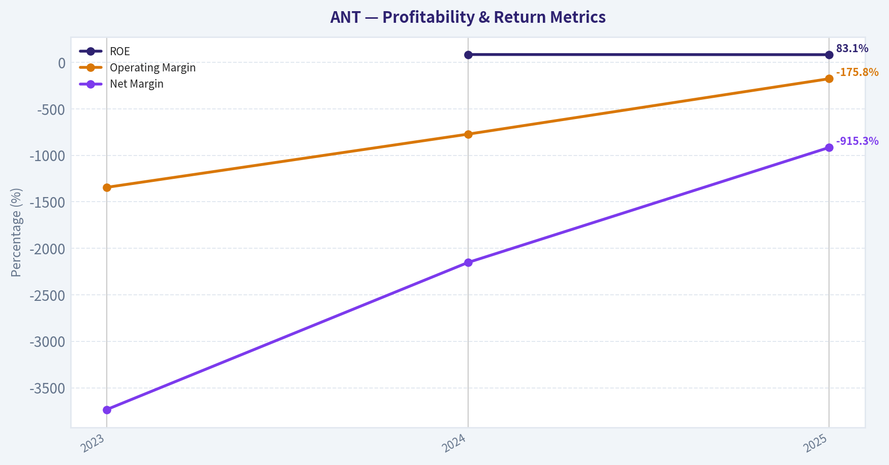
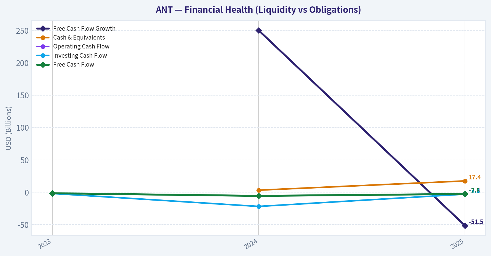
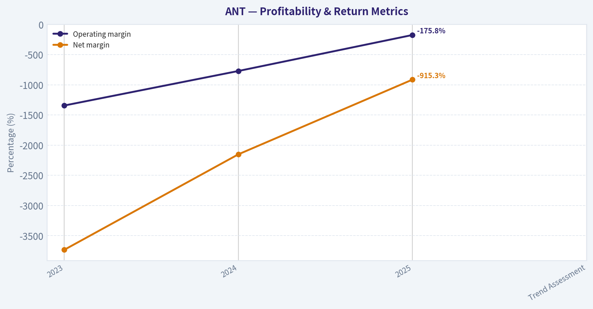
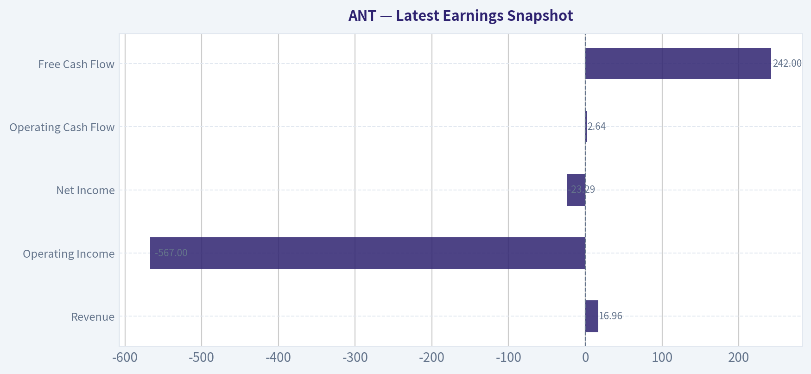
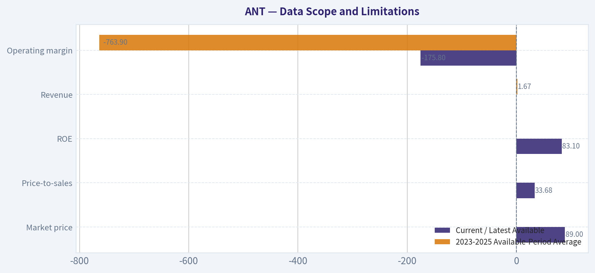
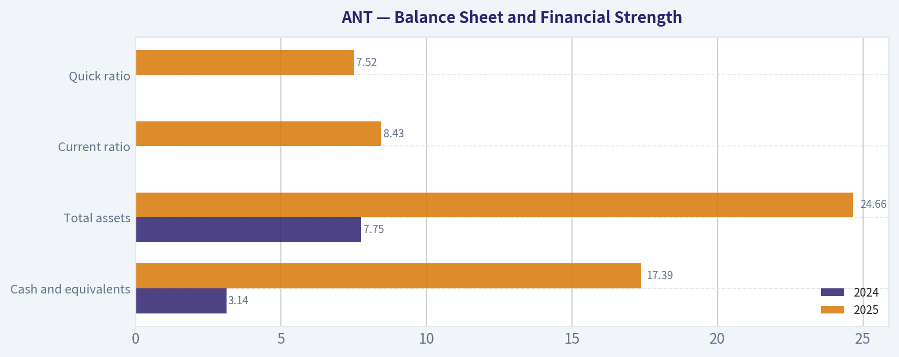
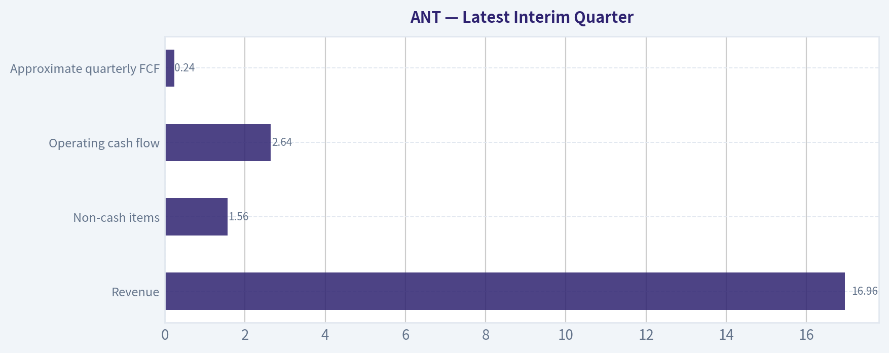
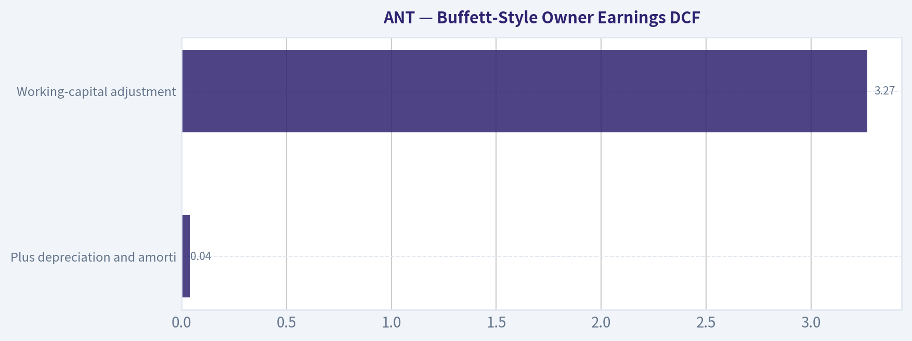

# ANT Deep Value Intelligence

**Analysis Date:** 2026-11-21

## Critical Disclaimer

*This analysis is generated by Deep Value Intelligence, an AI-powered multi-agent investing framework. Education & research only - not financial advice, not a financial advisor.*

---

## Table of Contents

1. Intelligence Summary
2. Analyst Team Reports
   - Fundamentals Analysis
   - Intrinsic Value Analysis (Buffett)
   - Trend & Growth Analysis (Lynch/Druckenmiller/Fisher)
   - Market Technical Analysis
   - Options Market Analysis
3. Research Team Commentary
4. Value Investing Team Commentary
5. Deep Values Commentary

---

## Intelligence Summary

### Thesis + Conditions

**Core Thesis:** Anthropic has credible franchise potential, but neither business quality nor per-share value is sufficiently demonstrated. Claude's enterprise relevance, research capabilities, and potential workflow switching costs support a plausible long-term moat.

**Key Risks:**
- The Risky Analyst correctly emphasizes that frontier AI cannot be assessed like a mature industrial company. Anthropic could become embedded across coding, customer service, knowledge management, and automation. Security approvals, workflow redesign, governance systems, prompt libraries, employee training, and output validation can create genuine switching friction.
- The analyst is also correct that scarce talent and technical leadership can be expensive capabilities rather than economic moats. If maintaining competitiveness requires continuously rising research and infrastructure spending, scale may become an obligation rather than a source of superior returns.
- The conservative case goes too far only if missing evidence is treated as proof of structural failure. The data establish uncertainty, not confirmed poor economics or permanent impairment.

**Confidence:** Low

---

## Analyst Team Reports

### Fundamentals Analysis

#### Latest Earnings Snapshot

*Most recent reported quarter anchored on 2026 Q3, with prior-year comparison when available.*

| Metric | 2026 Q3 | Prior-Year Quarter | YoY Change |
| --- | ---: | ---: | ---: |
| Revenue | $16.96B | N/A | N/A |
| Operating Income | $-567.0M | N/A | N/A |
| Net Income | $-23.29B | N/A | N/A |
| Diluted EPS | N/A | N/A | N/A |
| Operating Cash Flow | $2.64B | N/A | N/A |
| Free Cash Flow | $242.0M | N/A | N/A |

Key Takeaways: This snapshot anchors the most recent reported quarter before the narrative analysis. It helps readers separate long-run business quality from whatever changed in the latest earnings print.

#### 3-Year Financial Metrics for ANT

*All values below are computed deterministically from raw data - not estimated by AI.*

*Issuer profile: operating company (Technology / Software - Application).*

#### 3-Year Financial Metrics
*Annual rows come from reported financial statements. The final TTM row is computed from the latest four quarters.*

| Metric | 2023 | 2024 | 2025 |
| --- | --- | --- | --- |
| Market Price | N/A | N/A | N/A |
| Market Cap | N/A | N/A | N/A |
| P/E Ratio | N/A | N/A | N/A |
| P/B Ratio | N/A | N/A | N/A |
| ROE | N/A | 84.8% | 83.1% |
| ROIC | N/A | N/A | N/A |
| EPS | $-1.42 | $-5.43 | $-23.04 |
| Revenue | $41.0M | $386.0M | $4.58B |
| Gross Profit | N/A | N/A | N/A |
| Gross Margin | N/A | N/A | N/A |
| Operating Margin | -1343.9% | -772.0% | -175.8% |
| Net Income | $-1.53B | $-8.31B | $-41.97B |
| Net Margin | -3734.1% | -2152.6% | -915.3% |
| Revenue Growth | N/A | 841.5% | 1087.8% |
| Net Income Growth | N/A | 442.7% | 405.1% |
| Free Cash Flow Growth | N/A | 250.3% | -51.5% |
| Total Book Value | N/A | $-9.80B | $-50.51B |
| Total Assets | N/A | $7.75B | $24.66B |
| Total Debt | N/A | N/A | N/A |
| Debt-to-Equity | N/A | N/A | N/A |
| Cash & Equivalents | N/A | $3.14B | $17.39B |
| Shareholders' Equity | N/A | $-9.80B | $-50.51B |
| Operating Cash Flow | $-1.63B | $-5.69B | $-2.64B |
| Investing Cash Flow | $-2.0M | $-22.0M | $-3.08B |
| Free Cash Flow | $-1.63B | $-5.71B | $-2.77B |
| FCF Margin | -3973.2% | -1478.5% | -60.4% |
| Dividends / Share | $0.00 | $0.00 | $0.00 |

#### Profitability Metrics
- Return on Equity (ROE): 83.1%
- Return on Invested Capital (ROIC): N/A
- Return on Assets (ROA): -170.2%
- Gross Margin: N/A
- Operating Margin: -175.8%
- Net Profit Margin: -915.3%

#### Liquidity Metrics
- Current Ratio: 8.43
- Quick Ratio: 7.52

#### Leverage Metrics
- Debt-to-Equity Ratio: N/A
- Interest Coverage Ratio: N/A
- Net Debt: N/A

#### Growth Metrics (Year-over-Year)
- Revenue Growth: 1087.8%
- Net Income Growth: -405.1%
- Free Cash Flow Growth: 51.5%
- Revenue CAGR (3-Year): N/A
- Revenue CAGR (5-Year): N/A

#### Valuation Metrics
- P/E Ratio (TTM): N/A
- Forward P/E: 2452.69
- Price-to-Book: N/A
- Price-to-Sales: 33.68
- PEG Ratio: N/A
- EV/EBITDA: -92.57
- Free Cash Flow Yield: -0.2%
- Earnings Yield: N/A

#### Owner Earnings (Buffett Method, Code-Computed)
- Net Income: $-41.97B
- + Depreciation & Amortization: $40.0M
- - Capital Expenditures: $-131.0M
- + Working Capital (cash-flow statement; negative = cash tied up): $3.27B
- = **Owner Earnings: $-3.19B**

#### Interim Period Newer Than the Last Annual
- Quarter ended 2026-09-30 is newer than the last annual period (2025-12-31), but a trailing-twelve-month total cannot be built from the source (quarters available: 2026-09-30, 2025-12-31, 2025-09-30). Annual figures above are therefore stale; weigh this quarter explicitly.
- Revenue: $16.96B; Operating income: $-567.0M; Net income: $-23.29B (non-cash items $1.56B); Operating cash flow: $2.64B; Capex: $-2.40B

#### Intrinsic Value (DVI estimate - no DeepValues app value for this ticker)
- Current Price: $89
- Headline Intrinsic Value: N/A - owner earnings are negative, so a DCF has no positive base; no intrinsic value, model range or margin of safety is reported. Do not quote a per-share intrinsic value.

#### Piotroski F-Score: 4/9
- Positive Net Income: FAIL
- Positive Operating Cash Flow: FAIL
- ROA Improvement: FAIL
- Cash Flow > Net Income: PASS
- Decreasing Debt: PASS
- Improving Current Ratio: FAIL
- No Dilution: PASS
- Improving Gross Margin: FAIL
- Improving Asset Turnover: PASS

ANALYST STANCE: **Bearish**

#### Executive Summary

Anthropic, PBC is an early-stage application-software company with extraordinary reported revenue growth but deeply negative earnings and owner earnings. Revenue increased from $41 million in 2023 to $4.58 billion in 2025, while the latest reported quarter reached $16.96 billion. However, operating margins remained negative, shareholder equity was negative, and owner earnings were negative $3.19 billion.

The current market snapshot shows an $89 share price and approximately $1.19 trillion market capitalization. The deterministic dataset reports no positive intrinsic value because owner earnings are negative. Consequently, the evidence does not support the current valuation under a conventional Buffett-style cash-flow framework.

#### Data Scope and Limitations

The canonical dataset contains three annual years, not ten. Therefore, a true ten-year average cannot be calculated without inventing data. Comparisons below use the available 2023-2025 period, while explicitly identifying metrics with only two years of usable data. The newer September 2026 quarter is discussed separately because a complete TTM series cannot be constructed from the available filings.

| Metric | Current / Latest Available | 2023-2025 Available-Period Average | Interpretation |
|---|---:|---:|---|
| Market price | $89 | Not available | Current market snapshot only |
| Market capitalization | $1.19T | Not available | Extremely large relative to reported historical revenue |
| P/E ratio | N/A | N/A | Earnings are negative |
| Price-to-sales | 33.68x | Not available | Very high for a company without positive operating earnings |
| ROE | 83.1% | 83.95% for 2024-2025 | Distorted by deeply negative equity; not a normal quality signal |
| ROIC | N/A | N/A | Insufficient data |
| EPS | $(23.04) | $(9.96) | Loss per share widened materially |
| Revenue | $4.58B in 2025; $16.96B latest quarter | $1.67B | Exceptional growth, but historical base was very small |
| Operating margin | -175.8% | -763.9% | Improving, but still substantially negative |
| Net income | $(41.97)B | $(17.27)B | Losses expanded sharply |
| Net margin | -915.3% | Not meaningfully comparable | Severe accounting losses |
| Free cash flow | $(2.77)B | $(3.37)B | Negative cash generation |
| FCF margin | -60.4% | -1,837.4% | Improved from extreme early-stage cash burn, but remains negative |
| Cash and equivalents | $17.39B | $10.27B for 2024-2025 | Strong liquidity cushion |
| Total assets | $24.66B | $16.21B for 2024-2025 | Asset base expanded rapidly |
| Shareholders' equity | $(50.51)B | $(30.16)B for 2024-2025 | Negative equity is a major balance-sheet warning |
| Dividends per share | $0.00 | $0.00 | No shareholder distribution |

**Key Takeaways:** Revenue growth and liquidity are the strongest features, but they coexist with very large losses, negative free cash flow, and negative equity. The 83.1% ROE is not economically reassuring because the denominator is negative equity; it is heavily distorted rather than evidence of sustainable profitability. Valuation is difficult to justify using earnings or book value, leaving cash-flow-based valuation as the relevant test-and that test currently fails.

#### Market Metrics and Valuation

The current reported market price is $89 and market capitalization is approximately $1.19 trillion. The deterministic annual table has no historical market-price, market-capitalization, P/E, or P/B observations, so historical valuation averages cannot be calculated.

P/E is not meaningful because net income and EPS are negative. The forward P/E of 2,452.69x is technically reported but economically fragile because it depends on a very small or highly uncertain projected earnings base. Price-to-sales is approximately 33.68x, which represents a demanding valuation for a company that has not yet demonstrated positive operating margins or owner earnings.

P/B is unavailable and should not be treated as a generic cheapness indicator. The company is an asset-light software and intellectual-property business, and its reported shareholder equity is negative. For this issuer type, book value is not a reliable anchor; intrinsic value must instead be assessed through normalized cash generation.

#### Profitability and Growth

Revenue growth was 841.5% in 2024 and 1,087.8% in 2025. This is a remarkable expansion rate, but it reflects a very low starting base and should not be extrapolated indefinitely. The latest quarter's $16.96 billion of revenue indicates that commercial adoption may have accelerated beyond the 2025 annual run rate.

Profitability has not kept pace with revenue. Operating margin improved from -1,343.9% in 2023 to -175.8% in 2025, but remains deeply negative. Net income declined from a loss of $1.53 billion to a loss of $41.97 billion over the same period. The dataset's net-income growth rates are mechanically positive because the losses became much larger in absolute terms; they should not be interpreted as profit growth.

Free cash flow improved from negative $5.71 billion in 2024 to negative $2.77 billion in 2025, but remained negative. The latest quarter showed operating cash flow of $2.64 billion and capital expenditures of $2.40 billion, implying approximately $240 million of quarterly free cash flow before considering other adjustments. That is a meaningful improvement, but one quarter is insufficient to establish a durable trend.

| Growth and Profitability Indicator | 2023 | 2024 | 2025 | Trend Assessment |
|---|---:|---:|---:|---|
| Revenue growth | N/A | 841.5% | 1,087.8% | Explosive expansion from a small base |
| Net-income growth rate | N/A | 442.7% | 405.1% | Losses became much larger; not positive earnings growth |
| FCF growth rate | N/A | 250.3% | -51.5% | Cash burn improved in 2025, but remained negative |
| Operating margin | -1,343.9% | -772.0% | -175.8% | Strong improvement, still loss-making |
| Net margin | -3,734.1% | -2,152.6% | -915.3% | Improved mathematically, but still extremely negative |
| FCF margin | -3,973.2% | -1,478.5% | -60.4% | Major improvement, but not yet self-funding annually |

**Key Takeaways:** The company is scaling rapidly and margins are moving in the right direction, but the economic model has not yet crossed into proven profitability. The latest quarter is encouraging because operating cash flow was positive, yet nearly all of it was consumed by capital expenditures. The central investment question is therefore not whether revenue can grow, but whether revenue can eventually produce durable owner earnings after infrastructure, compute, research, and capital requirements.

#### Balance Sheet and Financial Strength

Cash and equivalents increased from $3.14 billion in 2024 to $17.39 billion in 2025. The current ratio of 8.43 and quick ratio of 7.52 indicate substantial short-term liquidity. These are meaningful strengths for a capital-intensive artificial-intelligence company.

However, total shareholder equity was negative $50.51 billion in 2025, compared with negative $9.80 billion in 2024. Total book value is therefore negative. Debt and debt-to-equity data are unavailable, so leverage cannot be fully assessed. The negative-equity position may reflect accumulated losses, financing arrangements, or other accounting effects, but regardless of cause it reduces the usefulness of traditional balance-sheet valuation measures.

| Balance-Sheet Indicator | 2024 | 2025 | Change / Significance |
|---|---:|---:|---|
| Cash and equivalents | $3.14B | $17.39B | Large liquidity expansion |
| Total assets | $7.75B | $24.66B | Asset base more than tripled |
| Total book value | $(9.80)B | $(50.51)B | Negative equity became substantially larger |
| Shareholders' equity | $(9.80)B | $(50.51)B | Major balance-sheet weakness |
| Current ratio | Not available | 8.43 | Strong reported current liquidity |
| Quick ratio | Not available | 7.52 | Strong liquid-asset coverage |
| Total debt | N/A | N/A | Cannot assess absolute debt from the dataset |
| Debt-to-equity | N/A | N/A | Not computable, especially with negative equity |

**Key Takeaways:** Liquidity is strong enough to provide substantial operating flexibility, but negative equity is a major warning sign and makes book-value analysis unusable. The absence of debt data also prevents a complete assessment of financial leverage. Cash strength reduces near-term solvency risk; it does not by itself establish economic value.

#### Latest Interim Quarter

The latest available quarter ended September 30, 2026, and is newer than the 2025 annual data. A complete TTM calculation is unavailable because the source does not provide four comparable quarters.

| Latest Interim Metric | September 30, 2026 |
|---|---:|
| Revenue | $16.96B |
| Operating income | $(567)M |
| Net income | $(23.29)B |
| Non-cash items | $1.56B |
| Operating cash flow | $2.64B |
| Capital expenditures | $(2.40)B |
| Approximate quarterly FCF | $0.24B |

**Key Takeaways:** Quarterly revenue appears dramatically higher than the 2025 annual base, demonstrating substantial commercial momentum. Operating losses narrowed to approximately $567 million, but net income remained deeply negative and capital expenditure absorbed most operating cash flow. This quarter improves the operating narrative but does not yet validate a stable, positive owner-earnings base.

#### Buffett-Style Owner Earnings DCF

The deterministic owner-earnings calculation is:

| Owner-Earnings Component | Amount |
|---|---:|
| Net income | $(41.97)B |
| Plus depreciation and amortization | $0.04B |
| Less capital expenditures | $(0.131)B |
| Working-capital adjustment | $3.27B |
| Calculated owner earnings | $(3.19)B |

**Key Takeaways:** Owner earnings are negative $3.19 billion, so the company does not currently provide a positive cash-flow base for a conventional Buffett-style intrinsic-value estimate. The working-capital adjustment improves the result, but not enough to overcome net losses and ongoing investment needs.

The DVI dataset explicitly reports no intrinsic value because owner earnings are negative. It also reports no reverse-DCF implied growth rate. Therefore, no per-share fair-value range or margin of safety can be responsibly quoted.

For transparency, a mechanical sensitivity exercise is shown below. It is not a valid fair-value estimate because it compounds a negative starting cash flow and produces negative terminal values. The assumptions use a 10% discount rate and a 2.5% terminal growth rate.

| Scenario | Illustrative Owner-Earnings Path | Mechanical Present Value | Interpretation |
|---|---|---:|---|
| Conservative | 3% annual growth for five years | Approximately $(45.5)B | Negative starting cash flow remains negative |
| Average | 20%, then fading to 8% by year five | Approximately $(74.8)B | Faster growth in losses produces a more negative mechanical value |
| Optimistic | 40%, 30%, 20%, 12%, then 8% | Approximately $(101.9)B | Growth cannot rescue a negative base in this formulation |

**Key Takeaways:** These outputs are diagnostic rather than fair values. They show why a positive intrinsic value cannot be calculated from the current owner-earnings base: applying growth to negative cash flow does not create economic value. A valid DCF would require a defensible transition to positive owner earnings, followed by assumptions about normalized margins, reinvestment, dilution, and terminal economics-none of which are established in the deterministic dataset.

#### Revenue Breakdown

The available data does not provide a product, segment, or geographic revenue split. The latest reported quarter provides only consolidated company revenue, so the table below presents the best available disclosure rather than inventing segment allocations.

| Revenue Source | Amount ($B) | % of Total |
|---|---:|---:|
| Consolidated Anthropic revenue, latest reported quarter | $16.96B | 100% |
| Product, segment, and geographic detail | Not disclosed in dataset | Not calculable |

**Key Takeaways:** The company's latest disclosed revenue base is $16.96 billion for the quarter, but the dataset does not identify how much came from individual products, geographies, or customer categories. This limits analysis of customer concentration, recurring revenue quality, and segment-level margins.

#### Economic Moat and Business Quality

Anthropic's potential moat is based on several factors:

- **Model capability and research expertise:** Advanced models can create meaningful switching costs when embedded in workflows, software tools, and enterprise processes.
- **Developer and enterprise adoption:** A growing ecosystem of users, developers, and integrations can reinforce distribution.
- **Data-center and compute access:** Access to large-scale computing resources may be a competitive advantage, although it also creates substantial capital requirements.
- **Brand, trust, and safety positioning:** Enterprise customers may value reliability, governance, and safety controls in addition to raw model performance.
- **Network and platform effects:** These may develop over time, but the dataset does not yet demonstrate that they are producing durable excess returns.

The principal weakness is that the moat has not yet been converted into positive owner earnings. High revenue growth alone does not establish a Buffett-quality business unless pricing power, retention, unit economics, and reinvestment returns eventually produce durable cash generation.

#### Predictable Earnings and Management Performance

Earnings are not predictable in the conventional sense. Net losses expanded sharply, ROIC is unavailable, operating margins remain negative, and FCF is negative on an annual basis. The Piotroski F-Score of 4 out of 9 reinforces the mixed financial condition: cash flow exceeded net income and the dataset records no dilution, but the company failed on positive net income, positive operating cash flow, ROA improvement, gross-margin improvement, and other profitability-related tests.

The reported ROE of 83.1% should not be used as evidence of superior management. Because equity is deeply negative, the ratio is distorted by the denominator. Management's strongest demonstrated achievement is revenue scaling and liquidity accumulation; its main unresolved challenge is converting that scale into positive returns on capital.

#### Risks, Opportunities, and Red Flags

| Category | Evidence | Significance |
|---|---|---|
| Opportunity | Revenue reached $16.96B in the latest quarter | Strong evidence of rapid commercial adoption |
| Opportunity | Cash increased to $17.39B | Provides substantial liquidity for development and infrastructure |
| Opportunity | Operating margin improved from -1,343.9% to -175.8% | Indicates operating leverage may be emerging |
| Risk | Owner earnings of $(3.19)B | No positive DCF base exists |
| Risk | Shareholders' equity of $(50.51)B | Book value is unusable and financial resilience is harder to assess |
| Risk | $2.40B quarterly capital expenditure | Infrastructure intensity may consume future cash generation |
| Risk | Net income of $(23.29)B in the latest quarter | Revenue growth has not yet translated into accounting profitability |
| Risk | Market capitalization of $1.19T | Valuation assumes substantial future success despite current losses |
| Risk | No complete TTM dataset | Current financial performance cannot be fully annualized from the supplied records |
| Risk | No disclosed revenue segmentation in dataset | Customer concentration and revenue quality cannot be independently assessed |

**Key Takeaways:** The opportunity is a potentially dominant AI platform with exceptional demand and improving operating economics. The red flags are more fundamental: negative owner earnings, negative equity, extreme valuation relative to current sales, high infrastructure spending, and limited evidence of normalized margins. The valuation depends on a successful future transition that is not yet demonstrated by the historical cash-flow record.

#### Valuation Stance

**Bearish - valuation evidence is insufficient and currently unfavorable.**

This stance reflects valuation and fundamental evidence, not a trading instruction. The company may possess substantial long-term strategic potential, but the current data does not support a positive Buffett-style intrinsic value. At approximately $1.19 trillion of market capitalization, the valuation requires very large and durable future owner earnings, while the latest annual owner-earnings base is negative $3.19 billion.

The most important future evidence would be sustained positive free cash flow, operating margins approaching durable profitability, reduced capital intensity, stable or improving cash conversion, and a credible path to positive return on invested capital. Until those conditions are established, revenue growth alone is not sufficient to justify the valuation under a conservative value-investing framework.

| Final Assessment Area | Judgment |
|---|---|
| Revenue growth | Exceptional |
| Profitability | Extremely weak but improving operationally |
| Free cash flow | Negative annually; latest quarter approximately positive before further adjustments |
| Balance-sheet liquidity | Strong |
| Balance-sheet quality | Weak because equity is deeply negative |
| Earnings predictability | Not established |
| Economic moat | Potentially substantial, but not yet financially proven |
| Valuation | Highly demanding relative to current cash generation |
| Intrinsic value | Not available from the canonical DVI framework |
| Overall stance | **Bearish** |

**Key Takeaways:** Anthropic combines extraordinary growth with unproven profitability and a valuation that requires exceptional future execution. Strong cash reserves and improving margins are genuine positives, but they do not offset the absence of positive owner earnings and the extreme market capitalization. The evidence therefore supports an **Bearish** valuation stance under Buffett's cash-flow-focused methodology.

#### Fundamental Visuals

This graph tracks the profitability and return metrics (ROE, ROIC, Margins) of **ANT** over the past decade, highlighting capital efficiency trends.

This chart illustrates the financial health of **ANT** over the last 10 years, mapping cash equivalents and free cash flow against total obligations (Debt).

This graph tracks the profitability and return metrics (ROE, ROIC, Margins) of **ANT** over the past decade, highlighting capital efficiency trends.

---

### Intrinsic Value Analysis (Buffett)

> *Following Warren Buffett's value investing philosophy: Circle of Competence, Economic Moat, Management Quality, and Margin of Safety.*

#### Intrinsic Value Snapshot

Price is what you pay. Intrinsic value is what the business may be worth based on the cash it can create for owners over time. We show a range, not one magic number.

- Current Price: $88.91
- Value Range (conservative to optimistic across both DCF methods): N/A to N/A

##### Owner Earnings (Buffett Method)
- Net Income: $-41,965,000,000.00
- Depreciation & Amortization: $40,000,000.00
- Capital Expenditures: $-131,000,000.00
- Working Capital Changes: $3,270,000,000.00
- Owner Earnings: $-3,188,400,000.00

##### Intrinsic Value

ANALYST STANCE: **Bearish**

#### Executive View

Anthropic is a strategically important artificial-intelligence company with exceptional reported growth, but the available financial evidence does not support a $1.19 trillion valuation. Owner earnings are negative, free-cash-flow yield is approximately negative 0.2%, and no positive intrinsic value can be calculated from current earnings. The business may ultimately develop a powerful technology moat, but the valuation currently depends on highly optimistic assumptions about future profitability, capital intensity, and competitive durability.

#### 1. Factor Scorecard

| Factor | Score | Assessment |
|---|---:|---|
| Circle of competence and simplicity | 3/5 | The basic model-selling AI models and related services-is understandable, but long-term economics remain difficult to predict because technology, pricing, competition, and infrastructure requirements are changing rapidly. |
| Moat | 3/5 | Claude, model quality, developer adoption, enterprise integration, and accumulated training capability may create switching costs and ecosystem advantages. Durability is not yet demonstrated through sustained margins or cash generation. |
| Management and capital allocation | 3/5 | Anthropic has attracted substantial strategic and financial backing, but the available evidence does not establish a long public record of owner-oriented capital allocation, disciplined acquisitions, or shareholder distributions. |
| Industry structure | 2/5 | AI has strong scale economics but also intense competition, rapid technological change, enormous infrastructure demands, and potentially significant pricing pressure. |

**Gate 5 hard floor:** **Not tripped.** The company has negative owner earnings, but the available data does not show both a clearly worsening earnings trajectory and a solvency red line such as interest coverage below 1x or distress-level solvency.

#### 2. Financial Summary

| Metric | Latest reported value |
|---|---:|
| Current price | $89 |
| Market capitalization | $1.19 trillion |
| Revenue growth, year over year | 1,087.8% |
| P/E ratio | N/A |
| ROE | 83.1% |
| FCF yield | -0.2% |
| Current ratio | 8.43 |
| Gross margin | N/A |
| Owner earnings | Negative |
| Intrinsic value | N/A |

**Key Takeaways:** Revenue growth is extraordinary, but the company has not yet converted that growth into positive owner earnings or free cash flow. The very high reported ROE should be treated cautiously because it may reflect a small or unusual equity base rather than mature, repeatable economics. The strong current ratio indicates substantial short-term liquidity, but liquidity alone does not justify the valuation.

#### 3. Moat Analysis

Anthropic's potential competitive advantages include:

- **Intangible assets:** Claude's model capabilities, brand, research talent, and accumulated model-development expertise.
- **Switching costs:** Enterprise customers may embed AI into workflows, software development, customer service, and internal knowledge systems.
- **Scale advantages:** Training and operating frontier models require substantial computing resources, technical talent, and capital.
- **Network and ecosystem effects:** Developer tools, application integrations, usage data, and enterprise adoption could reinforce the platform over time.

The principal concern is that these advantages remain economically unproven. A durable moat should eventually appear through sustained gross margins, operating margins, retention, pricing power, and returns on invested capital. Those measures are not yet established in the available financial evidence. The moat rating is therefore **narrow-to-potentially-wide, but unproven: 3/5**.

#### 4. Management Quality Assessment

Anthropic's institutional backing and focus on frontier AI research suggest strong technical ambition and access to capital. However, a Buffett-style assessment requires evidence that management can convert technical leadership into durable per-share owner earnings.

The available information does not demonstrate:

- A long history of disciplined capital allocation.
- Proven acquisition economics.
- Sustained positive free cash flow.
- A demonstrated policy of avoiding dilution or excessive capital consumption.
- A multi-cycle record of candid shareholder communication.

Management quality is therefore scored **3/5**, reflecting significant potential but limited evidence of mature public-company stewardship.

#### 5. Owner Earnings Calculation

| Owner-earnings component | Assessment |
|---|---|
| Net income | Not provided as a positive base |
| Depreciation and amortization | Not provided |
| Maintenance capital expenditure | Not provided |
| Working-capital investment | Not provided |
| Owner earnings | Negative |
| Free-cash-flow cross-check | FCF yield approximately -0.2% |

**Key Takeaways:** The owner-earnings framework cannot produce a positive valuation base because current owner earnings are negative. In an AI infrastructure business, distinguishing maintenance capital expenditure from growth capital expenditure is especially important, but the available figures do not support that separation.

#### 6. Three-Scenario DCF Valuation

| Scenario | Result |
|---|---|
| Scenario A: No growth | Not meaningful because owner earnings are negative |
| Scenario B: 3% growth | Not meaningful because owner earnings are negative |
| Scenario C: Historical growth | Not meaningful because historical growth cannot offset a negative current owner-earnings base without explicit profitability assumptions |
| DeepValues intrinsic value | N/A |

**Key Takeaways:** No positive intrinsic value can be quoted from the supplied research pack. A conventional DCF would require explicit assumptions for the timing of profitability, sustainable margins, capital intensity, dilution, and terminal growth; those assumptions would dominate the result rather than merely refine it.

#### 7. Margin of Safety Analysis

| Valuation measure | Result |
|---|---:|
| Market capitalization | $1.19 trillion |
| Intrinsic value | N/A |
| Margin of safety versus intrinsic value | N/A |
| FCF yield | -0.2% |

**Key Takeaways:** A numerical margin of safety cannot be established because the company has negative owner earnings and no positive app-derived intrinsic value. At $1.19 trillion, the valuation appears to require exceptional long-term growth and eventual economics that are not yet demonstrated in reported cash flows.

#### 8. Final Buffett Scorecard

| Criterion | Weight | Score |
|---|---:|---:|
| Moat width and durability | 25% | 3.0 |
| Valuation and margin of safety | 20% | 1.0 |
| Capital returns versus WACC | 15% | 1.5 |
| Business understanding and predictability | 12% | 3.0 |
| Management quality and capital allocation | 12% | 3.0 |
| Reinvestment runway | 8% | 4.0 |
| Balance-sheet strength | 4% | 4.0 |
| Industry structure | 4% | 2.0 |
| **Weighted total** | **100%** | **2.4/5.0** |

**Key Takeaways:** Anthropic scores well on potential reinvestment runway and liquidity, but those strengths are outweighed by negative owner earnings, unproven capital returns, uncertain industry economics, and an unsupported valuation. The weighted score falls below the threshold for a compelling Buffett-style investment.

#### 9. Investment Stance

**Bearish - Low-to-moderate conviction on business quality, high conviction that the valuation is not supported by present financial evidence.**

Anthropic could become a major AI platform with a durable moat. Nevertheless, the evidence currently describes a high-potential, capital-intensive technology company rather than a proven compounding machine. At a $1.19 trillion market capitalization, the valuation requires a successful outcome across technology leadership, customer retention, pricing power, operating leverage, capital efficiency, and competitive durability. That combination is possible, but it is not yet demonstrated by positive owner earnings or a calculable intrinsic value.

#### Valuation Visuals

This comparison chart from *Latest Earnings Snapshot* stacks current figures against historical benchmarks for **ANT**, making it easy to see where the company trades relative to its own averages.

This comparison chart from *Data Scope and Limitations* stacks current figures against historical benchmarks for **ANT**, making it easy to see where the company trades relative to its own averages.

This comparison chart from *Balance Sheet and Financial Strength* stacks current figures against historical benchmarks for **ANT**, making it easy to see where the company trades relative to its own averages.

This comparison chart from *Latest Interim Quarter* stacks current figures against historical benchmarks for **ANT**, making it easy to see where the company trades relative to its own averages.

This comparison chart from *Buffett-Style Owner Earnings DCF* stacks current figures against historical benchmarks for **ANT**, making it easy to see where the company trades relative to its own averages.

---

### Trend & Growth Analysis (Lynch/Druckenmiller/Fisher)

> *Following Peter Lynch's GARP, Stanley Druckenmiller's macro-aware approach, and Philip Fisher's scuttlebutt methodology.*

ANALYST STANCE: **Neutral**

#### 1. Lynch Classification

**Fast Grower, with unusually high execution and valuation risk.** Anthropic is reporting extraordinary growth, but the current evidence base is too short and the company remains unprofitable on an owner-earnings basis.

| Metric | Latest data | Interpretation |
|---|---:|---|
| Current price | $89 | Price data supplied for Nasdaq-listed ANT |
| Market capitalization | $1.19 trillion | Extremely large starting valuation |
| Year-over-year revenue growth | 1,087.8% | Hypergrowth, but likely from a small prior base |
| P/E | N/A | Earnings are not yet a useful valuation anchor |
| FCF yield | -0.2% | Slightly negative free cash flow |
| Current ratio | 8.43 | Strong reported liquidity |
| ROE | 83.1% | Potentially distorted by capital structure or unusual accounting effects |
| Intrinsic value | N/A | Owner earnings are negative; no positive-base DCF is available |

**Key Takeaways:** Anthropic clearly fits the fast-grower category based on reported revenue growth. However, the $1.19 trillion valuation, lack of earnings, and negative owner earnings make conventional valuation methods unreliable. The principal question is whether current hypergrowth can persist long enough to justify an exceptionally large enterprise value.

#### 2. The Story in Three Bullets

- Anthropic develops frontier artificial-intelligence models, including Claude, for enterprise, developer, and consumer use cases.
- The company participates directly in the secular AI infrastructure and software adoption cycle, where model usage can expand across coding, customer service, knowledge work, and automation.
- The potential growth engine is a combination of rising AI workloads, enterprise adoption, model improvement, and expanded distribution through technology partnerships.

The story is easy to explain, but the long-term outcome depends on pricing, inference costs, model differentiation, and competition from OpenAI, Google, Meta, Microsoft, and open-source systems.

#### 3. TAM and the 10x Test

| Scenario | Revenue reference | 10x revenue implication | Runway assessment |
|---|---:|---:|---|
| Reported current growth base | Not supplied | Cannot calculate reliably | Historical base is unclear |
| Analyst FY2027 revenue estimate | $127 billion | $1.27 trillion | Requires a very large and expanding AI software market |
| Current market capitalization | $1.19 trillion | Not a revenue figure | Valuation already embeds major future success |
| Mature-market question | Not measurable from supplied data | Company would need substantial global AI share | Long runway exists conceptually, but share and economics are unproven |

**Key Takeaways:** The 10x test cannot be completed precisely because audited current revenue and a defensible TAM estimate were not supplied. Using the reported $127 billion FY2027 estimate, 10x revenue would equal $1.27 trillion, which is plausible only if AI software and services become a multi-trillion-dollar market. The runway is potentially enormous, but the valuation already discounts a significant portion of that opportunity.

#### 4. Revenue Growth Trend

| Indicator | Evidence | Assessment |
|---|---|---|
| Reported year-over-year growth | 1,087.8% | Exceptional acceleration from a likely small base |
| FY2027 revenue expectation | $127 billion, according to cited coverage | Implies continued very rapid expansion |
| Growth sequence | Insufficient quarterly history | Acceleration cannot be confirmed |
| Revenue quality | Detailed organic, usage, contract, and customer data unavailable | Requires verification |
| Customer concentration | Not supplied | Unknown risk |

**Key Takeaways:** The available data show hypergrowth, but not enough sequential history to determine whether growth is accelerating, stabilizing, or beginning to decelerate. The most important missing evidence is recurring revenue composition, customer concentration, usage retention, and the proportion of growth generated organically rather than through large strategic contracts.

#### 5. Unit Economics and Operating Efficiency

| Metric | Available result | Interpretation |
|---|---:|---|
| LTV/CAC | Not disclosed | Cannot assess customer acquisition efficiency |
| Net revenue retention | Not disclosed | Cannot assess expansion or churn |
| Rule of 40 | Not calculable | Revenue growth is available, but FCF margin data are insufficient |
| FCF yield | -0.2% | Cash generation is not yet established |
| Gross margin | Not available | Critical because AI inference costs can be substantial |
| Liquidity | Current ratio of 8.43 | Provides financial flexibility, subject to balance-sheet verification |

**Key Takeaways:** Anthropic's unit economics are presently unproven from the supplied data. For an AI model company, gross margin, inference cost per token, customer retention, utilization, and pricing power are more informative than headline revenue growth alone. Strong liquidity reduces near-term financing pressure, but it does not establish a durable path to free-cash-flow generation.

#### 6. Inflection Point Assessment

| Potential inflection | Evidence | Status |
|---|---|---|
| Product cycle | Claude and AI coding applications are expanding | Positive, but not quantified |
| TAM expansion | Enterprise AI adoption remains a major secular trend | Positive |
| Market share | No reliable share data supplied | Unconfirmed |
| Margin inflection | Gross margin unavailable; FCF slightly negative | Unconfirmed |
| Distribution | Strategic technology partnerships are a potential advantage | Positive, but economics unclear |
| Competitive inflection | AI competition and recent sector selloff create uncertainty | Mixed |

**Key Takeaways:** The strongest identifiable inflection is product and market adoption rather than profitability. A true earnings inflection would require evidence that revenue is scaling faster than compute, infrastructure, sales, and research costs. Until gross-margin and cash-flow trends are available, the inflection thesis remains promising but incomplete.

#### 7. Macro Setup

| Macro factor | Assessment | Effect |
|---|---|---|
| AI secular trend | Very strong | Structural tailwind |
| Enterprise technology spending | Supportive, but economically sensitive | Moderate tailwind |
| Interest rates | Current direction not supplied | Uncertain valuation impact |
| AI-sector sentiment | Recent reported Nasdaq and Nvidia selloff | Near-term headwind |
| Competitive intensity | Extremely high | Persistent pressure on pricing and margins |

**Key Takeaways:** The secular macro backdrop is favorable because AI adoption remains one of the strongest technology themes of the decade. However, the company is exposed to high-duration valuation risk, capital-spending cycles, and rapid competitive change. Recent AI-sector volatility shows that favorable secular growth does not prevent sharp changes in market expectations.

#### 8. Fisher 15-Point Assessment

| Fisher criterion | Score / 5 | Rationale |
|---|---:|---|
| Market potential | 5 | AI applications have very large potential |
| New-product determination | 5 | Frontier-model development requires continuous innovation |
| R&D effectiveness | 4 | Strong apparent product traction; economics not yet proven |
| Sales organization | 3 | Enterprise distribution evidence is incomplete |
| Current profit margins | 2 | Owner earnings are negative |
| Margin trend | 2 | Insufficient evidence of improvement |
| Labor and personnel relations | 3 | Limited public evidence |
| Executive relations | 3 | Limited public evidence |
| Management depth | 4 | Significant technical and commercial organization implied |
| Cost analysis and accounting | 2 | Detailed operating-cost data unavailable |
| Outstanding competitive aspects | 4 | Model quality, ecosystem, and possible switching benefits |
| Long-range profit outlook | 4 | Large opportunity, but uncertain cost structure |
| Dilution risk | 3 | Large capital requirements create potential dilution risk |
| Management candor | 3 | Not enough reporting history |
| Management integrity | 3 | No sufficient basis for a stronger or weaker score |

**Total: 50 / 75 - Average, with substantial uncertainty.**

**Key Takeaways:** Fisher's framework gives Anthropic a strong product and market-potential profile, but weaker marks for profitability, cost transparency, dilution risk, and limited public history. The score is not a judgment on technical quality; it reflects the lack of evidence needed to validate durable economics.

#### 9. Valuation Analysis

| Method | Result | Interpretation |
|---|---:|---|
| P/E | N/A | Not applicable while earnings are unavailable |
| PEG | N/A | Cannot calculate without meaningful earnings and a reliable growth rate |
| Current market cap / FY2027 revenue estimate | Approximately 9.4x | Based on $1.19 trillion divided by $127 billion |
| Price-to-sales | Approximately 9.4x using FY2027 estimate | Requires sustained growth and eventual margin credibility |
| DCF | Not available | Owner earnings are negative |
| Intrinsic value per share | Not available | No valid positive-base model supplied |

**Key Takeaways:** The approximate 9.4-times forward-sales figure appears demanding but is not automatically excessive for a durable hypergrowth platform. The valuation requires continued exceptional revenue growth, improving gross margins, and eventual positive free cash flow. Because the $127 billion revenue figure is an external estimate rather than audited company guidance in the supplied material, the multiple should be treated as illustrative rather than definitive.

#### 10. Scenario Valuation Framework

| Scenario | Operating assumptions | Valuation implication |
|---|---|---|
| Bear | Growth decelerates sharply; inference costs remain high; competition compresses pricing | Current valuation would face substantial pressure |
| Base | Revenue remains very high-growth for several years; margins gradually improve | Valuation could be supportable, but only with strong execution |
| Bull | Anthropic becomes a leading enterprise AI platform; revenue compounds rapidly; operating leverage emerges | Large long-term value creation is possible |
| Failure case | AI usage monetizes poorly or capital intensity remains structurally high | High revenue would not necessarily translate into equity value |

**Key Takeaways:** The valuation is highly asymmetric because revenue growth alone is insufficient; cash conversion determines the eventual outcome. The bull case requires leadership in a large market plus meaningful operating leverage. The bear case does not require demand to disappear-mere deceleration, commoditization, or persistently high compute costs could materially weaken valuation support.

#### 11. Growth Investor Scorecard

| Criterion | Weight | Score / 5 | Weighted contribution |
|---|---:|---:|---:|
| The story | 10% | 4.5 | 0.45 |
| TAM and runway | 20% | 5.0 | 1.00 |
| Revenue growth | 20% | 5.0 | 1.00 |
| Unit economics | 15% | 2.0 | 0.30 |
| Competitive position | 10% | 4.0 | 0.40 |
| Management quality | 10% | 3.5 | 0.35 |
| Macro setup | 5% | 4.0 | 0.20 |
| Profitability path | 5% | 2.5 | 0.13 |
| Valuation | 5% | 2.0 | 0.10 |
| **Total** | **100%** | - | **3.93 / 5.00** |

**Key Takeaways:** Anthropic scores strongly on story, TAM, and reported growth, but the overall score is reduced by unproven unit economics, uncertain profitability, and a demanding valuation. A 3.93 score would ordinarily qualify as a strong growth setup, but the unusually high uncertainty warrants a Neutral stance rather than an unequivocal advocate classification.

#### 12. Key Catalysts and Risks

| Catalysts | Risks |
|---|---|
| Sustained enterprise adoption of Claude | Revenue growth deceleration after a very high base |
| Strong expansion in AI coding and agent applications | Compute and inference costs remaining structurally high |
| Gross-margin improvement | Model commoditization and open-source competition |
| Rising net revenue retention | Dependence on a small number of large customers or partners |
| Positive free-cash-flow inflection | Future capital requirements and dilution |
| Clear evidence of durable market share | AI-sector valuation compression |
| Successful expansion beyond a single flagship product | Regulatory, copyright, safety, and cybersecurity constraints |

**Key Takeaways:** The highest-value catalyst would be proof that revenue growth is translating into improving gross margins and free cash flow. The central risk is not simply slower AI adoption; it is that intense competition and infrastructure costs prevent Anthropic from converting exceptional demand into durable shareholder economics.

#### Bottom Line

Anthropic is a **high-potential fast grower** at a potentially important AI inflection point. Its reported growth and addressable market are extraordinary, but audited operating history, customer economics, gross margins, and cash-flow visibility are insufficient to validate a $1.19 trillion valuation. The evidence supports close monitoring of revenue durability, retention, inference economics, margin progression, and dilution before the valuation can be characterized as robustly supported.

---

### Market Technical Analysis

ANALYST STANCE: **Neutral**

#### Scope and data quality

This report analyzes **ANT, Anthropic, PBC, SEC CIK 0002130357**, using the supplied Nasdaq ticker only. The retrieved Yahoo Finance history contains just **two trading sessions**, November 19 and November 20, 2026. Because the historical series is far too short, most conventional indicators-including the 50-day SMA, 200-day SMA, MACD, RSI, ATR, and VWMA-should be treated as preliminary calculations rather than established signals.

The limited dataset does not provide enough evidence for a reliable trend, valuation, or market-regime conclusion. The technical evidence therefore supports a **Neutral** stance reflecting data insufficiency and unusually high short-term volatility, rather than a directional judgment about Anthropic's underlying business value.

#### Price action and trading activity

| Date | Open | High | Low | Close | Intraday range | Volume | Daily close change |
|---|---:|---:|---:|---:|---:|---:|---:|
| 2026-11-19 | $111.50 | $115.10 | $92.72 | $97.17 | $22.38 | 857.3 million | - |
| 2026-11-20 | $89.86 | $92.56 | $83.05 | $88.91 | $9.51 | 399.6 million | -8.5% |

**Key Takeaways:** ANT experienced a sharp two-session decline, with the closing price falling from $97.17 to $88.91. The November 19 session had an exceptionally wide range and very heavy volume, while November 20 opened materially below the prior close and finished lower, indicating continued near-term pressure despite a partial recovery from its intraday low.

The November 19 session closed only about $4.45 above its low, equivalent to roughly 20% of that day's range. That pattern indicates sellers controlled most of the session after the high near $115. On November 20, the close was approximately $5.86 above the low, or about 62% of the daily range, showing some intraday recovery; however, the recovery did not offset the large opening gap lower.

Volume declined approximately 53% from November 19 to November 20, but it remained substantial in absolute terms. Given the absence of earlier observations, it is not possible to determine whether the first session represented an isolated listing-related event, a news reaction, or the beginning of a broader distribution pattern.

#### Trend indicators

| Indicator | 2026-11-19 | 2026-11-20 | Interpretation |
|---|---:|---:|---|
| 10-day EMA | $97.17 | $92.63 | Price closed below the short-term EMA on November 20 |
| 50-day SMA | $97.17 | $93.04 | Not statistically meaningful with only two available sessions |
| 200-day SMA | $97.17 | $93.04 | Not statistically meaningful with only two available sessions |
| VWMA | $101.66 | $97.37 | Volume-weighted reference remained above the latest close |

**Key Takeaways:** The latest close of $88.91 was below every reported moving-average and volume-weighted reference, which is directionally weak. However, the reported 50-day and 200-day averages are effectively based on the same minimal dataset, so they cannot confirm a durable medium- or long-term trend.

The 10-day EMA fell from $97.17 to $92.63 as the second session's lower close entered the calculation. That decline is consistent with immediate downside momentum, but it is not yet a reliable estimate of a multi-week trend. The VWMA remained above the latest close, suggesting that the prices associated with the available trading volume were higher than the final traded level.

#### Momentum and volatility

| Indicator | Latest reported value | Signal description | Reliability |
|---|---:|---|---|
| MACD | -0.1853 | Slightly negative momentum reading | Very low; insufficient history |
| MACD Signal | -0.1030 | Signal line also negative | Very low; insufficient history |
| RSI | 0.0 | Extreme downside reading | Invalid or highly distorted by the one-session decline |
| ATR | $18.10 | Very high absolute volatility relative to the $88.91 close | More informative, but still based on minimal history |

**Key Takeaways:** MACD and its signal line both turned slightly negative, providing limited confirmation of short-term downside momentum. The RSI reading of zero should not be interpreted as a dependable oversold signal because it appears to result from only one observed declining interval. ATR near $18.10 represents roughly 20% of the latest closing price, underscoring exceptionally wide expected price movement, although its reliability is also constrained by the short sample.

The relationship between the indicators is important. Price weakness is accompanied by negative MACD and a close below the short-term averages, but the apparent RSI extreme is not independently confirmatory. In other words, the data show acceleration and instability rather than a well-established reversal setup.

#### Overall assessment

ANT's available price history shows three immediate characteristics:

1. **A sharp downside adjustment:** The close declined 8.5% in one session following an already highly volatile first trading day.
2. **Weak short-term technical structure:** The latest close was below the 10-day EMA, both reported longer moving averages, and the VWMA.
3. **Insufficient history for durable conclusions:** The indicator output is dominated by the fact that only two sessions are available. The 50-day and 200-day calculations cannot yet perform their intended trend-confirmation functions, and the RSI is especially distorted.

The evidence therefore indicates **short-term technical weakness with unusually high volatility**, but it does not establish a reliable medium- or long-term trend. It also does not provide fundamental valuation inputs such as revenue, margins, cash flows, capitalization, dilution, or comparable-company multiples. Consequently, the available evidence is insufficient to support a valuation conclusion for Anthropic beyond recognizing that the quoted market price is currently subject to substantial uncertainty and wide price dispersion.

| Area | Evidence | Assessment | Confidence |
|---|---|---|---|
| Price trend | Close declined from $97.17 to $88.91 | Short-term downside pressure | Moderate |
| Intraday behavior | Wide ranges, especially $22.38 on November 19 | Exceptional volatility and uncertain price discovery | Moderate |
| Volume | 857.3 million followed by 399.6 million shares | Heavy activity, but no long-run benchmark | Low to moderate |
| Short-term trend | Close below $92.63 10-day EMA | Immediate momentum is weak | Low to moderate |
| Medium- and long-term trend | 50-day and 200-day values rely on minimal data | No valid trend confirmation | Very low |
| Momentum | MACD and signal line slightly negative | Limited downside confirmation | Low |
| Reversal evidence | RSI at 0.0 | Distorted by insufficient observations | Very low |
| Volatility | ATR of $18.10, about 20% of latest close | Risk and uncertainty are unusually elevated | Moderate |
| Valuation implication | No fundamental or comparable-company data supplied | Valuation cannot be assessed reliably from this dataset | Very low |

**Key Takeaways:** The strongest conclusion is that ANT displayed weak near-term price momentum alongside unusually high volatility. The historical sample is too short for the longer-term indicators and too sparse for a dependable valuation assessment, so the evidence supports continued monitoring of data quality and trend development rather than a firm directional or valuation conclusion.

---

### Options Market Analysis

> *Reading options flow - put/call ratios, IV skew, and unusual activity - to gauge institutional positioning and event-driven risk.*

ANALYST STANCE: **Neutral**

#### Options Data Availability

No options market data was available for ticker **ANT** from the requested source as of **November 21, 2026**. Consequently, the following metrics cannot be calculated reliably:

| Metric | Result | Interpretation |
|---|---:|---|
| Put/call open-interest ratio | Unavailable | No conclusion on hedging or directional positioning |
| Put/call volume ratio | Unavailable | No conclusion on current options-flow bias |
| Near-term ATM call IV | Unavailable | Implied volatility cannot be assessed |
| Near-term ATM put IV | Unavailable | Implied volatility cannot be assessed |
| OTM put/call skew | Unavailable | Downside-versus-upside demand cannot be compared |
| Unusual activity | Unavailable | No contracts identified with volume materially above open interest |
| OI concentration and gamma walls | Unavailable | No strike-based pinning or support/resistance inference |

**Key Takeaways:** The data source returned no options chain for ANT, so there is no empirical basis for assessing options sentiment, volatility, unusual activity, or open-interest concentration. This may reflect an incorrect or incomplete ticker, a non-listed security, or a lack of listed options.

#### Overall Options Signal

**Signal: Neutral - insufficient data**

There is no defensible bullish, neutral, or bearish options signal because the underlying options dataset is unavailable. Confidence is therefore **very low**, and no conclusion about institutional positioning or forward-looking market expectations can be drawn from options activity.

| Summary Category | Assessment |
|---|---|
| Put/call ratio | Unavailable |
| IV level | Unavailable |
| Skew direction | Unavailable |
| Unusual activity | None identifiable from the unavailable dataset |
| Overall signal | **Neutral: insufficient data** |

**Key Takeaways:** ANT cannot currently be evaluated through the requested options-flow framework. Verification of the exchange-listed ticker or company identifier would be required before interpreting sentiment.

---

## Research Team Commentary

> *The Research Manager synthesizes the Bull vs Bear debate into action-free commentary. This is a pre-risk view, not the final stance.*

Core takeaway: Anthropic may develop into a high-quality AI platform, but the evidence currently supports a Neutral stance rather than Bullish or Bearish. Claude's technology, enterprise relevance, and potential workflow switching costs create a credible long-term franchise thesis. Yet neither the moat nor the per-share valuation is demonstrable from the supplied data. A price of $88.91 is analytically meaningless without fully diluted shares, net cash or debt, financing terms, and expected dilution. No DeepValues intrinsic-value estimate is available, so there is no established margin of safety.

The strongest bull argument is that Anthropic could become embedded AI infrastructure rather than remain a replaceable model vendor. Enterprises integrating Claude into coding, customer service, knowledge systems, and automation may incur meaningful switching costs through application redesign, security approvals, monitoring systems, and employee workflows. Frontier research expertise, scarce technical talent, compute scale, and accumulated evaluation know-how also create legitimate barriers to entry. The reported 1,087.8% revenue growth, while likely inflated by a small base, at least indicates substantial demand and a potentially long reinvestment runway.

If Anthropic can convert that demand into durable enterprise relationships while lowering inference cost per useful task, the economics could improve dramatically. The business could benefit from rising usage, premium enterprise products, model efficiency, and operating leverage in research and platform expenses. This is the most credible path to a Buffett-compatible modern compounder: valuable intellectual property, recurring usage, deep customer integration, and years of high-return reinvestment.

The strongest bear argument is that technological importance does not establish shareholder value. Model customers can multi-home, route workloads among providers, or use abstraction layers that reduce switching costs. Anthropic also competes with firms that possess larger cloud platforms, established enterprise distribution, and the ability to subsidize AI through other profit pools. Scale may therefore represent a recurring cost of staying competitive rather than a source of superior returns.

The missing financial information is decisive. Gross margin, contribution margin, free cash flow, capital expenditures, cloud commitments, cash burn, revenue concentration, retention, and ROIC are unavailable. The 83.1% ROE is not useful evidence of quality alongside negative 170.2% ROA; it likely reflects an unusual or very small equity base. Revenue can grow rapidly while creating little value if inference costs, research spending, infrastructure commitments, and dilution rise alongside it.

Rationale: Buffett's framework permits paying a fair price for a demonstrably wonderful business, including an asset-light technology platform. It does not permit treating a potentially wonderful business as proven or ignoring the denominator in per-share value. Anthropic has not yet shown that technical capability produces durable pricing power, attractive unit economics, or high returns on incremental capital. Its moat should be judged through retention, customer expansion, pricing stability, and cash economics-not benchmark leadership alone.

The bear case is therefore stronger on present valuation discipline, but it does not establish clear overvaluation or financial distress. Without a verified market capitalization or enterprise value, one cannot conclude that the market is requiring heroic growth; one can only conclude that the valuation is unsupported by the available evidence. That distinction prevents an Bearish label under the stated framework, which reserves that stance for clearer overvaluation, deteriorating quality, or solvency risk.

The 8.5% decline and weak technical structure mostly reflect unstable expectations and post-listing price discovery. They do not create a contrarian value case by themselves. Likewise, the extraordinary revenue-growth figure may encourage extrapolation from a small base. Fear is not yet demonstrably producing a discount, and enthusiasm is not yet quantifiable as overvaluation. The absence of an options chain and ambiguity around ticker coverage further reduce confidence in the market dataset.

The key lesson from similar high-growth situations is to avoid two opposite errors. One is dismissing a young platform because current accounting does not resemble a mature software company. The other is assuming that rapid adoption inevitably becomes profitable, defensible growth per diluted share. Here, the second error is the more immediate danger because the narrative is strong while the financial bridge to intrinsic value is missing.

Monitoring plan: Over the next one to four quarters, the first priority is a verified capitalization table: fully diluted shares, preferred or convertible securities, stock-based compensation, net cash or debt, and any major cloud or compute obligations. These are necessary to translate $88.91 into enterprise value and to assess dilution.

Second, gross margin and contribution margin should be tracked alongside inference cost per workload and revenue per unit of compute. The thesis strengthens if margins improve despite competitive pricing and rising usage. It weakens if revenue expansion requires proportionate growth in serving costs or repeated infrastructure commitments.

Third, enterprise retention, net revenue retention, customer concentration, contract duration, and expansion within existing customers are critical. Durable retention and rising customer spending would support the switching-cost thesis. Heavy discounting, short contracts, customer multi-homing, or rapid workload migration would suggest that model access is becoming commoditized.

Fourth, cash burn, free-cash-flow progression, research spending, capital expenditures, and external financing requirements need to be assessed together. Spending can be rational when it creates future earning power, but the relevant result is growth in intrinsic value per diluted share. Persistent financing needs without improving unit economics would undermine that result.

Finally, competitive evidence should focus less on temporary model benchmarks and more on enterprise win rates, pricing power, reliability, security certifications, developer adoption, and workflow integration. Management quality should be judged by how efficiently it converts scarce compute and research spending into recurring gross profit while maintaining disciplined governance.

The evidence supports significant franchise potential but not a demonstrated intrinsic-value discount at $88.91. The appropriate stance is Neutral.

---

## Value Investing Team Commentary

> *The Investor translates the research view into an investment thesis before risk review. This is still not the final stance.*

### ANT Commentary

Anthropic presents a potentially important modern platform business, but the available evidence is not yet sufficient to establish either durable shareholder economics or a defensible margin of safety.

### Business quality and moat

The strongest aspect of the thesis is the possibility that Claude becomes embedded in enterprise workflows rather than remaining a stand-alone model accessed opportunistically. Coding systems, customer-service operations, internal knowledge tools, and automated processes can create integration costs through security reviews, workflow redesign, monitoring infrastructure, and employee training. That would make the relationship more durable than a simple model API subscription.

Anthropic also benefits from scarce research talent, accumulated model-development expertise, enterprise credibility, and access to substantial computing resources. These are meaningful barriers. However, they are not automatically economic moats. Frontier models may remain vulnerable to multi-homing, rapid competitor improvement, open-source alternatives, and enterprise abstraction layers that allow customers to switch among providers.

The key distinction is between technological leadership and pricing power. A superior model can attract demand without generating attractive returns if customers receive aggressive pricing, inference costs remain high, or competitors continually force reinvestment.

### Financial quality and valuation

The reported 1,087.8% revenue growth indicates strong adoption, but it is almost certainly influenced by a small starting base. It cannot be extrapolated without customer-retention data, revenue concentration, contract duration, and evidence that revenue is converting into gross profit and cash flow.

The 83.1% ROE and negative 170.2% ROA are not reliable indicators of business quality in this context. They may reflect an unusual capital structure, a very small accounting equity base, accumulated losses, or other company-specific accounting effects. Without audited financial statements, gross margin, contribution margin, free cash flow, capital expenditures, cloud commitments, and dilution data, these ratios provide little analytical value.

The $88.91 share price also cannot be interpreted meaningfully without fully diluted shares, preferred or convertible securities, net cash or debt, and the capitalization structure. The absence of a DeepValues intrinsic-value estimate means there is no established comparison between enterprise value and intrinsic value. Consequently, the evidence does not demonstrate that the quoted price represents a discount, nor does it establish that the market is clearly pricing in impossible growth.

For a frontier AI company, dilution is especially important. External financing, stock-based compensation, strategic investments, and preferred claims can allow operating progress while reducing intrinsic value per diluted share. The relevant test is not merely whether Anthropic is growing, but whether each unit of growth creates more value than the capital and dilution required to produce it.

### Selective contrarian perspective

The recent 8.5% decline and weak technical readings may reveal unstable expectations rather than deteriorating business fundamentals. If enterprise adoption, retention, and unit economics continue improving, short-term price weakness would not by itself invalidate the long-term franchise thesis. This is the constructive contrarian interpretation.

The opposing contrarian insight is more important at present: market enthusiasm around artificial intelligence may be correctly identifying a major technological shift while still overestimating the returns available to individual model providers. The essential technology can be valuable to customers without allowing every supplier to earn durable excess returns. Large cloud platforms may use AI to strengthen broader ecosystems, while independent model developers may face persistent compute costs and pricing pressure.

Thus, the principal risk is not necessarily that Anthropic lacks strategic importance. It is that strategic importance becomes confused with attractive per-share economics.

### Evidence that would change the assessment

The thesis would become materially stronger with evidence of:

- Improving gross and contribution margins despite rising usage
- Lower inference cost per useful task
- High enterprise retention and meaningful net revenue expansion
- Greater customer concentration resilience and longer contracts
- Falling cash burn relative to recurring gross profit
- Limited dilution relative to growth in intrinsic value per diluted share
- Pricing stability despite competition from major platforms and open-source models

The thesis would weaken if revenue growth depends on heavy discounting, customers routinely multi-home across providers, serving costs rise proportionally with revenue, or continuing financing becomes necessary without corresponding improvement in unit economics.

### ANALYST STANCE: **Neutral**

Anthropic has credible franchise potential through enterprise integration, research capability, and the expanding use of AI in knowledge work. However, the supplied data do not establish durable pricing power, attractive returns on capital, sustainable cash economics, or a measurable valuation discount at $88.91. The appropriate conclusion is **Neutral** until capitalization, dilution, unit economics, and customer-retention evidence make intrinsic value assessable.

---

## Deep Values Commentary

> *The Risk Management Team debates and the Risk Judge provides the final action-free verdict. This section determines the final Bullish / Neutral / Bearish stance.*

#### Final Stance Scorecard

This scorecard converts the final research view into a weighted decision frame. It does not replace the narrative judgement, but it makes the main drivers of the verdict easier to scan.

| Criterion | Score | Weight | Commentary |
| --- | ---: | ---: | --- |
| Business Quality | 3.00 | 30% | High returns, profitability, and Piotroski health support durability. |
| Valuation Support | 2.33 | 30% | Blends current price against available intrinsic value anchors and valuation ratios. |
| Financial Strength | 4.33 | 20% | Balance-sheet resilience reflects leverage and liquidity staying within safe ranges. |
| Growth Durability | 3.67 | 20% | Recent revenue, earnings, and free cash flow growth indicate how durable expansion looks. |
| TOTAL / FINAL STANCE | 3.20 | 100% | Neutral |

#### Key Takeaways

The weighted score lands at **3.20 / 5.0**, while the final stance remains **Neutral**. This is useful as a quick calibration aid rather than a mechanical signal.

#### Risk Summary

Higher scores indicate more risk pressure. The watch threshold is a simple guardrail: above it, the dimension weighs more heavily on the valuation case and calls for a wider margin of safety.

| Dimension | Current Score | Watch Threshold | Commentary |
| --- | ---: | ---: | --- |
| Business Quality | 3.00 | 3.00 | High returns, profitability, and Piotroski health support durability. |
| Valuation Support | 3.67 | 3.00 | Blends current price against available intrinsic value anchors and valuation ratios. |
| Financial Strength | 1.67 | 3.00 | Balance-sheet resilience reflects leverage and liquidity staying within safe ranges. |
| Growth Durability | 2.33 | 3.00 | Recent revenue, earnings, and free cash flow growth indicate how durable expansion looks. |

#### Key Takeaways

This view helps readers separate *where* the risk sits: valuation, business quality, balance sheet, or growth durability. It is especially useful when the final stance is close to the line between Neutral and Bearish.
