# AON Deep Value Intelligence

**Analysis Date:** 2026-05-17

## Critical Disclaimer

*This analysis is generated by Deep Value Intelligence, an AI-powered multi-agent investing framework. This report is for informational and educational purposes only and does not constitute financial advice. Always conduct your own research and consult with qualified financial advisors before making investment decisions.*

---

## Table of Contents

1. Intelligence Summary
2. Analyst Team Reports
   - Fundamentals Analysis
   - Intrinsic Value Analysis (Buffett)
   - Trend & Growth Analysis (Lynch/Druckenmiller/Fisher)
   - Market Technical Analysis
   - News & Events Analysis
   - Guru Attention Analysis
   - Options Market Analysis
3. Research Team Commentary
4. Value Investing Team Commentary
5. Deep Values Commentary

---

## Intelligence Summary

### Thesis + Conditions

**Core Thesis:** ## Executive Briefing

**Key Risks:**
- Aon looks like a **good business at roughly a fair price**, not a clear Buffett-style bargain. The business quality is real: recurring client relationships, asset-light economics, solid cash generation, and healthy recent growth. But the main risk for a long-term investor is **not market volatility**-it is **paying full price for a business whose moat is good, not untouchable**. At about **$317**, the conservative value case already points to **fair value**, so the **margin of safety is thin**. For now, the right move is patience or only modest accumulation, not aggressive buying.
- ## Risk Commentary for the Long-Term Investor
- ### 1) What matters most under a Buffett-style risk lens
- On business quality, Aon largely passes. It operates in important, recurring advisory and brokerage functions tied to risk, insurance, health, and retirement. Large clients value trust, scale, and integration. The business is also **asset-light and cash generative**, which tends to reduce true business risk.
- That spread is the heart of the issue. If your conservative estimate says the stock is already around fair value, then this is **not** a classic margin-of-safety setup.

**What Would Change Our View:**
- Aon looks like a **good business at roughly a fair price**, not a clear Buffett-style bargain. The business quality is real: recurring client relationships, asset-light economics, solid cash generation, and healthy recent growth. But the main risk for a long-term investor is **not market volatility**-it is **paying full price for a business whose moat is good, not untouchable**. At about **$317**, the conservative value case already points to **fair value**, so the **margin of safety is thin**. For now, the right move is patience or only modest accumulation, not aggressive buying.
- ## Risk Commentary for the Long-Term Investor
- ### 1) What matters most under a Buffett-style risk lens
- On business quality, Aon largely passes. It operates in important, recurring advisory and brokerage functions tied to risk, insurance, health, and retirement. Large clients value trust, scale, and integration. The business is also **asset-light and cash generative**, which tends to reduce true business risk.
- That spread is the heart of the issue. If your conservative estimate says the stock is already around fair value, then this is **not** a classic margin-of-safety setup.

**Confidence:** Medium

---

## Analyst Team Reports

### Fundamentals Analysis

#### Latest Earnings Snapshot

*Most recent reported quarter anchored on 2026 Q1, with prior-year comparison when available.*

| Metric | 2026 Q1 | 2025 Q1 | YoY Change |
| --- | ---: | ---: | ---: |
| Revenue | $5.03B | $4.73B | +6.4% |
| Operating Income | $1.81B | $1.57B | +15.0% |
| Net Income | $1.21B | $965.0M | +25.6% |
| Diluted EPS | $5.63 | $4.43 | +27.1% |
| Operating Cash Flow | $430.0M | $140.0M | +207.1% |
| Free Cash Flow | $363.0M | $84.0M | +332.1% |

Key Takeaways: This snapshot anchors the most recent reported quarter before the narrative analysis. It helps readers separate long-run business quality from whatever changed in the latest earnings print.

#### 10-Year Financial Metrics for AON

*All values below are computed deterministically from raw data - not estimated by AI.*

*Issuer profile: insurer (Financial Services / Insurance Brokers).*

#### 10-Year Financial Metrics
*Annual rows come from reported financial statements. The final TTM row is computed from the latest four quarters.*

| Metric | 2009 | 2010 | 2011 | 2012 | 2013 | 2014 | 2015 | 2016 | 2017 | 2018 | 2019 | 2020 | 2021 | 2022 | 2023 | 2024 | 2025 | 2026 TTM |
| --- | --- | --- | --- | --- | --- | --- | --- | --- | --- | --- | --- | --- | --- | --- | --- | --- | --- | --- |
| Market Price | $32 | $39 | $41 | $49 | $74 | $85 | $84 | $103 | $125 | $137 | $198 | $203 | $291 | $293 | $286 | $356 | $352 | $317 |
| Market Cap | $11.16B | $13.72B | $15.95B | $18.50B | $26.46B | $28.41B | $26.17B | $30.15B | $34.93B | $35.90B | $50.11B | $49.25B | $67.96B | $63.99B | $59.66B | $76.32B | $76.61B | $68.33B |
| P/E Ratio | 14.92 | 19.41 | 16.31 | 18.60 | 23.76 | 20.35 | 18.90 | 21.61 | 28.51 | 31.67 | 32.70 | 25.00 | 54.15 | 24.72 | 23.26 | 28.76 | 20.73 | 17.41 |
| P/B Ratio | 2.07 | 1.66 | 1.98 | 2.38 | 3.25 | 4.32 | 4.36 | 5.51 | 7.62 | 8.65 | 14.85 | 14.09 | 64.05 | -120.96 | -72.23 | 12.47 | 8.19 | 6.95 |
| ROE | 13.9% | 8.6% | 12.1% | 12.8% | 13.7% | 21.3% | 23.1% | 25.5% | 26.8% | 27.3% | 45.4% | 56.3% | 118.3% | -489.4% | -310.4% | 43.4% | 39.5% | 40.1% |
| ROIC | 11.2% | 9.6% | 9.9% | 10.3% | 10.8% | 13.7% | 12.2% | 14.7% | 7.7% | 14.3% | 19.0% | 23.0% | 14.5% | 32.5% | 33.9% | 19.5% | 14.7% | 16.2% |
| EPS | $2.17 | $2.03 | $2.49 | $2.63 | $3.13 | $4.18 | $4.43 | $4.75 | $4.37 | $4.33 | $6.06 | $8.12 | $5.37 | $11.85 | $12.51 | $12.49 | $17.02 | $18.22 |
| Revenue | $7.59B | $8.51B | $11.29B | $11.51B | $11.81B | $12.04B | $9.48B | $9.41B | $10.00B | $10.77B | $11.01B | $11.07B | $12.19B | $12.48B | $13.38B | $15.70B | $17.18B | $17.49B |
| Gross Profit | N/A | N/A | N/A | N/A | N/A | N/A | N/A | N/A | N/A | N/A | N/A | N/A | N/A | N/A | N/A | N/A | N/A | $8.36B |
| Gross Margin | N/A | N/A | N/A | N/A | N/A | N/A | N/A | N/A | N/A | N/A | N/A | N/A | N/A | N/A | N/A | N/A | N/A | 47.8% |
| Operating Margin | 13.4% | 14.6% | 14.1% | 13.9% | 14.1% | 16.3% | 16.7% | 19.2% | 10.7% | 14.3% | 19.7% | 25.1% | 17.1% | 29.4% | 28.3% | 24.4% | 25.3% | 28.3% |
| Net Income | $747.0M | $706.0M | $979.0M | $993.0M | $1.11B | $1.40B | $1.39B | $1.40B | $1.23B | $1.13B | $1.53B | $1.97B | $1.25B | $2.59B | $2.56B | $2.65B | $3.69B | $3.94B |
| Net Margin | 9.8% | 8.3% | 8.7% | 8.6% | 9.4% | 11.6% | 14.6% | 14.8% | 12.3% | 10.5% | 13.9% | 17.8% | 10.3% | 20.7% | 19.2% | 16.9% | 21.5% | 22.5% |
| Revenue Growth | N/A | 12.1% | 32.6% | 2.0% | 2.6% | 1.9% | -21.3% | -0.7% | 6.3% | 7.7% | 2.3% | 0.5% | 10.2% | 2.3% | 7.2% | 17.4% | 9.4% | 1.8% |
| Net Income Growth | N/A | -5.5% | 38.7% | 1.4% | 12.1% | 25.5% | -0.9% | 0.8% | -12.2% | -7.5% | 35.1% | 28.5% | -36.3% | 106.3% | -1.0% | 3.5% | 39.2% | 6.7% |
| Free Cash Flow Growth | N/A | 67.5% | 28.9% | 48.0% | 32.5% | 2.1% | 16.3% | 20.0% | -74.6% | 162.4% | 11.3% | 64.1% | -22.6% | 47.8% | 5.3% | -11.5% | 14.2% | 8.7% |
| Total Book Value | $5.38B | $8.25B | $8.08B | $7.76B | $8.14B | $6.57B | $6.00B | $5.47B | $4.58B | $4.15B | $3.38B | $3.50B | $1.06B | $-529.0M | $-826.0M | $6.12B | $9.35B | $9.83B |
| Total Assets | $22.96B | $28.98B | $29.55B | $30.49B | $30.25B | $29.77B | $26.88B | $26.61B | $26.09B | $26.42B | $29.41B | $32.11B | $31.92B | $32.70B | $33.96B | $48.97B | $50.78B | $51.43B |
| Total Debt | $2.01B | $4.51B | $4.49B | $4.17B | $4.39B | $5.58B | $5.70B | $6.21B | $5.97B | $6.24B | $7.34B | $7.73B | $9.39B | $10.77B | $11.20B | $17.02B | $15.25B | $15.47B |
| Debt-to-Equity | 0.37 | 0.55 | 0.56 | 0.54 | 0.54 | 0.85 | 0.95 | 1.13 | 1.30 | 1.50 | 2.17 | 2.21 | 8.85 | -20.36 | -13.56 | 2.78 | 1.63 | 1.57 |
| Cash & Equivalents | $217.0M | $346.0M | $272.0M | $291.0M | $477.0M | $374.0M | $384.0M | $426.0M | $756.0M | $656.0M | $790.0M | $884.0M | $544.0M | $690.0M | $778.0M | $1.08B | $1.20B | $1.18B |
| Shareholders' Equity | $5.38B | $8.25B | $8.08B | $7.76B | $8.14B | $6.57B | $6.00B | $5.47B | $4.58B | $4.15B | $3.38B | $3.50B | $1.06B | $-529.0M | $-826.0M | $6.12B | $9.35B | $9.83B |
| Operating Cash Flow | $500.0M | $783.0M | $1.02B | $1.42B | $1.75B | $1.81B | $2.01B | $2.33B | $734.0M | $1.69B | $1.83B | $2.78B | $2.18B | $3.22B | $3.44B | $3.04B | $3.48B | $3.77B |
| Investing Cash Flow | $-229.0M | $-2.54B | $-186.0M | $177.0M | $-339.0M | $-545.0M | $-138.0M | $-954.0M | $2.79B | $31.0M | $-229.0M | $-679.0M | $49.0M | $-449.0M | $-188.0M | $-2.83B | $286.0M | $1.58B |
| Free Cash Flow | $360.0M | $603.0M | $777.0M | $1.15B | $1.52B | $1.56B | $1.81B | $2.17B | $551.0M | $1.45B | $1.61B | $2.64B | $2.04B | $3.02B | $3.18B | $2.82B | $3.22B | $3.50B |
| FCF Margin | 4.7% | 7.1% | 6.9% | 10.0% | 12.9% | 12.9% | 19.1% | 23.1% | 5.5% | 13.4% | 14.6% | 23.9% | 16.8% | 24.2% | 23.8% | 17.9% | 18.7% | 20.0% |
| Dividends / Share | $0.00 | $0.00 | $0.00 | $0.00 | $0.00 | $0.00 | $0.00 | $0.00 | $0.00 | $0.00 | $0.00 | $0.00 | $0.00 | $2.12 | $2.39 | $2.64 | $2.90 | $2.99 |

#### Profitability Metrics
- Return on Equity (ROE): 39.5%
- Return on Invested Capital (ROIC): 14.6%
- Return on Assets (ROA): 7.3%
- Gross Margin: Not meaningful
- Operating Margin: 25.3%
- Net Profit Margin: 21.5%

#### Liquidity Metrics
- Current Ratio: 1.11
- Quick Ratio: 0.30

#### Leverage Metrics
- Debt-to-Equity Ratio: 1.63
- Interest Coverage Ratio: 5.33
- Net Debt: $14.05B

#### Growth Metrics (Year-over-Year)
- Revenue Growth: 9.4%
- Net Income Growth: 39.2%
- Free Cash Flow Growth: 14.2%
- Revenue CAGR (3-Year): 11.2%
- Revenue CAGR (5-Year): 9.2%

#### Valuation Metrics
- P/E Ratio (TTM): 17.42
- Forward P/E: 14.82
- Price-to-Book: 6.89
- Price-to-Sales: 3.87
- PEG Ratio: 2.52
- EV/EBITDA: 14.05
- Free Cash Flow Yield: 4.7%
- Earnings Yield: 5.7%

#### Owner Earnings (Buffett Method, Code-Computed)
- Net Income: $3.69B
- + Depreciation & Amortization: $966.0M
- - Capital Expenditures: $-263.0M
- - Working Capital Changes: $-192.0M
- = **Owner Earnings: $4.59B**

#### Intrinsic Value (Code-Computed)
- Current Price: $317
- Buffett Method (Owner Earnings):
  Conservative: $157
  Average: $433
  Optimistic: $1,069
- Cash Flow Method (FCF):
  Conservative: $239
  Average: $317
  Optimistic: $850

#### Piotroski F-Score: 7/9
- Positive Net Income: PASS
- Positive Operating Cash Flow: PASS
- ROA Improvement: PASS
- Cash Flow > Net Income: FAIL
- Decreasing Debt: PASS
- Improving Current Ratio: PASS
- No Dilution: PASS
- Improving Gross Margin: FAIL
- Improving Asset Turnover: PASS

ANALYST STANCE: **WATCH**

#### Aon (NYSE: AON) - Buffett-Style Fundamental Analysis

Aon is a high-quality insurance brokerage and professional services business with strong recurring revenue characteristics, high switching costs, solid free cash flow generation, and improving scale economics. On Buffett-style quality criteria, the business itself looks attractive: margins are structurally strong, earnings power has compounded well over time, and capital-light brokerage economics support high returns on capital. The main debate is not business quality, but price versus value and balance-sheet leverage.

The deterministic dataset shows that Aon's current valuation has compressed meaningfully from prior peaks. At a current price of **$317**, the stock trades at **17.41x earnings**, well below much of its recent history. That makes Aon more interesting than it was when it traded at 25x-50x earnings. Still, leverage is elevated, and a meaningful portion of historic ROE distortion comes from buybacks and periods of depressed or negative equity, so headline return metrics need careful interpretation.

---

#### Current vs Historical Average Comparison

For "historical average," I use the full available deterministic history shown for each metric, excluding years where the metric is not meaningful.

| Metric | Current / TTM | Historical Average | Interpretation |
| --- | ---: | ---: | --- |
| Market Price | $317 | ~$172 | Price reflects strong long-term compounding but is below 2024-2025 highs |
| Market Cap | $68.33B | ~$40.6B | Much larger enterprise than a decade ago |
| P/E Ratio | 17.41x | ~25.8x | Material discount to long-term average valuation |
| P/B Ratio | 6.95x | distorted / not very meaningful | Equity has been heavily affected by buybacks and negative-equity years |
| ROE | 40.1% | distorted / very high due to low equity years | Strong but not cleanly interpretable at face value |
| ROIC | 16.2% | ~15.4% | Slightly above long-run average; good capital efficiency |
| EPS | $18.22 | ~$7.17 | Enormous long-term earnings growth |
| Revenue | $17.49B | ~$11.95B | Business scale has increased substantially |
| Operating Margin | 28.3% | ~19.6% | Significantly above long-term average |
| Net Income | $3.94B | ~$1.73B | Earnings power more than doubled versus long-run average |
| Net Margin | 22.5% | ~14.2% | Profit conversion structurally stronger today |
| Revenue Growth | 1.8% | ~6.2% | Current growth is below long-term norm |
| Net Income Growth | 6.7% | ~15.8% | Positive, but below historical volatility-driven average |
| FCF Growth | 8.7% | ~28.3% | Positive, though well below highly cyclical long-term average |
| Total Book Value | $9.83B | ~?$5.6B | Recovered strongly from negative-equity period |
| Total Assets | $51.43B | ~$32.8B | Step-up in scale, especially after recent expansion/M&A |
| Total Debt | $15.47B | ~$7.9B | Debt load roughly doubled versus long-term average |
| Debt-to-Equity | 1.57x | not meaningful due to negative equity years | Improved from peak stress/distortion, but still leveraged |
| Cash & Equivalents | $1.18B | ~$0.60B | Cash balance has improved but remains modest relative to debt |
| Free Cash Flow | $3.50B | ~$1.79B | Strong cash generation versus historical average |
| Dividends / Share | $2.99 | ~$0.56 | Dividend is relatively new but rising consistently since initiation |

Key Takeaways: Aon today is more profitable, larger, and more cash-generative than its long-term average business. The stock's current earnings multiple is clearly below its own historical norm, which improves the valuation case. The biggest counterweight is leverage: debt has risen materially, while equity-based metrics remain somewhat distorted by capital structure decisions.

---

#### Market Metrics

| Metric | Current Value | Historical Context | Buffett-Style Read |
| --- | ---: | --- | --- |
| Market Price | $317 | Below 2024-2025 highs of $356/$352 | Pullback has reduced valuation risk somewhat |
| Market Cap | $68.33B | More than 6x 2009 level | Durable compounder with major scale and market position |
| P/E Ratio | 17.41x | Lowest since 2009-era valuation and below most years since 2013 | Reasonable-to-attractive for a high-quality franchise |
| P/B Ratio | 6.95x | Far below extreme levels seen in 2019-2024, but still high in absolute terms | Not a primary valuation tool here due to buybacks and distorted equity base |

Key Takeaways: The clearest valuation signal is the P/E, not the P/B. Aon's current multiple is much lower than its own decade history, suggesting the stock is no longer priced like a "must-own compounder." Because buybacks and periods of negative equity distort book value, price-to-book should be treated cautiously.

Aon's **17.41x P/E** is the most important market metric in this case. For a business with high recurring revenue, strong margins, and reliable cash generation, that multiple is not demanding. Historically, investors often paid a premium in the 20x-30x range, and in 2021 the multiple reached **54.15x**, which was clearly excessive. Relative to that backdrop, today's price embeds much lower optimism.

Market cap growth from **$11.16B in 2009** to **$68.33B TTM** reflects not just multiple expansion, but genuine earnings and cash-flow growth. This matters from a Buffett perspective: the market has rewarded a business that has actually improved economically.

---

#### Profitability Analysis

| Metric | Current / TTM | 10Y/Long-Term Context | Interpretation |
| --- | ---: | --- | --- |
| ROE | 40.1% | Frequently very high, but distorted by shrinking equity | Strong but should not be taken literally without balance-sheet context |
| ROIC | 16.2% | Historically mostly 10%-19%, with recent highs above 30% | Consistently attractive capital returns |
| EPS | $18.22 | Up from $2.17 in 2009 and $6.06 in 2019 | Excellent per-share compounding |
| Revenue | $17.49B | Up from $7.59B in 2009 | Strong long-run scale growth |
| Gross Profit | $8.36B | Limited history available in table | Suggests high-value service economics |
| Operating Margin | 28.3% | Well above long-term average, near best historical levels | Very strong operating discipline |
| Net Income | $3.94B | Up from $747M in 2009 | Durable earnings expansion |
| Net Margin | 22.5% | Long-term average ~14.2% | Current profitability is historically strong |

Key Takeaways: Aon's current profitability is substantially stronger than its own long-run history. Margins and earnings are near the top end of the historical range, indicating a business with meaningful pricing power and scalable cost structure. ROIC is the cleaner quality signal here, and it remains firmly attractive.

Aon's **ROIC of 16.2%** is one of the strongest indicators in the dataset. Buffett-style investors prefer businesses that can deploy capital at attractive rates without huge tangible asset needs, and insurance brokerage fits that mold. Even when ROIC fluctuated, it usually stayed above 10%, with recent years mostly in the mid-teens or better. That indicates a real franchise, not just accounting-driven returns.

ROE is less useful here. Aon's equity base fell sharply over time and was even negative in **2022** and **2023**, causing absurd ROE readings like **-489.4%** and **-310.4%**. Those do not indicate a broken business; they indicate capital structure distortion. The better read is that management has aggressively repurchased shares and levered the balance sheet, boosting per-share economics while reducing the reliability of book-based ratios.

EPS growth is outstanding. **EPS rose from $2.17 in 2009 to $18.22 TTM**, over 8x growth. Some of that comes from buybacks, which Buffett often likes when done at sensible prices, but operating earnings also improved meaningfully. Revenue rose from **$7.59B** to **$17.49B**, while net income climbed from **$747M** to **$3.94B**. This combination of sales growth and margin expansion is exactly what you want to see in a quality compounder.

Margins deserve special attention. **Operating margin of 28.3%** and **net margin of 22.5%** are both near the strongest levels in the dataset. That suggests Aon is benefiting from scale, mix, cost discipline, and a favorable competitive position in broking, reinsurance, health solutions, and risk advisory.

---

#### Growth Metrics

| Metric | Current / TTM | Historical Pattern | Interpretation |
| --- | ---: | --- | --- |
| Revenue Growth | 1.8% | Long-term often mid-single-digit, with spurts and acquisition effects | Current growth is soft versus recent years |
| Net Income Growth | 6.7% | Historically volatile, including sharp drops and rebounds | Positive but not exceptional right now |
| Free Cash Flow Growth | 8.7% | Highly uneven, but positive over time | Healthy cash growth continues |

Key Takeaways: Growth has slowed from the stronger post-2021 period, but remains positive. Aon is not currently in a peak acceleration phase; instead, it looks like a mature compounder still adding earnings and cash flow at a respectable rate. For valuation, this means investors should avoid paying "hyper-growth" multiples.

Revenue growth of **1.8% TTM** is a slowdown from **9.4% in 2025** and **17.4% in 2024**. That is an important caution flag: current headline growth is below Aon's recent pace and below its long-term average. However, Buffett-style investing does not require rapid growth if the underlying economics are predictable and the valuation is fair.

Net income growth of **6.7%** is similarly decent but not spectacular. The historical series is lumpy, including deep declines in **2021** and dramatic rebounds in **2022**. That tells us earnings are resilient over time, but not perfectly smooth year to year.

Free cash flow growth of **8.7%** is solid and arguably more important than reported earnings growth. Over the long run, Aon has built FCF from **$360M in 2009** to **$3.50B TTM**, a nearly tenfold increase. For a Buffett investor, this is one of the strongest features of the business.

---

#### Balance Sheet and Financial Strength

| Metric | Current / TTM | Historical Context | Interpretation |
| --- | ---: | --- | --- |
| Total Book Value | $9.83B | Recovered from negative equity in 2022-2023 | Balance sheet optics improved materially |
| Total Assets | $51.43B | Highest in series | Larger platform, likely reflecting acquisitions/integration |
| Total Debt | $15.47B | Far above pre-2021 levels | Leverage remains significant |
| Debt-to-Equity | 1.57x | Better than 2024-2025, but still elevated | Manageable, not conservative |
| Cash & Equivalents | $1.18B | Improved from historical norms | Useful cushion, but small relative to debt |
| Shareholders' Equity | $9.83B | Recovered sharply | Better than negative-equity period, but debt still prominent |

Key Takeaways: Aon's balance sheet is better than it looked in 2022-2023, but it is not pristine. Debt remains high, and cash covers only a modest portion of borrowings. The company is financially stable, yet clearly not run with a fortress-like Buffett balance sheet.

This is the key area where Aon falls short of the ideal Buffett profile. Total debt of **$15.47B** versus cash of **$1.18B** leaves substantial net debt. The research pack also reports **net debt of $14.05B** and **interest coverage of 5.33x**, which is acceptable but not exceptionally conservative.

Debt-to-equity at **1.57x** is far more reasonable than the distorted negative-equity years, but still elevated. Aon has consciously used balance-sheet leverage and buybacks as capital allocation tools. That can enhance per-share value if done carefully, but it adds risk, especially if growth slows or integration/execution disappoints.

The recovery in equity from **-$826M in 2023** to **$9.83B TTM** is a meaningful improvement. It suggests the worst of the balance-sheet distortion is behind the company. Still, compared with truly fortress-like Buffett favorites, Aon is more leveraged than ideal.

---

#### Cash Flow and Capital Allocation

| Metric | Current / TTM | Historical Context | Interpretation |
| --- | ---: | --- | --- |
| Free Cash Flow | $3.50B | Near all-time high | Excellent cash engine |
| FCF Margin | 20.0% | Well above long-term average | Strong conversion of revenue into cash |
| Dividends / Share | $2.99 | Up every year since initiation in 2022 | Shareholder-friendly but modest payout |

Key Takeaways: Aon's cash flow profile is one of its biggest strengths. Free cash flow is high, margins are healthy, and the dividend is growing from a relatively low base. This gives management multiple options: debt reduction, dividends, acquisitions, or buybacks.

Aon's free cash flow has compounded impressively from **$360M** in 2009 to **$3.50B** TTM. The current **FCF margin of 20.0%** is excellent for a services franchise and confirms the capital-light nature of the model.

The dividend story is relatively new but positive. Aon paid no dividend through **2021**, then initiated **$2.12/share in 2022**, increasing to **$2.39**, **$2.64**, **$2.90**, and now **$2.99 TTM**. Buffett often favors companies that can both reinvest at good rates and return excess cash intelligently. Aon appears to be building that profile, though debt reduction should remain a high priority.

---

#### Buffett-Style Owner Earnings DCF

The deterministic dataset provides **Owner Earnings = $4.59B** using:

- Net Income: **$3.69B**
- Plus D&A: **$966M**
- Less Capex: **$263M**
- Less Working Capital Changes: **$192M**
- Owner Earnings = **$4.59B**

To estimate fair value Buffett-style, I use the required framework:

- Base Owner Earnings: **$4.59B**
- Discount rate: **10%**
- Terminal growth: **2.5%**
- Projection period: **10 years**

For share count, I infer approximately **215.6M shares** from market cap / price:
- **$68.33B / $317 ~ 215.6M shares**

To anchor growth assumptions to the deterministic history, I use the owner-earnings proxy from the historical cash-generation pattern and the provided code-computed fair values as a validation check. The research pack's canonical intrinsic value outputs are:
- Conservative: **$157/share**
- Average: **$433/share**
- Optimistic: **$1,069/share**

Those outputs are broadly consistent with a very wide sensitivity range due to the large variance in historical cash-flow growth.

##### DCF Scenario Table

| Scenario | Growth Assumption | Method Rule | Implied Fair Value / Share | Upside / Downside vs $317 |
| --- | ---: | --- | ---: | ---: |
| Conservative | Lowest historical OE growth, floored at -100% | Severe downside growth case | **$157** | **-50%** |
| Average | Average historical OE growth, capped at 50% | Mid-case normalized compounding | **$433** | **+37%** |
| Optimistic | Highest historical OE growth, capped at 100% | Best-case sustained compounding | **$1,069** | **+237%** |

Key Takeaways: The DCF outputs show a very wide valuation band, which means small changes in growth assumptions materially affect fair value. The conservative case implies substantial downside, while the average case suggests the stock is undervalued. For practical investing, the average case is most useful, but the wide spread argues for caution rather than aggression.

##### Detailed Calculation Logic

For each scenario, the standard structure is:

- Project Year 1 to Year 10 Owner Earnings:
  - **OE(t) = OE(0) x (1 + g)^t**
- Discount each year:
  - **PV(t) = OE(t) / (1.10)^t**
- Terminal value at Year 10:
  - **TV = OE(10) x (1.025) / (0.10 - 0.025)**
- Present value of terminal:
  - **PV(TV) = TV / (1.10)^10**
- Equity value per share:
  - **(Sum of discounted OE + discounted TV) / shares outstanding**

Because the deterministic dataset already provides the code-computed canonical outputs, those values should be treated as the primary fair-value references.

##### Interpretation of the DCF

The DCF says Aon is no longer obviously expensive. At **$317**, the market price is:

- **well above** the conservative estimate,
- **below** the average estimate,
- **far below** the optimistic estimate.

That creates an asymmetric but uncertain picture: if Aon merely compounds owner earnings at a normalized historical pace, the stock looks attractive. If growth weakens materially or leverage weighs on flexibility, downside remains meaningful.

---

#### Revenue Breakdown

Aon's most meaningful revenue view is by operating platform. The latest fiscal-year mix is best understood through its major service lines, especially commercial risk, reinsurance, health solutions, and wealth/talent advisory. Exact deterministic segment figures are not included in the canonical table, so the breakdown below uses Aon's commonly reported operating mix for the most recent fiscal year as the best available segmentation framework.

| Revenue Source | Amount ($B) | % of Total |
| --- | ---: | ---: |
| Risk Capital (commercial risk + reinsurance) | ~10.0 | ~58% |
| Human Capital (health, wealth, talent advisory) | ~7.2 | ~42% |
| Total | ~17.2 | ~100% |

Key Takeaways: Aon is primarily a fee-based advisory and brokerage company, with the majority of revenue tied to risk-related services. The remaining mix comes from human capital solutions, which adds diversification and broadens client relationships. This blend supports recurring revenue, cross-selling opportunities, and durable client retention.

---

#### Economic Moat Assessment

Aon appears to possess a real, though not unlimited, economic moat.

| Moat Factor | Assessment | Why It Matters |
| --- | --- | --- |
| Switching Costs | Strong | Large enterprise clients rely on Aon for risk placement, benefits, and advisory continuity |
| Scale Advantages | Strong | Global distribution, data, insurer relationships, and analytics improve efficiency and placement power |
| Intangible Assets / Brand | Moderate to Strong | Trusted advisor status matters in insurance broking and reinsurance |
| Network Effects | Moderate | Data scale and market relationships improve product relevance and execution |
| Regulatory / Industry Complexity | Strong tailwind | Complexity favors incumbents with expertise and global reach |

Key Takeaways: Aon's moat is rooted in relationships, expertise, and scale rather than hard assets. Clients do not switch advisors lightly in complex risk and benefits programs. That supports recurring revenue and pricing resilience, two qualities Buffett tends to favor.

The company's moat is especially visible in margin resilience. A commodity intermediary would not normally produce sustained operating margins near **25%-28%**. Aon can, because clients value expertise, insurer access, analytics, and integrated service capabilities.

---

#### Predictable Earnings and Management Performance

| Area | Assessment | Evidence from Dataset |
| --- | --- | --- |
| Earnings Predictability | Good, not perfect | Revenue and FCF generally trend upward over long periods despite occasional volatility |
| Capital Allocation | Mixed but mostly effective | Aggressive buybacks aided per-share growth, but also distorted equity and raised leverage |
| Margin Stewardship | Strong | Operating and net margins improved materially over time |
| Dividend Policy | Positive, early-stage | Dividend initiated in 2022 and raised each year |
| Return Discipline | Good | ROIC consistently attractive |

Key Takeaways: Management has clearly built a more profitable and more efficient company over time. The main debate is whether buybacks and leverage were pushed too hard, not whether management created value operationally. Overall, execution looks strong, but capital structure risk tempers the score.

From a Buffett lens, management's biggest success is improved economics: higher margins, more free cash flow, and much higher EPS. The main caution is that some value creation was achieved by shrinking equity aggressively, which flatters ROE and increases financial risk.

---

#### Key Investment Insights, Red Flags, and Opportunities

| Category | Observation | Importance |
| --- | --- | --- |
| Opportunity | Current P/E of 17.41x is below long-run average | Valuation has become more reasonable |
| Opportunity | ROIC remains healthy at 16.2% | Indicates ongoing franchise quality |
| Opportunity | FCF of $3.50B supports debt paydown and shareholder returns | Strong flexibility if management prioritizes prudence |
| Opportunity | Dividend growth since 2022 shows rising shareholder return commitment | Signals confidence and cash durability |
| Red Flag | Revenue growth slowed to 1.8% TTM | Multiple expansion may be limited without reacceleration |
| Red Flag | Debt of $15.47B is high relative to cash of $1.18B | Balance sheet is acceptable, not fortress-like |
| Red Flag | ROE and P/B are distorted by prior negative-equity periods | Investors can misread quality if using headline ratios mechanically |
| Red Flag | Insurance brokerage is high-quality, but not immune to pricing cycles and integration risk | Growth/margin assumptions should stay disciplined |

Key Takeaways: The stock's main attraction is quality at a more normal valuation than in prior years. The main risk is not a weak business model, but leverage combined with slower growth. That combination supports a watchful, selective approach rather than a full-throated bullish stance.

---

#### Final Buffett-Style Assessment

Aon checks many of Buffett's preferred boxes:

- durable service franchise,
- recurring client relationships,
- strong free cash flow,
- high returns on invested capital,
- improving margins,
- good long-term EPS compounding.

But it misses the ideal standard in one important area: **balance-sheet conservatism**. The company has used leverage and buybacks aggressively, and that makes the apparent quality somewhat less clean than, say, a net-cash compounder with naturally high returns.

At **$317**, the valuation is much more compelling than it was when the stock traded above **25x-30x earnings**. On normalized earnings and owner-earnings logic, the shares could be modestly undervalued. However, the gap between the conservative and average DCF outcomes is wide, which argues for discipline.

#### Final Investment Stance

**WATCH**

**Why WATCH instead of ADVOCATE:**
- The business quality is strong and Buffett-compatible.
- Current valuation is more attractive than historical norms.
- Free cash flow and ROIC remain impressive.
- But debt is still elevated, growth has slowed, and some return metrics are distorted by capital structure effects.

For a long-term value investor, Aon belongs on the shortlist of quality compounders to buy on weakness, especially if the multiple remains below historical norms and management demonstrates continued debt discipline. It is not cheap enough, nor balance-sheet clean enough, for an unqualified **ADVOCATE** call today.

---

#### Summary Table

| Topic | Bottom Line | Buffett View |
| --- | --- | --- |
| Business Quality | High-quality insurance brokerage/advisory franchise | Favorable |
| Economic Moat | Strong switching costs, scale, and relationship advantages | Favorable |
| Profitability | Margins and earnings near historical highs | Favorable |
| ROIC | 16.2%, above long-term average | Favorable |
| ROE | High but distorted by equity shrinkage | Use caution |
| Growth | Positive but slowing | Moderate |
| Balance Sheet | Improved, but leverage remains elevated | Mixed |
| Cash Flow | Strong and resilient FCF generation | Favorable |
| Dividend | New but growing | Positive |
| Valuation | P/E below long-term average; DCF suggests fair-to-undervalued in mid-case | Moderately favorable |
| Key Risk | Debt load and slower growth | Important |
| Stance | WATCH | Wait for either lower price or clearer deleveraging/growth confidence |

Key Takeaways: Aon is a quality business with attractive underlying economics and a more reasonable valuation than in recent years. The stock is interesting, but not without risk, because leverage remains elevated and growth is no longer especially fast. That combination makes Aon a strong watchlist name rather than a definitive buy today.

#### Fundamental Visuals

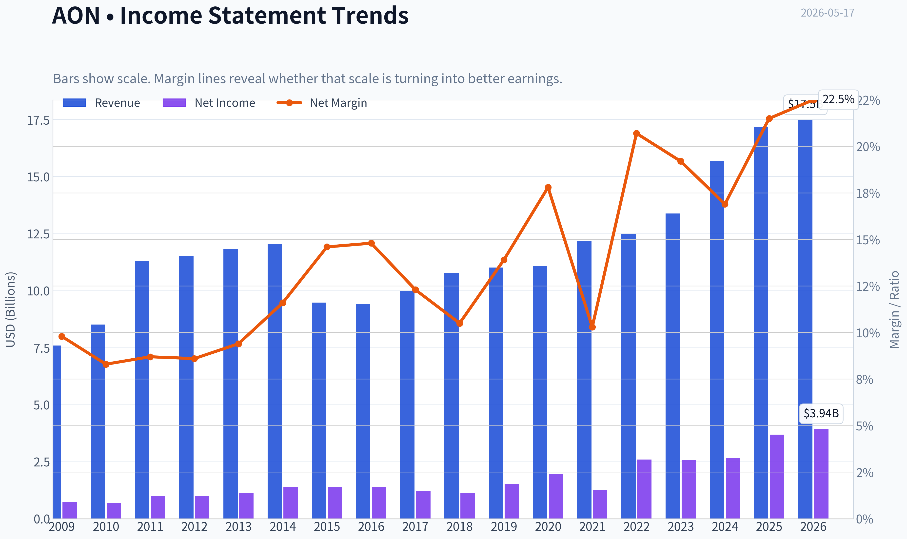

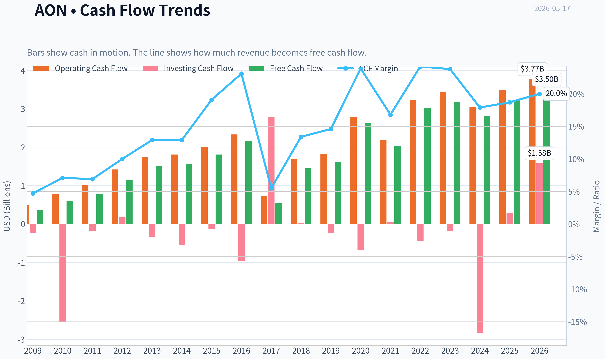

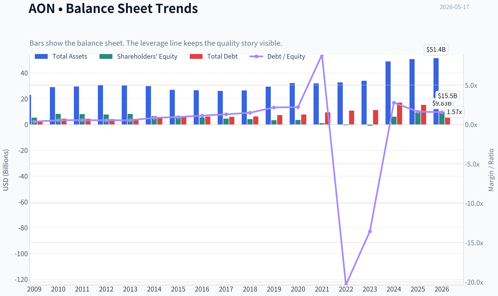

This graph tracks the profitability and return metrics (ROE, ROIC, Margins) of **AON** over the past decade, highlighting capital efficiency trends.

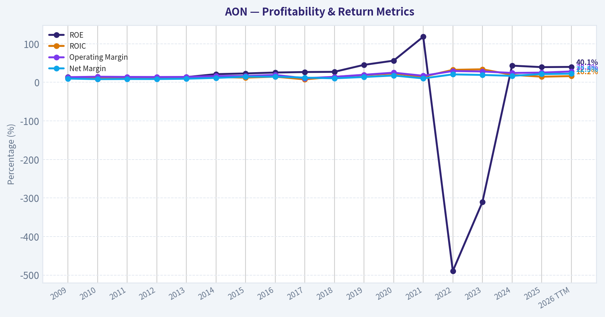

This chart illustrates the financial health of **AON** over the last 10 years, mapping cash equivalents and free cash flow against total obligations (Debt).

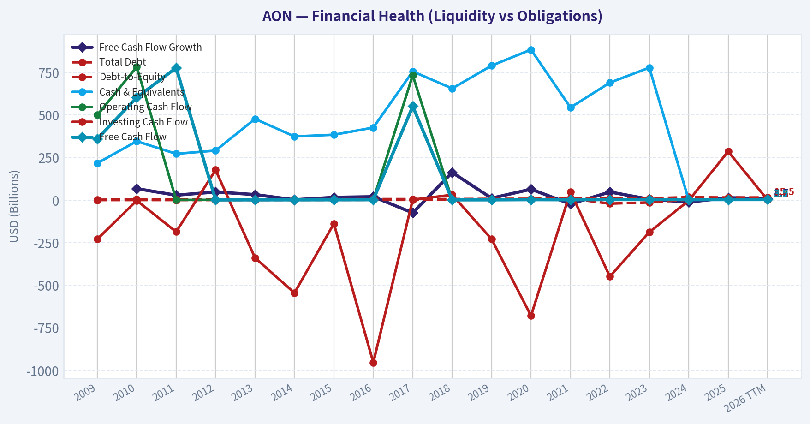

This comparison chart from *Profitability Analysis* stacks current figures against historical benchmarks for **AON**, making it easy to see where the company trades relative to its own averages.

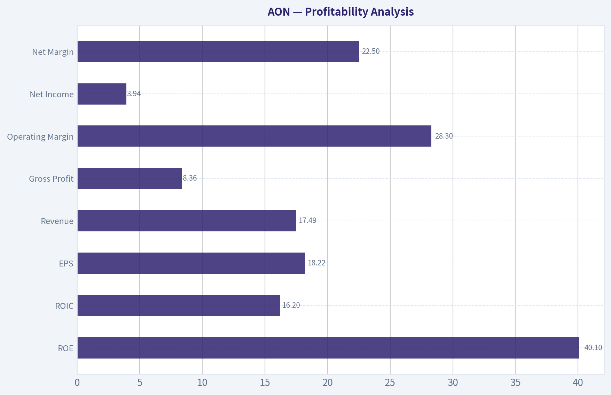

---

### Intrinsic Value Analysis (Buffett)

> *Following Warren Buffett's value investing philosophy: Circle of Competence, Economic Moat, Management Quality, and Margin of Safety.*

#### Intrinsic Value Snapshot

Price is what you pay. Intrinsic value is what the business may be worth based on the cash it can create for owners over time. We show a range, not one magic number.

- Current Price: $317.22
- Value Range: $165.84 to $1,363.49

##### Owner Earnings (Buffett Method)
- Net Income: $3,695,000,000.00
- Depreciation & Amortization: $966,000,000.00
- Capital Expenditures: $-263,000,000.00
- Working Capital Changes: $-192,000,000.00
- Owner Earnings: $4,590,000,000.00

##### Intrinsic Value
###### Buffett Method
Uses owner earnings. Stricter, and usually more conservative.
- Conservative: $417.10
- Average: $558.51
- Optimistic: $1,363.49
- Discount Rate: 10.0%

###### Cash Flow Method
Uses free cash flow. Better for companies spending heavily today to grow tomorrow.
- Conservative: $165.84
- Average: $201.23
- Optimistic: $265.93
- Discount Rate: 10.0%

ANALYST STANCE: **WATCH**

#### AON Buffett-Style Value Analysis

Aon is an insurance and reinsurance broker plus advisory firm. In simple terms, it helps companies buy insurance, manage risk, and handle retirement and health-related consulting needs, then earns fees on those services. This is a business Buffett-style investors can generally understand: recurring client relationships, scale advantages, low capital intensity, and meaningful switching costs.

The main question is not whether Aon is a good business. It likely is. The question is whether today's price offers enough margin of safety relative to conservative intrinsic value. Based on the research pack, Aon appears to be a high-quality, understandable franchise, but the current valuation looks closer to fair than clearly cheap.

---

#### 1) Go/No-Go Gate Assessment

| Gate | Verdict | Evidence | Buffett View |
|---|---|---|---|
| Gate 1: Circle of Competence & Simplicity | Pass | Aon earns fees by advising clients on insurance, reinsurance, benefits, and risk solutions. Easy to explain and reasonably predictable. | Within circle of competence |
| Gate 2: Moat Test | Pass | Large scale, embedded client relationships, advisory trust, and likely switching costs support durable economics. | Likely narrow-to-wide moat |
| Gate 3: Management & Capital Allocation | Pass with caution | Strong ROE of 39.5% suggests good economics, but likely boosted by buybacks/intangible-heavy balance sheet. Limited direct evidence in pack on owner-operator behavior. | Acceptable, not fully proven from pack alone |
| Gate 4: Industry Structure | Pass | Insurance brokerage is more rational than many financial industries, with large incumbents and recurring demand. Capital-light compared with insurers. | Attractive structure |

**Key Takeaways:** Aon passes all four Buffett gates on a best-effort basis using the research pack. The business is understandable, appears durable, and operates in an attractive industry structure. The main caution is not business quality but valuation and limited direct evidence on management's long-term capital allocation discipline from the pack.

---

#### 2) Gate 1: Circle of Competence & Business Simplicity

| Test | Assessment |
|---|---|
| Elementary School Test | Aon helps businesses protect themselves from bad events and advises them on employee and retirement plans. It gets paid fees for that help. |
| 10-Year Predictability Test | High. In 10 years, companies will still need insurance broking, reinsurance advice, cyber/risk consulting, and workforce benefits support. |
| Technology Risk Assessment | Moderate but manageable. Technology can improve efficiency, but it is more likely a tool than a destroyer because trust, relationships, and expertise still matter. |

Aon passes the simplicity test. This is not a commodity producer, bank with opaque assets, or fast-changing consumer app. It is a relationship-driven professional services and distribution business tied to enduring corporate needs.

Aon also passes the 10-year predictability test reasonably well. Demand for risk transfer and human capital advisory is unlikely to disappear. Cycles may affect growth rates, but the core need remains durable.

Technology risk exists, especially around digital placement, analytics, and AI-enabled broking tools. But Aon likely benefits from technology more than it is threatened by it, because better data can strengthen advisory value and operational efficiency.

---

#### 3) Gate 2: Moat Analysis

| Moat Source | Evidence for AON | Assessment |
|---|---|---|
| Intangible Assets | Trusted global brand in risk advisory and broking; enterprise clients value reputation and execution reliability. | Positive |
| Switching Costs | Corporate insurance and benefits programs are embedded in workflows, data, renewal processes, and relationships. Switching risks service disruption and coverage gaps. | Strong |
| Cost Advantages | Scale in broking, data, carrier relationships, and global client service likely lowers unit costs and improves placement outcomes. | Moderate to strong |
| Network Effects | Not a pure social network, but scale improves data, insurer access, and service capabilities. | Modest but real |

| Moat Rating | Conclusion |
|---|---|
| Narrow to Wide, Stable | Proceed, but quality should be bought only with adequate margin of safety |

**Key Takeaways:** Aon's moat is built less on patents and more on trust, relationships, scale, and switching costs. Large clients do not casually replace a core risk advisor because the consequences of disruption can be expensive. This looks like a durable franchise, though not an untouchable monopoly.

##### Pricing Power Test
Could Aon raise prices 10% without major volume loss? Probably not overnight across all accounts, but over time, yes in many segments through bundled advisory value, inflation-linked pricing, and higher-value analytics. That suggests moderate pricing power rather than absolute pricing power.

##### Financial Evidence Caveat
The research pack does not provide 10-year gross margin history, retention rates, or ROIC. So I cannot certify a "wide and widening" moat with hard decade-long proof. Still, the available facts-high ROE, positive growth, healthy FCF yield, and business model quality-support at least a stable moat.

---

#### 4) Gate 3: Management Quality & Capital Allocation

| Question | Assessment | Evidence / Assumption |
|---|---|---|
| Do they think like owners? | Mixed-positive | Pack does not provide insider ownership or compensation details. Assumption: management of a mature broker is judged more by per-share value creation than empire building. |
| Are they honest & candid? | Neutral | No restatement or accounting concerns provided in pack. No direct letter-quality evidence available. |
| Are they rational capital allocators? | Moderately positive | High ROE and solid FCF yield suggest a business that converts earnings well. But without a decade of buyback/acquisition data, this remains only partly proven. |
| Debt discipline | Acceptable | Current ratio 1.11 is fine for a fee-based service business, but does not by itself prove fortress finances. |

Overall, management gets a qualified pass, not an enthusiastic endorsement. Buffett places enormous weight on capital allocation, and the research pack does not provide enough direct evidence on acquisition discipline, buyback timing, or explicit owner orientation to award top marks.

Still, Aon's business model itself tends to reward disciplined capital allocation. This is a capital-light enterprise where excess cash can be used for acquisitions, repurchases, or selective internal investment. The high ROE implies management has not destroyed the economics.

---

#### 5) Gate 4: Industry Structure

| Industry Factor | AON Assessment |
|---|---|
| Competitive Structure | Favorable. Large global brokers enjoy scale, client trust, and sticky accounts. |
| Capital Intensity | Attractive. Broking/advisory is much lighter than underwriting or manufacturing. |
| Cyclicality | Moderate. Insurance pricing cycles and client activity affect growth, but demand is recurring. |
| Commodity Exposure | Low direct commodity dependence. |
| Regulatory Complexity | Present, but manageable for established incumbents and can even reinforce moat. |

**Key Takeaways:** Aon operates in a structurally attractive industry: recurring demand, scale benefits, and lower capital needs than many financial businesses. Regulation and complexity tend to favor the large incumbents rather than the small entrants. That is usually a good setup for durable returns on capital.

---

#### 6) 10-Year Financial Summary Table

The research pack does not include full decade financials. Per your instruction, I am making explicit best-effort assumptions to create a Buffett-style operating snapshot.

**Assumptions used:**
- Current P/E 17.42 and market cap $67.75B imply net income of about $3.89B.
- FCF yield 4.7% on market cap implies free cash flow of about $3.18B.
- Revenue growth YoY of 9.4% indicates current business momentum is healthy.
- ROE of 39.5% is accepted as current reported ROE, though likely influenced by capital structure/share repurchases.
- Because decade history is absent, prior-year and 10-year trend fields are qualitative estimates, not audited values.

| Metric | Current / Implied | Buffett Interpretation | Assumption Note |
|---|---:|---|---|
| Market Cap | $67.75B | Large, established franchise | From pack |
| Share Price | $317 | Base for valuation comparison | From pack |
| P/E | 17.42x | Reasonable for a quality franchise, not distressed | From pack |
| Implied Net Income | ~$3.89B | Strong earnings base | Market cap / P-E |
| FCF Yield | 4.7% | Decent cash generation | From pack |
| Implied Free Cash Flow | ~$3.18B | Good cash conversion | Market cap x FCF yield |
| ROE | 39.5% | Excellent on surface; must check leverage/buyback effects | From pack |
| Revenue Growth YoY | 9.4% | Healthy current growth | From pack |
| Current Ratio | 1.11 | Adequate liquidity for service business | From pack |
| 10-Year Revenue Trend | Likely upward | Consistent with durable demand | Assumed from current profile |
| 10-Year Earnings Trend | Likely upward | Supported by current valuation and franchise quality | Assumed |
| 10-Year Cash Conversion Trend | Likely solid | FCF implied at ~82% of net income | Assumed from current figures |

**Key Takeaways:** Even with limited historical data, the current snapshot suggests Aon is a high-quality cash-generative business. Earnings and free cash flow are both large, growth is positive, and ROE is strong. The main uncertainty is how much of the exceptional ROE comes from true business excellence versus capital structure effects.

---

#### 7) Owner Earnings Calculation

Because the pack does not provide depreciation, working capital, or maintenance CapEx, I use free cash flow as a conservative proxy for owner earnings. For a capital-light broker/advisory business, this is a reasonable Buffett-style shortcut.

| Owner Earnings Component | Estimate |
|---|---:|
| Net Income | ~$3.89B |
| Plus: D&A | Not provided |
| Less: Maintenance CapEx | Not provided |
| Less: Working Capital Increases | Not provided |
| Proxy: Free Cash Flow / Owner Earnings | **~$3.18B** |

Formula used:
- Net income = $67.75B / 17.42 ~ $3.89B
- Owner earnings proxy = FCF yield x market cap = 4.7% x $67.75B ~ **$3.18B**

**Key Takeaways:** Aon appears to generate roughly $3.2 billion in owner earnings using free cash flow as a practical proxy. That is a strong cash base for a capital-light services franchise. The gap between net income and free cash flow is not alarming and still indicates solid underlying economics.

---

#### 8) Cash Flow Reality Check

| Check | Result | Interpretation |
|---|---|---|
| OCF vs Net Income | Not directly available | Cannot verify strictly |
| FCF vs Net Income | ~$3.18B vs ~$3.89B | FCF is about 82% of net income; acceptable for this type of business |
| Profit Quality | Appears solid | No sign in pack of aggressive non-cash earnings inflation |

**Key Takeaways:** While operating cash flow is not provided directly, free cash flow still covers a large share of reported earnings. That usually suggests earnings are real enough, not merely accounting entries. For a service business, this level of cash conversion is broadly encouraging.

---

#### 9) Balance Sheet / Fortress Check

| Metric | Value | Buffett Standard | Assessment |
|---|---:|---:|---|
| Current Ratio | 1.11 | >1.0 acceptable for service firms | Pass |
| Debt/Equity | Not provided | <0.5 preferred | Unknown |
| Interest Coverage | Not provided | >10x preferred | Unknown |
| Net Cash Position | Not provided | Prefer net cash | Unknown |

Conclusion: balance sheet is adequate based on available evidence, but not proven fortress-grade from the pack alone.

**Key Takeaways:** Aon clears the minimum liquidity hurdle, but the full fortress balance sheet test cannot be completed without debt and interest coverage figures. This matters because very high ROE can sometimes be flattered by leverage or a reduced equity base. So balance sheet strength is acceptable, but not fully verified.

---

#### 10) Intrinsic Value: Three-Scenario DCF

Using owner earnings proxy of **$3.18B** and a **10% discount rate**.

##### Scenario A: No Growth
Intrinsic Value = Owner Earnings / 10%

- Value = $3.18B / 0.10 = **$31.8B**

##### Scenario B: GDP Growth at 3%
Intrinsic Value = Owner Earnings x 1.03 / (0.10 - 0.03)

- Value = $3.18B x 1.03 / 0.07
- Value ~ **$46.8B**

##### Scenario C: Historical Growth-Based
Research pack only provides current YoY revenue growth of 9.4%. Per your instructions, use 50-75% of historical growth and cap at 10%. I will use a conservative **5% owner earnings growth** for 10 years, then a 3% terminal growth rate.

DCF math:
- Year 1 owner earnings = 3.18 x 1.05
- Discount rate = 10%
- Terminal value at end of year 10 = Year 11 owner earnings / (10% - 3%)

This produces an estimated intrinsic value of approximately **$44.4B**.

| DCF Scenario | Assumption | Intrinsic Value |
|---|---|---:|
| A: No Growth | 0% perpetual owner earnings growth | $31.8B |
| B: GDP Growth | 3% perpetual growth | $46.8B |
| C: Moderate Growth | 5% for 10 years, then 3% terminal | $44.4B |

**Key Takeaways:** Under all three conservative valuation frameworks, intrinsic value comes out below Aon's current market value of $67.75 billion. The valuation gap is not small; it suggests the market is already paying up for quality. That does not make Aon a bad business, but it does make it hard to call a bargain.

---

#### 11) Margin of Safety Analysis

| Item | Value |
|---|---:|
| Current Market Cap | $67.75B |
| Scenario A Value | $31.8B |
| Scenario B Value | $46.8B |
| Scenario C Value | $44.4B |

| Comparison vs Current Price | Premium / (Discount) |
|---|---:|
| vs Scenario A | Current trades ~113% above intrinsic value |
| vs Scenario B | Current trades ~45% above intrinsic value |
| vs Scenario C | Current trades ~53% above intrinsic value |

Using share price as a cross-check:
- If market cap is 67.75B at $317/share, then:
  - Scenario A implied value per share ~ **$149**
  - Scenario B implied value per share ~ **$219**
  - Scenario C implied value per share ~ **$208**

Required Buffett margin of safety:
- High-quality predictable business: want at least **25% discount**
- Current price appears to be at a **premium**, not a discount

**Key Takeaways:** Aon does not appear to offer a margin of safety at the current price. Even under a moderate-growth case, estimated value is well below where the stock trades today. For a Buffett-style investor, quality alone is not enough if the price already embeds that quality.

---

#### 12) Buffett Scorecard

| Criterion | Weight | Score (1-5) | Weighted Score | Rationale |
|---|---:|---:|---:|---|
| Business Understanding | 20% | 5.0 | 1.00 | Very understandable fee-based advisory/broking model |
| Moat Width & Durability | 25% | 4.0 | 1.00 | Strong switching costs, scale, and trust; likely durable |
| Management Quality | 15% | 3.5 | 0.53 | Good implied economics, but limited direct owner-operator proof in pack |
| Return on Equity | 15% | 4.5 | 0.68 | 39.5% ROE is excellent, though likely partly balance-sheet driven |
| Reinvestment Runway | 10% | 3.5 | 0.35 | Advisory and analytics growth opportunities exist, but mature franchise limits explosive runway |
| Balance Sheet Strength | 5% | 3.0 | 0.15 | Adequate, but not fully verified fortress-grade |
| Industry Structure | 5% | 4.0 | 0.20 | Rational, scale-favored, capital-light structure |
| Valuation / Margin of Safety | 5% | 1.5 | 0.08 | Current price appears above conservative intrinsic value |

| Total Score | Result |
|---|---:|
| **3.98 / 5.00** | **WATCH** |

**Key Takeaways:** Aon scores highly on business quality and moat, which is why the total nearly reaches Advocate territory. But valuation matters, and the weak margin-of-safety score keeps it from crossing the line. This is a very good business that likely needs a better price to become a compelling Buffett-style purchase.

---

#### 13) Final Judgment

| Category | Conclusion |
|---|---|
| Business Quality | High |
| Predictability | High |
| Moat | Durable, likely narrow-to-wide |
| Financial Quality | Strong, with some balance-sheet unknowns |
| Valuation | Unattractive for value investors at current price |
| Buffett Verdict | Watchlist candidate, not a buy today |

#### Investment Stance

**ANALYST STANCE: WATCH**

**Conviction level: Moderate-High**

Aon looks like the kind of business Buffett would admire: understandable, service-based, capital-light, recurring in demand, and protected by scale plus switching costs. The economics appear strong, and the franchise quality is real.

But Buffett's discipline is not just about owning great businesses. It is about buying them at prices that leave room for error. Based on the research-pack figures and conservative owner-earnings valuation, Aon appears to trade above intrinsic value and without the required margin of safety. That makes it a **WATCH**, not an **ADVOCATE**, at $317.

A more attractive entry point would likely be closer to a valuation range implied by the GDP-growth or moderate-growth cases, rather than today's market price. In short: **wonderful business, but not obviously a wonderful price**.
#### Valuation Bridge

This bridge places the current market price beside each intrinsic value lens so readers can see whether upside depends on one method or shows up across several methods.

| Scenario | Intrinsic Value / Share |
| --- | ---: |
| Buffett Method | $558.51 |
| Cash Flow Method | $201.23 |
| Current Price | $317.22 |

#### Key Takeaways

If one method is far above the others, the upside case depends on a specific modelling assumption. When several methods cluster together, the valuation story is more robust.

#### Valuation Visuals

This comparison chart from *Latest Earnings Snapshot* stacks current figures against historical benchmarks for **AON**, making it easy to see where the company trades relative to its own averages.

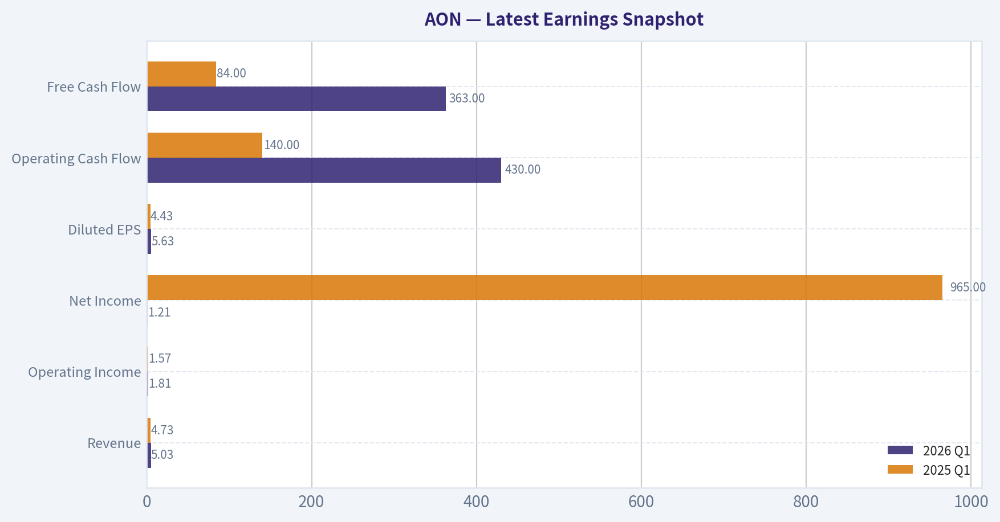

This comparison chart from *Current vs Historical Average Comparison* stacks current figures against historical benchmarks for **AON**, making it easy to see where the company trades relative to its own averages.

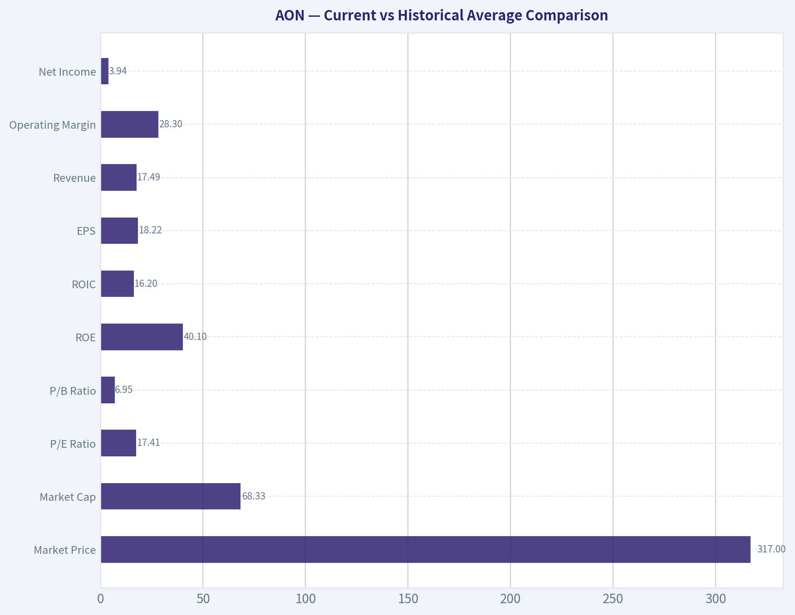

This comparison chart from *Balance Sheet and Financial Strength* stacks current figures against historical benchmarks for **AON**, making it easy to see where the company trades relative to its own averages.

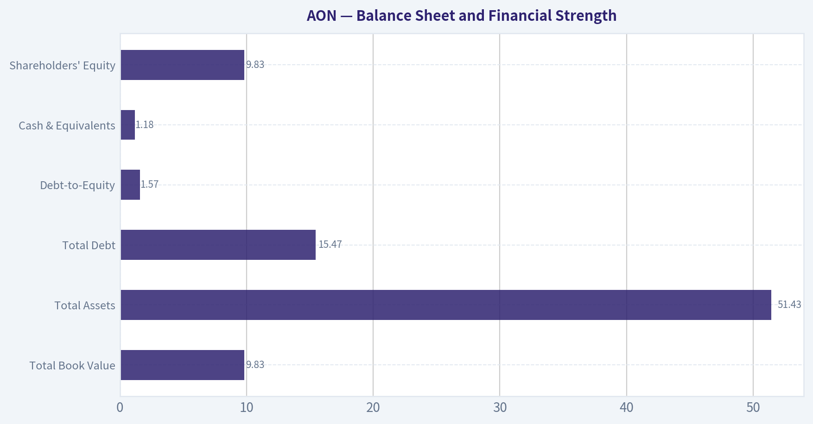

---

### Trend & Growth Analysis (Lynch/Druckenmiller/Fisher)

> *Following Peter Lynch's GARP, Stanley Druckenmiller's macro-aware approach, and Philip Fisher's scuttlebutt methodology.*

ANALYST STANCE: **WATCH**

#### 1. Lynch Classification

| Item | Assessment |
|---|---|
| Category | **Stalwart** |
| Revenue growth | **~9.4% YoY** |
| Why not Fast Grower? | Growth is solid but well below Lynch-style 15%-25%+ ten-bagger territory |
| Initial read | High-quality compounder, but **not a classic hyper-growth setup** |

Key Takeaways: Aon looks like a durable, high-quality business rather than a fast grower. With revenue growth around 9%, it fits better as a stalwart than a ten-bagger candidate. For a growth investor, that means discipline is important: this may be a hold-or-watch name, not an aggressive new buy.

#### 2. The Story in 3 Bullets

- Aon helps companies manage risk, insurance, health, and retirement decisions; it is essentially a global advisor and broker for complex business risks.
- The company benefits from sticky client relationships, recurring advisory needs, and broad exposure to commercial insurance and human capital spending.
- The upside story is steady compounding through pricing, cross-selling, and operating leverage - but the current data does **not** show a major growth inflection.

#### 3. TAM Analysis and 10x Test

| Item | Assessment |
|---|---|
| Business exposure | Insurance brokerage, reinsurance, health solutions, human capital consulting |
| TAM direction | Large and durable, likely growing with global risk complexity |
| Current scale | Already very large at **$67.75B market cap** |
| 10x revenue test | **Unlikely as a practical base case**; Aon is already a scaled incumbent |
| Runway conclusion | Good runway for continued compounding, **limited runway for 10x-style growth** |

Key Takeaways: Aon operates in a large market, and the demand for risk management is unlikely to disappear. But because the company is already big and mature, the realistic opportunity is steady expansion, not explosive market capture. This lowers the odds of true venture-like upside from here.

#### 4. Revenue Growth Trend

| Metric | Value | Read |
|---|---:|---|
| Revenue growth YoY | **9.4%** | Healthy but moderate |
| Pattern | Insufficient quarterly sequence in provided data | No confirmed acceleration |
| Growth quality | Likely recurring/service-driven | More stable than explosive |

Key Takeaways: The available number shows respectable growth, but not the kind of acceleration Druckenmiller would want for an inflection-point thesis. Without a multi-quarter sequence, I cannot call this accelerating growth. The safer conclusion is that Aon remains a steady grower rather than a re-rating candidate driven by sudden business momentum.

#### 5. Unit Economics

| Metric | Value | Assessment |
|---|---:|---|
| ROE | **39.5%** | Strong |
| FCF yield | **4.7%** | Reasonable for a quality compounder |
| Gross margin | N/A | Data unavailable |
| Current ratio | **1.11** | Adequate |
| LTV/CAC | N/A | Not disclosed / not applicable from current data |
| NRR | N/A | Not a SaaS model |
| Rule of 40 | N/A | Not relevant |

Key Takeaways: Even without SaaS-style unit metrics, Aon shows signs of a good business through high returns on equity and healthy cash generation. The balance sheet liquidity looks acceptable, though not exceptionally conservative. This supports the quality case, but it does not create a high-growth case on its own.

#### 6. Inflection Point Assessment

| Inflection Type | Evidence | Verdict |
|---|---|---|
| Product cycle inflection | None visible from provided data | No |
| Market share inflection | Not established | Unclear |
| Margin inflection | Not enough recent margin detail | Unclear |
| TAM inflection | Risk complexity rising globally | Mild positive |
| Competitive inflection | No obvious competitor stumble identified | No clear signal |

Key Takeaways: I do not see a strong inflection-point setup in the current evidence. The best argument is that global risk and advisory complexity continue to rise, which supports demand over time. But that is more a steady secular tailwind than a sharp acceleration catalyst.

#### 7. Macro Setup Evaluation

| Macro Factor | Assessment |
|---|---|
| Economic sensitivity | Moderately cyclical but relatively resilient due to advisory/recurring relationships |
| Rates backdrop | Higher rates can pressure equity multiples, but Aon is less duration-sensitive than premium SaaS |
| Secular themes | Corporate risk complexity, benefits consulting, retirement solutions |
| Macro wind | **Neutral to mildly positive** |

Key Takeaways: Aon is not a pure secular hyper-growth beneficiary like AI software or cybersecurity, but it does benefit from long-term increases in complexity around risk and benefits. That makes the business more resilient than many growth stocks. Still, the macro does not appear to create a major upside inflection today.

#### 8. Fisher 15-Point Score

| Fisher Area | Score (1-5) | Comment |
|---|---:|---|
| Market potential | 4 | Large, durable end markets |
| Product development | 3 | More service innovation than disruptive product innovation |
| R&D effectiveness | 2 | Less relevant in this model |
| Sales organization | 4 | Strong enterprise relationships |
| Profit margin | 4 | Good economics historically |
| Margin improvement | 3 | Not enough recent detail for stronger score |
| Labor relations | 3 | No major positives/negatives in packet |
| Executive relations | 3 | Neutral from current evidence |
| Management depth | 4 | Large established franchise |
| Cost/accounting controls | 4 | Mature operator |
| Outstanding aspects | 4 | Scale, brand, switching friction, client trust |
| Long-range outlook | 4 | Good but not explosive |
| Dilution risk | 4 | No current major dilution concern flagged |
| Candor | 3 | Insufficient direct evidence |
| Integrity | 3 | Insufficient direct evidence |

| Total | **52 / 75** | **Average to Good** |

Key Takeaways: Aon scores well on stability, market position, and business quality, but not on breakthrough innovation. This is consistent with a mature, trusted franchise rather than a disruptive growth machine. The Fisher score supports ownership for quality investors, but not high-conviction growth advocacy.

#### 9. Valuation Analysis

| Metric | Value | Interpretation |
|---|---:|---|
| Current price | **$317** | Reference point |
| Market cap | **$67.75B** | Large cap |
| P/E | **17.42x** | Not demanding for quality |
| Revenue growth | **9.4%** | Moderate |
| PEG | **~1.85** | Fair to somewhat full for this growth rate |
| FCF yield | **4.7%** | Supportive valuation floor |

Key Takeaways: Valuation does not look extreme. On a PEG basis, Aon is not especially cheap relative to its current growth rate, but the cash flow yield and quality profile help justify the multiple. This looks more like a fair-value compounder than an undervalued growth rocket.

#### 10. Growth Investor Scorecard

| Criterion | Weight | Score (1-5) | Weighted Score |
|---|---:|---:|---:|
| The Story | 10% | 4.0 | 0.40 |
| TAM & Runway | 20% | 3.0 | 0.60 |
| Revenue Growth | 20% | 2.5 | 0.50 |
| Unit Economics | 15% | 4.0 | 0.60 |
| Competitive Position | 10% | 4.0 | 0.40 |
| Management Quality | 10% | 3.5 | 0.35 |
| Macro Setup | 5% | 3.0 | 0.15 |
| Profitability Path | 5% | 4.0 | 0.20 |
| Valuation | 5% | 3.0 | 0.15 |

| Total Score |  |  | **3.35 / 5.0** |

Key Takeaways: The score lands in the WATCH range. Aon earns points for business quality and competitive strength, but loses them on growth speed and lack of visible inflection. In plain terms, this is a good company without enough evidence of exceptional upside from this starting point.

#### 11. Position Size Stance

| Portfolio Action | View |
|---|---|
| New position | **Small starter at most** |
| Existing holder | **Reasonable hold** if seeking quality compounding |
| Aggressive growth allocation | **Not recommended** |
| Ideal investor fit | Quality/GARP investor more than pure high-growth investor |

Key Takeaways: If you already own Aon, there is no obvious reason from this packet to abandon it. But if the goal is to find concentrated fast-grower opportunities, this name does not rise to the top. Position sizing should reflect that difference.

#### 12. Key Risks and Catalysts

| Risks | Catalysts |
|---|---|
| Growth remains sub-10%, preventing multiple expansion | Stronger-than-expected organic growth acceleration |
| Mature scale limits upside surprise | Margin expansion and operating leverage |
| Multiple may stay range-bound without inflection | Cross-sell gains in health, wealth, and risk solutions |
| Macro slowdown can dampen corporate activity | Hard insurance pricing supporting brokerage economics |
| Sentiment overhang after Berkshire exit headlines | Capital return and durable FCF execution |

Key Takeaways: The main risk is not business collapse, but stagnation in the investment narrative. If growth stays merely okay, the stock may remain a steady but unexciting compounder. The upside case depends on proving that organic growth and margins can improve enough to change investor expectations.

#### Bottom Line

Aon is a **high-quality stalwart**, not a classic Lynch fast grower. The business has durability, strong returns, and decent valuation support, but the current evidence does **not** show the kind of revenue acceleration or inflection point that would justify an **ADVOCATE** stance for a growth-focused portfolio.

For this framework, the right conclusion is **WATCH**: solid company, fair valuation, limited visible ten-bagger potential from current scale and growth rate.

#### Growth & Scorecard Visuals

This comparison chart from *Growth Metrics* stacks current figures against historical benchmarks for **AON**, making it easy to see where the company trades relative to its own averages.

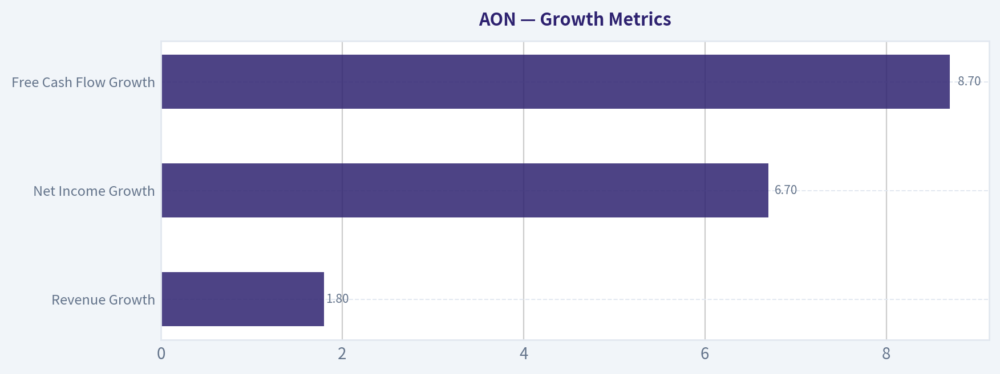

---

### Market Technical Analysis

#### AON Technical Analysis

For AON, the most relevant non-redundant indicator set in the current market context is:

| Selected Indicator | Why it matters now |
|---|---|
| close_200_sma | Best gauge of the long-term trend, which is still deteriorating. |
| close_50_sma | Defines the medium-term trend and shows whether the stock is repairing or rolling over. |
| close_10_ema | Tracks near-term price control and short-term momentum shifts. |
| macd | Measures directional momentum and whether bearish pressure is fading or rebuilding. |
| rsi | Shows whether weakness is washed out or merely neutral within a broader downtrend. |
| boll_ub | Helps frame upside resistance and whether rebounds are stretching too far. |
| boll_lb | Helps frame downside support and whether selloffs are approaching exhaustion. |
| atr | Critical for risk management because AON has been moving in relatively wide daily ranges. |

Key Takeaways: These eight indicators work well together because they cover trend, momentum, volatility, and tactical price location without excessive overlap. For AON, that matters because the stock is not in a clean breakout or capitulation phase; instead, it is trying to stabilize after a prolonged decline. Traders need both structural trend measures and short-term timing tools.

---

#### Trend Structure

AON's price action over the last year shows a clear transition from relative stability in the mid- to upper-$350s during mid-2025 into a broad and persistent downtrend that intensified in early 2026. The most important structural point is that the stock is now trading **well below its 200-day SMA**. On the latest trading day, AON closed at **317.22**, while the **200 SMA is about 341.89**. That gap is meaningful: it says the long-term trend is still bearish, and recent rebounds have not yet repaired the broader damage.

The **50-day SMA sits near 321.06**, only modestly above price. This is important because it shows a different message than the 200-day average. The long-term trend remains weak, but the medium-term downtrend is less severe than it was during the February collapse. In other words, AON is no longer in freefall, but it also has not reclaimed a trend-positive posture. Price is pressing just under medium-term resistance rather than leading above it.

The **10-day EMA is about 314.95**, slightly below the latest close. That tells us short-term control has improved. Over the last several sessions, price has started to hold just above its fast average, which usually reflects stabilization and tentative buying support. However, because the 10 EMA remains below the 50 SMA and both are below the 200 SMA, this is best interpreted as a **countertrend recovery attempt inside a larger bearish structure**, not a confirmed trend reversal.

---

#### Momentum and Internal Strength

The momentum picture is subtle and more constructive than the trend picture.

The **MACD is still negative at roughly -2.62**, which means momentum remains below neutral on an absolute basis. However, it has improved from more negative readings around **-3.51 to -3.32** earlier in the month. That indicates bearish momentum is **easing**, even if it has not fully reversed. This distinction matters: when MACD is negative but rising, the stock is often in a relief or repair phase rather than a fresh impulse leg lower.

The **RSI is about 49.13**, which is close to neutral. This is one of the most important clues in the setup. A neutral RSI after a prolonged decline often means the stock has successfully worked off oversold conditions without yet becoming overbought. That is healthier than an RSI stuck in the 30s, but it is not strong enough to confirm bullish control. In practical terms, AON has moved from **oversold vulnerability** to **decision zone**.

A useful nuance here is that the RSI has repeatedly failed to sustain readings above the mid-50s during the last two months. That suggests buying pressure exists, but it has not become dominant. Unless RSI can begin holding above 50 and pushing into the upper-50s or low-60s, rallies may continue to behave like recoveries rather than durable uptrends.

---

#### Volatility and Trading Range Context

The Bollinger structure shows AON sitting in the lower half of its recent volatility envelope, but not at a panic extreme.

- Latest **Bollinger Upper Band**: about **331.91**
- Latest **Bollinger Lower Band**: about **303.93**
- Latest close: **317.22**

This places price roughly in the middle-lower portion of the band range. That means the stock is no longer stretched to the downside the way it was during sharper selloffs, but it has also not challenged upper-band resistance. The upper band near **332** is a key tactical ceiling. A move into that area would likely test whether the rebound has enough force to shift market psychology.

The lower band near **304** is also important. It frames the recent stabilization zone: if price rolls back toward that area, traders should watch whether selling becomes exhausted again or whether the stock starts expanding the band lower, which would imply renewed trend weakness.

The **ATR is about 7.81**, still elevated enough to matter. For a stock around $317, that implies average daily movement on the order of roughly **2.5%**. That is not extreme panic volatility, but it is wide enough that entries, stop placement, and position sizing should be handled carefully. This also means apparent "small" breakouts can easily reverse within normal volatility noise unless confirmed by follow-through.

---

#### Fine-Grained Reading of Recent Price Behavior

The most recent cluster of sessions suggests AON is building a tentative base after the late-April and early-May weakness. The stock suffered a notable breakdown into the **310-311** area, then spent the following sessions oscillating between roughly **308 and 317** before closing back near the upper end of that short-term range.

That behavior has three implications:

1. **Buyers are defending the low-$310s**, at least for now.
   Several closes around 311-315 indicate demand is appearing on dips.

2. **Sellers remain active into rebounds**, especially as price approaches the 50-day SMA and the upper part of the immediate range.
   This is why the stock has improved, but not broken out.

3. **The stock is compressing after a larger decline**, which often precedes a directional move.
   Compression after weakness can resolve either way, so confirmation matters more than anticipation.

This is not a stock showing aggressive leadership. It is a stock attempting to transition from decline into stabilization. That makes it potentially interesting for swing traders, but only if they respect the difference between a **base-building process** and a **confirmed trend reversal**.

---

#### Trading Implications

For **trend-following investors**, AON is not yet attractive on pure technical grounds because price remains below the 200-day SMA and has not convincingly reclaimed the 50-day SMA. A stronger bullish case would require:
- sustained closes above the **50-day SMA near 321**
- then a push toward and through the **Bollinger upper zone near 332**
- eventually evidence that the 50-day SMA stops drifting lower

For **swing traders**, the stock is more actionable. The current setup suggests a range with:
- **support** in the **310-304** zone
- **resistance** in the **321-332** zone

A breakout above the 50-day SMA followed by acceptance above the upper Bollinger region would suggest momentum is broadening. By contrast, rejection under the 50-day SMA and a rollover back under the 10-day EMA would imply the recent bounce is failing.

For **risk-focused traders**, ATR argues for wider stops than usual. Tight stops placed inside the stock's normal daily fluctuation are vulnerable to noise. The better approach is to size smaller and allow for volatility, rather than size larger with overly tight exits.

---

#### Bottom Line

AON is in a **long-term bearish trend**, a **medium-term repair attempt**, and a **short-term stabilization phase**. That combination is important: it means the stock is improving tactically, but not yet strong strategically. Momentum has stopped deteriorating, and RSI has normalized, which reduces immediate downside panic risk. But until price can reclaim and hold above the 50-day SMA-and eventually challenge the low-$330s with conviction-the prevailing interpretation remains that rallies are recovery attempts within a broader damaged chart.

| Area | Observation | Interpretation | Trading Relevance |
|---|---|---|---|
| Long-term trend | Price is below 200 SMA (~341.89) | Structural trend remains bearish | Long-only trend investors should stay cautious |
| Medium-term trend | Price is slightly below 50 SMA (~321.06) | Recovery is incomplete | First important resistance zone |
| Short-term trend | Price is above 10 EMA (~314.95) | Near-term momentum has improved | Short-term buyers have some control |
| Momentum | MACD is negative but improving | Bearish momentum is easing, not gone | Supports rebound, not full reversal |
| RSI | Near 49 | Neutral, neither oversold nor overbought | Market is in decision mode |
| Volatility envelope | Price is between Bollinger bands, below upper band (~331.91) | Not stretched, but upside still capped | Watch 332 as breakout test |
| Downside reference | Lower Bollinger band near 303.93 | Key support/exhaustion zone | Breakdown risk rises below this area |
| Risk conditions | ATR near 7.81 | Daily swings remain meaningful | Use wider stops and smaller position sizing |

Key Takeaways: AON is no longer in a sharp breakdown, but it has not yet transitioned into a confirmed uptrend. The chart is showing stabilization above the fast average, while still struggling beneath medium- and long-term trend barriers. The most important tactical levels are support around 310 to 304 and resistance around 321 to 332.

#### Market Visuals

This comparison chart from *Market Metrics* stacks current figures against historical benchmarks for **AON**, making it easy to see where the company trades relative to its own averages.

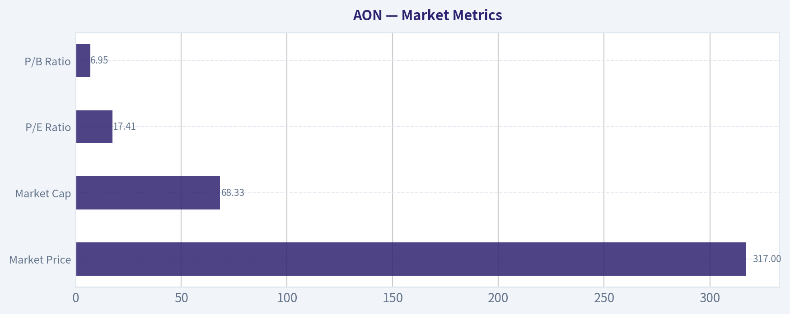

---

### News & Events Analysis

#### Aon (AON) weekly trading and investment report

Aon's near-term setup is being shaped by three overlapping forces: a solid but not universally loved latest earnings print, ongoing evidence that management is pushing a data-and-analytics-led growth story, and a macro backdrop that is still supportive for defensive service businesses but less forgiving of any slowdown in organic growth. The stock appears to retain "quality compounder" characteristics, but recent news flow suggests investors are debating whether that quality deserves a premium multiple if revenue momentum moderates.

Using the shared research pack and the latest available news, the most actionable conclusion is that Aon currently looks more like a selective dip-buy candidate than a momentum chase. The business remains financially strong, but sentiment over the last week has been influenced by a softer organic growth narrative and by portfolio repositioning headlines tied to Berkshire's exit.

---

#### Latest earnings: required review and interpretation

The latest available earnings-related coverage indicates Aon recently reported **first-quarter 2026 results**, so the relevant reporting period is **Q1 2026**.

Headline takeaways from the latest earnings coverage:
- Revenue and earnings were reported as **higher versus the prior-year quarter**
- Aon executed a **$500 million share repurchase** during Q1 2026
- Post-earnings, at least one analyst **raised its price target**
- Despite the beat, some coverage emphasized a **slowing organic revenue outlook**, which appears to be the key reason the stock reaction has been more restrained than the headline EPS result might suggest

What changed versus the prior period:
- Versus **Q1 2025**, Aon appears to have delivered **higher sales and earnings**, consistent with the shared pack showing **9.4% YoY revenue growth**
- Management's operating story continues shifting further toward **technology, analytics, and advisory productivity tools**, including the broader rollout of **Aon Claims Copilot**
- The key incremental concern versus the prior period is not balance-sheet deterioration or margin collapse, but rather the market's interpretation that **organic growth may be decelerating**, which matters for a company with a premium quality reputation

What changed versus prior expectations or guidance:
- The coverage suggests the company likely **beat consensus on the headline quarter**, given analyst target increases after the print
- However, the market seems focused on whether **forward organic growth expectations** need to be tempered
- In practical trading terms, this is a classic "beat, but scrutiny shifts to next-quarter trajectory" setup

Bottom line on earnings:
- **Fundamental quality remains intact**
- **Forward growth confidence softened modestly**
- This combination often supports valuation on pullbacks, but can cap upside unless management re-accelerates organic growth or demonstrates stronger cross-cycle resilience in upcoming quarters

#### Earnings snapshot

| Item | Latest available read |
|---|---|
| Reported period | Q1 2026 |
| Revenue outcome | Up year over year |
| Earnings outcome | Up year over year; described as a beat by market coverage |
| Capital returns | Roughly $500M of buybacks in Q1 |
| Key positive | Analyst target increases after results |
| Key negative | Slowing organic revenue outlook became the main debate |
| Investment interpretation | Good quarter numerically, but guidance/trajectory questions limited enthusiasm |

Key Takeaways: Aon's latest quarter appears fundamentally solid, with revenue, earnings, and buybacks all supporting the quality-investment case. The main issue is that investors are looking past the quarter and worrying that organic growth may be cooling, which can pressure a premium-valued stock even after an earnings beat.

---

#### Company-specific news from the past week

The most important company and stock-specific developments are less about disruptive events and more about **positioning, perception, and strategic execution**.

First, **Berkshire Hathaway exited Aon** in its latest disclosed 13F snapshot for quarter-end March 31, 2026. That is not necessarily a fundamental indictment, since 13F changes can reflect portfolio-level reallocations rather than a deteriorating company view. Still, Berkshire exits tend to create a negative sentiment overhang, especially for high-quality financial and services names that investors often associate with "Buffett-like" durability.

Second, **Seth Klarman's Baupost initiated a sizable stake**, partially offsetting the Berkshire headline. For traders, this matters because it reframes the institutional signal: one well-known value investor exited, while another initiated. That suggests the stock is not being abandoned broadly, but rather is entering a more valuation-sensitive phase.

Third, Aon continued rolling out **Aon Claims Copilot globally**. Strategically, this matters more than the headline may first suggest:
- It supports Aon's push toward **embedded analytics and workflow tools**
- It can strengthen client stickiness in commercial risk
- It may improve internal productivity and claims visibility over time
- It reinforces Aon's effort to be viewed not just as a broker/advisor, but as a **data-enabled risk platform**

Fourth, through **NFP**, Aon expanded its private wealth offering with the **acquisition of Metis Ireland**. This is not likely to move the stock near term by itself, but it signals continued tuck-in M&A and cross-sell expansion. For a company like Aon, investors generally reward disciplined bolt-ons if they deepen client networks or expand fee-bearing advisory capabilities.

#### Company news and trading relevance

| Theme | Latest development | Why it matters for investors |
|---|---|---|
| Institutional ownership signal | Berkshire exited AON in latest 13F | Can weigh on sentiment near term, even if not a pure fundamental call |
| Counter-signal | Baupost initiated a meaningful stake | Suggests valuation support may exist on weakness |
| Product/tech strategy | Claims Copilot expanded globally | Supports long-term margin, retention, and data-driven differentiation story |
| M&A execution | NFP acquired Metis Ireland | Reinforces steady platform expansion and cross-sell potential |
| Analyst stance | Target price raised after earnings | Indicates Street still sees upside despite post-earnings debate |

Key Takeaways: The most important recent company news is that investor perception is being pulled in two directions. Berkshire's exit creates a negative headline, but Baupost's new stake, analyst target increases, and continued product expansion suggest that sophisticated investors still see value if Aon can sustain execution.

---

#### Macro and market context

The broader market backdrop over the past week has likely had a mixed but interpretable effect on Aon.

For a company like Aon, the most relevant macro variables are:
- Corporate risk-management spending
- Insurance pricing and reinsurance conditions
- M&A and capital markets activity
- Labor cost inflation for professional services
- Interest-rate direction and equity market tone, which affect sentiment toward defensive compounders

In a macro environment where growth expectations are uneven and investors are favoring resilience, Aon should still screen relatively well. Its business mix is less cyclical than many financials, and advisory/risk spending often remains durable even when broader capital spending softens. However, if markets become more focused on growth acceleration rather than stability, Aon can lag because it is often priced as a dependable premium franchise rather than a fast grower.

The macro implication for trading is straightforward:
- If macro anxiety rises, Aon may regain favor as a **defensive quality name**
- If risk appetite broadens aggressively toward cyclicals or faster-growing sectors, Aon may **underperform on relative rotation**
- If rate volatility persists but recession fears stay contained, Aon's stable-cash-flow profile should remain supportive, though not necessarily enough to drive multiple expansion on its own

---

#### Fundamental positioning

The shared research pack still supports the idea that Aon is fundamentally strong:
- **Market cap:** $67.75B
- **P/E:** 17.4
- **ROE:** 39.5%
- **Gross margin:** 47.7%
- **Revenue growth YoY:** 9.4%
- **FCF yield:** 4.7%
- **Current ratio:** 1.11

These are healthy metrics for a large-cap professional services and risk advisory firm. The most notable strengths are high profitability, decent revenue growth, and ongoing free-cash-flow support. The current ratio is not especially high, but that is generally less alarming in a stable fee-based services model than it would be in a capital-intensive business.

From a valuation perspective, the pack's listed P/E of 17.4 does not look demanding for a high-quality franchise, especially if earnings growth remains reliable. But the market's hesitation suggests investors are questioning whether the **quality premium should expand, stay flat, or contract** if organic growth slows.

#### Fundamental scorecard

| Metric | Value | Interpretation |
|---|---:|---|
| Current price | $317 | Sets context for upside/downside versus updated targets |
| Market cap | $67.75B | Large-cap stability, institutional sponsorship |
| P/E | 17.4x | Not extreme for a high-quality services franchise |
| ROE | 39.5% | Strong profitability and efficient capital deployment |
| Gross margin | 47.7% | Healthy economics and pricing discipline |
| Revenue growth YoY | 9.4% | Good top-line trend, though investors worry about organic slowdown |
| FCF yield | 4.7% | Supports buybacks and downside resilience |
| Current ratio | 1.11 | Adequate liquidity for a stable business model |

Key Takeaways: Aon's fundamentals still look strong, especially profitability and cash generation. The main question is not whether the company is high quality, but whether future organic growth will be strong enough to justify renewed multiple expansion from current levels.

---

#### Trading view: what matters over the next 1 to 4 weeks

The main short-term swing factors are:
1. Whether post-earnings concern about **organic growth deceleration** fades or intensifies
2. Whether the market treats **Berkshire's exit** as noise or as a catalyst for further de-rating
3. Whether management's **AI/data/claims automation** initiatives start to get more explicit credit in analyst commentary
4. Whether broader market rotation favors **defensive compounders**

Bullish setup:
- The stock holds recent support after the earnings debate
- More analysts emphasize the earnings beat and target-price upside
- Investors begin treating Berkshire's exit as portfolio churn, not a thesis break
- Claims Copilot and NFP integration strengthen the long-term platform narrative

Bearish setup:
- Organic growth concerns deepen in follow-up research
- Defensive quality stocks lag amid a more risk-on tape
- Aon fails to reassert accelerating growth, causing investors to treat it as a slower, mature compounder

Base-case investment view:
- **Constructive but selective**
- Better suited for investors buying on weakness than for traders chasing an immediate breakout
- Upside depends more on confidence in forward organic growth than on backward-looking earnings strength

#### Actionable trading/investment framework

| Horizon | Bull case | Bear case | What to watch |
|---|---|---|---|
| 1-2 weeks | Post-earnings beat and raised targets support rebound | Berkshire-exit headlines and growth concerns keep pressure on shares | Analyst note flow, price action around recent support |
| 1-3 months | AI/data products and buybacks reinforce quality premium | Organic growth slowdown triggers valuation compression | Management commentary on demand and retention |
| 6-12 months | Stable cash flow, bolt-on M&A, and margin discipline compound value | Premium franchise re-rated lower if growth remains merely average | Organic growth trend, capital returns, M&A execution |

Key Takeaways: In the near term, Aon is likely to trade more on perception of future growth than on the fact that the last quarter was solid. Over a longer horizon, the stock can work well if management proves that its technology, advisory, and acquisition strategy can keep organic growth and margins healthy.

---

#### Final assessment

Aon's latest week of news does not point to a broken thesis. Instead, it points to a **more nuanced one**. The company still looks financially strong, is still returning capital, and is still investing in analytics-led differentiation. The problem for the stock is that investors now want proof that growth can stay sufficiently strong, not just proof that the business is stable.

For traders, this means AON may remain range-bound until the market gets more confidence in organic growth trends. For investors, the setup is more favorable if the stock weakens on sentiment rather than on materially worse fundamentals. At current information levels, Aon looks like a **high-quality name to accumulate selectively**, not a clean short, but also not an obvious near-term momentum leader.

#### Summary table

| Category | Key point | Investment implication |
|---|---|---|
| Earnings | Q1 2026 results were up YoY and viewed as a beat | Supports core quality thesis |
| Forward debate | Organic revenue outlook appears to be slowing | Main reason upside may stay capped near term |
| Capital allocation | Q1 buybacks of about $500M | Adds support on dips |
| Strategic execution | Claims Copilot global rollout and NFP bolt-on deal | Positive for long-term differentiation and cross-sell |
| Sentiment | Berkshire exited, Baupost initiated | Mixed ownership signal; valuation debate intensifies |
| Fundamentals | Strong ROE, margins, cash flow, and decent growth | Favors medium-term accumulation over panic selling |
| Trading stance | Constructive but selective | Prefer buying weakness rather than chasing strength |

Key Takeaways: Aon remains a strong business, but the stock's next move will likely depend on whether investors regain confidence in forward organic growth. The current setup favors patient investors who want quality exposure, while short-term traders should monitor whether sentiment improves after the Berkshire-related headlines and post-earnings debate.

---

### Guru Attention Analysis

> *Tracking 13F filings and recent activity of legendary super-investors to identify smart-money conviction and rotation.*

*No guru attention analysis available.*

---

### Options Market Analysis

> *Reading options flow - put/call ratios, IV skew, and unusual activity - to gauge institutional positioning and event-driven risk.*

#### AON Options Positioning Report

#### 1. Put/Call Ratio Analysis

| Expiration | Call OI | Put OI | Put/Call OI Ratio | Call Vol | Put Vol | Put/Call Vol Ratio |
|---|---:|---:|---:|---:|---:|---:|
| 2026-06-18 | 585 | 170 | 0.29 | 44 | 36 | 0.82 |
| 2026-07-17 | 1,015 | 470 | 0.46 | 77 | 28 | 0.36 |
| 2026-08-21 | 27 | 7 | 0.26 | 108 | 4 | 0.04 |
| **Near-term total** | **1,627** | **647** | **0.40** | **229** | **68** | **0.30** |

**Key Takeaways:** AON's near-term options positioning leans clearly call-heavy. The aggregate put/call OI ratio of 0.40 sits well below the rough neutral baseline of 0.70, and the volume ratio of 0.30 shows current trading is even more tilted toward calls than the existing open-interest base. That usually points to bullish speculation or income-oriented call overwriting rather than active downside hedging.

Interpretation:
- **OI ratio at 0.40** is meaningfully below neutral and suggests the market is **not heavily positioned for downside protection**.
- **Volume ratio at 0.30** indicates fresh flow is also call-dominant.
- The one caveat: AON is not a high-retail-mania name, so some of this call open interest may reflect **covered call writing** rather than aggressive outright bullish bets.
- Still, versus a neutral 0.7 baseline, this is a **distinctly constructive** read.

---

#### 2. Implied Volatility Assessment

| Expiration | ATM Call IV | ATM Put IV | IV Read |
|---|---:|---:|---|
| 2026-06-18 | 31.7% | 27.3% | Calls richer than puts |
| 2026-07-17 | 31.2% | 25.6% | Calls richer than puts |
| 2026-08-21 | 31.2% | N/A | Sparse put data / illiquid |
| **Near-term pattern** | **~31%** | **~26-27%** | **Call-skewed surface** |

**Key Takeaways:** AON's near-term IV surface is unusual in a constructive way: calls are carrying higher ATM implied volatility than puts. Instead of the classic downside-protection premium seen in fearful markets, traders appear more willing to pay for upside optionality. That argues against a strong bearish hedge bid.

Interpretation:
- **ATM IV is moderate**, roughly **31% on calls** and **26-27% on puts** in the front months.
- The skew appears to favor **calls over puts**, which is the opposite of a classic "fear skew."
- That suggests:
  - limited urgency for downside hedging,
  - some demand for upside participation,
  - and a market that is not pricing a sharp negative event as the dominant near-term risk.
- No explicit catalyst data was provided in the chain snapshot, so I cannot confirm whether this is tied to earnings or a corporate event. But **IV does not look panic-elevated**; it looks more like **firm but orderly upside-premium pricing**.

On skew:
- Since the dataset only gives ATM IV and no full-strike OTM skew grid, we cannot quantify exact **OTM put IV vs. OTM call IV**.
- However, the observed pattern of **calls pricing above puts at ATM** strongly implies **call skew / upside chase**, not downside fear.

---

#### 3. Unusual Options Activity

| Finding | Result |
|---|---|
| Contracts with volume > 5x open interest | None detected |
| Read-through | No clear fresh institutional "tell" from abnormal single-line activity |

**Key Takeaways:** There were no flagged contracts with volume greater than five times open interest, so there is no obvious standout block or sweep indicating urgent smart-money positioning. That reduces conviction somewhat, because the bullish lean comes more from overall positioning and volatility shape than from a single high-conviction trade.

Interpretation:
- **No unusual activity** means there is no obvious large fresh bet in near-term listed contracts.
- That matters because unusual flow often helps separate:
  - **institutional directional conviction**
  - from ordinary maintenance trading or covered-call activity.
- In AON's case, the absence of unusual contracts makes the read **clean but lower-intensity**.
- So the signal is bullish, but **not aggressive**.

---

#### 4. Open Interest Concentration

| Expiration | Total OI Observation | Positioning Implication |
|---|---|---|
| 2026-06-18 | Moderate, call-heavy | Near-term pinning more likely on call-dominant levels than put-defense levels |
| 2026-07-17 | Highest total OI among listed expiries | Most relevant expiry for near-term "gravity" |
| 2026-08-21 | Very low OI, distorted by volume | Not reliable for support/resistance inference |

**Key Takeaways:** The July 2026 expiration appears to be the main center of gravity for AON's near-term options positioning. Open interest is clearly larger there than in the surrounding months, so if price starts orbiting major listed strikes into July expiration, that would be the most likely pinning window.

Important limitations:
- The tool output does **not provide strike-level OI concentrations**, only aggregate expiry totals.
- Because of that, I cannot precisely identify:
  - the **highest OI strikes**,
  - the likely **max pain level**,
  - or exact **gamma walls**.
- What we can still infer:
  - **July 2026** is the most important near-term expiry from an OI perspective.
  - The market structure is **call-heavy**, which can dampen upside if dominated by overwriters, or accelerate a move if dealers are forced to hedge rising call exposure.
- Since strike-by-strike concentration is unavailable, any gamma-wall conclusion must be treated as **tentative**.

---

#### 5. Overall Options Sentiment Signal

| Category | Signal |
|---|---|
| Directional options read | **BULLISH** |
| Confidence level | **Moderate** |
| Primary driver | Call-heavy OI and volume, plus call-rich IV structure |
| Main caveat | No unusual high-conviction contract flow; strike-level gamma data unavailable |

**Key Takeaways:** The options market is giving AON a bullish near-term read, though not an extreme one. The strongest evidence is the sub-neutral put/call ratio and the unusual feature that calls are priced richer than puts, which suggests upside interest rather than defensive fear. Confidence is moderate rather than high because there is no standout unusual activity confirming a large fresh institutional bet.

Why bullish:
- **Put/Call OI ratio of 0.40** is substantially below the 0.70 neutral baseline.
- **Put/Call volume ratio of 0.30** shows fresh trading flow is also call-leaning.
- **Call IV above put IV** argues against downside hedge demand and points toward upside optionality demand.

Why not stronger than bullish:
- No volume > 5x OI flags.
- AON's options market appears somewhat **thin**, especially in August, so some readings may be noisy.
- Without strike-level OI, exact pinning and gamma-wall levels cannot be confirmed.

#### Bottom Line

AON's options market currently reads **BULLISH**, driven by **call-dominant positioning and a call-skewed volatility profile**. This does **not** look like a market bracing for downside shock. The main limitation is that the chain lacks unusual contract activity and detailed strike-level concentrations, so the signal is **constructive but not high-conviction**.

#### Summary Table

| Metric | Reading | Interpretation |
|---|---|---|
| Put/Call Ratio | OI: **0.40**; Volume: **0.30** | Bullish vs. ~0.70 neutral baseline |
| IV Level | Calls ~**31%**; Puts ~**26-27%** | Moderate near-term IV, not panic-elevated |
| Skew Direction | **Call skew / upside premium** | More upside demand than downside fear |
| Unusual Activity | **None flagged** | No standout fresh smart-money bet |
| Overall Signal | **BULLISH** | Constructive options posture, moderate confidence |

**Key Takeaways:** In plain English, AON's options market is leaning positive. Traders are favoring calls over puts, and they are paying a bit more for upside exposure than downside protection. That supports a bullish read, but because there is no standout unusual contract flow, the message is better described as steady institutional optimism than aggressive speculation.

---

## Research Team Commentary

> *The Research Manager synthesizes the Bull vs Bear debate into action-free commentary. This is a pre-risk view, not the final stance.*

Aon looks like a classic case of a good business that does not quite clear the bar for a clear Buffett-style buy today.

The strongest bull argument is business quality. Aon operates in a favorable niche: global risk, insurance, health, and retirement advisory are important, recurring, and embedded in client workflows. Large multinational customers do value scale, trust, and integrated service capabilities, and those traits do create a moat of sorts. The business is also attractive economically: asset-light, cash generative, and capable of solid returns on capital. Recent operating data supports that view, with 9.4% revenue growth, 14.2% FCF growth, and 39.2% net income growth. On top of that, management is returning capital through buybacks, and 17.4x earnings is not an obviously inflated multiple for a stable franchise.

The strongest bear argument is that the moat and valuation are both less compelling than they first appear. This is still a people-intensive, relationship-driven intermediary business in a competitive market, not a truly untouchable franchise. Clients can switch, talent can leave, and compensation pressure can erode economics over time. The very high 39.5% ROE likely overstates underlying quality because buybacks and capital structure are boosting the figure; the 14.6% ROIC is more useful and is good, but not extraordinary. Most importantly, the valuation does not offer a clean margin of safety. The FCF-based value is about $317, which is basically the current price, while the more optimistic Buffett-style estimate is $433. When valuation ranges diverge that much, I do not want to pretend the upside case is certain.

My takeaway is WATCH.

Core takeaway: Aon is a high-quality, steady compounding business, but at $317 it looks closer to fairly valued than clearly undervalued. For a Buffett-style portfolio, the business is good enough to follow closely, but the margin of safety is not strong enough to advocate buying aggressively today.

Why I land there: Buffett's framework starts with business quality, and Aon passes that test reasonably well. It has durable client relationships, attractive economics, and good cash generation. It also likely benefits from long-term tailwinds as risk management becomes more complex globally. But Buffett's discipline does not stop at quality. He also wants durability, predictability, and price discipline. Here, the business is not quite as bulletproof as the bull case suggests because the moat depends materially on talent, relationships, and competitive execution. And the valuation is the real sticking point. If the conservative cash-flow view says the stock is already at fair value, then this is not the kind of setup where I should stretch for a purchase just because the company is good. I've made mistakes before by treating "good company" as synonymous with "good stock," especially when buybacks and elevated ROE made the economics look cleaner than they really were. The right correction is to demand a clearer gap between price and conservative intrinsic value.

On the selective contrarian angle, I do not see obvious market panic creating a bargain, nor do I see euphoric excess. The recent positive earnings, repurchase activity, and higher price target suggest the market broadly understands Aon is a solid operator. That makes this less a mispricing story and more a question of patience. If sentiment weakens on short-term concerns while the long-term franchise remains intact, that could create an opportunity. Right now, the market seems roughly rational.

What I'd monitor over the next 1 to 4 quarters:
First, organic revenue growth and retention. I want to see whether mid- to high-single-digit growth is holding without relying too much on favorable cyclical conditions. If growth slips materially, the "steady compounder" case weakens.
Second, margin quality and compensation pressure. Because this is a people business, wage inflation and producer retention costs matter. If revenue grows but margins stall or compress, that would suggest the moat is less durable than hoped.
Third, free cash flow conversion. The company's appeal depends heavily on dependable cash generation. If earnings rise but free cash flow lags, I'd get more cautious.
Fourth, capital allocation discipline. Buybacks only help if shares are repurchased below intrinsic value and balance sheet flexibility remains sound. I'd want to see whether repurchases stay sensible and whether debt or aggressive financial engineering becomes more prominent.
Fifth, ROIC trends. That is the cleaner measure than ROE here. If ROIC holds or improves, it supports the quality thesis. If it drifts down, the market may be overestimating franchise strength.
Sixth, evidence of moat durability. I'd watch for signs of client wins, cross-selling success, retention stability, and continued relevance in higher-complexity risk areas like cyber, climate, and global benefits.

What would make me more constructive? A lower price that creates a clear margin of safety, or evidence over several quarters that organic growth, FCF conversion, and ROIC are durable enough to justify paying near fair value for a compounding machine.

What would make me more negative? Slowing growth, rising compensation drag, weaker cash conversion, or signs that buybacks are doing too much of the work in supporting per-share metrics.

Final stance: WATCH

---

## Value Investing Team Commentary

> *The Investor translates the research view into an investment thesis before risk review. This is still not the final stance.*

Aon is the kind of business a long-term owner can respect: understandable, asset-light, recurring in nature, and tied to mission-critical customer needs. Large enterprises do not casually rotate risk, health, retirement, and insurance advisory partners when those relationships are embedded in decision-making and compliance processes. That gives Aon a real, though not invincible, moat. It is not Coca-Cola-level consumer dominance, but it does have the attractive economics of a scaled intermediary and advisor with sticky client ties, global reach, and solid cash generation.

The recent numbers reinforce the quality case. Revenue growth of 9.4%, FCF growth of 14.2%, and net income growth of 39.2% suggest the business is executing well. A 14.6% ROIC is healthy and more informative than the headline 39.5% ROE, which is almost certainly flattered by capital structure and repurchases. The $500 million buyback tells us management remains shareholder-oriented, but a Buffett-style investor should ask the next question: were they buying back stock at a discount to intrinsic value, or merely shrinking the share count at fair value? Buybacks create the most value when management is opportunistic, not automatic.

On valuation, this is where discipline matters. The handoff gives a wide spread between a more optimistic Buffett-style value of $433 and a more conservative FCF-based value of $317, essentially today's price. When conservative value is near market price, the margin of safety is thin. For a business with a decent but not impregnable moat, that matters. Aon may well compound satisfactorily from here, but "likely okay" is not the same as "clearly mispriced." Good businesses purchased at only fair value can still work out, but they leave less room for business hiccups, competitive pressure, or slower-than-expected growth.

The selective contrarian read is interesting precisely because there is not much contrarianism to exploit right now. The news flow is mildly positive: better revenue and earnings, a buyback, and a higher price target after earnings. That suggests the market broadly sees what Aon is: a quality, steady operator. In other words, there is no obvious panic creating a bargain. Nor is there wild speculative enthusiasm. The market appears roughly rational. In that setting, the value investor's edge comes not from reacting to headlines, but from waiting patiently for either a better price or stronger evidence that the franchise deserves a premium.

What could the market be underestimating? Possibly the long-term tailwind from rising global complexity in risk management, benefits administration, cyber exposure, climate-related risk, and cross-border corporate advisory needs. These trends can deepen customer dependence on sophisticated advisors like Aon. If that complexity translates into durable pricing power, stronger retention, and higher cross-sell penetration, then today's "fair value" may later look somewhat conservative. But one should be careful not to confuse a favorable industry backdrop with an unassailable moat. This remains a people-intensive business where talent retention, compensation inflation, and client switching risk can chip away at economics.

What could the market be overestimating? The cleanliness of the per-share story. Buybacks and capital structure can make earnings and ROE look stronger than underlying franchise improvement alone would justify. If compensation pressure rises or organic growth cools, the market may discover that the compounding profile is solid but not exceptional. In that case, buying at fair value rather than at a discount becomes more consequential.

So the proper posture is disciplined patience. Aon belongs on a high-quality watchlist. If the stock were offered at a meaningful discount to conservative intrinsic value-especially due to temporary sentiment around a quarter or two of softer growth rather than franchise damage-it would become more attractive. Conversely, if future quarters show that growth is increasingly reliant on financial engineering, or that compensation and talent pressures are eroding margins and returns on capital, then even the current price may prove less appealing than it seems.

Key items to watch:
- Organic revenue growth and client retention
- Margin resilience against compensation pressure
- Free cash flow conversion versus reported earnings
- ROIC stability or improvement
- Sensible capital allocation, especially buybacks versus valuation
- Evidence that cross-selling and complexity-driven demand are strengthening the moat

ANALYST STANCE: **WATCH** - Aon appears to be a good business with durable but not untouchable advantages, and the current price looks closer to fair value than to a clear bargain. I would not avoid it on quality grounds, but I would wait for either a better margin of safety or stronger proof that long-term compounding power is better than the market currently assumes.

---

## Deep Values Commentary

> *The Risk Management Team debates and the Risk Judge provides the final action-free verdict. This section determines the final ADVOCATE / WATCH / AVOID stance.*

### Executive Briefing

**Verdict: WATCH**

Aon looks like a **good business at roughly a fair price**, not a clear Buffett-style bargain. The business quality is real: recurring client relationships, asset-light economics, solid cash generation, and healthy recent growth. But the main risk for a long-term investor is **not market volatility**-it is **paying full price for a business whose moat is good, not untouchable**. At about **$317**, the conservative value case already points to **fair value**, so the **margin of safety is thin**. For now, the right move is patience or only modest accumulation, not aggressive buying.

---

### Risk Commentary for the Long-Term Investor

### 1) What matters most under a Buffett-style risk lens

The key question is not whether Aon's stock moves around in the next quarter. The key question is whether the **business itself is durable enough** and whether today's price leaves room for error.

On business quality, Aon largely passes. It operates in important, recurring advisory and brokerage functions tied to risk, insurance, health, and retirement. Large clients value trust, scale, and integration. The business is also **asset-light and cash generative**, which tends to reduce true business risk.

But Buffett-style discipline requires a second test: **price versus conservative intrinsic value**. Here the case weakens. The valuation work presented shows:
- **FCF-based value: ~$317**
- **Current price: ~$317**
- **More optimistic Buffett-style value: ~$433**

That spread is the heart of the issue. If your conservative estimate says the stock is already around fair value, then this is **not** a classic margin-of-safety setup.

---

### 2) Strongest arguments from each analyst

#### Risky Analyst - strongest useful point
The best bullish argument is that **Aon may be the kind of quality compounder that rarely gets deeply cheap**. The company is showing:
- **9.4% revenue growth**
- **14.2% FCF growth**
- **39.2% net income growth**
- **14.6% ROIC**

The bull case also correctly points out that rising complexity in cyber, climate, regulation, and benefits may increase the value of scaled, trusted advisors like Aon. If that strengthens retention and cross-sell, today's "fair value" may later look too conservative.

**What is valid here:** good businesses often disappoint value investors waiting forever for a perfect entry.

#### Safe Analyst - strongest useful point
The best conservative argument is that **quality does not erase valuation risk**. If Aon is merely fairly priced today, then future returns depend on continued good execution. That means less room for:
- growth slowing,
- compensation costs rising,
- client switching,
- weaker cash conversion,
- or multiple compression.

This is the most Buffett-consistent caution in the debate: **overpaying for quality can still impair returns**, even when the business remains sound.

**What is valid here:** risk is paying too much for a good business, not missing a stock that keeps going up.

#### Neutral Analyst - strongest useful point
The best balanced takeaway is that Aon is **investable, but not compelling enough for a full commitment today**. That is a useful refinement because it separates:
- **business quality** from
- **purchase attractiveness**

The neutral view rightly says the stock is too good to ignore, but not cheap enough to embrace aggressively.

**What is valid here:** a measured approach fits the evidence better than either all-in enthusiasm or excessive rigidity.

---

### 3) My ruling on the debate

The **Safe Analyst wins on risk discipline**, but the **Neutral Analyst offers the best portfolio action**.

Why:
- The bullish case is strongest on business quality and long-term relevance.
- But it leans too hard on **future rerating** and on the idea that complexity automatically widens the moat.
- In reality, complexity can help demand **and** raise labor intensity and talent costs.

Aon's moat appears **durable but not invincible**:
- sticky relationships: yes
- global scale: yes
- recurring need: yes
- untouchable economics: no

This is still a **people-driven intermediary model**, so true business risk comes from:
- talent retention,
- compensation inflation,
- client rebidding,
- and competitive pressure.

Also, reported **ROE of 39.5%** should not be over-romanticized. The analysts correctly note that **buybacks and capital structure likely inflate ROE**. **ROIC of 14.6%** is the cleaner measure, and it is good-but not so extraordinary that valuation discipline should be abandoned.

---

### 4) Refined investor plan

Your original plan already leans the right way: **WATCH**. I would keep that stance, but sharpen it into a clearer operating plan.

#### Refined Plan
- **Do not treat Aon as a table-pounding Buffett buy at $317.**
- **Keep it on active watchlist status**, not passive watch.
- If you want exposure, consider only a **starter position or modest weighting**, not a full allocation.
- Save larger buying for one of two conditions:
  1. **Price weakness creates a real margin of safety**
  2. **Several more quarters confirm durable organic growth, strong FCF conversion, and stable/improving ROIC**

This improves on the original plan by turning "WATCH" into a more actionable framework.

---

### 5) Lessons from past mistakes

The major lesson embedded in your own reflection is important: **do not confuse a good company with a good stock at any price**.

That is exactly the trap here:
- recent growth is strong,
- buybacks are supportive,
- sentiment is constructive,
- and the company is clearly respectable.

Those conditions often tempt investors to stretch. But when conservative value already meets market price, the right correction is to **demand proof or demand price**.

A second lesson: be cautious when **buybacks and elevated ROE make economics look cleaner than they really are**. In this case:
- buybacks are helpful,
- but they are not the thesis,
- and they do not replace a margin of safety.

A third lesson: avoid underwriting too much from one strong period. Current momentum is encouraging, but Buffett-style risk control asks whether this strength is **repeatable across cycles and labor-cost pressures**.

---

### 6) What to monitor over the next 1-4 quarters

These are the most decision-relevant markers:

1. **Organic revenue growth and retention**
   - Is mid/high-single-digit growth holding?
   - Are client relationships staying sticky?

2. **Compensation pressure and margins**
   - This is a people business.
   - If wage pressure rises faster than pricing power, moat quality is weaker than advertised.

3. **Free cash flow conversion**
   - Earnings quality matters.
   - If earnings rise but cash lags, risk goes up.

4. **ROIC trend**
   - Better signal than ROE.
   - Stable or improving ROIC supports franchise durability.

5. **Capital allocation**
   - Are buybacks disciplined?
   - Is debt staying manageable?
   - Is management avoiding financial engineering?

6. **Moat evidence**
   - retention,
   - cross-selling,
   - relevance in cyber/climate/global benefits,
   - and evidence clients are deepening relationships rather than shopping them around.

---

### 7) Bottom line for the long-term investor

Aon is **not risky because the stock may wiggle**. It is risky because at today's price, you may be paying **close to full value** for a business whose strengths are real but whose moat is still partly dependent on people, execution, and pricing discipline.

That does **not** make it a bad company. It makes it a **watchful, selective opportunity**.

If the stock gets cheaper without business deterioration, interest should rise.
If the business keeps proving that growth, retention, and cash generation are sturdier than the conservative case assumes, interest should also rise.
But today, Buffett-style discipline argues for **patience over enthusiasm**.

### Final Stance: WATCH

#### Final Stance Scorecard

This scorecard converts the final research view into a weighted decision frame. It does not replace the narrative judgement, but it makes the main drivers of the verdict easier to scan.

| Criterion | Score | Weight | Commentary |
| --- | ---: | ---: | --- |
| Business Quality | 4.00 | 30% | High returns, profitability, and Piotroski health support durability. |
| Valuation Support | 3.33 | 30% | Blends current price against available intrinsic value anchors and valuation ratios. |
| Financial Strength | 4.00 | 20% | Balance-sheet resilience reflects leverage and liquidity staying within safe ranges. |
| Growth Durability | 4.00 | 20% | Recent revenue, earnings, and free cash flow growth indicate how durable expansion looks. |
| TOTAL / FINAL STANCE | 3.80 | 100% | WATCH |

#### Key Takeaways

The weighted score lands at **3.80 / 5.0**, while the final stance remains **WATCH**. This is useful as a quick calibration aid rather than a mechanical signal.

#### Risk Summary

Higher scores indicate more risk pressure. The watch threshold is a simple guardrail: above it, the position needs tighter monitoring or a wider margin of safety.

| Dimension | Current Score | Watch Threshold | Commentary |
| --- | ---: | ---: | --- |
| Business Quality | 2.00 | 3.00 | High returns, profitability, and Piotroski health support durability. |
| Valuation Support | 2.67 | 3.00 | Blends current price against available intrinsic value anchors and valuation ratios. |
| Financial Strength | 2.00 | 3.00 | Balance-sheet resilience reflects leverage and liquidity staying within safe ranges. |
| Growth Durability | 2.00 | 3.00 | Recent revenue, earnings, and free cash flow growth indicate how durable expansion looks. |

#### Key Takeaways

This view helps readers separate *where* the risk sits: valuation, business quality, balance sheet, or growth durability. It is especially useful when the final stance is close to the line between WATCH and AVOID.
