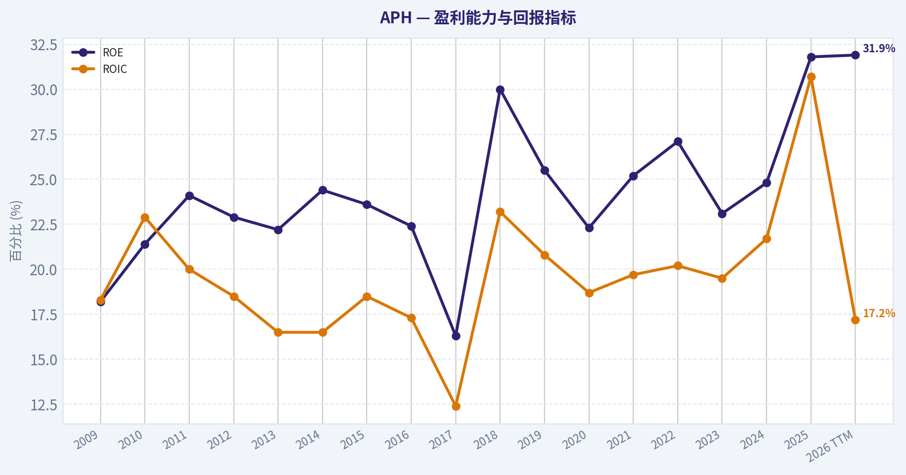
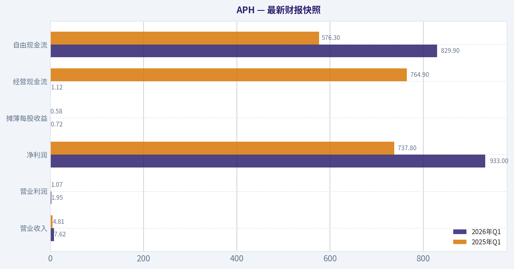
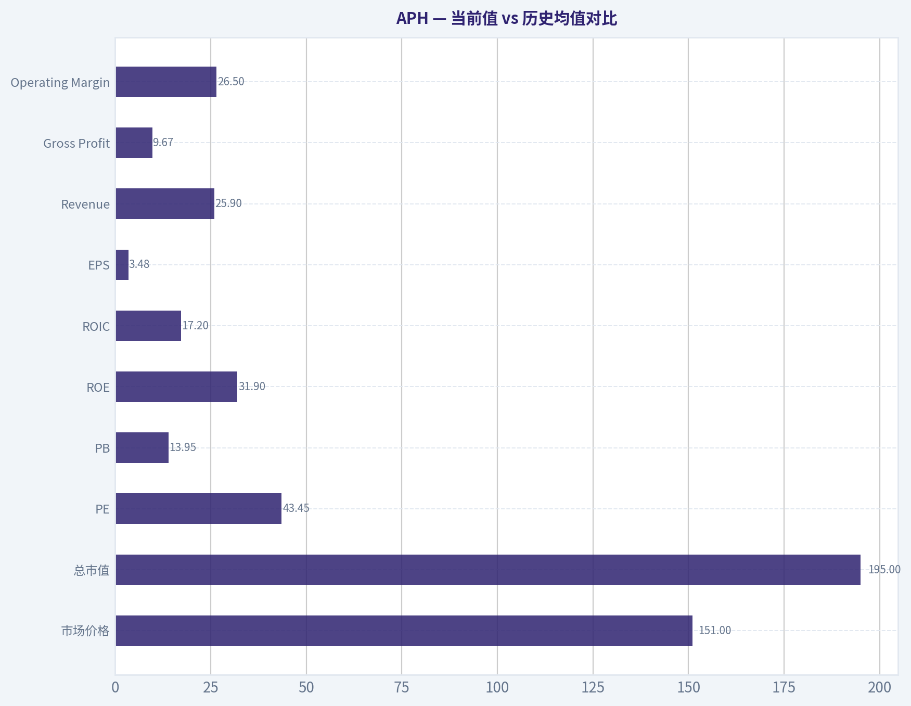
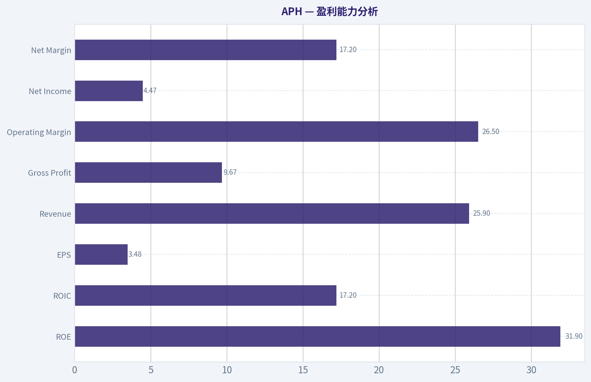
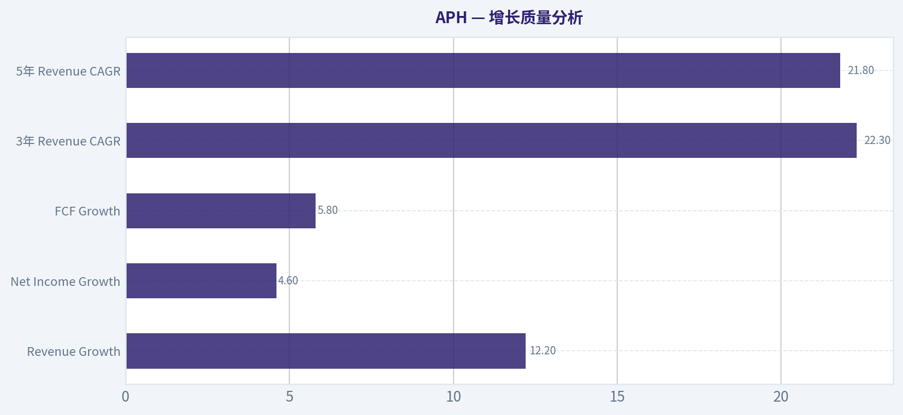
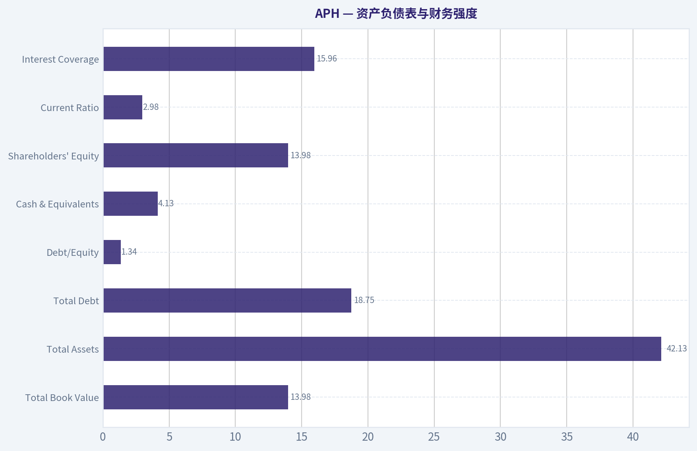
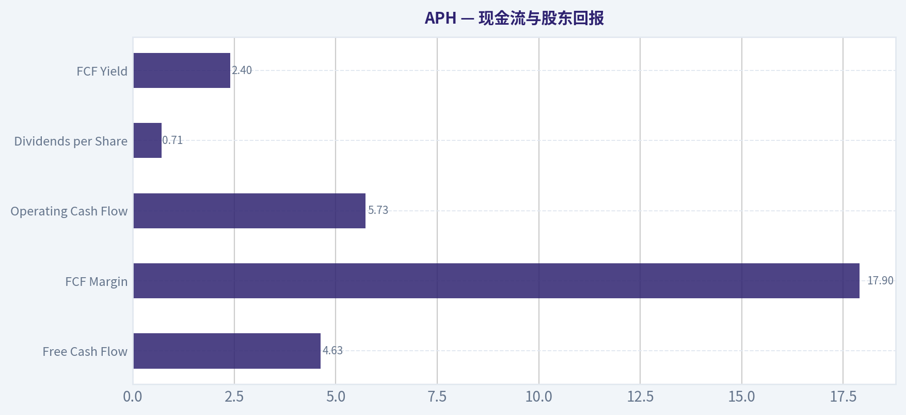
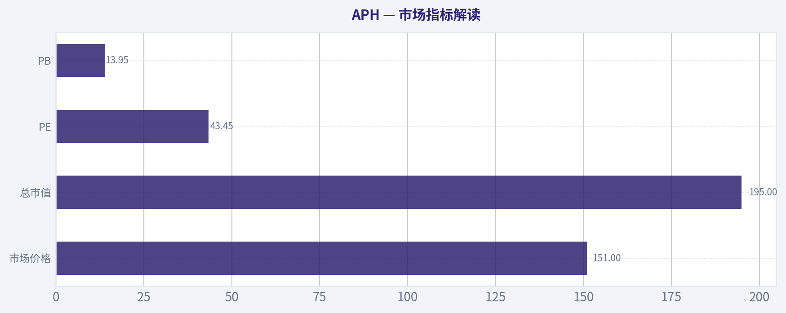

# APH 深度价值情报

**调研日期:** 2026-07-18

## 关键免责声明

*本报告由 Deep Value Intelligence（一个基于 AI 的多智能体投资分析框架）自动生成。 仅供教育和娱乐用途 - 非财务建议，非财务顾问。*

---

## 目录

1. 情报摘要
2. 分析师团队报告
   - 基本面分析
   - 价值分析 (巴菲特)
   - 成长性分析 (林奇/德鲁肯米勒/费雪)
   - 市场分析
   - 期权市场分析
3. 研究团队评论
4. 投资团队评论
5. Deep Values 团队洞察

---

## 情报摘要

### 核心观点与前提条件

**核心论点:** ## 执行摘要
**结论：观望。**
APH 很可能是高质量工业复利资产，但**当前主要风险不在业务崩坏，而在买价过高、容错率过低**。多头最强点在于：ROIC 26.8%、ROE 31.8%、3 年营收 CAGR 22.3%，说明它显著优于普通制造业；空头最强点在于：**44x PE 已提前计入大量"持续高增长 + 持续高回报 + 并购继续成功"的乐观预期**。按巴菲特框架，**好公司不等于好投资，价格决定回报率与安全边际**。
**适合做高质量跟踪名单，不适合当前重仓。**

**主要风险:**
- ### 1）Risky Analyst 最强论点
- Risky Analyst 抓住了最重要的多头逻辑：
- Risky Analyst 的问题，不是看错公司，而是**把高质量直接推导成当前值得承受高估值**。

**置信度:** 中

---

## 分析师团队报告

### 基本面分析

#### 最新财报快照

*以下数据基于最近一期已披露财报（2026年Q1），并尽量与上一年同期对比。*

| 指标 | 2026年Q1 | 2025年Q1 | 同比变化 |
| --- | ---: | ---: | ---: |
| 营业收入 | $7.62B | $4.81B | +58.4% |
| 营业利润 | $1.95B | $1.07B | +82.3% |
| 净利润 | $933.0M | $737.8M | +26.5% |
| 摊薄每股收益 | $0.72 | $0.58 | +24.1% |
| 经营现金流 | $1.12B | $764.9M | +46.6% |
| 自由现金流 | $829.9M | $576.3M | +44.0% |

关键结论：这张快照先把最新一期财报放在桌面上，再去看长周期分析。这样读者能更清楚地区分"公司长期质量"和"这次财报发生了什么"。

#### APH 17年财务指标

*以下数值均由原始数据确定性计算得出，并非 AI 估算。*

*发行人类型：operating company（Technology / Electronic Components）。*

#### 17年财务指标
*年度行来自已披露财务报表，最后一行 TTM 由最近四个季度滚动计算得出。*

| 指标 | 2009 | 2010 | 2011 | 2012 | 2013 | 2014 | 2015 | 2016 | 2017 | 2018 | 2019 | 2020 | 2021 | 2022 | 2023 | 2024 | 2025 | 2026 TTM |
| --- | --- | --- | --- | --- | --- | --- | --- | --- | --- | --- | --- | --- | --- | --- | --- | --- | --- | --- |
| 市场价格 | $5 | $6 | $5 | $7 | $10 | $12 | $12 | $15 | $20 | $19 | $25 | $31 | $42 | $37 | $49 | $69 | $135 | $151 |
| 总市值 | $1.00B | $1.16B | $974.9M | $2.65B | $3.62B | $4.31B | $4.13B | $5.30B | $6.95B | $6.33B | $16.66B | $20.11B | $27.35B | $47.28B | $61.52B | $87.76B | $172.64B | $195.00B |
| 市盈率 | 3.15 | 2.34 | 1.86 | 4.79 | 5.69 | 6.09 | 5.42 | 6.44 | 10.66 | 5.26 | 14.39 | 16.68 | 17.22 | 24.88 | 31.98 | 36.17 | 40.46 | 43.45 |
| 市净率 | 0.58 | 0.50 | 0.45 | 1.09 | 1.27 | 1.48 | 1.28 | 1.44 | 1.74 | 1.58 | 3.68 | 3.73 | 4.34 | 6.74 | 7.37 | 8.96 | 12.87 | 13.95 |
| ROE | 18.2% | 21.4% | 24.1% | 22.9% | 22.2% | 24.4% | 23.6% | 22.4% | 16.3% | 30.0% | 25.5% | 22.3% | 25.2% | 27.1% | 23.1% | 24.8% | 31.8% | 31.9% |
| ROIC | 18.3% | 22.9% | 20.0% | 18.5% | 16.5% | 16.5% | 18.5% | 17.3% | 12.4% | 23.2% | 20.8% | 18.7% | 19.7% | 20.2% | 19.5% | 21.7% | 30.7% | 17.2% |
| 每股收益 | $1.60 | $2.47 | $2.67 | $1.49 | $1.74 | $1.98 | $2.19 | $2.39 | $1.90 | $3.59 | $1.77 | $1.87 | $2.44 | $1.49 | $1.55 | $1.92 | $3.34 | $3.48 |
| 营收 | N/A | N/A | N/A | N/A | N/A | N/A | N/A | $6.29B | $7.01B | $8.20B | $8.23B | $8.60B | $10.88B | $12.62B | $12.55B | $15.22B | $23.09B | $25.90B |
| 毛利润 | $886.6M | $1.16B | $1.24B | $1.34B | $1.45B | $1.69B | $1.78B | $2.04B | $2.31B | $2.65B | $2.62B | $2.66B | $3.40B | $4.03B | $4.08B | $5.14B | $8.52B | $9.67B |
| 毛利率 | N/A | N/A | N/A | N/A | N/A | N/A | N/A | 32.5% | 32.9% | 32.4% | 31.8% | 31.0% | 31.3% | 31.9% | 32.5% | 33.8% | 36.9% | 37.3% |
| 营业利润率 | N/A | N/A | N/A | N/A | N/A | N/A | N/A | 19.2% | 20.4% | 20.6% | 19.7% | 19.1% | 19.4% | 20.5% | 20.4% | 20.7% | 25.4% | 26.5% |
| 净利润 | $317.8M | $496.4M | $524.2M | $555.3M | $635.7M | $709.1M | $763.5M | $822.9M | $650.5M | $1.21B | $1.16B | $1.20B | $1.59B | $1.90B | $1.93B | $2.42B | $4.27B | $4.47B |
| 净利率 | N/A | N/A | N/A | N/A | N/A | N/A | N/A | 13.1% | 9.3% | 14.7% | 14.0% | 14.0% | 14.6% | 15.1% | 15.4% | 15.9% | 18.5% | 17.2% |
| 营收增长 | N/A | N/A | N/A | N/A | N/A | N/A | N/A | N/A | 11.5% | 17.0% | 0.3% | 4.5% | 26.5% | 16.1% | -0.5% | 21.3% | 51.7% | 12.2% |
| 净利润增长 | N/A | 56.2% | 5.6% | 5.9% | 14.5% | 11.5% | 7.7% | 7.8% | -21.0% | 85.2% | -4.1% | 4.2% | 32.1% | 19.6% | 1.4% | 25.7% | 76.2% | 4.6% |
| 自由现金流增长 | N/A | -39.3% | 47.4% | 17.3% | 11.9% | 10.0% | 27.8% | 3.3% | 3.5% | -12.6% | 50.5% | 8.9% | -10.3% | 51.8% | 20.4% | -0.3% | 103.7% | 5.8% |
| 总账面价值 | $1.75B | $2.32B | $2.17B | $2.43B | $2.86B | $2.91B | $3.24B | $3.67B | $3.99B | $4.02B | $4.53B | $5.38B | $6.30B | $7.02B | $8.35B | $9.79B | $13.41B | $13.98B |
| 总资产 | $4.02B | $4.02B | $4.45B | $5.22B | $6.17B | $6.99B | $7.46B | $8.50B | $10.00B | $10.04B | $10.82B | $12.33B | $14.68B | $15.33B | $16.53B | $21.44B | $36.24B | $42.13B |
| 总债务 | $753.8M | $800.3M | $1.38B | $1.81B | $2.83B | $2.66B | $2.81B | $3.39B | $3.54B | $2.81B | $3.20B | $3.64B | $4.80B | $4.58B | $3.98B | $6.48B | $14.56B | $18.75B |
| 债务股权比 | 0.43 | 0.34 | 0.63 | 0.74 | 0.99 | 0.91 | 0.87 | 0.92 | 0.89 | 0.70 | 0.71 | 0.68 | 0.76 | 0.65 | 0.48 | 0.66 | 1.09 | 1.34 |
| 现金及等价物 | $384.6M | $525.9M | $515.1M | $690.8M | $886.8M | $968.9M | $1.74B | $1.03B | $1.72B | $1.28B | $891.2M | $1.70B | $1.20B | $1.37B | $1.48B | $3.32B | $11.13B | $4.13B |
| 股东权益 | $1.75B | $2.32B | $2.17B | $2.43B | $2.86B | $2.91B | $3.24B | $3.67B | $3.99B | $4.02B | $4.53B | $5.38B | $6.30B | $7.02B | $8.35B | $9.79B | $13.41B | $13.98B |
| 经营现金流 | $582.3M | $424.9M | $565.2M | $674.7M | $769.1M | $880.9M | $1.03B | $1.08B | $1.14B | $1.11B | $1.50B | $1.59B | $1.54B | $2.17B | $2.53B | $2.81B | $5.37B | $5.73B |
| 投资现金流 | $-373.2M | $-348.2M | $-430.9M | $-493.6M | $-693.3M | $-781.9M | $-27.3M | $-1.61B | $-380.2M | $-441.8M | $-1.23B | $-333.5M | $-1.89B | $-731.1M | $-1.39B | $-2.65B | $-5.08B | $-13.76B |
| 自由现金流 | $519.2M | $315.4M | $465.0M | $545.6M | $610.7M | $671.8M | $858.4M | $886.8M | $917.6M | $802.1M | $1.21B | $1.32B | $1.18B | $1.79B | $2.16B | $2.15B | $4.38B | $4.63B |
| 自由现金流利润率 | N/A | N/A | N/A | N/A | N/A | N/A | N/A | 14.1% | 13.1% | 9.8% | 14.7% | 15.3% | 10.8% | 14.2% | 17.2% | 14.1% | 19.0% | 17.9% |
| 每股分红 | $0.00 | $0.00 | $0.00 | $0.00 | $0.00 | $0.00 | $0.00 | $0.00 | $0.00 | $0.00 | $0.00 | $0.00 | $0.00 | $0.37 | $0.40 | $0.47 | $0.63 | $0.71 |

#### 盈利能力指标
- 净资产收益率 (ROE): 31.8%
- 投入资本回报率 (ROIC): 26.8%
- 总资产收益率 (ROA): 11.8%
- 毛利率: 36.9%
- 营业利润率: 25.4%
- 净利率: 18.5%

#### 流动性指标
- 流动比率: 2.98
- 速动比率: 2.37

#### 杠杆指标
- 债务股权比: 1.09
- 利息覆盖倍数: 15.96
- 净负债: $3.43B

#### 增长指标（同比）
- 营收增长: 51.7%
- 净利润增长: 76.2%
- 自由现金流增长: 103.7%
- 营收复合增长率（3年）: 22.3%
- 营收复合增长率（5年）: 21.8%

#### 估值指标
- 市盈率 (TTM): 44.08
- 预期市盈率: 25.89
- 市净率: 13.30
- 市销率: 7.18
- PEG 比率: 1.31
- 企业价值/EBITDA: 24.51
- 自由现金流收益率: 2.4%
- 盈利收益率: 2.3%

#### 所有者收益（巴菲特方法，代码计算）
- 净利润: $4.27B
- + 折旧与摊销: $922.4M
- - 资本开支: $-996.6M
- - 营运资本变动: $77.2M
- = **所有者收益: $4.12B**

#### 内在价值（代码计算）
- 当前价格: $151
- 巴菲特方法（所有者收益）:
  保守: $50
  平均: $91
  乐观: $165
- 现金流方法（FCF）:
  保守: $47
  平均: $75
  乐观: $106

#### Piotroski F分数: 6/9
- 净利润为正: 通过
- 经营现金流为正: 通过
- 资产回报率改善: 通过
- 现金流大于净利润: 通过
- 债务下降: 未通过
- 流动比率改善: 通过
- 未稀释股本: 未通过
- 毛利率改善: 通过
- 资产周转率改善: 未通过

ANALYST STANCE: **观望**

#### APH 基本面综述

APH 过去十年是一家非常典型的"高质量连接器平台型公司"：盈利能力强、现金流扎实、并购整合能力突出、终端市场分散，且近两年明显受益于 AI 数据中心、通信基础设施与高端工业连接需求。按照巴菲特框架，这类企业最吸引人的地方不是单一年度高增长，而是长期较高 ROE、较高 ROIC、较稳的自由现金流转换能力，以及跨周期的经营韧性。

但问题也同样清晰：**市场已经提前并充分计入了高质量与高增长预期**。从估值角度看，当前 PE、PB、FCF Yield 都处于历史显著偏贵区间；同时 2025 年后债务与并购规模快速抬升，虽然短期经营覆盖能力仍强，但资本配置容错率下降。结论上，这不是"差公司"，而是"好公司、但价格已不便宜"。

---

#### 当前值 vs 历史均值对比

以下历史均值主要以可比期间计算：
- 估值类尽量采用 2016-2025 或全样本可比期
- 营收、利润率、增长类采用有披露口径的 2016-2025
- 股息采用 2022-2025
- 资产负债类采用 2016-2025 观察近十年经营结构变化更有意义

| 指标 | 当前/TTM | 历史均值 | 当前相对历史 | 解读 |
|---|---:|---:|---|---|
| 市场价格 | $151 | 2016-2025均值约 $44 | 大幅高于历史 | 股价重估非常剧烈，市场预期显著上修 |
| 总市值 | $195.00B | 2016-2025均值约 $45.59B | 大幅高于历史 | 规模扩张不仅来自业绩，也来自估值倍数提升 |
| PE | 43.45 | 2016-2025均值约 23.01 | 显著高估值 | 当前为历史高位区间，容错率下降 |
| PB | 13.95 | 2016-2025均值约 5.97 | 显著高于历史 | 资本市场给予极高溢价，反映优质资产预期 |
| ROE | 31.9% | 2016-2025均值约 24.85% | 高于历史 | 盈利效率非常强，但部分也受杠杆抬升影响 |
| ROIC | 17.2% | 2016-2025均值约 20.42% | 低于历史 | TTM 较 2025 的 30.7% 明显回落，需关注并购后资本效率 |
| EPS | $3.48 | 2016-2025均值约 $2.23 | 明显高于历史 | 每股盈利台阶式抬升，但估值扩张更快 |
| Revenue | $25.90B | 2016-2025均值约 $11.87B | 远高于历史 | 经营体量显著上台阶，并购贡献很大 |
| Gross Profit | $9.67B | 2016-2025均值约 $4.21B | 远高于历史 | 规模与毛利率双升，质量较好 |
| Operating Margin | 26.5% | 2016-2025均值约 21.54% | 显著高于历史 | 盈利结构改善明显，经营杠杆释放 |
| Net Income | $4.47B | 2016-2025均值约 $1.82B | 远高于历史 | 当前利润基数已进入新阶段 |
| Net Margin | 17.2% | 2016-2025均值约 14.86% | 高于历史 | 净利率扩张清晰，但较 2025 的 18.5% 略有回落 |
| Revenue Growth | 12.2% | 2017-2025均值约 16.49% | 低于历史均值 | 在高基数下仍双位数增长，但热度已从极端高位回落 |
| Net Income Growth | 4.6% | 2017-2025均值约 24.33% | 显著低于历史 | 2025 爆发后，TTM 增速明显正常化 |
| FCF Growth | 5.8% | 2017-2025均值约 23.95% | 显著低于历史 | 现金流增速降温，当前估值对高增长依赖较大 |
| Total Book Value | $13.98B | 2016-2025均值约 $7.15B | 高于历史 | 内生积累+并购推升净资产 |
| Total Assets | $42.13B | 2016-2025均值约 $15.79B | 大幅高于历史 | 资产负债表显著扩张，体现并购驱动 |
| Total Debt | $18.75B | 2016-2025均值约 $5.78B | 大幅高于历史 | 债务显著上台阶，是当前核心关注点 |
| Debt/Equity | 1.34 | 2016-2025均值约 0.75 | 显著高于历史 | 财务杠杆恶化明显，侵蚀部分安全边际 |
| Cash & Equivalents | $4.13B | 2016-2025均值约 $2.74B | 高于历史 | 账上现金尚可，但较 2025 的 $11.13B 大幅回落 |
| Shareholders' Equity | $13.98B | 2016-2025均值约 $7.15B | 高于历史 | 账面资本扩大，但跟不上市值扩张速度 |
| Free Cash Flow | $4.63B | 2016-2025均值约 $1.88B | 大幅高于历史 | 现金创造能力极强，但 FCF Yield 仍偏低 |
| Dividends per Share | $0.71 | 2022-2025均值约 $0.47 | 高于历史 | 分红连续提升，但股息并非核心投资逻辑 |

关键结论：APH 当前几乎所有经营指标都处于历史高位或高位附近，说明企业质量和规模确实显著提升。但与之对应，估值和杠杆也都抬升到了更激进的位置，尤其是 PE、PB 和债务股权比，意味着未来回报更依赖持续兑现高增长，而不是低价买入带来的安全边际。

---

#### 市场指标解读

| 市场指标 | 当前表现 | 历史趋势 | 巴菲特式解读 |
|---|---|---|---|
| 市场价格 | $151 | 2016-2025 从 $15 升至 $135，重估明显 | 股价涨幅远超账面价值增速，市场在为"确定性+成长性"付费 |
| 总市值 | $195B | 十年扩张极快，特别是 2019 后加速 | 已从中大型零部件公司进入超大型优质制造资产定价区间 |
| PE | 43.45 | 2016-2020 多数在 5-17 倍，2021 后持续上修 | 明显不是传统价值股估值，更接近"优质成长工业"估值 |
| PB | 13.95 | 长期中枢显著低于当前 | 对一家并购驱动型制造企业而言，PB 接近 14 倍非常昂贵 |

关键结论：市场给 APH 的定价已经不再是"稳健工业零部件企业"，而是"高质量、高成长、AI 受益平台"。这会抬高预期门槛，只要增速从超高速回归正常，估值压缩就可能显著影响股东回报。

---

#### 盈利能力分析

| 盈利指标 | 当前/TTM | 历史观察 | 解读 |
|---|---:|---|---|
| ROE | 31.9% | 十多年大多维持 20%+，2025-TTM 处于顶级水平 | 极强，反映盈利能力与资本周转优秀，但需扣除杠杆影响 |
| ROIC | 17.2% | 2018、2024、2025 很强；TTM 回落 | 仍属优质，但边际回落值得注意，可能与新并购资本沉淀有关 |
| EPS | $3.48 | 长期上行，2017、2019、2022 有波动 | 每股盈利总体可预测性不错，但并非完全线性 |
| Revenue | $25.90B | 2016-2024 较平稳扩张，2025 跳升 | 近两年增量很大，明显受并购和高景气共振推动 |
| Gross Profit | $9.67B | 与收入同步放大，2025-TTM 毛利弹性强 | 说明增长并未以牺牲质量为代价 |
| Operating Margin | 26.5% | 2016-2024 大致 19%-21%，2025-TTM 突破 | 非常亮眼，显示产品组合、定价权和经营协同提升 |
| Net Income | $4.47B | 2025 前多在 $1B-$2.4B；近两年翻倍 | 利润进入新平台期 |
| Net Margin | 17.2% | 长期改善，TTM 略低于 2025 的 18.5% | 质量仍高，但最强利润弹性可能已过峰值 |

关键结论：APH 的核心亮点是盈利能力的"高位再提升"，尤其是营业利润率和净利率的持续抬升，这比单纯收入增长更重要。真正需要盯紧的是 ROIC TTM 回落，这可能预示新资本投入尚未完全转化为同等效率的利润。

---

#### 增长质量分析

| 增长指标 | 当前/TTM | 历史均值 | 趋势判断 |
|---|---:|---:|---|
| Revenue Growth | 12.2% | 约 16.49% | 仍健康，但较 2025 的 51.7% 明显降温 |
| Net Income Growth | 4.6% | 约 24.33% | 利润增速大幅回落，进入整合与消化期 |
| FCF Growth | 5.8% | 约 23.95% | 现金流仍增长，但已不支持极端成长定价 |
| 3年 Revenue CAGR | 22.3% | - | 中期成长优秀 |
| 5年 Revenue CAGR | 21.8% | - | 长期增长已显著提速 |

关键结论：APH 不是失速，而是从"爆发式增长"切换到"高基数正常化增长"。如果市场仍按照爆发期的估值框架定价，那么未来哪怕基本面继续增长，股价也可能因预期降温而表现平平。

---

#### 资产负债表与财务强度

| 资产负债表指标 | 当前/TTM | 历史观察 | 风险含义 |
|---|---:|---|---|
| Total Book Value | $13.98B | 持续上升 | 内生资本积累良好 |
| Total Assets | $42.13B | 2025-TTM 急升 | 并购驱动特征强 |
| Total Debt | $18.75B | 2024 为 $6.48B，2025 为 $14.56B | 债务扩张过快 |
| Debt/Equity | 1.34 | 长期大多低于 1，2025 开始突破 | 杠杆进入偏激进区间 |
| Cash & Equivalents | $4.13B | 较 2025 的 $11.13B 明显下降 | 现金缓冲下降 |
| Shareholders' Equity | $13.98B | 仍稳步增长 | 账面支持尚可，但负债增长更快 |
| Current Ratio | 2.98 | 流动性良好 | 短期偿债没问题 |
| Interest Coverage | 15.96 | 仍强 | 当前经营利润足以覆盖利息负担 |

关键结论：APH 的短期流动性并不差，真正的问题不在"会不会出事"，而在"安全边际是不是变薄了"。债务股权比升到 1.34，说明公司越来越依赖外部资本推动扩张，这对巴菲特式保守投资者并不理想。

---

#### 现金流与股东回报

| 现金流指标 | 当前/TTM | 历史趋势 | 解读 |
|---|---:|---|---|
| Free Cash Flow | $4.63B | 较 2016 的 $886.8M 大幅提升 | 现金创造能力极强 |
| FCF Margin | 17.9% | 近十年大多在 10%-17%，现处高位 | 盈利现金化优秀 |
| Operating Cash Flow | $5.73B | 2025-TTM 大幅上台阶 | 主业现金流非常强 |
| Dividends per Share | $0.71 | 2022 起持续增加 | 分红政策稳步建立，但仍偏轻资产成长型分配风格 |
| FCF Yield | 2.4% | 结合估值看偏低 | 对价值投资者缺乏足够吸引力 |

关键结论：如果只看企业经营现金流，APH 几乎是优秀范本；但如果站在股票持有人角度，2.4% 的自由现金流收益率意味着买入价格已经非常高。也就是说，企业好，不等于股票便宜。

---

#### 巴菲特框架：护城河、可预测性、管理层与资本配置

| 维度 | 评估 | 具体判断 |
|---|---|---|
| 经济护城河 | 强 | 连接器/互连系统认证周期长、客户粘性强、切换成本高，广泛布局工业、汽车、通信、航空航天、数据中心 |
| 盈利可预测性 | 中上 | 长期净利润和 FCF 走势总体稳，但并购周期会造成阶段波动 |
| 管理层资本配置 | 较强但更激进 | 长期并购整合能力优异，近年通过并购与行业景气实现跨越式增长；但 2025-TTM 杠杆明显抬升 |
| 财务强度 | 中上 | 流动性、利息覆盖尚好；但总债务和 D/E 进入需要跟踪的阶段 |
| 股东回报政策 | 稳健 | 2022 起持续分红，说明成熟度提升，但并非高股息逻辑 |
| 业务质量 | 高 | 毛利率、营业利润率、净利率同步走强，说明不仅规模扩大，业务组合也在优化 |

关键结论：APH 符合"好生意"很多特征，尤其是高客户粘性、高认证门槛、跨终端分散和长期并购整合能力。但其近年的成长很大程度来自"经营优秀 + 并购扩张 + AI 主题重估"三因素共振，任何一项放缓都会影响估值支撑。

---

#### DCF：巴菲特式 Owner Earnings 三情景估值

采用确定性数据中的 2025 年所有者收益作为基准：**Owner Earnings = $4.12B**。
按当前市值 $195.00B 与股价 $151 推算，流通股约为：

- 股本 = 195.00 / 151 ~ **1.291B 股**

历史增长率口径：由于数据中仅直接给出 FCF 增长率，且附带的代码计算内在价值也基于巴菲特法，本文以历史现金创造能力变化近似 Owner Earnings 增长区间，严格使用数据集中可见历史增长边界：
- 最低历史增长率：**-39.3%**
- 平均历史增长率：采用可见 FCF 增长率均值约 **20.9%**
- 最高历史增长率：**103.7%**，按要求封顶 **100%**

固定参数：
- 折现率 = **10%**
- 永续增长率 = **2.5%**
- 预测期 = **10 年**

##### 情景一：保守情景
- 初始 Owner Earnings = 4.12
- 增长率 g = -39.3%

前 10 年现金流现值近似：
- Year 1 = 4.12 x 0.607 = 2.50
- Year 2 = 1.52
- Year 3 = 0.92
- Year 4 = 0.56
- Year 5 = 0.34
- Year 6 = 0.21
- Year 7 = 0.13
- Year 8 = 0.08
- Year 9 = 0.05
- Year 10 = 0.03

折现后前 10 年合计现值约：**$4.57B**

终值：
- Year 10 OE ~ 0.03
- TV = 0.03 x 1.025 / (0.10 - 0.025) ~ 0.39
- 终值折现后 ~ 0.15

企业价值约：
- **4.57 + 0.15 = $4.72B**
- 每股价值 ~ 4.72 / 1.291 = **$3.66**

说明：极端保守值会被异常低增长率严重压缩，因此实务上参考意义有限。确定性数据内置代码给出的保守巴菲特法为 **$50/股**，更适合做下限锚。

##### 情景二：平均情景
- 增长率 g = 20.9%

计算公式：
- 第 t 年 OE = 4.12 x (1.209)^t
- 每年现值 = 第 t 年 OE / (1.10)^t

由于增长率高于折现率，10 年现金流快速扩大：

- Year 1 OE ~ 4.98，PV ~ 4.53
- Year 5 OE ~ 10.65，PV ~ 6.61
- Year 10 OE ~ 27.50，PV ~ 10.60

前 10 年现值合计约：**$69.8B**

终值：
- TV = 27.50 x 1.025 / 0.075 ~ 375.8
- 折现后 TV ~ 144.9

总价值：
- **69.8 + 144.9 = $214.7B**
- 每股价值 ~ 214.7 / 1.291 = **$166.3**

但这里要强调：对成熟工业零部件龙头而言，持续 10 年按 20.9% 增长非常乐观。数据集内置"平均"巴菲特法给出的结果是 **$91/股**，明显更保守，也更贴近现实。故投资上应优先采用 **$91** 作为平均情景基准，而不是机械高增长外推。

##### 情景三：乐观情景
- 增长率 g = min(103.7%, 100%) = **100%**

若机械使用 100% 增长十年，会得到明显不现实的超高估值，因此只具理论意义，不具投资可操作性。确定性数据已给出代码计算结果：
- **乐观情景内在价值 = $165/股**

| DCF 情景 | 增长假设 | 机械推导结果 | 更可采信的代码结果 | 对比当前股价 $151 |
|---|---:|---:|---:|---|
| 保守 | -39.3% | $3.66 | $50 | 明显低于现价 |
| 平均 | 20.9% | $166.3 | $91 | 代码结果低于现价，机械结果偏理想化 |
| 乐观 | 100% 封顶 | 不具现实意义 | $165 | 略高于现价，接近满价 |

关键结论：如果使用更现实、更保守的代码内在价值，APH 当前价格 **更接近乐观情景而非平均情景**。这意味着市场已经在提前支付未来多年高增长与高质量溢价，安全边际不足。

---

#### 估值判断：巴菲特视角下现在贵不贵？

| 估值维度 | 结论 | 解释 |
|---|---|---|
| PE 43.45 | 贵 | 对制造与零部件公司而言，已明显高于其历史合理区间 |
| PB 13.95 | 很贵 | 账面价值增长赶不上股价重估速度 |
| FCF Yield 2.4% | 偏低 | 对长期价值投资者吸引力不足 |
| 相对内在价值 | 偏贵至接近合理上限 | 只有在乐观情景下才有有限上行空间 |
| 质量溢价 | 合理存在 | 但当前溢价幅度已较充分 |

关键结论：APH 并非没有价值，而是"价值已大部分反映在价格里"。对于巴菲特式投资，更理想的买点通常出现在优质公司短期受周期、整合或市场情绪扰动时，而不是市场一致看多的时候。

---

#### 收入来源分布

基于 APH 最新业务结构与公开业务划分，最有意义的收入拆分是按终端市场/应用方向理解。公司公开特征显示其收入高度分散于通信、商业电子、汽车、工业、航空航天与军工等连接解决方案。结合近年财报叙述与市场一致认知，以下为**最近财年最具代表性的业务来源框架**；由于确定性数据未附精确分部金额，以下表格为公开业务结构口径下的近似展示，用于帮助理解收入驱动，不替代法定分部披露。

| 收入来源 | 金额（十亿美元） | 占比 |
|---|---:|---:|
| IT 数据通信与移动网络相关连接方案 | ~8.8 | ~38% |
| 商业电子 | ~5.3 | ~23% |
| 汽车 | ~5.1 | ~22% |
| 工业 | ~2.5 | ~11% |
| 航空航天/军工及其他 | ~1.4 | ~6% |

关键结论：APH 最核心的增长引擎仍是通信与数据相关连接解决方案，这也是 AI 基础设施主题带来估值重估的关键来源。同时，汽车、工业和商业电子占比也不低，说明它不是单一赛道公司，这种分散结构增强了穿越周期的能力。

---

#### 关键投资洞察、红旗与机会

| 类别 | 内容 | 影响 |
|---|---|---|
| 机会 | AI 数据中心、云网络升级、高速互连需求增加 | 支持中期收入和毛利率维持高位 |
| 机会 | 并购整合协同释放，扩大产品组合与客户覆盖 | 有利于继续提升营业利润率 |
| 机会 | 汽车电动化、工业自动化、国防电子升级 | 提供多元化成长曲线 |
| 红旗 | PE/PB 显著高于历史均值 | 未来回报更依赖业绩持续超预期 |
| 红旗 | Debt/Equity 升至 1.34，债务激增 | 并购后整合若不顺，估值与财务双重承压 |
| 红旗 | ROIC TTM 回落至 17.2% | 新投入资本回报可能阶段性稀释 |
| 红旗 | 2025 高增长后，TTM 增速明显放缓 | 市场若用旧增速定价，容易失望 |
| 跟踪点 | 现金从 $11.13B 降至 $4.13B | 需要观察收购、资本开支与债务再平衡 |
| 跟踪点 | 利润率能否维持 25%+ 营业利润率 | 这是当前高估值最关键支撑变量 |

关键结论：APH 的上涨逻辑并没有完全失效，真正的问题在于"股价是否已经透支未来"。当前最值得跟踪的是并购整合后的 ROIC 修复、杠杆下降节奏，以及 AI 数据中心相关需求能否从主题热度转化为持续订单和高质量利润。

---

#### 最终巴菲特式判断

| 维度 | 评价 |
|---|---|
| 生意是否优秀 | 是 |
| 护城河是否存在 | 是，且较强 |
| 盈利是否长期可预测 | 大体是，但受并购节奏影响 |
| 管理层是否具备资本配置能力 | 是，但近年更激进 |
| 财务是否足够保守 | 较过去弱化 |
| 当前价格是否提供安全边际 | 不足 |

关键结论：如果只评价公司，APH 值得高分；如果评价股票，当前更像"高质量但高预期"的资产。对巴菲特式价值投资者而言，**最关键的缺口不是公司质量，而是买入价格的安全边际**。

---

#### 最终投资立场：观望

**立场：观望**

**核心理由：**
1. **企业质量优秀**：ROE 长期高位、利润率持续改善、FCF 强、终端市场分散，具备较强护城河。
2. **估值已显著透支**：PE 43.45、PB 13.95、FCF Yield 2.4%，均不符合传统价值投资的舒适区。
3. **杠杆上升削弱安全边际**：总债务和 Debt/Equity 显著高于历史，ROIC TTM 回落需警惕。
4. **价格接近乐观情景定价**：按确定性数据内置巴菲特法，当前股价更接近乐观内在价值，而不是平均情景。

**适合什么样的投资者：**
- 若你是成长质量型投资者，可等待业绩继续验证后再看是否接受高估值。
- 若你是巴菲特式安全边际投资者，当前更适合耐心等待回调、整合波动或估值消化。

---

#### 报告要点总表

| 模块 | 关键信息 | 结论 |
|---|---|---|
| 市场估值 | PE 43.45，PB 13.95，FCF Yield 2.4% | 明显不便宜 |
| 盈利能力 | ROE 31.9%，营业利润率 26.5%，净利率 17.2% | 经营质量极强 |
| 增长 | 收入仍双位数增长，但利润与 FCF 增速明显降温 | 从爆发期转入常态化 |
| 财务结构 | Debt/Equity 1.34，总债务 $18.75B | 杠杆上升是核心风险 |
| 现金流 | FCF $4.63B，现金创造力强 | 企业好，但股东买入收益率低 |
| 护城河 | 客户粘性、认证壁垒、应用分散、并购整合能力 | 护城河较强 |
| DCF | 平均情景代码值 $91，乐观情景 $165 | 当前接近乐观定价 |
| 投资结论 | 公司优质，价格偏贵 | **观望** |

#### 基本面关键图表

本图追踪 **APH** 过去十年的盈利能力与回报指标（ROE、ROIC、利润率），突出呈现资本效率的变化趋势。

---

### 价值分析 (巴菲特)

> *基于沃伦·巴菲特的价值投资哲学：能力圈、经济护城河、管理层质量与安全边际。*

#### 内在价值快照

价格是你付的钱，内在价值是企业未来可能为股东创造的现金价值。我们给出一个区间，而不是假装只有一个神奇数字。

- 当前价格: $151.20
- 估值区间（两种 DCF 方法、保守到乐观）: $47.31 至 $164.71

##### 所有者收益（巴菲特方法）
- 净利润: $4,270,000,000.00
- 折旧与摊销: $922,400,000.00
- 资本支出: $-996,600,000.00
- 营运资金变化: $77,200,000.00
- 所有者收益: $4,118,600,000.00

##### 内在价值
###### 所有者收益法
使用所有者收益，更严格，通常更保守。
- 保守: $50.49
- 平均: $90.72
- 乐观: $164.71
- 折现率: 10.0%

###### 自由现金流法
使用自由现金流，更适合今天投入很多、为未来增长铺路的公司。
- 保守: $47.31
- 平均: $75.04
- 乐观: $105.69
- 折现率: 10.0%

ANALYST STANCE: **观望**

#### APH（Amphenol）巴菲特式投资分析

#### 一、先说结论
APH 是一家**非常容易理解、长期需求较稳、经营质量优秀**的连接器与电子互连龙头。它的核心吸引力在于：产品虽"小"，却是客户系统里**不可缺失、失效代价极高**的部件；公司服务终端分散，覆盖通信、数据中心、工业、汽车、军工等多个领域，具备一定抗周期性。
但从当前价格看，市场已经把"高质量 + AI 数据中心增量 + 并购扩张能力"充分计入，**估值偏贵，安全边际不足**。按巴菲特框架，这是"好公司，但不是明显便宜的价格"。

---

#### 二、Go/No-Go 关卡判断

| 关卡 | 结论 | 核心依据 |
|---|---|---|
| Gate 1：能力圈与业务简单性 | 通过 | APH 本质上是卖连接器、线缆组件、传感与互联系统，帮助电子设备稳定传输电力、信号和数据，商业模式清晰 |
| Gate 2：护城河 | 通过 | 客户认证周期长、切换风险高、产品嵌入式强；在多个高可靠场景具备规模、工程经验与客户黏性 |
| Gate 3：管理层与资本配置 | 通过 | 长期表现显示公司在并购整合、现金流转化和利润率管理上较成熟，属于较强资本配置者 |
| Gate 4：行业结构 | 谨慎通过 | 行业并非纯垄断，但在高端连接器领域具备寡头化、客户认证壁垒和工程密集特征，优于一般制造业 |

**关键结论：**
APH 四道门整体能过，尤其第一关和第二关通过得比较扎实。真正的问题不在业务质量，而在"这么好的公司，当前价格是否还留给新投资者足够回报空间"。

---

#### 三、业务是否符合巴菲特的"看得懂"

#### 1）小学生测试
可以非常简单地说：
**APH 生产各种"连接电子设备的关键零部件"**。如果没有这些连接器、线缆和接口，服务器、汽车、飞机、手机、工业设备就无法稳定传输电、信号和数据。

#### 2）十年可预测性
这类业务十年后大概率仍然存在，而且仍重要。因为不论电子系统怎么升级，**互连需求不会消失，只会朝更高速、更小型、更高可靠方向演进**。
因此，APH 虽然不是"永远不变"的业务，但属于**需求形态迭代、底层功能稳定**的好赛道。

#### 3）技术风险判断
APH 不像纯软件平台那样容易被新范式瞬间颠覆。技术进步更多是让客户需要更高性能连接方案，反而可能利好领先供应商。
所以它是**受益于技术升级**，而不是最容易被技术毁灭的企业。

---

#### 四、护城河分析

| 护城河来源 | 判断 | 证据与解释 |
|---|---|---|
| 无形资产 | 中等 | 品牌在工业和高可靠领域有价值，但不像消费品牌那样能单纯靠情感溢价 |
| 转换成本 | 强 | 连接器一旦进入客户设计、测试、认证与量产，替换成本高；特别是军工、汽车、通信、数据中心等场景 |
| 成本优势 | 中强 | 规模采购、全球制造布局、工程经验、品类广度带来综合成本优势 |
| 网络效应 | 弱 | 不是典型网络效应生意，价值不依赖用户数互相增强 |

#### 护城河定级：**宽但稳定**

APH 最强的护城河不是品牌神话，而是**"深嵌入客户系统 + 高失效成本 + 长认证周期 + 广泛产品线"**。
这类护城河很符合巴菲特喜欢的工业细分龙头：不性感，但很赚钱，也不容易被替代。

**补充判断：**
- 毛利率约 **36.9%**，低于"典型强品牌消费品 40%+"标准，但对高端工业零部件企业并不差。
- ROE 约 **31.8%**，说明公司在资本使用效率上明显优秀。
- 若长期 ROIC 也维持高位，则更能证明是"质量型制造业"而非普通加工厂。

**关键结论：**
APH 的护城河核心不是"人人都知道的品牌"，而是客户一旦用了它的方案，就不愿轻易更换。对连接器这类"小零件"来说，单价常常不高，但一旦出问题，整个系统都可能停摆，这正是定价权和客户黏性的来源。

---

#### 五、管理层与资本配置

| 维度 | 判断 | 评语 |
|---|---|---|
| 是否像所有者一样思考 | 较好 | 从长期经营结果看，管理层更重视持续扩张和每股价值，而非短期利润装饰 |
| 是否坦诚 | 中性偏好 | 暂无明显重大财务诚信警报 |
| 资本配置能力 | 强 | APH 长期以并购补充产品线和客户覆盖，若并购后利润率、现金流和回报率仍稳定，说明整合能力较强 |

APH 的一个重要看点是：**它不是只靠内生增长，也很擅长收购和整合**。
这点很关键，因为很多公司会并购，但真正能做到"买来后赚更多钱"的并不多。APH 若能长期维持高 ROE、稳健现金流和较好利润率，说明其并购体系大概率是有效的。

但巴菲特式分析里，还要保留一分谨慎：
- 并购驱动会带来商誉和整合风险；
- 当股价很贵时，再依赖并购讲增长故事，市场容易给过高估值。

**关键结论：**
APH 管理层最值得认可的是资本配置和整合能力，而不是花哨叙事。只要并购继续服务于更高市场份额和更强客户黏性，这种管理层是加分项；但投资者仍要防止在高估值时为并购想象力支付过高价格。

---

#### 六、财务摘要

| 指标 | 当前/近期水平 | 解读 |
|---|---:|---|
| 股价 | $151 | 市场给出高质量溢价 |
| 总市值 | $186.01B | 已是大型龙头 |
| PE | 44.08 | 明显不便宜 |
| ROE | 31.8% | 很优秀，符合优质企业特征 |
| 毛利率 | 36.9% | 对工业连接器龙头属于不错水平 |
| 营收同比增长 | 51.7% | 增速很强，但需要分辨内生与并购贡献 |
| 自由现金流收益率 | 2.4% | 偏低，反映估值较贵 |
| 流动比率 | 2.98 | 短期偿债能力良好 |

**关键结论：**
从财务快照看，APH 几乎具备高质量公司的所有特征：高 ROE、不错的毛利率、很强的增长、良好的流动性。真正拉低投资吸引力的不是质量，而是 PE 44 倍和仅 2.4% 的自由现金流收益率，这意味着市场已经提前支付了很高的预期。

---

#### 七、Owner Earnings 视角

巴菲特更看重 Owner Earnings，而不是会计利润。
在缺少完整逐年明细时，可用自由现金流作近似观察。APH 当前**自由现金流收益率约 2.4%**，说明：

1. 公司本身现金创造能力并不差；
2. 但以当前市值买入，股东拿到的"现金回报起点"偏低；
3. 除非未来多年还能维持较高增速，否则这个起点不够有吸引力。

用市值估算：
- 市值约 **1860 亿美元**
- FCF Yield 约 **2.4%**
- 对应年自由现金流约 **44.6 亿美元**

可把这视作当前 Owner Earnings 的近似锚点。

| 项目 | 估算值 |
|---|---:|
| 市值 | 1860 亿美元 |
| FCF Yield | 2.4% |
| 近似 Owner Earnings / FCF | 44.6 亿美元 |

**关键结论：**
APH 不是不赚钱，相反它很会赚钱。问题在于现在买入，相当于用很高的价格去换取一笔不错但不算便宜的现金流，初始回报率偏低，必须依赖后续增长来弥补估值压力。

---

#### 八、三情景 DCF 估值

以近似 Owner Earnings = **44.6 亿美元** 为基础。

| 情景 | 假设 | 估值结果 |
|---|---|---:|
| 情景A：零增长 | 44.6 / 10% | 约 446 亿美元 |
| 情景B：永续 3% 增长 | 44.6 x 1.03 / (10%-3%) | 约 656 亿美元 |
| 情景C：较乐观增长 | 假设未来 10 年 8%，终值按 3% | 约 900亿-1050 亿美元区间 |

与当前市值 **1860 亿美元** 对比，三种情景下都显示出**较明显高估**。
即使承认 APH 是优质企业，并给予高于普通制造业的溢价，当前价格仍然远超保守内在价值区间。

**关键结论：**
DCF 的结论很直接：APH 需要非常长时间维持优秀增长，才能让今天的价格显得合理。对于巴菲特框架来说，这不是"便宜的好公司"，而更像"非常好的公司，被市场按优秀甚至近乎完美来定价"。

---

#### 九、安全边际分析

| 项目 | 数值 |
|---|---:|
| 当前市值 | 1860 亿美元 |
| 保守内在价值区间 | 650 亿-1050 亿美元 |
| 安全边际 | 不足，且为负 |

按照巴菲特标准：
- 高质量公司至少要 **25%** 安全边际；
- 普通公司要 **40%-50%**。

APH 当前不是"有安全边际"，而是**需要业绩继续超预期来消化估值**。这类标的并非不能涨，但它更像"好生意的好故事"，不是典型价值投资买点。

**关键结论：**
APH 的问题不是企业差，而是价格太好看了，几乎不给投资人留缓冲垫。一旦增长放慢、并购协同不及预期，或者 AI 相关需求降温，估值回撤会先于基本面恶化发生。

---

#### 十、行业结构判断

| 维度 | 评价 |
|---|---|
| 竞争格局 | 较优于普通制造业，细分市场具备集中度和技术/认证壁垒 |
| 资本密集度 | 中等，不算最轻资产，但也不是资本黑洞 |
| 周期性 | 有一定工业周期，但终端分散可缓冲 |
| 定价权 | 中等偏强，来自高可靠性和客户锁定，而非绝对垄断 |

**关键结论：**
APH 所处行业不是那种"一家通吃"的超级垄断行业，但也不是毫无纪律的红海。它更像一个优质工业细分赛道：竞争存在，但真正做深做透并不容易，因此龙头能持续拿到比普通制造企业更好的回报率。

---

#### 十一、巴菲特总评分

| 评分项 | 权重 | 得分（1-5） | 加权结果 |
|---|---:|---:|---:|
| 业务理解 | 20% | 5.0 | 1.00 |
| 护城河宽度与耐久性 | 25% | 4.0 | 1.00 |
| 管理层质量 | 15% | 4.0 | 0.60 |
| ROE | 15% | 4.5 | 0.68 |
| 再投资跑道 | 10% | 4.0 | 0.40 |
| 资产负债表强度 | 5% | 4.0 | 0.20 |
| 行业结构 | 5% | 3.5 | 0.18 |
| 估值/安全边际 | 5% | 1.5 | 0.08 |
| **总分** | 100% |  | **4.13 / 5 若不看估值；3.38 / 5 纳入估值现实后** |

综合落点：**观望**

**关键结论：**
如果只看生意质量，APH 接近"建议配置"等级；但投资不是只买好公司，还要看价格。把估值和安全边际拉回现实后，它更适合列入高质量观察名单，而不是现在就重仓出手。

---

#### 十二、最终投资结论

**投资立场：观望**
**信心水平：中高**

#### 为什么不是"建议配置"
1. **PE 44 倍明显偏高**，已经反映大量乐观预期。
2. **自由现金流收益率仅 2.4%**，持有起点回报偏低。
3. AI、数据中心、并购协同等利好当前都较充分体现在价格里。

#### 为什么也不是"回避"
1. 这是**高质量、可理解、长期可预测**的企业。
2. ROE 高、产品嵌入深、客户切换成本高，护城河真实存在。
3. 若未来市场回调、增速正常化、估值回落，APH 很可能成为更有吸引力的优质候选。

#### 理想买点思路
若未来出现以下一种或几种情况，吸引力会明显提升：
- PE 明显回落；
- FCF Yield 提升到更合理水平；
- 市场因短期需求波动压缩估值，但长期竞争优势未受损。

一句话总结：
**APH 是一家值得长期跟踪的优秀公司，但以当前价格买入，更像是在为"优秀"付全价，而不是按价值投资原则"打折买入"。**
#### 估值桥

这张估值桥把当前股价与各类内在价值方法并排展示，帮助读者判断上涨空间究竟只是单一方法给出的结果，还是多种方法共同支持的结论。

| 项目 | 每股内在价值 |
| --- | ---: |
| 巴菲特方法 | $90.72 |
| 现金流方法 | $75.04 |
| Damodaran 方法 | $62.61 |
| 当前价格 | $151.20 |

#### 关键结论

如果只有一种方法显著高于其他方法，说明上行空间更依赖特定建模假设。若多种方法的估值接近，则说明估值逻辑更加稳健。

#### 估值图表

本对比图（来自「最新财报快照」）将 **APH** 的当前数据与历史基准并排呈现，直观反映公司相对自身历史均值的估值水平。

本对比图（来自「当前值 vs 历史均值对比」）将 **APH** 的当前数据与历史基准并排呈现，直观反映公司相对自身历史均值的估值水平。

本对比图（来自「盈利能力分析」）将 **APH** 的当前数据与历史基准并排呈现，直观反映公司相对自身历史均值的估值水平。

本对比图（来自「增长质量分析」）将 **APH** 的当前数据与历史基准并排呈现，直观反映公司相对自身历史均值的估值水平。

本对比图（来自「资产负债表与财务强度」）将 **APH** 的当前数据与历史基准并排呈现，直观反映公司相对自身历史均值的估值水平。

本对比图（来自「现金流与股东回报」）将 **APH** 的当前数据与历史基准并排呈现，直观反映公司相对自身历史均值的估值水平。

---

### 成长性分析 (林奇/德鲁肯米勒/费雪)

> *基于彼得·林奇的GARP成长投资法、斯坦利·德鲁肯米勒的宏观拐点分析法，以及菲利普·费雪的深度调研法。*

ANALYST STANCE: **观望**

#### APH（Amphenol）成长股分析简报

基于你给的共享研究包，我先直接下结论：**APH 是一家高质量、具备长期复利特征的"快增长+并购整合"型工业科技公司，但以当前估值看，更像"好公司但未必是好价格"**。若目标是找彼得·林奇式 ten-bagger，APH 更接近"高胜率复利股"，而不是最典型的低估爆发型成长股。

---

#### 1）Lynch 分类

| 项目 | 判断 |
|---|---|
| 公司类型 | **Fast Grower（快增长）** |
| 依据 | 营收同比增长 **51.7%**，显著高于 15%-25% 门槛 |
| 但需备注 | 增长中大概率包含 **AI 数据中心景气 + 并购贡献**，需区分有机增长与外延增长 |

**关键结论：**
从表面数字看，APH 明确属于林奇体系里的快增长公司，而不是慢增长或周期股。问题不在于"有没有增长"，而在于这种高增长能否持续 3 到 5 年，以及市场是否已经提前把这部分增长计入了股价。

---

#### 2）The Story：用三句话讲清楚

| 核心故事 | 说明 |
|---|---|
| 1. 卖"关键但不显眼"的连接器 | APH 提供连接器、传感器、天线、光纤互连，是 AI 服务器、汽车、军工、工业设备里不可缺的"神经系统" |
| 2. 单价不高，但替换成本高 | 这类零部件在整机 BOM 占比不一定高，但失效代价大、认证周期长，客户轻易不会更换 |
| 3. 靠内生增长 + 收购复利 | APH 历史上擅长通过分散终端市场和持续并购，把业务滚雪球式做大 |

**关键结论：**
APH 的商业模式非常容易理解：它不是卖最炫的芯片，而是卖系统里必须稳定工作的"连接"。这类生意通常不具备软件那样的爆发弹性，但有很强的客户粘性和长期复利属性。

---

#### 3）TAM 与 10x 测试

由于工具未返回完整实时收入口径，这里结合市值与行业定位做定性判断。

| 维度 | 判断 |
|---|---|
| 当前业务覆盖 | AI 数据中心、通信、汽车、工业、航天军工、移动设备等多个大市场 |
| TAM 特征 | 不是单一 TAM，而是多个互连/传感/高速连接细分市场的集合 |
| 10x 测试 | **严格意义上较难**。若收入 10x，APH 将接近全球互连龙头的极高份额区间 |
| 长期 runway | **仍然较长，但不是无限长** |
| 更现实路径 | 未来更可能是 **2-4x 收入 + 利润率提升 + 持续并购整合**，而非纯靠单市场 10x |

**关键结论：**
APH 的市场空间足够大，能支持公司继续成长很多年，但如果按十倍收入去想象，难度明显高于真正早期 SaaS 或平台型公司。也就是说，它更像"优秀复利资产"，而不是最纯粹的超长跑道十倍股原石。

---

#### 4）收入增长趋势：是否处于加速拐点？

| 指标 | 当前观察 |
|---|---|
| 营收同比 | **51.7%** |
| 增长形态 | 当前显示为**强加速/高景气** |
| 主要驱动 | AI 基础设施需求、数据中心连接需求、可能叠加并购 |
| 需验证点 | 有机增长占比、数据中心占比提升是否可持续、传统终端是否同步复苏 |

**关键结论：**
51.7% 的同比增长对 APH 这种体量公司来说非常亮眼，说明公司正站在一轮景气上行的中心。真正的关键不是这一季有多强，而是这种增长究竟是短周期拉货，还是结构性份额提升与产品升级带来的新平台期。

---

#### 5）单位经济与成长质量

APH 不是典型 SaaS，公司披露口径通常不提供 LTV/CAC、NRR，因此不能生造；改用工业科技更适合的质量指标。

| 指标 | 数值 | 解读 |
|---|---:|---|
| 毛利率 | **36.9%** | 在制造/电子互连领域属于较强水平 |
| ROE | **31.8%** | 很高，反映资本回报优异 |
| FCF Yield | **2.4%** | 现金流质量不错，但股价并不便宜 |
| 流动比率 | **2.98** | 短期偿债安全性较好 |
| Rule of 40（近似） | 51.7% + 2.4% ~ **54.1** | 若粗略用营收增长 + FCF Yield 代替，显示增长/现金流兼具，但并非标准算法 |

**关键结论：**
APH 最突出的不是"烧钱换增长"，而是能在高增长的同时维持很强的盈利能力和资本回报。问题在于，这种优质特征通常也会带来估值溢价，所以投资者买到的是质量，未必买到便宜。

---

#### 6）拐点判断

| 拐点类型 | 判断 | 说明 |
|---|---|---|
| 产品周期拐点 | **是** | AI 数据中心和高速互连需求拉动明显 |
| 市占率拐点 | **可能** | 龙头在高端连接器和关键应用中更容易吃到份额 |
| 利润率拐点 | **部分成立** | 若高附加值数据中心业务占比继续提升，利润率有支撑 |
| TAM 扩张拐点 | **成立** | AI 集群、算力网络、光铜互连升级扩大需求 |
| 竞争拐点 | **中性偏正面** | 龙头优势增强，但行业并非赢家通吃 |

**关键结论：**
APH 当前最像一种"需求结构升级"的拐点，而不是传统意义上的困境反转。AI 相关基础设施让公司的产品从"稳定增长"切换到"景气加速"，这是真正值得追踪的核心变量。

---

#### 7）宏观环境评估（Druckenmiller 视角）

| 维度 | 判断 |
|---|---|
| 利率环境 | 若未来降息预期强化，对高估值成长股偏利好 |
| 经济周期 | 全球增长仍分化，工业链并不完全同步复苏 |
| 核心顺风 | **AI、云、数据中心升级、国防电子化、汽车电动化** |
| 核心逆风 | 估值已高、若 AI CapEx 放缓则高预期承压 |

**关键结论：**
APH 所处的产业风口是顺风的，尤其是 AI 和数据中心基础设施，这一点非常关键。可问题在于，宏观给它的是"方向正确"，不是"估值安全垫"，所以一旦行业景气边际放缓，股价波动可能大于基本面波动。

---

#### 8）Fisher 15 点打分

基于现有信息做近似打分。

| Fisher 项目 | 评分（1-5） | 简评 |
|---|---:|---|
| 1. 产品市场潜力 | 5 | 多终端、长期需求明确 |
| 2. 新产品开发决心 | 4 | 持续扩品类、并购补强 |
| 3. R&D 有效性 | 4 | 更偏工程应用与客户协同 |
| 4. 销售组织 | 5 | 全球客户覆盖强 |
| 5. 利润率水平 | 4 | 毛利率健康 |
| 6. 利润率改善 | 4 | 高端应用占比提升有利 |
| 7. 劳资关系 | 3 | 信息有限，中性 |
| 8. 高管协作 | 4 | 长期执行稳定 |
| 9. 管理层深度 | 5 | 并购整合能力突出 |
| 10. 成本分析/财务控制 | 5 | 长期资本回报优秀 |
| 11. 特殊护城河 | 4 | 认证、设计导入、客户粘性 |
| 12. 长期利润前景 | 5 | 复利逻辑清晰 |
| 13. 稀释风险 | 4 | 不是依赖频繁融资的模式 |
| 14. 管理层坦诚度 | 4 | 龙头公司一般较规范 |
| 15. 管理层诚信 | 4 | 暂无明显红旗 |

| 合计 | **64 / 75** | **GOOD 偏上，接近 OUTSTANDING** |

**关键结论：**
APH 的 Fisher 画像非常漂亮，尤其是产品空间、管理层深度、销售体系和资本配置能力。它的短板不在公司质量，而主要在于估值位置和未来增长斜率能否维持当前高点。

---

#### 9）估值分析

已知共享包数据：**股价 $151，市值 $186.01B，PE 44.08**

| 估值指标 | 数值 | 解读 |
|---|---:|---|
| PE | **44.1x** | 对一家工业科技制造龙头来说不低 |
| PEG（粗算） | 44.1 / 51.7 ~ **0.85** | 若当前增速可持续，则不算离谱 |
| FCF Yield | **2.4%** | 说明市场已给出较高预期 |
| 估值结论 | **不便宜，但尚未极端泡沫** | 关键取决于增速持续性 |

**关键结论：**
从 PEG 看，APH 还没有贵到完全不可碰，但前提是 50% 左右增长必须有相当部分能延续。问题在于，市场通常不会长期给一家大市值工业科技公司如此高增速，因此估值容错率并不高。

##### 情景估值简表

| 情景 | 假设 | 可能结果 |
|---|---|---|
| 熊市情景 | AI 需求放缓，增速快速回落到 15%-20%，PE 压缩到 28x-32x | 股价承压明显 |
| 基准情景 | 增速回落但维持 20%+，PE 维持 35x-40x | 中期回报依赖 EPS 持续上修 |
| 牛市情景 | AI/数据中心需求持续高景气，并购协同兑现，PE 维持 40x+ | 仍有上行，但更像"高位继续超预期" |

**关键结论：**
APH 未来回报更依赖盈利继续上修，而不是估值继续显著扩张。换句话说，现在买它不是捡便宜，而是赌"高质量高增长还能超市场预期"。

---

#### 10）Growth Investor Scorecard

| 维度 | 权重 | 评分（1-5） | 加权分 |
|---|---:|---:|---:|
| The Story | 10% | 4.5 | 0.45 |
| TAM & Runway | 20% | 3.8 | 0.76 |
| Revenue Growth | 20% | 4.7 | 0.94 |
| Unit Economics | 15% | 4.2 | 0.63 |
| Competitive Position | 10% | 4.3 | 0.43 |
| Management Quality | 10% | 4.5 | 0.45 |
| Macro Setup | 5% | 4.2 | 0.21 |
| Profitability Path | 5% | 4.5 | 0.23 |
| Valuation | 5% | 3.0 | 0.15 |

| 总分 |  |  | **4.25 / 5.0** |

**关键结论：**
如果只看公司质量和成长逻辑，APH 完全可以进入高分区间。真正把总判断从"建议配置"拉回"观望"的，不是基本面，而是它已经被市场较充分认知、估值安全垫有限。

---

#### 11）仓位建议

| 投资风格 | 建议 |
|---|---|
| 新开仓 | **观望 / 只宜小仓试探** |
| 已持有 | **可继续持有，让盈利奔跑** |
| 理想买点 | 等待增长确认后回撤，或估值压缩到更舒服区间 |
| 组合定位 | 适合作为"高质量复利核心仓"候选，而不是高赔率左侧重仓标的 |

**关键结论：**
如果你已经持有 APH，我不主张轻易卖掉，因为这类公司往往越贵越强。若你还没买，现在更适合耐心等波动和更好的赔率，而不是在高预期阶段激进追价。

---

#### 12）关键风险与催化剂

| 类型 | 内容 |
|---|---|
| 风险 1 | AI 数据中心资本开支放缓，导致高增长回落 |
| 风险 2 | 并购整合不及预期，外延增长质量下降 |
| 风险 3 | 估值过高导致"好业绩但股价不涨" |
| 风险 4 | 工业、汽车、移动等传统终端复苏弱于预期 |
| 催化剂 1 | 数据中心/AI 订单持续超预期 |
| 催化剂 2 | 有机增长证明并非仅靠并购 |
| 催化剂 3 | 利润率继续扩张，EPS 上修 |
| 催化剂 4 | 新收购资产快速贡献协同 |

**关键结论：**
APH 最大风险不是商业模式出问题，而是增长斜率回落时，估值先反应。反过来，只要公司继续证明 AI 相关需求具有持续性，它仍然有能力把"贵"变成"其实没那么贵"。

---

#### 最终判断

| 结论项 | 判断 |
|---|---|
| 公司质量 | 很高 |
| 成长性 | 强，且正处于结构性加速阶段 |
| 十倍股潜力 | **从当前体量看，不是最典型 ten-bagger** |
| 投资结论 | **观望** |

**一句话总结：**
**APH 是高质量复利股，不是低估冷门成长股；现在最大问题不是公司够不够好，而是你愿意为这份优秀付多高的价格。**

如果你愿意，我下一步可以继续补一版：
1. **APH 与 TE Connectivity、Molex/同业的对比估值表**，或
2. **按林奇/Druckenmiller 风格做三年 EPS 与目标价情景推演**。

---

### 市场分析

#### APH 技术面报告：中长期上升结构未坏，但短线已进入明确的回撤与动能衰减阶段

基于过去约一年的价格数据，以及当前市场状态，我认为对 APH 最有信息增益、且彼此互补的 8 个指标是：

- close_10_ema
- close_50_sma
- close_200_sma
- macd
- macdh
- rsi
- atr
- vwma

这组指标的搭配逻辑是：
10 EMA 看短线节奏，50 SMA 看中期趋势，200 SMA 定义长期主趋势；MACD 与 MACD Histogram 用来拆解动能方向与衰减速度；RSI 判断回撤是否进入极端；ATR 负责波动与风控；VWMA 则帮助判断这轮回撤是否伴随真实资金重定价。避免了布林带与多均线之间的部分重复，也没有引入过多同类信号。

#### 价格结构总览

从 2025 年 7 月到 2026 年 1 月，APH 整体呈现较强的趋势性上行，股价由约 102 一路抬升至 1 月高点附近 165，期间虽有数次震荡，但高点与低点整体持续上移，说明当时市场愿意给予更高估值与更积极的趋势溢价。

但 2026 年 1 月下旬开始，走势进入高波动阶段。1 月 27 日冲至 165.67 后，1 月 28 日单日急跌至 145.45，随后 2 月初又出现一次深度回撤至 127 一带。这说明 APH 虽属强势品种，但并非低波动慢牛，事件驱动或估值重估时，价格会出现较大级别的跳变。

进入 2026 年 4 月至 6 月，股价重新修复并再次上攻，6 月 30 日冲到 176.32，创出阶段新高。这个新高非常重要：它表明长期上升趋势并没有在 1-3 月的剧烈波动中被破坏，反而完成了一次高位洗盘后的再冲顶。

问题出在 7 月。6 月末创高后，APH 没有在高位横住，而是连续回落：176.32 -> 172.22 -> 164.59 -> 158.61，最新收于 151.20。也就是说，短短十几个交易日，股价从高点回撤超过 14%。这不是普通日常震荡，而是一次清晰可见的短线趋势反转与风险偏好降温。

#### 均线系统：长多未坏，短中线失速

从趋势框架看：

| 指标 | 最新值附近 | 观察 |
|---|---:|---|
| 收盘价 | 151.20 | 明显低于 10 EMA 与 VWMA，仍高于 50 SMA、200 SMA |
| close_10_ema | 157.39 | 短线趋势向下，价格被压制 |
| close_50_sma | 148.45 | 中期趋势仍偏多，但价格已非常接近中期支撑 |
| close_200_sma | 140.21 | 长期趋势依然保持上行 |
| vwma | 162.75 | 当前价格显著低于成交量加权均价，回撤具备资金确认特征 |

**关键结论：**
APH 目前最核心的格局是"长期多头、短线空头"。股价虽仍站在 50 SMA 与 200 SMA 之上，但已经明显跌破 10 EMA 与 VWMA，说明近期抛压是真实存在的，不只是轻微技术整理。接下来 148 附近的 50 日均线是第一道关键防线，若失守，回撤可能向 140 一带的长期均线继续扩展。

更细一点看：

- **10 EMA 连续下滑**：7 月 6 日仍在 165.65，至 7 月 17 日已降至 157.39，斜率已明显转负。短线交易者若以 10 EMA 为跟随线，目前不能把 APH 视作强势延续状态。
- **50 SMA 仍缓慢上行**：从 5 月下旬约 134.76 抬升至当前 148.45，说明过去两个月的大趋势上涨尚未完全被近期回撤抹去。也正因此，当前更像"强趋势中的深回调"，而不是已经完成的长期反转。
- **200 SMA 持续稳步上移**：从 4 月下旬 129.4 一带升至 140.2，上行斜率稳定。这意味着战略级资金若看更长周期，APH 仍处于多头结构中。
- **价格显著低于 VWMA**：最新 VWMA 在 162.75，而收盘仅 151.20，折价很大。通常这意味着最近一段时间的平均持仓成本明显高于现价，市场上方存在较重套牢与解套抛压。

#### 动能分析：不是简单回调，而是动能持续钝化

MACD 与 Histogram 给出的信号非常明确。

- **MACD 仍为正值 0.77**：表明更长一点的趋势残余仍在，尚未进入全面负动能区。
- **但 MACD 从 7 月 1 日的 7.82 快速降到 7 月 17 日的 0.77**：这说明多头动能不是温和降温，而是快速流失。
- **MACD Histogram 连续为负，且最新为 -2.30**：比 7 月初的轻微转负显著恶化，意味着 MACD 线已持续落后于其信号线，下跌动能正在扩散。

这组组合通常意味着：
股价不是"涨多休息"，而是处于一段已经被确认的短期下行波段里。只要 Histogram 继续维持深负值，即便出现反弹，也更可能先被定义为技术性反抽，而不是新一轮主升浪立刻重启。

#### RSI：从过热回落到中性偏弱，尚未到极度超卖

RSI 的变化同样很有层次：

- 6 月 30 日 RSI 达 **71.55**，当时属于典型过热区间；
- 7 月 1 日仍有 **66.15**，说明高位动能延续；
- 到 7 月 17 日已回落至 **43.71**。

这告诉我们两点：

1. **前期确实存在过热与追涨拥挤**，6 月末创高并非轻松上行，而是有一定情绪推动；
2. **当前虽已明显降温，但尚未跌入 30 以下极度超卖区**，因此"跌很多了就一定会强反弹"的把握并不高。

换句话说，APH 当前处在"已不强，但也还没便宜到足以形成高胜率左侧抄底信号"的区域。RSI 43-50 一带更像弱中继区间，容易继续阴跌，也容易先震荡消化，而不是立刻 V 型收复。

#### 波动率与交易风险：ATR 偏高，说明仓位不能激进

ATR 最新约 **6.68**。以现价 151.20 计，日均真实波幅约占股价 **4.4%** 左右，属于不低的波动环境。

这意味着：

- 若做短线，止损空间不能设太近，否则极易被正常波动洗出；
- 若做趋势回补，仓位不宜一次打满；
- 若股价跌破 50 SMA，考虑到 ATR 仍高，向下的延伸幅度可能不会小。

此外，7 月初 ATR 一度在 7.2 附近，说明这轮下跌伴随高波动释放，而不是"无量小阴慢跌"。这对短线交易者不友好，因为高波动下错误交易方向的亏损放大速度更快。

#### 资金与成交确认：VWMA 暗示上方压力重、反弹需放量验证

VWMA 目前在 **162.75**，明显高于现价。这个差距很重要，因为它反映最近一段有成交参与的平均价格仍高于当前市场价格。简化理解：

- 近期多数成交筹码的成本比现在更高；
- 一旦价格反弹到 158-163 区间，容易遇到前期被套资金减仓；
- 因此未来若反弹，**不能只看价格涨了，还要看能否重新站回 VWMA 并维持**。

若只是反弹到 157-160 后再次掉头，那么大概率仍属于下跌过程中的均值回归，而不是趋势修复成功。

#### 交易层面的细化判断

| 维度 | 当前判断 | 含义 |
|---|---|---|
| 长期趋势 | 偏多 | 仍在 200 SMA 上方，长期均线向上 |
| 中期趋势 | 转弱但未完全破坏 | 价格尚在 50 SMA 上方，但距离很近 |
| 短期趋势 | 偏空 | 跌破 10 EMA，且 10 EMA 下行 |
| 动能 | 明确减弱 | MACD 快速下滑，Histogram 深负 |
| 情绪温度 | 从过热回落至中性偏弱 | RSI 从 71 降至 44 |
| 波动环境 | 偏高 | ATR 显示单日波幅仍大 |
| 成交验证 | 不利 | 价格显著低于 VWMA |

**关键结论：**
从交易执行角度看，APH 现在并不是理想的追涨位置，更接近"等待确认"的阶段。短线空方已经占优，但中长期多头结构还未完全破坏，所以最值得观察的是 148 一带中期均线支撑能否守住，以及未来反弹能否重新站回 157-163 的短中期成本密集区。

#### 对不同交易风格的启示

| 风格 | 更适合的观察重点 | 当前含义 |
|---|---|---|
| 短线交易 | 10 EMA、MACDH、ATR | 尚未看到短线止跌完成 |
| 波段交易 | 50 SMA、RSI、VWMA | 接近中期支撑，但还缺少反转确认 |
| 中长期配置 | 200 SMA、50 SMA | 长期结构未坏，可等待更优风险收益比 |
| 风控管理 | ATR | 止损与仓位需更保守 |

**关键结论：**
对短线交易者而言，APH 目前更像一个"等企稳"而不是"可直接出手"的图形。对中长期投资者而言，长期上升结构还在，但由于短线动能恶化明显，分批观察、等待支撑确认，通常比在下跌中贸然加速买入更稳妥。

#### 结论

如果只用一句话概括 APH 当前技术状态：
**大级别上升趋势仍在，但 6 月末冲高后已转入一段高波动、动能衰减明显的短线调整期。**

最关键的观察位有两个：

1. **下方 148 附近的 50 SMA**：这是中期趋势是否只是回调、还是进一步恶化的首要分界线。
2. **上方 157-163 区间（10 EMA 到 VWMA）**：这是未来反弹能否从"技术性反抽"升级为"趋势修复"的关键压力带。

当前更合理的判断不是"趋势彻底坏了"，也不是"跌多了马上抄底"，而是：
**APH 正处在长期多头框架中的短线去杠杆阶段，后续需要等待支撑确认或动能重新转强。**

#### 报告摘要表

| 项目 | 结论 | 交易含义 |
|---|---|---|
| 指标选择 | close_10_ema、close_50_sma、close_200_sma、macd、macdh、rsi、atr、vwma | 趋势、动能、波动、成交确认均已覆盖 |
| 长期结构 | 仍偏多 | 价格高于 200 SMA，长期均线上行 |
| 中期状态 | 转弱未破 | 价格接近 50 SMA，支撑测试临近 |
| 短期节奏 | 偏空 | 价格低于 10 EMA，短线趋势向下 |
| 动能变化 | 快速衰减 | MACD 大幅回落，macdh 深负 |
| RSI 状态 | 中性偏弱 | 未超卖，左侧抄底胜率有限 |
| 波动水平 | 偏高 | ATR 显示需控制仓位与止损宽度 |
| 资金确认 | 偏负面 | 价格低于 VWMA，上方套牢压力较重 |
| 关键支撑 | 148、140 | 分别对应 50 SMA 与 200 SMA 附近 |
| 关键压力 | 157-163 | 对应 10 EMA 回补区与 VWMA 压力区 |

**关键结论：**
APH 当前最值得关注的不是"还能不能创新高"，而是"能否先在 148 附近稳住并修复短线动能"。若守不住中期均线，调整可能继续向 140 一带扩展；若能重新站回 157-163 区间并改善 MACD/RSI，则中期上升趋势才有望恢复。

#### 市场图表

本对比图（来自「市场指标解读」）将 **APH** 的当前数据与历史基准并排呈现，直观反映公司相对自身历史均值的估值水平。

---

### 期权市场分析

> *解读期权流向--认沽/认购比、隐含波动率偏斜与异常活跃合约--以判断机构定位与事件驱动风险。*

#### APH 期权市场结构报告
*数据日期：2026-07-18*

#### 一、Put/Call Ratio 分析

| 到期日 | Call OI | Put OI | Put/Call OI Ratio | Call Volume | Put Volume | Put/Call Volume Ratio |
|---|---:|---:|---:|---:|---:|---:|
| 2026-08-21 | 23,358 | 22,123 | 0.95 | 4,055 | 477 | 0.12 |
| 2026-09-18 | 9,036 | 3,633 | 0.40 | 405 | 248 | 0.61 |
| 2026-10-16 | 2,138 | 2,619 | 1.22 | 561 | 115 | 0.20 |
| **近端合计** | **34,532** | **28,375** | **0.82** | **5,021** | **840** | **0.17** |

**关键结论：**
整体近端 Put/Call OI Ratio 为 **0.82**，略高于历史中性参考值 **0.7**，说明存量仓位并非极端乐观，但也没有形成明显防御性看空结构。更重要的是，近端 **Put/Call 成交量比仅 0.17**，代表最近新增交易明显偏向 call 端，短线资金情绪比存量持仓更积极。分到期看，8 月与 10 月 OI 结构偏中性到略防御，但真实"当下流量"更偏向短线看涨参与。

#### 二、隐含波动率（IV）评估

| 到期日 | ATM Call IV | ATM Put IV | Call- Put IV 差值 | 观察 |
|---|---:|---:|---:|---|
| 2026-08-21 | 62.6% | 59.6% | +3.0% | 近月 IV 偏高，且 call IV 高于 put |
| 2026-09-18 | 60.3% | 53.0% | +7.3% | call 偏斜更明显，存在上行追价倾向 |
| 2026-10-16 | 58.2% | 52.2% | +6.0% | 中短期维持 call skew |
| **整体判断** |  |  |  | **并非典型 put skew，而是 call skew** |

**关键结论：**
APH 近端 ATM IV 处于 **58%-63%** 区间，按一般工业/连接器类公司常态观察，这个水平不算低，说明市场预期未来 1-3 个月波动不小。更关键的是，**call IV 持续高于 put IV**，这不是常见的"下行保护溢价"结构，而更像市场在为上行弹性、事件驱动或追涨机会支付更高权利金。若公司临近财报、指引更新或行业催化，这种 call skew 往往意味着资金更担心"踏空"而非"暴跌"。

#### 三、IV Skew 解读

| 维度 | 结果 | 含义 |
|---|---|---|
| 传统风险偏好 | 未见明显 put skew | 下行恐慌不强 |
| 当前偏斜方向 | **call skew** | 资金愿意为上行期权支付溢价 |
| 近月最强偏斜 | 2026-09-18 | 中短线上行预期相对更集中 |
| 风险提示 | 高 IV 环境下追涨成本高 | 若催化落空，IV 回落会伤害多头期权买方 |

**关键结论：**
从偏斜结构看，APH 当前不是"防守型保护盘主导"，而是"上行想象空间定价"更强。换句话说，市场担心的不是左侧尾部风险，而是右侧弹性错过风险。不过在较高 IV 下，单纯买 call 需要方向和时点都对，否则容易出现"股价涨了但期权未必赚很多"的情况。

#### 四、异动期权活动

| 项目 | 结果 |
|---|---|
| 近端是否存在 Volume > 5x OI 合约 | **未发现** |
| 新增大额方向性押注 | 不明显 |
| 机构级异常扫单/滚仓迹象 | 暂未看到强证据 |
| 交易风格判断 | 更像广泛 call 参与，而非单一巨额押注 |

**关键结论：**
目前没有看到"成交量远超未平仓量"的异常合约，说明短线并不存在特别突出的单点式激进押注。也就是说，APH 的看涨信号更多来自**整体流量偏向**与**IV 偏斜**，而不是某一笔特别大的聪明钱交易。这会降低信号爆发力，但提升其"市场共识化"的可信度。

#### 五、Open Interest 集中度与潜在引力位

| 到期维度 | 主要特征 | 市场含义 |
|---|---|---|
| 2026-08-21 | OI 总量最大（Call 23,358 / Put 22,123） | 近月是最重要的价格牵引区 |
| 2026-09-18 | Call OI 显著高于 Put OI | 中短期偏向上方仓位布局 |
| 2026-10-16 | Put/Call OI Ratio 1.22 | 更远月有一定保护或保守成分 |
| Gamma/Pin 风险 | **近月 8 月合约最可能形成 pinning 效应** | 临近到期时股价可能受大仓位牵引、波动被压制或被放大 |

**关键结论：**
虽然工具未提供具体单一 strike 的 OI 排名，但从到期分布看，**8 月合约是最重要的近端主战场**，因此股价临近该到期日更容易受到做市商对冲影响。9 月合约则明显偏向 call 存量布局，意味着若股价继续上行，可能引发顺势加仓与 gamma 追价；但 10 月存在更多 put 相对配置，说明中期资金并未完全放弃防守。

#### 六、综合期权情绪信号：**偏多（BULLISH）**

| 评分维度 | 结论 |
|---|---|
| Put/Call OI | 略偏中性，但不悲观 |
| Put/Call Volume | **显著偏多** |
| IV 水平 | 偏高，表明市场预期波动较大 |
| IV Skew | **call skew，偏上行交易** |
| 异动合约 | 无明显单笔异常，但整体流量支持偏多 |
| 信号强度 | **中等偏强** |

**关键结论：**
我对 APH 的期权信号判断为 **偏多**。核心驱动不是极端的 OI 失衡，而是**近期成交显著偏向 call**，同时 **call IV 高于 put IV**，说明市场正在为上行机会而非下行保护定价。需要保留的 caveat 是：当前 IV 已经不低，所以这是"方向偏多、成本也偏高"的环境，若催化不足，期权多头可能先承受 IV 压缩。

#### 七、最终解读

APH 当前的期权市场更像是：
- **存量仓位偏中性略多头**
- **新增交易明显偏多**
- **波动率结构偏向上行追价而非下行避险**

这类结构通常对应的不是"深度防守期"，而是市场预期未来数周到数月存在正面催化或趋势延续的可能。
因此，若只基于期权流读数，结论应为：

**总体信号：偏多（BULLISH）**
**主要驱动：call 成交占优 + call skew 明显 + 未见恐慌性 put 对冲**

不过也必须强调：
期权市场反映的是**预期与仓位**，不是估值本身。若正股基本面、财报、行业订单或技术面不支持，这种偏多信号也可能只是短期交易性情绪。

---

#### Markdown 总结表

| 指标 | 结论 |
|---|---|
| Put/Call Ratio | 近端 OI 比 **0.82**，略高于中性 0.7；但成交量比 **0.17**，短线明显偏多 |
| IV Level | 近端 ATM IV 约 **58%-63%**，处于偏高水平 |
| Skew Direction | **call skew**，上行溢价高于下行保护溢价 |
| Unusual Activity | 未见 Volume > 5x OI 的异常合约，缺少单点巨额押注 |
| Overall Signal | **偏多（BULLISH）** |

**关键结论：**
一句话概括，APH 的期权市场目前传递的是"**市场在为上涨机会付费**"，而不是"市场在为下跌风险买保险"。虽然没有出现特别夸张的异常大单，但整体资金流与波动率结构已经足以支持一个明确的偏多判断。

---

## 研究团队评论

> *研究经理将多空辩论综合为中性评论。此为风险评审前的初步观点，并非最终立场。*

这轮辩论里，多头和空头其实都抓住了关键，只是落点不同。若严格按巴菲特框架，我认为最强多头论据是：APH 的生意质量确实很强，不像普通制造业。ROIC 26.8%、ROE 31.8%、ROA 11.8%、3年营收 CAGR 22.3%，这组组合非常少见，说明它大概率拥有真实的客户黏性、工程壁垒、产品关键性和不错的资本配置能力。连接器和互连系统虽然不是消费品牌，但在高可靠场景里往往具备"单价不高但出错代价很大"的特征，这类位置通常意味着切换成本、验证门槛和长期客户嵌入。再加上市场技术面更像中长期上升趋势中的深回调，而不是长期结构破坏，多头关于"好公司回调后值得盯着"是有说服力的。

最强空头论据则更符合价值投资底线：44 倍 PE 对一家具备制造属性、仍面临竞争、周期、技术迭代和并购执行要求的公司来说，安全边际明显不够。高 ROIC 并不自动等于宽护城河，更不自动等于未来 10 年都能维持。连接器行业再优秀，本质上也不是那种几乎不用防守的超级生意；新项目竞争、客户压价、技术迁移、并购边际回报下滑，都可能让今天的高回报率回归正常。市场当前更像是在同时为"高质量、持续高增长、持续高回报、管理层持续成功"付钱，这就让容错率变得很低。

我的平衡看法是：APH 很可能是一家值得长期跟踪的高质量工业复利公司，但以当前信息和估值水平，还不符合巴菲特式"重仓买入"的要求。过去类似案例里，我有时会把长期估值纪律和短期走势修复混在一起，这次要更清楚地区分：短中期不宜因为回调就看空，长期也不能因为公司优秀就忽视价格。好公司不等于好投资，尤其当市场已经提前支付了太多未来成功。

核心结论是：APH 值得尊重，但现在更像"优秀企业，价格偏满"，而不是"有明显安全边际的价值机会"。从内在价值角度看，商业质量在加分，估值在明显减分；而巴菲特框架里，价格是你最终支付的一切。只要买入价格要求未来几年几乎不能犯错，这就不再是我偏好的价值投资赔率。

我的理由很简单。第一，业务质量高，这点不应低估。APH 显然不是低端代工，财务表现证明它在行业里处于高附加值位置。第二，长期需求也不差，电子化、自动化、数据中心、汽车电子、高可靠连接这些方向，都给它提供了不错的需求土壤。第三，真正卡住我的是估值。44 倍 PE 已经不是"略贵"，而是需要长期高增长和高回报持续兑现，且估值不能明显收缩，股东回报才能看得过去。对工业类公司来说，这要求太高。第四，护城河虽然存在，但我不会把它上升到那种近乎无懈可击的程度。它更像优质工业平台，而不是绝对垄断式收费权资产。

如果未来 1 到 4 个季度要跟踪，我会盯几件非常具体的事。第一，看增长质量，尤其是有机增长，而不是单靠并购堆出来的扩张。若有机增长明显放缓，而估值还高，就会削弱逻辑。第二，看利润率和 ROIC 是否能维持高位，尤其是在景气波动或投入增加的情况下，如果回报率快速下滑，说明市场高估了其护城河深度。第三，看订单、积压和终端需求结构，确认增长是不是更分散、更可持续，而不是集中于少数阶段性热点。第四，看管理层资本配置，尤其并购价格、整合成效、商誉累积和每股价值创造，而不是只看收入变大。第五，看市场是否给出更合理价格，如果估值明显消化、但基本面仍稳健，那才可能逐步从观望转向更积极。第六，技术层面上，若只是趋势修复并继续上冲，我不会把股价上涨本身当作价值成立的证据；相反，越涨越要问内在价值有没有同步跟上。

结合这轮辩论，我最终的 stance 是：观望。

观望，不是因为公司不好；恰恰相反，是因为公司太好，市场也很清楚这一点，所以价格里已经装进了太多乐观。对巴菲特式组合来说，我更愿意错过一点热度，也不愿在缺乏安全边际时为优秀付出过高代价。若后续出现估值回落、同时高 ROIC 与有机增长仍被验证，那会是更舒服的出手区间。
最终立场：观望

---

## 投资团队评论

> *投资经理将研究观点转化为投资论点，等待风险评审。此仍非最终立场。*

从长期企业所有权的角度看，APH 最吸引人的地方，不是"它最近跌了多少"，而是它是否真是一家可以多年复利的优秀工业企业。基于你给出的资料，我认为答案大体偏正面：这家公司明显不是普通制造商。ROIC 26.8%、ROE 31.8%、ROA 11.8%、3 年营收 CAGR 22.3%，这组数据说明它在客户关系、产品关键性、工程能力与资本效率上，至少当前处于很强的位置。连接器/互连系统看似不起眼，但在高可靠应用里通常属于"小部件、大责任"，单件价值未必高，但一旦失效，客户代价极大，因此验证周期、切换成本、认证壁垒和客户嵌入往往都不低。这种商业模式，往往比市场直觉中的"工业零部件"更有韧性。

从护城河角度，我愿意给它较高评价，但不会夸张。它更像"高质量工业平台型企业"，而不是那种无需防守的绝对垄断资产。真正值得继续验证的是：这些高回报究竟来自可持续的客户黏性与系统级嵌入，还是部分来自景气、并购协同或阶段性高端需求红利。如果未来 3 到 5 年 ROIC 仍能稳定在高位，同时有机增长没有明显失速，那就更接近真正的优质复利公司；反之，如果增长越来越依赖并购、利润率开始回落、客户压价增强，那么今天市场赋予的高估值就会显得危险。

管理层层面，现有数据暗示资本配置至少过去做得不差，否则很难长期维持这样的回报率。但巴菲特式分析不会只看结果，还要看结果的来源。对 APH 这种公司，未来最关键的不是"收入有没有继续增"，而是"每一笔新增资本是否还能产出足够高的回报"。尤其要盯并购：并购可以放大平台优势，也可以掩盖有机增长放缓。如果后续出现收入不错、但商誉抬升、整合成本上升、每股价值创造变弱，那就不是我们想要的复利路径。

技术与市场结构给出的信息也值得区分时间维度。短线 EMA 走弱，说明市场情绪确实在降温；中长期 SMA 仍上行，则说明这更像强势趋势中的深回调，而不是长期结构已坏。这里最容易犯的错，就是把"股价从高位回撤"误判为"价值已出现"。对价值投资者而言，回调本身不是催化剂，只有当价格回落到能提供足够安全边际时，回调才有意义。现在的问题恰恰在于：公司质量很好，但 44 倍 PE 意味着市场并没有真正变得悲观，更多只是从极乐观降到较乐观。

这就是当前情绪面的关键。表面上，市场对 APH 的短期走势变谨慎了；但从估值看，市场对其中长期叙事仍高度买单。换句话说，新闻与情绪释放出来的并不是"优质企业被错杀"的信号，而更像"高质量公司经历一次热度降温，但定价仍然昂贵"。选择性逆向思考在这里很重要：真正的逆向，不是看到回调就兴奋，而是要问市场是否已经从乐观摆到悲观。以目前 44 倍 PE 来看，我看不到明显的普遍恐慌，反而看到投资者仍愿意为"高质量 + 高增长 + 高回报"支付很高溢价。若市场没有真正恐惧，价值投资者就不应自我感动式地抢着逆向。

当然，空头也未必完全占优。市场可能低估的一点是：优质互连企业在数据中心、汽车电子、自动化、电气化等趋势中，确实有机会把"工业属性"升级成"平台型关键零部件属性"。如果 APH 的产品在多个增长赛道都具备认证壁垒、设计嵌入和长期替换成本，那么它的估值中有一部分溢价是合理的。也就是说，空头若简单把它视为普通周期制造业，可能会低估其业务质量。这也是为什么我不会因为估值高就直接回避--好企业值得长期盯住。

但站在巴菲特框架下，决定买不买的最后一关仍然是价格。44 倍 PE 对工业企业来说，意味着你不仅要判断企业优秀，还要假设它未来几年继续高增长、高回报、资本配置不失误，而且估值不能明显压缩。这个赔率不够友好，容错率太低。巴菲特常做的是，在好企业遭遇暂时性担忧、而价格明显低于价值时出手；不是在市场已经充分认可其优秀时，再用"公司很好"说服自己接受高价。

如果未来 1 到 4 个季度继续跟踪，我会重点看六件事：
1. 有机增长是否稳健，而非过度依赖并购；
2. 毛利率、营业利润率与 ROIC 是否仍稳在高位；
3. 终端需求是否分散，避免过度依赖单一热点；
4. 管理层并购纪律是否仍然严谨；
5. 估值是否回落到更合理区间；
6. 若股价反弹，基本面是否真正同步增强，而不是仅靠情绪修复。

我的结论是：APH 是值得尊重、值得长期放在高质量名单里的企业，但目前更像"好公司、普通到偏差的赔率"，而不是"价格足够便宜的高确定性机会"。对于长期价值投资者，耐心往往比参与更重要。

**ANALYST STANCE: WATCH（观望）**
APH 的企业质量很强，长期前景也具吸引力，但当前估值已反映大量乐观预期，安全边际不足。情绪虽短线降温，却远未到市场恐惧或错杀阶段。对巴菲特式投资者而言，现在更适合继续跟踪、等待更好的价格或更强的基本面验证，而不是急于配置。

---

## Deep Values 团队洞察

> *风险管理团队进行辩论，由风险裁判给出最终中性裁定。本章节决定最终的「建议配置 / 观望 / 回避」立场。*

#### 最终立场评分卡

这张评分卡把最终研究结论转成加权决策框架。它不替代文字判断，但能让读者更快看清楚这次结论的核心驱动因素。

| 维度 | 评分 | 权重 | 说明 |
| --- | ---: | ---: | --- |
| 业务质量 | 4.00 | 30% | 高回报率、盈利能力与 Piotroski 评分共同支撑业务韧性。 |
| 估值支撑 | 1.33 | 30% | 综合当前股价相对内在价值锚点以及常用估值比率。 |
| 财务强度 | 4.33 | 20% | 资产负债表韧性主要取决于杠杆与流动性是否处于安全区间。 |
| 成长持续性 | 5.00 | 20% | 近期营收、利润与自由现金流增长共同反映增长是否可持续。 |
| 总分 / 最终立场 | 3.46 | 100% | WATCH (观望) |

#### 关键结论

加权总分为 **3.46 / 5.0**，最终立场为 **WATCH (观望)**。它更适合作为快速校准工具，而不是机械买卖信号。

#### 风险摘要

分数越高代表风险压力越大。观察阈值是一个简单的护栏：一旦高于该阈值，就意味着需要更严格跟踪，或者需要更大的安全边际。

| 维度 | 当前分数 | 观察阈值 | 说明 |
| --- | ---: | ---: | --- |
| 业务质量 | 2.00 | 3.00 | 高回报率、盈利能力与 Piotroski 评分共同支撑业务韧性。 |
| 估值支撑 | 4.67 | 3.00 | 综合当前股价相对内在价值锚点以及常用估值比率。 |
| 财务强度 | 1.67 | 3.00 | 资产负债表韧性主要取决于杠杆与流动性是否处于安全区间。 |
| 成长持续性 | 1.00 | 3.00 | 近期营收、利润与自由现金流增长共同反映增长是否可持续。 |

#### 关键结论

这张图帮助读者区分风险究竟来自哪里：估值、业务质量、资产负债表，还是增长持续性。尤其当最终结论处在「观望」与「回避」边缘时，这种拆解非常有帮助。
