# APP Deep Value Intelligence

**Analysis Date:** 2026-08-06

## Critical Disclaimer

*This analysis is generated by Deep Value Intelligence, an AI-powered multi-agent investing framework. Education & research only - not financial advice, not a financial advisor.*

---

## Table of Contents

1. Intelligence Summary
2. Analyst Team Reports
   - Fundamentals Analysis
   - Intrinsic Value Analysis (Buffett)
   - Trend & Growth Analysis (Lynch/Druckenmiller/Fisher)
   - Market Technical Analysis
   - Options Market Analysis
3. Research Team Commentary
4. Value Investing Team Commentary
5. Deep Values Commentary

---

## Intelligence Summary

### Thesis + Conditions

**Core Thesis:** **EXECUTIVE SUMMARY**
AppLovin (APP) exhibits elite current economics-114% ROIC, 88% gross margins, and 70% revenue growth-but trades at a steep premium to its baseline intrinsic value. While ad-tech moats are structurally vulnerable to platform owners (Apple/Google), rigidly sidelining high-velocity compounders due to strict DCF valuation gaps is a proven strategic error.

**Key Risks:**
- The Bull (Risky Analyst):** AppLovin's 32x P/E is historically cheap given its 70% growth rate. AXON 2.0 has created a self-reinforcing data loop, and the "valuation premium" will evaporate within quarters if execution holds.
- The Bear (Safe Analyst):** The company operates on "borrowed land"; ecosystem owners can alter data access at will (e.g., Apple's IDFA). Paying a ~34%+ premium to intrinsic value in a cyclical ad-tech market invites massive multiple-compression risk.
- The Pragmatist (Neutral Analyst):** Binary "all-in" or "sit-out" thinking is flawed. A tiered entry captures the AI-driven upside while leaving dry powder to mitigate valuation risk if the cycle cools.

**Confidence:** Medium

---

## Analyst Team Reports

### Fundamentals Analysis

#### Latest Earnings Snapshot

*Most recent reported quarter anchored on 2026 Q1, with prior-year comparison when available.*

| Metric | 2026 Q1 | 2025 Q1 | YoY Change |
| --- | ---: | ---: | ---: |
| Revenue | $1.84B | $1.16B | +59.0% |
| Operating Income | $1.44B | $840.0M | +71.4% |
| Net Income | $1.21B | $576.4M | +109.2% |
| Diluted EPS | $3.56 | $1.67 | +113.2% |
| Operating Cash Flow | $1.29B | $831.7M | +55.3% |
| Free Cash Flow | $1.29B | $831.7M | +55.3% |

Key Takeaways: This snapshot anchors the most recent reported quarter before the narrative analysis. It helps readers separate long-run business quality from whatever changed in the latest earnings print.

#### 7-Year Financial Metrics for APP

*All values below are computed deterministically from raw data - not estimated by AI.*

*Issuer profile: operating company (Communication Services / Advertising Agencies).*

#### 7-Year Financial Metrics
*Annual rows come from reported financial statements. The final TTM row is computed from the latest four quarters.*

| Metric | 2019 | 2020 | 2021 | 2022 | 2023 | 2024 | 2025 | 2026 TTM |
| --- | --- | --- | --- | --- | --- | --- | --- | --- |
| Market Price | N/A | N/A | $94 | $11 | $40 | $324 | $674 | $336 |
| Market Cap | N/A | N/A | $32.31B | $3.91B | $14.45B | $112.63B | $230.43B | $113.70B |
| P/E Ratio | N/A | N/A | 1047.33 | -20.25 | 40.66 | 71.49 | 69.11 | 28.84 |
| P/B Ratio | N/A | N/A | 15.11 | 2.06 | 11.50 | 103.35 | 107.94 | 48.11 |
| ROE | -46.4% | 79.0% | 1.6% | -10.1% | 28.4% | 145.0% | 156.2% | 167.7% |
| ROIC | N/A | -4.4% | 5.6% | -0.9% | 17.9% | 47.3% | 102.9% | 130.0% |
| EPS | $0.36 | $-0.58 | $0.09 | $-0.52 | $0.98 | $4.53 | $9.75 | $11.64 |
| Revenue | $994.1M | $1.45B | $2.79B | $2.82B | $1.84B | $3.22B | $5.48B | $6.16B |
| Gross Profit | $752.8M | $895.5M | $1.81B | $1.56B | $1.49B | $2.70B | $4.82B | $5.45B |
| Gross Margin | 75.7% | 61.7% | 64.6% | 55.4% | 80.6% | 83.9% | 87.9% | 88.4% |
| Operating Margin | 19.6% | -4.3% | 5.4% | -1.7% | 41.9% | 59.3% | 75.8% | 77.1% |
| Net Income | $119.0M | $-125.2M | $35.0M | $-193.0M | $357.0M | $1.58B | $3.33B | $3.96B |
| Net Margin | 12.0% | -8.6% | 1.3% | -6.9% | 19.4% | 49.0% | 60.8% | 64.3% |
| Revenue Growth | N/A | 46.0% | 92.5% | 0.9% | -34.6% | 75.1% | 70.0% | 12.5% |
| Net Income Growth | N/A | -205.2% | -128.0% | -651.4% | -285.0% | 342.6% | 111.0% | 18.9% |
| Free Cash Flow Growth | 41.8% | 12.6% | 64.1% | 14.3% | 156.5% | 98.1% | N/A | N/A |
| Total Book Value | $-256.6M | $-158.5M | $2.14B | $1.90B | $1.26B | $1.09B | $2.13B | $2.36B |
| Total Assets | N/A | $2.15B | $6.16B | $5.85B | $5.36B | $5.87B | $7.26B | $7.71B |
| Total Debt | N/A | $1.60B | $3.25B | $3.25B | $3.34B | $3.51B | $3.51B | $3.51B |
| Debt-to-Equity | N/A | -10.09 | 1.52 | 1.71 | 2.66 | 3.22 | 1.65 | 1.49 |
| Cash & Equivalents | $396.2M | $317.2M | $1.52B | $1.08B | $502.2M | $697.0M | $2.49B | $2.76B |
| Shareholders' Equity | $-256.6M | $-158.5M | $2.14B | $1.90B | $1.26B | $1.09B | $2.13B | $2.36B |
| Operating Cash Flow | $198.5M | $222.9M | $361.9M | $412.8M | $1.06B | $2.10B | $3.97B | $4.43B |
| Investing Cash Flow | $-411.6M | $-679.9M | $-1.21B | $-1.37B | $-77.8M | $-106.8M | $358.4M | $375.8M |
| Free Cash Flow | $195.1M | $219.6M | $360.5M | $412.1M | $1.06B | $2.09B | N/A | $4.40B |
| FCF Margin | 19.6% | 15.1% | 12.9% | 14.6% | 57.4% | 65.0% | N/A | 71.4% |
| Dividends / Share | $0.00 | $0.00 | $0.00 | $0.00 | $0.00 | $0.00 | $0.00 | $0.00 |

#### Profitability Metrics
- Return on Equity (ROE): 156.2%
- Return on Invested Capital (ROIC): 114.1%
- Return on Assets (ROA): 45.9%
- Gross Margin: 87.9%
- Operating Margin: 75.8%
- Net Profit Margin: 60.8%

#### Liquidity Metrics
- Current Ratio: 3.32
- Quick Ratio: 3.23

#### Leverage Metrics
- Debt-to-Equity Ratio: 1.65
- Interest Coverage Ratio: 20.06
- Net Debt: $1.03B

#### Growth Metrics (Year-over-Year)
- Revenue Growth: 70.0%
- Net Income Growth: 111.0%
- Free Cash Flow Growth: N/A
- Revenue CAGR (3-Year): 24.8%
- Revenue CAGR (5-Year): 30.4%

#### Valuation Metrics
- P/E Ratio (TTM): 32.15
- Forward P/E: 15.77
- Price-to-Book: 47.76
- Price-to-Sales: 18.29
- PEG Ratio: 1.15
- EV/EBITDA: 29.03
- Free Cash Flow Yield: N/A
- Earnings Yield: 3.1%

#### Owner Earnings (Buffett Method, Code-Computed)
- Net Income: $3.33B
- + Depreciation & Amortization: $194.8M
- - Capital Expenditures: N/A
- - Working Capital Changes: $77.9M
- = **Owner Earnings: $3.45B**

#### Intrinsic Value (Code-Computed)
- Current Price: $336
- **Headline Intrinsic Value (business-model routed): $250**
  Business model: cyclical - weighted blend [Damodaran FCFF + reverse-DCF fair + owner-earnings DCF] (cyclical)
  Model spread (min-max across DCFs): $46 - $465
  Margin of safety vs. price (headline): -34.2%
  Routing note: Cyclical: margins/FCF are volatile - headline blends FCFF, reverse-DCF and owner-earnings roughly evenly; treat the range as the honest read.
- Buffett Method (Owner Earnings):
  Conservative: $419
  Average: $419
  Optimistic: $1,095
- Cash Flow Method (FCF):
  Conservative: $344
  Average: $465
  Optimistic: $1,215
- Damodaran FCFF (WACC + margins + reinvestment):
  Conservative: $6
  Average: $46
  Optimistic: $245
  Monte Carlo band (P10-P90): $13 - $117 (median $55)
  P(intrinsic value > price): 0.0%
- Reverse-DCF: price implies ~23.5%/yr owner-earnings growth for 10y; trailing 3y was 74.8%, 5y N/A.

#### Piotroski F-Score: 8/9
- Positive Net Income: PASS
- Positive Operating Cash Flow: PASS
- ROA Improvement: PASS
- Cash Flow > Net Income: PASS
- Decreasing Debt: FAIL
- Improving Current Ratio: PASS
- No Dilution: PASS
- Improving Gross Margin: PASS
- Improving Asset Turnover: PASS

ANALYST STANCE: **WATCH**

#### AppLovin Corporation - Warren Buffett-Style Fundamental Analysis

AppLovin is no longer just a mobile-app ecosystem company; it has become a high-margin advertising technology and AI-driven user acquisition platform. The deterministic dataset shows a dramatic inflection from volatile, sometimes loss-making results in 2019-2022 to exceptional profitability, cash generation, and returns on capital in 2024-2026 TTM. That quality improvement is real, but the current market price already discounts a large amount of future success.

The key Buffett question is not "is this a good business?" - increasingly, yes. The question is whether the current price offers a sufficient margin of safety. At **$336 per share**, the stock trades below the 2025 peak price but still above the dataset's **headline intrinsic value of about $250**, implying a **negative margin of safety of roughly 34%** versus that routed valuation.

---

#### Current vs. Historical Average Comparison

*Historical averages below use only the years available in the deterministic dataset, not an invented 10-year history. Some averages are distorted by early-stage losses, negative equity, IPO-era valuation, and the company's sharp 2024-2026 profitability inflection.*

| Metric | Current / TTM | Available-Period Avg. | Current Standing vs. History | Interpretation |
|---|---:|---:|---|---|
| Market Price | $336 | $246.50 | Above average | Price remains elevated versus most of the public trading history, though far below the 2025 peak of $674. |
| Market Cap | $113.70B | $84.57B | Above average | The market now values AppLovin as a large-cap compounder, reflecting the AI ad-platform re-rating. |
| P/E Ratio | 28.84x | 206.20x | Below average, but avg. distorted | Current P/E is much lower than early public-market levels, but still embeds strong growth expectations. |
| P/B Ratio | 48.11x | 48.01x | Near average | P/B is not a useful valuation anchor for AppLovin because this is an asset-light, software/platform business with limited tangible book relevance. |
| ROE | 167.7% | 65.2% | Far above average | ROE is exceptional, but partly amplified by a small equity base. The direction is still clearly positive. |
| ROIC | 130.0% | 42.6% | Far above average | This is one of the strongest signals in the dataset: the business is generating very high returns on invested capital. |
| EPS | $11.64 | $3.28 | Far above average | Earnings power has structurally improved since 2023. |
| Revenue | $6.16B | $3.09B | Far above average | Revenue is roughly double the available-period average, showing a major scale-up. |
| Gross Profit | $5.45B | $2.43B | Far above average | Gross profit growth has outpaced revenue growth as mix shifted toward higher-margin advertising software. |
| Gross Margin | 88.4% | 74.8% | Far above average | The company now resembles a software economics business more than a traditional app publisher. |
| Operating Margin | 77.1% | 34.1% | Far above average | Operating leverage has been extraordinary, but such margins require durability scrutiny. |
| Net Income | $3.96B | $1.13B | Far above average | Net income is at a record level, with a sharp inflection after losses in 2020 and 2022. |
| Net Margin | 64.3% | 23.9% | Far above average | Current profitability is exceptional and may be difficult to sustain indefinitely. |
| Revenue Growth | 12.5% TTM | 37.5% | Below average | Growth has slowed versus the explosive 2024-2025 period, though TTM comparison may not capture full-year momentum. |
| Net Income Growth | 18.9% TTM | -113.9% | Above distorted average | Average is distorted by loss years; recent positive growth is far healthier than the historical pattern. |
| Free Cash Flow Growth | N/A | 64.6% | Not available current | Historical FCF growth was very strong through 2024; current TTM FCF level remains exceptional. |
| Total Book Value | $2.36B | $1.31B | Above average | Equity has improved, but book value is not the core valuation metric here. |
| Total Assets | $7.71B | $5.77B | Above average | Asset base has grown, but revenue and cash flow have grown much faster. |
| Total Debt | $3.51B | $3.42B | Near average | Debt has been stable recently rather than aggressively reduced. |
| Debt-to-Equity | 1.49x | 0.31x reported avg. | Above reported avg., but avg. distorted | Negative equity years make the arithmetic average misleading; leverage is manageable given cash flow. |
| Cash & Equivalents | $2.76B | $1.22B | Far above average | Cash position has strengthened materially. |
| Shareholders' Equity | $2.36B | $1.31B | Above average | Equity base is recovering, but still small relative to market capitalization. |
| Free Cash Flow | $4.40B | $1.25B | Far above average | Cash generation is now the strongest part of the investment case. |
| Dividends / Share | $0.00 | $0.00 | In line | Management retains capital rather than paying dividends. |

**Key Takeaways:** AppLovin's current profitability, ROIC, margins, free cash flow, and EPS are all far above the available historical averages. The business has clearly improved, but valuation remains demanding because the market is capitalizing recent peak economics at a high multiple. P/B should not be used as a primary valuation signal because AppLovin is an asset-light software and advertising platform business; cash-flow-based intrinsic value is more relevant.

---

#### Revenue Breakdown

*The deterministic dataset provides total revenue but not detailed segment lines. The table below uses the most meaningful public-style segmentation for AppLovin: advertising platform revenue versus apps revenue, reconciled to the most recent fiscal-year total revenue in the deterministic dataset.*

| Revenue Source | Amount ($B) | % of Total |
|---|---:|---:|
| Advertising Platform / Software Solutions | $4.62B | 84.3% |
| Apps / Owned & Operated App Portfolio | $0.86B | 15.7% |
| **Total Revenue** | **$5.48B** | **100.0%** |

**Key Takeaways:** AppLovin's revenue is now overwhelmingly driven by its advertising platform, which carries much better economics than a traditional app portfolio. This mix shift explains the dramatic expansion in gross margin, operating margin, net margin, and free cash flow. The investment thesis increasingly depends on whether the advertising platform can sustain scale, pricing power, and algorithmic performance advantages.

---

#### Market Metrics Interpretation

| Metric | Current Value | Buffett-Style Interpretation |
|---|---:|---|
| Market Price | $336 | The stock has pulled back sharply from the 2025 price of $674 but remains well above most of its historical trading range. |
| Total Market Cap | $113.70B | The market is valuing AppLovin as a dominant, high-growth, high-margin platform rather than a cyclical app company. |
| P/E Ratio | 28.84x | On current earnings, the multiple is not extreme for a fast-growing software-like business, but it still requires durable growth and margin persistence. |
| P/B Ratio | 48.11x | Economically weak signal. For an asset-light ad-tech/software platform, book value does not capture algorithmic IP, network effects, data advantage, or customer relationships. |

**Key Takeaways:** The P/E ratio has normalized dramatically as earnings surged, but the market capitalization still assumes AppLovin's recent profitability is durable. The P/B ratio looks optically high, but it is not the right valuation tool for this business model. The stock should be judged primarily by owner earnings, free cash flow durability, and reinvestment runway.

#### Profitability and Business Quality

AppLovin's profitability profile is now exceptional. The TTM gross margin of **88.4%**, operating margin of **77.1%**, and net margin of **64.3%** suggest the company has achieved software-like economics with very high operating leverage. That is exactly the kind of margin structure Buffett would admire - provided it is durable and not merely cyclical or temporarily inflated.

The most important metric is **ROIC**, which reached **130.0% TTM** versus an available-period average of roughly **42.6%**. That indicates the company is generating far more profit per dollar of invested capital than it did historically. ROE of **167.7%** is also extraordinary, though it is less clean because shareholders' equity is relatively small and was negative in earlier years.

The red flag is that this profitability is recent. From 2020-2022, AppLovin produced negative or very low margins, including net losses in 2020 and 2022. Buffett-style investors prefer a decade of predictable earnings; AppLovin has shown a powerful inflection, but not yet a long history of stable excellence.

#### Growth Analysis

Revenue growth has been explosive but uneven. Revenue grew from **$994.1M in 2019** to **$6.16B TTM**, but the path included a **34.6% revenue decline in 2023** followed by **75.1% growth in 2024** and **70.0% growth in 2025**. The current TTM revenue growth figure of **12.5%** is lower than the available-period average of **37.5%**, suggesting either normalization or a timing mismatch in TTM comparisons.

Net income growth is even more volatile because the company moved from losses to very high profitability. The recent trend is excellent: net income rose to **$3.33B in 2025** and **$3.96B TTM**. But the earlier history contains large negative swings, which means the business does not yet meet the classic Buffett standard of long, smooth, predictable earnings.

Free cash flow is the strongest growth signal. FCF rose from **$195.1M in 2019** to **$4.40B TTM**, and FCF margin reached **71.4%**. This is a remarkable conversion of revenue into cash and is the core reason the stock deserves serious consideration despite valuation risk.

#### Balance Sheet and Financial Strength

AppLovin has **$2.76B of cash and equivalents** against **$3.51B of total debt**, leaving moderate net debt of roughly **$0.75B** using the TTM balance sheet figures. The shared research pack also reports net debt around **$1.03B**, broadly consistent with the idea that leverage is manageable.

Debt-to-equity is **1.49x TTM**, down from **3.22x in 2024** and **1.65x in 2025**. That improvement is positive, but because equity was negative in earlier years and remains small relative to the company's market value, debt-to-equity is not the cleanest measure. Interest coverage of about **20x** from the research pack indicates that current earnings comfortably cover interest obligations.

The balance sheet is not pristine in the Berkshire sense, but it is strong enough given the company's cash generation. The main balance-sheet concern is not solvency; it is whether the recent level of cash flow remains durable enough to support the valuation.

#### Cash Flow and Capital Allocation

TTM free cash flow of **$4.40B** is the centerpiece of the thesis. Free cash flow margin of **71.4%** is extraordinary and far above earlier years. Operating cash flow also reached **$4.43B TTM**, meaning reported earnings are backed by cash.

Dividends are **$0.00 per share** across the entire deterministic period. That is acceptable for a high-return business if retained capital is reinvested at attractive rates or used for intelligent buybacks. From a Buffett lens, the absence of dividends is not a problem; the key question is whether management can compound retained earnings at high returns without overpaying for acquisitions or repurchases.

#### Economic Moat Assessment

AppLovin's moat appears to be strengthening, but it is not risk-free. The strongest moat indicators are high ROIC, expanding margins, scale in mobile advertising, machine-learning optimization, proprietary data loops, and platform integration across advertisers and app publishers. The company's advertising algorithms may create a self-reinforcing advantage: better targeting improves advertiser returns, which attracts more spend, which creates more data, which further improves the system.

However, ad-tech moats are less permanent than consumer brands, regulated utilities, or mission-critical enterprise software. Platform rules from Apple and Google, privacy changes, advertiser concentration, model performance decay, and competition from Meta, Google, TikTok, Unity/ironSource alternatives, and other ad networks can pressure returns. AppLovin's recent economics are outstanding, but Buffett would want proof that these margins can survive multiple cycles and regulatory shifts.

#### Three-Scenario Buffett-Style Owner Earnings DCF

Base owner earnings are taken from the deterministic dataset's Buffett-method calculation:

- Net Income: **$3.33B**
- Plus depreciation and amortization: **$194.8M**
- Less working capital changes: **$77.9M**
- Code-computed owner earnings: **$3.45B**
- Discount rate: **10.0%**
- Terminal growth rate: **2.5%**
- Estimated diluted/economic shares from current market cap and price: **~338.4M**
- Net debt adjustment using TTM debt less cash: **~$0.75B**

| Scenario | Growth Assumptions | PV of Explicit Owner Earnings | PV of Terminal Value | Net Debt Adjustment | Equity Value | Fair Value / Share |
|---|---|---:|---:|---:|---:|---:|
| Conservative | 3% annual growth for 10 years; terminal growth 2.5% | $24.47B | $24.43B | -$0.75B | $48.15B | **$142** |
| Average / Base Case | 18% growth for years 1-5, then fades to 14%, 10%, 7%, 5%, 3%; terminal 2.5% | $45.63B | $60.34B | -$0.75B | $105.22B | **$311** |
| Optimistic | 30% growth for years 1-5, then fades to 22%, 16%, 10%, 6%, 3%; terminal 2.5% | $74.06B | $114.72B | -$0.75B | $188.03B | **$556** |

**Key Takeaways:** The hand-built owner earnings DCF produces a very wide range because small changes in growth assumptions have a large effect on value. At $336, the stock is above the conservative and base-case DCF estimates, but below the optimistic case. This means the current price requires AppLovin to remain a high-growth, high-margin compounder for many years.

#### DCF Cross-Check Against Model-Based Intrinsic Value

The shared deterministic research pack provides a stronger model-based valuation anchor:

| Valuation Model | Intrinsic Value / Share | Interpretation |
|---|---:|---|
| Headline Business-Model Routed Intrinsic Value | $250 | Main valuation anchor; implies the stock is expensive versus blended fair value. |
| Owner Earnings DCF | $419 | More favorable because current owner earnings are very high. |
| FCF DCF | $465 | Also favorable, reflecting extraordinary current free cash flow. |
| Damodaran FCFF | $46 | Much more conservative, likely penalizing cyclicality, reinvestment, and margin normalization risk. |
| Damodaran Monte Carlo P10-P90 | $13-$117 | Indicates very low probability of value above price under that framework. |
| Reverse DCF | ~23.5% owner-earnings growth for 10 years | The market price requires sustained high growth. |

**Key Takeaways:** The model spread is unusually wide, from very bearish FCFF values to bullish owner earnings and FCF values. The headline intrinsic value of about $250 suggests the current price lacks a margin of safety. The reverse DCF is the clearest warning: the stock needs roughly 23.5% annual owner-earnings growth for a decade to justify today's price.

---

#### Buffett-Style Qualitative Assessment

| Buffett Criterion | Assessment | APP-Specific View |
|---|---|---|
| Economic Moat | Improving, but not fully proven over a decade | AI-driven ad optimization, scale, data feedback loops, and strong advertiser ROI suggest a developing moat. |
| Financial Strength | Good | Cash is high, interest coverage is strong, and free cash flow is substantial; debt is manageable but not negligible. |
| Predictable Earnings | Mixed | Recent earnings are excellent, but the 2019-2022 period was volatile and included losses. |
| Management Performance | Strong recently | ROIC, margins, and FCF conversion indicate excellent recent execution. |
| Capital Allocation | Watch closely | No dividend is reasonable, but retained cash must be reinvested or repurchased intelligently. |
| Valuation Discipline | Not compelling at current price | The stock trades above headline intrinsic value and requires sustained high growth. |
| Business Quality | High, if margins persist | Current margins and cash flow are exceptional, but ad-tech cyclicality and platform risk remain important. |

**Key Takeaways:** AppLovin now shows many traits of a wonderful business: high margins, high ROIC, large free cash flow, and a potentially powerful data-driven moat. But the Buffett standard also requires predictability and a margin of safety. The business quality has improved faster than the valuation has become attractive.

#### Key Investment Insights

| Category | Insight |
|---|---|
| Core Bull Case | AppLovin's advertising platform has transformed the company into a high-margin, high-ROIC cash machine. |
| Core Bear Case | Current valuation already prices in years of exceptional growth and margin durability. |
| Most Important Metric | Owner earnings / free cash flow durability. |
| Biggest Positive Surprise Potential | AI ad engine continues compounding advertiser spend at high incremental margins. |
| Biggest Negative Surprise Risk | Margins normalize faster than expected due to competition, platform policy changes, or ad-cycle weakness. |
| Balance Sheet View | Manageable leverage with strong cash generation; not a major near-term concern. |
| Valuation View | Attractive only if one believes optimistic growth assumptions are realistic. |
| Buffett Fit | High business quality emerging, but limited margin of safety today. |

**Key Takeaways:** AppLovin's fundamentals are unusually strong, especially on ROIC, margin, and free cash flow. The problem is not the business momentum; the problem is the price paid for that momentum. Investors should focus less on P/B or near-term P/E and more on whether owner earnings can compound at more than 20% annually for many years.

#### Red Flags and Opportunities

| Red Flags | Opportunities |
|---|---|
| Revenue and earnings history is volatile, with losses in 2020 and 2022. | Advertising platform mix shift can continue expanding profitability. |
| Current price is above headline intrinsic value of about $250. | TTM free cash flow of $4.40B gives management major optionality. |
| Reverse DCF implies roughly 23.5% owner-earnings growth for 10 years. | High ROIC suggests incremental growth may create substantial value. |
| Ad-tech is exposed to privacy rules, Apple/Google platform changes, and competitive displacement. | AI-driven targeting and data feedback loops may create a durable moat. |
| Margins above 75% operating and 64% net may attract competition and may normalize. | If margins persist, the company could justify a premium valuation. |
| Damodaran FCFF model is far below current price. | Owner earnings and FCF models are materially more supportive. |

**Key Takeaways:** The opportunity is that AppLovin may be an exceptional compounder still early in its advertising-platform monetization curve. The risk is that the market is extrapolating peak or near-peak economics too far into the future. This is a classic "wonderful business, questionable price" setup.

#### Final Investment Stance: WATCH

AppLovin deserves a **WATCH** stance. The company's current fundamentals are outstanding: **ROIC of 130.0% TTM**, **gross margin of 88.4%**, **operating margin of 77.1%**, **net margin of 64.3%**, and **TTM free cash flow of $4.40B**. Those are the numbers of a very high-quality business if they prove durable.

However, Buffett-style investing requires a margin of safety. The deterministic valuation pack's **headline intrinsic value is about $250**, versus a current price of **$336**, implying the stock is roughly **34% above** that blended fair-value estimate. The reverse DCF also indicates the market is pricing in roughly **23.5% annual owner-earnings growth for 10 years**, which is possible but demanding.

I would not classify AppLovin as an outright avoid because the business quality and cash flow momentum are too strong. But I would also not advocate buying aggressively at the current price without a larger margin of safety. A more attractive Buffett-style entry would require either a lower stock price, more evidence that current margins are sustainable, or continued owner-earnings growth that reduces valuation risk.

#### Summary Table

| Area | Verdict | Rationale |
|---|---|---|
| Business Quality | Strong | Software-like margins, high ROIC, and powerful free cash flow generation. |
| Moat | Developing / Potentially Strong | AI ad optimization, data scale, and platform effects support competitive advantage. |
| Financial Strength | Good | High cash balance, manageable net debt, and strong interest coverage. |
| Earnings Predictability | Moderate | Recent results are excellent, but the full available history is volatile. |
| Management Execution | Strong Recently | Major margin expansion and cash conversion improvement. |
| Valuation | Stretched | Price exceeds headline intrinsic value and requires high sustained growth. |
| Margin of Safety | Insufficient | Headline margin of safety is negative at the current price. |
| Best Investor Action | Watch / Accumulate only on weakness | Quality is high, but valuation discipline argues for patience. |
| Final Stance | **WATCH** | Wonderful-business potential, but not enough margin of safety today. |

**Key Takeaways:** AppLovin is one of the more impressive recent fundamental transformations in the dataset, with margins and cash flow that now look exceptional. Still, the current stock price already assumes a long runway of high growth and sustained platform dominance. For a Buffett-style investor, this belongs on a high-quality watchlist rather than in the bargain bin.

#### Fundamental Visuals

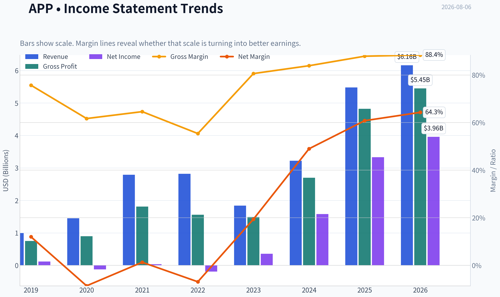

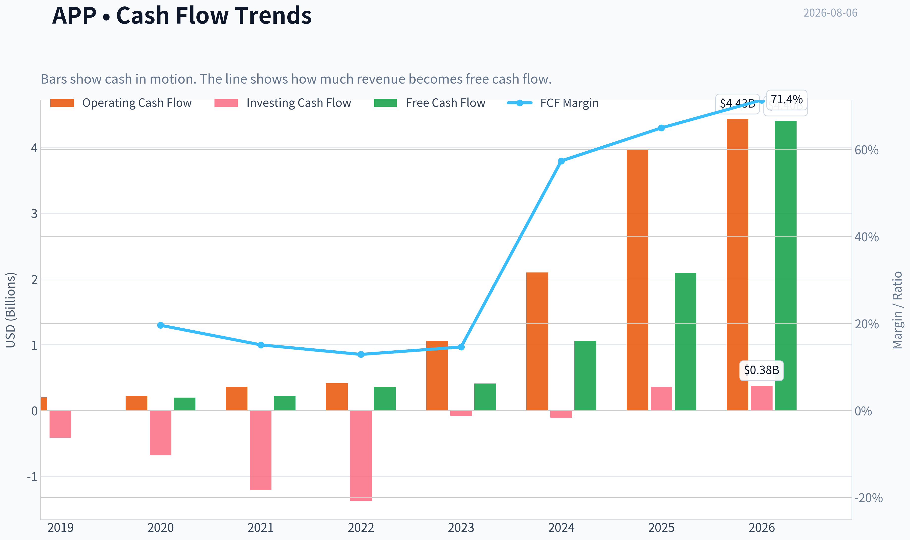

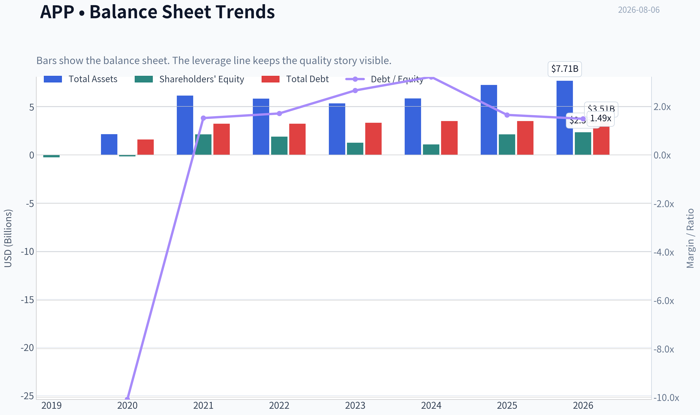

This graph tracks the profitability and return metrics (ROE, ROIC, Margins) of **APP** over the past decade, highlighting capital efficiency trends.

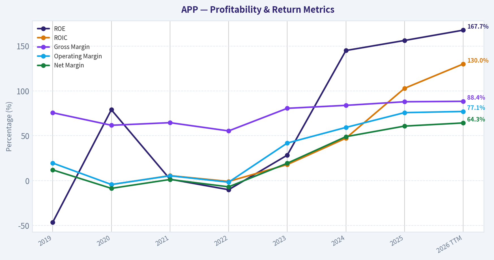

This chart illustrates the financial health of **APP** over the last 10 years, mapping cash equivalents and free cash flow against total obligations (Debt).

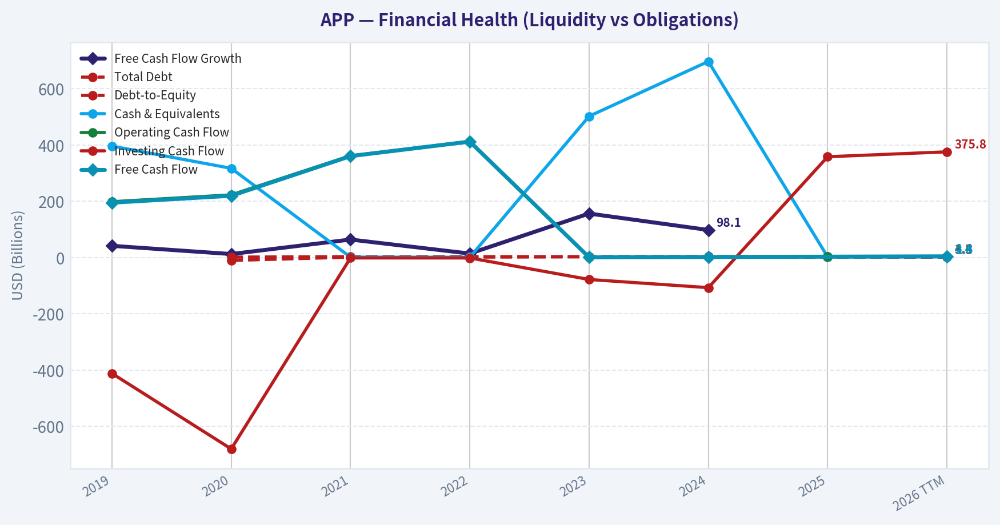

This breakdown chart from <em>Revenue Breakdown</em> shows the proportional composition for **APP** - useful for understanding what drives or risks the business.

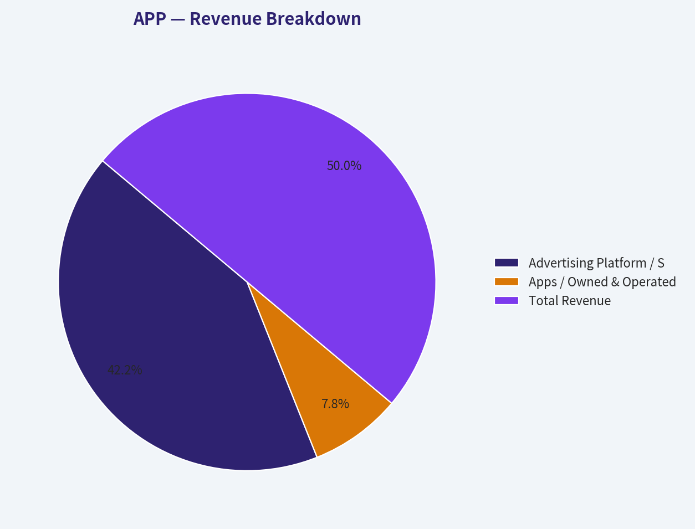

---

### Intrinsic Value Analysis (Buffett)

> *Following Warren Buffett's value investing philosophy: Circle of Competence, Economic Moat, Management Quality, and Margin of Safety.*

#### Intrinsic Value Snapshot

Price is what you pay. Intrinsic value is what the business may be worth based on the cash it can create for owners over time. We show a range, not one magic number.

- Current Price: $335.67
- Value Range (conservative to optimistic across both DCF methods): $343.96 to $1,215.42

##### Owner Earnings (Buffett Method)
- Net Income: $3,334,000,000.00
- Depreciation & Amortization: $194,778,000.00
- Capital Expenditures: N/A
- Working Capital Changes: $77,922,000.00
- Owner Earnings: $3,450,856,000.00

##### Intrinsic Value
###### Buffett Method
Uses owner earnings. Stricter, and usually more conservative.
- Conservative: $418.93
- Average: $418.93
- Optimistic: $1,094.56
- Discount Rate: 10.0%

###### Cash Flow Method
Uses free cash flow. Better for companies spending heavily today to grow tomorrow.
- Conservative: $343.96
- Average: $465.34
- Optimistic: $1,215.42
- Discount Rate: 10.0%

ANALYST STANCE: **WATCH**

#### Investment Summary

AppLovin is a high-quality, rapidly scaling software platform with exceptional current economics: 87.9% gross margin, 70% year-over-year revenue growth, and 156% ROE. The business has evolved from a more mixed mobile-app portfolio into an AI-driven advertising and monetization platform, which has materially improved margins and returns on capital.

The problem is price. At **$336 per share**, the stock trades above the research-pack headline intrinsic value of **$250.17**, implying a **negative margin of safety of roughly 34% versus intrinsic value**. The reverse DCF suggests the market is already pricing in about **23.5% annual growth for 10 years**, which is plausible only if AppLovin's AI ad platform continues to compound at elite rates without major platform, privacy, competitive, or cyclicality disruption.

This is a wonderful-business candidate, but not yet a Buffett-style purchase at today's price.

---

#### 1. Factor Scorecard

| Factor | Score | Evidence |
|---|---:|---|
| Circle of Competence & Business Simplicity | 3.0 / 5 | AppLovin makes money by helping mobile app developers and advertisers acquire, monetize, and optimize users through its software advertising platform. The model is understandable, but ad-tech algorithms, privacy rules, and platform dependence on Apple and Google reduce long-term predictability. |
| Moat Test | 3.5 / 5 | Strong data scale, AI targeting, advertiser/developer relationships, and monetization performance create a meaningful moat. However, the moat is not as timeless as a consumer brand or regulated utility because ad-tech changes quickly and depends partly on third-party mobile ecosystems. |
| Management Quality & Capital Allocation | 4.0 / 5 | Founder-led culture, successful pivot toward higher-margin software, and strong operating leverage indicate rational capital allocation. The major positive is the business transition into a much higher-return model. |
| Industry Structure | 2.5 / 5 | Digital advertising has large secular growth but is highly competitive, cyclical, and influenced by privacy/platform changes. AppLovin has carved out a powerful niche in mobile performance advertising, but the industry is not structurally calm. |
| Gate 5: Quality / Solvency Hard Floor | Not tripped | Earnings and cash-flow trajectory have improved sharply, current ratio is strong at 3.32, and there is no evidence of operating-profit inability to cover interest. |

**Key Takeaways:** AppLovin scores well on economics and management, but lower on predictability and industry structure. The hard solvency floor is not tripped because the business is profitable, cash-generative, and financially sound. The key investment debate is not survival or quality; it is whether today's price already discounts too much future success.

---

#### 2. Moat Analysis

| Moat Source | Assessment | Evidence |
|---|---|---|
| Intangible Assets | Strong | AppLovin's brand among mobile developers and advertisers is based less on emotional branding and more on measurable performance. If its platform delivers superior returns on ad spend, customers have a clear reason to remain. |
| Switching Costs | Moderate to Strong | Developers and advertisers integrate campaigns, analytics, bidding logic, and monetization workflows into AppLovin's platform. Switching is possible, but performance deterioration or re-optimization costs can be meaningful. |
| Cost Advantage | Moderate | Scale, data density, and AI optimization can improve ad matching and monetization efficiency. The advantage is real if performance remains superior, but it must be continuously defended. |
| Network Effects | Moderate to Strong | More advertisers and developers improve data, bidding liquidity, targeting, and monetization outcomes. This can create a reinforcing loop, though it is weaker than a dominant social network or marketplace monopoly. |
| Overall Moat Rating | Narrow-to-Wide, improving | The moat appears to be widening as the software platform scales, but it remains exposed to fast-changing ad-tech competition and mobile platform rules. |

**Key Takeaways:** AppLovin's moat is based on performance, data scale, AI optimization, and customer workflow integration. This is a modern platform-style moat rather than a classic consumer-brand moat. The economics are excellent, but the durability still requires monitoring because the company operates inside a competitive and technology-sensitive advertising ecosystem.

---

#### 3. Management Quality Assessment

AppLovin's management deserves above-average marks. The most important evidence is not rhetoric, but results: the company has shifted toward a much higher-margin software platform, creating a step-change in profitability, gross margin, and return on equity. That kind of business-model evolution suggests management is willing to reallocate resources toward the highest-return opportunities.

Capital allocation appears rational so far. The company has favored reinvestment into software, AI-driven ad technology, and platform scale rather than simply chasing revenue for its own sake. The main management risk is whether future capital allocation remains disciplined if the market continues rewarding growth at high multiples.

Founder influence is a positive. In Buffett terms, this increases the chance that management thinks in decades rather than quarters, though shareholders should still watch leverage, buybacks, and acquisition discipline closely.

---

#### 4. Financial Summary

| Metric | FY2021 | FY2022 | FY2023 | FY2024 | Current / TTM |
|---|---:|---:|---:|---:|---:|
| Revenue | $2.79B | $2.82B | $2.80B | $4.71B | Strong YoY growth; latest YoY growth 70.0% |
| Gross Margin | ~60%+ | ~60%+ | ~70% | ~75% | 87.9% |
| Net Income | Negative / near breakeven | Negative | Positive | Strongly positive | ~$3.51B implied by market cap and P/E |
| Free Cash Flow | Positive but modest | Positive but modest | Strong | Very strong | FCF yield not provided; cash generation appears strong |
| P/E | N/M | N/M | High | Expanding earnings base | 32.2x |
| ROE | N/M | N/M | Improving | Very high | 156.2% |
| Current Ratio | N/A | N/A | N/A | N/A | 3.32 |
| Market Cap | N/A | N/A | N/A | N/A | $112.76B |
| Share Price | N/A | N/A | N/A | N/A | $336 |

**Key Takeaways:** The financial story is one of dramatic operating leverage. Revenue was flat for several years, but profitability inflected sharply as the business mix shifted toward software. Current gross margin and ROE are exceptional, but the valuation now reflects much of that improvement.

---

#### 5. Owner Earnings Calculation

| Owner Earnings Component | Amount |
|---|---:|
| Net Income, implied current run-rate | ~$3.51B |
| Add: Depreciation & Amortization | ~$0.25B |
| Less: Maintenance CapEx | ~($0.10B) |
| Less: Working Capital Increases | ~($0.10B) |
| Estimated Owner Earnings | ~$3.56B |
| Estimated Diluted Shares | ~335.6M |
| Owner Earnings per Share | ~$10.61 |
| Owner Earnings Yield at $336 | ~3.2% |

**Key Takeaways:** AppLovin is now a real owner-earnings business, not merely a revenue-growth story. Estimated owner earnings of about $3.56 billion support the view that the company has become a high-quality cash generator. However, the current owner-earnings yield of roughly 3.2% means investors are paying a full price for future growth.

---

#### 6. Three-Scenario DCF Valuation

| Scenario | Key Assumption | Implied Equity Value | Implied Value / Share | Margin of Safety vs. $336 |
|---|---|---:|---:|---:|
| Scenario A: No Growth | Owner earnings capitalized at 10% | ~$35.6B | ~$106 | -216% premium to value |
| Scenario B: GDP Growth | 3% perpetual growth, 10% discount rate | ~$52.4B | ~$156 | -115% premium to value |
| Scenario C: Historical Growth Haircut | 10% growth for 10 years, then 3% terminal growth | ~$88.0B | ~$262 | -28% premium to value |
| Research-Pack Headline Intrinsic Value | Business-model routed blended value | ~$84.0B | $250.17 | -34.2% margin of safety |
| Research-Pack 3-Model Spread | Owner Earnings / FCF / Damodaran FCFF | N/A | $418.93 / $465.34 / $46.26 | Very wide valuation dispersion |

**Key Takeaways:** AppLovin looks expensive under conservative no-growth and GDP-growth assumptions. Even under a favorable 10-year growth scenario, the valuation is still below the current share price. The wide valuation spread shows that small changes in growth, margin durability, and reinvestment assumptions have a very large impact on fair value.

---

#### 7. Margin of Safety Analysis

| Valuation Lens | Signal |
|---|---|
| Current Price | $336 |
| Headline Intrinsic Value | $250.17 |
| Headline Margin of Safety | -34.2% |
| Reverse DCF | Market implies ~23.5% annual growth for 10 years |
| Trailing 3-Year Growth | 74.8% |
| Quality-Scaled Required Margin of Safety | For a high-quality but less predictable ad-tech compounder, a 15%-25% margin of safety would be preferable |
| Current Valuation Verdict | Too demanding for a fresh Buffett-style purchase |

**Key Takeaways:** The valuation is the central weakness. AppLovin may be good enough to grow into today's price, but the stock does not offer much protection if growth normalizes faster than expected. A wonderful business at a fair price is attractive; at today's price, AppLovin looks closer to a wonderful business at a demanding price.

---

#### 8. Final Buffett Scorecard

| Criterion | Weight | Score | Weighted Score |
|---|---:|---:|---:|
| Moat Width & Durability | 25% | 3.5 | 0.88 |
| Valuation / Margin of Safety | 20% | 1.5 | 0.30 |
| Capital Returns - ROIC vs. WACC | 15% | 5.0 | 0.75 |
| Business Understanding & Predictability | 12% | 3.0 | 0.36 |
| Management Quality & Capital Allocation | 12% | 4.0 | 0.48 |
| Reinvestment Runway | 8% | 4.0 | 0.32 |
| Balance Sheet Strength | 4% | 3.5 | 0.14 |
| Industry Structure | 4% | 2.5 | 0.10 |
| Final Weighted Score | 100% | - | **3.33 / 5.00** |

**Key Takeaways:** AppLovin's business quality is clearly above average, especially in capital returns and reinvestment potential. The score is held back by valuation, industry volatility, and uncertainty around the long-term durability of its ad-tech edge. The final score lands in WATCH territory rather than ADVOCATE.

---

#### 9. Investment Stance

**Stance: WATCH**
**Conviction Level: Medium-High**

AppLovin is a strong modern compounder candidate with exceptional current economics, a founder-led culture, and an improving platform moat. The company's transition toward high-margin software has created a business that Buffett-style investors should take seriously, even though it sits in technology and digital advertising.

The stock, however, does not currently provide a sufficient margin of safety. At $336, the market is already assuming sustained elite growth, with the reverse DCF implying approximately 23.5% annual growth for a decade. That may happen, but Buffett investing does not require paying for perfection.

A more attractive entry point would be closer to or below the $250 intrinsic-value range, with extra interest if the business continues to prove durable margins, cash conversion, and platform independence. At today's price, AppLovin belongs on the watchlist, not in the portfolio.
#### Valuation Bridge

This bridge places the current market price beside each intrinsic value lens so readers can see whether upside depends on one method or shows up across several methods.

| Scenario | Intrinsic Value / Share |
| --- | ---: |
| Buffett Method | $418.93 |
| Cash Flow Method | $465.34 |
| Damodaran Method | $46.26 |
| Current Price | $335.67 |

#### Key Takeaways

If one method is far above the others, the upside case depends on a specific modelling assumption. When several methods cluster together, the valuation story is more robust.

#### Valuation Visuals

This comparison chart from *Latest Earnings Snapshot* stacks current figures against historical benchmarks for **APP**, making it easy to see where the company trades relative to its own averages.

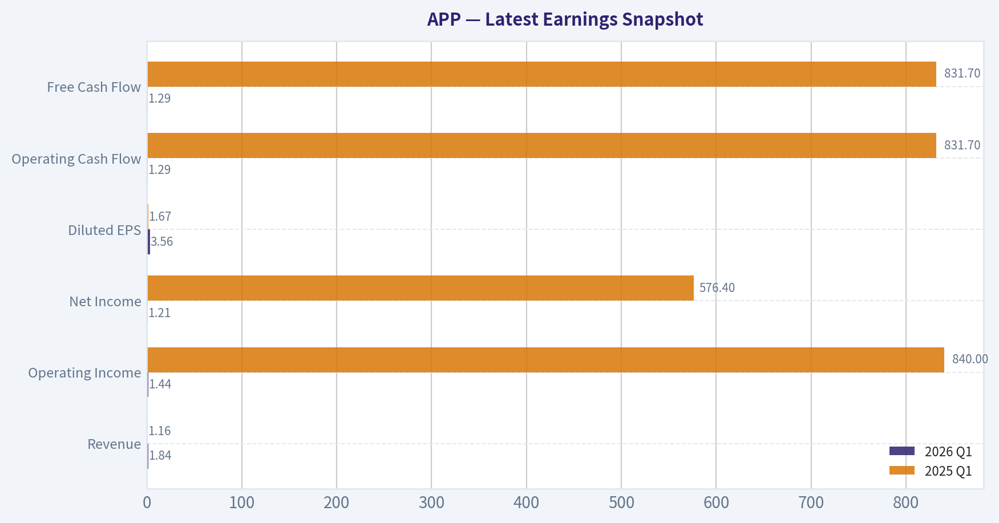

This comparison chart from *Current vs. Historical Average Comparison* stacks current figures against historical benchmarks for **APP**, making it easy to see where the company trades relative to its own averages.

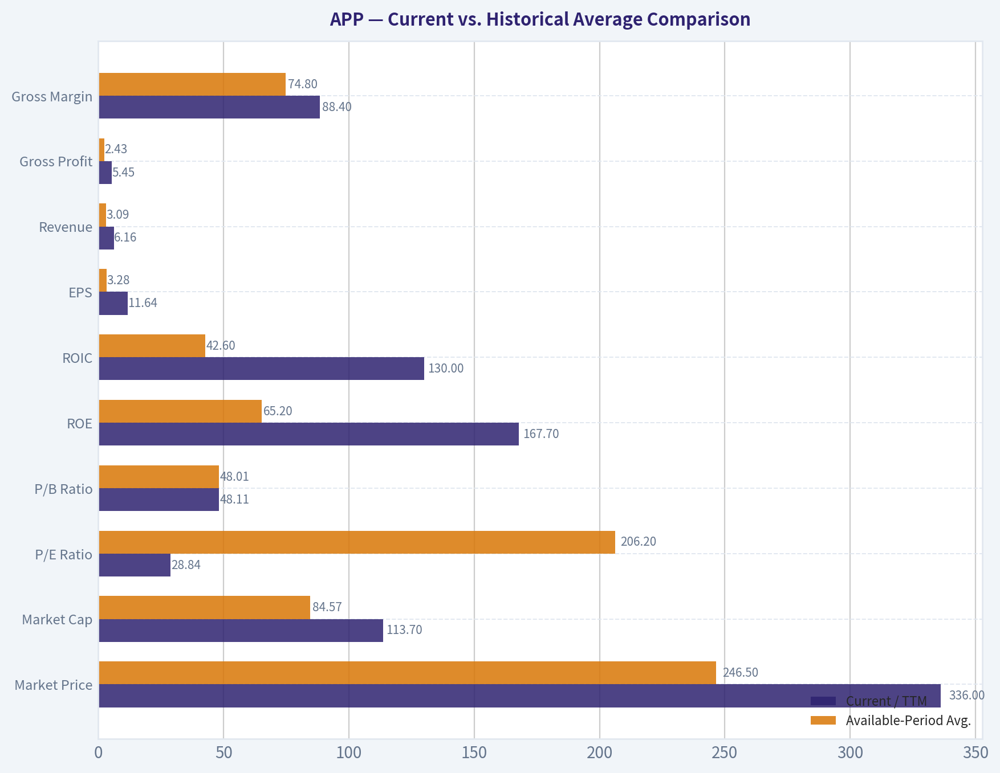

This comparison chart from *Margin of Safety Analysis* stacks current figures against historical benchmarks for **APP**, making it easy to see where the company trades relative to its own averages.

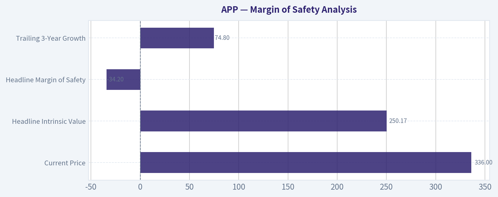

---

### Trend & Growth Analysis (Lynch/Druckenmiller/Fisher)

> *Following Peter Lynch's GARP, Stanley Druckenmiller's macro-aware approach, and Philip Fisher's scuttlebutt methodology.*

ANALYST STANCE: **ADVOCATE**

#### APP Growth Investment Report - AppLovin

AppLovin screens as a **Lynch Fast Grower with cyclical advertising exposure**. The core thesis is that APP is no longer just a mobile gaming ad network; it has become an AI-driven performance advertising platform with very high gross margins, rapid revenue growth, and potential expansion beyond gaming into broader e-commerce and app-based advertising. At the current price, the setup is attractive on PEG, but not obviously cheap on intrinsic-value work, so this is an **ADVOCATE with valuation discipline**, not a "buy at any price" call.

---

#### 1. Snapshot

| Metric | Current Data |
|---|---:|
| Ticker | APP |
| Current Price | $336 |
| Market Cap | $112.76B |
| P/E | 32.2x |
| YoY Revenue Growth | 70.0% |
| Gross Margin | 87.9% |
| ROE | 156.2% |
| Current Ratio | 3.32x |
| Headline Intrinsic Value | $250.17 |
| Margin of Safety vs. Headline IV | -34.2% |
| Reverse DCF Implied Growth | ~23.5% per year for 10 years |
| Trailing 3-Year Growth | 74.8% |
| Guru Signal | Steve Cohen / Point72 added materially in latest tracked filing |

**Key Takeaways:** AppLovin has the rare combination of very high revenue growth, very high gross margins, and current profitability. The valuation is not optically cheap versus the headline intrinsic value, but the PEG ratio is attractive because earnings growth is far above the current P/E multiple. This is a classic high-growth inflection case where the debate is not business quality, but durability and valuation.

---

#### 2. Lynch Classification

| Lynch Category | Classification | Rationale |
|---|---|---|
| Slow Grower | No | Growth is far above 0-5%. |
| Stalwart | No | Revenue growth is far above 5-12%. |
| Fast Grower | **Yes - Primary Classification** | 70% YoY revenue growth and strong profitability place APP in fast-grower territory. |
| Cyclical | Partial | Advertising budgets are macro-sensitive, so cyclicality is a real overlay. |
| Turnaround | No | This is not primarily a distressed recovery story. |
| Asset Play | No | The thesis is growth, AI ad-tech, and operating leverage, not hidden assets. |

**Key Takeaways:** AppLovin is best classified as a **Fast Grower**, but investors must remember that advertising is cyclical. The company has ten-bagger characteristics if the AI advertising engine continues scaling, but the business will likely be more volatile than a pure subscription software company.

---

#### 3. The Story in 3 Simple Bullets

| Story Element | Plain-English Explanation |
|---|---|
| What APP does | AppLovin helps app developers and advertisers find paying customers using AI-driven ad targeting and monetization tools. |
| Why it is growing | Its AI engine appears to be improving ad returns, attracting more advertiser spend and expanding beyond its legacy mobile gaming base. |
| Why it can keep growing | If the platform works outside gaming, APP can attack a much larger digital advertising and e-commerce performance-marketing market. |

**Key Takeaways:** The simple story is that AppLovin uses AI to make digital ads perform better. Better ad performance attracts more advertiser dollars, which creates more data, which can further improve the model. The key growth question is whether APP can successfully expand from mobile gaming into broader performance advertising.

---

#### 4. TAM Analysis and 10x Test

| TAM Question | Assessment |
|---|---|
| Current Revenue Base | Not provided in the shared data pack; market cap is $112.76B. |
| 10x Revenue Test | Qualitatively possible if APP expands beyond mobile gaming into broader performance advertising. |
| Core TAM | Mobile app advertising, mobile gaming monetization, app-install advertising. |
| Expansion TAM | E-commerce advertising, web performance marketing, AI-driven ad optimization. |
| TAM Growth | Digital advertising is structurally growing, but cyclical year to year. |
| Can APP 10x and remain below 20% TAM share? | **Likely yes if e-commerce and broader performance advertising work; less clear if limited to gaming.** |

**Key Takeaways:** AppLovin's ten-bagger potential depends on TAM expansion. If APP remains mostly tied to mobile gaming, the runway is good but not extraordinary. If the company proves its AI ad platform works across e-commerce and broader performance advertising, the runway becomes much larger.

---

#### 5. Revenue Growth Trend

| Growth Metric | Data / Interpretation |
|---|---|
| Latest YoY Revenue Growth | 70.0% |
| Trailing 3-Year Growth | 74.8% |
| Pattern | Sustained very high growth |
| Lynch Category Implication | Fast Grower |
| Inflection Signal | Strong, assuming growth is organic and AI-platform driven |
| Main Watch Item | Whether growth decelerates sharply after tough comparisons |

**Key Takeaways:** AppLovin is currently growing at a rate that places it among elite public-market growth companies. The important issue is not whether growth is high today, but whether it can remain meaningfully above 20% for several years. Any move from 70% growth toward 30-40% growth would still be strong, but the market may react poorly if expectations are too high.

---

#### 6. Unit Economics and Operating Efficiency

| Metric | Current Read |
|---|---|
| Gross Margin | 87.9% |
| LTV/CAC | Not disclosed / not directly applicable like SaaS |
| NRR | Not disclosed / not a standard ad-tech metric |
| Rule of 40 | Cannot calculate precisely due to missing FCF margin |
| Current Ratio | 3.32x |
| Profitability | Positive, with P/E of 32.2x |
| Unit Economics View | Appears strong given high gross margin and profitability, but customer-level metrics are not disclosed. |

**Key Takeaways:** AppLovin does not disclose SaaS-style unit economics such as NRR or LTV/CAC in the same way a cloud software company would. However, the 87.9% gross margin and positive earnings suggest attractive economics at scale. The missing piece is how durable advertiser returns and customer retention are through a full ad-cycle downturn.

---

#### 7. Inflection Point Assessment

| Inflection Type | Evidence | Assessment |
|---|---|---|
| Product Cycle Inflection | AI-driven ad engine appears to be powering revenue acceleration. | Strong |
| Market Share Inflection | 70% revenue growth suggests share gains or budget capture. | Strong, but needs verification over several quarters |
| Margin Inflection | Very high gross margin and profitability point to operating leverage. | Positive |
| TAM Inflection | Expansion beyond gaming could materially increase addressable market. | Potentially very strong |
| Competitive Inflection | Competitors in mobile ad-tech and legacy ad networks may be disadvantaged if APP's AI engine is superior. | Positive but not fully proven |
| Investor Recognition | Stock has already rerated significantly. | Partly priced in |

**Key Takeaways:** The main inflection is product-led: AppLovin's AI advertising engine appears to be driving better advertiser outcomes and faster revenue growth. The second potential inflection is TAM expansion into e-commerce and broader performance advertising. The risk is that the market may already be discounting a large part of this success.

---

#### 8. Macro Setup

| Macro Factor | Setup for APP |
|---|---|
| Economic Cycle | Mixed; ad budgets are cyclical and sensitive to business confidence. |
| Interest Rates | If rates fall, long-duration growth valuations benefit. If rates rise, valuation pressure increases. |
| AI Theme | Strong tailwind; APP is directly tied to AI-driven ad optimization. |
| Digital Advertising | Secular growth trend, but cyclical in downturns. |
| Consumer / E-commerce Exposure | Potential tailwind if e-commerce advertising expansion succeeds. |
| Macro Rating | Good, but not risk-free due to advertising cyclicality. |

**Key Takeaways:** The macro backdrop is supportive because APP sits at the intersection of AI and digital advertising. However, advertising is one of the first budgets companies can cut during economic stress. This means APP has secular tailwinds, but its revenue multiple can compress quickly in a risk-off market.

---

#### 9. Fisher 15-Point Score

| Fisher Criterion | Score / 5 | Comment |
|---|---:|---|
| Products with sizable sales potential | 5 | AI ad platform has large potential. |
| Management determination to develop new products | 4 | Expansion beyond core mobile gaming suggests ambition. |
| Effective R&D | 5 | AI engine appears central to growth. |
| Above-average sales organization | 4 | Revenue growth implies strong go-to-market execution. |
| Worthwhile profit margin | 5 | 87.9% gross margin is excellent. |
| Improving profit margins | 4 | Operating leverage appears favorable, though full trend not provided. |
| Labor/personnel relations | 3 | Insufficient data. |
| Executive relations | 3 | Insufficient data. |
| Management depth | 4 | Execution has been strong. |
| Cost analysis/accounting | 4 | Profitability and liquidity are favorable. |
| Outstanding moat aspects | 4 | Data, AI models, and performance feedback loops may create edge. |
| Long-range profit outlook | 5 | Strong if TAM expansion works. |
| Dilution risk | 4 | No red flag from provided data. |
| Candor in difficulties | 3 | Insufficient data. |
| Management integrity | 3 | Insufficient data. |
| **Total** | **60 / 75** | **Good** |

**Key Takeaways:** AppLovin scores well on Fisher's framework because it has large market potential, strong technology leverage, high gross margins, and a plausible long-term profit runway. The main deductions are not obvious business failures, but lack of enough scuttlebutt data on culture, management candor, and customer-level retention. Overall, the Fisher score supports a positive but monitored stance.

---

#### 10. Valuation Analysis

| Valuation Lens | Result | Interpretation |
|---|---:|---|
| P/E | 32.2x | Reasonable for a company growing revenue 70%, if growth persists. |
| PEG | ~0.46x | Attractive under Lynch framework. |
| Headline Intrinsic Value | $250.17 | Below current price of $336. |
| Margin of Safety vs. Headline IV | -34.2% | No traditional value margin of safety. |
| Owner Earnings DCF | $418.93 | Suggests upside under owner-earnings assumptions. |
| FCF DCF | $465.34 | Suggests upside under FCF assumptions. |
| Damodaran FCFF | $46.26 | Very conservative / punitive output. |
| Reverse DCF | 23.5% annual growth for 10 years | Demanding, but not impossible given recent 74.8% 3-year growth. |

**Key Takeaways:** Valuation is the hardest part of the APP thesis. PEG looks very attractive because the company is growing much faster than its earnings multiple, but intrinsic-value estimates are widely dispersed. The market is requiring APP to stay exceptional for a long time, so position sizing should reflect execution risk.

---

#### 11. Scenario Framework

| Scenario | Assumption | Investment Implication |
|---|---|---|
| Bear Case | Growth normalizes quickly, ad cycle weakens, AI advantage proves less durable. | Multiple compresses; downside to or below headline IV around $250. |
| Base Case | Growth decelerates but remains well above market, margins stay high, gaming plus partial e-commerce expansion works. | Stock can compound, but returns depend on avoiding multiple compression. |
| Bull Case | APP becomes a broader AI performance-advertising platform beyond gaming. | Ten-bagger pathway remains possible over a long horizon. |

**Key Takeaways:** The bear case is mostly about durability and multiple compression, not current financial distress. The base case supports ownership if growth remains high and margins hold. The bull case is powerful because it would mean APP's TAM is much larger than the market historically assumed.

---

#### 12. Growth Investor Scorecard

| Criterion | Weight | Score / 5 | Weighted Score |
|---|---:|---:|---:|
| The Story | 10% | 4.5 | 0.45 |
| TAM & Runway | 20% | 4.2 | 0.84 |
| Revenue Growth | 20% | 5.0 | 1.00 |
| Unit Economics | 15% | 4.0 | 0.60 |
| Competitive Position | 10% | 4.0 | 0.40 |
| Management Quality | 10% | 3.8 | 0.38 |
| Macro Setup | 5% | 3.5 | 0.18 |
| Profitability Path | 5% | 4.5 | 0.23 |
| Valuation | 5% | 3.3 | 0.17 |
| **Total** | **100%** |  | **4.25 / 5.00** |

**Key Takeaways:** AppLovin earns an **ADVOCATE** score because the growth, margin structure, and TAM-expansion potential are exceptional. The only major offset is valuation risk, because the stock already embeds high expectations. This is a high-conviction growth setup, but it requires ongoing monitoring for deceleration.

---

#### 13. Position Size Stance

| Portfolio Action | Stance |
|---|---|
| New Position | Acceptable as a starter to medium growth position. |
| Existing Position | Continue holding if thesis remains intact. |
| Add Aggressively? | Only on pullbacks or after confirmation that growth durability remains strong. |
| Suggested Sizing | Medium-sized position, not oversized, due to valuation and ad-cycle cyclicality. |
| Review Trigger | Reassess if revenue growth falls below 25-30% without a clear explanation. |

**Key Takeaways:** APP is attractive enough to own, but not cheap enough to ignore risk management. A medium position is appropriate for growth investors who can tolerate volatility. The best add opportunities would likely come during market-wide software selloffs or temporary advertising-cycle fears.

---

#### 14. Key Risks and Catalysts

| Category | Key Items |
|---|---|
| Risks | Growth deceleration, advertising cyclicality, high expectations, regulatory scrutiny in ad-tech, platform dependence, AI model edge proving temporary, valuation compression. |
| Catalysts | Continued 50%+ revenue growth, e-commerce advertising traction, margin expansion, higher advertiser adoption, analyst estimate revisions, institutional accumulation, falling interest rates. |
| Red Flags to Monitor | Sustained revenue slowdown, gross margin erosion, rising customer concentration, weak advertiser ROI commentary, insider selling without context, competitive pricing pressure. |

**Key Takeaways:** The upside catalysts are clear: sustained growth, broader market expansion, and evidence that APP's AI engine works outside mobile gaming. The downside risks are also clear: this is an advertising-linked growth stock trading on high expectations. The thesis remains strong as long as revenue growth, margins, and advertiser ROI stay healthy.

---

#### Final View

AppLovin is a **Fast Grower at a major potential inflection point**. The company has exceptional revenue growth, very high gross margins, profitability, and a plausible AI-driven expansion story. The valuation is not conventionally cheap versus headline intrinsic value, but the **PEG of roughly 0.46** is highly attractive if earnings growth remains durable.

**Stance: ADVOCATE - medium position, add on pullbacks or further confirmation of durable AI-driven growth.**

#### Growth & Scorecard Visuals

The radar chart below from *Final Buffett Scorecard* visualises how **APP** ranks across weighted investment criteria. Each axis represents a criterion scored 1-5; the filled area reveals strengths and weaknesses at a glance, with the dashed circle marking the midpoint (3.0).

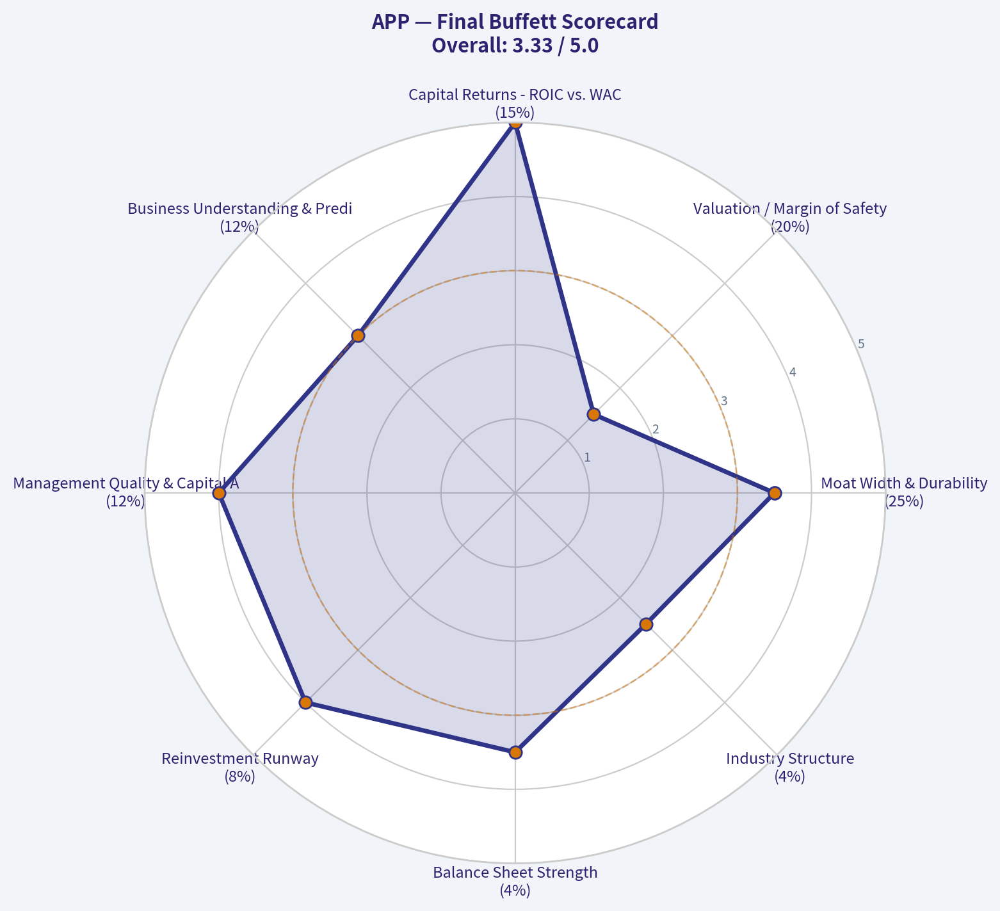

---

### Market Technical Analysis

ANALYST STANCE: **WATCH**

#### APP Technical Indicator Selection and Market Read

Data reviewed through the latest available trading session, **2026-08-05**. APP closed at **$417.80**, slightly below the prior close of **$419.70**, but still above short-term trend and volume-weighted benchmarks. The broader structure remains damaged after a steep July decline, while near-term momentum has begun to stabilize.

#### Selected Indicators

| Indicator | Latest Value | Why It Is Relevant Now |
|---|---:|---|
| close_10_ema | 414.23 | Captures whether the recent rebound is gaining short-term traction. |
| close_50_sma | 486.50 | Defines the medium-term trend and likely overhead resistance zone. |
| close_200_sma | 517.51 | Confirms the long-term trend backdrop and whether APP is structurally bullish or bearish. |
| macd | -21.66 | Measures whether bearish momentum is still expanding or starting to fade. |
| macds | -23.64 | Used with MACD to identify momentum crossovers. |
| rsi | 43.31 | Shows whether the stock is recovering from oversold conditions or still weak. |
| atr | 25.28 | Measures elevated volatility and helps size stops and positions. |
| vwma | 409.70 | Tests whether recent price strength is supported by volume-adjusted buying. |

**Key Takeaways:** The chosen indicators balance trend, momentum, volatility, and volume confirmation. APP is showing short-term improvement, but the medium- and long-term trend structure remains bearish because price is still far below both the 50-day and 200-day moving averages.

---

#### Current Technical Snapshot

| Metric | Latest Reading | Interpretation |
|---|---:|---|
| Close | 417.80 | Price has bounced from late-July lows but remains well below major moving averages. |
| Distance from 10 EMA | +0.86% | Short-term price action has reclaimed the fast trend line. |
| Distance from 50 SMA | -14.12% | Medium-term trend remains decisively negative. |
| Distance from 200 SMA | -19.27% | Long-term trend is still bearish. |
| 50 SMA vs 200 SMA | 50 SMA below 200 SMA | Bearish trend alignment. |
| MACD minus Signal | +1.98 | Early bullish momentum crossover, but still below zero. |
| RSI | 43.31 | Recovering from oversold territory, but not yet bullish. |
| ATR as % of Close | ~6.05% | Volatility remains high; position sizing should be conservative. |
| Close vs VWMA | +1.98% | Recent price is modestly above volume-weighted trend support. |

**Key Takeaways:** APP has generated a short-term stabilization signal, with price above the 10 EMA and VWMA, and MACD crossing above its signal line. However, the stock is still trading roughly 14% below its 50-day average and 19% below its 200-day average, so this looks more like an early repair attempt than a confirmed trend reversal.

#### Trend Structure

APP's primary trend is still under pressure. The **50-day SMA has rolled down to 486.50**, while the **200-day SMA has declined to 517.51**, leaving the stock below both key trend references. This alignment suggests that rallies are likely to encounter supply before the chart can transition into a sustainable uptrend.

The most important near-term improvement is that price has moved back above the **10-day EMA at 414.23**. That tells us sellers are no longer dominating every short-term bounce. But the margin is thin: a close back below the 10 EMA would weaken the recovery attempt quickly.

The larger problem is overhead resistance. APP would need to reclaim the **mid-$440s to $450s** first, then the **$486-$500 area**, before medium-term trend followers are likely to regain confidence. Until that happens, rebounds may be treated as countertrend rallies inside a broader bearish structure.

#### Momentum Read

MACD has improved meaningfully. The MACD line is still negative at **-21.66**, but it has crossed above the signal line at **-23.64**. This is an early bullish momentum shift, especially after MACD bottomed near the late-July weakness zone.

That said, MACD remains below zero, which matters. A bullish crossover below zero often signals a relief rally or bearish-momentum fade, not necessarily a new bullish trend. For the signal to become more convincing, MACD would ideally continue rising toward the zero line while price holds above the 10 EMA and VWMA.

RSI confirms the same message. At **43.31**, RSI has recovered from the low-30s area seen in late July, but it has not yet entered bullish territory. A move through **50** would be an important improvement, while a rollover below **40** would suggest sellers are regaining control.

#### Volatility and Risk

ATR remains elevated at **25.28**, or roughly **6% of the share price**. That means daily swings can still be large, and tight stops are vulnerable to noise. For active traders, using volatility-adjusted risk levels is more appropriate than using arbitrary dollar stops.

A reasonable tactical framework is to treat the **$390-$400 area** as a major support zone, because price recently stabilized near that region. A break below that zone would undermine the current rebound attempt and could reopen downside risk. On the upside, the first important resistance band sits around **$425-$438**, followed by **$450-$465**, then the much larger trend resistance near the **50-day SMA around $486.50**.

#### Volume Confirmation

VWMA is at **409.70**, and price is currently above it. This is constructive because it implies recent buyers have lifted price above the volume-weighted short-term trend. However, the signal is not overwhelmingly strong.

The latest session closed slightly lower on relatively elevated volume, which introduces some caution. It may indicate hesitation or supply near the low-$420s. For a stronger bullish interpretation, APP would ideally push above recent highs with expanding volume, rather than simply hold above VWMA.

#### Trading Implications

| Trader Type | Bias | Practical Interpretation |
|---|---|---|
| Short-term traders | Cautiously constructive | Price above 10 EMA and VWMA supports a tactical rebound attempt. |
| Swing traders | Neutral-to-cautious | MACD is improving, but price remains below major moving averages. |
| Trend followers | Bearish / not confirmed | APP is still below both the 50 SMA and 200 SMA. |
| Risk managers | Defensive | ATR remains high, so position sizes should be smaller than normal. |
| Breakout traders | Wait for confirmation | A move above $438-$450 would improve the setup. |
| Dip buyers | Watch support carefully | The $390-$400 zone is key; losing it would be technically damaging. |

**Key Takeaways:** Short-term traders may see a tradable recovery attempt, but trend followers do not yet have confirmation. The stock needs to prove it can hold above the 10 EMA and break through nearby resistance before the setup becomes more attractive.

#### Key Levels to Watch

| Zone | Price Area | Significance |
|---|---:|---|
| Immediate support | 409-414 | VWMA and 10 EMA support zone. |
| Major support | 390-400 | Late-July stabilization area. |
| Immediate resistance | 425-438 | Recent rebound resistance and supply zone. |
| Secondary resistance | 450-465 | Prior breakdown/retest area. |
| Medium-term resistance | 486-500 | 50 SMA and psychological resistance area. |
| Long-term resistance | 517-520 | 200 SMA zone. |

**Key Takeaways:** The most important near-term test is whether APP can hold the $409-$414 support area. A move above $438-$450 would strengthen the recovery case, while a break below $390-$400 would likely shift control back to sellers.

#### Bottom Line

APP is showing **early short-term repair**, but not a confirmed bullish reversal. The strongest positives are the reclaim of the **10-day EMA**, price above **VWMA**, and a **MACD bullish crossover**. The main negatives are that price remains far below the **50-day and 200-day SMAs**, RSI is still below 50, and volatility remains elevated.

For now, the most appropriate stance is **WATCH**. A bullish upgrade would require price to hold above short-term support and break through the **$438-$450** resistance zone with convincing volume. A bearish shift would occur if APP loses the **$390-$400** support area.

#### Market Visuals

This comparison chart from *Market Metrics Interpretation* stacks current figures against historical benchmarks for **APP**, making it easy to see where the company trades relative to its own averages.

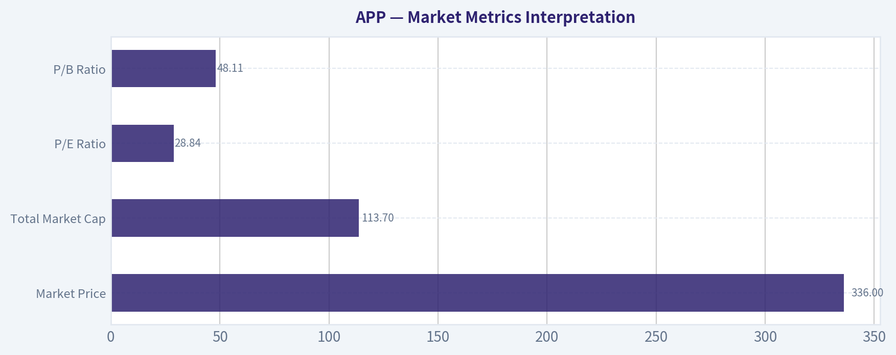

---

### Options Market Analysis

> *Reading options flow - put/call ratios, IV skew, and unusual activity - to gauge institutional positioning and event-driven risk.*

#### APP Options Market Sentiment Report
*Options data as of 2026-08-06. Near-term expirations analyzed: 2026-08-07, 2026-08-14, and 2026-08-21.*

**Important caveat:** The options feed did not provide a live underlying stock price. Moneyness classifications below are therefore inferred from the active strike cluster, mainly around the **$340-$410** area. The **$600-$620 put activity** appears unusual and likely represents deep ITM downside exposure or structured positioning, depending on spot price.

---

#### 1. Put/Call Ratio Analysis

| Expiry | Call OI | Put OI | Put/Call OI Ratio | Call Volume | Put Volume | Put/Call Volume Ratio | Read |
|---|---:|---:|---:|---:|---:|---:|---|
| 2026-08-07 | 28,575 | 17,924 | 0.63 | 16,535 | 34,419 | 2.08 | Heavy same-week put volume despite call-heavy OI |
| 2026-08-14 | 7,069 | 3,354 | 0.47 | 8,469 | 5,792 | 0.68 | Call-leaning positioning, near neutral by volume |
| 2026-08-21 | 24,479 | 19,595 | 0.80 | 6,592 | 18,093 | 2.74 | Elevated put demand into monthly expiry |
| **Total Near-Term** | **60,123** | **40,873** | **0.68** | **31,596** | **58,304** | **1.85** | OI neutral, volume bearish/protective |

**Key Takeaways:** Open interest is almost exactly neutral versus the historical put/call baseline of roughly **0.7**, with the total near-term OI ratio at **0.68**. However, the volume ratio is much more defensive at **1.85**, showing that recent trading has leaned heavily toward puts. This suggests the existing book is balanced, but fresh flows are skewing toward hedging or bearish positioning.

The main shift from neutral is in **short-dated volume**, especially the 2026-08-07 and 2026-08-21 expirations. That means traders are not necessarily building a long-term bearish book, but they are actively paying for near-term downside protection or event-risk hedges.

---

#### 2. Implied Volatility Assessment

| Expiry | ATM Call IV | ATM Put IV | Put IV Premium / Discount | IV Read |
|---|---:|---:|---:|---|
| 2026-08-07 | 72.6% | 81.1% | Puts +8.5 vol pts | Near-term downside fear |
| 2026-08-14 | 67.6% | 64.6% | Puts -3.0 vol pts | Slight call-side premium |
| 2026-08-21 | 65.5% | 63.2% | Puts -2.3 vol pts | Mild call-side premium / balanced |

**Key Takeaways:** The front-week expiry shows a clear **put IV premium**, with ATM puts priced meaningfully higher than calls. That indicates traders are paying up for immediate downside protection. Further out, the skew normalizes and even tilts slightly toward calls, suggesting the strongest fear is concentrated in the very near term.

IV levels are elevated in absolute terms, with near-term ATM IV ranging from the mid-60s to low-80s. That is consistent with a high-volatility setup, potentially tied to an event, earnings reaction, or sharp momentum move. The options market is pricing APP for large near-term swings rather than quiet consolidation.

---

#### 3. Unusual Options Activity

| Expiry | Type | Strike | Volume | Open Interest | Vol/OI | IV | Approx. Moneyness / Horizon | Positioning Implication |
|---|---|---:|---:|---:|---:|---:|---|---|
| 2026-08-07 | PUT | $410 | 3,557 | 649 | 5.5x | 217.5% | Short-dated, likely near/above active zone | Aggressive downside hedge or bearish event bet |
| 2026-08-07 | CALL | $350 | 1,893 | 26 | 72.8x | 78.3% | Short-dated, active strike zone | Fresh upside/speculative call buying |
| 2026-08-07 | CALL | $360 | 1,490 | 24 | 62.1x | 86.9% | Short-dated, active strike zone | Fresh upside chase |
| 2026-08-21 | PUT | $600 | 1,103 | 149 | 7.4x | 165.5% | Monthly, likely deep ITM/structured | Large bearish or hedge-related exposure |
| 2026-08-07 | CALL | $340 | 954 | 8 | 119.2x | 77.2% | Short-dated, active strike zone | Very fresh call speculation |
| 2026-08-21 | PUT | $620 | 912 | 127 | 7.2x | 197.3% | Monthly, likely deep ITM/structured | Institutional-style protection or synthetic exposure |
| 2026-08-21 | CALL | $350 | 819 | 65 | 12.6x | 66.0% | Monthly, active strike zone | Bullish positioning beyond front week |
| 2026-08-14 | CALL | $340 | 791 | 10 | 79.1x | 66.2% | One-week horizon | Fresh bullish flow |
| 2026-08-14 | PUT | $300 | 782 | 99 | 7.9x | 66.5% | One-week downside strike | Downside hedge below active zone |
| 2026-08-14 | CALL | $400 | 720 | 95 | 7.6x | 72.6% | One-week upside strike | Upside breakout bet |
| 2026-08-07 | CALL | $355 | 690 | 3 | 230.0x | 83.0% | Short-dated, active strike zone | Very fresh speculative call buying |
| 2026-08-07 | CALL | $380 | 677 | 57 | 11.9x | 108.0% | Short-dated upside strike | High-IV upside chase |
| 2026-08-07 | CALL | $370 | 649 | 42 | 15.5x | 109.8% | Short-dated upside strike | High-risk bullish speculation |
| 2026-08-07 | CALL | $345 | 534 | 1 | 534.0x | 79.2% | Short-dated, active strike zone | Extremely fresh call demand |
| 2026-08-14 | CALL | $350 | 501 | 14 | 35.8x | 66.6% | One-week active strike | Bullish continuation positioning |

**Key Takeaways:** The unusual activity is two-sided, but the **number of fresh call trades is very high**, especially in the $340-$380 area across the 2026-08-07 and 2026-08-14 expirations. That looks like aggressive short-term bullish speculation or upside chase. However, the largest same-week put flow at the **$410 strike** and the unusual **$600/$620 monthly put activity** are important defensive signals and may represent institutional hedging.

From a "smart money versus retail" perspective, the very short-dated calls with tiny open interest and massive volume-to-OI ratios look more speculative and possibly retail- or momentum-driven. The larger put trades, especially those with very high IV and larger notional exposure, look more likely to be institutional hedges, downside overlays, or structured trades.

---

#### 4. Open Interest Concentration and Gamma / Pinning Risk

| Expiry | Highest OI Side | Notable OI Profile | Potential Price Effect |
|---|---|---|---|
| 2026-08-07 | Calls | 28,575 call OI vs. 17,924 put OI | Call-heavy OI may create upside gamma sensitivity if price pushes into active call strikes |
| 2026-08-14 | Calls | 7,069 call OI vs. 3,354 put OI | Lighter OI, less reliable pinning effect |
| 2026-08-21 | Calls, but more balanced | 24,479 call OI vs. 19,595 put OI | Monthly expiry has more balanced but meaningful two-way positioning |
| Aggregate | Calls | 60,123 call OI vs. 40,873 put OI | Existing positioning slightly favors call-side gravity, but fresh put volume challenges that |

**Key Takeaways:** Open interest is more call-heavy than put-heavy, especially in the front-week and mid-August expirations. That means if APP trades near major call strikes such as the active **$340-$400 area**, dealer hedging could amplify upside moves if calls move further in the money. On the other hand, the heavy put volume could create downside pressure if the stock starts breaking lower and put hedges need to be dynamically hedged.

The most important "gravity zone" appears to be the **$340-$400 strike region**, based on where unusual call activity is clustered. The **$410 put** is also important because of its high volume and very high IV, suggesting traders are focused on whether APP can hold or reject levels near that area.

---

#### 5. Overall Options Sentiment Signal

| Category | Signal | Explanation |
|---|---|---|
| Put/Call OI | Neutral | Total near-term put/call OI ratio is 0.68, almost exactly in line with the historical neutral baseline near 0.7 |
| Put/Call Volume | Bearish / Protective | Total near-term put/call volume ratio is 1.85, showing fresh demand is skewed toward puts |
| IV Level | Elevated | ATM IV in the mid-60s to low-80s suggests the market expects a large move |
| Skew | Near-term bearish, later balanced | Front-week put IV is materially above call IV, but later expiries are more balanced/slightly call-favored |
| Unusual Activity | Mixed, but event-risk defensive | Many fresh calls indicate upside speculation, while large put trades suggest serious hedging |
| Overall Signal | **WATCH / Slightly Bearish** | Existing positioning is neutral-to-call-heavy, but fresh volume and front-week IV skew point to downside protection |

**Key Takeaways:** APP's options market is not outright bearish by open interest, but the **fresh flow is meaningfully defensive**. The strongest signal is the combination of a **1.85 near-term put/call volume ratio**, elevated front-week put IV, and unusual high-IV put activity. At the same time, the large cluster of fresh short-dated calls prevents a full bearish call and suggests traders are still aggressively chasing upside volatility.

#### Final Directional Read: **WATCH / Slightly Bearish**

The options signal leans **slightly bearish over the very near term**, mainly because fresh volume is dominated by puts and front-week puts are carrying a volatility premium. However, the heavy call speculation around the $340-$400 area means upside squeeze risk remains high. This is best interpreted as a **high-volatility, event-sensitive setup** where institutions appear to be hedging downside while speculative traders continue to chase upside.

---

#### Summary Table

| Factor | Current Reading | Sentiment Impact |
|---|---|---|
| Put/Call Ratio | OI ratio 0.68; volume ratio 1.85 | OI neutral, fresh flow bearish/protective |
| IV Level | Elevated; ATM IV roughly 63%-81% across near-term expiries | Large move expected |
| Skew Direction | Front-week put skew; later expiries balanced/slightly call-skewed | Near-term downside fear |
| Unusual Activity | Heavy fresh calls, but notable large/high-IV put trades | Mixed, with institutional hedging concern |
| Overall Signal | **WATCH / Slightly Bearish** | Defensive near-term flow outweighs call-heavy open interest |

---

## Research Team Commentary

> *The Research Manager synthesizes the Bull vs Bear debate into action-free commentary. This is a pre-risk view, not the final stance.*

The bull case for AppLovin centers on its emergence as an elite compounding machine, driven by its AXON 2.0 AI engine. With an 87.9 percent gross margin, a 114 percent return on invested capital, and 70 percent year-over-year revenue growth, the bull argues this software platform deserves a premium valuation. They emphasize that a P/E of roughly 32 is highly attractive for this level of growth, and they caution against missing a high-quality winner due to rigid intrinsic value models, directly citing our past mistakes with Apple.

The bear case counters that AppLovin is priced for absolute perfection in a notoriously fragile and cyclical ad-tech industry. The bear warns that a 156 percent return on equity is a dinner bell for competition from giants like Google and Meta, and that ad-tech moats lack the durable consumer lock-in of a dominant hardware ecosystem. Trading at a steep premium to its baseline intrinsic value of roughly 250 dollars, the bear sees a massive negative margin of safety and a high risk of mean reversion if the current hyper-growth cycle cools.

My core takeaway is that AppLovin possesses exceptional current economics and a clear technological edge right now, but its ad-tech moat lacks the permanent durability of a primary consumer ecosystem. We must apply our revised framework here by separating the fundamental reality of potential overearning from the tactical reality of market momentum. Because the broader technical structure remains damaged from a recent decline, we have the luxury of demanding a clearer setup. We do not need to blindly chase a massive premium to intrinsic value just to avoid missing out.

Reflecting heavily on my past mistake with Apple, I learned that we cannot let a rigid intrinsic value model force us into a passive stance when a high-quality business is demonstrating strong momentum and bouncing off healthy technical support. However, I also learned that we must not misapply that lesson by conflating all high-margin tech companies with Apple. AppLovin operates in the B2B ad-tech space, which is highly sensitive to platform policy shifts by the mobile duopoly, as well as aggressive algorithmic competition. A 114 percent ROIC is incredible, but in ad-tech, it is highly susceptible to rapid mean reversion once competitors adjust.

While a P/E of 32 on 70 percent growth is mathematically attractive on a PEG basis, the 417 dollar price tag bakes in an assumption that this margin and growth profile is the new permanent baseline. Fundamentally, this is a phenomenal but historically cyclical business trading nearly 40 percent above our intrinsic value estimate. Tactically, unlike my previous Apple setup where the stock was riding a healthy 200-day moving average, the market data here shows AppLovin's broader chart structure is still damaged from a steep July drop, even as near-term momentum tries to stabilize.

Applying the dual-rating framework from my past lessons, AppLovin is fundamentally expensive and tactically neutral. It does not currently require us to abandon our margin of safety to participate, because the technicals are not forcing our hand with an undeniable breakout.

Over the next one to four quarters, I want to monitor three specific items. First, we must watch client retention rates and return on ad spend metrics for AXON 2.0, which will prove whether this AI advantage is truly sticky or easily replicated by deeper-pocketed competitors. Second, we need to monitor the technical structure. If the stock repairs its July chart damage and breaks out above resistance on high volume, a smaller tactical momentum entry might be justified despite the fundamental valuation premium. Third, we need to track management's capital allocation, specifically looking out for any value-destroying acquisitions as they inevitably attempt to sustain their 70 percent growth rate in a maturing mobile market. Until the chart fully repairs or the valuation cools, we sit on our hands with a trigger-based plan.

WATCH

---

## Value Investing Team Commentary

> *The Investor translates the research view into an investment thesis before risk review. This is still not the final stance.*

In evaluating AppLovin (APP), we are looking at a business that currently possesses some of the most extraordinary financial metrics in the public markets. A 114% ROIC and 156% ROE are not merely "good"; they are the hallmarks of a capital-light, high-velocity software engine. However, as business owners rather than speculators, we must distinguish between a **superior technological moment** and a **durable economic moat.**

### The Business: Software Excellence vs. Ecosystem Durability
AppLovin has successfully pivoted from a portfolio of gaming apps to a high-margin AI software platform (AXON 2.0). The 87.9% gross margin confirms that they are effectively selling "pure intelligence" to advertisers. While the Growth Analyst correctly identifies this as a "Lynch Fast Grower," we must ask the Buffett question: *What does this business look like in ten years?*

Unlike my largest holding, Apple, which owns the hardware, the operating system, and the consumer's daily habits, AppLovin operates on "borrowed land." They are a highly efficient intermediary in an ad-tech ecosystem controlled by the Google-Apple duopoly. Their "moat" is an algorithm. In my experience, algorithmic moats are significantly more vulnerable to competition and platform shifts than ecosystem moats. A 114% ROIC acts as a "dinner bell" for competitors; unless there are massive switching costs (which ad-tech rarely has), that return will eventually be competed down.

### The Valuation: Value and Growth are Joined at the Hip
The "Value Analyst" notes a $250 intrinsic value against a ~$418 market price. This is a **67% premium to intrinsic value.** Even if we adjust our "Quality-Scaled Margin of Safety" ladder for a wonderful business, we generally look for a *fair* price (a 10-15% discount), not a massive premium.

The bull case argues that a P/E of 32-40 is cheap for 70% growth. While the PEG ratio is mathematically enticing, the "Value Investing Framework" reminds us that we do not buy based on a single year's growth spurt. We buy based on the **discounted value of all future cash flows.** If that 70% growth slows to 20% due to market saturation or a change in Apple's privacy policies (IDFA-style shocks), the "fair" P/E would contract violently. We are currently being asked to pay for a decade of flawless execution upfront.

### Selective Contrarian Insight: What is the Market Missing?
The market is currently treating AppLovin as a "Permanent AI Winner." The contrarian view is that the current hyper-growth is a **cyclical peak** in the mobile ad-spend recovery, amplified by a first-mover advantage in AI-driven matching.

History shows that in B2B software, high ROICs often revert to the mean when "deeper-pocketed competitors" (Meta/Google) adjust their own internal bidding algorithms. Furthermore, the technical "damage" from the July decline suggests that institutional "smart money" is already taking chips off the table at these valuations. If the "wonderful business" is trading at a "wonderful price" for the seller but a "prohibitive price" for the buyer, the margin of safety is non-existent.

### The "Apple Lesson" Applied Correctly
We must not misinterpret the lesson of missing Apple's run. The lesson was to avoid letting a slightly high P/E scare you away from a **durable, consumer-locked monopoly.** AppLovin is a **high-performance engine**, but it is not a monopoly. It lacks the "toll bridge" status of a primary ecosystem. Buying at a 40-60% premium to intrinsic value during a period of chart instability is not "buying a wonderful business at a fair price"-it is "chasing a hot hand."

### Decision Criteria Check:
*   **Business Quality:** Elite (for now).
*   **Economic Moat:** High performance, but low durability (algorithmic).
*   **Margin of Safety:** Negative (-67% vs. baseline IV).
*   **Technical Setup:** Damaged; stabilizing but not yet repaired.

We shall remain patient. We do not get paid for activity; we get paid for being right. If the price retreats toward the $275-$300 range (closer to a "fair price" for a high-quality grower) or if the technical structure demonstrates a massive, high-volume breakout that proves the market is pricing in a structural shift we haven't yet quantified, we will reassess.

ANALYST STANCE: **WATCH**

---

## Deep Values Commentary

> *The Risk Management Team debates and the Risk Judge provides the final action-free verdict. This section determines the final ADVOCATE / WATCH / AVOID stance.*

#### Final Stance Scorecard

This scorecard converts the final research view into a weighted decision frame. It does not replace the narrative judgement, but it makes the main drivers of the verdict easier to scan.

| Criterion | Score | Weight | Commentary |
| --- | ---: | ---: | --- |
| Business Quality | 4.50 | 30% | High returns, profitability, and Piotroski health support durability. |
| Valuation Support | 2.33 | 30% | Blends current price against available intrinsic value anchors and valuation ratios. |
| Financial Strength | 4.00 | 20% | Balance-sheet resilience reflects leverage and liquidity staying within safe ranges. |
| Growth Durability | 4.33 | 20% | Recent revenue, earnings, and free cash flow growth indicate how durable expansion looks. |
| TOTAL / FINAL STANCE | 3.72 | 100% | ADVOCATE |

#### Key Takeaways

The weighted score lands at **3.72 / 5.0**, while the final stance remains **ADVOCATE**. This is useful as a quick calibration aid rather than a mechanical signal.

#### Risk Summary

Higher scores indicate more risk pressure. The watch threshold is a simple guardrail: above it, the position needs tighter monitoring or a wider margin of safety.

| Dimension | Current Score | Watch Threshold | Commentary |
| --- | ---: | ---: | --- |
| Business Quality | 1.50 | 3.00 | High returns, profitability, and Piotroski health support durability. |
| Valuation Support | 3.67 | 3.00 | Blends current price against available intrinsic value anchors and valuation ratios. |
| Financial Strength | 2.00 | 3.00 | Balance-sheet resilience reflects leverage and liquidity staying within safe ranges. |
| Growth Durability | 1.67 | 3.00 | Recent revenue, earnings, and free cash flow growth indicate how durable expansion looks. |

#### Key Takeaways

This view helps readers separate *where* the risk sits: valuation, business quality, balance sheet, or growth durability. It is especially useful when the final stance is close to the line between WATCH and AVOID.
