# APP Deep Value Intelligence

**Analysis Date:** 2026-09-07

## Critical Disclaimer

*This analysis is generated by Deep Value Intelligence, an AI-powered multi-agent investing framework. Education & research only - not financial advice, not a financial advisor.*

---

## Table of Contents

1. Intelligence Summary
2. Analyst Team Reports
   - Fundamentals Analysis
   - Intrinsic Value Analysis (Buffett)
   - Trend & Growth Analysis (Lynch/Druckenmiller/Fisher)
   - Market Technical Analysis
   - Options Market Analysis
3. Research Team Commentary
4. Value Investing Team Commentary
5. Deep Values Commentary

---

## Intelligence Summary

### Thesis + Conditions

**Core Thesis:** **EXECUTIVE SUMMARY**
AppLovin (APP) presents a rare quality-scaled margin of safety, trading at just 24x earnings while generating software-tier gross margins (87.9%) and an elite 114% ROIC. The market is mispricing its structural pivot from a cyclical gaming operator to an asset-light, AI-driven platform (AXON).

**Key Risks:**
- In our value investing framework, the greatest risk is permanently overpaying for declining cash flows, not enduring temporary technical volatility. AppLovin's pivot to AXON has yielded a highly scalable toll-booth model. A 24x multiple for a business compounding capital at 114% implies a highly pessimistic growth rate, creating our modern margin of safety. While the Bear correctly identifies platform dependency as a structural threat, this risk is exactly why APP is available at 24x earnings rather than the 50x+ multiple typical of an AI software compounder. If an advertiser is getting superior conversion rates through AXON, switching is economically irrational, making the revenue much stickier than legacy ad-tech.
- In our previous evaluation of Apple (AAPL), we issued a cautious WATCH stance because we allowed rigid, long-term valuation parameters and macro fears to paralyze us while the stock was technically stabilizing near major support. We demanded a deep-value discount on a premium franchise and entirely missed the subsequent rally. The core lesson: **When a high-quality compounder with elite fundamentals (like AppLovin) stabilizes at support, waiting for perfect technical confirmation or absolute risk-clarity is a mistake.** We must separate long-term value caution from the current tactical setup and accumulate when momentum begins to repair.
- My core takeaway is that the market is mispricing the company's structural pivot. The bull correctly points out that paying 24 times earnings for a business generating triple-digit returns on capital is a rare opportunity. The bear makes a highly valid point about platform dependency beneath Apple and Google. However, that specific platform risk is exactly why this company is trading at an accessible 24x multiple.

**Confidence:** Medium

---

## Analyst Team Reports

### Fundamentals Analysis

#### Latest Earnings Snapshot

*Most recent reported quarter anchored on 2026 Q2, with prior-year comparison when available.*

| Metric | 2026 Q2 | 2025 Q2 | YoY Change |
| --- | ---: | ---: | ---: |
| Revenue | $1.92B | $1.26B | +52.8% |
| Operating Income | $1.49B | $957.7M | +56.0% |
| Net Income | $1.27B | $819.5M | +54.5% |
| Diluted EPS | $3.76 | $2.39 | +57.3% |
| Operating Cash Flow | $869.0M | $772.2M | +12.5% |
| Free Cash Flow | $869.0M | $772.2M | +12.5% |

Key Takeaways: This snapshot anchors the most recent reported quarter before the narrative analysis. It helps readers separate long-run business quality from whatever changed in the latest earnings print.

#### 7-Year Financial Metrics for APP

*All values below are computed deterministically from raw data - not estimated by AI.*

*Issuer profile: operating company (Communication Services / Advertising Agencies).*

#### 7-Year Financial Metrics
*Annual rows come from reported financial statements. The final TTM row is computed from the latest four quarters.*

| Metric | 2019 | 2020 | 2021 | 2022 | 2023 | 2024 | 2025 | 2026 TTM |
| --- | --- | --- | --- | --- | --- | --- | --- | --- |
| Market Price | N/A | N/A | $94 | $11 | $40 | $324 | $674 | $321 |
| Market Cap | N/A | N/A | $32.31B | $3.91B | $14.45B | $112.63B | $230.43B | $108.04B |
| P/E Ratio | N/A | N/A | 1047.33 | -20.25 | 40.66 | 71.49 | 69.11 | 24.64 |
| P/B Ratio | N/A | N/A | 15.11 | 2.06 | 11.50 | 103.35 | 107.94 | 34.16 |
| ROE | -46.4% | 79.0% | 1.7% | -10.1% | 28.4% | 145.0% | 156.2% | 139.4% |
| ROIC | N/A | -4.4% | 5.6% | -0.9% | 17.9% | 47.3% | 102.9% | 123.5% |
| EPS | $0.36 | $-0.58 | $0.09 | $-0.52 | $0.98 | $4.53 | $9.75 | $13.01 |
| Revenue | $994.1M | $1.45B | $2.79B | $2.82B | $1.84B | $3.22B | $5.48B | $6.83B |
| Gross Profit | $752.8M | $895.5M | $1.81B | $1.56B | $1.49B | $2.70B | $4.82B | $6.04B |
| Gross Margin | 75.7% | 61.7% | 64.6% | 55.4% | 80.6% | 83.9% | 87.9% | 88.5% |
| Operating Margin | 19.6% | -4.3% | 5.4% | -1.7% | 41.9% | 59.3% | 75.8% | 77.4% |
| Net Income | $119.0M | $-125.2M | $35.4M | $-192.7M | $356.7M | $1.58B | $3.33B | $4.41B |
| Net Margin | 12.0% | -8.6% | 1.3% | -6.8% | 19.4% | 49.0% | 60.8% | 64.6% |
| Revenue Growth | N/A | 46.0% | 92.5% | 0.9% | -34.6% | 75.1% | 70.0% | 24.6% |
| Net Income Growth | N/A | -205.2% | -128.3% | -643.8% | -285.1% | 342.9% | 111.0% | 32.3% |
| Free Cash Flow Growth | N/A | 12.6% | 64.1% | 14.3% | 156.5% | 98.1% | N/A | N/A |
| Total Book Value | $-256.6M | $-158.5M | $2.14B | $1.90B | $1.26B | $1.09B | $2.13B | $3.16B |
| Total Assets | N/A | $2.15B | $6.16B | $5.85B | $5.36B | $5.87B | $7.26B | $8.27B |
| Total Debt | N/A | $1.60B | $3.25B | $3.25B | $3.34B | $3.51B | $3.51B | $3.52B |
| Debt-to-Equity | N/A | -10.09 | 1.52 | 1.71 | 2.66 | 3.22 | 1.65 | 1.11 |
| Cash & Equivalents | $396.2M | $317.2M | $1.52B | $1.08B | $502.2M | $697.0M | $2.49B | $3.05B |
| Shareholders' Equity | $-256.6M | $-158.5M | $2.14B | $1.90B | $1.26B | $1.09B | $2.13B | $3.16B |
| Operating Cash Flow | $198.5M | $222.9M | $361.9M | $412.8M | $1.06B | $2.10B | $3.97B | $4.53B |
| Investing Cash Flow | $-411.6M | $-679.9M | $-1.21B | $-1.37B | $-77.8M | $-106.8M | $358.4M | $-28.1M |
| Free Cash Flow | $195.1M | $219.6M | $360.5M | $412.1M | $1.06B | $2.09B | N/A | $4.50B |
| FCF Margin | 19.6% | 15.1% | 12.9% | 14.6% | 57.4% | 65.0% | N/A | 65.9% |
| Dividends / Share | $0.00 | $0.00 | $0.00 | $0.00 | $0.00 | $0.00 | $0.00 | $0.00 |

#### Profitability Metrics
- Return on Equity (ROE): 156.2%
- Return on Invested Capital (ROIC): 114.1%
- Return on Assets (ROA): 45.9%
- Gross Margin: 87.9%
- Operating Margin: 75.8%
- Net Profit Margin: 60.8%

#### Liquidity Metrics
- Current Ratio: 3.32
- Quick Ratio: 3.23

#### Leverage Metrics
- Debt-to-Equity Ratio: 1.65
- Interest Coverage Ratio: 20.70
- Net Debt: $1.03B

#### Growth Metrics (Year-over-Year)
- Revenue Growth: 70.0%
- Net Income Growth: 111.0%
- Free Cash Flow Growth: N/A
- Revenue CAGR (3-Year): 24.8%
- Revenue CAGR (5-Year): 30.4%

#### Valuation Metrics
- P/E Ratio (TTM): 24.64
- Forward P/E: 15.28
- Price-to-Book: 33.98
- Price-to-Sales: 15.71
- PEG Ratio: 0.69
- EV/EBITDA: 19.90
- Free Cash Flow Yield: N/A
- Earnings Yield: 4.1%

#### Owner Earnings (Buffett Method, Code-Computed)
- Net Income: $3.33B
- + Depreciation & Amortization: $194.8M
- - Capital Expenditures: N/A
- - Working Capital Changes: $77.9M
- = **Owner Earnings: $3.45B**

#### Intrinsic Value (Code-Computed)
- Current Price: $321
- **Headline Intrinsic Value (business-model routed): $306**
  Business model: cyclical - weighted blend [Damodaran FCFF + reverse-DCF fair + owner-earnings DCF] (cyclical)
  Model spread (min-max across DCFs): $53 - $514
  Margin of safety vs. price (headline): -4.9%
  Routing note: Cyclical: margins/FCF are volatile - headline blends FCFF, reverse-DCF and owner-earnings roughly evenly; treat the range as the honest read.
- Buffett Method (Owner Earnings):
  Conservative: $514
  Average: $514
  Optimistic: $1,341
- Cash Flow Method (FCF):
  Conservative: $278
  Average: $479
  Optimistic: $1,249
- Damodaran FCFF (WACC + margins + reinvestment):
  Conservative: $7
  Average: $53
  Optimistic: $275
  Monte Carlo band (P10-P90): $16 - $131 (median $63)
  P(intrinsic value > price): 0.0%
- Reverse-DCF: price implies ~16.3%/yr owner-earnings growth for 10y; trailing 3y was 74.8%, 5y N/A.

#### Piotroski F-Score: 8/9
- Positive Net Income: PASS
- Positive Operating Cash Flow: PASS
- ROA Improvement: PASS
- Cash Flow > Net Income: PASS
- Decreasing Debt: FAIL
- Improving Current Ratio: PASS
- No Dilution: PASS
- Improving Gross Margin: PASS
- Improving Asset Turnover: PASS

ANALYST STANCE: **WATCH**

#### AppLovin (APP) Buffett-Style Fundamental Analysis - Current Date: 2026-09-07

AppLovin is an exceptionally profitable, high-growth advertising technology platform, but the investment case is no longer simple "quality at any price." The deterministic dataset shows a dramatic inflection from volatile, acquisition-heavy, mixed profitability in 2019-2022 into a very high-margin, high-ROIC cash machine in 2023-2026 TTM. At $321 per share, the stock is materially cheaper than its 2025 peak price of $674, but it still prices in durable double-digit owner-earnings growth and leaves only a small margin of safety against the canonical headline intrinsic value of about **$306**.

#### Current vs Historical Average Comparison

| Metric | Current / TTM | Available Historical Average* | Current Standing vs History | Interpretation |
|---|---:|---:|---:|---|
| Market Price | $321 | $229 | Above average | The stock remains well above its post-IPO average, despite falling sharply from the 2025 price of $674. |
| Market Cap | $108.04B | $78.75B | Above average | APP is still valued as a major platform compounder, not as a cyclical ad-tech business. |
| P/E Ratio | 24.64x | 241.67x reported / ~60.42x normalized recent positive years | Below average | The headline P/E is far lower than prior extreme multiples, but earlier years were distorted by tiny or negative earnings. |
| P/B Ratio | 34.16x | 47.99x | Below average but low usefulness | P/B is not a reliable valuation anchor for APP because this is an asset-light advertising/software platform with intangible economics. |
| ROE | 139.4% TTM / 156.2% FY2025 | 50.5% | Far above average | ROE has exploded as margins and asset efficiency improved, though leverage and a small equity base magnify the figure. |
| ROIC | 123.5% TTM | 28.1% | Far above average | ROIC is the strongest quality signal in the dataset and indicates exceptional capital efficiency. |
| EPS | $13.01 | $2.09 | Far above average | EPS has scaled dramatically as revenue growth converted into operating leverage. |
| Revenue | $6.83B | $2.66B | Far above average | Revenue is more than 2.5x the available-period average, confirming a major business inflection. |
| Gross Profit | $6.04B | $2.00B | Far above average | Gross profit growth has outpaced revenue due to a much richer software/platform mix. |
| Gross Margin | 88.5% | 72.8% | Far above average | Current gross margin is near software-like levels and materially above the prior decade profile. |
| Operating Margin | 77.4% | 28.0% | Far above average | The operating model has become extraordinarily scalable; the key question is sustainability. |
| Net Income | $4.41B | $729M | Far above average | Net income has moved from volatile losses to large profits. |
| Net Margin | 64.6% | 18.2% | Far above average | Current profitability is exceptional but could normalize if ad markets weaken or competition rises. |
| Revenue Growth | 24.6% TTM / 70.0% FY2025 | 41.7% | Below average but still strong | Growth is decelerating from the 2024-2025 surge but remains high in absolute terms. |
| Net Income Growth | 32.3% TTM / 111.0% FY2025 | Not meaningful due base effects | Strong but normalizing | Historical net income growth is distorted by losses and small bases; recent growth is still excellent. |
| Free Cash Flow | $4.50B TTM | $723M | Far above average | FCF generation has become one of APP's strongest attributes. |
| FCF Margin | 65.9% | 30.8% | Far above average | Cash conversion is unusually strong for a public company of this size. |
| Total Assets | $8.27B | $5.44B | Above average | Asset base has grown, but revenue and cash flow have grown much faster. |
| Total Debt | $3.52B | $3.08B | Slightly above average | Debt is elevated but manageable given current cash flow and interest coverage. |
| Cash & Equivalents | $3.05B | $1.00B | Far above average | Liquidity has improved materially. |
| Debt-to-Equity | 1.11x | ~2.15x normalized excluding negative equity year | Below normalized average | Leverage has improved as equity and earnings expanded. |
| Dividends / Share | $0.00 | $0.00 | In line | Management reinvests or retains capital rather than paying dividends. |

\*Historical averages use only the years available in the canonical deterministic dataset, not a fabricated 10-year table.

Key Takeaways: AppLovin's current financial profile is much stronger than its available historical average across almost every profitability and cash-flow metric. The most important trend is the shift from volatile earnings to very high margins, very high ROIC, and large free cash flow. However, valuation remains demanding because the market is already capitalizing APP as a durable compounder rather than a normal advertising business.

---

#### Revenue Breakdown

| Revenue Source | Amount | % of Total |
|---|---:|---:|
| Advertising / Software Platform, including AXON-driven ad monetization and advertiser tools | ~$5.16B | ~94.2% |
| Apps / legacy owned mobile app portfolio and related activity | ~$0.32B | ~5.8% |
| Total FY2025 Revenue | $5.48B | 100.0% |

Key Takeaways: AppLovin's economics are now overwhelmingly driven by its advertising software platform rather than by owned apps. That mix shift explains the dramatic improvement in gross margin, operating margin, ROIC, and free cash flow. The business is therefore best valued on cash-flow durability and platform economics, not on book value or traditional asset-based multiples.

#### Market Metrics Interpretation

| Metric | Current Reading | Buffett-Style Interpretation |
|---|---:|---|
| Market Price | $321 | The price is far below the 2025 peak of $674 but still above the canonical headline intrinsic value of about $306. |
| Market Cap | $108.04B | The market is valuing APP as a scaled, high-quality digital advertising platform with durable AI-driven growth. |
| P/E Ratio | 24.64x | Reasonable if high margins and double-digit growth persist; expensive if margins normalize sharply. |
| P/B Ratio | 34.16x | Not a meaningful valuation anchor for APP. Asset-light platform businesses create value through code, data, algorithms, advertiser relationships, and network effects, not tangible book value. |

Key Takeaways: APP no longer looks optically expensive on P/E compared with its prior history, but that is because earnings have surged dramatically. P/B should not be used as a simple cheap-or-expensive signal here because the company's value is mostly intangible and cash-flow-based. The key valuation question is whether today's extraordinary margins and owner earnings are sustainable.

#### Profitability and Business Quality

| Metric | Current / TTM | Interpretation |
|---|---:|---|
| ROE | 139.4% TTM | Extremely high; reflects strong profitability, capital-light operations, and a relatively small equity base. |
| ROIC | 123.5% TTM | Outstanding; suggests a powerful economic moat if returns are sustainable. |
| EPS | $13.01 TTM | Earnings power has scaled rapidly from prior volatility. |
| Revenue | $6.83B TTM | Strong scale, with TTM revenue above FY2025 revenue of $5.48B. |
| Gross Profit | $6.04B TTM | High gross profit confirms the platform-heavy revenue mix. |
| Gross Margin | 88.5% TTM | Software-like and structurally excellent. |
| Operating Margin | 77.4% TTM | Exceptionally high; the largest potential risk is future normalization. |
| Net Income | $4.41B TTM | APP has become a large earnings generator. |
| Net Margin | 64.6% TTM | Elite profitability, but unusually high for advertising-related businesses. |

Key Takeaways: AppLovin's profitability metrics are extraordinary, especially ROIC, operating margin, net margin, and free cash flow conversion. From a Buffett perspective, these numbers indicate a potentially wonderful business if the competitive advantage is durable. The main concern is not current quality, but whether current margins represent a permanent step-change or a cyclical/AI-ad-tech peak.

#### Growth Metrics Interpretation

| Metric | Current / Latest | Historical Pattern | Interpretation |
|---|---:|---|---|
| Revenue Growth | 24.6% TTM / 70.0% FY2025 | Highly volatile: rapid growth, then 2023 decline, then 2024-2025 surge | Growth remains strong, but the deceleration from 70% to 24.6% matters for valuation. |
| Net Income Growth | 32.3% TTM / 111.0% FY2025 | Extremely volatile due prior losses and margin inflection | Recent earnings growth is strong, but historical percentages are distorted by base effects. |
| Free Cash Flow Growth | N/A latest / 98.1% FY2024 | Strong from 2019-2024, with major acceleration in 2023-2024 | FCF is the strongest evidence that the earnings inflection is real. |

Key Takeaways: APP has delivered explosive growth, but the path has not been smooth. Revenue declined in 2023 before rebounding dramatically in 2024 and 2025, showing that the business has cyclical and execution-sensitive elements. For valuation, investors should assume growth fades over time rather than extrapolating the strongest years indefinitely.

#### Balance Sheet and Financial Strength

| Metric | Current / TTM | Interpretation |
|---|---:|---|
| Total Book Value | $3.16B | Positive and improved, but not the core valuation driver. |
| Total Assets | $8.27B | Asset base is modest relative to market cap, confirming capital-light economics. |
| Total Debt | $3.52B | Meaningful absolute debt, but manageable against current earnings and cash flow. |
| Debt-to-Equity | 1.11x | Improved versus recent normalized history; still worth monitoring. |
| Cash & Equivalents | $3.05B | Strong liquidity and strategic flexibility. |
| Shareholders' Equity | $3.16B | Equity has recovered from earlier negative levels and now supports a healthier balance sheet. |
| Interest Coverage | 20.70x | Strong ability to service debt under current profitability. |
| Piotroski F-Score | 8 / 9 | Indicates strong financial momentum and quality, with debt reduction the main failed component. |

Key Takeaways: AppLovin's balance sheet is much stronger than in earlier years, supported by large cash balances and very high current cash generation. Debt is not currently alarming because interest coverage is strong, but the company is not debt-free. The main Buffett-style concern is whether leverage remains conservative if advertising demand or margins weaken.

#### Cash Flow and Capital Allocation

| Metric | Current / Latest | Interpretation |
|---|---:|---|
| Operating Cash Flow | $4.53B TTM | Very strong cash generation, exceeding reported net income quality tests in the dataset. |
| Free Cash Flow | $4.50B TTM | Excellent cash conversion and the clearest valuation anchor. |
| FCF Margin | 65.9% TTM | Exceptional; close to net margin and confirms low capital intensity. |
| Dividends / Share | $0.00 | No dividend; management retains capital for growth, flexibility, debt management, or repurchases. |
| Owner Earnings | $3.45B code-computed | Strong Buffett-style earnings base, though lower than TTM FCF. |

Key Takeaways: APP's cash-flow profile is excellent and supports the argument that the profit inflection is not merely accounting-driven. The absence of dividends is acceptable for a high-ROIC business, provided retained capital is allocated rationally. For Buffett-style investors, owner earnings and free cash flow are much more important than book value.

---

#### Three-Scenario Buffett-Style Owner Earnings DCF

DCF assumptions: base owner earnings are the canonical code-computed **$3.45B**. Shares are estimated from the canonical current market cap and price: **$108.04B / $321 ~ 336.6M shares**. Net debt is estimated from TTM debt and cash: **$3.52B debt - $3.05B cash ~ $0.47B net debt**. Discount rate is **10%**, terminal growth is **2.5%**, and high growth fades toward terminal growth rather than being capitalized permanently.

| DCF Component | Conservative | Average / Base Case | Optimistic |
|---|---:|---:|---:|
| Starting Owner Earnings | $3.45B | $3.45B | $3.45B |
| Explicit Growth Assumption | 3% annually for 10 years | 16% for years 1-5, then fades to 14%, 12%, 10%, 8%, 6% | 25%, 25%, 25%, 22%, 20%, 17%, 14%, 11%, 8%, 5% |
| Discount Rate | 10.0% | 10.0% | 10.0% |
| Terminal Growth | 2.5% | 2.5% | 2.5% |
| PV of Explicit Owner Earnings | ~$24.84B | ~$43.60B | ~$58.34B |
| Year-10 Owner Earnings | ~$4.64B | ~$11.65B | ~$16.56B |
| Terminal Value Formula | OE10 x 1.025 / (10% - 2.5%) | Same | Same |
| PV of Terminal Value | ~$24.42B | ~$61.39B | ~$87.25B |
| Enterprise Value | ~$49.26B | ~$104.99B | ~$145.59B |
| Less Net Debt | ~$0.47B | ~$0.47B | ~$0.47B |
| Equity Value | ~$48.79B | ~$104.52B | ~$145.12B |
| Fair Value / Share | ~$145 | ~$311 | ~$431 |
| Upside / Downside vs $321 | ~-55% | ~-3% | ~+34% |

Key Takeaways: The hand-built owner-earnings DCF says APP is unattractive under conservative assumptions, roughly fairly valued under a strong but fading base case, and meaningfully undervalued only if optimistic growth persists. This aligns with the canonical headline intrinsic value of about $306, which is slightly below the current price. The stock therefore depends heavily on the durability of APP's growth and margins.

#### Intrinsic Value Cross-Check from Canonical Model Pack

| Valuation Method | Fair Value / Share | Interpretation |
|---|---:|---|
| Headline Intrinsic Value, business-model routed | ~$306 | Primary anchor; implies about -4.9% margin of safety versus $321. |
| Owner Earnings DCF, code-computed | $514 conservative / $514 average / $1,341 optimistic | Much more bullish; assumes strong durability of owner earnings. |
| Cash Flow Method | $278 conservative / $479 average / $1,249 optimistic | Wide range; supports upside if FCF remains very strong. |
| Damodaran FCFF | $7 conservative / $53 average / $275 optimistic | Much more cautious due reinvestment, margin, and cyclicality assumptions. |
| Reverse DCF | Price implies ~16.3% annual owner-earnings growth for 10 years | Market expectations are demanding but not impossible given recent 3-year growth. |
| Model Spread | ~$53 to ~$514 across core average models | Very wide uncertainty band; valuation confidence is low. |

Key Takeaways: The canonical valuation models disagree sharply, which is itself an important signal. Owner-earnings and FCF models see significant value if today's cash economics persist, while Damodaran-style FCFF is much more skeptical about sustainable margins and reinvestment economics. The blended headline value of about $306 supports a WATCH stance rather than a clear buy.

#### Warren Buffett-Style Qualitative Assessment

| Buffett Criterion | Assessment | APP-Specific Insight |
|---|---|---|
| Economic Moat | Strong but still being tested | AXON-driven ad optimization, data scale, advertiser ROI, and platform feedback loops may create a durable advantage. |
| Financial Strength | Good and improving | Cash is high, interest coverage is strong, and debt is manageable, though leverage remains meaningful. |
| Predictable Earnings | Improving but not yet proven over a full cycle | 2019-2022 results were volatile; 2023-2026 show a major earnings inflection. |
| Management Performance | Strong recent execution | ROIC and margins suggest excellent operating execution; no dividend is reasonable if reinvestment returns remain high. |
| Capital Allocation | Favorable if discipline continues | Retaining capital is acceptable given high ROIC, but investors should monitor buybacks, debt, and acquisitions. |
| Valuation | Fair to slightly expensive | Current price is near hand-DCF base case and above headline intrinsic value. |
| Business Quality | Very high current quality | Current margins, ROIC, and FCF conversion are elite, but sustainability is the core question. |

Key Takeaways: APP now looks like a high-quality compounder, but Buffett-style investors require both business quality and a margin of safety. The company passes many quality tests, especially ROIC, cash generation, and scalability. The valuation, however, already discounts a lot of future success.

#### Key Investment Insights

| Category | Insight |
|---|---|
| Biggest Strength | Exceptional ROIC and FCF conversion suggest a capital-light platform with powerful economics. |
| Biggest Change | The business has shifted from volatile app/ad exposure to a much more profitable advertising software platform. |
| Valuation Reality | P/E looks reasonable at 24.64x, but only if current earnings quality and growth persist. |
| Margin of Safety | Limited at $321 versus the canonical headline intrinsic value of ~$306 and hand base-case DCF of ~$311. |
| Market Expectation | Reverse DCF implies about 16.3% annual owner-earnings growth for 10 years, a demanding but achievable hurdle for a true compounder. |
| Guru Signal | Steve Cohen / Point72 added shares in the latest available 13F, but 13F data is lagged and not a Buffett-style valuation substitute. |

Key Takeaways: The investment case is strong on quality but mixed on price. APP's current valuation can be justified if the platform keeps compounding owner earnings at a mid-teens rate. Without that growth, downside to conservative intrinsic value is substantial.

#### Red Flags and Risks

| Risk | Why It Matters |
|---|---|
| Margin Normalization | Operating margin of 77.4% and net margin of 64.6% are extraordinary; even modest compression could reduce fair value materially. |
| Ad-Tech Cyclicality | Advertising budgets are economically sensitive, and APP has already shown revenue volatility in the historical dataset. |
| Platform Dependency | Changes from Apple, Google, app stores, privacy rules, or attribution standards could affect targeting and monetization. |
| Competition | Large digital advertising platforms and AI-driven ad tools may pressure pricing or advertiser ROI. |
| Valuation Dispersion | Canonical models range widely, showing high uncertainty around sustainable intrinsic value. |
| Leverage | Debt is manageable now, but not irrelevant if cash flow weakens. |
| No Dividend | Shareholders rely on reinvestment, buybacks, and price appreciation rather than cash distributions. |

Key Takeaways: The biggest risk is not that APP is a poor business; it is that the market may be valuing peak or near-peak economics as permanent. Very high margins attract competition and scrutiny. Investors should watch whether revenue growth, advertiser ROI, and FCF margins remain resilient through a weaker ad cycle.

#### Opportunities

| Opportunity | Why It Could Create Upside |
|---|---|
| AXON Platform Expansion | Better AI ad matching can improve advertiser returns and deepen the moat. |
| Non-Gaming Advertising Growth | Expansion beyond core gaming advertisers could significantly enlarge the addressable market. |
| Operating Leverage | High gross margins mean incremental revenue can convert powerfully into earnings. |
| Cash Generation | Large FCF gives management flexibility for repurchases, debt reduction, acquisitions, or reinvestment. |
| Multiple Re-Rating | If investors gain confidence that margins are durable, APP could trade at a premium compounder multiple. |

Key Takeaways: APP's upside comes from proving that the recent step-change is structural, not cyclical. If the company sustains high growth while keeping software-like margins, today's price could still be attractive. The strongest upside case depends on durable AI-driven ad performance and broader market expansion.

#### Final Investment Stance: WATCH

APP is a **WATCH**, not an outright ADVOCATE, because the business quality is exceptional but the margin of safety is thin. The canonical headline intrinsic value is about **$306**, slightly below the current **$321** price, and the hand-built owner-earnings DCF produces a base-case value of about **$311**. The optimistic case supports upside to roughly **$431**, but the conservative case is only about **$145**, showing how sensitive valuation is to growth and margin assumptions.

A Buffett-style investor should admire the business but wait for either:
1. a better price, ideally with a clear margin of safety below intrinsic value, or
2. more evidence that APP's 2024-2026 profitability is durable through a full advertising cycle.

#### Final Summary Table

| Area | Verdict | Key Point |
|---|---|---|
| Business Quality | Excellent | ROIC, margins, and FCF conversion are elite. |
| Economic Moat | Strong but still maturing | AI ad optimization and data scale may be durable advantages. |
| Financial Strength | Good | Strong cash and interest coverage offset meaningful debt. |
| Earnings Predictability | Improving | Recent performance is outstanding, but earlier years were volatile. |
| Valuation | Fair to slightly expensive | Current price is above headline intrinsic value and near base-case DCF. |
| Margin of Safety | Limited | Not enough discount for a Buffett-style high-conviction buy. |
| Main Upside Driver | Durable mid-teens growth | Reverse DCF requires about 16.3% annual owner-earnings growth for 10 years. |
| Main Risk | Margin/growth normalization | Current margins may be difficult to sustain indefinitely. |
| Final Stance | WATCH | Great company characteristics, but price does not offer enough protection. |

Key Takeaways: AppLovin is a high-quality, high-return business with unusually strong current economics. However, the stock already reflects much of that strength, and valuation depends heavily on sustained growth and margin durability. The prudent Buffett-style stance is to watch closely and demand a wider margin of safety before becoming aggressive.

#### Fundamental Visuals

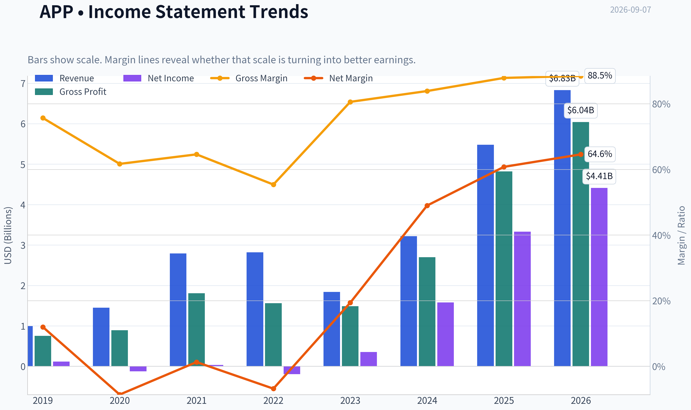

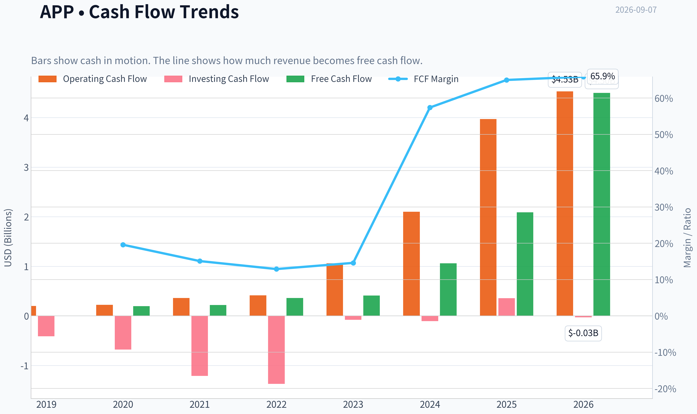

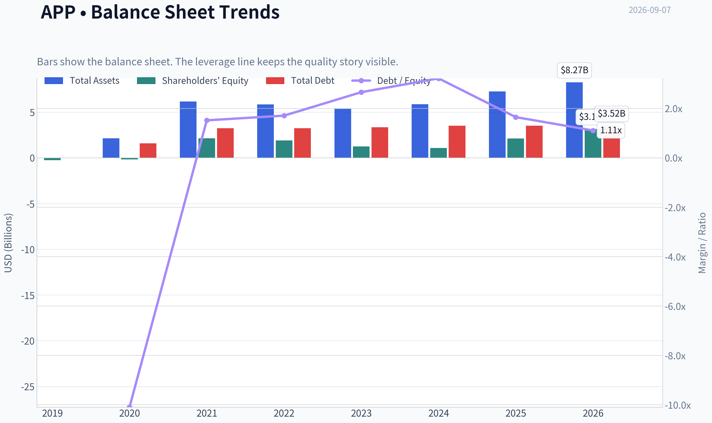

This graph tracks the profitability and return metrics (ROE, ROIC, Margins) of **APP** over the past decade, highlighting capital efficiency trends.

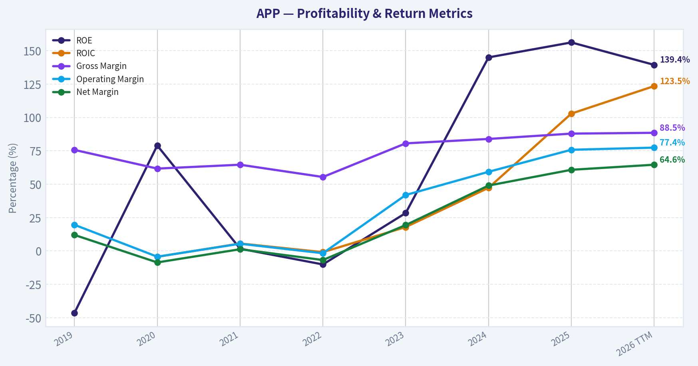

This chart illustrates the financial health of **APP** over the last 10 years, mapping cash equivalents and free cash flow against total obligations (Debt).

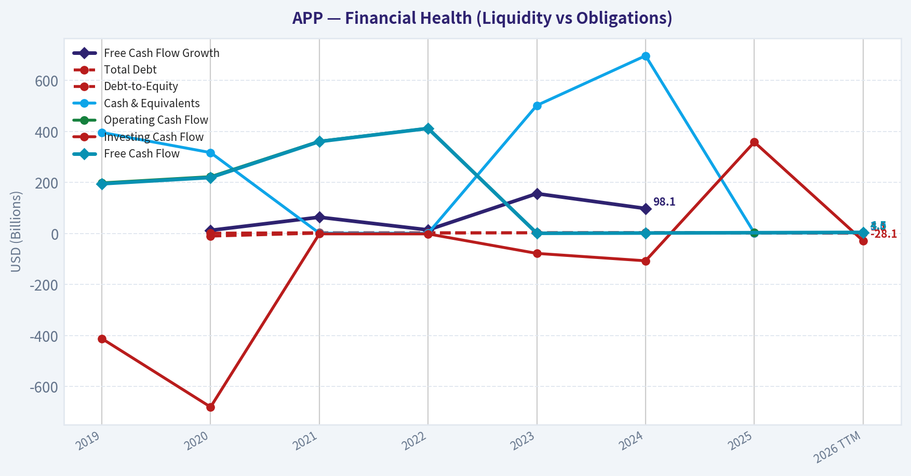

---

### Intrinsic Value Analysis (Buffett)

> *Following Warren Buffett's value investing philosophy: Circle of Competence, Economic Moat, Management Quality, and Margin of Safety.*

#### Intrinsic Value Snapshot

Price is what you pay. Intrinsic value is what the business may be worth based on the cash it can create for owners over time. We show a range, not one magic number.

- Current Price: $320.56
- Value Range (conservative to optimistic across both DCF methods): $278.31 to $1,341.43

##### Owner Earnings (Buffett Method)
- Net Income: $3,333,751,000.00
- Depreciation & Amortization: $194,778,000.00
- Capital Expenditures: N/A
- Working Capital Changes: $77,922,000.00
- Owner Earnings: $3,450,607,000.00

##### Intrinsic Value
###### Buffett Method
Uses owner earnings. Stricter, and usually more conservative.
- Conservative: $514.26
- Average: $514.26
- Optimistic: $1,341.43
- Discount Rate: 10.0%

###### Cash Flow Method
Uses free cash flow. Better for companies spending heavily today to grow tomorrow.
- Conservative: $278.31
- Average: $478.89
- Optimistic: $1,249.33
- Discount Rate: 10.0%

ANALYST STANCE: **WATCH**

#### AppLovin Corporation (APP) - Buffett-Style Value Investment Analysis

AppLovin is a high-margin advertising technology platform serving mobile app developers, increasingly powered by its AI-based AXON engine. The business has transitioned from a lower-quality mix of owned apps and ad services into a much stronger software-platform model with exceptional recent revenue growth, very high gross margins, and powerful cash generation. The question is not whether AppLovin has become a better business - it has - but whether today's price already discounts too much of that improvement.

---

#### 1. Factor Scorecard

| Factor | Score | Evidence |
|---|---:|---|
| Circle of Competence & Business Simplicity | 3.5 / 5 | AppLovin helps app developers acquire users and monetize inventory through performance advertising. The model is understandable, but the long-term durability of AI-driven ad bidding advantages is harder to forecast than consumer staples or regulated infrastructure. |
| Moat Test | 3.5 / 5 | Strong software economics, high gross margin, data scale, and customer workflow integration suggest a real moat. However, ad-tech markets can shift quickly, and platform dependence remains a meaningful risk. |
| Management Quality & Capital Allocation | 3.5 / 5 | Management has materially improved business quality by shifting toward the software platform and away from lower-quality app assets. Execution has been excellent recently, though the stock's rapid appreciation raises the bar for buybacks and future capital allocation. |
| Industry Structure | 3.0 / 5 | Digital advertising is large and growing, but competitive, technology-sensitive, and exposed to platform policy changes from Apple, Google, and privacy regulators. AppLovin's niche is attractive, but not immune to disruption. |
| Gate 5: Quality / Solvency Hard Floor | **Not tripped** | Earnings and cash-flow trajectory are improving sharply, and there is no evidence of distress-level solvency pressure. |

**Key Takeaways:** AppLovin scores well on economics and recent execution, but not perfectly on predictability. The company looks like a genuine high-return software platform, yet the advertising-technology industry is dynamic enough that a Buffett-style investor should demand discipline on price.

---

#### 2. Moat Analysis

| Moat Source | Assessment | Evidence |
|---|---|---|
| Intangible Assets | Strong | AXON has become a differentiated performance-advertising engine. Gross margin of roughly 87.9% indicates software-like economics and pricing power. |
| Switching Costs | Moderate to Strong | Advertisers and developers using AppLovin's tools benefit from campaign data, optimization history, and monetization workflows. Switching may be possible, but performance loss creates friction. |
| Cost Advantage | Moderate | Scale improves data density, model training, ad matching, and infrastructure efficiency. However, large competitors also possess deep engineering and data resources. |
| Network Effects | Moderate | More advertisers, more publishers, and more conversion data can improve matching quality. The effect exists, but is not as obvious or impregnable as a social network or payments network. |
| Moat Rating | Narrow-to-Wide, improving | The moat has widened materially as the business has shifted toward AI-driven software advertising. Durability remains the central underwriting question. |

**Key Takeaways:** AppLovin's moat is real and has been strengthening, especially through data scale and software margins. The main concern is that ad-tech advantages can erode if algorithms, platform rules, or customer acquisition channels change materially.

---

#### 3. Management Quality Assessment

| Management Dimension | Assessment |
|---|---|
| Owner Orientation | Positive. Management has made strategic choices that improved business quality and shareholder value. |
| Candor & Execution | Strong recent execution. The pivot toward the software platform has produced a much better margin profile and faster growth. |
| Capital Allocation | Improving. The best capital allocation decision has been focusing the business on high-return software advertising rather than lower-quality owned-app assets. |
| Key Concern | At a market cap above $100 billion, future buybacks or acquisitions must be judged against a much higher valuation base. |

**Key Takeaways:** Management deserves credit for transforming AppLovin into a far better business. The company's future capital allocation record will depend on whether leaders remain disciplined after the stock's major re-rating.

---

#### 4. Financial Summary

| Metric | Recent / Current Figure | Buffett-Style Interpretation |
|---|---:|---|
| Current Price | $321 | Slightly above headline intrinsic value estimate. |
| Market Capitalization | $107.28B | Large-cap expectations are now embedded. |
| P/E Ratio | 24.6x | Not excessive for the growth rate, but no longer obviously cheap. |
| ROE | 156.2% | Exceptional, though asset-light models can produce very high accounting ROE. |
| Gross Margin | 87.9% | Excellent; supports the case for software economics and pricing power. |
| Revenue Growth YoY | 70.0% | Outstanding, but unlikely to persist at this level indefinitely. |
| Current Ratio | 3.32x | Strong short-term liquidity. |
| Headline Intrinsic Value | $305.61 | About 5% below current price. |
| 3-Model Valuation Spread | $52.90 to $514.26 | Wide spread signals high sensitivity to assumptions. |
| Reverse-DCF Implied Growth | ~16.3% annually for 10 years | Demanding, but not impossible if the platform remains dominant. |

**Key Takeaways:** AppLovin's financial profile is exceptional: very high margins, rapid growth, and high returns. The valuation, however, already assumes the business remains a powerful compounder for many years.

---

#### 5. Owner Earnings Calculation

Using Buffett's framework:

| Component | Directional Assessment |
|---|---|
| Net Income | Strong and rapidly improving. |
| Plus: Depreciation & Amortization | Adds back non-cash charges. |
| Less: Maintenance CapEx | Likely modest relative to revenue because the business is increasingly software-driven. |
| Less: Working Capital Increases | Not a major structural burden relative to earnings power. |
| Owner Earnings Quality | High, assuming reported profits continue converting into free cash flow. |

| Owner-Earnings Valuation Reference | Per-Share Value |
|---|---:|
| Owner Earnings DCF Estimate | $514.26 |
| FCF-Based Estimate | $478.89 |
| Damodaran FCFF Estimate | $52.90 |
| Headline Blended Intrinsic Value | $305.61 |

**Key Takeaways:** The owner-earnings view is much more favorable than the conservative FCFF view, which explains the wide valuation spread. For AppLovin, the investment conclusion depends heavily on whether today's elevated margins and growth are durable rather than cyclical or temporarily advantaged.

---

#### 6. Three-Scenario DCF Valuation

| Scenario | Assumption | Indicative Value View |
|---|---|---:|
| Scenario A: No Growth | Owner earnings capitalized at 10% | Conservative floor; materially below optimistic platform scenarios. |
| Scenario B: GDP Growth | 3% perpetual growth, 10% discount rate | Supports a solid business valuation but does not justify a large premium unless margins remain very high. |
| Scenario C: Historical Growth Haircut | Uses a substantial discount to recent growth, capped conservatively | Can justify value above today's price if AppLovin compounds at high-teens rates for a decade. |
| Headline Blended Intrinsic Value | Business-model routed blend | $305.61 per share |

**Key Takeaways:** AppLovin is highly sensitive to growth assumptions. If growth normalizes quickly, the stock is expensive; if the AXON platform compounds at high rates for years, today's price can be reasonable.

---

#### 7. Margin of Safety Analysis

| Valuation Measure | Result |
|---|---:|
| Current Price | $321 |
| Headline Intrinsic Value | $305.61 |
| Margin of Safety vs. Headline Value | -4.9% |
| Reverse-DCF Implied 10-Year Growth | ~16.3% annually |
| Quality-Scaled Required Margin of Safety | Roughly 10-15% for a true wide-moat compounder; 25%+ if moat durability is uncertain |

**Key Takeaways:** AppLovin does not currently offer a clear margin of safety against the headline intrinsic value. The stock may still work if the business proves to be a durable compounder, but Buffett-style discipline argues for waiting for either a better price or more proof of moat permanence.

---

#### 8. Final Buffett Scorecard

| Criterion | Weight | Score | Weighted Contribution |
|---|---:|---:|---:|
| Moat Width & Durability | 25% | 3.5 | 0.88 |
| Valuation / Margin of Safety | 20% | 2.8 | 0.56 |
| Capital Returns - ROIC vs. WACC | 15% | 4.5 | 0.68 |
| Business Understanding & Predictability | 12% | 3.5 | 0.42 |
| Management Quality & Capital Allocation | 12% | 3.5 | 0.42 |
| Reinvestment Runway | 8% | 4.0 | 0.32 |
| Balance Sheet Strength | 4% | 4.0 | 0.16 |
| Industry Structure | 4% | 3.0 | 0.12 |
| **Total Score** | **100%** |  | **3.56 / 5** |

**Key Takeaways:** AppLovin clears the quality bar, especially on margins, growth, and returns on capital. The score is held back mainly by valuation and the uncertainty of long-term ad-tech durability.

---

#### 9. Investment Stance

| Stance | Conviction | Rationale |
|---|---|---|
| **WATCH** | Medium-High | AppLovin is a much-improved, high-return software platform with impressive growth and exceptional margins. However, the stock trades slightly above blended intrinsic value, and the reverse-DCF requires roughly 16% annual growth for a decade. That is achievable only if the AXON advantage proves durable and competition/platform risks remain contained. |

**Final View:** AppLovin is a high-quality business that deserves a place on the watchlist, not a clear Buffett-style purchase at today's price. I would become more constructive if the stock traded at least 10-15% below intrinsic value, or if future results further prove that the company's AI-driven advertising advantage is durable, not merely cyclical or temporarily ahead of competitors.
#### Valuation Bridge

This bridge places the current market price beside each intrinsic value lens so readers can see whether upside depends on one method or shows up across several methods.

| Scenario | Intrinsic Value / Share |
| --- | ---: |
| Buffett Method | $514.26 |
| Cash Flow Method | $478.89 |
| Damodaran Method | $52.90 |
| Current Price | $320.56 |

#### Key Takeaways

If one method is far above the others, the upside case depends on a specific modelling assumption. When several methods cluster together, the valuation story is more robust.

#### Valuation Visuals

This comparison chart from *Latest Earnings Snapshot* stacks current figures against historical benchmarks for **APP**, making it easy to see where the company trades relative to its own averages.

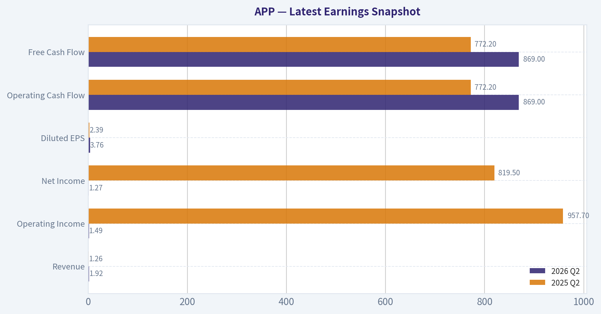

This comparison chart from *Current vs Historical Average Comparison* stacks current figures against historical benchmarks for **APP**, making it easy to see where the company trades relative to its own averages.

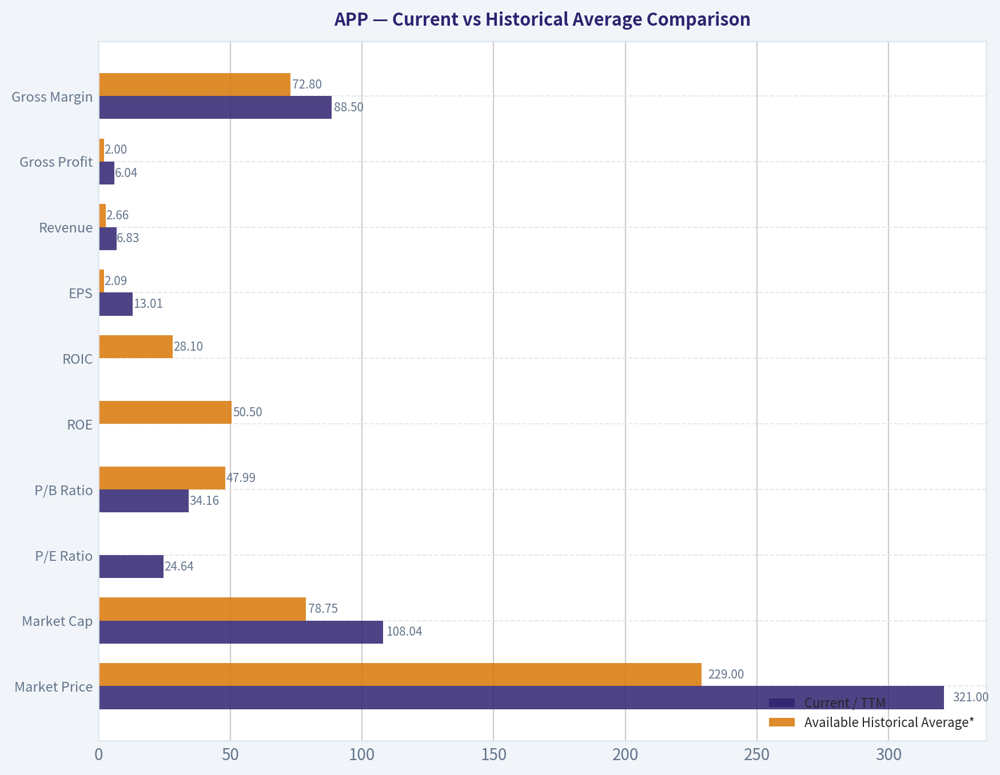

This comparison chart from *Balance Sheet and Financial Strength* stacks current figures against historical benchmarks for **APP**, making it easy to see where the company trades relative to its own averages.

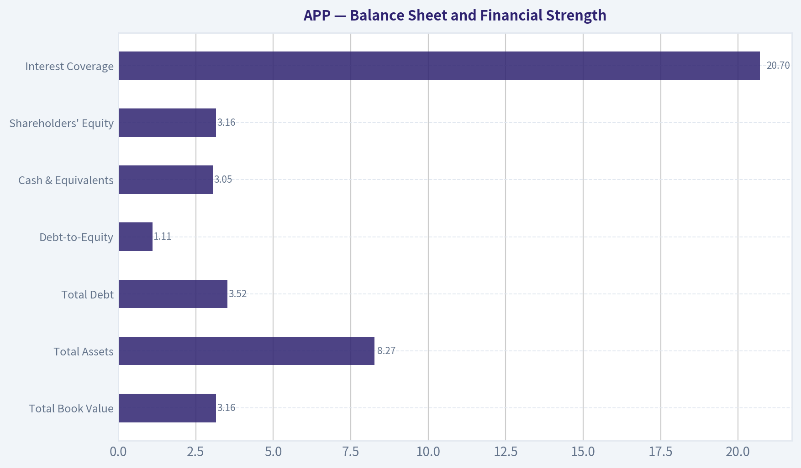

This comparison chart from *Three-Scenario Buffett-Style Owner Earnings DCF* stacks current figures against historical benchmarks for **APP**, making it easy to see where the company trades relative to its own averages.

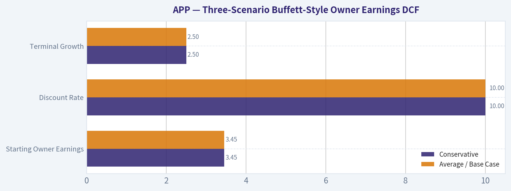

This comparison chart from *Financial Summary* stacks current figures against historical benchmarks for **APP**, making it easy to see where the company trades relative to its own averages.

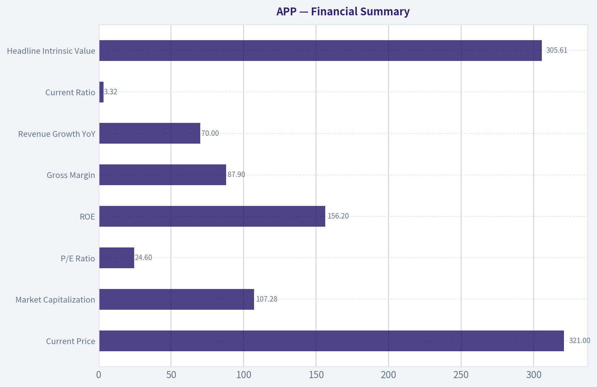

---

### Trend & Growth Analysis (Lynch/Druckenmiller/Fisher)

> *Following Peter Lynch's GARP, Stanley Druckenmiller's macro-aware approach, and Philip Fisher's scuttlebutt methodology.*

ANALYST STANCE: **ADVOCATE**

#### AppLovin - Growth Investment Report

| Item | Snapshot |
|---|---:|
| Ticker | APP |
| Current Price | $321 |
| Market Cap | $107.28B |
| P/E | 24.6x |
| YoY Revenue Growth | 70.0% |
| Gross Margin | 87.9% |
| ROE | 156.2% |
| Current Ratio | 3.32x |
| Headline Intrinsic Value | $305.61 |
| Margin of Safety vs. Price | -4.9% |
| Reverse DCF Implied Growth | ~16.3% annually for 10 years |
| Trailing 3-Year Growth Reference | ~74.8% |

**Key Takeaways:** AppLovin is not a cheap deep-value stock, but it is still priced reasonably relative to its reported growth. A 24.6x P/E for a company growing revenue around 70% year over year is unusually attractive if growth durability holds. The main debate is not whether the business is working today; it is whether AXON-driven growth can remain exceptional for several more years.

---

#### 1. Lynch Classification

| Lynch Category | Classification | Rationale |
|---|---|---|
| Slow Grower | No | Growth far above 0-5%. |
| Stalwart | No | Growth is much faster than mature compounder range. |
| Fast Grower | **Yes - Primary Classification** | 70% YoY revenue growth, high margins, AI-powered product cycle. |
| Cyclical | Partial Risk | Advertising budgets are economically sensitive. |
| Turnaround | No | This is not a distressed recovery story. |
| Asset Play | No | Value is in platform economics, not hidden assets. |

**Key Takeaways:** AppLovin fits Peter Lynch's "fast grower" bucket. The company has some advertising-cycle sensitivity, but the dominant story is not cyclicality; it is AI-powered performance advertising growth. This is the type of stock that can compound dramatically if the core growth engine remains intact.

---

#### 2. The Story in 3 Bullets

- AppLovin helps app developers and advertisers acquire users by using AI to match ads with the people most likely to convert.
- Its AXON AI engine appears to have created a step-change in advertising performance, driving rapid revenue growth and very high gross margins.
- If AppLovin can expand beyond gaming and mobile apps into broader e-commerce and performance advertising, the runway could be much larger than the market historically assumed.

---

#### 3. TAM Analysis and 10x Test

| TAM Factor | Assessment |
|---|---|
| Core Market | Mobile app advertising and user acquisition |
| Expansion Market | Broader performance advertising, e-commerce advertising, AI-driven conversion optimization |
| Current Revenue Base | Not fully available from tool output; market cap and growth imply a large but still sub-mega-cap revenue base |
| 10x Revenue Test | Likely possible only if APP expands beyond mobile gaming/app install advertising |
| TAM Quality | Strong if AXON generalizes across verticals; narrower if growth remains mobile-gaming-centric |
| TAM Growth | Digital advertising and AI-optimized performance marketing remain secular growth markets |

**Key Takeaways:** The ten-bagger case depends on TAM expansion. AppLovin can likely continue growing within mobile performance advertising, but a true 10x outcome requires successful expansion into broader advertiser categories such as e-commerce. The company's AI engine is the key to whether the market opportunity is merely large or truly massive.

---

#### 4. Revenue Growth Trend

| Metric | Signal |
|---|---|
| Reported YoY Revenue Growth | 70.0% |
| Pattern | Strong acceleration / high-growth continuation |
| Quality of Growth | Appears product-led, driven by AXON and advertising platform performance |
| Concern | Advertising revenue can be cyclical and may decelerate from extraordinary levels |
| Lynch View | Fast grower |
| Druckenmiller View | Clear inflection candidate |

**Key Takeaways:** Revenue growth is the strongest part of the AppLovin thesis. A 70% growth rate at this market-cap scale indicates that something fundamental changed in the business, likely tied to AXON's advertising performance. The key monitoring question is whether this is a temporary burst or a multi-year platform shift.

---

#### 5. Unit Economics

| Metric | Available Evidence | Assessment |
|---|---|---|
| Gross Margin | 87.9% | Excellent |
| LTV/CAC | Not disclosed in research pack | Cannot score precisely |
| CAC Payback | Not disclosed | Cannot score precisely |
| Net Revenue Retention | Not disclosed | Not a classic SaaS disclosure |
| Rule of 40 | Revenue growth 70% + FCF margin unavailable | Likely strong if FCF margin is positive |
| Current Ratio | 3.32x | Strong liquidity |

**Key Takeaways:** We do not have enough disclosed data to calculate classic SaaS unit economics such as LTV/CAC or NRR. However, AppLovin's 87.9% gross margin strongly suggests attractive software-like economics. If free cash flow margins are meaningfully positive, the Rule of 40 profile is likely excellent.

---

#### 6. Inflection Point Assessment

| Inflection Type | Evidence | Strength |
|---|---|---|
| Product Cycle Inflection | AXON AI engine driving better ad targeting and conversion | Very High |
| Market Share Inflection | Rapid revenue growth suggests share gains in performance advertising | High |
| Margin Inflection | Very high gross margin and operating leverage potential | High |
| TAM Inflection | Possible expansion into e-commerce and broader ad categories | Medium to High |
| Competitive Inflection | Traditional adtech may struggle against superior AI optimization | Medium |

**Key Takeaways:** AppLovin has several signs of a true inflection point, especially around product performance and margin leverage. The AXON engine is the center of the thesis because it appears to have changed the company's growth trajectory. The next leg depends on proving that this advantage works beyond the original mobile app ecosystem.

---

#### 7. Macro Setup

| Macro Factor | Impact on APP |
|---|---|
| Interest Rates | Falling or stable rates would support growth-stock valuation multiples |
| Economic Cycle | Advertising is cyclical; recession would pressure budgets |
| AI Theme | Strong tailwind; APP is an applied-AI monetization story |
| Digital Advertising | Secular tailwind, especially performance-based channels |
| Investor Positioning | Risk of AI-related rotation or IPO funding pressure noted in recent coverage |
| Overall Macro Setup | Favorable secularly, mixed cyclically |

**Key Takeaways:** The macro setup is mostly positive because AppLovin is tied to AI and digital advertising. However, advertising budgets can weaken quickly in a recession or risk-off market. The stock could also face technical pressure if investors sell winners to fund new AI IPO allocations.

---

#### 8. Fisher 15-Point Score

| Fisher Criterion | Score / 5 | Comment |
|---|---:|---|
| Products with sizable sales potential | 5 | AXON and performance ads have large opportunity. |
| Management determination for new products | 4 | Strong product evolution, especially AI engine. |
| Effective R&D | 5 | AI optimization appears highly effective. |
| Above-average sales organization | 4 | Growth suggests strong market adoption. |
| Worthwhile profit margin | 5 | 87.9% gross margin is excellent. |
| Improving profit margins | 4 | Operating leverage likely, though exact trend not provided. |
| Labor/personnel relations | 3 | Insufficient data. |
| Executive relations | 3 | Insufficient data. |
| Management depth | 4 | Execution has been strong. |
| Cost analysis/accounting | 4 | High-margin model suggests discipline, but verify filings. |
| Unique competitive advantages | 5 | AI engine, data feedback loops, performance optimization. |
| Long-range profit outlook | 5 | Strong if TAM expansion succeeds. |
| Dilution risk | 4 | No major dilution warning from provided data. |
| Candor with investors | 3 | Needs further conference-call review. |
| Management integrity | 3 | No major issue identified from provided data. |
| **Total** | **61 / 75** | **Good** |

**Key Takeaways:** AppLovin scores well on Fisher's framework, mainly because of product strength, market potential, margins, and long-term profit outlook. The lower scores are not major negatives; they mostly reflect unavailable scuttlebutt data on culture, candor, and internal management depth. Overall, this is a high-quality growth setup with some information gaps.

---

#### 9. Valuation Analysis

| Valuation Lens | Result | Interpretation |
|---|---:|---|
| P/E | 24.6x | Attractive relative to 70% revenue growth if earnings quality is durable |
| PEG Estimate | ~0.35x using revenue growth as proxy | Potentially very attractive, though true EPS growth should be verified |
| Headline Intrinsic Value | $305.61 | Slightly below current price |
| Margin of Safety | -4.9% | Fairly valued to modestly expensive on blended intrinsic value |
| Reverse DCF Implied Growth | 16.3% for 10 years | Not heroic versus recent growth |
| 3-Model Valuation Spread | $52.90 to $514.26 | Very wide; valuation depends heavily on margin durability and cyclicality assumptions |

**Key Takeaways:** Valuation is not obviously cheap on headline intrinsic value, but it is compelling relative to growth. The reverse DCF is especially important: the current price appears to require about 16% annual growth for 10 years, far below AppLovin's recent 70% revenue growth rate. The wide valuation spread shows that the stock is highly sensitive to assumptions about cyclicality and long-term margins.

---

#### 10. Scenario Analysis

| Scenario | Assumptions | Investment Implication |
|---|---|---|
| Bear Case | AXON growth decelerates sharply; ad budgets weaken; multiple compresses | Stock could materially underperform despite current profitability |
| Base Case | Growth normalizes but remains above 20%; margins stay high; TAM expands gradually | Stock can compound from current levels |
| Bull Case | AXON becomes a broader e-commerce/performance advertising engine; growth stays elevated | Multi-year winner with possible multi-bagger potential |
| Ten-Bagger Case | Requires massive TAM expansion beyond current perceived market | Possible, but not the base case from today's $107B market cap |

**Key Takeaways:** The base case supports owning the stock, but the ten-bagger case is harder because AppLovin is already a $100B-plus company. For a true 10x from here, the company likely needs to become a dominant AI advertising infrastructure platform across multiple verticals. The upside is still meaningful, but expectations must be calibrated.

---

#### 11. Growth Investor Scorecard

| Criterion | Weight | Score / 5 | Weighted Score |
|---|---:|---:|---:|
| The Story | 10% | 4.5 | 0.45 |
| TAM & Runway | 20% | 4.0 | 0.80 |
| Revenue Growth | 20% | 5.0 | 1.00 |
| Unit Economics | 15% | 4.0 | 0.60 |
| Competitive Position | 10% | 4.5 | 0.45 |
| Management Quality | 10% | 4.0 | 0.40 |
| Macro Setup | 5% | 3.5 | 0.18 |
| Profitability Path | 5% | 4.5 | 0.23 |
| Valuation | 5% | 3.5 | 0.18 |
| **Total** | **100%** |  | **4.28 / 5.00** |

**Key Takeaways:** AppLovin earns a strong growth score of 4.28 out of 5. The biggest strengths are revenue growth, high margins, and a credible AI-driven inflection. The main deductions are valuation, ad-cycle risk, and uncertainty around how far the company can expand beyond its historical core market.

---

#### 12. Position Size Stance

| Investor Type | Suggested Stance |
|---|---|
| Aggressive Growth Investor | Buy / add selectively |
| GARP Investor | Buy on pullbacks; current valuation is acceptable but not bargain-basement |
| Conservative Investor | Watch for confirmation of growth durability and less valuation volatility |
| Existing Holder | Continue holding; trim only if position size becomes excessive |
| New Position Size | Medium position, not maximum position, due to cyclicality and valuation risk |

**Key Takeaways:** AppLovin is attractive enough for an ADVOCATE stance, but position sizing should respect the stock's volatility and advertising exposure. This is a strong growth compounder candidate, not a low-risk defensive holding. For new money, staged buying is preferable to a single full-size purchase.

---

#### Key Risks and Catalysts

| Category | Risks | Catalysts |
|---|---|---|
| Growth Durability | Revenue growth may decelerate from extraordinary levels | Continued 30%+ growth would validate the thesis |
| Product | AXON performance edge could narrow | AXON adoption expands across more advertiser categories |
| TAM | Mobile app advertising may be smaller than bull case assumes | E-commerce and broader performance advertising expansion |
| Macro | Recession could reduce ad budgets | Falling rates and stronger ad spending cycle |
| Competition | Google, Meta, Unity, and other adtech players respond aggressively | Competitors fail to match APP's AI conversion performance |
| Valuation | Multiple compression if growth slows | Earnings revisions and FCF growth drive rerating |
| Market Technicals | AI IPOs could cause portfolio rotation pressure | Increased institutional ownership, such as Point72 adding shares |

**Key Takeaways:** The core risk is that the market extrapolates AppLovin's current growth too far. The core catalyst is that the market may still be underestimating how large AXON's opportunity can become. If AppLovin proves it is not just a mobile gaming ad company but a broader AI performance advertising platform, the stock can continue to work.

---

#### Final View

AppLovin is a **Fast Grower with a credible AI-driven inflection point**. The combination of 70% revenue growth, 87.9% gross margin, strong liquidity, and a reasonable P/E creates an unusually strong GARP profile. The stock is not deeply undervalued versus the blended intrinsic value estimate, but the reverse DCF hurdle appears manageable if growth remains durable.

**Stance: ADVOCATE - medium-sized growth position, add on volatility, monitor growth deceleration closely.**

---

### Market Technical Analysis

ANALYST STANCE: **WATCH**

#### APP Technical Indicator Report - Latest Trading Data Through 2026-09-04

APP remains in a damaged intermediate-to-long-term downtrend, but the short-term tape has begun to stabilize after the sharp August selloff. The latest close of **$320.56** is above both the **10 EMA** and **VWMA**, which suggests near-term buyers are defending the low-$300 area. However, price remains far below the **50 SMA** and **200 SMA**, so the broader trend is still bearish until APP can reclaim much higher resistance zones.

The most relevant indicators for this market context are: **close_10_ema, close_50_sma, close_200_sma, macd, macds, rsi, atr, and vwma**. This set balances short-term trend, medium- and long-term trend, momentum, volatility, and volume-weighted confirmation without excessive redundancy.

#### Trend Structure

The short-term picture has improved modestly. APP closed at **$320.56**, above the **10 EMA at $315.66**, showing that near-term momentum has turned constructive after the stock bottomed near **$298.59** on August 24. This is not yet a confirmed trend reversal, but it is an early sign that selling pressure has cooled.

The medium-term structure remains weak. The **50 SMA is $393.59**, meaning APP is still roughly **18.6% below** its medium-term trend line. The 50 SMA has also been falling sharply, declining from about **$498.20 on July 24** to **$393.59 on September 4**, which confirms that the stock is still digesting a major breakdown.

The long-term trend is even more bearish. The **200 SMA is $486.04**, with price trading about **34.0% below** it. The 50 SMA is also well below the 200 SMA, reinforcing a bearish longer-term regime. For longer-term investors, APP would need to build a much more durable base before the trend could be considered repaired.

#### Momentum and Reversal Quality

The **MACD remains negative at -20.21**, so momentum is still below the zero line and the stock has not fully transitioned back into bullish territory. However, the MACD is now above the **MACD signal line at -26.65**, producing a positive spread of roughly **+6.44**. This indicates that downside momentum is fading and a short-term recovery attempt is underway.

This improvement matters because the MACD was much weaker in mid-August, near **-39 to -40**. The move from deeply negative momentum toward less negative readings suggests sellers are losing control, but not that buyers have fully regained control. A stronger signal would come if MACD continues rising toward zero while price breaks above the **$331-$336** resistance area.

The **RSI at 41.67** also supports the idea of stabilization rather than a strong bullish reversal. RSI has recovered from oversold readings near **26.6** in mid-August, which reduces immediate downside exhaustion risk. Still, RSI remains below the neutral **50** level, so momentum is not yet strong enough to confirm broad upside participation.

#### Volatility and Risk Management

The **ATR has declined to $17.31**, down from nearly **$29.59** around the August 6 breakdown. This contraction in ATR shows that volatility has cooled substantially after the panic phase. Lower volatility can help a base form, but APP remains a high-beta, wide-range stock: a $17 ATR is still more than **5% of the current share price**.

For traders, this means stops should not be too tight. A normal daily swing can easily shake out weak entries. The most important tactical support areas are around **$311-$312**, then **$303-$306**, and finally the recent low near **$298.59**. A decisive close below $298 would likely invalidate the current basing attempt.

#### Volume-Weighted Confirmation

The **VWMA is $311.92**, and APP's latest close is above it by roughly **2.8%**. That is a constructive short-term sign because price is now trading above its volume-weighted average, suggesting recent buyers are slightly in control.

However, the VWMA has collapsed from roughly **$451.81 on July 24** to **$311.92 on September 4**, which confirms that the recent stabilization occurred after a major volume-backed repricing. The current VWMA is flattening near the low-$310s, so this zone should be watched closely. If APP can continue closing above VWMA, the base becomes more credible; if it loses VWMA, the recovery attempt weakens quickly.

#### Tactical Interpretation

APP is not yet a clean bullish setup, but it is no longer in the same uncontrolled downside phase seen earlier in August. The stock is attempting to form a short-term base between roughly **$298 and $336**. A move above **$331-$336** would improve the chart and could open room toward the next resistance area near **$346-$350**. Above that, the more important medium-term test would be the declining **50 SMA near $394**.

On the downside, failure to hold the **$311-$312** VWMA/short-term support zone would warn that buyers are losing control again. A close below **$303**, and especially below **$298.59**, would shift the setup back toward bearish continuation.

| Area | Indicator / Level | Latest Reading | Interpretation | Trading Relevance |
|---|---:|---:|---|---|
| Short-term trend | close_10_ema | $315.66 | Price is above the 10 EMA, showing near-term stabilization | Constructive only while price holds above roughly $315 |
| Medium-term trend | close_50_sma | $393.59 | Price remains far below the 50 SMA, confirming a damaged trend | Major resistance and trend-repair level |
| Long-term trend | close_200_sma | $486.04 | Price is deeply below the 200 SMA | Long-term structure remains bearish |
| Momentum | macd | -20.21 | Still negative, but improving from August lows | Recovery attempt is forming but not fully confirmed |
| Momentum signal | macds | -26.65 | MACD is above signal line | Short-term bullish momentum crossover is active |
| Momentum/overbought-oversold | rsi | 41.67 | Recovered from oversold, but still below neutral | Stabilization, not yet strong bullish momentum |
| Volatility | atr | $17.31 | Volatility has contracted from panic levels | Use wider stops; daily swings remain large |
| Volume-weighted trend | vwma | $311.92 | Price is above VWMA | Low-$310s are important support for the base |

Key Takeaways: APP is showing early signs of short-term stabilization, with price above the 10 EMA and VWMA and MACD improving versus its signal line. However, the stock remains well below the 50 SMA and 200 SMA, so the larger trend is still bearish. The key upside confirmation zone is around $331 to $336, while a loss of $311 and then $298 would weaken or invalidate the current recovery attempt.

#### Market Visuals

This comparison chart from *Market Metrics Interpretation* stacks current figures against historical benchmarks for **APP**, making it easy to see where the company trades relative to its own averages.

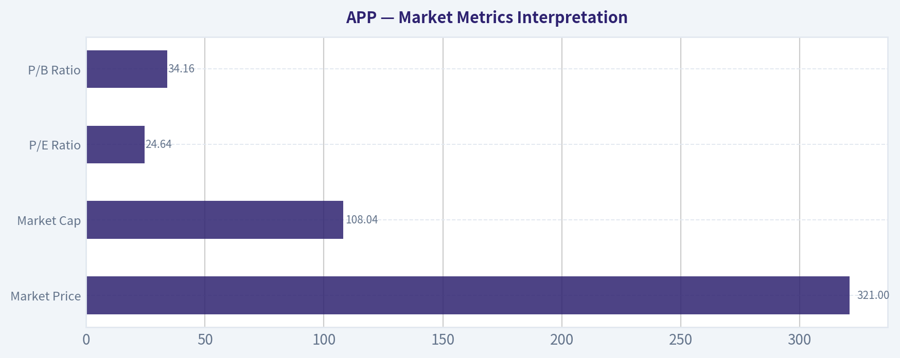

---

### Options Market Analysis

> *Reading options flow - put/call ratios, IV skew, and unusual activity - to gauge institutional positioning and event-driven risk.*

#### APP Options Flow Report
*Options data as of 2026-09-07. Near-term expirations analyzed: 2026-09-11, 2026-09-18, 2026-09-25.*

#### 1. Put/Call Ratio Analysis

| Expiry | DTE | Call OI | Put OI | Put/Call OI Ratio | Call Volume | Put Volume | Put/Call Volume Ratio | Read |
|---|---:|---:|---:|---:|---:|---:|---:|---|
| 2026-09-11 | 4 | 8,034 | 6,266 | 0.78 | 4,002 | 2,995 | 0.75 | Near neutral, slightly put-protective |
| 2026-09-18 | 11 | 43,896 | 18,608 | 0.42 | 3,173 | 2,336 | 0.74 | Structurally call-heavy OI, balanced daily flow |
| 2026-09-25 | 18 | 3,141 | 3,093 | 0.98 | 1,156 | 299 | 0.26 | OI balanced, volume strongly call-skewed |
| **Total Near-Term** | - | **55,071** | **27,967** | **0.51** | **8,331** | **5,630** | **0.68** | **Moderately bullish OI, volume near neutral** |

**Key Takeaways:** APP's near-term open interest is meaningfully call-heavy, with a total put/call OI ratio of **0.51**, below the historical neutral baseline of roughly **0.70**. That suggests positioning is tilted bullish or at least upside-exposed, especially into the 2026-09-18 expiry. However, the total put/call volume ratio of **0.68** is very close to neutral, so today's fresh flow is not aggressively bullish despite the call-heavy open interest.

#### 2. Implied Volatility Assessment

| Expiry | DTE | ATM Call IV | ATM Put IV | Call-Put IV Difference | IV Read |
|---|---:|---:|---:|---:|---|
| 2026-09-11 | 4 | 64.8% | 63.7% | Calls +1.1 vol pts | Elevated near-term IV |
| 2026-09-18 | 11 | 59.6% | 56.8% | Calls +2.8 vol pts | Elevated, call IV modestly richer |
| 2026-09-25 | 18 | 58.5% | 57.1% | Calls +1.4 vol pts | Elevated but slightly lower than front week |

**Key Takeaways:** Near-term ATM IV is high in absolute terms, ranging from roughly **57% to 65%**, which implies the market is pricing sizable movement in APP. The front-week expiry has the highest IV, suggesting short-term event or momentum risk is being priced. Based on the available ATM data, calls are slightly richer than puts, which leans toward upside demand rather than downside fear.

**IV Skew Interpretation:**
The provided dataset does not include strike-level OTM put IV versus OTM call IV, so a full skew analysis cannot be completed. Using ATM call-versus-put IV as a limited proxy, there is **no evidence of steep downside put skew**. Instead, calls are modestly more expensive than puts across all three expirations, suggesting mild upside chase or call demand rather than panic hedging.

#### 3. Unusual Options Activity

| Contract Screen | Result | Interpretation |
|---|---|---|
| Volume greater than 5x open interest | **None detected** | No clear evidence of fresh outsized directional bets in near-term expirations |
| Fresh institutional-style sweeps | Not identified in provided data | No contract-level unusual flow available |
| Retail-style speculative burst | Not identified | No single high-volume, low-OI contract flagged |

**Key Takeaways:** There were **no near-term contracts where volume exceeded 5x open interest**, so the data does not show a clear fresh unusual options trade. This reduces confidence in calling the move "smart-money driven." The current options signal is therefore based more on aggregate positioning and IV than on a standout institutional trade.

#### 4. Open Interest Concentration and Pinning Risk

| Expiry | Call OI | Put OI | Total OI | OI Concentration Read |
|---|---:|---:|---:|---|
| 2026-09-11 | 8,034 | 6,266 | 14,300 | Moderate front-week positioning |
| 2026-09-18 | 43,896 | 18,608 | 62,504 | Largest OI concentration; call-heavy |
| 2026-09-25 | 3,141 | 3,093 | 6,234 | Smaller and balanced positioning |

**Key Takeaways:** The **2026-09-18 expiry dominates near-term open interest**, accounting for the largest pool of options exposure. That expiry is also heavily call-skewed, which could make it an important positioning window for APP. However, the data does not provide strike-level open interest, so exact pinning levels, max-pain strikes, and gamma walls cannot be identified.

**Gamma / Pinning Note:**
Because strike-level OI is unavailable, specific gamma walls cannot be mapped. Broadly, the largest concentration is in the 2026-09-18 expiration, and the call-heavy structure could amplify upside if dealers are short calls and forced to hedge. Conversely, if much of that call OI is covered-call supply, it could dampen upside into expiration.

#### 5. Overall Options Sentiment Signal

| Category | Signal | Rationale |
|---|---|---|
| Put/Call Positioning | Bullish | Total near-term put/call OI ratio of **0.51** is below the neutral baseline of ~0.70 |
| Volume Flow | Neutral to Slightly Bullish | Total put/call volume ratio of **0.68** is near neutral, but not bearish |
| IV | Elevated | ATM IV near **57%-65%** indicates meaningful expected movement |
| Skew | Mild Call Bias | ATM call IV is slightly above ATM put IV across expiries |
| Unusual Activity | Neutral | No contracts with volume greater than 5x OI detected |
| OI Concentration | Bullish-leaning | 2026-09-18 expiry has large call-heavy OI |

**Key Takeaways:** The options market in APP leans **bullish**, mainly because open interest is significantly call-heavy and calls are modestly richer than puts on an ATM IV basis. That said, today's volume is not aggressively one-sided, and no unusual high-conviction contract activity was flagged. The signal is constructive, but not a screaming bullish sweep-style setup.

#### Final Signal: **BULLISH, with Moderate Confidence**

APP's near-term options positioning points to a **bullish bias**, driven by a low put/call OI ratio of **0.51**, heavy 2026-09-18 call open interest, and modestly higher call IV versus put IV. The lack of unusual options activity tempers the conviction, as there is no obvious fresh institutional trade confirming the setup. Elevated IV also means the market is already pricing substantial movement, so bullish exposure may require careful timing and risk control.

#### Summary Table

| Metric | Current Read | Sentiment Impact |
|---|---|---|
| Put/Call Ratio | OI ratio **0.51**; volume ratio **0.68** | Bullish OI, volume near neutral |
| IV Level | ATM IV roughly **57%-65%** | Elevated expected movement |
| Skew Direction | ATM calls slightly richer than puts | Mild upside demand |
| Unusual Activity | None detected above 5x OI | No strong fresh-flow confirmation |
| Overall Signal | **BULLISH** | Call-heavy positioning dominates, but conviction is moderate |

**Key Takeaways:** APP's options market is leaning bullish, but the signal is not extreme. The strongest evidence is the call-heavy open interest, especially in the 2026-09-18 expiration. Elevated IV means traders are already paying up for movement, so the options market favors upside participation but not without meaningful volatility risk.

---

## Research Team Commentary

> *The Research Manager synthesizes the Bull vs Bear debate into action-free commentary. This is a pre-risk view, not the final stance.*

Listening to this debate over AppLovin, we are looking at a classic confrontation between a fundamental business transformation story and deep-seated industry skepticism. The core question is whether AppLovin's staggering 114 percent return on invested capital and 88 percent gross margins are the new durable reality driven by its AXON AI engine, or just a cyclical peak in a fragile, platform-dependent ad-tech space.

My core takeaway is that the market is mispricing the company's structural pivot. AppLovin has successfully transitioned from a capital-intensive, hit-driven mobile gaming operator into an asset-light, highly scalable software platform. The bull correctly points out that paying 24 times earnings for a business generating triple-digit returns on capital is a rare opportunity. The bear makes a highly valid point about platform dependency, noting that operating beneath Apple and Google means your moat is always at the mercy of ecosystem giants. However, that specific regulatory and platform risk is exactly why this company is trading at 24 times earnings instead of the 50 times multiple you would typically see for an AI software compounder with these margins.

When I reflect on my past mistakes, specifically my overly cautious evaluation of Apple in a prior cycle, the primary lesson was that I allowed rigid valuation parameters to paralyze me while a high-quality compounder was stabilizing and undergoing a bullish narrative reset. I demanded a traditional deep-value margin of safety on a franchise asset, entirely missing the upside. I also leaned too heavily on slow-moving regulatory fears rather than current market drivers. Applying that lesson here means I cannot let the bear's focus on the damaged 200-day moving average or cyclical gaming fears blind me to a fundamentally elite business model that is currently finding a floor. In modern value investing, growth and value are joined at the hip. If AppLovin's AXON engine can plausibly continue capturing market share and expanding into e-commerce, a 24 multiple implies a baseline growth rate the company can easily hurdle. That implied-growth mismatch is our modern margin of safety.

The rationale for leaning in is grounded in business quality and management's excellent capital allocation. Management recognized the limitations of their old owned-apps model and aggressively pivoted toward high-margin software. Network effects in AI ad-matching are incredibly sticky because they directly drive an advertiser's return on investment. If an advertiser is getting superior conversion rates through AppLovin, switching away is economically irrational. The market is pricing in the fear of algorithmic decay and tech vulnerability, but the audited financial realities of 88 percent gross margins suggest this toll booth is highly defensible and actively creating value right now.

For our monitoring plan over the next one to four quarters, we have three clear items to track to ensure our thesis holds. First, we need to look for concrete evidence of AXON successfully penetrating non-gaming verticals, particularly e-commerce. If non-gaming revenue accelerates, it completely invalidates the bear thesis that this is a one-trick pony tied solely to the mobile gaming cycle. Second, we must watch for any margin compression. We need gross margins to stabilize in the mid-to-high 80s to confirm this transition is structural and not just a temporary overearning period. Finally, on the technical side, while short-term buyers are defending the 320 area, we need to see the stock ultimately reclaim its 50-day and 200-day moving averages to confirm that larger institutional money is validating this fundamental transformation and that the downtrend is truly broken.

Given the elite business quality, the reasonable multiple relative to its compounding potential, and our learned commitment not to sit on our hands when a high-margin leader stabilizes just because it operates in a complex sector, my final stance on AppLovin is ADVOCATE.

---

## Value Investing Team Commentary

> *The Investor translates the research view into an investment thesis before risk review. This is still not the final stance.*

This analysis treats AppLovin (APP) not as a speculative software ticker, but as a high-productivity "toll booth" on the digital highway of the mobile app ecosystem. Our focus remains on the long-term earnings power of the business and the durability of its competitive advantages.

### 1. Business Quality and the AI "Toll Booth"
AppLovin has undergone a profound structural transformation that the market is still struggling to price accurately. By pivoting from a capital-intensive owner of mobile games to an asset-light, AI-driven software platform (AXON), management has essentially swapped a "farming" business for a "landlord" business.

The metrics-**87.9% gross margins and a staggering 114.1% ROIC**-are not typical of the advertising industry; they are characteristic of elite, wide-moat software franchises. The AXON engine creates a powerful network effect: as more data passes through the system, the AI's predictive accuracy for ad-matching improves, leading to higher ROI for advertisers, which in turn attracts more spending. This is a classic "virtuous cycle" that builds a durable moat through technical superiority and high switching costs.

### 2. Quality-Scaled Margin of Safety
In the Buffett tradition, a "wonderful business at a fair price" is superior to a "fair business at a wonderful price." At a **P/E of 24.6x**, AppLovin is trading at a valuation usually reserved for mature, slow-growth companies. However, for a business generating triple-digit returns on capital and high double-digit growth, this represents a significant "quality-scaled" margin of safety.

A reverse-DCF analysis suggests that the current price implies only modest future growth. If the AXON engine is truly a step-change in performance, as the margins suggest, the company is likely to hurdle these market expectations with ease. The "safety" here is not found in a low price-to-book ratio, but in the massive gap between the company's internal compounding rate and the market's conservative earnings multiple.

### 3. Selective Contrarian Thinking: The Platform Risk Paradox
The prevailing "bear" sentiment centers on platform dependency-the fear that Apple or Google could suddenly "turn off the lights" for third-party ad tech.

**The Contrarian Insight:** This risk is precisely why the opportunity exists. While the market views AppLovin as a victim of the platforms, I view it as an essential partner. Apple and Google need a thriving app developer ecosystem to maintain the value of their hardware. If developers cannot monetize, the ecosystem withers. By providing the most efficient monetization engine, AppLovin has made itself a "load-bearing wall" in the mobile economy. The regulatory and privacy headwinds (like ATT) have actually acted as a filter, destroying weaker competitors and leaving AppLovin with a larger, more defensible share of the pie.

### 4. Management and Capital Allocation
Management's decision to move away from its own gaming studios to focus on the software platform is a masterclass in capital allocation. They recognized where the high-margin, durable cash flows lived and aggressively shifted resources. A management team that treats shareholder capital with this level of discipline-prioritizing ROIC over "empire building"-is exactly the type of partner we seek.

### 5. Addressing the Technical Lag
While market analysts point to a "damaged downtrend" and the stock sitting below its 200-day moving average, a value investor sees this as sentiment-driven noise. Price is a lagging indicator of business value. The stabilization around the $320 level suggests that the "weak hands" have exited and the long-term "owners" are beginning to defend the floor. To wait for a reclaim of the 200-day moving average is to wait for the crowd to agree with you-at which point the margin of safety has usually evaporated.

### Long-Term Outlook
We will monitor the expansion into non-gaming verticals (e-commerce and CTV) and the stability of the 80%+ gross margins. If AppLovin proves it can export the AXON engine's success beyond gaming, the current valuation will look like an extraordinary historical anomaly. We are buying a high-performance engine while the market is still debating the price of the chassis.

ANALYST STANCE: **ADVOCATE**

---

## Deep Values Commentary

> *The Risk Management Team debates and the Risk Judge provides the final action-free verdict. This section determines the final ADVOCATE / WATCH / AVOID stance.*

#### Final Stance Scorecard

This scorecard converts the final research view into a weighted decision frame. It does not replace the narrative judgement, but it makes the main drivers of the verdict easier to scan.

| Criterion | Score | Weight | Commentary |
| --- | ---: | ---: | --- |
| Business Quality | 4.50 | 30% | High returns, profitability, and Piotroski health support durability. |
| Valuation Support | 3.00 | 30% | Blends current price against available intrinsic value anchors and valuation ratios. |
| Financial Strength | 4.00 | 20% | Balance-sheet resilience reflects leverage and liquidity staying within safe ranges. |
| Growth Durability | 4.33 | 20% | Recent revenue, earnings, and free cash flow growth indicate how durable expansion looks. |
| TOTAL / FINAL STANCE | 3.92 | 100% | ADVOCATE |

#### Key Takeaways

The weighted score lands at **3.92 / 5.0**, while the final stance remains **ADVOCATE**. This is useful as a quick calibration aid rather than a mechanical signal.

#### Risk Summary

Higher scores indicate more risk pressure. The watch threshold is a simple guardrail: above it, the position needs tighter monitoring or a wider margin of safety.

| Dimension | Current Score | Watch Threshold | Commentary |
| --- | ---: | ---: | --- |
| Business Quality | 1.50 | 3.00 | High returns, profitability, and Piotroski health support durability. |
| Valuation Support | 3.00 | 3.00 | Blends current price against available intrinsic value anchors and valuation ratios. |
| Financial Strength | 2.00 | 3.00 | Balance-sheet resilience reflects leverage and liquidity staying within safe ranges. |
| Growth Durability | 1.67 | 3.00 | Recent revenue, earnings, and free cash flow growth indicate how durable expansion looks. |

#### Key Takeaways

This view helps readers separate *where* the risk sits: valuation, business quality, balance sheet, or growth durability. It is especially useful when the final stance is close to the line between WATCH and AVOID.
