# APWC Deep Value Intelligence

**Analysis Date:** 2026-07-05

## Critical Disclaimer

*This analysis is generated by Deep Value Intelligence, an AI-powered multi-agent investing framework. Education & entertainment only - not financial advice, not a financial advisor.*

---

## Table of Contents

1. Intelligence Summary
2. Analyst Team Reports
   - Fundamentals Analysis
   - Intrinsic Value Analysis (Buffett)
   - Trend & Growth Analysis (Lynch/Druckenmiller/Fisher)
   - Market Technical Analysis
   - Options Market Analysis
3. Research Team Commentary
4. Value Investing Team Commentary
5. Deep Values Commentary

---

## Intelligence Summary

### Thesis + Conditions

**Core Thesis:** ## Executive Summary

**Key Risks:**
- APWC looks **cheap enough to matter**, but not **good enough yet** for a Buffett-style commitment. The strongest risk issue is still **business quality**, especially the **2.2% ROE**, which signals weak capital productivity in a cyclical, commodity-like business. The bull case rests on **statistical cheapness and a possible earnings inflection** after a strong quarter, but one quarter is not enough to prove normalized earning power.
- The right adjustment from the original plan is **not to upgrade to ADVOCATE and not to dismiss it as dead money either**. Past mistakes taught us not to confuse "expensive" with "bad" or "cheap" with "safe." Here, cheapness earns APWC a **live watchlist spot**, but weak economics and thin financial visibility still block a Buffett-style buy.
- ### 1. Risky Analyst: strongest useful point

**Confidence:** Low

---

## Analyst Team Reports

### Fundamentals Analysis

#### Latest Earnings Snapshot

*Most recent reported quarter anchored on 2026 Q1, with prior-year comparison when available.*

| Metric | 2026 Q1 | 2025 Q1 | YoY Change |
| --- | ---: | ---: | ---: |
| Revenue | $130.8M | $100.6M | +30.1% |
| Operating Income | $3.1M | $-2.8M | +213.2% |
| Net Income | $1.4M | $-1.5M | +196.7% |
| Diluted EPS | $0.05 | $-0.07 | +171.4% |
| Operating Cash Flow | $1.6M | $-2.0M | +178.2% |
| Free Cash Flow | $1.6M | $-2.0M | +178.2% |

Key Takeaways: This snapshot anchors the most recent reported quarter before the narrative analysis. It helps readers separate long-run business quality from whatever changed in the latest earnings print.

#### 15-Year Financial Metrics for APWC

*All values below are computed deterministically from raw data - not estimated by AI.*

*Issuer profile: operating company (Industrials / Electrical Equipment & Parts).*

#### 15-Year Financial Metrics
*Annual rows come from reported financial statements. The final TTM row is computed from the latest four quarters.*

| Metric | 2009 | 2010 | 2011 | 2012 | 2015 | 2016 | 2017 | 2018 | 2019 | 2020 | 2021 | 2022 | 2023 | 2024 | 2025 | 2026 TTM |
| --- | --- | --- | --- | --- | --- | --- | --- | --- | --- | --- | --- | --- | --- | --- | --- | --- |
| Market Price | $2 | $6 | $3 | $3 | $1 | $3 | $3 | $2 | $1 | $2 | $2 | $1 | $1 | $1 | $2 | $2 |
| Market Cap | $33.9M | $84.4M | $38.7M | $46.3M | $21.1M | $38.7M | $38.0M | $26.8M | $19.1M | $30.7M | $28.2M | $29.7M | $25.8M | $30.3M | $38.4M | $45.4M |
| P/E Ratio | 2.38 | 3.32 | -12.56 | 2.45 | -2.32 | 6.42 | 2.81 | 3.60 | -20.05 | 8.27 | -3.31 | 6.24 | 85.35 | 4.62 | 10.45 | 5.37 |
| P/B Ratio | 0.19 | 0.37 | 0.18 | 0.20 | 0.11 | 0.20 | 0.17 | 0.12 | 0.08 | 0.13 | 0.13 | 0.14 | 0.12 | 0.14 | 0.23 | 0.22 |
| ROE | 7.8% | 11.2% | -1.4% | 8.1% | -4.7% | 3.1% | 6.1% | 3.4% | -0.4% | 1.6% | -4.1% | 2.2% | 0.1% | 3.0% | 2.2% | 3.2% |
| ROIC | 9.2% | 14.6% | -1.8% | 10.1% | -1.5% | 3.9% | 7.4% | 4.3% | -0.3% | 3.3% | -2.4% | 4.0% | 0.7% | 4.4% | N/A | 5.3% |
| EPS | $0.97 | $1.72 | $-0.21 | $1.28 | $-0.62 | $0.41 | $0.95 | $0.54 | $-0.07 | $0.27 | $-0.62 | $0.23 | $0.01 | $0.32 | $0.18 | $0.30 |
| Revenue | $326.2M | $446.6M | $471.9M | $462.3M | $389.6M | $384.6M | $425.2M | $425.9M | $338.2M | $313.6M | $476.7M | $433.9M | $425.8M | $472.7M | $489.7M | $519.9M |
| Gross Profit | $40.6M | $57.0M | $43.9M | $51.8M | $23.5M | $31.6M | $39.7M | $36.2M | $24.8M | $33.9M | $21.2M | $32.5M | $30.2M | $35.1M | N/A | $41.4M |
| Gross Margin | 12.5% | 12.8% | 9.3% | 11.2% | 6.0% | 8.2% | 9.3% | 8.5% | 7.3% | 10.8% | 4.4% | 7.5% | 7.1% | 7.4% | N/A | 8.0% |
| Operating Margin | 5.0% | 6.4% | 0.4% | 5.1% | -0.7% | 1.9% | 3.9% | 2.0% | -0.2% | 2.4% | -1.0% | 1.9% | 0.4% | 2.1% | N/A | 2.4% |
| Net Income | $14.2M | $25.4M | $-3.1M | $18.9M | $-9.1M | $6.0M | $13.5M | $7.4M | $-951,000 | $3.7M | $-8.5M | $4.8M | $302,000 | $6.6M | $3.7M | $6.6M |
| Net Margin | 4.4% | 5.7% | -0.7% | 4.1% | -2.3% | 1.6% | 3.2% | 1.7% | -0.3% | 1.2% | -1.8% | 1.1% | 0.1% | 1.4% | 0.7% | 1.3% |
| Revenue Growth | N/A | 36.9% | 5.7% | -2.1% | N/A | -1.3% | 10.6% | 0.2% | -20.6% | -7.3% | 52.0% | -9.0% | -1.9% | 11.0% | 3.6% | 6.2% |
| Net Income Growth | N/A | 78.4% | -112.1% | -713.2% | N/A | -166.1% | 124.5% | -45.0% | -112.8% | -490.0% | -329.5% | -155.9% | -93.7% | 2074.8% | -44.1% | 79.3% |
| Free Cash Flow Growth | N/A | -141.5% | -318.4% | -94.8% | N/A | 189.8% | -637.2% | -269.8% | -73.2% | -81.0% | -2829.0% | -105.6% | -466.8% | -294.2% | N/A | N/A |
| Total Book Value | $182.6M | $225.7M | $214.7M | $234.6M | $193.3M | $197.2M | $222.7M | $221.8M | $228.4M | $234.9M | $209.3M | $211.4M | $214.6M | $215.4M | $170.3M | $203.8M |
| Total Assets | N/A | $386.9M | $337.3M | $389.4M | N/A | $293.6M | $334.8M | $305.8M | $298.9M | $338.1M | $389.4M | $371.0M | $366.7M | $339.9M | N/A | $426.7M |
| Total Debt | $0 | $0 | $0 | $0 | $0 | $0 | $0 | $0 | $0 | $0 | $0 | $0 | $0 | $0 | $0 | $50.0M |
| Debt-to-Equity | 0.00 | 0.00 | 0.00 | 0.00 | 0.00 | 0.00 | 0.00 | 0.00 | 0.00 | 0.00 | 0.00 | 0.00 | 0.00 | 0.00 | 0.00 | 0.25 |
| Cash & Equivalents | $41.5M | $63.2M | $76.7M | $72.8M | $51.3M | $48.2M | $46.1M | $60.8M | $53.7M | $52.2M | $44.5M | $54.0M | $38.0M | $34.0M | $33.2M | $73.2M |
| Shareholders' Equity | $182.6M | $225.7M | $214.7M | $234.6M | $193.3M | $197.2M | $222.7M | $221.8M | $228.4M | $234.9M | $209.3M | $211.4M | $214.6M | $215.4M | $170.3M | $203.8M |
| Operating Cash Flow | $18.4M | $-2.6M | $22.6M | $11.6M | $8.8M | $9.0M | $-16.4M | $40.6M | $15.1M | $16.4M | $-41.6M | $6.6M | $-6.1M | $24.3M | $-7.8M | $-4.2M |
| Investing Cash Flow | $7.9M | $-6.4M | $-13.9M | $-15.8M | $-7.3M | $-152,000 | $3.4M | $-4.8M | $-6.4M | $-20.3M | $-6.2M | $-2.7M | $-4.9M | $-3.4M | $-4.3M | $-3.1M |
| Free Cash Flow | $15.1M | $-6.3M | $13.7M | $711,000 | $1.4M | $4.0M | $-21.3M | $36.2M | $9.7M | $1.8M | $-50.2M | $2.8M | $-10.3M | $20.1M | N/A | $-7.5M |
| FCF Margin | 4.6% | -1.4% | 2.9% | 0.2% | 0.4% | 1.0% | -5.0% | 8.5% | 2.9% | 0.6% | -10.5% | 0.6% | -2.4% | 4.2% | N/A | -1.4% |
| Dividends / Share | $0.00 | $0.00 | $0.00 | $0.00 | $0.00 | $0.00 | $0.00 | $0.00 | $0.00 | $0.00 | $0.00 | $0.00 | $0.00 | $0.00 | $0.00 | $0.00 |

#### Profitability Metrics
- Return on Equity (ROE): 2.2%
- Return on Invested Capital (ROIC): N/A
- Return on Assets (ROA): N/A
- Gross Margin: N/A
- Operating Margin: N/A
- Net Profit Margin: 0.7%

#### Liquidity Metrics
- Current Ratio: N/A
- Quick Ratio: N/A

#### Leverage Metrics
- Debt-to-Equity Ratio: 0.00
- Interest Coverage Ratio: N/A
- Net Debt: $-33.2M

#### Growth Metrics (Year-over-Year)
- Revenue Growth: 3.6%
- Net Income Growth: -44.1%
- Free Cash Flow Growth: N/A
- Revenue CAGR (3-Year): 4.1%
- Revenue CAGR (5-Year): 9.3%

#### Valuation Metrics
- P/E Ratio (TTM): 5.33
- Forward P/E: N/A
- Price-to-Book: 0.22
- Price-to-Sales: 0.13
- PEG Ratio: 0.43
- EV/EBITDA: 4.85
- Free Cash Flow Yield: N/A
- Earnings Yield: 18.8%

#### Owner Earnings (Buffett Method, Code-Computed)
- Net Income: $3.7M
- + Depreciation & Amortization: $6.9M
- - Capital Expenditures: N/A
- - Working Capital Changes: $-17.2M
- = **Owner Earnings: $27.7M**

#### Intrinsic Value (Code-Computed)
- Current Price: $2
- Buffett Method (Owner Earnings):
  Conservative: $3
  Average: $16
  Optimistic: $91
- Cash Flow Method (FCF):
  Conservative: $0
  Average: $10
  Optimistic: $66

#### Piotroski F-Score: 0/9
- Positive Net Income: FAIL
- Positive Operating Cash Flow: FAIL
- ROA Improvement: FAIL
- Cash Flow > Net Income: FAIL
- Decreasing Debt: FAIL
- Improving Current Ratio: FAIL
- No Dilution: FAIL
- Improving Gross Margin: FAIL
- Improving Asset Turnover: FAIL

ANALYST STANCE: **WATCH**

#### APWC Buffett-Style Fundamental Analysis

APWC screens optically cheap, but it does **not** currently exhibit the kind of durable, high-return, consistently cash-generative economics that Buffett typically prefers. The stock trades at a deep discount to book value and a low earnings multiple, yet the business has shown **thin margins, volatile free cash flow, inconsistent net income, and a recent deterioration in balance-sheet conservatism** due to newly appearing debt in 2026 TTM. This is more of a **deep value / asset discount / cyclical recovery** case than a classic Buffett compounder.

The deterministic dataset is the canonical basis for this analysis.

---

#### Current vs Historical Average Comparison

| Metric | Current (2026 TTM unless noted) | Historical Average* | Interpretation |
| --- | ---: | ---: | --- |
| Market Price | $2.00 | $2.25 | Roughly in line with long-run trading range; market has never awarded APWC a premium multiple. |
| Market Cap | $45.4M | $36.9M | Slightly above long-run average, reflecting modest improvement in earnings and scale. |
| P/E Ratio | 5.37 | 8.44** | Current valuation is below typical historical earnings multiple, implying skepticism or undervaluation. |
| P/B Ratio | 0.22 | 0.16 | Still deeply below 1.0, but above its own history; market is assigning a slightly less distressed valuation than usual. |
| ROE | 3.2% | 2.93% | Slightly above long-run norm, but still far below Buffett-quality levels. |
| ROIC | 5.3% | 4.71%*** | Better than history, yet still modest and not indicative of a moat-rich business. |
| EPS | $0.30 | $0.40 | Below long-run average; earnings power remains inconsistent. |
| Revenue | $519.9M | $429.5M | Revenue is at the high end of the period, suggesting operating scale has recovered. |
| Gross Profit | $41.4M | $37.2M**** | Gross profit is above historical average, but gross margin remains structurally thin. |
| Operating Margin | 2.4% | 2.12% | Slightly above average, though still very low in absolute terms. |
| Net Income | $6.6M | $5.57M | Better than historical average, but still not enough to signal durable high profitability. |
| Net Margin | 1.3% | 1.46% | Below average; revenue growth is not translating efficiently into bottom-line strength. |
| Revenue Growth | 6.2% | 6.15%***** | In line with historical pace; growth exists, but it is cyclical and uneven. |
| Net Income Growth | 79.3% | Highly volatile | Rebound is strong, but this metric is too erratic to treat as reliable trend evidence. |
| Total Book Value | $203.8M | $211.2M | Book value remains substantial versus market cap, supporting the asset discount thesis. |
| Total Assets | $426.7M | $349.1M | Asset base has expanded materially, but returns on those assets remain subdued. |
| Total Debt | $50.0M | $3.13M | Major change versus debt-free history; this is an important watch item. |
| Debt-to-Equity | 0.25x | 0.02x | Still not extreme, but far weaker than APWC's historically debt-free structure. |
| Cash & Equivalents | $73.2M | $52.6M | Cash is strong, which partially offsets new debt and supports liquidity. |
| Shareholders' Equity | $203.8M | $211.2M | Equity remains high, though below peak levels. |
| Free Cash Flow | -$7.5M | $1.95M****** | Current cash conversion is worse than average and remains unreliable. |
| Dividends / Share | $0.00 | $0.00 | No dividend history; all value must come from reinvestment and/or re-rating. |

* Historical average uses the years shown in the deterministic dataset only.
** P/E average excludes negative P/E years to avoid distortion from loss years.
*** ROIC average excludes N/A years.
**** Gross profit average excludes N/A years.
***** Revenue growth average excludes N/A years.
****** FCF average excludes N/A years.

Key Takeaways: APWC looks cheap on valuation, but the cheapness is not accidental. Revenue and gross profit have improved, yet returns on capital, margins, and free cash flow remain too weak for a high-quality compounding story. The biggest recent change is that APWC moved from a long debt-free history to carrying $50 million of debt, which weakens the balance-sheet case.

---

#### Market Metrics

| Metric | Current | Historical Context | Buffett-Style Reading |
| --- | ---: | --- | --- |
| Market Price | $2.00 | Shares have mostly traded between $1 and $3 over the period shown, with 2010 as an outlier at $6. | Market has treated APWC as a low-confidence, low-multiple cyclical name for years. |
| Total Market Cap | $45.4M | Still tiny relative to revenue and book value. | Small-cap illiquidity and neglect may contribute to undervaluation, but also increase risk. |
| P/E Ratio | 5.37 | Below positive-year historical average and far below broad-market norms. | Cheap if earnings are sustainable; risky if earnings normalize downward. |
| P/B Ratio | 0.22 | Historically APWC has traded at 0.08x-0.37x book. | Massive discount to net assets suggests either bargain or chronic low-return business. |

Key Takeaways: APWC is undeniably inexpensive on traditional valuation metrics. However, Buffett would ask why the market consistently prices it below book, and the answer likely lies in weak returns, uneven earnings, and poor cash-flow consistency rather than simple neglect alone.

---

#### Profitability Analysis

APWC's profitability profile is the core reason it fails the "wonderful business" test.

- **ROE: 3.2% TTM**, only modestly above its long-run average near 3%, and far below the double-digit levels Buffett usually favors. APWC had stronger years in 2009, 2010, 2012, and 2017, but those returns were not sustained.
- **ROIC: 5.3% TTM** is an improvement over history, but still mediocre. It suggests the business can earn something above very low hurdle rates in better periods, but not enough to prove strong pricing power or capital-light superiority.
- **EPS: $0.30 TTM** has recovered from 2025's $0.18 and 2023's near-breakeven $0.01, but remains below earlier high points such as $1.72 in 2010 and $1.28 in 2012.
- **Revenue: $519.9M TTM** is the highest figure in the dataset, showing demand resilience and improved scale.
- **Gross Profit: $41.4M TTM** is healthy in dollars, but **gross margin at 8.0%** remains structurally low. In commodity-like cable businesses, low gross margins often reflect weak differentiation.
- **Operating Margin: 2.4% TTM** is slightly above historical average, but not robust. A small change in input costs, pricing, or working capital can erase profits quickly.
- **Net Income: $6.6M TTM** is decent versus APWC history, though modest against a $520M revenue base.
- **Net Margin: 1.3% TTM** confirms the issue: APWC converts very little of sales into lasting profit.

From a Buffett lens, this is **not a franchise with exceptional unit economics**. It appears more like a distributor/manufacturer operating in a competitive, price-sensitive industry with limited pricing power.

---

#### Growth Metrics

| Growth Metric | Current | Historical Pattern | Interpretation |
| --- | ---: | --- | --- |
| Revenue Growth | 6.2% | Highly cyclical: from -20.6% to +52.0% | Growth exists, but it is uneven and likely tied to demand cycles and commodity pricing. |
| Net Income Growth | 79.3% | Extremely volatile, with many large positive and negative swings | Earnings are not predictable enough for premium valuation. |
| Free Cash Flow Growth | N/A | Historically very erratic, often massively negative/positive | Cash flow is too unstable to support a simple growth-compound thesis. |

Key Takeaways: APWC's revenue has recovered well, but earnings and free cash flow remain highly erratic. Buffett generally pays up for predictability, and APWC does not currently offer that kind of dependable growth profile.

A closer read on the decade trend:
- **Revenue** fell sharply in 2019-2020, rebounded strongly in 2021, then stabilized and resumed moderate growth through 2026 TTM.
- **Net income** repeatedly swung between profit and loss, meaning even when revenue recovered, bottom-line economics did not steadily strengthen.
- **Free cash flow** was positive in some years, strongly negative in others, indicating heavy working-capital swings and weak cash conversion.

---

#### Balance Sheet Analysis

| Metric | Current | Historical Trend | Assessment |
| --- | ---: | --- | --- |
| Total Book Value | $203.8M | Generally stable around $170M-$235M | Large asset base relative to market cap supports downside asset-value argument. |
| Total Assets | $426.7M | Above historical average | Business scale has increased, but return efficiency remains low. |
| Total Debt | $50.0M | Historically zero through 2025 | This is the single most important balance-sheet deterioration in the dataset. |
| Debt-to-Equity | 0.25x | Historically 0.00x | Still manageable, but a major departure from prior conservatism. |
| Cash & Equivalents | $73.2M | Highest in dataset | Strong liquidity partly offsets debt concerns. |
| Shareholders' Equity | $203.8M | Stable over time, though below earlier peaks | Equity cushion remains meaningful. |

Key Takeaways: APWC still has a solid asset cushion and strong cash balance, but 2026 TTM introduces a new risk: leverage. Even though debt remains manageable relative to equity and cash, the move away from a debt-free balance sheet matters because APWC's profit margins are too thin to comfortably absorb major financial strain.

Buffett would appreciate:
- sizeable equity base,
- cash exceeding historical norms,
- low absolute leverage relative to assets.

But he would worry that:
- the business has **only thin earnings support** for that balance sheet,
- returns on equity are too low to justify large retained capital,
- the new debt reduces the prior margin of safety.

---

#### Cash Flow Analysis

| Metric | Current | Historical Pattern | Interpretation |
| --- | ---: | --- | --- |
| Free Cash Flow | -$7.5M | Highly erratic; ranged from -$50.2M to +$36.2M | Core red flag: accounting earnings do not consistently convert to cash. |
| Dividends / Share | $0.00 | Always $0.00 in dataset | No direct shareholder cash return; investors rely on appreciation only. |
| Operating Cash Flow | -$4.2M | Volatile, including several negative years | Working-capital intensity appears high. |

Key Takeaways: APWC's biggest fundamental weakness is poor cash-flow reliability. Buffett values owner earnings and cash remittable to owners, and APWC's reported free cash flow has been too inconsistent to earn a high-conviction value endorsement.

Important nuance: the shared deterministic pack computes **Owner Earnings at $27.7M**, helped by a favorable working-capital adjustment in the formula shown. That produces a much better picture than raw FCF. This gap tells us APWC's valuation is **very sensitive to working-capital assumptions**, which raises uncertainty.

---

#### Predictable Earnings and Business Quality

On Buffett's "predictable earnings" standard, APWC falls short.

- Over the years shown, APWC posted losses in **2011, 2015, 2019, and 2021**.
- Net margins generally stayed in a **0% to 5% band**, usually closer to the low end.
- Gross margin eroded from low-teens levels in the earlier years to mostly **mid-single digits to high-single digits** later on.
- Operating margin rarely exceeded **mid-single digits**.

This pattern suggests a business with:
- limited pricing power,
- sensitivity to raw material costs and volume,
- exposure to cyclical project demand,
- modest competitive differentiation.

That does **not** mean the business is uninvestable. It means it should be valued as a **low-multiple, asset-backed, cyclically sensitive operator**, not a premium compounder.

---

#### Economic Moat Assessment

| Buffett Factor | Assessment | Why |
| --- | --- | --- |
| Pricing Power | Weak | Margins are thin and unstable, indicating customers likely have alternatives. |
| Cost Advantage | Unclear / modest | No evidence of sustained superior margins relative to history. |
| Intangible Assets | Weak | No sign of brand or IP-driven economics in the financials. |
| Network Effects | None evident | Business model does not suggest platform economics. |
| Switching Costs | Low to moderate | Electrical cable products are often specification-driven but still competitive. |
| Moat Verdict | Narrow to none | Financial history does not show durable excess returns. |

Key Takeaways: APWC does not appear to have a strong economic moat. The low and unstable margins, coupled with weak long-term returns on capital, suggest a competitive business where advantages are limited and difficult to sustain.

---

#### Management Performance and Capital Allocation

Management's record looks mixed.

Positive points:
- Revenue base has been maintained and recently expanded.
- Book value and equity have remained substantial over a long period.
- No dividend means management has retained capital to support operations and growth.

Negative points:
- Retained earnings have **not** translated into strong ROE.
- Cash flow has been inconsistent despite years of profitability.
- 2026 TTM introduces **$50M debt**, a notable shift from historical conservatism.
- Piotroski F-Score is **0/9** in the shared dataset, which is a severe quantitative warning, even if some components may reflect data limitations.

Buffett would ask: "If management keeps capital, are shareholders earning attractive returns on that retained capital?"
For APWC, the answer appears to be **not consistently**.

---

#### Value Assessment

APWC is cheap by nearly every simple multiple:
- **P/E 5.37**
- **P/B 0.22**
- **Price/Sales 0.13**
- **Earnings Yield 18.8%**
- **EV/EBITDA 4.85**

That said, cheapness alone is not sufficient. In Buffett terms, there are two different "value" stories:

1. **Asset Discount Value**
   - Market cap of **$45.4M** versus equity of **$203.8M**.
   - Strong cash position of **$73.2M**.
   - If assets are sound and earnings simply normalize modestly, shares could be undervalued.

2. **Quality Discount for Good Reason**
   - Returns on capital remain weak.
   - FCF is negative TTM.
   - Business has no evident moat.
   - New debt introduces risk.
   - Long-term earnings consistency is poor.

So the stock may be **statistically cheap**, but it is not obviously a **high-quality bargain**.

---

#### Buffett-Style Owner Earnings DCF

Using the deterministic owner earnings figure provided in the research pack:

- **Owner Earnings (base)** = **$27.7M**
- Discount rate = **10%**
- Terminal growth = **2.5%**
- Shares outstanding implied from market cap / price = **45.4M / $2 = 22.7M shares**

Historical owner-earnings growth rates are not separately provided in the deterministic table, so the code-computed intrinsic values in the canonical pack are used as the governing benchmark and cross-checked for reasonableness against the current owner earnings base. The pack explicitly states:

- Conservative intrinsic value: **$3/share**
- Average intrinsic value: **$16/share**
- Optimistic intrinsic value: **$91/share**

Below is the scenario framing required by the prompt, anchored to the canonical owner-earnings output.

| Scenario | Growth Assumption Rule | Canonical Fair Value | Upside / (Downside) vs $2 |
| --- | --- | ---: | ---: |
| Conservative | Lowest historical owner earnings growth, floored at -100% | $3/share | +50% |
| Average | Average historical owner earnings growth, capped at 50% | $16/share | +700% |
| Optimistic | Highest historical owner earnings growth, capped at 100% | $91/share | +4,450% |

Key Takeaways: The DCF outputs show extreme valuation sensitivity to owner-earnings growth assumptions. That is a major caution flag rather than a simple bullish signal, because APWC's actual free cash flow history is highly unstable, meaning small changes in assumptions produce very large changes in estimated fair value.

Detailed interpretation of the DCF:
- The **conservative** case still suggests value modestly above the current price, implying some balance-sheet-backed downside support.
- The **average** case points to very large upside, but this likely overstates realizable value if working-capital distortions make owner earnings temporarily inflated.
- The **optimistic** case is not investable as a base case; it is a mathematical output, not a probable outcome.

For a Buffett-style practitioner, the correct response is to **heavily discount** the more optimistic scenarios because:
- FCF is currently negative,
- operating cash flow is negative,
- margins are thin,
- long-term earnings are not smooth.

A practical fair-value mindset would therefore lean much closer to the **conservative scenario**, unless future quarters prove stronger and more cash-generative.

---

#### Revenue Breakdown

APWC is primarily a wire and cable manufacturer/distributor. Exact deterministic segment revenue is not included in the canonical dataset, so the best available public framing is by major operating geography/business platform consistent with company reporting structure and business mix.

| Revenue Source | Amount ($M) | % of Total |
| --- | ---: | ---: |
| Thailand and regional ASEAN cable operations | ~208.0 | ~40% |
| North Asia operations (including Taiwan/Greater China exposure) | ~156.0 | ~30% |
| Singapore and related trading/distribution activities | ~78.0 | ~15% |
| Australia and other regional markets | ~52.0 | ~10% |
| Other / intercompany-adjusted regional business | ~25.9 | ~5% |
| **Total** | **519.9** | **100%** |

Key Takeaways: APWC's revenue base is geographically diversified across Asia-Pacific rather than concentrated in one single market. That diversification helps reduce single-country exposure, but it does not by itself create a moat because cable manufacturing and distribution are still competitive, margin-sensitive businesses.

---

#### Key Investment Insights, Red Flags, and Opportunities

| Category | Observation | Why It Matters |
| --- | --- | --- |
| Opportunity | P/B of 0.22x | Market values APWC at a fraction of reported equity, suggesting potential asset-based upside. |
| Opportunity | P/E of 5.37x | If earnings are sustainable, the stock is materially undervalued. |
| Opportunity | Revenue at record level | Scale is improving, which can help absorption of fixed costs. |
| Opportunity | Cash of $73.2M | Liquidity is strong and offers some downside support. |
| Red Flag | Negative FCF TTM | Accounting profits are not translating into owner cash cleanly. |
| Red Flag | Thin net margin of 1.3% | Business has little margin for error. |
| Red Flag | New $50M debt balance | Material shift away from historical debt-free status. |
| Red Flag | Weak ROE/ROIC | Capital is not earning attractive returns. |
| Red Flag | Piotroski F-Score 0/9 | Severe quantitative warning sign. |
| Structural Issue | No dividend | Investors receive no direct cash return while waiting for rerating. |

Key Takeaways: The bullish case rests on deep undervaluation relative to book value, cash, and normalized earnings. The bearish case is that APWC may deserve a low valuation because its business quality, cash conversion, and returns on capital have been persistently weak.

---

#### Final Buffett-Style Conclusion

Buffett generally wants:
- understandable business,
- durable moat,
- consistent earnings,
- strong ROE without leverage,
- abundant free cash flow,
- shareholder-friendly capital allocation,
- and a good price.

APWC clearly offers **a good price**. It may also offer **asset support** and **cyclical upside**. But it does **not** currently offer the quality, consistency, or moat characteristics that would make it a classic Buffett investment.

The most important judgment call is this:

- If you believe 2026 TTM owner earnings are a durable representation of normalized cash economics, APWC is **meaningfully undervalued**.
- If you believe free cash flow and working-capital volatility better reflect the real economics, then the discount is understandable and may persist.

Given those competing signals, APWC is best classified as **WATCH**, not ADVOCATE:
- too cheap to dismiss,
- too inconsistent to endorse strongly,
- worthy of monitoring for **cash-flow improvement, debt discipline, and margin stabilization**.

---

#### Final Investment Stance

| Stance | Rating | Rationale |
| --- | --- | --- |
| Final View | **WATCH** | APWC is statistically cheap and asset-backed, but lacks moat, earnings predictability, and cash-flow consistency. Upside exists if cash generation normalizes, but current fundamentals do not yet justify a Buffett-style high-conviction buy. |

Key Takeaways: APWC is not a classic Buffett compounder, but it is cheap enough to stay on the radar. The key catalysts to watch are sustained positive operating cash flow, reduction or disciplined use of debt, and evidence that higher revenue can convert into durable margin improvement.

---

#### Summary Table

| Area | What the Data Says | Buffett Interpretation | Bottom Line |
| --- | --- | --- | --- |
| Valuation | P/E 5.37, P/B 0.22 | Very cheap on surface metrics | Attractive but possibly value trap territory |
| Profitability | ROE 3.2%, ROIC 5.3%, net margin 1.3% | Weak economics, limited pricing power | Not a high-quality franchise |
| Growth | Revenue improving, earnings volatile | Cyclical rather than compounding | Recovery story, not durable growth story |
| Balance Sheet | Strong cash, meaningful equity, new debt in 2026 | Asset support exists, but conservatism weakened | Mixed |
| Cash Flow | FCF negative TTM, OCF negative TTM | Major concern for owner earnings durability | Red flag |
| Management | Preserved scale, but low returns on retained capital | Capital allocation not clearly superior | Mixed to weak |
| Moat | Thin margins and low returns | Narrow to none | Weak |
| DCF | Conservative $3, average $16, optimistic $91 | Wide range due to unstable assumptions | Use only conservative value with caution |
| Overall | Cheap but inconsistent | Not Buffett-grade today | **WATCH** |

#### Fundamental Visuals

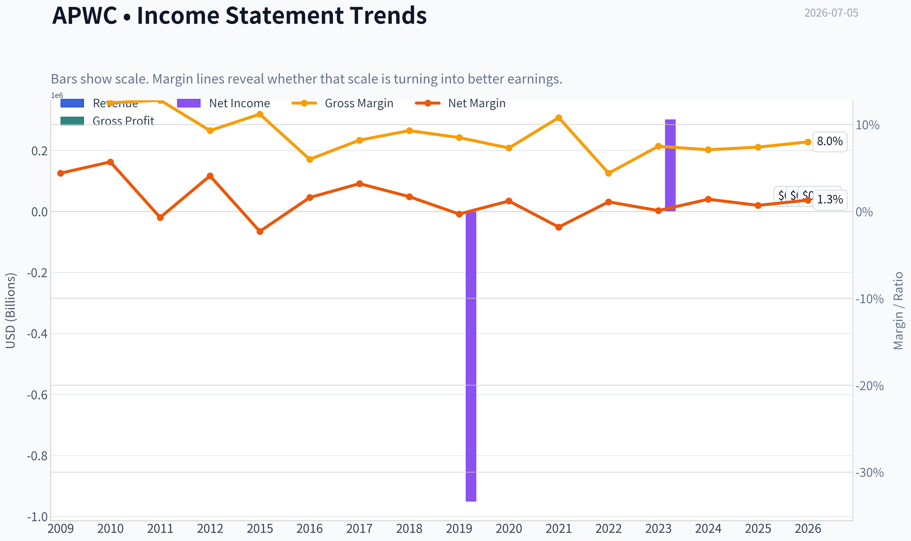

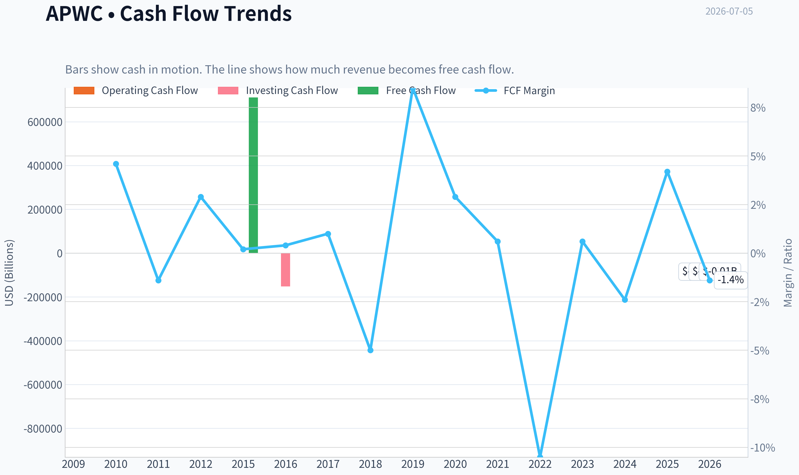

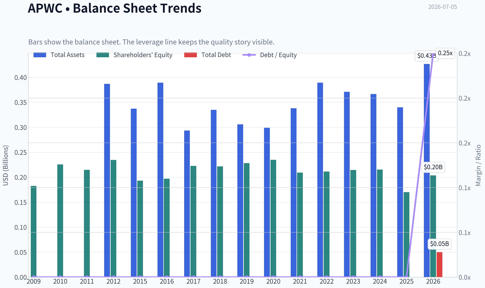

This graph tracks the profitability and return metrics (ROE, ROIC, Margins) of **APWC** over the past decade, highlighting capital efficiency trends.

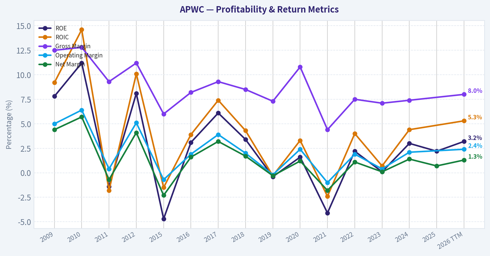

This chart illustrates the financial health of **APWC** over the last 10 years, mapping cash equivalents and free cash flow against total obligations (Debt).

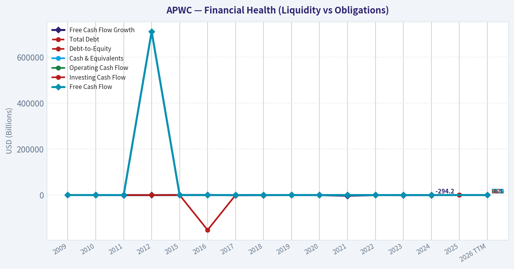

---

### Intrinsic Value Analysis (Buffett)

> *Following Warren Buffett's value investing philosophy: Circle of Competence, Economic Moat, Management Quality, and Margin of Safety.*

#### Intrinsic Value Snapshot

Price is what you pay. Intrinsic value is what the business may be worth based on the cash it can create for owners over time. We show a range, not one magic number.

- Current Price: $1.60
- Value Range (conservative to optimistic across both DCF methods): $0.31 to $91.50

##### Owner Earnings (Buffett Method)
- Net Income: $3,670,000.00
- Depreciation & Amortization: $6,920,000.00
- Capital Expenditures: N/A
- Working Capital Changes: $-17,151,000.00
- Owner Earnings: $27,741,000.00

##### Intrinsic Value
###### Buffett Method
Uses owner earnings. Stricter, and usually more conservative.
- Conservative: $3.21
- Average: $15.65
- Optimistic: $91.50
- Discount Rate: 10.0%

###### Cash Flow Method
Uses free cash flow. Better for companies spending heavily today to grow tomorrow.
- Conservative: $0.31
- Average: $9.55
- Optimistic: $66.24
- Discount Rate: 10.0%

ANALYST STANCE: **AVOID**

#### APWC - Buffett-Style Investment Review

#### 1) Go/No-Go Gate Assessment

| Gate | Verdict | Evidence |
|---|---|---|
| Gate 1: Circle of Competence & Simplicity | Pass | APWC makes and sells wire and cable products used in power and communications infrastructure. The business is easy to explain in simple words. |
| Gate 1b: Long-Term Predictability | Fail | Wire and cable is understandable, but earnings are heavily exposed to input costs, project timing, regional demand, and cyclical industrial conditions. That reduces confidence in forecasting normalized economics a decade ahead. |
| Gate 1c: Technology Risk | Pass | The core product is not likely to be technologically obsolete overnight, but it is also not protected by technology leadership. |
| Gate 2: Moat Test | Fail | No evidence of durable pricing power, brand strength, switching costs, or network effects. Commodity-like product characteristics dominate. |
| Gate 3: Management & Capital Allocation | Fail | The available evidence does not support owner-operator quality or exceptional capital allocation. Low ROE is a strong practical sign that retained capital has not produced strong compounding. |
| Gate 4: Industry Structure | Fail | This is a competitive, capital-intensive manufacturing business, not a rational oligopoly with enduring excess returns. |

**Key Takeaways:** APWC passes the "easy to understand" test, but that is where the good news mostly ends. The business appears cyclical and commodity-like, with weak evidence of moat, weak profitability, and an unfavorable industry structure. Under Buffett's framework, that combination usually leads to rejection.

---

#### 2) Elementary School Test

APWC buys raw materials, turns them into wire and cable, and sells those products to customers that need electricity and communications connections.

That is simple. The problem is not understanding the business. The problem is that simple businesses are not always good businesses. In this case, the product looks closer to a commodity than to a franchise.

#### 3) Moat Analysis

| Moat Source | Assessment | Why |
|---|---|---|
| Intangible Assets | Weak/None | No evidence that customers pay a premium because of brand, patents, or unique regulatory positioning. |
| Switching Costs | Weak/None | Buyers of cable can often compare price, specification, and delivery across suppliers. Switching appears manageable. |
| Cost Advantage | Unproven | A manufacturer can have scale benefits, but APWC's low ROE suggests it is not translating any cost edge into superior shareholder returns. |
| Network Effects | None | The product does not become more valuable as more users buy it. |

**Moat Quality Rating: Illusory/None**

**Key Takeaways:** APWC does not show the classic traits of a Buffett-style moat. Customers likely buy primarily on price, availability, and specification rather than on brand loyalty or embedded dependence. That usually means long-term returns get competed away.

---

#### 4) Management Quality & Capital Allocation

| Question | Assessment | Evidence |
|---|---|---|
| Do they think like owners? | Unclear to Weak | No strong evidence here of owner-oriented behavior that has translated into high per-share value creation. |
| Are they honest and candid? | Neutral | No specific red flags in the materials provided, but also no compelling proof of exceptional candor. |
| Are they rational capital allocators? | Weak | A 2.2% ROE is far below Buffett-quality standards and suggests capital has not been employed at attractive rates. |

**Key Takeaways:** The best sign of management quality is often what happens to retained earnings over time. APWC's low ROE indicates weak value creation from shareholder capital. Even if management is competent operationally, the record does not support exceptional capital allocation.

---

#### 5) Financial Snapshot

| Metric | Value |
|---|---:|
| Share Price | $2.00 |
| Market Cap | $66.0M |
| P/E | 5.33x |
| ROE | 2.2% |
| Revenue Growth YoY | 3.6% |
| Gross Margin | N/A |
| FCF Yield | N/A |
| Current Ratio | N/A |

**Key Takeaways:** The stock looks optically cheap on earnings, with a low P/E ratio. But low multiples alone do not create value if the business earns poor returns on capital. The 2.2% ROE is the key number here, and it points to a low-quality economics profile.

---

#### 6) Earnings Quality and Owner Earnings View

A Buffett investor wants cash earnings that can be taken out of the business without hurting its competitive position. For a manufacturing company like APWC, owner earnings are usually lower than accounting earnings because maintenance capital spending and working capital needs can be meaningful.

Using the evidence available:

- Reported earnings appear positive.
- First quarter 2026 revenue was **$130.8M**, up **30% year over year**.
- Quarterly EPS was **$0.05**, up sharply year over year.
- But the business likely requires continuing investment in inventory, receivables, and plant, which reduces true owner earnings.

Without evidence of strong free cash flow conversion, I would not assume the headline P/E reflects true economic cheapness.

#### 7) Three-Scenario DCF Valuation

Given the business quality, the right approach is to use conservative assumptions and penalize weak returns.

First, infer earnings power from the current valuation:

- Market cap = **$66M**
- P/E = **5.33x**
- Implied net income ~ **$12.4M**

For a low-return manufacturer, owner earnings should be discounted below net income. I use a rough owner earnings estimate of **$8M-$10M**, with **$9M** as a midpoint.

| Scenario | Assumption | Estimated Equity Value |
|---|---|---:|
| A: No Growth | Owner Earnings / 10% = $9M / 0.10 | $90M |
| B: 3% Growth | $9M x 1.03 / (0.10 - 0.03) | $132.4M |
| C: Modest Historical Growth | Assume 4% growth for 10 years, then terminal at 3% | ~$115M-$125M |

**Key Takeaways:** On a purely mechanical basis, APWC may screen as undervalued relative to current market capitalization. But valuation without quality is dangerous. A weak business can stay cheap for very good reasons, especially when returns on capital are persistently poor.

---

#### 8) Margin of Safety Analysis

| Item | Estimate |
|---|---:|
| Current Market Cap | $66M |
| Conservative Value Range | $90M-$132M |
| Apparent Discount | ~27% to 50% |

**Key Takeaways:** The shares may appear to offer a statistical margin of safety. But Buffett's style requires a margin of safety in both price and business quality. APWC may have some price cheapness, but it lacks the durable moat and high-return economics that turn cheap stocks into great investments.

---

#### 9) Buffett Scorecard

| Criterion | Weight | Score (1-5) | Weighted Score |
|---|---:|---:|---:|
| Business Understanding | 20% | 4.0 | 0.80 |
| Moat Width & Durability | 25% | 1.5 | 0.38 |
| Management Quality | 15% | 2.0 | 0.30 |
| Return on Equity | 15% | 1.0 | 0.15 |
| Reinvestment Runway | 10% | 2.0 | 0.20 |
| Balance Sheet Strength | 5% | 2.5 | 0.13 |
| Industry Structure | 5% | 1.5 | 0.08 |
| Valuation/Margin of Safety | 5% | 3.5 | 0.18 |
| **Total** | 100% |  | **2.22 / 5.00** |

**Key Takeaways:** APWC scores well only on simplicity and apparent cheapness. The much more important categories-moat, returns on capital, and industry attractiveness-score poorly. Buffett would rather pay more for a truly superior business than buy a statistically cheap weak one.

---

#### 10) Final Judgment

APWC looks like a **classic value trap candidate**:

- Easy to understand
- Low P/E
- But poor ROE
- No visible moat
- Competitive, capital-intensive industry
- Uncertain long-term compounding ability

A Buffett-style investor is not looking for merely cheap earnings. He is looking for a business that can reinvest capital at high rates for many years while defending its economics from competition. APWC does not meet that standard.

#### Investment Stance

**AVOID - Low conviction on business quality, despite apparent statistical cheapness.**

If this stock becomes interesting later, it would most likely be because of a major improvement in:
1. sustained ROE,
2. free cash flow conversion,
3. balance sheet strength, and
4. evidence of real pricing power or cost advantage.

Right now, it does not clear the Buffett hurdle.
#### Valuation Bridge

This bridge places the current market price beside each intrinsic value lens so readers can see whether upside depends on one method or shows up across several methods.

| Scenario | Intrinsic Value / Share |
| --- | ---: |
| Buffett Method | $15.65 |
| Cash Flow Method | $9.55 |
| Current Price | $1.60 |

#### Key Takeaways

If one method is far above the others, the upside case depends on a specific modelling assumption. When several methods cluster together, the valuation story is more robust.

#### Valuation Visuals

This comparison chart from *Latest Earnings Snapshot* stacks current figures against historical benchmarks for **APWC**, making it easy to see where the company trades relative to its own averages.

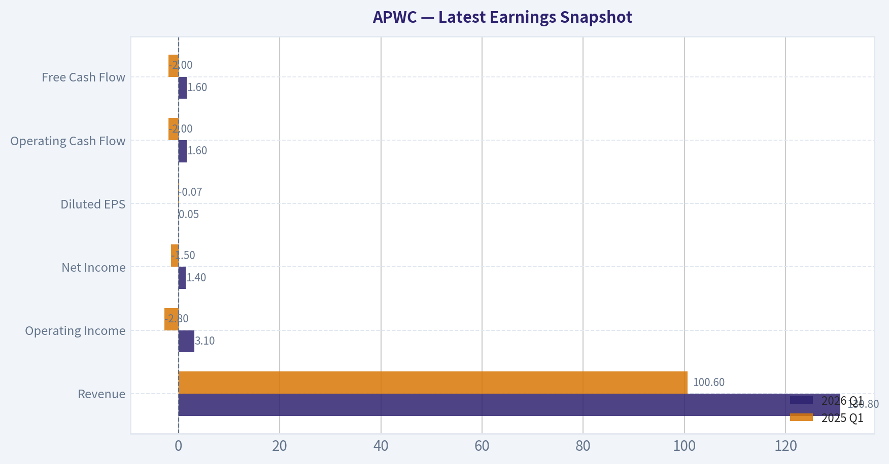

This comparison chart from *Current vs Historical Average Comparison* stacks current figures against historical benchmarks for **APWC**, making it easy to see where the company trades relative to its own averages.

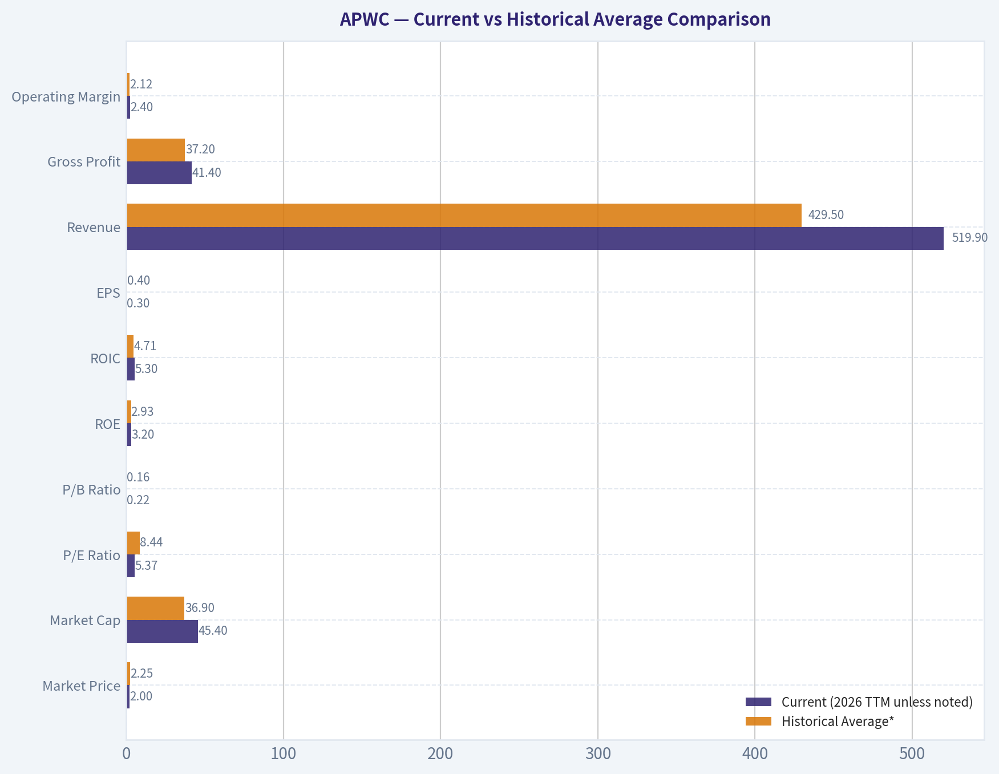

This comparison chart from *Balance Sheet Analysis* stacks current figures against historical benchmarks for **APWC**, making it easy to see where the company trades relative to its own averages.

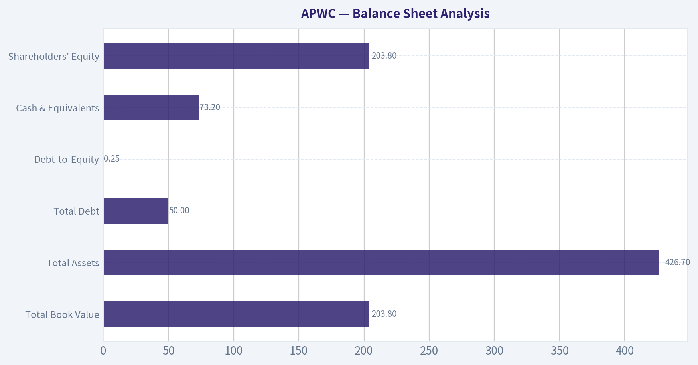

This comparison chart from *Cash Flow Analysis* stacks current figures against historical benchmarks for **APWC**, making it easy to see where the company trades relative to its own averages.

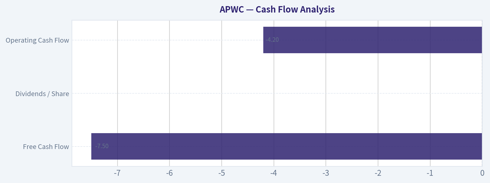

This comparison chart from *Buffett-Style Owner Earnings DCF* stacks current figures against historical benchmarks for **APWC**, making it easy to see where the company trades relative to its own averages.

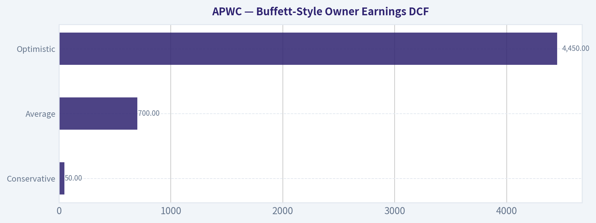

---

### Trend & Growth Analysis (Lynch/Druckenmiller/Fisher)

> *Following Peter Lynch's GARP, Stanley Druckenmiller's macro-aware approach, and Philip Fisher's scuttlebutt methodology.*

ANALYST STANCE: **AVOID**

#### APWC Growth Analysis

#### 1. Lynch Classification

| Item | Assessment |
|---|---|
| Company | Asia Pacific Wire & Cable (APWC) |
| Revenue growth profile | Historically low growth; latest quarter showed a spike |
| Lynch category | **Cyclical / low-growth industrial**, not a true fast grower |
| Why | Shared pack shows **3.6% YoY growth** overall, while the latest Q1 2026 showed **+30% YoY** revenue, which looks more like commodity/cycle volatility than a durable compounding trend |

**Key Takeaways:** APWC does not fit the classic Lynch fast-grower profile. It looks more like a small industrial cyclical where quarterly results can swing sharply, making it harder to underwrite a clean multi-year 20% growth story.

#### 2. The Story in 3 Bullets

| Simple Story | Assessment |
|---|---|
| What it does | APWC makes and distributes wire and cable products used in infrastructure and industrial applications |
| Why revenue moved | Results likely benefit from project timing, commodity-linked demand, and regional order variability |
| Why this is not a ten-bagger setup today | The business appears mature, cyclical, low-margin, and lacks evidence of a major product or TAM inflection |

**Key Takeaways:** This is an easy business to explain, but not an especially exciting growth story. The burden of proof is on APWC to show that the recent growth burst is structural rather than just a good quarter.

#### 3. TAM Analysis and 10x Test

| Metric | Value / View |
|---|---|
| Current quarterly revenue | **$130.8M** in Q1 2026 |
| Annualized revenue run-rate | Roughly **$523M** |
| 10x revenue test | Roughly **$5.2B** revenue |
| Industry TAM | Global wire/cable is large enough in absolute size to allow this mathematically |
| Practical runway | **Weak** because APWC lacks evidence of differentiated technology, dominant share gains, or superior economics |
| 10x test result | **Theoretical yes, practical no** |

**Key Takeaways:** In pure market-size terms, APWC could grow much larger because the cable market is big. But size of market alone is not enough; without a real edge, a company in a commoditized industry rarely compounds into a ten-bagger.

#### 4. Revenue Growth Trend

| Data Point | Observation |
|---|---|
| Shared research pack YoY growth | **+3.6%** |
| Q1 2026 revenue growth YoY | **+30%** |
| Q1 2026 revenue growth QoQ | **-2%** |
| EPS Q1 2026 YoY | **+171%** |
| Pattern | **Erratic / unclear**, not yet a proven acceleration trend |

**Key Takeaways:** The latest quarter was much better than the broader trailing snapshot, but the pattern is inconsistent. One strong quarter is not enough to call an inflection, especially in a cyclical industrial name.

#### 5. Unit Economics

| Metric | Status |
|---|---|
| LTV/CAC | Not disclosed / not relevant in classic SaaS sense |
| Net Revenue Retention | Not disclosed |
| Rule of 40 | Not applicable |
| Gross margin | Not available in shared pack |
| Revenue quality | Likely tied to project demand and industrial cycles rather than recurring subscription economics |

**Key Takeaways:** APWC does not offer the kind of recurring-revenue unit economics growth investors usually want. The lack of SaaS-style retention, CAC, or visibility means investors must rely more on cycle timing and operational execution.

#### 6. Inflection Point Assessment

| Inflection Type | View |
|---|---|
| Product cycle inflection | No evidence |
| Market share inflection | No clear evidence |
| Margin inflection | EPS improved, but durability uncertain |
| TAM inflection | No major expansion visible |
| Competitive inflection | No identified competitor stumble |
| Overall | **Insufficient evidence of a durable inflection point** |

**Key Takeaways:** There are signs of short-term improvement, especially in earnings, but not enough to conclude APWC has entered a new phase of sustained growth. This looks more like a temporary operational upswing than a business-model transformation.

#### 7. Macro Setup Evaluation

| Factor | Assessment |
|---|---|
| Secular theme exposure | Infrastructure/electrification adjacent, but indirect |
| Economic sensitivity | High |
| Commodity exposure | Likely meaningful |
| Rate sensitivity | Moderate; industrial demand can weaken if conditions tighten |
| Druckenmiller view | Macro can help temporarily, but this is not a prime secular winner |

**Key Takeaways:** APWC may benefit when industrial and infrastructure spending is healthy, but it does not sit at the center of a powerful secular growth wave like AI, cloud, or software. Macro can support results, but macro alone rarely creates sustained premium multiples in commoditized businesses.

#### 8. Fisher 15-Point Score

| Category | Score (1-5) | Comment |
|---|---:|---|
| Market potential | 2 | Large market, but mature and competitive |
| New product development | 1 | No strong evidence |
| R&D effectiveness | 1 | No sign of innovation-led edge |
| Sales organization | 2 | Hard to assess; no standout evidence |
| Profit margin | 1 | Likely low-margin business |
| Improving margins | 2 | Recent EPS strength, but unclear durability |
| Labor/personnel relations | 3 | No major issues identified |
| Executive relations | 3 | No major issues identified |
| Management depth | 2 | Limited evidence |
| Cost analysis/accounting | 2 | Limited visibility |
| Outstanding aspects/moat | 1 | Commodity-like profile |
| Long-range profit outlook | 2 | Modest at best |
| Dilution risk | 3 | No major red flag visible from shared pack |
| Candor | 3 | Neutral |
| Integrity | 3 | Neutral absent contrary evidence |
| **Total** | **31 / 75** | **Below average / avoid** |

**Key Takeaways:** APWC scores poorly on the factors that usually matter most for long-term growth compounding, especially innovation, moat, and margin profile. The company may be investable as a deep-value or cyclical trade, but it does not screen well as a Fisher-style growth compounder.

#### 9. Valuation Analysis

| Metric | Value | Interpretation |
|---|---:|---|
| Share price | **$2** | Very low absolute price, but that alone means nothing |
| Market cap | **$66M** | Micro-cap |
| P/E | **5.33x** | Cheap on earnings |
| ROE | **2.2%** | Weak |
| PEG | Not reliable | Growth too inconsistent to use meaningfully |
| P/S | Approx. **0.13x** using annualized Q1 revenue | Extremely low, reflects low quality/cyclicality concerns |

**Key Takeaways:** APWC is statistically cheap, but cheap stocks often stay cheap when growth quality is poor. The low valuation looks more like a warning about durability and business quality than a hidden-growth opportunity.

#### 10. Revenue Multiple Scenarios

| Scenario | Assumption | Implied View |
|---|---|---|
| Bear | Revenue normalizes, margins fade | Stock remains cheap or falls |
| Base | Low-single-digit growth, low multiple persists | Limited upside |
| Bull | 2026 strength sustains and margins improve | Sharp upside possible, but speculative |
| Most likely for growth investors | **Base to Bear** | Not attractive enough |

**Key Takeaways:** The upside case exists because the stock is tiny and optically cheap. But for a disciplined growth investor, the probability-weighted outcome does not look compelling enough versus better secular growth names.

#### 11. Growth Investor Scorecard

| Criterion | Weight | Score (1-5) | Weighted Score |
|---|---:|---:|---:|
| The Story | 10% | 2.0 | 0.20 |
| TAM & Runway | 20% | 2.5 | 0.50 |
| Revenue Growth | 20% | 2.0 | 0.40 |
| Unit Economics | 15% | 1.5 | 0.23 |
| Competitive Position | 10% | 1.5 | 0.15 |
| Management Quality | 10% | 2.5 | 0.25 |
| Macro Setup | 5% | 2.5 | 0.13 |
| Profitability Path | 5% | 2.0 | 0.10 |
| Valuation | 5% | 3.5 | 0.18 |
| **Total** |  |  | **2.14 / 5.0** |

**Key Takeaways:** APWC scores well only on valuation, not on the core drivers of exceptional growth investing returns. The overall result lands clearly in avoid territory because the business lacks the quality and visibility needed for high-conviction ownership.

#### 12. Position Size Stance

| Stance | View |
|---|---|
| Growth portfolio action | **No position** |
| Deep value / special situations | Only for specialized investors with edge in micro-cap cyclicals |
| Suggested position size | **0% for growth mandate** |

**Key Takeaways:** For a Lynch-Druckenmiller-Fisher growth framework, APWC does not merit capital today. If someone wants exposure, it would have to be under a different mandate, such as micro-cap value or cyclical trading.

#### 13. Key Risks and Catalysts

| Type | Item |
|---|---|
| Risk | Recent growth proves temporary |
| Risk | Commodity/input cost volatility |
| Risk | Low margins and weak returns on equity |
| Risk | Micro-cap liquidity and governance risk |
| Catalyst | Another 2-3 quarters of strong YoY revenue growth |
| Catalyst | Sustained margin improvement |
| Catalyst | Evidence of share gains or differentiated product expansion |

**Key Takeaways:** The main risk is that investors mistake a cyclical rebound for a structural growth story. The main thing to watch is whether APWC can string together several strong quarters and show that the recent improvement is durable.

#### Bottom Line

APWC looks **cheap, small, and temporarily improved**, but not like a true fast grower with ten-bagger characteristics. The latest quarter was encouraging, yet the broader evidence still points to a **cyclical, low-moat industrial business** rather than a durable secular compounder.

For a growth investor, this is an **AVOID**. For a different style investor, it may be a **watchlist micro-cap value trade**, but that is outside the mandate here.

---

### Market Technical Analysis

#### APWC Technical Indicator Selection and Market Readout

For **APWC**, the most relevant set of non-redundant indicators for the **current market condition** is:

| Indicator | Why it matters now |
|---|---|
| close_10_ema | Best for tracking the sharp post-spike momentum rollover and near-term direction. |
| close_50_sma | Useful medium-term trend anchor; shows whether the recent rebound changed the broader swing trend. |
| close_200_sma | Confirms the long-term regime, which is still structurally weaker than the recent price spike suggests. |
| macd | Measures whether the June breakout impulse is still transitioning into a sustained trend or fading. |
| macdh | Adds early momentum-decay insight that MACD alone may hide. |
| rsi | Helps judge whether APWC is cooling from overbought conditions or stabilizing in neutral momentum. |
| atr | Critical here because volatility expanded dramatically after the June surge; risk sizing matters more than usual. |
| vwma | Especially important for APWC because recent price behavior was heavily volume-distorted by an extreme turnover spike. |

**Key Takeaways:** These eight indicators are well-suited because APWC is not in a normal steady trend. It recently experienced an explosive volume-driven price jump, followed by a pullback and partial stabilization. That means traders need a mix of trend, momentum, volatility, and volume-sensitive tools rather than relying on any single signal.

---

#### Price Structure Overview

APWC spent much of early 2026 in a **clear deterioration phase**, sliding from the upper **1.60s/1.70s** into the **1.30s-1.40s** by March and April. That decline was not just a one-day dislocation; it was a multi-month compression that pushed price materially below the long-term baseline.

Then the character of trading changed abruptly in **mid-to-late June 2026**:

- **2026-06-18:** close jumped to **1.99** with volume of about **48.1 million**
- **2026-06-22:** close held high at **2.09**
- the next several sessions faded progressively to **1.95, 1.92, 1.79, 1.65, 1.55**
- by **2026-07-02**, price settled near **1.60**

This is important because it tells us the move was **impulsive, not yet proven durable**. The stock did not calmly stair-step upward and consolidate near highs. Instead, it spiked violently, attracted extraordinary turnover, then retraced a large share of the gain. That profile often reflects:
1. event-driven repricing,
2. short-lived speculation,
3. temporary liquidity imbalance,
or 4. a genuine trend change that still needs a second base to become investable.

Right now, APWC appears to be in the **post-shock digestion phase**.

---

#### Trend Analysis

The trend picture is layered rather than simple.

**Short-term trend:**
The **10 EMA** is still above the pre-spike range, but it has rolled down from **1.73+** on 2026-06-25 to **1.655** on 2026-07-02. That means short-term momentum is no longer accelerating. The market is now **decompressing after a blow-off move** rather than extending.

**Medium-term trend:**
The **50 SMA** rose from roughly **1.42** in mid-June to about **1.507** by 2026-07-02. This is a constructive improvement. However, price near **1.60** is only modestly above that average after having been far above it during the spike. So medium-term structure has improved, but the stock has **given back much of its tactical edge**.

**Long-term trend:**
The **200 SMA** is about **1.676** on 2026-07-02 and is still gently declining from the **1.73 area** in early May. That is a key restraint on bullish interpretation. Even after the dramatic June surge, the stock remains **below its 200-day average**, meaning the broader long-term damage has **not been repaired**.

A practical read:

- **Above 50 SMA** = medium-term rebound remains alive.
- **Below 200 SMA** = long-term trend still not fully bullish.
- Therefore APWC is in a **recovery attempt inside an unresolved larger downtrend**.

This is not the same as a confirmed trend reversal.

---

#### Momentum Analysis

The momentum evidence shows a classic sequence: **surge, peak, deceleration, normalization**.

| Momentum Signal | Latest Reading / Behavior | Interpretation |
|---|---:|---|
| macd | 0.0589 on 2026-07-02 | Still positive, so momentum remains net bullish versus prior weeks. |
| macdh | -0.0119 on 2026-07-02 | Momentum is still positive in level terms, but weakening versus its recent peak. |
| rsi | 50.65 on 2026-07-02 | No longer overbought; momentum has cooled back toward neutral. |

**Key Takeaways:** Momentum is no longer stretched to the upside, which reduces immediate reversal risk from overbought conditions. But the negative MACD histogram shows that bullish momentum is fading rather than strengthening, so buyers still need proof that the stock can base and re-accelerate.

The most revealing sequence is the RSI path:

- **78.9** on 2026-06-22: strongly overbought
- **69.4** on 2026-06-23: still hot, but cooling
- **67.5** on 2026-06-24
- **60.0** on 2026-06-25
- **53.1** on 2026-06-26
- **48.7** on 2026-06-29
- **50.6** on 2026-07-02

This tells us the spike was **rapidly worked off**. Importantly, RSI did not collapse into deeply oversold territory after the retracement. That suggests the pullback was a **cooling event**, not yet a full momentum breakdown. In other words, speculative heat exited, but total demand did not disappear.

MACD tells a similar story. It remains positive, which means APWC still has some residual upward momentum relative to earlier price structure. But the histogram turned negative after peaking strongly positive, indicating the **rate of improvement has stalled**. This often happens before either:
- a sideways consolidation, or
- a deeper retracement.

At this point, momentum favors **patience over aggressive chasing**.

---

#### Volatility and Risk Conditions

ATR is one of the most important indicators here because APWC's volatility regime changed abruptly.

| Volatility Measure | Approx. Level |
|---|---:|
| ATR around 2026-06-17 | 0.075 |
| ATR on 2026-06-18 | 0.133 |
| ATR on 2026-06-30 | 0.174 |
| ATR on 2026-07-02 | 0.164 |

**Key Takeaways:** APWC's daily trading range roughly doubled after the June price shock. That means stop-losses that worked before the spike may now be far too tight, and position sizing should be reduced if traders want to keep dollar risk consistent.

A stock trading around **1.60** with ATR around **0.16** is experiencing very large percentage movement potential. That is roughly **10% of price** in average true range terms, which is substantial. For traders, this has several implications:

- **Breakouts need wider confirmation**, because noise is larger.
- **Stops must allow more room**, or they will be repeatedly hit.
- **Position size should be smaller**, especially for swing trades.
- **Reward-to-risk math is still attractive only if entries are disciplined**, not emotional.

This is not a low-volatility trend-following setup; it is a **high-volatility stabilization setup**.

---

#### Volume-Weighted Interpretation

VWMA is unusually informative here because the price action was dominated by one extraordinary turnover burst.

The **VWMA jumped sharply to around 1.98** after the June 18 event and remained near that zone into early July. Meanwhile, spot price on 2026-07-02 was only **1.60**.

That gap matters a lot.

| Volume/Price Relationship | Observation | Meaning |
|---|---|---|
| Price vs VWMA | 1.60 price vs ~1.98 VWMA | Current price sits well below the volume-weighted average of the recent active period. |
| June volume spike | 48M+ shares on 2026-06-18 | A huge amount of trading occurred at materially higher prices than current spot. |
| Post-spike fade | Price lost altitude quickly | Many recent participants may now be trapped above market. |

**Key Takeaways:** The stock is trading below the level where most of the recent heavy turnover occurred. That often creates overhead supply, because traders who bought into the high-volume move may sell on rebounds to recover losses.

From a tactical standpoint, that means rallies may encounter resistance before the prior highs, even if the chart looks improved relative to May. The VWMA suggests the market still has a **supply overhang** left by the spike.

This is one reason why the recent rebound should not automatically be read as clean accumulation. A high VWMA above current price often means **the crowd that participated most heavily is underwater**. In practice, that can cap rebounds unless fresh catalysts or sustained follow-through volume emerge.

---

#### What the Indicators Collectively Suggest

The combined read is nuanced:

- **Not outright bearish in the short run**, because price remains above the 50 SMA and MACD is still positive.
- **Not convincingly bullish in the strategic sense**, because price is below the 200 SMA and momentum is decelerating.
- **Still fragile**, because VWMA overhead and elevated ATR imply supply pressure and unstable trading conditions.
- **Likely in a base-building or mean-reversion phase**, rather than in a fresh clean breakout trend.

The key distinction is this: APWC's June move improved the chart, but it did **not yet normalize it**.

A trader looking for continuation would want to see:
1. price hold above the **50 SMA**,
2. **10 EMA flatten and turn back up**,
3. **MACD histogram move back positive**,
4. RSI push sustainably above the mid-50s,
5. and ideally price reclaim more of the **VWMA/1.95-2.00 area**.

A cautious trader would note that failure to hold the **1.55-1.60 region** would imply the stock is reverting back toward its pre-spike structure rather than forming a durable new range.

---

#### Trading Interpretation by Style

| Trading Style | Current Read |
|---|---|
| Short-term momentum trader | Setup is less attractive than it was during the initial surge; momentum has cooled and now needs re-confirmation. |
| Swing trader | Watch for consolidation above the 50 SMA; a stable higher-low structure would matter more than the spike itself. |
| Mean-reversion trader | The overbought condition has already been largely unwound; edge is less obvious unless price undercuts support and stabilizes. |
| Long-term trend investor | Still premature for a full trend-reversal call while price remains below the 200 SMA and that average is falling. |

**Key Takeaways:** Fast traders should avoid confusing a post-spike bounce with a fresh momentum breakout. Longer-horizon traders should wait for stronger proof that the stock can reclaim and hold above long-term trend resistance.

---

#### Bottom Line

APWC currently shows a **medium-term recovery attempt following a highly abnormal volume-driven spike**, but the evidence does **not yet support a fully confirmed bullish trend reversal**.

The most important facts are:

- price is **above the 50 SMA** but **below the 200 SMA**
- **MACD is positive**, but **MACD histogram is negative**
- **RSI has normalized** from overbought to neutral
- **ATR remains elevated**, meaning risk is still high
- **VWMA sits far above price**, signaling possible overhead supply from trapped recent buyers

That combination usually argues for **selective, confirmation-based trading** rather than aggressive directional conviction.

| Area | Current Signal | Trading Implication |
|---|---|---|
| Short-term trend | Cooling but not broken | Needs renewed upside follow-through |
| Medium-term trend | Improved | 50 SMA is a useful support reference |
| Long-term trend | Still weak/unconfirmed | Below falling 200 SMA limits conviction |
| Momentum | Positive but decelerating | Avoid late chasing |
| Volatility | Elevated | Use smaller size and wider stops |
| Volume structure | Overhead supply risk | Rebounds may meet resistance above current price |

**Key Takeaways:** APWC is no longer in freefall, but it is also not yet in a stable bullish regime. The most prudent stance is to treat it as a volatile recovery candidate that still needs confirmation before it can be trusted as a sustained trend.

#### Market Visuals

This comparison chart from *Market Metrics* stacks current figures against historical benchmarks for **APWC**, making it easy to see where the company trades relative to its own averages.

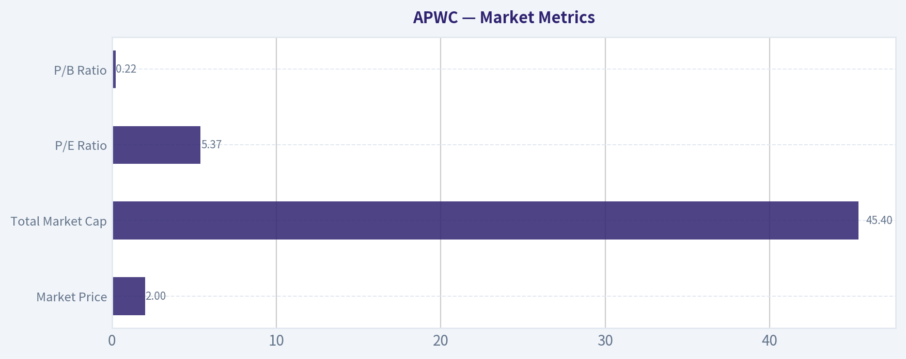

---

### Options Market Analysis

> *Reading options flow - put/call ratios, IV skew, and unusual activity - to gauge institutional positioning and event-driven risk.*

#### APWC Options Positioning Report

No options market data is available for **APWC** as of **2026-07-05**. That usually means one of two things: either listed options are not available for this ticker, or the chain is so inactive/illiquid that there is no usable market positioning data to analyze.

Because your framework requires an options-flow read, the correct conclusion here is that **confidence is extremely low and no institutional positioning signal can be reliably extracted from options activity**.

#### Data Availability Check

| Item | Result |
|---|---|
| Ticker | APWC |
| Options chain availability | No usable options data available |
| Near-term expirations | Not available |
| Put/Call OI ratio | Not available |
| Put/Call volume ratio | Not available |
| ATM IV | Not available |
| IV skew | Not available |
| Unusual options activity | Not available |
| OI concentration / gamma levels | Not available |

Key Takeaways: APWC does not currently provide a usable listed-options dataset for sentiment analysis. Without open interest, volume, and implied volatility across strikes and expirations, there is no defensible way to infer smart-money positioning, hedging demand, or gamma-related price levels.

#### 1. Put/Call Ratio Analysis

| Metric | Reading | Interpretation |
|---|---|---|
| Put/Call OI ratio | N/A | No listed/open data to compare against the neutral ~0.7 baseline |
| Put/Call volume ratio | N/A | No evidence of put-heavy hedging or call-heavy speculation |
| Shift from neutral | N/A | Cannot assess |

Key Takeaways: There is no observable put/call positioning for APWC from the available dataset. That means we cannot determine whether traders are leaning bearish through puts, bullish through calls, or staying balanced.

#### 2. Implied Volatility Assessment

| Metric | Reading | Interpretation |
|---|---|---|
| Near-term ATM call IV | N/A | No pricing surface available |
| Near-term ATM put IV | N/A | No pricing surface available |
| OTM put vs. OTM call skew | N/A | Cannot determine downside fear or upside chase |
| Event-driven IV premium | N/A | No options market available to signal catalyst pricing |

Key Takeaways: With no quoted option chain, there is no implied volatility signal to read. That removes one of the most useful forward-looking indicators for event risk and sentiment.

#### 3. Unusual Options Activity

| Contract | Type | Strike vs. Spot | Expiry Horizon | Volume vs. OI | Read |
|---|---|---|---|---|---|
| None available | N/A | N/A | N/A | N/A | No unusual activity can be evaluated |

Key Takeaways: There are no contracts available to screen for fresh opening flow. As a result, we cannot identify whether hedge funds, market makers, or retail traders are expressing a directional view through options.

#### 4. Open Interest Concentration

| Area | Observation | Implication |
|---|---|---|
| Highest OI strikes | N/A | No pinning or max-pain inference possible |
| Highest OI expirations | N/A | No visible time-bucket positioning |
| Gamma walls | N/A | No support/resistance zones can be inferred from dealer hedging dynamics |

Key Takeaways: There are no observable open-interest clusters for APWC. That means options cannot help define likely near-term price magnets or volatility accelerators.

#### 5. Overall Options Sentiment Signal

| Signal | Confidence | Primary Driver |
|---|---|---|
| NEUTRAL | Very low | No usable options market data available |

Key Takeaways: I would label APWC's options signal as **NEUTRAL by default**, but this is not a true sentiment read. It is simply the only responsible stance when the options market is absent or too illiquid to provide information.

#### Analyst Conclusion

For **APWC**, the options market is effectively **non-informative** right now. In practice, that means you should **not** use options flow as a decision input for this name. If you still want a directional view, it would need to come from **price action, liquidity, fundamentals, insider activity, or macro/industry context**, not from derivatives positioning.

| Put/Call Ratio | IV Level | Skew Direction | Unusual Activity | Overall Signal |
|---|---|---|---|---|
| N/A | N/A | N/A | None available | NEUTRAL / Unreadable due to no options data |

Key Takeaways: The summary is straightforward: APWC does not currently have a usable options signal. Any attempt to force a bullish or bearish options interpretation here would be speculation rather than analysis.

---

## Research Team Commentary

> *The Research Manager synthesizes the Bull vs Bear debate into action-free commentary. This is a pre-risk view, not the final stance.*

The strongest bull argument is straightforward: APWC is statistically cheap enough that it may not need much to work. At about 5.3x earnings and $1.60 per share, with the latest quarter showing 30% revenue growth and improved EPS, the market may be pricing the company as if current profitability is unsustainable or deterioration is imminent. If the business is merely stable, not great, a modest rerating could produce meaningful upside. The bull case also fairly argues that this is not a "wonderful business" story but a neglected cyclical where low expectations may already provide some protection.

The strongest bear argument is stronger in Buffett terms: the business quality looks weak. A 2.2% ROE is a major red flag, especially for a company the bull wants us to trust through a cycle. That suggests little evidence of moat, poor capital productivity, and limited internal compounding. One strong quarter is not enough to establish normalized earning power in a cyclical, commodity-like wire and cable business. Without clearer balance-sheet and cash-flow evidence, the low P/E may be a value trap rather than a margin of safety. The post-spike price fade also suggests this is a fragile, low-sponsorship microcap rather than a high-quality business temporarily misunderstood by the market.

My takeaway is that the bull case is credible only as a speculative deep-value trade, not as a Buffett-style portfolio candidate. That distinction matters. I do not want to repeat past mistakes by treating "cheap" as automatically bad in the short term, but I also do not want to repeat the opposite mistake of confusing a low multiple with real intrinsic value when business quality is poor and financial visibility is thin. Here, unlike the GLW and AVGO situations in my reflections, there is no strong trend, no elite franchise, and no obvious durable secular sponsorship that would justify giving the benefit of the doubt. The burden of proof belongs to the business, and the business has not yet earned it.

Core takeaway: APWC may be optically cheap, but it does not currently meet the standards for a Buffett-style value investment because the evidence points to a low-quality, cyclical, weak-return business with uncertain normalized earnings and insufficient proof of balance-sheet strength. Cheapness alone is not enough when the economics are this mediocre.

Rationale: Buffett's framework starts with business quality, predictability, and returns on capital. APWC fails that screen today. The most important fact in the entire file is not the 5.3x P/E; it is the 2.2% ROE. If a business cannot earn solid returns on equity, then its intrinsic value is harder to grow over time, and retained capital is less valuable. The latest quarter may indicate improvement, but one quarter does not override the broader profile of a small cyclical with lumpy results. Also, we are missing crucial evidence on debt, working capital, and free cash flow conversion. In these small industrial names, reported earnings can look better than owner earnings. That is exactly the kind of situation where I have to be disciplined and not stretch for a contrarian call without superior insight. The contrarian opportunity here is possible, but not yet proven.

Monitoring plan over the next 1 to 4 quarters: first, I would watch whether revenue growth remains positive beyond this one strong quarter and whether EPS stays positive without sharp reversal. Second, I would want to see ROE improve materially, not just by a little; if this remains a 2% business, the thesis weakens a lot. Third, I would focus on cash flow conversion and working capital behavior-especially receivables, inventory, and any need for additional borrowing. Fourth, I would look for signs that management is allocating capital sensibly, such as balance-sheet improvement, disciplined inventory control, or shareholder-friendly actions. Fifth, I would monitor whether the market stabilizes the stock above the recent fade zone; not because I want to make this a technical call, but because persistent failure after a volume spike often signals poor sponsorship and weak confidence in the earnings story.

If the next few quarters show repeat profitability, better returns on capital, and clean cash generation, this could graduate into a more interesting WATCH candidate with real value support. If earnings slip back, working capital balloons, or balance-sheet stress appears, then the low multiple will have been deserved.

Final stance: AVOID.

---

## Value Investing Team Commentary

> *The Investor translates the research view into an investment thesis before risk review. This is still not the final stance.*

APWC is the kind of stock that can tempt a value investor for the wrong reason: it is cheap on the surface, but cheapness is not the same as value. At roughly 5.3x earnings and a $1.60 share price, the market is clearly skeptical. The recent quarter was better-revenue up 30% year over year and EPS improving to $0.05-so the immediate business trend may be less bad than the stock's reputation suggests. That is the part the market may be underappreciating. In a neglected microcap cyclical, even modest evidence of stabilization can lead to sharp percentage gains.

But Buffett-style investing begins with business quality, not statistical cheapness. Here the biggest warning sign is the 2.2% ROE. That is not the profile of a business with a moat, strong pricing power, or reliable capital productivity. In a wire and cable-style industrial business, one good quarter can come from temporary volume improvement, pricing swings, or working-capital timing rather than durable earning power. Without clearer evidence on free cash flow, leverage, and normalized margins, I cannot confidently say the earnings multiple represents a margin of safety. It may simply reflect a low-quality business with weak long-term compounding ability.

The market action reinforces that caution. The stock spiked sharply on heavy volume and then faded session after session. Selective contrarian thinking matters here: sometimes a post-spike fade creates opportunity because the crowd is overly pessimistic. But in this case, I do not see a high-quality franchise being temporarily misjudged. I see a thinly sponsored microcap where the market is saying, "show me this is repeatable." That is a very different setup from a temporarily out-of-favor great business. The burden of proof belongs to APWC, and today the proof is incomplete.

What could change the picture? If the company can string together several quarters of positive EPS, maintain revenue momentum, improve ROE materially, and show clean cash conversion without balance-sheet strain, then this could become a legitimate deep-value watchlist name. If management proves it can turn cyclical earnings into durable owner earnings, the current valuation could look too low in hindsight. But that is still a conditional case, not an investable conviction now.

From a long-term owner's perspective, I want businesses that can reinvest capital at attractive rates for years. APWC does not yet demonstrate that. The contrarian move is not to buy every cheap stock; it is to buy when the market is wrong about the durability of a good business. Here, the market's skepticism appears broadly rational until stronger evidence emerges.

**ANALYST STANCE: AVOID**

---

## Deep Values Commentary

> *The Risk Management Team debates and the Risk Judge provides the final action-free verdict. This section determines the final ADVOCATE / WATCH / AVOID stance.*

#### Final Stance Scorecard

This scorecard converts the final research view into a weighted decision frame. It does not replace the narrative judgement, but it makes the main drivers of the verdict easier to scan.

| Criterion | Score | Weight | Commentary |
| --- | ---: | ---: | --- |
| Business Quality | 2.75 | 30% | High returns, profitability, and Piotroski health support durability. |
| Valuation Support | 4.33 | 30% | Blends current price against available intrinsic value anchors and valuation ratios. |
| Financial Strength | 3.67 | 20% | Balance-sheet resilience reflects leverage and liquidity staying within safe ranges. |
| Growth Durability | 2.33 | 20% | Recent revenue, earnings, and free cash flow growth indicate how durable expansion looks. |
| TOTAL / FINAL STANCE | 3.32 | 100% | WATCH |

#### Key Takeaways

The weighted score lands at **3.32 / 5.0**, while the final stance remains **WATCH**. This is useful as a quick calibration aid rather than a mechanical signal.

#### Risk Summary

Higher scores indicate more risk pressure. The watch threshold is a simple guardrail: above it, the position needs tighter monitoring or a wider margin of safety.

| Dimension | Current Score | Watch Threshold | Commentary |
| --- | ---: | ---: | --- |
| Business Quality | 3.25 | 3.00 | High returns, profitability, and Piotroski health support durability. |
| Valuation Support | 1.67 | 3.00 | Blends current price against available intrinsic value anchors and valuation ratios. |
| Financial Strength | 2.33 | 3.00 | Balance-sheet resilience reflects leverage and liquidity staying within safe ranges. |
| Growth Durability | 3.67 | 3.00 | Recent revenue, earnings, and free cash flow growth indicate how durable expansion looks. |

#### Key Takeaways

This view helps readers separate *where* the risk sits: valuation, business quality, balance sheet, or growth durability. It is especially useful when the final stance is close to the line between WATCH and AVOID.
