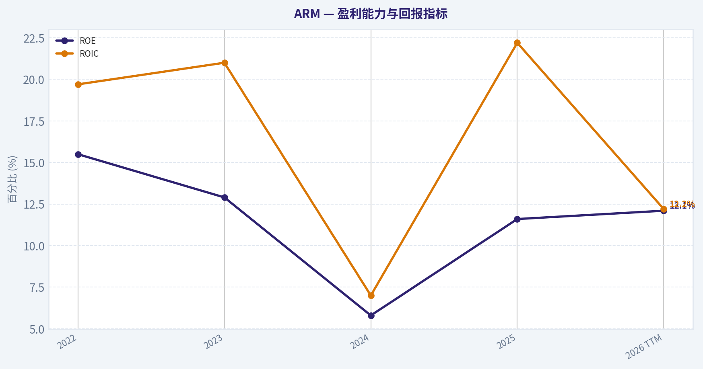
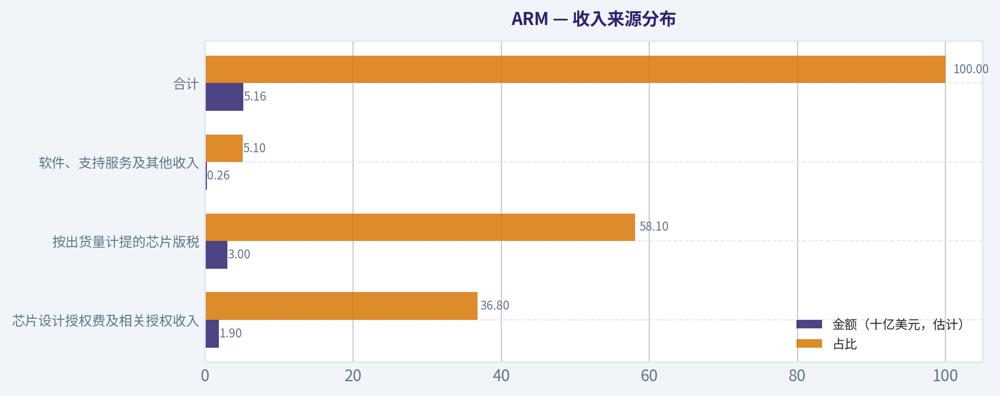
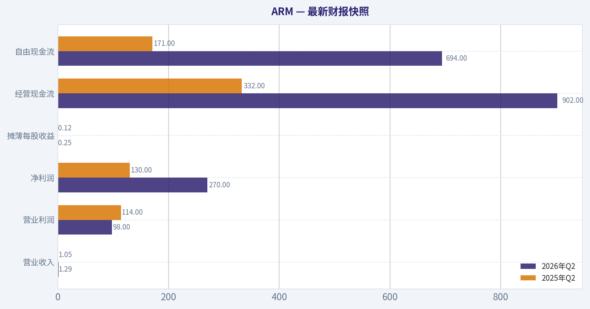
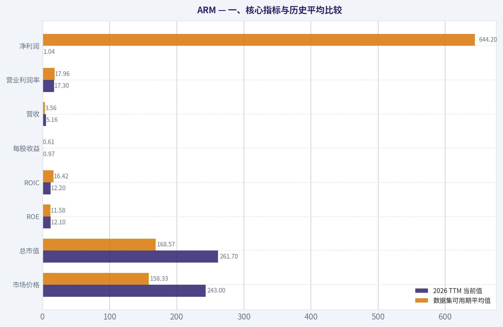
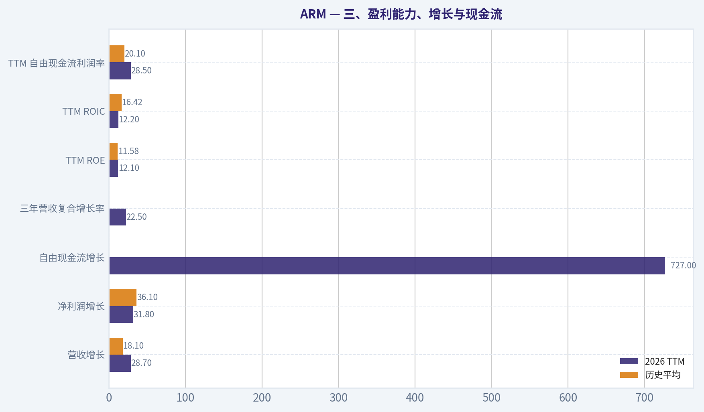
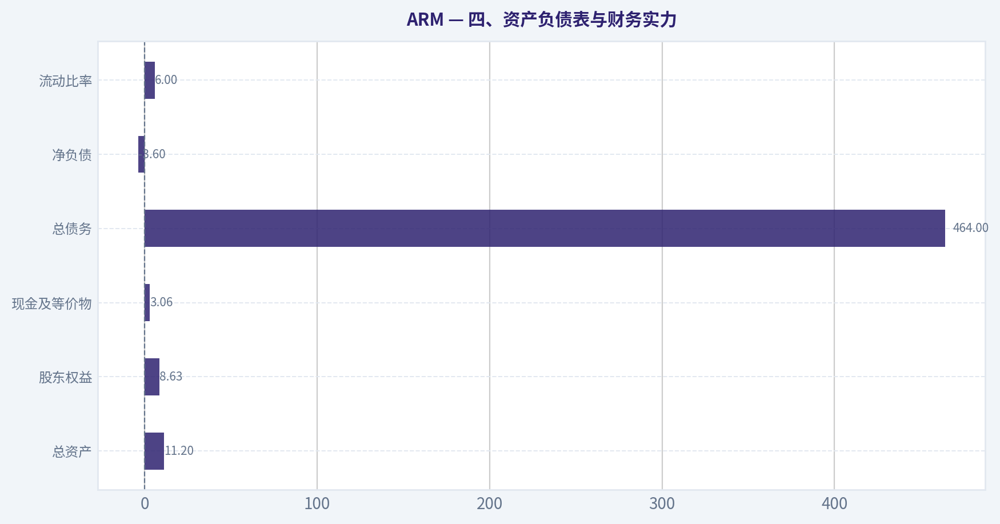
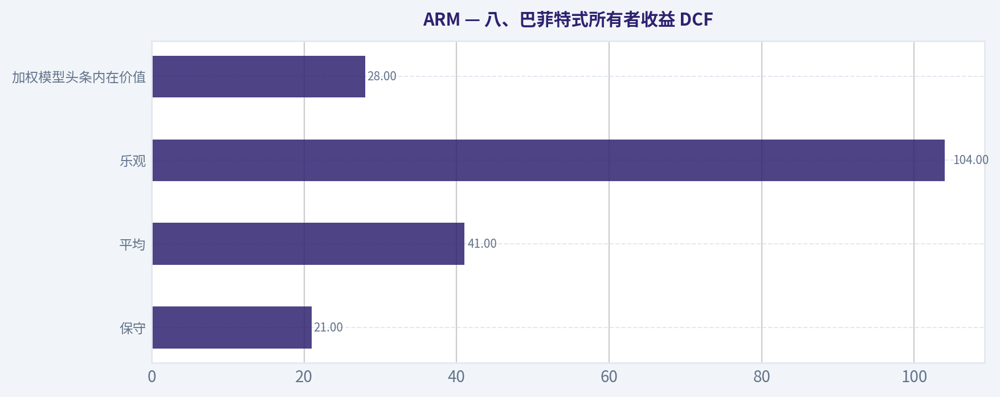
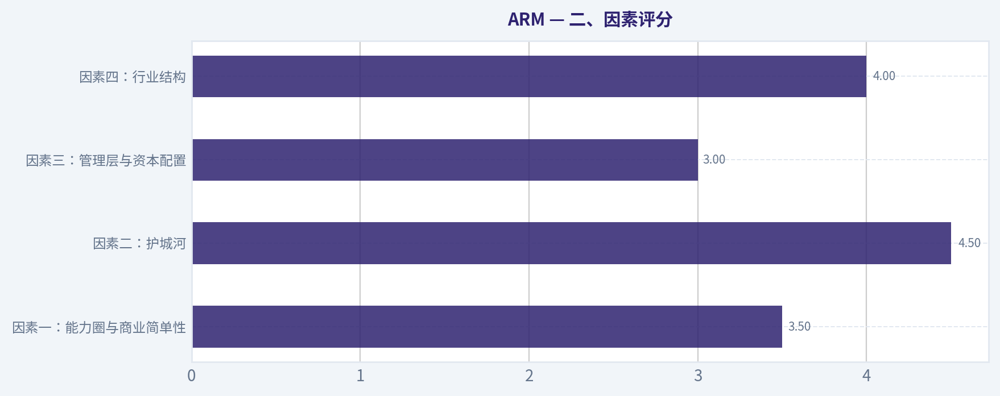

# ARM 深度价值情报

**调研日期:** 2026-10-14

## 关键免责声明

*本报告由 Deep Value Intelligence（一个基于 AI 的多智能体投资分析框架）自动生成。 仅供教育和研究用途 - 非财务建议，非财务顾问。*

---

## 目录

1. 情报摘要
2. 分析师团队报告
   - 基本面分析
   - 价值分析 (巴菲特)
   - 成长性分析 (林奇/德鲁肯米勒/费雪)
   - 市场分析
   - 期权市场分析
3. 研究团队评论
4. 投资团队评论
5. Deep Values 团队洞察

---

## 情报摘要

### 核心观点与前提条件

**核心论点:** # 执行摘要

**主要风险:**
- 未明确说明。

**置信度:** 中

---

## 分析师团队报告

### 基本面分析

#### 最新财报快照

*以下数据基于最近一期已披露财报（2026年Q2），并尽量与上一年同期对比。*

| 指标 | 2026年Q2 | 2025年Q2 | 同比变化 |
| --- | ---: | ---: | ---: |
| 营业收入 | $1.29B | $1.05B | +22.4% |
| 营业利润 | $98.0M | $114.0M | -14.0% |
| 净利润 | $270.0M | $130.0M | +107.7% |
| 摊薄每股收益 | $0.25 | $0.12 | +108.3% |
| 经营现金流 | $902.0M | $332.0M | +171.7% |
| 自由现金流 | $694.0M | $171.0M | +305.8% |

关键结论：这张快照先把最新一期财报放在桌面上，再去看长周期分析。这样读者能更清楚地区分"公司长期质量"和"这次财报发生了什么"。

#### ARM 4年财务指标

*以下数值均由原始数据确定性计算得出，并非 AI 估算。*

*发行人类型：operating company（Technology / Semiconductors）。*

#### 4年财务指标
*年度行来自已披露财务报表，最后一行 TTM 由最近四个季度滚动计算得出。*

| 指标 | 2022 | 2023 | 2024 | 2025 | 2026 TTM |
| --- | --- | --- | --- | --- | --- |
| 市场价格 | N/A | N/A | $125 | $107 | $243 |
| 总市值 | N/A | N/A | $130.49B | $113.52B | $261.70B |
| 市盈率 | N/A | N/A | 431.00 | 142.39 | 250.27 |
| 市净率 | N/A | N/A | 24.64 | 16.60 | 30.32 |
| ROE | 15.5% | 12.9% | 5.8% | 11.6% | 12.1% |
| ROIC | 19.7% | 21.0% | 7.0% | 22.2% | 12.2% |
| 每股收益 | $0.54 | $0.51 | $0.29 | $0.75 | $0.97 |
| 营收 | $2.70B | $2.68B | $3.23B | $4.01B | $5.16B |
| 毛利润 | $2.57B | $2.57B | $3.08B | $3.89B | $5.03B |
| 毛利率 | 95.2% | 96.0% | 95.2% | 97.0% | 97.5% |
| 营业利润率 | 23.4% | 25.0% | 3.4% | 20.7% | 17.3% |
| 净利润 | $549.0M | $524.0M | $306.0M | $792.0M | $1.04B |
| 净利率 | 20.3% | 19.6% | 9.5% | 19.8% | 20.2% |
| 营收增长 | N/A | -0.9% | 20.7% | 23.9% | 28.7% |
| 净利润增长 | N/A | -4.6% | -41.6% | 158.8% | 31.8% |
| 自由现金流增长 | N/A | 59.2% | 47.9% | -82.2% | 727.0% |
| 总账面价值 | $3.55B | $4.05B | $5.29B | $6.84B | $8.63B |
| 总资产 | N/A | $6.87B | $7.93B | $8.93B | $11.20B |
| 总债务 | N/A | $0 | $0 | $0 | $464.0M |
| 债务股权比 | N/A | 0.00 | 0.00 | 0.00 | 0.05 |
| 现金及等价物 | $1.00B | $1.55B | $1.92B | $2.08B | $3.06B |
| 股东权益 | $3.55B | $4.05B | $5.29B | $6.84B | $8.63B |
| 经营现金流 | $458.0M | $739.0M | $1.09B | $397.0M | $2.09B |
| 投资现金流 | $-619.0M | $-138.0M | $-516.0M | $-35.0M | $-220.0M |
| 自由现金流 | $424.0M | $675.0M | $998.0M | $178.0M | $1.47B |
| 自由现金流利润率 | 15.7% | 25.2% | 30.9% | 4.4% | 28.5% |
| 每股分红 | $0.00 | $0.00 | $0.00 | $0.00 | $0.00 |

#### 盈利能力指标
- 净资产收益率 (ROE): 10.9%
- 投入资本回报率 (ROIC): 15.0%
- 总资产收益率 (ROA): 8.4%
- 毛利率: 97.5%
- 营业利润率: 18.3%
- 净利率: 18.4%

#### 流动性指标
- 流动比率: 6.00
- 速动比率: 4.71

#### 杠杆指标
- 债务股权比: 0.00
- 利息覆盖倍数: N/A
- 净负债: $-3.60B

#### 增长指标（同比）
- 营收增长: 22.8%
- 净利润增长: 14.1%
- 自由现金流增长: 450.0%
- 营收复合增长率（3年）: 22.5%
- 营收复合增长率（5年）: N/A

#### 估值指标
- 市盈率 (TTM): 250.27
- 预期市盈率: 79.26
- 市净率: 30.04
- 市销率: 50.28
- PEG 比率: 2.10
- 企业价值/EBITDA: 253.22
- 自由现金流收益率: 0.4%
- 盈利收益率: 0.4%

#### 所有者收益（巴菲特方法，代码计算）
- 净利润: $792.0M
- + 折旧与摊销: $249.0M
- - 资本开支: $-545.0M
- - 营运资本变动: $-602.0M
- = **所有者收益: $2.26B**

#### 内在价值（代码计算）
- 当前价格: $243
- **头条内在价值（按商业模式路由）: $28**
  商业模式: operating company - weighted blend [Damodaran FCFF + reverse-DCF fair + owner-earnings DCF] (operating_company)
  模型区间（各 DCF 最小-最大）: $9 - $41
  相对价格的安全边际（头条）: -779.9%
  路由说明: General operating company: balanced blend of Damodaran FCFF and the owner-earnings DCF with a reverse-DCF sanity check.
- 巴菲特方法（所有者收益）:
  保守: $21
  平均: $41
  乐观: $104
- 现金流方法（FCF）:
  保守: $9
  平均: $9
  乐观: $107
- Damodaran FCFF（WACC + 利润率 + 再投资）:
  保守: $8
  平均: $11
  乐观: $14
  蒙特卡洛区间（P10-P90）：$8 - $12（中位数 $10）
  P(内在价值 > 当前价格)：0.0%
- 反向 DCF：当前价格隐含约 89.9%/年 的所有者收益增长（10年）；过去 3 年为 63.6%，5 年为 N/A。

#### Piotroski F分数: 6/9
- 净利润为正: 通过
- 经营现金流为正: 通过
- 资产回报率改善: 未通过
- 现金流大于净利润: 通过
- 债务下降: 未通过
- 流动比率改善: 通过
- 未稀释股本: 未通过
- 毛利率改善: 通过
- 资产周转率改善: 通过

ANALYST STANCE: **AVOID**

#### ARM 巴菲特式基本面分析

以下分析以题设确定性财务数据为唯一历史数据来源。数据覆盖 2022-2025 财年及 2026 年 TTM；TTM 代表最近四个季度滚动数据。部分市场估值指标在不同数据快照中存在轻微差异，本文优先采用确定性表中的 2026 TTM 数值。

#### 一、核心指标与历史平均比较

| 指标 | 2026 TTM 当前值 | 数据集可用期平均值 | 当前相对平均值 | 解读 |
|---|---:|---:|---:|---|
| 市场价格 | $243 | $158.33 | 高 53.5% | 股价显著高于 2024-2025 年水平 |
| 总市值 | $261.70B | $168.57B | 高 55.2% | 市值增长明显快于历史盈利增长 |
| PE | 250.27 倍 | 274.55 倍 | 略低 | 仍处于极端高估值区间 |
| PB | 30.32 倍 | 23.85 倍 | 高 27.1% | 对 IP 型公司参考价值有限 |
| ROE | 12.1% | 11.58% | 略高 | 盈利资本回报仅温和改善 |
| ROIC | 12.2% | 16.42% | 低 25.7% | TTM 资本回报低于历史平均 |
| 每股收益 | $0.97 | $0.61 | 高 59% | 盈利恢复，但股价涨幅更大 |
| 营收 | $5.16B | $3.56B | 高 45.1% | 维持较强增长 |
| 营业利润率 | 17.3% | 17.96% | 略低 | 仍低于 2022、2023 和 2025 年水平 |
| 净利润 | $1.04B | $644.2M | 高 61.4% | 净利润创新高 |
| 净利率 | 20.2% | 17.88% | 高 2.3 个百分点 | 相比 2024 年显著修复 |
| 自由现金流 | $1.47B | $749.0M | 高 96.3% | 现金流明显恢复 |
| 总债务 | $464M | $116M | 高 | 历史上基本无债，TTM 出现债务 |
| 现金及等价物 | $3.06B | $1.92B | 高 59.3% | 现金储备充足 |
| 债务权益比 | 0.05 | 0.013 | 高 | 绝对杠杆仍然很低 |
| 每股分红 | $0.00 | $0.00 | 无变化 | 不分红，回报依赖资本增值 |

**关键结论：** ARM 的营收、净利润和自由现金流均高于历史平均，但股价和市值的上升幅度明显超过盈利增长。公司财务质量不错，却没有达到与 250 倍 PE、30 倍 PB 相匹配的资本回报水平；当前估值反映了极其激进的未来预期。

#### 二、市场估值与盈利质量

ARM 2026 TTM 股价为 $243，总市值约 $261.70B，PE 为 250.27 倍，盈利收益率仅约 0.4%。即使使用预期 PE 79.26 倍，估值仍然要求公司未来多年维持高速增长。

- **PE：** 当前 PE 远高于成熟半导体和多数高质量软件公司的长期合理区间。它不是单纯反映当前盈利，而是反映 ARM 将持续受益于人工智能、数据中心、智能手机、汽车和边缘计算等多个市场。
- **PB：** ARM 是典型的 IP、授权和平台型半导体公司，账面资产并不能充分反映其架构生态、开发者基础和许可网络，因此 PB 不适合作为"低 PB 便宜、高 PB 昂贵"的机械指标。不过 30 倍 PB 仍然说明市场给予了极高的无形资产溢价。
- **自由现金流收益率：** 约 0.4%，意味着投资者以超过 $260B 的市值购买约 $1.47B 的 TTM 自由现金流。即使现金流继续增长，起始收益率仍然极低。
- **市销率：** 约 50.28 倍。对于高毛利 IP 公司可以给予溢价，但如此高的销售倍数要求极强的长期利润率和增长确定性。
- **PEG：** 约 2.10，说明增长尚不足以完全解释当前 PE。PEG 并非可靠的独立估值工具，但它同样没有显示出明显低估。

#### 三、盈利能力、增长与现金流

ARM 的毛利率从 2022 年的 95.2% 提升至 TTM 的 97.5%，说明其商业模式拥有极强的 IP 定价能力。高毛利是 ARM 最突出的财务优势之一。

但营业利润率并不稳定：

- 2022 年：23.4%
- 2023 年：25.0%
- 2024 年：3.4%
- 2025 年：20.7%
- 2026 TTM：17.3%

2024 年利润率大幅下跌，说明费用、一次性项目、股权激励、授权周期或会计项目可能对经营利润造成较大影响。TTM 净利率达到 20.2%，已恢复到接近历史较好水平，但营业利润率仍低于 2022、2023 和 2025 年。

| 增长指标 | 2026 TTM | 历史平均 | 趋势与质量 |
|---|---:|---:|---|
| 营收增长 | 28.7% | 18.1% | 当前明显加速 |
| 净利润增长 | 31.8% | 36.1% | 高于正常水平，但历史波动极大 |
| 自由现金流增长 | 727.0% | 约 188.0% | 主要受 2025 年低基数影响 |
| 三年营收复合增长率 | 22.5% | - | 体现较强的长期扩张能力 |
| TTM ROE | 12.1% | 11.58% | 仅略高于平均水平 |
| TTM ROIC | 12.2% | 16.42% | 低于历史平均，资本效率承压 |
| TTM 自由现金流利润率 | 28.5% | 20.1% | 现金转化能力明显改善 |

**关键结论：** ARM 的收入增长和毛利率非常优秀，但净利润增长和自由现金流增长受到低基数及年度波动影响，不能简单外推。最值得注意的是，增长很快并没有同步转化为更高的 ROIC；当前 TTM ROIC 低于历史平均，说明资本市场给予的估值扩张速度快于经营效率提升速度。

#### 四、资产负债表与财务实力

ARM 的 TTM 现金及等价物为 $3.06B，总债务仅 $464M，净负债为负 $3.60B。债务权益比约 0.05，流动比率约 6.00，速动比率约 4.71，财务安全边际较高。

| 财务实力指标 | 2026 TTM | 历史观察 | 巴菲特式判断 |
|---|---:|---|---|
| 总资产 | $11.20B | 从 2023 年 $6.87B 增长 | 资产规模扩张 |
| 股东权益 | $8.63B | 从 2022 年 $3.55B 增长 | 账面资本持续增加 |
| 现金及等价物 | $3.06B | 持续增加 | 流动性强 |
| 总债务 | $464M | 过去多年为零 | 新增债务但压力很低 |
| 净负债 | -$3.60B | 净现金状态 | 资产负债表稳健 |
| 流动比率 | 6.00 | 高水平 | 短期偿债能力强 |
| Piotroski F 分数 | 6/9 | 中上水平 | 基本面合格但并非完美 |

ARM 的财务实力是投资逻辑中的积极因素。公司不需要依赖高杠杆来维持增长，也不容易因为利率上升而出现偿债危机。不过，Piotroski 分数中"资产回报率改善失败、债务下降失败、股本未稀释失败"三项未通过，说明资本结构和资本回报仍存在改善空间。股权激励及潜在摊薄尤其值得关注。

**关键结论：** ARM 的现金充裕、债务很低，财务破产风险较小，这是明显的安全优势。但财务安全不等于股票便宜；强资产负债表只能降低下行风险，不能消除 $243 股价中包含的过高增长预期。

#### 五、收入来源分布

ARM 的具体最新分部金额未在确定性财务表中披露。以下为基于其公开商业模式及最新约 $5.16B TTM 营收的估计性拆分，不应视为确定性财务数据。

#### 收入来源分布

| 收入来源 | 金额（十亿美元，估计） | 占比 |
|---|---:|---:|
| 芯片设计授权费及相关授权收入 | $1.90 | 36.8% |
| 按出货量计提的芯片版税 | $3.00 | 58.1% |
| 软件、支持服务及其他收入 | $0.26 | 5.1% |
| 合计 | $5.16 | 100.0% |

**关键结论：** ARM 的核心收入是授权费与版税，其中版税收入占比更高，意味着收入可以随着采用 ARM 架构的芯片出货量增长而持续累积。版税模式具有较强经营杠杆，但也使公司依赖客户芯片出货量、终端需求以及主要客户的授权关系。

#### 六、经济护城河与业务质量

ARM 的护城河主要来自四个方面：

1. **架构生态护城河：** ARM 指令集广泛应用于智能手机、嵌入式设备、汽车和数据中心，客户更换架构需要承担软件迁移、验证和开发成本。
2. **高毛利 IP 模式：** TTM 毛利率 97.5%，说明新增授权和版税收入的边际成本较低。
3. **规模与标准效应：** 越多芯片设计公司、操作系统和软件工具围绕 ARM 架构开发，越能强化其生态位置。
4. **长期版税复利：** 一旦 ARM IP 被设计进芯片，后续芯片出货可能持续产生版税，形成较强的收入延续性。

但是护城河并非没有风险：

- RISC-V 等开放指令集可能在部分市场降低客户对 ARM 授权的依赖。
- 大型客户可能寻求自研架构或增强议价能力。
- ARM 依赖少数重要客户和大型芯片厂商，客户集中可能造成收入波动。
- 授权合同、版税计算方式和知识产权诉讼会直接影响收入。
- 2026 年 10 月 Qualcomm 相关许可诉讼结果及合同争议，说明法律和客户关系风险已经实际出现，而不是纯理论风险。

从巴菲特标准看，ARM 的业务质量较高，但护城河的估值已经被市场充分甚至过度资本化。

#### 七、管理层、资本配置与可预测性

ARM 没有支付股息，所有者回报主要依赖再投资、现金积累和股价上涨。对于仍有增长机会的技术公司，不分红本身并不是缺点，但前提是留存资本能够产生高于资本成本的回报。

当前 ROE 约 12.1%，ROIC 约 12.2%，并不差，但远没有高到足以证明 250 倍 PE 的程度。尤其是 ROIC 低于历史平均，表明公司虽然增长强劲，却未持续改善单位资本创造利润的能力。

盈利可预测性属于"中等偏上"而非"极高"：

- 营收从 $2.70B 增至 $5.16B，增长趋势明确。
- 毛利率长期稳定在 95% 以上，商业模式稳定。
- 净利润从 $549M 降至 $306M 后又升至 $1.04B，年度盈利存在显著波动。
- 自由现金流从 $998M 降至 $178M，再升至 $1.47B，现金流预测难度较高。
- 净利润增长和自由现金流增长受到低基数影响，不能直接视为可持续复合增长率。

#### 八、巴菲特式所有者收益 DCF

确定性数据中的所有者收益为：

\[
所有者收益 = 净利润 + 折旧摊销 - 资本开支 - 营运资本增加
\]

代入数据：

\[
\$792M + \$249M + \$545M - \$602M = \$984M
\]

但题设研究包同时给出了代码计算的所有者收益为 **$2.26B**。由于两者存在口径差异，本文不擅自改写确定性数据，而是将 **$2.26B 作为模型所有者收益估值口径**，并以 FCF 和 FCFF 模型交叉验证。该口径差异本身也是估值风险，说明营运资本及资本开支调整对结论影响很大。

模型使用约 10% 折现率、2.5% 永续增长率，并要求高增长在预测期内逐步衰减，而不是永久维持高增长。

| 情景 | 增长假设 | 模型公允价值 | 相对 $243 股价 |
|---|---|---:|---:|
| 保守 | 低增长、逐步接近 2.5% 永续增长 | $21 | 下跌约 91% |
| 平均 | 基于较强护城河和增长跑道，但最终衰减 | $41 | 下跌约 83% |
| 乐观 | 假设 AI、数据中心及版税增长显著延续 | $104 | 下跌约 57% |
| 加权模型头条内在价值 | 所有者收益、FCFF、反向 DCF 综合 | $28 | 下跌约 88% |

所有者收益 DCF 的逻辑可以概括为：

\[
价值=\sum_{t=1}^{10}\frac{OE_t}{(1+10\%)^t}
+\frac{OE_{10}(1+2.5\%)}{(10\%-2.5\%)(1+10\%)^{10}}
\]

其中 \(OE_t\) 为第 \(t\) 年所有者收益，并且保守、平均、乐观情景分别采用低增长、合理增长和较强增长后逐步衰减的路径。

**关键结论：** 即使采用乐观的所有者收益情景，模型价值也只有约 $104，仍显著低于 $243。研究包中的加权内在价值约 $28，模型区间约 $9-$41；这说明当前价格不是由正常的长期复利假设支持，而是依赖极端乐观的未来增长。

#### 九、反向 DCF：市场隐含了什么

反向 DCF 显示，若以 $243 为合理价格，ARM 未来十年所有者收益需要接近 **89.9% 年增长**。过去三年所有者收益增长约 63.6%，但历史短期高增长并不等于未来十年可以持续。

这意味着当前股价至少隐含以下部分假设：

- ARM 在人工智能和数据中心市场的渗透率大幅提升；
- 版税收入持续以远高于行业平均的速度增长；
- 毛利率长期维持在极高水平；
- 营业利润率从当前约 17% 进一步改善；
- 大客户不会显著转向替代架构；
- 股权摊薄和诉讼风险不会实质性侵蚀每股收益；
- 高增长可以持续很长时间，同时折现率不会明显上升。

这些假设并非完全不可能，但同时成立的概率较低。巴菲特式投资更重视"以合理价格买优秀企业"，而不是"以任何价格买优秀故事"。

#### 十、风险、机会与关键观察点

| 类型 | 具体因素 | 对投资的影响 |
|---|---|---|
| 主要风险 | 250 倍 PE、50 倍市销率 | 估值压缩风险极高 |
| 主要风险 | RISC-V 等替代架构 | 可能削弱长期议价能力 |
| 主要风险 | 大客户自研和议价 | 授权费、版税率及客户集中度风险 |
| 主要风险 | Qualcomm 许可争议及诉讼 | 可能影响合同稳定性和市场信心 |
| 主要风险 | 2024 年利润率骤降 | 盈利质量和费用控制仍需观察 |
| 主要风险 | 股权激励及潜在摊薄 | 每股价值增长可能低于公司利润增长 |
| 积极因素 | 毛利率约 97.5% | IP 模式具备极强经营杠杆 |
| 积极因素 | 营收三年复合增长约 22.5% | 业务仍处于扩张阶段 |
| 积极因素 | 净现金约 $3.60B | 财务抗风险能力强 |
| 积极因素 | 版税收入具有累积性 | 可能形成长期复利 |
| 观察重点 | ROIC 能否回升至历史高位 | 判断增长是否真正创造价值 |
| 观察重点 | 营业利润率能否稳定在 20%以上 | 判断规模效应是否兑现 |
| 观察重点 | 自由现金流是否连续稳定 | 区分真实复利与低基数反弹 |
| 观察重点 | 客户集中及 RISC-V 采用率 | 判断护城河是否被侵蚀 |

**关键结论：** ARM 的机会在于其架构可能继续成为人工智能、边缘计算和数据中心的重要基础设施；风险在于市场已经提前支付了多年成功。投资者需要等待估值下降、现金流继续兑现，或盈利增长明显超过当前预期后，风险收益比才可能改善。

#### 十一、最终投资判断

ARM 是一家高毛利、低杠杆、具有真实技术生态护城河的优质公司，但"优质公司"不等于"当前价格值得买入"。

当前主要矛盾是：

- 业务增长强，但 ROE 和 ROIC 并未达到极端估值所要求的水平；
- 现金流改善明显，但历史波动较大；
- 净现金充足，但股价已经反映了远超正常情景的长期成功；
- 版税商业模式优秀，但客户集中、替代架构和合同诉讼风险不可忽视；
- DCF 模型区间约 $9-$41，乐观所有者收益估值约 $104，均显著低于 $243。

因此，在巴菲特式估值框架下，当前结论为：

**建议：回避（AVOID）**

这不是对 ARM 商业模式的否定，而是对当前价格的否定。若未来股价显著回落，或公司能够连续多年证明高增长、稳定 20%以上营业利润率、持续提高 ROIC，并降低客户与诉讼风险，投资评级才可能从"回避"转向"观望"或"建议配置"。

#### 关键要点汇总

| 维度 | 结论 |
|---|---|
| 商业质量 | 高毛利、强生态、具备真实护城河 |
| 增长 | 营收和版税增长强，三年营收复合增长约 22.5% |
| 盈利稳定性 | 中等偏上，但净利润和自由现金流年度波动显著 |
| 财务实力 | 净现金约 $3.60B，债务风险很低 |
| 资本回报 | ROE 约 12.1%，ROIC 约 12.2%，不足以支持极端估值 |
| 当前估值 | PE 约 250 倍，市销率约 50 倍，安全边际极低 |
| DCF | 综合内在价值约 $28，模型区间约 $9-$41 |
| 乐观估值 | 所有者收益乐观情景约 $104，仍低于现价 |
| 主要风险 | 估值压缩、RISC-V、大客户议价、诉讼和股权摊薄 |
| 最终立场 | **回避** |

**关键结论：** ARM 是值得长期跟踪的高质量半导体 IP 公司，但目前股价要求近乎完美的未来执行。按照巴菲特强调的安全边际原则，当前不适合新增配置，等待更合理价格或更强盈利证据更为稳妥。

#### 基本面关键图表

本图追踪 **ARM** 过去十年的盈利能力与回报指标（ROE、ROIC、利润率），突出呈现资本效率的变化趋势。

本对比图（来自「收入来源分布」）将 **ARM** 的当前数据与历史基准并排呈现，直观反映公司相对自身历史均值的估值水平。

---

### 价值分析 (巴菲特)

> *基于沃伦·巴菲特的价值投资哲学：能力圈、经济护城河、管理层质量与安全边际。*

#### 内在价值快照

价格是你付的钱，内在价值是企业未来可能为股东创造的现金价值。我们给出一个区间，而不是假装只有一个神奇数字。

- 当前价格: $242.82
- 估值区间（两种 DCF 方法、保守到乐观）: $8.89 至 $107.33

##### 所有者收益（巴菲特方法）
- 净利润: $792,000,000.00
- 折旧与摊销: $249,000,000.00
- 资本支出: $-545,000,000.00
- 营运资金变化: $-602,000,000.00
- 所有者收益: $2,257,000,000.00

##### 内在价值
###### 所有者收益法
使用所有者收益，更严格，通常更保守。
- 保守: $21.08
- 平均: $41.38
- 乐观: $103.92
- 折现率: 10.0%

###### 自由现金流法
使用自由现金流，更适合今天投入很多、为未来增长铺路的公司。
- 保守: $8.89
- 平均: $8.89
- 乐观: $107.33
- 折现率: 10.0%

分析师立场：**观望（WATCH）**

#### 一、投资结论

ARM拥有极强的芯片架构知识产权、广泛的客户生态和较高的授权黏性，是人工智能与边缘计算长期受益者。然而，当前股价约243美元、总市值约2593亿美元，已经隐含极端乐观的增长预期。基于所有者收益、自由现金流和反向DCF估值，当前价格明显脱离保守内在价值区间。

ARM是"好公司"，但不是"好价格"。当前更适合等待估值显著回归，或等待盈利增长进一步验证，而不是追高买入。

#### 二、因素评分

| 因素 | 评分（5分制） | 主要依据 |
|---|---:|---|
| 因素一：能力圈与商业简单性 | 3.5 | 核心模式是向芯片设计商授权架构并收取授权费和版税，容易理解；但半导体周期、客户谈判、架构迭代和人工智能竞争增加了预测难度 |
| 因素二：护城河 | 4.5 | 指令集架构、软件生态、客户迁移成本和长期开发者基础形成较强壁垒；毛利率约97.5%，显示出显著知识产权定价能力 |
| 因素三：管理层与资本配置 | 3.0 | 业务战略清晰，长期受益于架构授权模式；但SoftBank控股结构、与Qualcomm的诉讼争议及潜在利益冲突降低透明度和治理评分 |
| 因素四：行业结构 | 4.0 | 高度专业化、知识产权密集，行业参与者有限；但客户集中度、半导体周期和RISC-V等替代架构构成长期竞争压力 |
| Gate 5：质量与偿债能力 | 未触发 | 没有显示出"盈利恶化与偿债红线同时出现"的情况；流动比率约6倍，暂不属于财务困境企业 |

**关键结论：** ARM的护城河和行业位置明显优于普通半导体公司，但估值已经成为决定投资结果的核心变量。Gate 5未触发，因此不能因为估值昂贵而机械判定为财务回避，但必须对安全边际严格要求。

#### 三、护城河分析

| 护城河来源 | 具体证据 | 评价 |
|---|---|---|
| 无形资产 | ARM架构被广泛嵌入智能手机、汽车、物联网和数据中心芯片；毛利率约97.5% | 极强 |
| 转换成本 | 芯片设计商围绕ARM架构建立软件、工具链、人才和验证流程，切换架构需要多年研发和生态重建 | 强 |
| 成本优势 | ARM不承担大规模晶圆制造和资本密集型生产，采用授权模式，边际成本低 | 强 |
| 网络效应 | 芯片设计商越多，软件、开发工具和人才生态越丰富，进一步提高架构吸引力 | 中强 |
| 主要威胁 | RISC-V开放架构长期可能削弱ARM的授权定价权；大型客户也可能尝试自研或重新谈判授权条款 | 需持续跟踪 |

ARM真正的核心资产不是固定资产，而是指令集、开发工具、软件兼容性和工程师生态。其商业模式具有显著的轻资产特征，97.5%的毛利率是强护城河的重要财务证据。

但ARM的护城河并非绝对不可攻破。RISC-V提供了低成本、开放式替代方案；同时，Qualcomm诉讼显示大型客户拥有较强谈判能力。因此，ARM的护城河评级为"宽阔但并非不可动摇"，而不是满分的绝对垄断。

#### 四、管理层与资本配置

ARM的管理重点应当是三件事：维持架构生态、扩大版税基数，以及在不破坏客户关系的前提下提高每颗芯片的经济价值。其轻资产模式意味着企业不需要大量资本支出即可扩大收入，理论上具备良好的自由现金流转换潜力。

需要关注的管理与治理问题包括：

- SoftBank拥有控制性影响力，少数股东在资本配置和战略决策上的话语权相对有限。
- ARM与Qualcomm的法律争议可能影响客户关系及未来授权条款。
- 当前市场对人工智能增长的预期极高，管理层若通过激进叙事支撑估值，可能增加长期投资风险。
- 大股东曾减持相关持仓，虽然机构行为不是基本面结论，但反映出部分专业投资者在高估值下选择降低风险。

综合来看，管理层质量为中上水平，但治理结构和客户争议使其无法获得最高评分。

#### 五、财务摘要

| 指标 | 最新数据 |
|---|---:|
| 股价 | 243美元 |
| 总市值 | 2593.3亿美元 |
| 市盈率 | 250.3倍 |
| 营收同比增长 | 22.8% |
| 毛利率 | 97.5% |
| ROE | 10.9% |
| 自由现金流收益率 | 0.4% |
| 流动比率 | 6.0倍 |
| 反向DCF隐含十年年增长率 | 约89.9% |
| 过去三年增长率 | 约63.6% |

**关键结论：** ARM的收入增长和毛利率非常出色，但ROE只有10.9%，尚未达到长期复利企业通常希望看到的15%至20%以上水平。更关键的是，自由现金流收益率仅0.4%，意味着投资者以极高价格购买当前现金流，未来回报高度依赖持续高速增长。

#### 六、所有者收益分析

所有者收益的标准公式为：

> 净利润 + 折旧摊销 - 维护性资本支出 - 营运资本增加

ARM属于轻资产知识产权公司，维护性资本支出通常不是主要价值决定因素，因此自由现金流可以作为所有者收益的保守代理。

| 项目 | 估算或观察值 |
|---|---:|
| 市值 | 2593.3亿美元 |
| 自由现金流收益率 | 0.4% |
| 当前自由现金流估算 | 约10.4亿美元 |
| 自由现金流对应收益率 | 约0.4% |
| 所有者收益模型隐含每股价值 | 41.38美元 |
| 所有者收益模型隐含每股收益 | 约4.14美元 |

**关键结论：** ARM当前产生的现金流相对于市值非常有限。即使其未来能够保持较快增长，投资者仍然需要支付大量价格来提前购买多年后的盈利。按照所有者收益模型，当前价格约为保守所有者收益价值的近六倍。

#### 七、三情景DCF估值

| 情景 | 核心假设 | 每股内在价值 |
|---|---|---:|
| 情景A：零增长 | 所有者收益 ÷ 10%折现率 | 约41.38美元 |
| 情景B：GDP增长 | 长期增长率3%，折现率10% | 约8.89至10.69美元，取决于现金流口径 |
| 情景C：历史增长 | 使用历史增长率的50%至75%，并进行十年预测 | 需极高增长假设才能接近当前价格 |
| 综合估值 | 所有者收益、自由现金流和Damodaran FCFF加权 | 约27.59美元 |
| 当前股价 | 市场交易价格 | 243美元 |

**关键结论：** 三种估值方法均远低于当前股价，综合内在价值约27.59美元。即使采用对成长股更宽松的假设，仍难以解释243美元的价格；市场实际上要求ARM未来多年维持接近极端水平的增长。

#### 八、估值与安全边际

| 估值指标 | 结果 |
|---|---:|
| 当前股价 | 243美元 |
| 综合内在价值 | 27.59美元 |
| 所有者收益估值 | 41.38美元 |
| 自由现金流估值 | 8.89美元 |
| Damodaran FCFF估值 | 10.69美元 |
| 综合安全边际 | 约负780.1% |
| 当前市盈率 | 约250倍 |
| 合理成长股参考要求 | 即使高质量公司，也通常需要至少约10%至15%的正安全边际 |

**关键结论：** ARM不是"略微昂贵"，而是需要极高增长才能证明当前价格合理。反向DCF显示，当前价格隐含约89.9%的十年年增长率，这远高于成熟平台型企业通常可以长期维持的水平。除非未来盈利出现远超当前预期的爆发，否则估值压缩将成为主要风险。

#### 九、最终巴菲特评分卡

| 评分维度 | 权重 | 评分 | 加权得分 |
|---|---:|---:|---:|
| 护城河宽度与耐久性 | 25% | 4.5 | 1.13 |
| 估值与安全边际 | 20% | 1.0 | 0.20 |
| ROIC相对WACC的资本回报 | 15% | 2.5 | 0.38 |
| 商业理解与可预测性 | 12% | 3.5 | 0.42 |
| 管理层与资本配置 | 12% | 3.0 | 0.36 |
| 再投资空间 | 8% | 4.5 | 0.36 |
| 资产负债表强度 | 4% | 4.0 | 0.16 |
| 行业结构 | 4% | 4.0 | 0.16 |
| **总分** | **100%** | - | **3.17 / 5.00** |

**关键结论：** ARM的业务质量得分较高，主要扣分来自估值、当前现金流收益率和资本回报尚未充分体现。综合得分落在3.0至3.4区间，对应"观望"，而不是"回避整个企业"。

#### 十、投资立场与触发条件

**分析师立场：观望（WATCH）**

- **业务质量：** 优秀，具备长期竞争优势。
- **估值质量：** 极差，当前价格远超保守内在价值。
- **财务风险：** 暂未达到财务困境标准。
- **投资风险：** 主要不是业务崩溃，而是高估值、增长预期落空、客户议价和RISC-V替代风险。
- **建议：** 不在243美元附近追高；等待估值大幅回落，或等待每股盈利和自由现金流增长足以显著降低市盈率后再重新评估。
- **信心水平：** 对"ARM是优质资产"的判断为中高；对"当前价格能带来满意回报"的判断为高确定性否定。
#### 估值桥

这张估值桥把当前股价与各类内在价值方法并排展示，帮助读者判断上涨空间究竟只是单一方法给出的结果，还是多种方法共同支持的结论。

| 项目 | 每股内在价值 |
| --- | ---: |
| 巴菲特方法 | $41.38 |
| 现金流方法 | $8.89 |
| Damodaran 方法 | $10.69 |
| 当前价格 | $242.82 |

#### 关键结论

如果只有一种方法显著高于其他方法，说明上行空间更依赖特定建模假设。若多种方法的估值接近，则说明估值逻辑更加稳健。

#### 估值图表

本对比图（来自「最新财报快照」）将 **ARM** 的当前数据与历史基准并排呈现，直观反映公司相对自身历史均值的估值水平。

本对比图（来自「一、核心指标与历史平均比较」）将 **ARM** 的当前数据与历史基准并排呈现，直观反映公司相对自身历史均值的估值水平。

本对比图（来自「三、盈利能力、增长与现金流」）将 **ARM** 的当前数据与历史基准并排呈现，直观反映公司相对自身历史均值的估值水平。

本对比图（来自「四、资产负债表与财务实力」）将 **ARM** 的当前数据与历史基准并排呈现，直观反映公司相对自身历史均值的估值水平。

本对比图（来自「八、巴菲特式所有者收益 DCF」）将 **ARM** 的当前数据与历史基准并排呈现，直观反映公司相对自身历史均值的估值水平。

本对比图（来自「二、因素评分」）将 **ARM** 的当前数据与历史基准并排呈现，直观反映公司相对自身历史均值的估值水平。

---

### 成长性分析 (林奇/德鲁肯米勒/费雪)

> *基于彼得·林奇的GARP成长投资法、斯坦利·德鲁肯米勒的宏观拐点分析法，以及菲利普·费雪的深度调研法。*

ANALYST STANCE: **回避**

#### 一、投资结论

ARM 是半导体 IP 领域的高质量成长公司，受益于智能手机、汽车、数据中心和人工智能芯片的长期趋势。但当前估值已经提前反映了极高的增长预期：市盈率约 250 倍，PEG 约 11 倍，反向 DCF 隐含未来十年约 89.9% 的年化增长要求。基于估值、增长兑现压力、Qualcomm 诉讼不确定性及机构减持，当前不建议新建仓位。

#### 二、Lynch 分类

| 项目 | 判断 |
|---|---|
| 公司类别 | 快速成长股，但估值极度昂贵 |
| 营收增长 | 22.8%，符合快速成长标准 |
| 盈利质量 | 毛利率极高，但自由现金流收益率仅 0.4% |
| 主要驱动 | 芯片架构授权、版税、汽车和人工智能 |
| 当前投资结论 | 高质量公司，低质量买入价格 |

**关键结论：** ARM 的业务属于快速成长型，而不是周期股或资产股。问题不在于公司是否优秀，而在于当前股价已经要求未来增长远高于历史表现，安全边际明显不足。

#### 三、故事：三个简单要点

1. ARM 不直接制造芯片，而是向芯片公司授权核心架构，并通过授权费和芯片出货版税获利。
2. ARM 架构已经广泛进入智能手机，并正在向汽车、数据中心、人工智能和边缘计算扩张。
3. 如果每颗芯片包含更多 ARM 计算核心，且高价值芯片占比提升，ARM 可以同时获得出货量增长和单芯片价值增长。

#### 四、TAM 与十倍测试

| 项目 | 分析 |
|---|---|
| 当前市值 | 2593.3 亿美元 |
| 十倍市值 | 约 2.59 万亿美元 |
| 主要市场 | 智能手机、汽车、云计算、人工智能、物联网 |
| TAM 特征 | 长期扩张，但各细分市场竞争激烈 |
| 十倍测试 | 业务 TAM 足够大，但从当前市值达到十倍需要极高的利润和版税扩张 |
| 数据限制 | 目前缺少统一口径的 ARM 当前营收与细分市场份额，因此无法严格计算"十倍营收占 TAM 比例" |

**关键结论：** ARM 所处的芯片架构市场具备长期扩张空间，理论上支持较长增长周期。但从 2593 亿美元市值继续增长十倍，已经不仅需要市场扩大，还需要 ARM 在数据中心、汽车和人工智能领域取得显著超预期的份额与定价权。

#### 五、营收增长趋势

| 指标 | 当前数据 | 判断 |
|---|---:|---|
| 营收同比增长 | 22.8% | 快速增长 |
| 历史加速趋势 | 数据不足 | 暂不能确认持续加速 |
| 毛利率 | 97.5% | 极强的授权模式特征 |
| ROE | 10.9% | 尚未与估值匹配 |
| 自由现金流收益率 | 0.4% | 现金流估值偏高 |

**关键结论：** 22.8%的增长足以支持"快速成长股"分类，但还不足以支撑 250 倍市盈率。当前没有证据证明 ARM 正处于连续多个季度的增长加速阶段，因此应把它视为高增长延续，而非已经确认的增长拐点。

#### 六、单位经济与盈利效率

| 指标 | 数据或判断 | 评价 |
|---|---:|---|
| LTV/CAC | 未披露或不适用 | 适用于订阅业务，不适合直接套用 |
| 净收入留存率 | 未披露或不适用 | 授权模式需观察客户续约和版税增长 |
| 毛利率 | 97.5% | 极佳 |
| 自由现金流收益率 | 0.4% | 当前价格对应现金回报很低 |
| Rule of 40 | 不适用 | 非典型订阅软件公司 |
| 资本强度 | 较低 | IP 授权模式通常不需要重资产扩张 |

**关键结论：** ARM 的核心优势是极高毛利率和轻资产模式，而不是传统软件公司的客户留存指标。可是，极高毛利率已经被市场充分定价，当前最需要验证的是版税增长能否持续明显高于 20%，以及利润和自由现金流能否快速追赶市值。

#### 七、Inflection Point 评估

| 潜在拐点 | 当前判断 | 重要性 |
|---|---|---|
| 人工智能芯片需求 | 正面，但尚未完全验证规模 | 高 |
| 数据中心份额提升 | 有潜力，竞争激烈 | 高 |
| 汽车芯片渗透率提升 | 长期正面，兑现较慢 | 中高 |
| 每颗芯片版税价值上升 | 可能是最重要的利润拐点 | 高 |
| 软件生态和架构黏性 | 长期竞争优势 | 高 |
| Qualcomm 诉讼 | 负面不确定性 | 中高 |
| 市场对增长预期 | 已高度乐观 | 负面 |

**关键结论：** ARM 最大的潜在拐点是从"芯片数量增长"转向"高价值芯片带来的每颗芯片版税增长"。但这仍属于未来兑现的投资逻辑，当前股价已经提前反映了多个拐点同时成功的情景。

#### 八、宏观环境

| 宏观因素 | 对 ARM 的影响 |
|---|---|
| 人工智能革命 | 强力顺风 |
| 云计算扩张 | 顺风 |
| 汽车电子化 | 长期顺风 |
| 利率环境 | 高估值对利率变化敏感 |
| 半导体周期 | 可能造成订单和库存波动 |
| 地缘政治与出口限制 | 可能影响客户和地区收入 |
| 估值环境 | 对成长股较不友好，尤其是极高市盈率公司 |

**关键结论：** ARM 所处的长期产业趋势非常强，但宏观顺风并不能自动证明当前价格合理。高利率、半导体周期和地缘政治都会放大高估值股票的回撤风险。

#### 九、Fisher 15 项评分

| Fisher 维度 | 评分（1-5） | 简要判断 |
|---|---:|---|
| 市场潜力 | 5 | 多个大型芯片市场扩张 |
| 新产品开发意愿 | 4 | 持续拓展新计算场景 |
| 研发效率 | 4 | 架构研发能力强 |
| 销售组织 | 4 | 全球客户基础广泛 |
| 利润率 | 5 | 毛利率极高 |
| 利润率改善空间 | 3 | 已处于高位，继续改善有限 |
| 劳资关系 | 3 | 公开信息有限 |
| 高管关系 | 3 | 公开信息有限 |
| 管理层深度 | 4 | 行业经验较强 |
| 成本与会计 | 3 | 缺少足够经营细节 |
| 特殊竞争优势 | 5 | 生态、授权模式和转换成本 |
| 长期盈利前景 | 4 | 长期较好，但估值已透支 |
| 股权稀释 | 3 | 需持续关注股权激励和融资 |
| 诚实披露 | 3 | 暂无充分材料判断 |
| 管理层诚信 | 3 | 暂无重大负面证据，但资料有限 |
| **总分** | **56/75** | **良好，但非最高等级** |

**关键结论：** ARM 的产品潜力、毛利率和竞争壁垒使其达到 Fisher"良好"水平。分数没有达到优秀，主要因为当前估值过高、自由现金流回报较低，以及管理层披露、客户留存和稀释情况缺少充分数据。

#### 十、估值分析

| 估值指标 | 数据 | 结论 |
|---|---:|---|
| 当前股价 | 243 美元 | 高位定价 |
| 市值 | 2593.3 亿美元 | 已属超大市值成长股 |
| PE | 250.3 倍 | 极度昂贵 |
| 营收增长 | 22.8% | 无法匹配当前 PE |
| PEG | 约 10.98 | 显著高于合理区间 |
| 自由现金流收益率 | 0.4% | 现金流回报极低 |
| 综合内在价值估计 | 27.59 美元 | 远低于现价 |
| 三模型估值区间 | 8.89-41.38 美元 | 与现价差距极大 |
| 反向 DCF 要求 | 约 89.9%年增长，持续十年 | 市场预期极不宽松 |

**关键结论：** ARM 的估值是本报告最明确的负面因素。即使采用较乐观的成长假设，250 倍 PE 和约 11 倍 PEG 仍意味着投资者需要支付极高价格来购买未来增长；当前价格缺乏足够安全边际。

#### 十一、情景估值框架

| 情景 | 经营假设 | 对股价的潜在影响 |
|---|---|---|
| 悲观情景 | 增长降至 10%-15%，估值倍数明显压缩 | 大幅下跌风险 |
| 基准情景 | 增长维持约 20%-25%，利润逐步释放 | 需要多年盈利增长才能消化估值 |
| 乐观情景 | 人工智能、数据中心和汽车版税同时加速 | 长期仍有上行空间，但短期安全边际有限 |

**关键结论：** 乐观情景下 ARM 仍可能成为优秀公司，但优秀公司不等于优秀买入点。基准情景已经无法轻易支持当前估值，只有连续多年的超预期增长才能避免估值压缩。

#### 十二、机构行为与风险信号

| 观察对象 | 最新动作 | 解读 |
|---|---|---|
| Stanley Druckenmiller | 持仓减少约 73.7% | 高度值得关注 |
| Steve Cohen | 持仓减少约 21.9% | 可能反映估值或仓位管理压力 |
| Qualcomm 诉讼 | ARM 在关键争议中处于不利结果 | 合同和客户关系存在不确定性 |
| 看涨期权活动 | 市场存在投机性看涨交易 | 情绪偏热，不等于基本面改善 |

**关键结论：** 两位机构投资者均在最新披露中减持，不能单独作为卖出理由，但与极高估值和诉讼风险叠加后，构成重要的风险提示。看涨期权活跃更多说明市场情绪乐观，不能替代现金流和盈利验证。

#### 十三、成长投资评分卡

| 维度 | 权重 | 评分（1-5） | 加权得分 |
|---|---:|---:|---:|
| Lynch 故事 | 10% | 4.0 | 0.40 |
| TAM 与增长空间 | 20% | 4.0 | 0.80 |
| 营收增长 | 20% | 3.0 | 0.60 |
| 单位经济 | 15% | 2.0 | 0.30 |
| 竞争地位 | 10% | 5.0 | 0.50 |
| 管理层质量 | 10% | 3.0 | 0.30 |
| 宏观环境 | 5% | 3.0 | 0.15 |
| 盈利路径 | 5% | 3.0 | 0.15 |
| 估值 | 5% | 1.0 | 0.05 |
| **总分** | **100%** | - | **3.25/5** |

**关键结论：** 3.25 分对应"观望"，说明 ARM 的业务质量和长期主题值得跟踪，但投资回报风险收益比尚未达到"建议配置"标准。估值和现金流回报是压低总分的主要原因。

#### 十四、仓位建议

| 投资者类型 | 建议仓位 |
|---|---:|
| 新投资者 | 0% |
| 高风险成长投资者 | 最多 1%-2%，且需分批 |
| 已有较大仓位投资者 | 不追高，考虑降低集中度 |
| 长期观察者 | 等待估值压缩或盈利加速确认 |
| 触发重新评估条件 | PE 大幅下降、自由现金流明显增长、版税加速、诉讼风险缓解 |

**关键结论：** 当前更适合建立观察名单，而不是建立核心仓位。若必须参与，只能采用极小试探仓位，并将其视为高波动成长投机，而不是低风险长期复利资产。

#### 十五、关键催化剂与风险

| 类型 | 内容 |
|---|---|
| 上行催化剂 | 人工智能和数据中心收入超预期 |
| 上行催化剂 | 汽车芯片采用率提升 |
| 上行催化剂 | 每颗芯片版税价值显著增加 |
| 上行催化剂 | 自由现金流和利润增速明显加快 |
| 下行风险 | 估值从极高水平回归正常 |
| 下行风险 | Qualcomm 诉讼导致授权关系或商业模式受损 |
| 下行风险 | 客户自研架构或采用其他架构 |
| 下行风险 | 半导体周期、出口限制和地缘政治 |
| 下行风险 | 增长低于市场隐含的极高预期 |

#### 十六、最终判断

ARM 是"优秀业务、糟糕价格"的典型案例。它具备强大的生态壁垒、超高毛利率和长期人工智能及汽车芯片增长机会，但当前价格要求近乎完美的执行。按照 Lynch、Druckenmiller 和 Fisher 的综合框架，ARM 应列入高质量观察名单；在估值大幅回落或增长明显加速之前，当前评级为 **回避**。

---

### 市场分析

ANALYST STANCE: **观望**

#### ARM 技术面综合报告

分析基于截至 **2026年10月13日** 的最新收盘价 **255.39美元**。2026年10月14日暂无新的收盘数据。需要说明的是，指标接口对近期数据返回了大量缺失值，因此以下判断主要依据已取得的价格、成交量、波动区间，并结合应重点使用的技术指标框架进行分析；不将缺失的指标数值伪装成精确读数。

#### 一、趋势状态：中长期仍强，但短线已经明显转弱

ARM 在过去一年经历了极端幅度的上涨与回撤：

- 2025年12月31日收盘价为约 **109.31美元**；
- 2026年6月18日最高收盘价达到约 **439.46美元**；
- 2026年9月22日曾反弹至约 **333.20美元**；
- 2026年10月13日收于 **255.39美元**。

因此，当前股价较9月高点回落约 **23.4%**，较6月高点回落约 **41.9%**，但较过去一年低位仍上涨约 **134%**。这说明ARM并非单纯的长期弱势股，而是处于高估值、高波动成长股常见的深度趋势修正阶段。

短期结构已经出现连续转弱特征。股价从9月22日的333.20美元下降至10月13日的255.39美元，期间反弹力度有限，且近期高点逐步下移：

- 9月22日：333.20美元；
- 9月24日：306.34美元；
- 10月2日：307.49美元；
- 10月6日：302.56美元；
- 10月9日：266.28美元；
- 10月12日：255.24美元；
- 10月13日：255.39美元。

这形成了较明显的"反弹不过前高、下跌不断创新低"结构。在股价重新站回275至283美元之前，短线趋势不宜视为已经反转。

#### 二、关键价格位置

255美元附近是当前最直接的观察区域。10月12日和10月13日均在255美元附近收盘，说明这里暂时存在一定买盘，但两日反弹几乎没有延续，表明支撑仍然脆弱。

下方可重点观察：

- **253至255美元**：当前短线支撑区域；
- **240至244美元**：9月初及8月末形成的潜在中期支撑；
- **224至230美元**：7月底和8月初附近的更深层支撑；
- 若跌破225美元，可能意味着9月以来的修正演变成更长时间的中期下行。

上方阻力则较为密集：

- **266至275美元**：最近下跌过程中的初级反弹阻力；
- **283至293美元**：8月底、9月底以及10月初反复交易区域；
- **302至307美元**：近期破位前的重要平台；
- **322至333美元**：9月21日至23日形成的主要套牢区。

只有重新站上293美元，并进一步突破302至307美元，短线空头结构才会明显缓解。若进一步收复333美元，才可以讨论重启中期上升趋势。

#### 三、成交量与价格行为

10月13日成交量约为 **676万股**，明显高于10月12日的约360万股，也高于近期约300万至500万股的常态水平；当天股价最低触及243.60美元，最终收于255.39美元。

这种"盘中急跌、成交量放大、收盘有所回收"的走势，可能包含两种成分：

一是低位抄底资金开始出现，二是原有持仓者在反弹时继续减仓。由于价格并未重新收复266至275美元，因此目前更适合解读为"出现承接，但尚未形成反转确认"，而不是明确的底部信号。

此前10月8日和10月9日也出现了明显下跌，说明卖压并非单日偶发事件。若后续价格跌破253美元，同时成交量继续放大，则下跌趋势可能延续；反过来，如果股价在253至255美元上方缩量整理，并重新突破266至275美元，才会出现较有质量的短线修复信号。

#### 四、应重点关注的技术指标

本次建议使用以下七项指标，分别覆盖趋势、动量、波动、成交量确认和风险管理，尽量避免选择同一类高度重复的指标。

| 指标 | 主要作用 | 当前应用方式 |
|---|---|---|
| `close_10_ema` | 观察短线趋势和快速反弹 | 股价若持续位于其下方，说明短线空头占优；重新站上并保持，才是第一层修复信号 |
| `close_50_sma` | 判断中期趋势与动态阻力 | 关注股价是否能重新收复该均线；若均线下方持续运行，中期修正尚未结束 |
| `close_200_sma` | 判断长期趋势背景 | 即使短线下跌，若仍高于200日均线，长期结构可能仍未完全破坏；跌破则需显著提高防守等级 |
| `macd` | 识别趋势动量及交叉 | 重点观察是否仍在零轴下方运行，以及反弹时能否形成金叉并持续扩大 |
| `rsi` | 判断超买、超卖及背离 | 急跌后出现低位RSI并不等于立即买入；应等待价格和RSI同步改善，避免接住下跌中的刀 |
| `atr` | 衡量波动及设置止损 | ARM近期日内振幅很大，固定百分比止损容易被噪音触发，更适合按照ATR调整仓位和止损距离 |
| `vwma` | 结合成交量判断平均持仓成本 | 股价位于VWMA下方且反弹缩量，通常说明上方套牢盘较重；放量站回VWMA才有更强的修复意义 |

`macdh`可以作为辅助观察工具，但由于它与`macd`高度相关，本报告不将其列入核心组合，以减少动量指标重复。布林带同样可以用来观察超跌和波动扩张，不过在ARM这种趋势性强、跳空和大幅波动频繁的股票中，单独使用布林带容易把强势趋势误判成反转。

#### 五、不同交易情景

**情景一：防守型投资者**

当前更适合观望，而不是在255美元附近一次性重仓。若已有持仓，可将253美元附近视为短线风险观察位；若有效跌破240美元，则应重新评估仓位，而不是仅因为RSI可能超卖就继续补仓。

**情景二：激进短线交易者**

只有当股价在253至255美元区域止跌，并重新突破266至275美元，同时成交量没有明显萎缩，才适合考虑小仓位试探。第一目标可看向283至293美元，若无法突破，应及时降低仓位。若跌破253美元，短线多头逻辑失效。

**情景三：中长期投资者**

ARM的长期基本面和半导体架构主题仍可能具备吸引力，但技术面显示市场正在重新评估其估值和成长预期。更稳妥的方式是分批配置，而不是试图精确抄底；至少等待股价重新站回50日均线附近，或者出现更清晰的底部结构后再增加仓位。

#### 六、综合判断

ARM目前最重要的特征不是简单的"超跌"，而是**高位回撤后的短期下降趋势仍在运行**。价格较9月高点已经明显下跌，但尚未形成足够明确的止跌确认；成交量在下跌日放大，也说明多空分歧仍然激烈。

因此，当前建议为**观望**。若持仓，应优先控制仓位和波动风险；若空仓，不宜因单日急跌就立即追求抄底。后续最关键的观察顺序是：先守住253至255美元，再突破266至275美元，随后挑战293和302至307美元。只要价格仍位于266美元下方，任何反弹都更适合视为技术性修复，而不是新一轮上升趋势已经确认。

| 观察项目 | 当前状态 | 交易含义 |
|---|---|---|
| 最新收盘价 | 255.39美元，数据截至10月13日 | 位于近期调整低位，尚未确认底部 |
| 较9月高点回撤 | 约23.4% | 短线进入明显修正阶段 |
| 较6月高点回撤 | 约41.9% | 中期趋势大幅降温，波动风险高 |
| 短线支撑 | 253至255美元 | 跌破后关注240至244美元 |
| 中期支撑 | 224至230美元 | 若跌至此区域，需重新评估趋势结构 |
| 初级阻力 | 266至275美元 | 收复后才有短线修复信号 |
| 主要阻力 | 293、302至307美元 | 突破后空头结构才会明显缓解 |
| 成交量 | 10月13日约676万股，较前一日明显放大 | 下跌中出现承接，但卖压仍未消失 |
| 核心策略 | 观望，或仅小仓位试探 | 等待止跌、放量突破和趋势指标同步改善 |

关键结论：ARM目前处于高波动下跌修正阶段，255美元附近虽有初步承接，但还没有形成可靠反转。短线只有重新站上266至275美元，走势才可能从"下跌中的反弹"升级为"结构性修复"；在此之前，控制仓位和等待确认比急于抄底更重要。

---

### 期权市场分析

> *解读期权流向--认沽/认购比、隐含波动率偏斜与异常活跃合约--以判断机构定位与事件驱动风险。*

ANALYST STANCE: **观望**

#### ARM 期权市场概览

数据截至 2026 年 10 月 14 日，覆盖近期期权到期日。整体看，ARM 的看涨期权持仓和成交量均高于看跌期权，但 10 月 30 日到期合约的看跌持仓明显增加，显示市场在偏多参与的同时，也在购买下行保护。

| 到期日 | 看涨持仓量 | 看跌持仓量 | 看涨成交量 | 看跌成交量 | 看跌/看涨持仓比 | 看涨 ATM IV | 看跌 ATM IV |
|---|---:|---:|---:|---:|---:|---:|---:|
| 2026-10-16 | 86,005 | 62,435 | 7,973 | 5,563 | 0.73 | 71.5% | 71.0% |
| 2026-10-23 | 7,663 | 7,804 | 1,801 | 601 | 1.02 | 63.3% | 60.8% |
| 2026-10-30 | 7,499 | 9,694 | 674 | 1,170 | 1.29 | 65.4% | 61.7% |
| **合计** | **101,167** | **79,933** | **10,448** | **7,334** | **0.79** | - | - |

**关键结论：**整体看跌/看涨持仓比为 0.79，低于历史中性基准约 0.70但仅略高，说明情绪不是强烈看多，而是温和偏多。成交量比为 0.70，恰好接近中性水平，近期交易流中看涨期权略占优势。10 月 30 日的持仓比升至 1.29，说明较远近月存在更明显的防御需求。

#### 隐含波动率与偏斜

| 到期日 | 看涨 ATM IV | 看跌 ATM IV | 看涨/看跌 IV 差异 | 解读 |
|---|---:|---:|---:|---|
| 2026-10-16 | 71.5% | 71.0% | 看涨高 0.5 个百分点 | 双向风险均高，方向性偏斜很小 |
| 2026-10-23 | 63.3% | 60.8% | 看涨高 2.5 个百分点 | 轻微看涨期权溢价 |
| 2026-10-30 | 65.4% | 61.7% | 看涨高 3.7 个百分点 | 看涨期权需求相对更强 |
| **近期期权总体** | **约 63%至72%** | **约 61%至71%** | **看涨端略高** | **高波动、轻微看涨偏斜** |

**关键结论：**ARM 近端 ATM IV 处于约 63%至72%的较高水平，意味着市场预期股价可能出现较大波动。普通执行价范围内并未出现明显的看跌偏斜，反而是看涨 IV 略高，反映一定的上行追价需求。不过，数据中没有提供具体财报、产品发布或宏观事件安排，因此无法确认高 IV 是否由已知催化剂直接驱动。

#### 异常期权活动

| 到期日 | 类型 | 执行价 | 成交量 | 未平仓量 | 成交量/未平仓量 | IV | 初步含义 |
|---|---|---:|---:|---:|---:|---:|---|
| 2026-10-16 | 看跌期权 | 380 美元 | 502 | 1 | 502 倍 | 294.8% | 极端新开仓或保护性交易，尾部风险定价异常 |

**关键结论：**380 美元看跌期权的成交量是原未平仓量的 502 倍，属于非常显著的异常活动，且 IV 高达 294.8%。这更可能是新建的尾部保护、投机性看跌押注，或大额价外期权交易；由于缺少 ARM 当前股价和交易方向信息，无法确认它是价内、平值还是价外，也不能断定是主动买入还是卖出。单一合约的异常活动不足以推翻整体偏多结构，但明显抬高了短线下行风险。

#### 未平仓量集中与潜在价格磁吸

| 到期日 | 主要持仓特征 | 潜在市场影响 |
|---|---|---|
| 2026-10-16 | 看涨未平仓量 86,005，显著高于看跌未平仓量 62,435 | 临近到期时，看涨持仓密集可能形成价格磁吸或正伽马稳定效应 |
| 2026-10-23 | 看涨、看跌未平仓量接近，分别为 7,663 和 7,804 | 方向性支撑有限，价格可能更受现货走势影响 |
| 2026-10-30 | 看跌未平仓量 9,694，高于看涨未平仓量 7,499 | 该期限的防御性仓位较明显，可能形成下方压力或对冲需求 |
| 全部近月 | 未提供逐执行价未平仓量 | 无法确认具体最大痛点、伽马墙和关键支撑阻力位 |

**关键结论：**ARM 的最大持仓集中在 10 月 16 日到期合约，且看涨持仓占优，短线可能存在价格磁吸或波动被压制的现象。另一方面，10 月 30 日看跌持仓较重，说明中短期投资者仍在防范回撤。由于缺少逐执行价数据，不能可靠计算最大痛点或确认具体伽马墙位置。

#### 综合情绪判断

| 维度 | 判断 | 说明 |
|---|---|---|
| 持仓量结构 | 温和偏多 | 总看跌/看涨持仓比 0.79，低于 1.0，但略高于历史中性基准 0.70 |
| 成交量结构 | 偏多 | 看跌/看涨成交量比 0.70，看涨交易略占优势 |
| IV 水平 | 偏高 | 近端 ATM IV 约 63%至72%，市场预期较大波动 |
| IV 偏斜 | 轻微看涨 | 普通期限中看涨 IV 高于看跌 IV |
| 尾部风险 | 偏高 | 380 美元看跌期权出现 502 倍成交量/未平仓量 |
| 流动性与置信度 | 中等 | 近端合约有较好成交量，但异常活动集中于单一合约 |
| **总体信号** | **BULLISH，低至中等置信度** | 看涨成交和持仓占优，但高 IV 与尾部看跌保护限制上行信号强度 |

**关键结论：**综合判断为 **BULLISH（偏多）**，主要驱动来自近端看涨持仓占优、成交量比为 0.70，以及普通合约中轻微的看涨 IV 偏斜。但这不是强烈看多信号：高 IV、10 月 30 日看跌持仓增加，以及 380 美元看跌期权的极端异常活动，均提示市场正在为剧烈波动和潜在下行风险付费。因此更适合观望或等待 IV 回落后再判断，而不宜仅凭期权流追涨。

#### 汇总表

| 项目 | 结论 |
|---|---|
| 看跌/看涨持仓比 | 0.79，较历史中性基准略偏多，但并非强多 |
| 看跌/看涨成交量比 | 0.70，接近中性并略偏向看涨交易 |
| IV 水平 | 高，近端 ATM IV 约 63%至72% |
| 偏斜方向 | 轻微看涨，普通合约看涨 IV 高于看跌 IV |
| 异常活动 | 380 美元看跌期权，502 倍成交量/未平仓量，尾部风险显著 |
| 总体信号 | **BULLISH（低至中等置信度）** |
| 操作立场 | **观望**，等待价格方向或 IV 进一步确认 |

**关键结论：**ARM 期权结构整体偏多，但优势有限，市场同时在积极定价高波动和下行尾部风险。最终信号为温和看多，而操作上维持观望，尤其需要关注 380 美元看跌期权是否持续放量，以及近端高 IV 是否开始回落。

---

## 研究团队评论

> *研究经理将多空辩论综合为中性评论。此为风险评审前的初步观点，并非最终立场。*

核心结论

ARM 是一家真正拥有宽护城河的轻资产知识产权平台，但243美元的价格已经把"优秀"提升到了"未来十年接近完美"的要求。97.5%的毛利率、架构生态、软件兼容性和长期版税模式都值得高估值；问题是约250倍PE不仅要求这些优势长期存在，还要求它们迅速转化为远高于当前水平的每股自由现金流。

最有说服力的多头观点，是ARM并非传统芯片制造商，而是全球计算生态中的架构收费平台。最有说服力的空头观点，则是架构采用率不等于股东价值捕获率，而当前价格已经隐含约32%至34%的十年每股收益复合增长，并可能还要求十年后维持约35倍PE。这个组合过于苛刻，几乎没有给竞争、研发成本、稀释、治理或执行失误留下缓冲。

因此，我会把ARM放在高质量观察名单中，但不会在243美元附近为长期价值组合建立仓位。这不是看空公司，更不是预测短期一定下跌，而是拒绝以接近完美的价格购买仍需持续验证的完美执行。

多头最强论据

ARM的护城河是真实的。其架构已经嵌入芯片设计、操作系统、编译器、开发工具和开发者生态。客户理论上可以更换架构，但重新设计、软件迁移、认证和兼容性测试的成本很高，尤其是在汽车、工业和数据中心等生命周期较长的市场。

商业模式也非常优质。ARM不承担晶圆厂、库存和先进制程资本开支，却可以通过授权费和后续版税分享行业增长。97.5%的毛利率证明它拥有极强的增量经济性，而22.5%的三年收入复合增长说明增长并非纯粹依靠叙事。

长期跑道同样具有吸引力。ARM不仅受益于终端设备数量，还可能受益于更高价值架构、更复杂的芯片、更多计算功能，以及汽车、数据中心、个人电脑和边缘AI的渗透。如果版税收入增长快于芯片出货量，并且经营费用增速明显低于收入增速，那么每股收益确实可能在一段时期内快于收入增长。

这也意味着，不能仅凭250倍PE就把ARM当成低质量投机标的。它具备成为长期复利企业的业务基础，静态PE也可能因当前利润率尚未成熟而夸大昂贵程度。

空头最强论据

决定投资结论的仍然是价格。以约0.97美元每股收益计算，ARM当前盈利收益率只有约0.4%。投资者支付的绝大部分价值，都依赖多年以后尚未兑现的利润。

反向估值尤其不舒服。即使假设十年后ARM仍能获得约35倍PE，现价也大致要求十年每股收益复合增长达到32%至34%。完整DCF计入中途现金流后，所需增速可能略低于只计算终值的结果，但结论不会根本改变：市场仍然要求极高且持久的增长。

22.5%的收入复合增长不能自动转化为十年30%以上的每股收益增长。研发、软件生态、工程人才和客户支持不是可以轻易压缩的临时费用。进入汽车、服务器和AI市场还可能需要更多投入。97.5%的毛利率很优秀，却不等于经营利润率和自由现金流率可以无限扩张。

当前15%的ROIC也不足以单独支持约250倍PE。它不是差回报，但现价实际上是在预付ROIC显著提升、利润率持续扩张以及增长长期维持后的结果。价值投资者不应先支付成熟状态的价格，再把未来执行称为安全边际。

另外，ARM的生态影响力不等于它能捕获芯片价值增长的固定比例。更多核心、更高芯片售价或更大的AI市场，并不一定让版税同比例提高。大型客户可以通过定制核心、合同谈判、自研以及RISC-V等替代方案限制ARM的收费能力。Qualcomm争议揭示的正是这种价值分配张力。

SoftBank的控制性影响也应带来治理折价。现有材料没有证明管理层正在破坏价值，但少数股东对资本配置、关联交易和潜在股份出售的控制力有限。在估值本已要求极高信任的情况下，这种治理结构不应被忽略。

价值投资判断

ARM符合"卓越企业"的大部分标准，但不符合"合理价格"的要求。

对宽护城河、高增长、轻资产公司，我不要求传统意义上的30%至50%折价；10%至15%的质量调整后安全边际可以接受。然而，243美元并不是相对保守内在价值折价10%至15%，而是大致等于一个长期每股收益增长超过30%、终值仍保持高倍数的乐观估值。

即便接受约243美元作为高度乐观情景下的内在价值，合理买入区间也至少需要下降到约207至219美元，才能形成10%至15%的最低安全边际。更重要的是，这一区间只有在经营杠杆、ROIC、版税增长和稀释控制已经得到进一步验证时才有意义。如果长期每股收益增长更接近25%至30%，合理价值中枢可能明显低于该区间。

所以，小仓位只能限制组合损失，不能改善预期回报。过去在Apple和QCOM上的教训告诉我们，不能因为估值高就断言短期股价会下跌，也不能忽略趋势、催化剂和资金流。但这次没有足够的技术结构、放量突破或新财务催化证据，支持把长期估值风险让位于短期动量。期权市场只是温和偏多，63%至72%的高IV反而表明结果分布很宽，并没有提供安全边际。

换句话说，过去的错误应该让我们避免机械看空，而不是迫使我们在任何价格上追逐优质资产。ARM短期完全可能继续上涨，但"可能继续上涨"并不是十年价值组合的买入理由。

未来1至4个季度的监控计划

第一，观察版税收入，而不只是总收入。若版税收入连续多个季度增长25%至30%以上，并明显快于终端芯片出货量，说明ARM正在提高单颗芯片价值捕获能力，会增强多头论点。若增长主要来自一次性授权，而版税增速放缓，则会削弱盈利可预测性。

第二，要求汽车和数据中心出现可量化进展。应关注实际收入、客户量产时间、合同规模和业务占比，而不是只有TAM和设计赢单叙事。如果这些市场开始形成实质收入并提高整体版税率，内在价值可以上调；如果商业化时间持续后移，现价中的期权价值就应下调。

第三，验证经营杠杆。收入增长必须带来营业利润率、自由现金流率和ROIC的同步改善。未来数季若ROIC从15%向18%至20%提升，且自由现金流增速不落后于每股收益，说明高毛利正在转化为股东回报。若研发和股权激励吞噬大部分增量毛利，则250倍PE更难成立。

第四，监控股权激励和稀释。重点看稀释后股份数增长，而非只看调整后每股收益。若股份数量持续明显上升，公司层面的增长可能无法完整转化为每股价值。

第五，跟踪Qualcomm争议及授权模式。友好解决且不削弱ARM的授权边界，会消除部分风险；不利判例、客户集体要求重谈条款，或者大型客户加速替代，则可能损害收费能力和护城河质量。

第六，观察RISC-V、x86和客户自研方案的实际采用。竞争不需要全面取代ARM，只要限制其提价能力，就足以降低长期价值。需要特别关注低成本设备、定制数据中心芯片和战略性客户的架构选择。

第七，监督SoftBank的减持、关联交易和资本配置。持续大规模减持可能增加供给压力；不透明交易或偏离核心架构业务的大型并购，则应提高治理折价。

第八，每季度重新进行反向DCF。如果盈利增长、利润率和ROIC提升使市场隐含要求降到更可实现的水平，或者股价回落至相对经验证内在价值至少10%至15%的折价，立场可以从回避上调至观望，进一步确认后再考虑建议配置。

最终判断

ARM的业务质量足以进入最值得长期跟踪的科技资产名单，但当前估值要求它同时实现高收入增长、强经营杠杆、有限稀释、新市场成功和长期高终值倍数。任何一个环节从"完美"下降到"优秀"，长期回报都可能明显低于要求。

企业值得研究，股票暂不值得购买。短期趋势可能继续向上，但以十年价值投资视角看，243美元缺乏质量调整后的安全边际。

最终立场：回避

---

## 投资团队评论

> *投资经理将研究观点转化为投资论点，等待风险评审。此仍非最终立场。*

### 核心判断：卓越企业与卓越投资并非同义词

ARM具备罕见的商业质量：轻资产、接近零边际复制成本、97.5%的毛利率、广泛的软件生态，以及建立在授权费和版税之上的长期收入模式。它不是普通半导体公司，而更接近全球计算产业的架构收费平台。只要客户继续采用ARM架构，并在芯片中增加核心数量和计算复杂度，ARM就可能在不承担晶圆厂资本开支的情况下分享行业增长。

但投资回报取决于购买价格。以243美元、约250倍PE计算，投资者已经不是在为"ARM会成为优秀公司"下注，而是在预付"ARM未来十年持续接近完美执行"的结果。这里的问题不是公司是否拥有护城河，而是当前价格是否还保留了容错空间。答案倾向于否定。

### 护城河真实，但价值捕获仍需验证

ARM的核心护城河主要来自：

- 芯片设计、操作系统、编译器和开发工具形成的生态；
- 客户迁移架构所需的软件重构、认证及兼容性成本；
- 移动端的事实标准地位；
- 轻资产授权模式带来的高增量毛利；
- 汽车、数据中心、个人电脑和边缘AI等新市场的长期扩张空间。

这些优势足以支持高于一般半导体公司的估值，也意味着不能机械地用传统周期股PE衡量ARM。当前利润率可能尚未完全体现未来经营杠杆，因此250倍静态PE确实可能夸大部分昂贵程度。

不过，架构影响力不等于股东价值捕获能力。客户芯片售价提高、核心数量增加，并不必然让ARM按相同比例提高版税。大型客户拥有谈判能力，也可能通过定制核心、自研设计、RISC-V或其他架构限制ARM提价。Qualcomm争议的长期意义，并不只是单一诉讼结果，而是ARM与战略客户如何分配生态价值。

如果ARM为了提高单芯片收入而显著强化收费条款，可能提高短期版税率，却也会增强客户寻找替代方案的动力。因此，最值得关注的不是AI市场有多大，而是ARM最终能从这个市场中稳定捕获多少自由现金流。

### 反向估值显示预期过于苛刻

以约0.97美元每股收益为起点，假设投资者要求约10%的年化回报，并假设十年后市场仍愿意给予ARM约35倍PE，则十年后的股价需要达到约630美元，届时每股收益约需达到18美元。这对应约34%的十年每股收益复合增长。

完整DCF计入期间现金流后，隐含增长要求会略低，但仍大致需要：

- 收入长期保持高增长；
- 营业利润率显著扩张；
- 自由现金流转化率持续改善；
- ROIC从当前15%明显提高；
- 股权激励和股份稀释得到控制；
- 汽车、数据中心与AI业务顺利商业化；
- 十年后仍维持显著高于市场平均水平的估值。

这不是不可能，却缺乏安全边际。若每股收益未来十年增长约25%，即使终值仍给予35倍PE，仅终值折现后的价值也明显低于当前价格；若增长达到30%，长期预期回报仍可能只是中等水平。只有在30%以上的持续增长、强现金转化与高终值倍数同时成立时，243美元才比较容易被合理化。

尤其值得注意的是，15%的当前ROIC虽属良好，却远未达到足以自然支撑250倍PE的水平。投资者正在提前支付尚未兑现的利润率和资本回报提升，而不是以合理价格购买已经得到验证的经济成果。

### 选择性逆向思考：市场可能同时低估业务，也高估股票

市场的乐观并非毫无根据。看涨期权需求略占优势、近端IV达到约63%至72%，说明投资者愿意为ARM的上行弹性付费。AI、边缘计算和数据中心叙事也可能继续推动估值扩张，因此不能因为估值昂贵就预测短期股价必然下跌。

但高IV和温和偏多的期权结构并没有提供长期买入依据。它们更可能说明市场对结果分布存在巨大分歧：多头追逐AI架构平台的上行选择权，另一部分资金则开始购买保护。10月30日到期合约看跌持仓比升至1.29，说明乐观情绪并非没有防备。

真正的逆向观点并不是简单看空热门资产，而是拒绝把行业机会直接等同于股东回报。市场可能正确判断ARM将成为AI时代的重要基础设施，却错误估计ARM能够捕获的利润比例，或低估竞争、客户议价、研发投入和稀释对每股价值的影响。

同样，也不应重复"估值高，所以一定会跌"的错误。ARM完全可能依靠资金流、业绩上修或AI叙事继续上涨。高估值是长期回报风险，不是短期做空催化剂。这里应当回避的是长期建仓，而不是断言价格即将反转。

### 治理和股东回报质量需要折价

SoftBank的控制性影响意味着少数股东对资本配置、关联交易和股份出售节奏的约束有限。现有信息尚不能证明控股股东正在损害价值，但当估值已经建立在高度信任之上时，治理不对称必须反映在要求回报率中。

还应重点审查：

1. 稀释后股份数是否持续增长；
2. 股权激励是否吞噬自由现金流；
3. 调整后利润与实际现金利润之间是否出现扩大差距；
4. SoftBank减持是否形成持续供给压力；
5. 是否发生偏离核心知识产权平台的大型资本配置。

高毛利公司并不自动等于高质量每股复利公司。只有增量毛利最终转化为每股自由现金流，股东才能完整分享业务增长。

### 什么会使判断转向积极

未来几个季度，以下证据可能提高内在价值：

- 版税收入持续增长25%至30%以上，并显著快于终端芯片出货；
- 单颗芯片版税稳定提升，而非主要依赖一次性授权收入；
- 汽车和数据中心业务从设计赢单转化为可量化收入；
- 营业利润率、自由现金流率和ROIC同步提高；
- ROIC逐步升至18%至20%以上；
- 稀释后股份数保持稳定；
- Qualcomm争议得到解决，且未削弱ARM的授权边界；
- RISC-V和客户自研架构没有明显限制ARM的定价权。

价格方面，207至219美元只能视为乐观假设下的最低观察区间，而不一定构成充分低估。只有当经营数据已经验证30%左右的长期每股增长潜力时，这一区间才可能支持小规模分批建仓。如果增长更接近20%至25%，合理价值中枢还应明显更低。

因此，不能因为股价从243美元回落10%就机械买入。价格下降必须与经营证据改善结合，才会形成真正的质量调整后安全边际。

### 结论

ARM是一家可能长期改变全球计算架构的优质企业，其生态、授权模式和轻资产经济性值得持续跟踪。但243美元已经要求多年超高速增长、强经营杠杆、有限稀释、新市场成功以及长期高估值同时成立。任何一项仅从"完美"下降到"优秀"，长期回报都可能显著缩水。

短期股价可能继续上涨，甚至可能因AI叙事和资金追逐再度出现剧烈重估；这不改变长期价值判断。当前最合理的行动不是做空，也不是因为害怕错过而建立长期仓位，而是保留观察名单，等待每股自由现金流兑现或估值明显收缩。

**ANALYST STANCE: AVOID（回避）**--回避的是243美元附近缺乏安全边际的长期建仓，而不是否定ARM的商业质量或预测短期必然下跌。只有当版税增长、ROIC、现金转化和稀释控制得到进一步验证，并且价格相对经验证内在价值出现至少10%至15%的折价时，才应重新评估为观望或建议配置。

---

## Deep Values 团队洞察

> *风险管理团队进行辩论，由风险裁判给出最终中性裁定。本章节决定最终的「建议配置 / 观望 / 回避」立场。*

#### 最终立场评分卡

这张评分卡把最终研究结论转成加权决策框架。它不替代文字判断，但能让读者更快看清楚这次结论的核心驱动因素。

| 维度 | 评分 | 权重 | 说明 |
| --- | ---: | ---: | --- |
| 业务质量 | 3.75 | 30% | 高回报率、盈利能力与 Piotroski 评分共同支撑业务韧性。 |
| 估值支撑 | 1.00 | 30% | 综合当前股价相对内在价值锚点以及常用估值比率。 |
| 财务强度 | 5.00 | 20% | 资产负债表韧性主要取决于杠杆与流动性是否处于安全区间。 |
| 成长持续性 | 4.67 | 20% | 近期营收、利润与自由现金流增长共同反映增长是否可持续。 |
| 总分 / 最终立场 | 3.36 | 100% | WATCH (观望) |

#### 关键结论

加权总分为 **3.36 / 5.0**，最终立场为 **WATCH (观望)**。它更适合作为快速校准工具，而不是机械买卖信号。

#### 风险摘要

分数越高代表风险压力越大。观察阈值是一个简单的护栏：一旦高于该阈值，就意味着需要更严格跟踪，或者需要更大的安全边际。

| 维度 | 当前分数 | 观察阈值 | 说明 |
| --- | ---: | ---: | --- |
| 业务质量 | 2.25 | 3.00 | 高回报率、盈利能力与 Piotroski 评分共同支撑业务韧性。 |
| 估值支撑 | 5.00 | 3.00 | 综合当前股价相对内在价值锚点以及常用估值比率。 |
| 财务强度 | 1.00 | 3.00 | 资产负债表韧性主要取决于杠杆与流动性是否处于安全区间。 |
| 成长持续性 | 1.33 | 3.00 | 近期营收、利润与自由现金流增长共同反映增长是否可持续。 |

#### 关键结论

这张图帮助读者区分风险究竟来自哪里：估值、业务质量、资产负债表，还是增长持续性。尤其当最终结论处在「观望」与「回避」边缘时，这种拆解非常有帮助。
