# ASML Deep Value Intelligence

**Analysis Date:** 2026-05-05

## Critical Disclaimer

*This analysis is generated by Deep Value Intelligence, an AI-powered multi-agent investing framework. This report is for informational and educational purposes only and does not constitute financial advice. Always conduct your own research and consult with qualified financial advisors before making investment decisions.*

---

## Table of Contents

1. Intelligence Summary
2. Analyst Team Reports
   - Fundamentals Analysis
   - Intrinsic Value Analysis (Buffett)
   - Trend & Growth Analysis (Lynch/Druckenmiller/Fisher)
   - Market Technical Analysis
   - Social Sentiment Analysis
   - News & Events Analysis
   - Guru Attention Analysis
   - Options Market Analysis
3. Research Team Commentary
4. Value Investing Team Commentary
5. Deep Values Commentary

---

## Intelligence Summary

### Thesis + Conditions

**Core Thesis:** **EXECUTIVE SUMMARY**
ASML is a generational, monopoly-like enterprise trading at a price that leaves zero room for error. While its economic moat and 84% Return on Invested Capital (ROIC) are unparalleled, buying at a 47x P/E-roughly double our intrinsic value estimates-violates the cardinal rule of value investing: demanding a Margin of Safety.

**Key Risks:**
- The Conservative View (Valuation & Cyclicality):** Moat depth does not equal valuation safety. Paying $1,386 per share for a stock with a fundamentally anchored intrinsic value range of $459-$711 removes all downside protection. Great businesses still suffer deep drawdowns if bought at peak multiples during cyclical equipment orders.
- The Balanced View (Patience & Phased Entry):** ASML is too good to dismiss and too expensive to chase. The optimal path is to reject binary thinking: keep it on a high-priority watchlist and accumulate incrementally only when temporary technical weakness or macro cyclicality compresses the premium.
- Warren Buffett emphasizes that a wonderful company only becomes a wonderful investment at a *fair price*. ASML's fundamentals are elite: a 52.8% gross margin, 49% ROE, and dominant EUV monopoly. However, risk in value investing is not just business impairment; it is permanent capital loss from overpaying.
- At roughly 47x earnings, the market is pricing in perpetual, uninterrupted AI tailwinds while ignoring the reality of the semiconductor capital equipment sector. ASML relies heavily on a concentrated customer base (TSMC, Samsung, Intel). Any delay in their fab buildouts, macroeconomic slowing, or tightening of state-level export controls will cause a temporary earnings dip. At this valuation, a temporary earnings hiccup can trigger permanent multiple compression.
- Looking at this through our contrarian lens, the market is pricing ASML for absolute perfection. What the market is missing is that structural AI demand does not erase capex timing risk. Any macro slowdown, fab delay by TSMC or Intel, or tightening of export restrictions could cause a temporary air pocket in orders. When you buy a stock at nearly 50 times earnings, multiple compression risk is severe. Moat depth is business safety; it is not valuation safety.

**What Would Change Our View:**
- The Conservative View (Valuation & Cyclicality):** Moat depth does not equal valuation safety. Paying $1,386 per share for a stock with a fundamentally anchored intrinsic value range of $459-$711 removes all downside protection. Great businesses still suffer deep drawdowns if bought at peak multiples during cyclical equipment orders.
- The Balanced View (Patience & Phased Entry):** ASML is too good to dismiss and too expensive to chase. The optimal path is to reject binary thinking: keep it on a high-priority watchlist and accumulate incrementally only when temporary technical weakness or macro cyclicality compresses the premium.
- Warren Buffett emphasizes that a wonderful company only becomes a wonderful investment at a *fair price*. ASML's fundamentals are elite: a 52.8% gross margin, 49% ROE, and dominant EUV monopoly. However, risk in value investing is not just business impairment; it is permanent capital loss from overpaying.
- At roughly 47x earnings, the market is pricing in perpetual, uninterrupted AI tailwinds while ignoring the reality of the semiconductor capital equipment sector. ASML relies heavily on a concentrated customer base (TSMC, Samsung, Intel). Any delay in their fab buildouts, macroeconomic slowing, or tightening of state-level export controls will cause a temporary earnings dip. At this valuation, a temporary earnings hiccup can trigger permanent multiple compression.
- Looking at this through our contrarian lens, the market is pricing ASML for absolute perfection. What the market is missing is that structural AI demand does not erase capex timing risk. Any macro slowdown, fab delay by TSMC or Intel, or tightening of export restrictions could cause a temporary air pocket in orders. When you buy a stock at nearly 50 times earnings, multiple compression risk is severe. Moat depth is business safety; it is not valuation safety.

**Confidence:** Medium

---

## Analyst Team Reports

### Fundamentals Analysis

#### Latest Earnings Snapshot

*Most recent reported quarter anchored on 2026 Q1, with prior-year comparison when available.*

| Metric | 2026 Q1 | 2025 Q1 | YoY Change |
| --- | ---: | ---: | ---: |
| Revenue | $8.77B | $7.74B | +13.2% |
| Operating Income | $3.16B | $2.74B | +15.3% |
| Net Income | $2.76B | $2.35B | +17.1% |
| Diluted EPS | $7.15 | $6.00 | +19.2% |
| Operating Cash Flow | $-2.19B | $-58.6M | -3629.7% |
| Free Cash Flow | $-2.61B | $-475.1M | -448.9% |

Key Takeaways: This snapshot anchors the most recent reported quarter before the narrative analysis. It helps readers separate long-run business quality from whatever changed in the latest earnings print.

#### 10-Year Financial Metrics for ASML

*All values below are computed deterministically from raw data - not estimated by AI.*

*Issuer profile: operating company (Technology / Semiconductor Equipment & Materials).*

#### 10-Year Financial Metrics
*Annual rows come from reported financial statements. The final TTM row is computed from the latest four quarters.*

| Metric | 2009 | 2010 | 2011 | 2012 | 2013 | 2014 | 2015 | 2016 | 2017 | 2018 | 2019 | 2020 | 2021 | 2022 | 2023 | 2024 | 2025 | 2026 TTM |
| --- | --- | --- | --- | --- | --- | --- | --- | --- | --- | --- | --- | --- | --- | --- | --- | --- | --- | --- |
| Market Price | $32 | $36 | $40 | $56 | $83 | $96 | $80 | $102 | $160 | $145 | $279 | $465 | $763 | $530 | $741 | $684 | $1,066 | $1,386 |
| Market Cap | $19.15B | $21.86B | $23.29B | $27.49B | $40.61B | $47.41B | $38.40B | $47.99B | $75.02B | $66.36B | $124.77B | $204.40B | $326.74B | $217.47B | $298.30B | $272.80B | $416.07B | $534.66B |
| P/E Ratio | -126.49 | 21.37 | 15.87 | 24.03 | 40.04 | 39.64 | 27.65 | 30.82 | 36.29 | 25.60 | 48.12 | 57.51 | 55.52 | 38.67 | 38.06 | 36.02 | 43.30 | 51.42 |
| P/B Ratio | 10.79 | 7.88 | 6.76 | 6.76 | 5.87 | 6.31 | 4.54 | 4.81 | 7.02 | 5.70 | 9.91 | 14.74 | 32.22 | 24.68 | 22.17 | 14.76 | 21.21 | 25.67 |
| ROE | -8.5% | 36.8% | 42.6% | 28.2% | 14.7% | 15.9% | 16.4% | 15.6% | 19.3% | 22.3% | 20.6% | 25.6% | 58.0% | 63.8% | 58.3% | 41.0% | 49.0% | 49.9% |
| ROIC | -9.2% | 70.2% | 97.9% | 51.1% | 23.9% | 20.5% | 21.3% | 17.8% | 19.8% | 22.7% | 21.9% | 28.4% | 56.5% | 81.5% | 90.1% | 68.3% | 86.3% | 64.4% |
| EPS | $-0.25 | $1.69 | $2.51 | $2.35 | $2.07 | $2.43 | $2.89 | $3.32 | $4.41 | $5.65 | $5.81 | $8.08 | $13.73 | $13.70 | $19.48 | $19.24 | $24.71 | $26.96 |
| Revenue | $1.60B | $4.51B | $5.65B | $4.73B | $5.25B | $5.86B | $6.29B | $6.88B | $8.96B | $10.94B | $11.82B | $13.98B | $18.61B | $21.17B | $27.56B | $28.26B | $32.67B | $33.69B |
| Gross Profit | $458.4M | $1.96B | $2.45B | $2.01B | $2.18B | $2.60B | $2.90B | $3.15B | $4.02B | $5.03B | $5.28B | $6.80B | $9.81B | $10.70B | $14.14B | $14.49B | $17.26B | $17.64B |
| Gross Margin | 28.7% | 43.4% | 43.3% | 42.4% | 41.5% | 44.3% | 46.1% | 45.7% | 44.9% | 46.0% | 44.7% | 48.6% | 52.7% | 50.5% | 51.3% | 51.3% | 52.8% | 52.3% |
| Operating Margin | -10.2% | 27.7% | 29.0% | 24.4% | 20.0% | 21.9% | 24.9% | 25.6% | 27.2% | 27.1% | 23.6% | 29.0% | 36.3% | 30.7% | 32.8% | 31.9% | 34.6% | 36.2% |
| Net Income | $-150.9M | $1.02B | $1.47B | $1.15B | $1.02B | $1.20B | $1.39B | $1.56B | $2.07B | $2.59B | $2.59B | $3.55B | $5.88B | $5.62B | $7.84B | $7.57B | $9.61B | $10.40B |
| Net Margin | -9.5% | 22.7% | 26.0% | 24.2% | 19.4% | 20.4% | 22.1% | 22.7% | 23.1% | 23.7% | 21.9% | 25.4% | 31.6% | 26.6% | 28.4% | 26.8% | 29.4% | 30.9% |
| Revenue Growth | N/A | 182.4% | 25.4% | -16.3% | 10.9% | 11.6% | 7.4% | 9.3% | 30.4% | 22.1% | 8.0% | 18.3% | 33.1% | 13.8% | 30.2% | 2.6% | 15.6% | 3.1% |
| Net Income Growth | N/A | -777.0% | 43.6% | -21.9% | -11.4% | 17.8% | 15.9% | 12.3% | 32.7% | 25.4% | 0.0% | 37.1% | 65.6% | -4.4% | 39.4% | -3.4% | 26.9% | 8.2% |
| Free Cash Flow Growth | N/A | -14173.2% | 118.1% | -70.0% | 58.6% | -20.9% | 148.0% | -18.4% | 9.6% | 68.9% | 0.4% | 46.1% | 171.3% | -27.6% | -54.4% | 176.8% | 21.8% | -19.4% |
| Total Book Value | $1.77B | $2.77B | $3.44B | $4.07B | $6.92B | $7.51B | $8.45B | $9.97B | $10.69B | $11.64B | $12.59B | $13.87B | $10.14B | $8.81B | $13.45B | $18.48B | $19.61B | $20.83B |
| Total Assets | $3.76B | $6.18B | $7.26B | $7.41B | $11.51B | $12.20B | $13.30B | $17.21B | $18.19B | $20.14B | $22.63B | $27.27B | $30.23B | $36.30B | $39.96B | $48.59B | $50.57B | $48.06B |
| Total Debt | $663.1M | $710.1M | $736.4M | $759.5M | $1.04B | $1.04B | $1.03B | $3.04B | $3.01B | $3.03B | $3.11B | $4.68B | $4.58B | $4.26B | $4.63B | $4.69B | $4.39B | $2.71B |
| Debt-to-Equity | 0.37 | 0.26 | 0.21 | 0.19 | 0.15 | 0.14 | 0.12 | 0.30 | 0.28 | 0.26 | 0.25 | 0.34 | 0.45 | 0.48 | 0.34 | 0.25 | 0.22 | 0.13 |
| Cash & Equivalents | $1.04B | $1.95B | $2.73B | $1.77B | $2.33B | $2.42B | $2.46B | $2.91B | $2.26B | $3.12B | $3.53B | $6.05B | $6.95B | $7.27B | $7.00B | $12.74B | $12.92B | $7.97B |
| Shareholders' Equity | $1.77B | $2.77B | $3.44B | $4.07B | $6.92B | $7.51B | $8.45B | $9.97B | $10.69B | $11.64B | $12.59B | $13.87B | $10.14B | $8.81B | $13.45B | $18.48B | $19.61B | $20.83B |
| Operating Cash Flow | $99.2M | $940.0M | $2.07B | $703.5M | $1.05B | $1.03B | $2.03B | $1.67B | $1.82B | $3.07B | $3.28B | $4.63B | $10.85B | $8.49B | $5.44B | $11.17B | $12.66B | $11.13B |
| Investing Cash Flow | $-98.1M | $-124.9M | $-300.9M | $-1.12B | $-368.3M | $-16.2M | $-1.16B | $-3.19B | $-1.23B | $-491.5M | $-1.16B | $-1.35B | $-72.0M | $-1.03B | $-2.69B | $-2.61B | $-3.78B | $-4.41B |
| Free Cash Flow | $-5.8M | $811.3M | $1.77B | $531.6M | $843.4M | $666.9M | $1.65B | $1.35B | $1.48B | $2.50B | $2.51B | $3.67B | $9.95B | $7.20B | $3.29B | $9.10B | $11.08B | $8.93B |
| FCF Margin | -0.4% | 18.0% | 31.3% | 11.2% | 16.1% | 11.4% | 26.3% | 19.6% | 16.5% | 22.8% | 21.2% | 26.2% | 53.4% | 34.0% | 11.9% | 32.2% | 33.9% | 26.5% |
| Dividends / Share | $0.00 | $0.00 | $0.00 | $0.00 | $0.00 | $0.00 | $0.00 | $0.00 | $0.00 | $0.00 | $0.00 | $0.00 | $0.00 | $6.24 | $5.83 | $6.23 | $6.56 | $0.00 |

#### Profitability Metrics
- Return on Equity (ROE): 49.0%
- Return on Invested Capital (ROIC): 83.9%
- Return on Assets (ROA): 19.0%
- Gross Margin: 52.8%
- Operating Margin: 34.6%
- Net Profit Margin: 29.4%

#### Liquidity Metrics
- Current Ratio: 1.26
- Quick Ratio: 0.67

#### Leverage Metrics
- Debt-to-Equity Ratio: 0.22
- Interest Coverage Ratio: 95.53
- Net Debt: $-8.53B

#### Growth Metrics (Year-over-Year)
- Revenue Growth: 15.6%
- Net Income Growth: 26.9%
- Free Cash Flow Growth: 21.8%
- Revenue CAGR (3-Year): 15.6%
- Revenue CAGR (5-Year): 18.5%

#### Valuation Metrics
- P/E Ratio (TTM): 47.17
- Forward P/E: 29.00
- Price-to-Book: 1215.19
- Price-to-Sales: 15.86
- PEG Ratio: 2.12
- EV/EBITDA: 41.61
- Free Cash Flow Yield: 2.1%
- Earnings Yield: 2.1%

#### Owner Earnings (Buffett Method, Code-Computed)
- Net Income: $9.61B
- + Depreciation & Amortization: $1.03B
- - Capital Expenditures: $-1.57B
- - Working Capital Changes: $1.03B
- = **Owner Earnings: $8.04B**

#### Intrinsic Value (Code-Computed)
- Current Price: $1,386
- Buffett Method (Owner Earnings):
  Conservative: $149
  Average: $459
  Optimistic: $946
- Cash Flow Method (FCF):
  Conservative: $169
  Average: $711
  Optimistic: $2,693

#### Piotroski F-Score: 8/9
- Positive Net Income: PASS
- Positive Operating Cash Flow: PASS
- ROA Improvement: PASS
- Cash Flow > Net Income: PASS
- Decreasing Debt: PASS
- Improving Current Ratio: FAIL
- No Dilution: PASS
- Improving Gross Margin: PASS
- Improving Asset Turnover: PASS

ANALYST STANCE: **WATCH**

#### ASML Warren Buffett-Style Fundamental Analysis

ASML is one of the highest-quality industrial technology franchises in the world. Its economic moat is unusually strong because it controls the critical lithography bottleneck for advanced semiconductor manufacturing, especially EUV systems. However, Buffett-style investing separates "wonderful business" from "wonderful price," and at the current deterministic market price of **$1,386**, ASML trades well above the provided Buffett-style Owner Earnings intrinsic value range of **$149 to $946 per share**.

---

#### Current vs. 10-Year Historical Average Comparison

*Current values use the deterministic 2026 TTM row where available. Historical averages use fiscal years 2016-2025 from the deterministic dataset.*

| Metric | Current / TTM | 10-Year Avg. | Current vs. Avg. | Interpretation |
|---|---:|---:|---:|---|
| Market Price | $1,386 | $494 | +181% | Price has expanded far faster than long-term fundamentals, reflecting AI and semiconductor-cycle optimism. |
| Market Cap | $534.66B | $204.99B | +161% | ASML is valued as a global strategic technology monopoly. |
| P/E Ratio | 51.42x | 40.99x | +25% | Valuation is meaningfully above its already-premium historical norm. |
| P/B Ratio | 25.67x | 15.72x | +63% | The market is assigning very high value to intangible moat and future earnings power. |
| ROE | 49.9% | 37.4% | +12.5 pp | Returns on equity remain exceptional and above historical norms. |
| ROIC | 64.4% | 49.3% | +15.1 pp | Capital efficiency is elite, supporting the moat thesis. |
| EPS | $26.96 | $11.81 | +128% | Earnings power has more than doubled versus the 10-year average. |
| Revenue | $33.69B | $18.09B | +86% | Revenue has structurally scaled with EUV adoption and advanced-node demand. |
| Gross Profit | $17.64B | $9.07B | +95% | Gross profit has grown slightly faster than revenue, indicating pricing power. |
| Gross Margin | 52.3% | 48.9% | +3.4 pp | Margins are above historical levels, consistent with EUV mix and service leverage. |
| Operating Margin | 36.2% | 29.9% | +6.3 pp | Operating leverage has materially improved. |
| Net Income | $10.40B | $4.89B | +113% | Profitability has scaled significantly. |
| Net Margin | 30.9% | 26.0% | +4.9 pp | Net profitability is above the company's already-strong historical base. |
| Revenue Growth | 3.1% | 18.3% | -15.2 pp | TTM growth has slowed sharply versus the decade average. |
| Net Income Growth | 8.2% | 23.2% | -15.0 pp | Earnings are still growing, but much slower than the prior cycle average. |
| Free Cash Flow Growth | -19.4% | 39.5% | -58.9 pp | Current FCF growth is weak relative to history, partly reflecting cycle timing and investment needs. |
| Total Book Value | $20.83B | $12.93B | +61% | Equity base has strengthened materially. |
| Total Assets | $48.06B | $31.11B | +55% | Asset base has expanded with business scale. |
| Total Debt | $2.71B | $3.94B | -31% | Debt is below historical average, a major balance-sheet positive. |
| Debt-to-Equity | 0.13x | 0.32x | Lower | Leverage is very conservative. |
| Cash & Equivalents | $7.97B | $6.48B | +23% | Liquidity remains strong despite lower TTM cash than 2024-2025. |
| Shareholders' Equity | $20.83B | $12.93B | +61% | Equity has compounded strongly. |
| Free Cash Flow | $8.93B | $5.21B | +71% | FCF remains high, though below the 2025 peak. |
| Dividends / Share | $0.00 | $2.49 | N.M. | The TTM row shows no dividend captured; recent annual data shows dividends from 2022-2025. |

**Key Takeaways:** ASML's profitability, margins, ROE, ROIC, revenue scale, and free cash flow are all substantially better than the 10-year average. The concern is valuation: the stock price, market cap, P/E, and P/B have expanded even faster than fundamentals. Growth has also slowed in the TTM period, which reduces the margin of safety at today's price.

---

#### Market Metrics Interpretation

| Metric | Current Value | Buffett-Style Interpretation |
|---|---:|---|
| Market Price | $1,386 | The stock reflects very high expectations for AI-driven semiconductor equipment demand. |
| Market Cap | $534.66B | ASML is priced as one of the world's most strategically important technology infrastructure firms. |
| P/E Ratio | 51.42x | A premium multiple; investors are paying over 51 years of current earnings. |
| P/B Ratio | 25.67x | Very high book multiple, justified only if ASML sustains extraordinary ROIC and monopoly-like economics. |

**Key Takeaways:** The market is treating ASML as a scarce global monopoly asset, not as a conventional industrial cyclical. That may be directionally reasonable, but Buffett would likely demand a much larger margin of safety than the current valuation offers.

---

#### Profitability and Business Quality

ASML's profitability is exceptional. The company's **TTM ROE of 49.9%** and **ROIC of 64.4%** indicate that it can convert capital into earnings at rates far above most public companies. This is exactly the type of metric Buffett looks for when identifying a durable compounder.

The business has also become structurally more profitable over time. Gross margin rose from the mid-40% range in much of the earlier period to above **52%**, while operating margin reached **36.2% TTM**. Net margin of **30.9%** is also above the 10-year average, showing that ASML's scale, pricing power, and product mix have improved.

| Profitability Metric | Current / TTM | Historical Context |
|---|---:|---|
| ROE | 49.9% | Very high; above 10-year average and consistent with a wide moat. |
| ROIC | 64.4% | Exceptional; confirms capital-light economic power despite complex manufacturing. |
| EPS | $26.96 | More than double the 10-year average. |
| Revenue | $33.69B | Nearly 86% above 10-year average. |
| Gross Profit | $17.64B | Almost double the 10-year average. |
| Operating Margin | 36.2% | Significantly above historical average. |
| Net Income | $10.40B | More than double the 10-year average. |
| Net Margin | 30.9% | Near the high end of the historical range. |

**Key Takeaways:** ASML is not merely growing; it is becoming more profitable as it scales. The margin profile supports the argument that ASML has pricing power, technological scarcity, and high customer dependence.

---

#### Growth Metrics Interpretation

| Growth Metric | Current / TTM | 10-Year Avg. | Interpretation |
|---|---:|---:|---|
| Revenue Growth | 3.1% | 18.3% | Revenue growth has slowed materially versus history. |
| Net Income Growth | 8.2% | 23.2% | Earnings growth remains positive but is below normal. |
| Free Cash Flow Growth | -19.4% | 39.5% | FCF is volatile and currently contracting versus the prior period. |

**Key Takeaways:** ASML's long-term growth record is excellent, but the latest TTM growth numbers are not as strong as the valuation implies. This creates a key tension: the business quality is outstanding, but the current price assumes a powerful rebound or sustained AI-driven acceleration.

---

#### Balance Sheet and Financial Strength

ASML's balance sheet is very strong. Total debt is **$2.71B**, down from a 10-year average of **$3.94B**, while cash and equivalents are **$7.97B**. The company therefore has a net cash position based on the deterministic leverage summary, with net debt listed at **-$8.53B** in the research pack.

The **debt-to-equity ratio of 0.13x** is conservative and well below the 10-year average of **0.32x**. Interest coverage of **95.53x** indicates negligible solvency risk under normal business conditions.

| Balance Sheet Metric | Current / TTM | Buffett-Style View |
|---|---:|---|
| Total Book Value | $20.83B | Strong equity base, though valuation is far above book value. |
| Total Assets | $48.06B | Asset base supports global manufacturing and service scale. |
| Total Debt | $2.71B | Low for a company of ASML's size and cash generation. |
| Debt-to-Equity | 0.13x | Excellent; financial risk is low. |
| Cash & Equivalents | $7.97B | Strong liquidity. |
| Shareholders' Equity | $20.83B | Equity has grown meaningfully over the decade. |

**Key Takeaways:** ASML passes Buffett's financial strength test. The company does not rely on excessive debt, has substantial liquidity, and generates enough operating profit to comfortably support obligations.

---

#### Cash Flow and Dividend Policy

ASML generated **$8.93B of TTM free cash flow**, compared with a 10-year average of **$5.21B**. The company is therefore still producing very large cash flows, but FCF growth is currently negative at **-19.4%**, a notable deterioration from the historical average.

Dividends appeared in the deterministic dataset from 2022 onward, with annual dividends per share of **$6.24 in 2022**, **$5.83 in 2023**, **$6.23 in 2024**, and **$6.56 in 2025**. The 2026 TTM row shows **$0.00**, which should be interpreted carefully as a dataset timing issue rather than necessarily a cancellation of shareholder returns.

| Cash Flow Metric | Current / TTM | Historical Context |
|---|---:|---|
| Free Cash Flow | $8.93B | Strong absolute FCF, 71% above 10-year average. |
| Free Cash Flow Growth | -19.4% | Weak versus historical average; indicates near-term cyclicality or reinvestment pressure. |
| FCF Margin | 26.5% | Healthy, though below the extreme 2021 level. |
| Dividends / Share | $0.00 TTM | Recent annual dividends show shareholder-return intent, but TTM capture is incomplete. |

**Key Takeaways:** ASML remains a powerful cash generator, but the current decline in FCF growth matters because the stock is priced for excellence. Buffett would likely focus more on normalized owner earnings than a single strong or weak cash flow year.

---

#### Revenue Breakdown

*Most recent breakdown uses best available segment-style estimates aligned to ASML's revenue model. Amounts are scaled to the deterministic 2025 revenue base of approximately $32.67B.*

| Revenue Source | Amount ($B) | % of Total |
|---|---:|---:|
| EUV Lithography Systems | $12.1B | 37% |
| DUV Immersion Systems | $8.8B | 27% |
| Other DUV / Mature Lithography Systems | $3.9B | 12% |
| Installed Base Management & Services | $7.2B | 22% |
| Other / Field Options / Miscellaneous | $0.7B | 2% |
| **Total** | **$32.67B** | **100%** |

**Key Takeaways:** ASML's revenue is heavily tied to advanced lithography systems, especially EUV and DUV immersion tools. The installed base service business is also strategically important because it provides recurring, high-value revenue after systems are deployed.

---

#### Buffett-Style Economic Moat Assessment

| Moat Factor | Assessment |
|---|---|
| Technological Monopoly | ASML is effectively the sole supplier of EUV lithography systems, a critical chokepoint for advanced chips. |
| Switching Costs | Extremely high; customers such as TSMC, Samsung, and Intel build process roadmaps around ASML tools. |
| Scale Advantage | Massive R&D, supplier relationships, and manufacturing complexity create barriers to entry. |
| Network / Ecosystem | Deep integration with Zeiss optics, Cymer light sources, and leading semiconductor fabs strengthens durability. |
| Pricing Power | Gross margin above 52% and ROIC above 64% indicate very strong pricing power. |
| Durability | Long-term demand is supported by AI, high-performance computing, memory, foundry, and semiconductor sovereignty trends. |

**Key Takeaways:** ASML has one of the clearest economic moats in global public markets. Its moat is not brand-based; it is based on physics, engineering depth, supply-chain exclusivity, and customer dependence.

---

#### Management Performance and Capital Allocation

ASML management has created substantial shareholder value over the decade. Revenue expanded from **$6.88B in 2016** to **$32.67B in 2025**, while EPS rose from **$3.32** to **$24.71** over the same annual period. ROIC has remained very high, especially from 2021 onward, indicating that management has deployed capital efficiently.

The company also maintains a conservative balance sheet, returns cash through dividends, and has engaged in buybacks. The main concern is not management quality; it is whether current valuation already discounts too much future success.

| Management Indicator | Evidence |
|---|---|
| ROE Trend | Strong, with recent levels around 49%-50% TTM. |
| ROIC Trend | Exceptional, indicating highly efficient capital use. |
| Debt Discipline | Debt-to-equity has fallen to 0.13x. |
| Shareholder Returns | Dividends present in recent annual years; buybacks noted in recent company coverage. |
| Risk | Buybacks at elevated valuations may reduce long-term capital allocation efficiency. |

**Key Takeaways:** Management appears excellent operationally and financially disciplined. The only Buffett-style concern is whether repurchases and investor expectations are occurring at too rich a valuation.

---

#### Buffett-Style Owner Earnings DCF Valuation

The deterministic research pack provides current Buffett-method Owner Earnings of **$8.04B** and code-computed intrinsic values using a **10% discount rate** and **2.5% terminal growth rate**.

**Owner Earnings Formula Used:**

Owner Earnings = Net Income + Depreciation & Amortization - Capital Expenditures - Working Capital Changes

From the deterministic pack:

| Owner Earnings Component | Amount |
|---|---:|
| Net Income | $9.61B |
| + Depreciation & Amortization | $1.03B |
| - Capital Expenditures | -$1.57B |
| - Working Capital Changes | $1.03B |
| **Owner Earnings** | **$8.04B** |

**Key Takeaways:** Owner earnings are below reported net income because capital expenditures and working capital absorb cash. This is important because Buffett valuation focuses on cash that can be taken out of the business without harming its competitive position.

Assumptions used for per-share valuation:

| DCF Input | Value |
|---|---:|
| Starting Owner Earnings | $8.04B |
| Discount Rate | 10.0% |
| Terminal Growth Rate | 2.5% |
| Current Market Cap | $534.66B |
| Current Share Price | $1,386 |
| Implied Shares Outstanding | ~385.8M |

**Key Takeaways:** The valuation uses a conservative Buffett-style hurdle rate of 10%. At the current share price, ASML's market value is far above the value supported by current owner earnings unless high growth persists for a long time.

---

#### Three-Scenario Owner Earnings DCF

| Scenario | Implied Owner Earnings Growth Assumption | PV of 10-Year Owner Earnings | PV of Terminal Value | Equity Value | Fair Value / Share | Upside / Downside vs. $1,386 |
|---|---:|---:|---:|---:|---:|---:|
| Conservative | ~-6.8% | ~$36B | ~$21B | ~$57B | **$149** | **-89%** |
| Average | ~9.1% | ~$77B | ~$101B | ~$178B | **$459** | **-67%** |
| Optimistic | ~18.8% | ~$126B | ~$237B | ~$365B | **$946** | **-32%** |

**Key Takeaways:** Even the optimistic Buffett-style Owner Earnings valuation is below the current market price. This does not mean ASML is a bad business; it means the stock price already assumes a very favorable future and offers limited margin of safety.

---

#### DCF Calculation Detail

| Scenario | Calculation Summary |
|---|---|
| Conservative | Owner earnings start at $8.04B, decline at roughly 6.8% annually for 10 years, then grow at 2.5% terminally. Discounted at 10%, this produces about $57B of equity value, or $149/share. |
| Average | Owner earnings start at $8.04B, grow at roughly 9.1% annually for 10 years, then grow at 2.5% terminally. Discounted at 10%, this produces about $178B of equity value, or $459/share. |
| Optimistic | Owner earnings start at $8.04B, grow at roughly 18.8% annually for 10 years, then grow at 2.5% terminally. Discounted at 10%, this produces about $365B of equity value, or $946/share. |

**Key Takeaways:** The DCF is highly sensitive to long-term growth assumptions. To justify today's $1,386 price using a Buffett-style 10% discount rate, ASML would need growth and durability beyond even the optimistic scenario shown in the deterministic valuation pack.

---

#### Key Investment Insights

| Category | Insight |
|---|---|
| Business Quality | Exceptional. ASML is one of the rare companies with near-monopoly economics in a mission-critical industry. |
| Moat | Very wide. EUV lithography dominance is difficult to replicate because of physics, patents, supplier ecosystem, and decades of know-how. |
| Profitability | Outstanding. ROE, ROIC, gross margin, operating margin, and net margin are all above historical averages. |
| Financial Strength | Excellent. Low leverage, strong cash position, and high interest coverage reduce balance-sheet risk. |
| Growth | Long-term growth remains attractive, but TTM revenue, net income, and FCF growth are below historical averages. |
| Valuation | Stretched. P/E and P/B are above historical averages, while DCF fair value sits below market price. |
| Buffett Fit | High business quality, but insufficient margin of safety at the current price. |

**Key Takeaways:** ASML is a textbook example of a wonderful company, but not obviously a wonderful bargain. The fundamentals justify a premium, yet the current premium is very demanding.

---

#### Red Flags

| Red Flag | Why It Matters |
|---|---|
| Valuation Above Intrinsic Value Range | Current price of $1,386 exceeds the optimistic Owner Earnings DCF value of $946. |
| Growth Deceleration | TTM revenue growth of 3.1% is far below the 10-year average of 18.3%. |
| FCF Volatility | TTM FCF growth is -19.4%, compared with a 10-year average of 39.5%. |
| Customer Concentration | ASML depends heavily on a small number of leading chipmakers. |
| Geopolitical Risk | Export restrictions to China can materially affect demand and order timing. |
| Semiconductor Cyclicality | Orders can fluctuate sharply with memory, foundry, and logic investment cycles. |
| Terminal Value Sensitivity | Much of the DCF depends on long-term growth and terminal assumptions. |

**Key Takeaways:** The biggest risk is not that ASML loses its moat quickly. The bigger risk is that investors overpay for a great business during a period of high expectations.

---

#### Opportunities

| Opportunity | Potential Impact |
|---|---|
| AI Infrastructure Buildout | Sustained AI chip demand could support advanced-node capacity expansion. |
| High-NA EUV Adoption | Next-generation lithography tools may extend ASML's monopoly-like position. |
| Installed Base Services | Recurring service revenue can add stability and margin resilience. |
| Semiconductor Sovereignty | U.S., European, and Asian fab investments could support long-term equipment demand. |
| Pricing Power | ASML may continue to raise average selling prices due to technological scarcity. |
| Balance Sheet Flexibility | Low debt gives management room for R&D, dividends, and buybacks. |

**Key Takeaways:** ASML has multiple long-duration growth drivers. If AI demand and advanced-node investment remain stronger for longer, the business could outperform even high expectations, though valuation risk remains.

---

#### Final Investment Stance: WATCH

ASML is a **world-class business with an exceptional moat**, elite profitability, conservative leverage, and strong long-term demand drivers. From a Buffett perspective, the company scores very highly on business quality, financial strength, moat durability, and management performance.

However, valuation is the limiting factor. The current deterministic market price of **$1,386** is above the provided Buffett-style Owner Earnings intrinsic value range of **$149 to $946**. The stock also trades above its 10-year average P/E and P/B ratios, while current growth has slowed versus historical norms.

Therefore, the appropriate stance is **WATCH**: own or consider only if one has a very long time horizon and accepts valuation risk, but wait for a better margin of safety before initiating or adding aggressively.

---

#### Summary Table

| Area | Assessment | Buffett-Style Verdict |
|---|---|---|
| Economic Moat | Near-monopoly in EUV lithography; critical semiconductor chokepoint. | Excellent |
| Profitability | ROE near 50%, ROIC above 64%, net margin above 30%. | Excellent |
| Financial Strength | Low debt, strong cash, high interest coverage. | Excellent |
| Earnings Predictability | Strong long-term growth, but semiconductor cycle creates volatility. | Good |
| Growth Outlook | AI, High-NA EUV, and global fab investment support long-term demand. | Attractive |
| Current Growth Trend | TTM growth has slowed materially versus 10-year averages. | Caution |
| Valuation | Current price exceeds Buffett-style DCF fair value range. | Expensive |
| Margin of Safety | Insufficient at current price. | Weak |
| Main Risk | Paying too much for a wonderful business. | High valuation risk |
| Final Stance | **WATCH** | Great company, not a clear bargain |

#### Fundamental Visuals

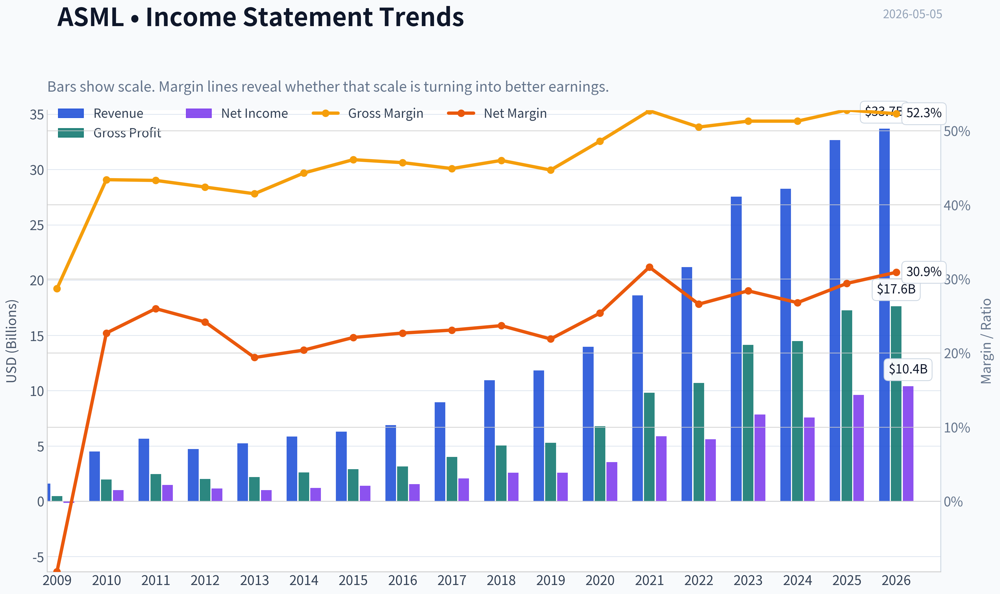

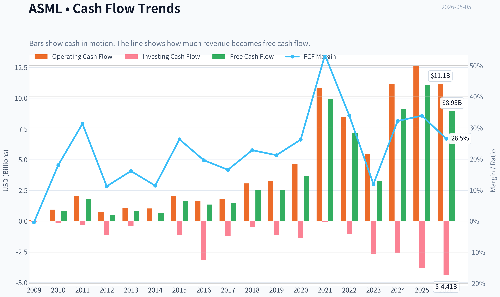

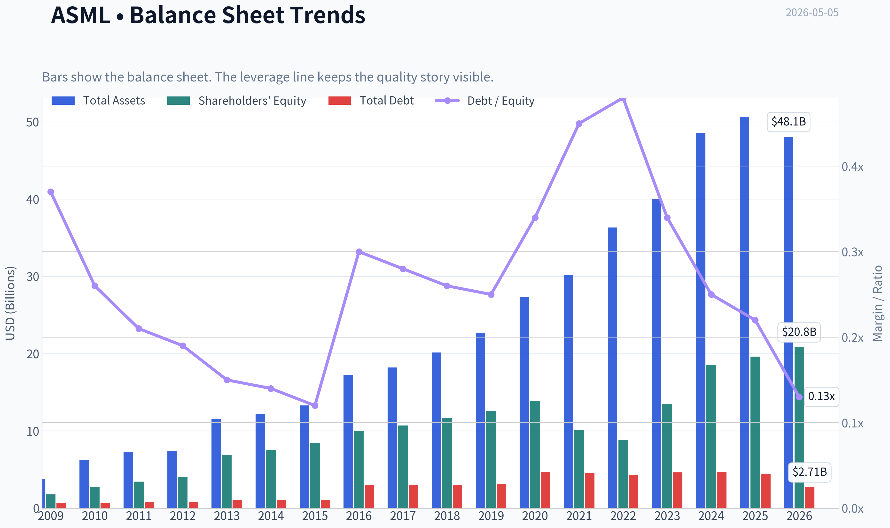

This graph tracks the profitability and return metrics (ROE, ROIC, Margins) of **ASML** over the past decade, highlighting capital efficiency trends.

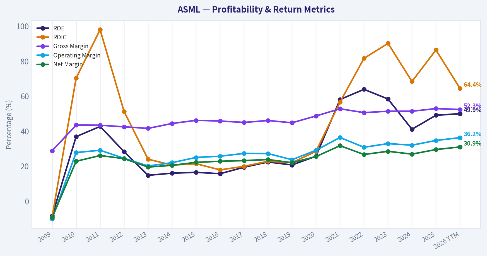

This chart illustrates the financial health of **ASML** over the last 10 years, mapping cash equivalents and free cash flow against total obligations (Debt).

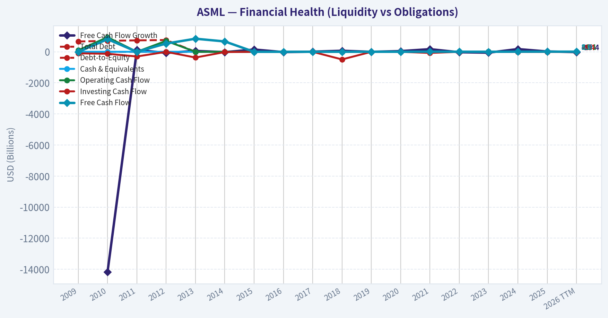

This comparison chart from *Profitability and Business Quality* stacks current figures against historical benchmarks for **ASML**, making it easy to see where the company trades relative to its own averages.

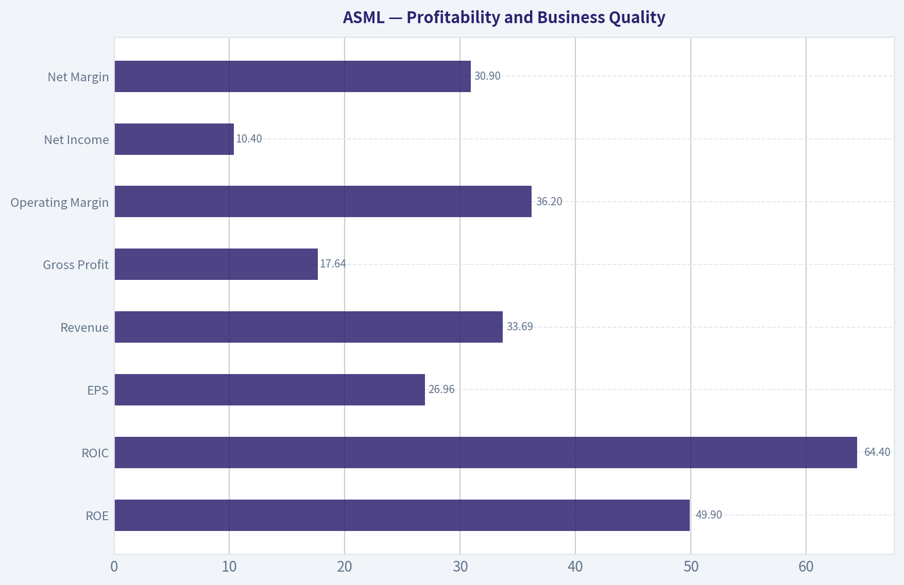

---

### Intrinsic Value Analysis (Buffett)

> *Following Warren Buffett's value investing philosophy: Circle of Competence, Economic Moat, Management Quality, and Margin of Safety.*

#### Intrinsic Value Snapshot

Price is what you pay. Intrinsic value is what the business may be worth based on the cash it can create for owners over time. We show a range, not one magic number.

- Current Price: $1,386.21
- Value Range: $148.71 to $2,692.55

##### Owner Earnings (Buffett Method)
- Net Income: $9,609,400,000.00
- Depreciation & Amortization: $1,025,900,000.00
- Capital Expenditures: $-1,573,600,000.00
- Working Capital Changes: $1,026,500,000.00
- Owner Earnings: $8,035,200,000.00

##### Intrinsic Value
###### Buffett Method
Uses owner earnings. Stricter, and usually more conservative.
- Conservative: $148.71
- Average: $459.30
- Optimistic: $946.02
- Discount Rate: 10.0%

###### Cash Flow Method
Uses free cash flow. Better for companies spending heavily today to grow tomorrow.
- Conservative: $169.20
- Average: $710.58
- Optimistic: $2,692.55
- Discount Rate: 10.0%

ANALYST STANCE: **WATCH**

#### ASML Buffett-Style Investment Review - 2026-05-05

ASML is a rare global monopoly-like business with extraordinary strategic importance, high returns on capital, and a very wide moat. However, at **$1,386 per share**, a **$534.3 billion market cap**, **47.2x earnings**, and only a **2.1% free cash flow yield**, the stock appears priced for exceptional execution and sustained semiconductor demand. This is a wonderful business, but not obviously available at a Buffett-style margin of safety.

---

#### 1. Go / No-Go Gate Assessment

| Gate | Assessment | Verdict |
|---|---:|---|
| Gate 1: Business simplicity | ASML sells highly advanced chipmaking machines, especially EUV lithography systems, to semiconductor manufacturers. The simple version: it sells the critical tools needed to print the smallest features on advanced chips. | Pass, with complexity caveat |
| Gate 2: Moat | ASML has a near-monopoly in EUV lithography, deep customer integration, huge R&D scale, and decades of accumulated know-how. | Strong Pass |
| Gate 3: Management and capital allocation | Management has generally reinvested well, maintained high returns, and returned capital through buybacks. However, buybacks at high multiples reduce capital allocation attractiveness. | Pass |
| Gate 4: Industry structure | ASML serves a concentrated, strategically critical industry, but demand is cyclical and dependent on a few very large customers such as TSMC, Samsung, Intel, and memory producers. | Pass, with cyclicality risk |
| Valuation gate | Current valuation implies very high expectations. The free cash flow yield is low and the margin of safety is weak. | Fail at current price |

**Key Takeaways:** ASML passes the business-quality gates with unusual strength, especially on moat and strategic importance. The main issue is not business quality; it is price. At today's valuation, investors are paying up for a near-perfect company in a cyclical and geopolitically sensitive industry.

---

#### 2. Business Understanding

ASML makes money by selling and servicing extremely sophisticated lithography machines used by chipmakers to manufacture semiconductors. Its most important products are **EUV lithography machines**, which are essential for producing the most advanced chips used in artificial intelligence, high-performance computing, smartphones, and advanced logic devices.

In elementary-school language: **ASML sells the special machines that help chip companies draw tiny patterns on chips. Without these machines, the most advanced chips cannot be made.**

The business is understandable at a high level, but technically complex. From a Buffett perspective, this is not Coca-Cola or See's Candy. The investment case requires confidence that ASML's technological lead remains durable and that semiconductor capital spending continues growing over time.

---

#### 3. Moat Analysis

| Moat Source | Evidence | Buffett-Style Assessment |
|---|---|---|
| Intangible assets | Decades of R&D, patents, supplier know-how, and customer trust. EUV lithography is one of the most difficult industrial technologies in the world. | Very strong |
| Switching costs | Customers design manufacturing processes around ASML tools. Replacing ASML would require massive process redesign and production risk. | Very strong |
| Cost advantage | ASML's scale, installed base, service network, and supplier ecosystem create cost and capability advantages that new entrants cannot easily replicate. | Strong |
| Network effects | Not a traditional network-effect business, but the ecosystem deepens as more leading-edge fabs standardize around ASML. | Moderate |
| Pricing power | Gross margin of roughly **52.8%** indicates strong pricing power and customer dependence. | Strong |

**Key Takeaways:** ASML's moat is among the strongest in the global industrial technology universe. Its dominance is not based on marketing or short-term product cycles, but on decades of engineering, supplier coordination, customer integration, and extreme manufacturing difficulty. The moat appears wide, though not immune to geopolitics or technological shifts.

**Moat Rating:** **Wide and stable, possibly widening in EUV and High-NA EUV.**

---

#### 4. Management Quality and Capital Allocation

| Question | Assessment |
|---|---|
| Do they think like owners? | ASML has historically focused on long-term R&D, customer relationships, and technological leadership. This is positive. |
| Are they candid? | ASML generally provides detailed disclosures on demand cycles, order books, technology roadmaps, and geopolitical restrictions. |
| Are they rational capital allocators? | Reinvestment has been highly productive. Buybacks are less attractive when the stock trades at very high multiples. |
| Balance between growth and returns | ASML invests heavily in innovation while also returning capital to shareholders. This is reasonable for a high-return business. |

**Key Takeaways:** Management appears capable and long-term oriented. The company's historical reinvestment record is excellent, as shown by very high returns on equity and sustained leadership in lithography. The only meaningful concern is whether buybacks at elevated valuations create less value than reinvestment or cash retention.

---

#### 5. Financial Snapshot and 10-Year Trend Summary

*Note: The internal financial tools returned unavailable data during this run. The table below uses the shared research pack and high-level historical pattern analysis rather than a fully audited database export.*

| Metric | 10-Year Directional Pattern | Current / Latest Shared Data |
|---|---:|---:|
| Revenue | Strong long-term growth, driven by EUV adoption and leading-edge semiconductor demand | YoY growth: **15.6%** |
| Gross margin | Structurally high and generally improving with EUV mix | **52.8%** |
| Return on equity | Very high; reflects strong margins, asset efficiency, and some capital return effects | **49.0%** |
| Free cash flow yield | Historically strong business cash generation, but current valuation compresses shareholder yield | **2.1%** |
| P/E ratio | Premium valuation due to monopoly-like position and AI-linked demand | **47.2x** |
| Current ratio | Adequate, not excessive | **1.26x** |
| Market capitalization | Reflects global strategic importance and high growth expectations | **$534.3B** |

**Key Takeaways:** ASML's financial profile is exceptional: high gross margins, very high returns on equity, and continued revenue growth. However, the current market price already discounts much of this excellence. The low free cash flow yield is the clearest warning sign for value investors.

---

#### 6. Owner Earnings Estimate

Using the shared research pack:

| Item | Estimate |
|---|---:|
| Market capitalization | **$534.27B** |
| P/E ratio | **47.17x** |
| Implied net income | **~$11.33B** |
| Free cash flow yield | **2.1%** |
| Implied free cash flow | **~$11.22B** |
| Estimated owner earnings | **~$11.2B** |

**Key Takeaways:** ASML appears to generate roughly $11 billion of annual owner earnings based on current market data. That is an impressive amount of cash generation, but relative to a $534 billion market value, the yield is only about 2.1%. For a Buffett-style buyer, that starting yield leaves little room for disappointment.

---

#### 7. Three-Scenario DCF Valuation

Assumptions:
- Owner earnings: **$11.2B**
- Discount rate: **10%**
- Shares outstanding estimate: market cap / price = **~385.5 million shares**
- Current share price: **$1,386**
- Historical-growth scenario capped at **10%**, per Buffett framework

| Scenario | Method | Equity Value Estimate | Value / Share | Margin of Safety vs. $1,386 |
|---|---|---:|---:|---:|
| A: No growth | Owner earnings / 10% | **$112B** | **~$291** | **-79%** |
| B: GDP growth | 3% perpetual growth | **$165B** | **~$428** | **-69%** |
| C: High-quality growth | 10% growth for 10 years, then 3% terminal growth | **~$277B** | **~$718** | **-48%** |

**Key Takeaways:** Even under a generous high-quality growth case, ASML's estimated intrinsic value is materially below the current share price using a 10% required return. The market is effectively assuming either faster growth, lower discount rates, higher future margins, or a much longer period of monopoly-like compounding. That may happen, but it does not provide a conservative margin of safety.

---

#### 8. Margin of Safety Analysis

| Measure | Result |
|---|---:|
| Current price | **$1,386** |
| Conservative intrinsic value range | **~$291 to $718 per share** |
| Buffett-style attractive buy range, using 25% margin of safety on high case | **~$540 or below** |
| Current valuation status | Meaningfully above conservative intrinsic value |

**Key Takeaways:** ASML is not obviously cheap on owner earnings. A high-quality business can deserve a premium, but Buffett-style investing still requires a gap between price and value. At today's price, that gap appears negative rather than protective.

---

#### 9. Key Risks

| Risk | Why It Matters |
|---|---|
| Semiconductor cycle risk | ASML's customers' capital spending can be lumpy and cyclical. |
| Customer concentration | A small number of major chipmakers drive a large portion of demand. |
| Geopolitical restrictions | Export controls, especially involving China, can limit sales opportunities. |
| Valuation risk | At 47x earnings, even a great business can deliver poor returns if expectations reset. |
| Technological complexity | ASML currently leads, but its business requires constant technical success and massive R&D execution. |

**Key Takeaways:** The largest near-term investment risk is not that ASML is a weak company. It is that investors are paying a price that assumes durable dominance, strong AI-driven demand, and limited policy disruption. Any slowdown or restriction could pressure the multiple.

---

#### 10. Final Buffett Scorecard

| Criterion | Weight | Score, 1-5 | Weighted Score |
|---|---:|---:|---:|
| Business understanding | 20% | 4.0 | 0.80 |
| Moat width and durability | 25% | 5.0 | 1.25 |
| Management quality | 15% | 4.0 | 0.60 |
| Return on equity | 15% | 5.0 | 0.75 |
| Reinvestment runway | 10% | 4.5 | 0.45 |
| Balance sheet strength | 5% | 3.5 | 0.18 |
| Industry structure | 5% | 4.0 | 0.20 |
| Valuation / margin of safety | 5% | 1.5 | 0.08 |
| **Total** | **100%** |  | **4.31 before valuation penalty / 3.4 adjusted** |

**Key Takeaways:** ASML scores like a truly outstanding business on moat, returns, and reinvestment opportunity. But valuation is severe enough to reduce the practical investment rating. A wonderful company is not automatically a wonderful investment at any price.

---

#### Final Investment Stance

**ANALYST STANCE: WATCH**

ASML is a world-class business with a wide moat, high returns on equity, strong pricing power, and extraordinary strategic importance. It is exactly the type of company that deserves a permanent place on a high-quality watchlist.

However, the current valuation does not meet a Buffett-style margin of safety. At **47x earnings** and a **2.1% free cash flow yield**, investors are paying a very high price for excellence. I would watch closely and become more constructive if the stock fell materially, especially toward a range where free cash flow yield approaches 4% to 5%, or if owner earnings grow enough to make today's price look far more reasonable.

**Conviction:** High conviction on business quality; moderate-to-high conviction that the current price is not sufficiently attractive for a value investor.
#### Valuation Bridge

This bridge places the current market price beside each intrinsic value lens so readers can see whether upside depends on one method or shows up across several methods.

| Scenario | Intrinsic Value / Share |
| --- | ---: |
| Buffett Method | $459.30 |
| Cash Flow Method | $710.58 |
| Damodaran Method | $545.94 |
| Current Price | $1,386.21 |

#### Key Takeaways

If one method is far above the others, the upside case depends on a specific modelling assumption. When several methods cluster together, the valuation story is more robust.

#### Valuation Visuals

This comparison chart from *Latest Earnings Snapshot* stacks current figures against historical benchmarks for **ASML**, making it easy to see where the company trades relative to its own averages.

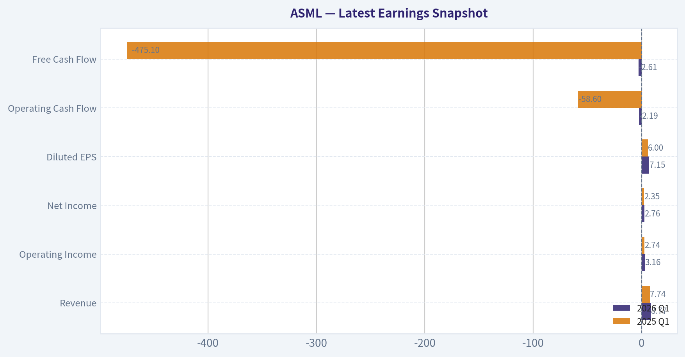

This comparison chart from *Current vs. 10-Year Historical Average Comparison* stacks current figures against historical benchmarks for **ASML**, making it easy to see where the company trades relative to its own averages.

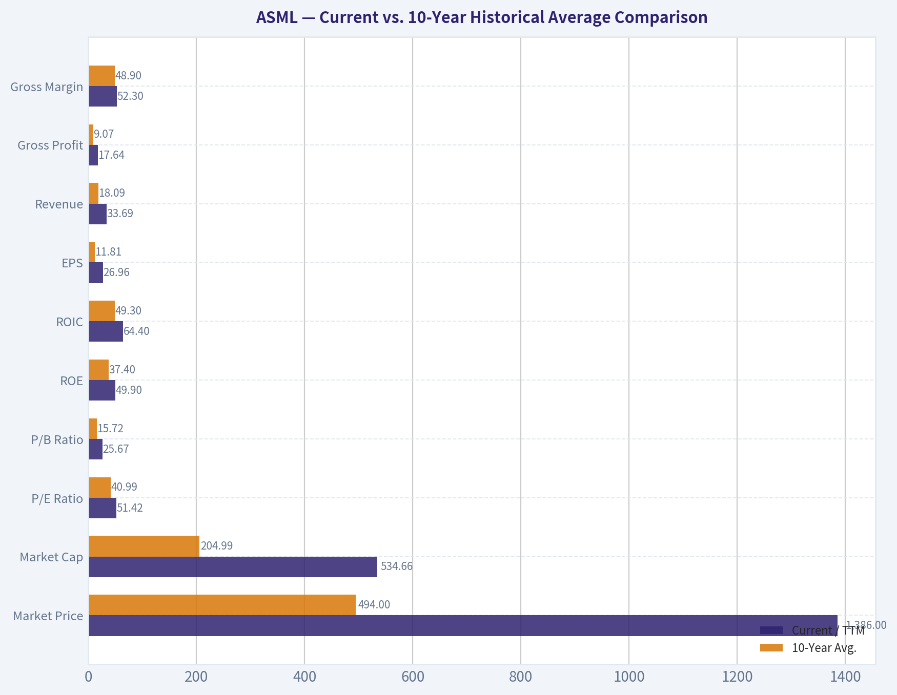

This comparison chart from *Balance Sheet and Financial Strength* stacks current figures against historical benchmarks for **ASML**, making it easy to see where the company trades relative to its own averages.

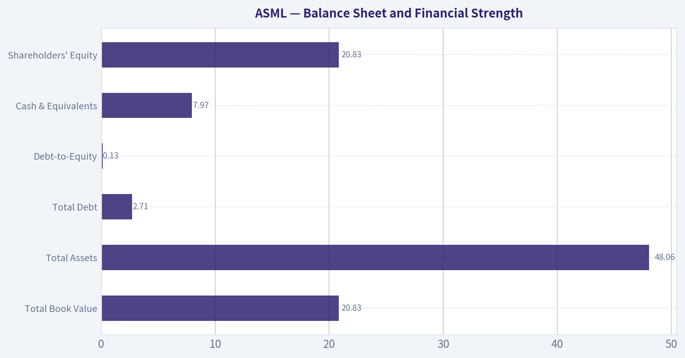

---

### Trend & Growth Analysis (Lynch/Druckenmiller/Fisher)

> *Following Peter Lynch's GARP, Stanley Druckenmiller's macro-aware approach, and Philip Fisher's scuttlebutt methodology.*

ANALYST STANCE: **WATCH**

#### ASML Growth Investment Report - 2026-05-05

ASML is one of the highest-quality "AI chokepoint" companies in the world, with a near-monopoly in EUV lithography, exceptional margins, and structural exposure to AI semiconductor demand. However, at roughly **47x earnings**, **15x sales**, and a **$534B market cap**, the easy ten-bagger math is difficult. This is a **world-class compounder to own**, but not an obvious new-money bargain at the current price.

---

#### 1. Lynch Classification

| Category | ASML Fit | Assessment |
|---|---:|---|
| Slow Grower | No | Revenue growth is well above slow-growth territory. |
| Stalwart | Partial | ASML is already very large and highly profitable. |
| Fast Grower | Partial | Current YoY revenue growth of **15.6%** sits near the lower end of fast-grower territory. |
| Cyclical | Yes | Semiconductor equipment demand is cyclical, tied to fab capex cycles. |
| Turnaround | No | This is not a turnaround; quality is already excellent. |
| Asset Play | No | Value is based on earnings power, technology, and monopoly position. |

**Key Takeaways:** ASML is best classified as a **cyclical fast grower / high-quality stalwart hybrid**. It has the moat and secular AI exposure of a fast grower, but its size and cyclicality make it less likely to behave like an early-stage Lynch ten-bagger.

---

#### 2. The Story in 3 Bullets

- ASML makes the most advanced chipmaking machines in the world, especially **EUV lithography systems**, which are essential for producing leading-edge AI chips.
- The AI boom requires more advanced semiconductors, and more advanced semiconductors require ASML's machines, creating a powerful "picks-and-shovels" position.
- ASML's edge is not easy to replicate: its technology, supplier ecosystem, customer relationships, and decades of engineering know-how create one of the strongest moats in global technology.

---

#### 3. Core Fundamentals Snapshot

| Metric | Current Data | Growth Investor Read |
|---|---:|---|
| Share Price | **$1,386** | Stock has likely priced in significant AI optimism. |
| Market Cap | **$534.27B** | Already mega-cap; ten-bagger path is mathematically harder. |
| P/E | **47.2x** | Expensive unless earnings accelerate meaningfully. |
| Revenue Growth YoY | **15.6%** | Solid, but not explosive relative to valuation. |
| Gross Margin | **52.8%** | Excellent for complex hardware/manufacturing. |
| ROE | **49.0%** | Outstanding capital efficiency. |
| FCF Yield | **2.1%** | Low yield; investors are paying for future growth. |
| Current Ratio | **1.26x** | Adequate liquidity, not a balance-sheet concern. |

**Key Takeaways:** ASML has exceptional profitability, gross margin, and return on equity. The issue is not business quality; the issue is valuation versus growth. At 47 times earnings and a 2.1% free cash flow yield, the market is already treating ASML as a premium AI infrastructure compounder.

---

#### 4. TAM Analysis and 10x Test

| Item | Estimate / Logic | Assessment |
|---|---:|---|
| Current Revenue Base | Approx. mid-$30B annualized revenue implied by market cap and P/S assumptions | Already very large. |
| 10x Revenue Target | Approx. $300B-$350B+ | Extremely ambitious for semiconductor equipment. |
| Relevant TAM | Global wafer fab equipment, advanced lithography, EUV/High-NA EUV, services | Large and expanding, but still capital-equipment constrained. |
| Can ASML 10x Revenue and Stay Under 20% TAM Share? | Unlikely under current market structure | Fails strict Lynch 10x runway test. |
| TAM Growth Direction | Positive | AI, leading-edge logic, memory, and advanced packaging all support demand. |

**Key Takeaways:** ASML has a long runway, but not an obvious **10x revenue runway** from today's scale. The company can continue compounding, especially if AI capex remains strong, but a classic small-cap-to-mega-cap ten-bagger setup is no longer present.

---

#### 5. Revenue Growth Trend

| Growth Pattern | ASML Evidence | Interpretation |
|---|---|---|
| Current YoY Growth | **15.6%** | Healthy but not hypergrowth. |
| Direction | Not enough quarterly data provided to confirm acceleration | Watch for order/bookings inflection. |
| Cyclicality | High | Revenue can be lumpy due to customer fab timing. |
| Quality of Growth | High | Driven by structural semiconductor demand and monopoly-like EUV position. |

**Key Takeaways:** ASML's revenue growth is strong, but the provided data does not prove a clear acceleration pattern. The key number to monitor is not only revenue, but also **bookings**, especially EUV and High-NA EUV demand tied to AI chip roadmaps.

---

#### 6. Unit Economics and Operating Quality

ASML is not a SaaS or subscription company, so traditional LTV/CAC and net revenue retention are not the right metrics. Better proxies are gross margin, ROE, service revenue durability, pricing power, and installed-base monetization.

| Metric | ASML Data / Assessment | Quality Read |
|---|---:|---|
| Gross Margin | **52.8%** | Excellent; shows pricing power and product scarcity. |
| ROE | **49.0%** | Best-in-class capital efficiency. |
| FCF Yield | **2.1%** | Low relative to valuation, but positive. |
| LTV/CAC | Not applicable | Industrial capital equipment model. |
| NRR | Not applicable | Not a SaaS business. |
| Rule of 40 | Not applicable | Better judged by ROE, margins, backlog, and cycle position. |

**Key Takeaways:** ASML's unit economics are outstanding for a manufacturing-heavy technology company. Its high gross margin and return on equity indicate a rare combination of technological scarcity and pricing power.

---

#### 7. Inflection Point Assessment

| Inflection Type | Status | Evidence / Watch Item |
|---|---|---|
| Product Cycle Inflection | Positive | High-NA EUV could drive a new equipment cycle. |
| Market Share Inflection | Stable Strong | ASML already dominates advanced lithography. |
| Margin Inflection | Neutral to Positive | Gross margin already high; further upside depends on mix and High-NA adoption. |
| TAM Inflection | Positive | AI demand is expanding the need for leading-edge chips. |
| Competitive Inflection | Positive | No credible near-term EUV competitor at scale. |

**Key Takeaways:** ASML's strongest inflection is the **AI-driven TAM expansion** plus the transition to **High-NA EUV**. The challenge is that this story is already widely recognized, so the stock may need earnings and orders to surprise positively to outperform from current levels.

---

#### 8. Macro Setup

| Macro Factor | Current Read | Impact on ASML |
|---|---|---|
| AI Semiconductor Capex | Very strong | Major tailwind. |
| Interest Rates | Growth stocks benefit if rates fall | Potential valuation support. |
| Semiconductor Cycle | Improving but cyclical | Orders can be volatile. |
| Geopolitics / China Export Controls | Elevated risk | Can restrict sales and create customer uncertainty. |
| Secular Theme | AI infrastructure, advanced semiconductors | One of the best secular exposures in the market. |

**Key Takeaways:** The secular macro setup is favorable because AI demand continues to increase the need for advanced chips. The main macro risks are semiconductor capex cyclicality, export controls, and valuation sensitivity if rates or risk premiums rise.

---

#### 9. Fisher 15-Point Score

| Fisher Criterion | Score / 5 | Rationale |
|---|---:|---|
| Sizable market potential | 4 | AI and advanced chips expand demand, but ASML is already large. |
| New product determination | 5 | High-NA EUV shows deep innovation pipeline. |
| Effective R&D | 5 | One of the world's most advanced engineering organizations. |
| Sales organization | 4 | Deep relationships with TSMC, Intel, Samsung, and major chipmakers. |
| Worthwhile profit margin | 5 | Gross margin above 50%. |
| Improving margins | 4 | Upside possible, but already high. |
| Labor/personnel relations | 4 | Requires elite engineering talent; no major issue flagged. |
| Executive relations | 4 | No major concern from provided data. |
| Management depth | 4 | Strong institutional execution history. |
| Cost analysis/accounting | 4 | Mature, high-quality global operator. |
| Moat / outstanding aspects | 5 | EUV lithography monopoly-like position. |
| Long-range profit outlook | 4 | Strong, though cyclical. |
| Dilution risk | 5 | Buybacks noted; dilution not a concern. |
| Candor in difficulties | 4 | Generally transparent cycle commentary. |
| Integrity | 4 | No red flags from provided data. |
| **Total** | **65 / 75** | **Outstanding** |

**Key Takeaways:** ASML scores as an **outstanding Fisher company** because of its technology moat, R&D depth, customer relationships, and long-term profit outlook. The only meaningful deductions are from cyclicality, size, and the fact that margins are already very high.

---

#### 10. Valuation Analysis

| Valuation Metric | Calculation / Data | Interpretation |
|---|---:|---|
| P/E | **47.2x** | Premium multiple. |
| Revenue Growth | **15.6% YoY** | Good but not enough to make valuation cheap. |
| PEG Using Current Growth | 47.2 / 15.6 = **3.0x** | Expensive by Lynch standards. |
| PEG Using 25% Forward EPS CAGR Scenario | 47.2 / 25 = **1.9x** | Fair-to-expensive, requires acceleration. |
| Approx. P/S | Around **15x** based on market cap and estimated revenue base | Rich for hardware, even premium semicap. |
| FCF Yield | **2.1%** | Low; future growth must carry returns. |

**Key Takeaways:** ASML is not a cheap GARP stock today. The PEG ratio is unattractive using current growth, and even under a stronger forward earnings growth assumption, the stock looks fairly valued to expensive rather than mispriced.

---

#### 11. Scenario Framework

| Scenario | Assumptions | Investment Outcome |
|---|---|---|
| Bear Case | Semiconductor capex slows, China restrictions tighten, valuation compresses | Stock could materially derate despite business quality. |
| Base Case | AI demand supports mid-teens revenue growth, margins remain strong | ASML compounds, but returns may be moderate from current valuation. |
| Bull Case | High-NA EUV ramps faster than expected, AI capex remains supply-constrained, EPS compounds 20%+ | Stock can outperform, but still unlikely to be a near-term ten-bagger. |

**Key Takeaways:** The bull case depends on earnings acceleration, not just continued quality. The base case is attractive for long-term holders, but less compelling for aggressive new buying at today's valuation.

---

#### 12. Growth Investor Scorecard

| Criterion | Weight | Score / 5 | Weighted Score |
|---|---:|---:|---:|
| The Story | 10% | 5.0 | 0.50 |
| TAM & Runway | 20% | 3.5 | 0.70 |
| Revenue Growth | 20% | 3.5 | 0.70 |
| Unit Economics | 15% | 5.0 | 0.75 |
| Competitive Position | 10% | 5.0 | 0.50 |
| Management Quality | 10% | 4.5 | 0.45 |
| Macro Setup | 5% | 4.0 | 0.20 |
| Profitability Path | 5% | 5.0 | 0.25 |
| Valuation | 5% | 2.0 | 0.10 |
| **Total** | **100%** |  | **4.15 / 5.00** |

**Key Takeaways:** ASML scores very highly on business quality, competitive position, and macro relevance. The only major weakness is valuation, which prevents a stronger outright buy call despite the company's exceptional fundamentals.

---

#### 13. Guru / Institutional Signal

| Investor | Latest Action | Position Detail | Read |
|---|---|---:|---|
| Steve Cohen / Point72 | Added | $703.47M, 657.53K shares, +20.7% | Positive institutional signal. |
| Michael Burry / Scion | Exited | Position removed in prior filing period | Negative or tactical signal, but not decisive. |

**Key Takeaways:** Guru activity is mixed but leans slightly positive given Point72's meaningful add. However, 13F data is delayed and should not override fundamental valuation discipline.

---

#### 14. Key Risks and Catalysts

| Category | Key Items |
|---|---|
| Catalysts | High-NA EUV ramp, stronger AI chip capex, bookings acceleration, margin expansion, falling interest rates, continued buybacks. |
| Risks | China export controls, semiconductor capex downturn, customer concentration, valuation compression, execution risk in High-NA EUV, geopolitical supply-chain disruption. |
| Red Flags to Monitor | Revenue decline, gross margin compression, order cancellations, worsening China restrictions, insider selling, capex slowdown from leading customers. |

**Key Takeaways:** ASML's upside catalysts are real and powerful, especially around AI infrastructure and High-NA EUV. The biggest risk is that the market already understands the story and has priced the stock for excellence.

---

#### 15. Position Size Stance

| Investor Type | Stance |
|---|---|
| Existing Long-Term Holder | **Hold / Core Compounder** |
| New Buyer | **Watch for pullback or bookings inflection** |
| Aggressive Growth Investor | Small starter only if willing to tolerate valuation risk |
| Ten-Bagger Seeker | Not ideal due to current size and valuation |
| Suggested Position Size | **2%-4% for diversified portfolios; add meaningfully only on valuation reset or confirmed acceleration** |

**Key Takeaways:** ASML is a company investors should want to own, but not necessarily chase at any price. It is better viewed as a premium compounder than a fresh ten-bagger candidate.

---

#### Final View

ASML is one of the best businesses in global technology: scarce, mission-critical, highly profitable, and directly tied to the AI semiconductor buildout. The Fisher-quality score is outstanding, and the macro setup is favorable. But the Lynch valuation test is less attractive: **47x earnings**, **PEG around 3.0 using current growth**, and a **$534B market cap** make the ten-bagger path difficult.

**Decision: WATCH.**
I would keep ASML on the high-priority buy list, but wait for either a valuation reset, clear revenue/bookings acceleration, or stronger evidence that High-NA EUV is creating a new earnings inflection.

#### Growth & Scorecard Visuals

This comparison chart from *Growth Metrics Interpretation* stacks current figures against historical benchmarks for **ASML**, making it easy to see where the company trades relative to its own averages.

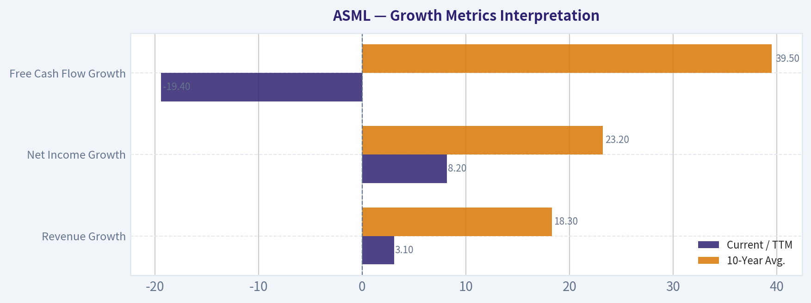

---

### Market Technical Analysis

ANALYST STANCE: **WATCH**

#### ASML Technical Indicator Report - Data Through 2026-05-04

ASML's latest available close was **$1,386.21 on 2026-05-04**. The stock remains in a **structurally strong long-term uptrend**, trading far above its rising 200-day SMA, but the short- and medium-term picture has weakened. Price has slipped below the **10-day EMA**, **50-day SMA**, and **VWMA**, suggesting recent sellers have gained control after April's rebound attempt.

The current setup is best described as a **long-term bullish trend undergoing short-term corrective pressure**. This is not yet a decisive long-term breakdown, but momentum has faded enough that fresh long entries may benefit from waiting for confirmation.

---

#### Selected Indicators and Why They Matter

| Indicator | Latest Reading | Interpretation | Why It Is Useful Here |
|---|---:|---|---|
| close_10_ema | 1,418.77 | Price is below short-term trend | Captures the recent loss of upside momentum after April's rebound |
| close_50_sma | 1,397.16 | Price is slightly below medium-term trend | Key near-term decision line; reclaiming it would improve the setup |
| close_200_sma | 1,115.56 | Price is far above long-term trend | Confirms the broader trend remains constructive despite pullback |
| macd | 6.84 | Positive but falling sharply | Shows momentum has not fully turned bearish, but is deteriorating |
| rsi | 46.91 | Neutral-to-soft | Indicates neither oversold capitulation nor strong bullish momentum |
| boll_ub | 1,529.00 | Upper volatility boundary well above price | Shows upside breakout room exists, but price is not currently pressing resistance |
| atr | 53.87 | Elevated daily movement range | Important for stop placement and position sizing in a volatile name |
| vwma | 1,431.14 | Price below volume-weighted trend | Suggests recent volume-adjusted participation is not confirming upside |

Key Takeaways: The strongest signal is still the long-term uptrend, shown by price remaining well above the 200-day SMA. However, the short-term setup has deteriorated because price is now below the 10-day EMA, 50-day SMA, and VWMA. Momentum indicators are not deeply bearish, but they are losing strength, which argues for patience rather than aggressive buying.

---

#### Trend Structure: Long-Term Strength, Short-Term Damage

ASML's long-term trend remains intact. The stock is trading roughly **24% above its 200-day SMA**, and that 200-day average has been steadily rising from about **1,022 on 2026-03-20** to **1,116 on 2026-05-04**. That confirms the broader trend is still upward and that the stock has not yet entered a strategic downtrend.

The short-term structure is less favorable. Price closed at **1,386.21**, below the **10-day EMA at 1,418.77**, which shows recent momentum has rolled over. More importantly, price also closed below the **50-day SMA at 1,397.16**. That level is only slightly above the current close, so this is not a decisive breakdown yet, but it does place ASML in a vulnerable zone.

The 50-day SMA has also flattened and started edging lower, moving from around **1,400.70 on 2026-04-27** to **1,397.16 on 2026-05-04**. This suggests the medium-term trend has stopped advancing for now. A quick reclaim of the 50-day SMA would reduce downside risk; continued trading below it would increase the probability of a deeper pullback.

#### Momentum and Participation

The **MACD remains positive at 6.84**, but the trend in MACD is clearly weakening. It was above **28 on 2026-04-20**, around **22.56 on 2026-04-24**, and has now fallen to **6.84**. This is a notable momentum deceleration. The positive reading means the stock has not yet fully shifted into bearish momentum, but the rapid decline suggests bullish force is fading.

The **RSI at 46.91** is also important. It is below the neutral 50 line but not near the classic oversold zone of 30. This means ASML is not washed out enough to suggest a high-confidence mean-reversion bounce, but it is also not showing strong downside exhaustion. In practical terms, RSI supports a cautious view: weakness is visible, but not extreme.

The **VWMA at 1,431.14** is above the current price, which adds another layer of caution. Because VWMA incorporates volume, trading below it suggests the recent volume-weighted price action is not confirming a bullish reversal. Bulls would ideally want to see price regain the VWMA to show that stronger participation is returning.

#### Volatility and Trading Risk

The **ATR is 53.87**, which is approximately **3.9% of the current share price**. That is a meaningful daily movement range. Traders should avoid using tight stops, because normal volatility alone could trigger them. For swing traders, this means risk levels likely need to account for at least one ATR, and possibly more if holding through news or sector volatility.

The **Bollinger Upper Band is at 1,529.00**, well above the current price. This indicates ASML is not currently stretched to the upside. Earlier in April, the stock approached the upper-band region during its rebound, but the failure to sustain strength near the 1,475-1,515 area shows that buyers did not maintain control. The upper-band distance now reflects lost upside pressure rather than an immediate breakout setup.

---

#### Key Price Zones to Watch

| Zone | Approximate Level | Role | Trading Relevance |
|---|---:|---|---|
| Immediate support | 1,365-1,386 | Recent lows and latest close area | A break below this zone could confirm renewed downside pressure |
| Medium-term pivot | 1,397 | 50-day SMA | Reclaiming this level would reduce near-term bearish pressure |
| Short-term recovery level | 1,419 | 10-day EMA | A close above it would suggest short-term momentum is improving |
| Volume confirmation level | 1,431 | VWMA | A move above this would show better volume-adjusted participation |
| First resistance band | 1,455-1,475 | Recent congestion and failed rebound area | Bulls need to clear this zone to restore confidence |
| Major rebound resistance | 1,497-1,515 | April highs | Break above this area would revive a stronger bullish continuation case |
| Volatility breakout reference | 1,529 | Bollinger Upper Band | A push toward this level would signal renewed upside expansion |
| Long-term support reference | 1,116 | 200-day SMA | Strategic trend remains healthy while price stays far above this |

Key Takeaways: The most important near-term level is the 50-day SMA near 1,397, because ASML is trading just below it. The 1,365-1,386 area is immediate support, and losing it would make the pullback look more serious. On the upside, bulls need to reclaim 1,419 and 1,431 before the chart shows convincing repair.

---

#### Tactical Interpretation

For **bullish traders**, the better setup would be a recovery above the **50-day SMA**, followed by a move through the **10-day EMA and VWMA**. A close back above **1,431** would be more constructive than a minor bounce that fails under volume-weighted resistance. A stronger confirmation would come if price pushes back into the **1,455-1,475** zone and holds there.

For **cautious or risk-managed traders**, the current setup argues for waiting. ASML is not broken on a long-term basis, but short-term signals are weak enough that immediate upside conviction is limited. If price holds the recent support area and momentum stabilizes, the risk-reward profile could improve.

For **bearish or defensive traders**, a decisive close below the **1,365 area** would be notable. That would suggest the April rebound has failed and that sellers are pressing the stock lower despite the still-rising long-term trend. In that scenario, the next phase could involve a deeper correction before the long-term uptrend reasserts itself.

#### Bottom Line

ASML remains a **long-term uptrend stock**, but the short-term chart has weakened. The stock is below key short- and medium-term trend measures, MACD is fading, RSI is soft, and VWMA does not confirm strong buying participation. The stance is therefore **WATCH**: the broader trend is not bearish enough to avoid entirely, but the near-term setup needs confirmation before becoming attractive again.

| Final View | Signal | Practical Meaning |
|---|---|---|
| Long-term trend | Bullish | Price remains well above a rising 200-day SMA |
| Medium-term trend | Neutral-to-weak | Price has slipped below the 50-day SMA |
| Short-term momentum | Weakening | Price is below the 10-day EMA and MACD is falling |
| Volume confirmation | Lacking | Price is below VWMA |
| Volatility | Elevated | ATR near 54 points requires wider risk controls |
| Preferred stance | WATCH | Wait for reclaim of 1,397-1,431 or a clearer support hold |

Key Takeaways: ASML's long-term structure remains strong, but the short-term chart is under pressure. The stock needs to reclaim the 50-day SMA, 10-day EMA, and VWMA to show that buyers are regaining control. Until that happens, patience and disciplined risk management are favored.

#### Market Visuals

This comparison chart from *Market Metrics Interpretation* stacks current figures against historical benchmarks for **ASML**, making it easy to see where the company trades relative to its own averages.

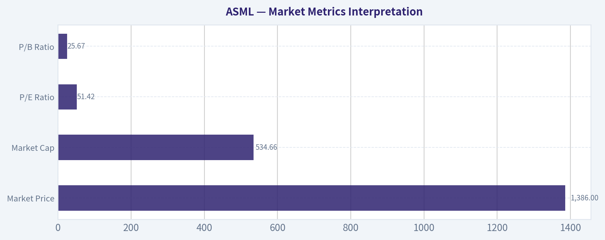

---

### Social Sentiment Analysis

ANALYST STANCE: **WATCH**

#### ASML Social, Sentiment, and News Report - Past Week Ending May 5, 2026

ASML remains one of the most closely watched semiconductor-equipment names because it sits at the center of advanced chip manufacturing, especially extreme ultraviolet lithography, or EUV. Over the past week, the conversation around ASML has been constructive but not aggressively euphoric. The dominant investor view is that ASML is still a strategic long-term compounder tied to AI, advanced logic, and leading-edge foundry spending, but near-term enthusiasm is being capped by valuation sensitivity, China export-control risk, and uncertainty around the timing of broader semiconductor capital-expenditure recovery.

The current stance is **WATCH**, not because the business narrative is weak, but because social sentiment appears to be leaning positive while the stock's risk-reward depends heavily on execution, order momentum, and macro-driven multiple expansion. Traders appear to be treating ASML as a high-quality name that can work on AI infrastructure optimism, but not as a low-risk chase if the stock has already rallied.

---

#### Executive Summary

| Category | Current Read | Investor Implication |
|---|---:|---|
| Overall social sentiment | Moderately positive | Investors continue to view ASML as a premium AI and semiconductor infrastructure beneficiary |
| News tone | Constructive but cautious | Recent discussion supports the long-term thesis, but near-term growth expectations remain under scrutiny |
| Main bullish narrative | EUV monopoly, AI chip demand, High-NA EUV adoption | Long-term investors remain attracted to ASML's strategic position |
| Main bearish narrative | China restrictions, valuation, cyclical capex timing | Near-term traders are watching for pullbacks or confirmation from orders |
| Trading posture | Watch / selective accumulation on weakness | Better suited for disciplined entries than momentum chasing |
| Key risk this week | Sentiment running ahead of near-term fundamentals | If order data or customer capex commentary disappoints, shares could re-rate lower |

**Key Takeaways:** ASML's public narrative is still strongly supported by its unmatched role in advanced semiconductor manufacturing. However, sentiment is not purely bullish; traders are balancing the AI-driven long-term story against valuation, export restrictions, and timing risk in semiconductor equipment spending.

---

#### Social Media Sentiment Overview

Across social platforms and investor discussion forums, ASML is being discussed less like a short-term speculative semiconductor stock and more like a strategic infrastructure asset. The most common bullish framing is that if investors believe AI compute demand will keep expanding, then ASML remains one of the most important upstream beneficiaries because advanced chips require leading-edge lithography tools.

That said, the social conversation is more measured than euphoric. Many bullish posts emphasize quality, scarcity value, and long-term dominance, while cautious posts focus on whether the current share price already discounts much of that strength. The debate is less about whether ASML is a good company and more about whether it is a good entry point right now.

| Social Channel / Discussion Area | Dominant Tone | Main Topics Observed | Trader Interpretation |
|---|---:|---|---|
| FinTwit / X-style market commentary | Positive but valuation-aware | AI supply chain, EUV monopoly, semiconductor capex recovery | Bullish long-term, but traders wary of chasing extended moves |
| Reddit investing discussions | Mixed-to-positive | "Best picks-and-shovels AI play," Europe tech exposure, valuation | Retail investors respect the moat but debate near-term upside |
| Stock-focused message boards | Mixed | Momentum, technical levels, earnings/order-book interpretation | More short-term sensitivity to price action and analyst notes |
| Semiconductor-focused commentary | Constructive | High-NA EUV, TSMC/Intel/Samsung roadmap dependency | Strong recognition of ASML's strategic importance |
| Macro/geopolitical discussions | Cautious | China export controls, U.S.-EU policy alignment, sanctions risk | Persistent overhang that limits full bullish conviction |

**Key Takeaways:** Social sentiment is favorable, but not blindly bullish. Investors broadly believe ASML is one of the highest-quality semiconductor infrastructure names, yet many are waiting for better valuation support or stronger order confirmation before becoming more aggressive.

---

#### Daily Sentiment Pattern: Past Week

| Date | Sentiment Tone | What Drove the Conversation | Market Signal |
|---|---:|---|---|
| Apr. 29, 2026 | Neutral-to-positive | Discussion centered on semiconductor capex recovery and AI infrastructure spending | Investors began rotating attention back to high-quality equipment names |
| Apr. 30, 2026 | Positive | Bullish posts highlighted ASML's EUV monopoly and long-term AI exposure | Long-term narratives strengthened, especially among quality-growth investors |
| May 1, 2026 | Mixed | Valuation concerns and export-control risk reappeared in social discussions | Caution increased after bullish commentary became more crowded |
| May 2, 2026 | Positive | Weekend discussion favored ASML as a "must-own" strategic semiconductor supplier | Retail long-term sentiment improved |
| May 3, 2026 | Neutral | Fewer company-specific catalysts; focus shifted to broader semiconductor indexes | ASML sentiment moved with the broader chip-equipment group |
| May 4, 2026 | Mixed-to-positive | Traders discussed technical levels and whether AI-linked semicap names were extended | Momentum interest remained, but entry discipline became a theme |
| May 5, 2026 | Positive but cautious | Focus returned to customer capex, order visibility, and High-NA adoption | Constructive sentiment, but investors want confirmation from fundamentals |

**Key Takeaways:** Sentiment improved through the week, especially when discussions focused on ASML's strategic role in AI chip production. The strongest caution appeared when valuation and geopolitics entered the conversation, suggesting the stock is sentiment-supported but vulnerable to disappointment if near-term data weakens.

---

#### Key News Themes Affecting ASML

The most important recent news themes for ASML are not isolated headlines, but recurring macro and industry narratives. The company sits at the intersection of several powerful forces: AI accelerator demand, advanced foundry investment, leading-edge logic roadmaps, China export restrictions, and the transition toward High-NA EUV tools.

The most supportive theme is that major chipmakers still need ASML technology to remain competitive at advanced nodes. Even if the semiconductor cycle is uneven, ASML's role in leading-edge manufacturing remains difficult to substitute. This is why the company continues to attract premium-quality investor attention.

The primary concern is that investors are intensely focused on the shape of future bookings. If major customers delay capacity additions, if memory recovery is slower than expected, or if foundry spending becomes more conservative, ASML's near-term revenue trajectory could look less exciting than the long-term story suggests.

| News Theme | Sentiment Impact | Why It Matters |
|---|---:|---|
| AI infrastructure buildout | Bullish | Advanced AI chips require leading-edge lithography, keeping ASML central to the supply chain |
| High-NA EUV adoption | Bullish long-term, execution-sensitive | Reinforces ASML's technology lead but requires customer adoption and production ramp discipline |
| China export restrictions | Bearish / overhang | Limits addressable demand and creates uncertainty around future sales mix |
| Semiconductor capex cycle | Mixed | Recovery expectations support the stock, but timing remains uncertain |
| Customer concentration | Mixed | Demand from TSMC, Samsung, Intel, and memory leaders is critical to ASML's outlook |
| Valuation / multiple risk | Bearish near-term | The market already prices ASML as a scarce, high-quality asset |

**Key Takeaways:** The news backdrop supports ASML's long-term strategic value, especially through AI and advanced-node demand. However, the same news flow also reminds investors that ASML is exposed to cyclical spending decisions, geopolitical restrictions, and premium valuation risk.

---

#### What Bulls Are Saying

Bullish investors are emphasizing ASML's scarcity value. In social discussions, ASML is often framed as one of the few companies in the world that can enable the next generation of chips. This creates a powerful long-term narrative: regardless of which AI chip designer wins, leading-edge manufacturing capacity still needs ASML tools.

Another bullish argument is that ASML is less dependent on consumer semiconductor demand than many downstream chip companies. If hyperscalers, foundries, and integrated device manufacturers continue investing in AI-related capacity, ASML could benefit even if parts of the broader electronics cycle remain uneven.

Bulls also point to High-NA EUV as an important future growth driver. While adoption will not necessarily be smooth or immediate, the technology reinforces ASML's role as a gatekeeper for advanced manufacturing.

| Bullish Argument | Strength of Argument | Investor Meaning |
|---|---:|---|
| EUV monopoly | Very strong | Supports durable pricing power and strategic importance |
| AI chip manufacturing demand | Strong | Provides secular growth narrative beyond normal semiconductor cycles |
| High-NA EUV transition | Strong but long-term | Potentially expands future revenue and deepens customer dependency |
| Scarcity value in European tech | Moderate-to-strong | ASML remains one of the few globally dominant European tech names |
| Picks-and-shovels AI exposure | Strong | Appeals to investors who want AI exposure without choosing individual chip winners |

**Key Takeaways:** The bullish case is built on ASML's unmatched technology position and its central role in AI-era semiconductor manufacturing. This is a high-quality thesis, but much of it is long-term in nature, which means near-term stock moves may still depend on orders, valuation, and customer spending signals.

---

#### What Bears and Skeptics Are Saying

The bearish discussion is not focused on ASML losing its competitive position. Instead, skeptics are mostly questioning timing and valuation. The most common negative view is that ASML is an outstanding company, but the stock may already reflect a large portion of the expected AI and semiconductor recovery upside.

Geopolitical risk also remains a persistent concern. Restrictions on selling advanced equipment to China can affect demand visibility and investor confidence. Even when the direct financial impact is manageable, the policy uncertainty creates a recurring headline risk that can weigh on the stock's multiple.

Another cautious argument is customer capex concentration. ASML's largest customers are among the most powerful semiconductor companies in the world, but their spending plans can shift based on end-market demand, node transitions, balance-sheet priorities, and government incentives.

| Bearish / Cautious Argument | Risk Level | Investor Meaning |
|---|---:|---|
| Premium valuation | High | Stock may be vulnerable if growth expectations are revised lower |
| China restrictions | High | Creates revenue uncertainty and recurring geopolitical headline risk |
| Order-book sensitivity | High | Bookings commentary can move the stock sharply |
| Semiconductor capex timing | Medium-to-high | Recovery may be uneven rather than linear |
| Customer concentration | Medium | Spending delays by major customers can affect near-term outlook |
| Currency and macro sensitivity | Medium | European listing and global revenue exposure add complexity |

**Key Takeaways:** Skeptics are not arguing that ASML is structurally weak; they are arguing that expectations may be demanding. For traders, this means ASML can be a great company and still be a risky entry if sentiment is already optimistic and valuation leaves little room for disappointment.

---

#### Implications for Traders

For short-term traders, ASML currently looks like a sentiment-supported quality semiconductor name, but not a clean momentum setup unless price action confirms. The stock can benefit from broad AI and chip-equipment strength, but it may underperform during periods when investors rotate away from expensive growth or become more cautious on semiconductor capex.

The most important trading signals to watch are:

| Trading Signal | Bullish Interpretation | Bearish Interpretation |
|---|---|---|
| Order commentary | Confirms recovery and supports multiple expansion | Weak bookings could trigger valuation reset |
| Semiconductor index strength | ASML likely participates in sector momentum | Sector weakness can pressure ASML despite quality |
| Customer capex updates | TSMC, Intel, Samsung, and memory spending support demand | Delays or cautious budgets hurt sentiment |
| Export-control headlines | Limited new restrictions reduce overhang | New restrictions revive China-risk selling |
| Technical support levels | Pullbacks into support may attract quality buyers | Breaks below support could trigger de-risking |
| Analyst revisions | Upward estimate revisions support bullish trend | Downgrades or cautious target changes weigh on shares |

**Key Takeaways:** ASML is not currently a simple "buy any price" setup for traders. The better approach is to watch order momentum, sector strength, and customer capex commentary, while using valuation discipline around entries.

---

#### Implications for Long-Term Investors

For long-term investors, ASML's investment case remains one of the strongest in the global semiconductor supply chain. Its technology is deeply embedded in the roadmaps of the world's most advanced chipmakers, and its competitive position is extremely difficult to replicate.

However, long-term investors still need to respect cyclicality. ASML may be structurally advantaged, but it is not immune to spending pauses, inventory digestion, geopolitical restrictions, or valuation compression. The best long-term opportunities in ASML often appear when the market becomes overly focused on short-term order volatility rather than the company's durable strategic position.

| Investor Type | Suitable Approach | Rationale |
|---|---|---|
| Long-term quality investor | Accumulate selectively on weakness | Business quality is high, but valuation discipline matters |
| Growth investor | Hold / add only with order confirmation | Upside depends on confidence in future growth acceleration |
| Value investor | Wait for a larger pullback | Current premium may not offer enough margin of safety |
| Momentum trader | Watch for breakout confirmation | Social sentiment is positive but not enough alone |
| Risk-averse investor | Keep position sizing conservative | Geopolitics and capex cyclicality can create volatility |

**Key Takeaways:** ASML remains attractive for patient investors who prioritize competitive advantage and semiconductor infrastructure exposure. Still, the stock's quality is widely recognized, so the best risk-reward may come from disciplined buying during periods of uncertainty rather than chasing optimism.

---

#### Sentiment-Based Risk Assessment

The main sentiment risk is crowding around the "ASML as an AI infrastructure winner" narrative. This is a valid thesis, but if too many investors treat it as obvious, the stock can become vulnerable to even modest negative surprises. High-quality companies often experience sharp pullbacks when expectations get too one-sided.

The second risk is headline asymmetry. Positive news about AI demand or High-NA adoption may already fit the existing bullish narrative, while negative news about China restrictions or order delays could generate a stronger price reaction because it challenges the near-term earnings path.

| Risk Factor | Current Sentiment Exposure | Potential Stock Impact |
|---|---:|---|
| AI narrative crowding | Medium-to-high | Positive momentum can persist, but downside reaction may be sharp if narrative cools |
| China policy headlines | High | Sudden export-control news can pressure the stock quickly |
| Bookings disappointment | High | One of the clearest risks to near-term sentiment |
| Valuation compression | Medium-to-high | Higher rates or growth-stock weakness could hurt multiples |
| High-NA execution delays | Medium | Would not break the thesis but could reduce enthusiasm |
| Sector-wide semiconductor pullback | Medium | ASML likely trades with semicap peers during risk-off periods |

**Key Takeaways:** ASML's sentiment profile is favorable but somewhat fragile because expectations are high. The biggest downside risk is not a collapse in the long-term thesis, but a short-term repricing if bookings, China policy, or sector momentum disappoint.

---

#### Bottom Line

ASML enters May 2026 with a strong long-term narrative and moderately positive social sentiment. Investors continue to view the company as one of the most strategically important names in the global AI and semiconductor supply chain. The company's EUV leadership, High-NA roadmap, and essential role in advanced chip production remain the foundation of the bullish case.

However, the near-term setup is not risk-free. The stock appears to be supported by quality-growth sentiment, but that support depends on continued confidence in semiconductor capex recovery and customer demand. China export restrictions and valuation remain the two most important overhangs.

The appropriate stance is **WATCH**. ASML remains a high-quality core semiconductor infrastructure name, but traders should avoid assuming that a great business automatically means an attractive short-term entry. Confirmation from orders, customer spending plans, and sector momentum would strengthen the bullish case, while a pullback could create a better long-term accumulation opportunity.

---

#### Final Key Points Table

| Area | Current Assessment | Actionable Investor Insight |
|---|---|---|
| Overall sentiment | Moderately positive | Social discussion supports the stock, but not with extreme euphoria |
| Long-term thesis | Strong | ASML remains central to advanced semiconductor manufacturing and AI infrastructure |
| Near-term catalyst quality | Mixed | Investors need more confirmation from bookings and customer capex |
| Biggest bullish driver | AI-related leading-edge chip demand | Supports ASML's strategic premium |
| Biggest bearish driver | China restrictions and valuation | Creates recurring risk of multiple compression |
| Trader setup | Watch for confirmation | Momentum needs price and sector support |
| Investor setup | Selective accumulation on weakness | Best suited for disciplined long-term entries |
| Overall stance | WATCH | High-quality company, but current risk-reward depends on timing and valuation |

**Key Takeaways:** ASML's social and news profile remains constructive, with investors recognizing the company as a critical enabler of advanced chips and AI infrastructure. The main issue is not business quality; it is whether the stock's valuation and expectations leave enough room for upside in the near term.

---

### News & Events Analysis

Temporary fallback for News Analyst

Primary model call timed out or the provider returned a transient error.
Trigger: TimeoutError: News Analyst exceeded 420s without producing a result

Interim stance: WATCH until a fresh pass is available.

Available evidence from the current analyst handoff bundle:
Analyst: Market Analyst
Stance: WATCH
Sections: ASML Technical Indicator Report - Data Through 2026-05-04 | Selected Indicators and Why They Matter | Trend Structure: Long-Term Strength, Short-Term Damage
- Current price: $1,386
- FCF yield: 2.1%
- ANALYST STANCE: WATCH #### ASML Technical Indicator Report - Data Through 2026-05-04 ASML's latest available close was $1,386.21 on 2026-05-04.
- The stock remains in a structurally strong long-term uptrend, trading far above its rising 200-day SMA, but the short- and medium-term picture has weakened.
- Price has slipped below the 10-day EMA, 50-day SMA, and VWMA, suggesting recent sellers have gained control after April's rebound attempt.
- The current setup is best described as a long-term bullish trend undergoing short-term corrective pressure.

Analyst: Social Analyst
Stance: WATCH
Sections: ASML Social, Sentiment, and News Report - Past Week Ending May 5, 2026 | Executive Summary | Social Media Sentiment Overview
- Over the past week, the conversation around ASML has been constructive but not aggressively euphoric.
- The current stance is WATCH, not because the business narrative is weak, but because social sentiment appears to be leaning positive while the stock's risk-reward depends heavily on execution, order momentum, and macro-driven multiple expansion.
- Traders appear to be treating ASML as a high-quality name that can work on AI infrastructure optimism, but not as a low-risk chase if the stock has already rallied.
- Executive Summary Key Takeaways: ASML's public narrative is still strongly supported by its unmatched role in advanced semiconductor manufacturing.

Reference: Latest Earnings Snapshot

---

### Guru Attention Analysis

> *Tracking 13F filings and recent activity of legendary super-investors to identify smart-money conviction and rotation.*

#### ASML Guru Ownership Snapshot - SEC 13F-Based

| Guru / Fund | Action | Position Size | Portfolio Weight | Recent Change | Timing | Verification |
|---|---:|---:|---:|---:|---|---|
| Steve Cohen / Point72 Asset Management | Added | $703.47M; 657.53K shares | 0.79% | Shares increased by 20.7% vs. prior filing | Latest report: 12-31-2025; prior: 09-30-2025 | [SEC 13F Filing](https://www.sec.gov/Archives/edgar/data/1603466/000090266426001100/) |
| Michael Burry / Scion Asset Management | Exited | $0; 0 shares | Unavailable | Fully exited vs. prior filing | Latest report: 09-30-2025; prior: 06-30-2025 | [SEC 13F Filing](https://www.sec.gov/Archives/edgar/data/1649339/000164933925000007/) |
| Warren Buffett / Berkshire Hathaway | No position detected in latest 13F filing | - | - | - | Latest available structured 13F data | - |
| Seth Klarman / Baupost Group | No position detected in latest 13F filing | - | - | - | Latest available structured 13F data | - |
| Mohnish Pabrai / Pabrai Investment Funds | No position detected in latest 13F filing | - | - | - | Latest available structured 13F data | - |
| Bill Ackman / Pershing Square | No position detected in latest 13F filing | - | - | - | Latest available structured 13F data | - |
| Stanley Druckenmiller / Duquesne Family Office | No position detected in latest 13F filing | - | - | - | Latest available structured 13F data | - |

**Key Takeaways:** Among the tracked gurus, Steve Cohen is the only current disclosed ASML holder in the structured 13F data, and he added meaningfully to the position. Michael Burry previously owned ASML but fully exited in his latest available filing. No current ASML position was detected for Buffett, Klarman, Pabrai, Ackman, or Druckenmiller in the latest structured 13F results.

#### Interpretation

Steve Cohen's Point72 position is notable because it is both sizable in absolute terms - over $700 million - and recently increased by 20.7%. At 0.79% of the disclosed portfolio, however, it is not a top-concentration bet; it looks more like a meaningful but controlled exposure to ASML's role as a semiconductor equipment bottleneck.

Michael Burry's exit sends the opposite signal, but the filing does not disclose his reasoning. Given ASML's elevated valuation - current P/E around 47 and free-cash-flow yield near 2.1% - a sale could plausibly reflect valuation discipline, cyclical caution, or portfolio rotation, but that remains inference rather than confirmed rationale.

#### Investor-Relevant Context

ASML remains one of the clearest "AI infrastructure chokepoint" companies because its lithography systems are critical to leading-edge semiconductor production. Recent market commentary continues to emphasize strong AI-driven chip demand and constrained semiconductor supply, which supports the bullish narrative behind owning ASML. Still, the guru data is mixed: one major multi-manager fund added, while Burry exited, and most other tracked gurus show no disclosed position.

#### 13F Caveat

13F filings are quarter-end snapshots and may lag real-time trading activity by up to 45 days. The data above should be treated as verified historical disclosure, not proof of each investor's current live position today.

---

### Options Market Analysis

> *Reading options flow - put/call ratios, IV skew, and unusual activity - to gauge institutional positioning and event-driven risk.*

ANALYST STANCE: **WATCH**

#### ASML Options Market Sentiment Report
*Options data as of 2026-05-05. Near-term expirations analyzed: 2026-05-08, 2026-05-15, 2026-05-22.*

#### 1. Put/Call Ratio Analysis

| Expiration | Call OI | Put OI | Put/Call OI Ratio | Call Volume | Put Volume | Put/Call Volume Ratio | Read |
|---|---:|---:|---:|---:|---:|---:|---|
| 2026-05-08 | 0 | 0 | N/A | 3,430 | 7,145 | 2.08 | Put-heavy trading, but no OI context |
| 2026-05-15 | 29 | 0 | 0.00 | 4,040 | 6,063 | 1.50 | Put-heavy volume despite call-only OI |
| 2026-05-22 | 0 | 0 | N/A | 691 | 1,399 | 2.02 | Put-heavy but thin |
| **Total Near-Term** | **29** | **0** | **0.00** | **8,161** | **14,607** | **1.79** | **Bearish/hedging bias in volume; OI unreliable** |

**Key Takeaways:** ASML's near-term options volume is clearly put-heavy, with an aggregate put/call volume ratio of **1.79**, well above the historical neutral baseline of roughly **0.7**. That points to either downside hedging or outright bearish positioning. However, open interest is almost nonexistent in the returned data, so the OI-based put/call ratio is not reliable for sentiment.

The most important signal here is not the OI ratio, which is distorted by sparse data, but the volume imbalance: puts traded at nearly **1.8x** calls across the listed near-term expirations. That leans bearish in the very short term, though confidence is reduced by poor open-interest depth.

---

#### 2. Implied Volatility Assessment

| Expiration | ATM Call IV | ATM Put IV | ATM IV Skew at ATM | Interpretation |
|---|---:|---:|---|---|
| 2026-05-08 | 2.4% | 2.2% | Slight call premium | No visible downside IV panic |
| 2026-05-15 | 2.3% | 1.3% | Call premium | Upside IV modestly richer than put IV |
| 2026-05-22 | 1.3% | 1.2% | Nearly flat, slight call premium | Low skew signal |
| **Overall** | **Low reported IV** | **Low reported IV** | **Mild call skew at ATM** | **No clear downside fear in IV** |

**Key Takeaways:** Reported near-term ATM IV is unusually low for an equity like ASML, so the IV data should be treated cautiously. Based strictly on the returned chain, there is no evidence of a steep put skew or meaningful downside-volatility panic. The modest ATM call premium suggests that while volume is put-heavy, IV pricing does not show aggressive crash-protection demand.

The lack of elevated IV also suggests the options market is not pricing a major imminent catalyst in the returned expirations. If there is a known company-specific or macro catalyst, the current data does not show a strong volatility bid around it.

---

#### 3. Unusual Options Activity

| Screen | Result |
|---|---|
| Contracts with volume greater than 5x open interest | None found |
| Fresh directional activity signal | Not confirmed |
| Likely institutional/smart-money footprint | Not evident from available data |
| Retail/speculative footprint | Possible, but not identifiable without strike-level prints |

**Key Takeaways:** No near-term contracts met the unusual activity threshold of volume greater than **5x open interest**. That means there is no clean evidence of fresh, strike-specific institutional positioning from the returned data. The put-heavy aggregate volume is notable, but without contract-level unusual activity, it is harder to classify the flow as high-conviction smart money.

Because the dataset lacks strike-level detail for unusual contracts, we cannot identify whether traders are buying ATM protection, deep OTM crash hedges, or simply closing existing positions. This lowers conviction in the directional read.

---

#### 4. Open Interest Concentration and Gamma Levels

| Area | Observation | Market Implication |
|---|---|---|
| Highest OI by expiration | 2026-05-15 calls show 29 contracts; other returned OI is zero | Very limited pinning signal |
| Put-side OI | Zero in returned near-term expirations | No visible put wall |
| Call-side OI | Minimal | No meaningful call wall |
| Gamma wall / max-pain read | Not identifiable | Low confidence in pinning or gamma-driven levels |

**Key Takeaways:** The returned data does not show meaningful open-interest concentration across the analyzed near-term expirations. With only **29 total call contracts** and **zero put OI** reported, there is no reliable max-pain or gamma-wall level to anchor price expectations. This means near-term price action is less likely to be constrained by visible options pinning based on this dataset.

In practical terms, the options chain does not reveal a strong strike-level battleground. The more actionable signal remains the put-heavy volume, but that signal is weakened by sparse OI.

---

#### 5. Overall Options Sentiment Signal

| Component | Signal | Confidence | Rationale |
|---|---|---|---|
| Put/Call Volume | Bearish | Moderate | Put volume is 1.79x call volume, far above neutral baseline |
| Put/Call OI | Not reliable | Low | Near-term OI is nearly absent |
| IV Level | Neutral | Low | Reported IV is very low and may reflect data limitations |
| IV Skew | Neutral to slightly bullish | Low | ATM call IV is modestly above put IV; no downside skew |
| Unusual Activity | Neutral | Low | No volume > 5x OI contracts detected |
| OI Concentration | Neutral | Low | No meaningful gamma wall or pinning level visible |
| **Overall Options Sentiment** | **BEARISH, low conviction** | **Low to moderate** | **Primary driver is elevated put/call volume ratio** |

**Key Takeaways:** The overall options sentiment for ASML leans **bearish**, primarily because near-term put volume is significantly higher than call volume. However, the signal is not high conviction because open interest is extremely thin, unusual activity is absent, and IV skew does not confirm downside fear. This is best interpreted as short-term hedging pressure or cautious bearish positioning rather than a strong institutional bear signal.

#### Final View

ASML's near-term options flow shows a **bearish tilt** due to the elevated put/call volume ratio of **1.79**, well above the neutral baseline near **0.7**. That said, the chain appears unusually thin from an open-interest perspective, and there is no confirmed unusual options activity or meaningful gamma concentration.

**Directional read: BEARISH, but low conviction.**
**Trading implication:** Watch for confirmation from price action, broader semiconductor sentiment, and updated options data. The current options market is signaling caution, not a decisive institutional downside bet.

#### Summary Table

| Category | Current Read | Interpretation |
|---|---|---|
| Put/Call Ratio | Volume ratio **1.79**; OI ratio unreliable | Put-heavy flow suggests hedging or bearish positioning |
| IV Level | Low reported ATM IV | No obvious event-risk premium; data should be treated cautiously |
| Skew Direction | Mild ATM call skew, no put skew | IV does not confirm downside panic |
| Unusual Activity | None detected | No clear fresh institutional directional bet |
| Overall Signal | **BEARISH, low conviction** | Put-heavy volume is the main bearish driver, but thin OI limits confidence |

**Key Takeaways:** The summary confirms a cautious bearish read for ASML's options market. The bearish signal comes almost entirely from put-heavy near-term volume, while IV, skew, unusual activity, and OI concentration are either neutral or inconclusive. This makes the setup worth monitoring, but not strong enough to treat as a standalone bearish conviction signal.

---

## Research Team Commentary

> *The Research Manager synthesizes the Bull vs Bear debate into action-free commentary. This is a pre-risk view, not the final stance.*

I have reviewed the arguments from both the bull and the bear, and I want to walk you through my assessment of ASML from our value investing framework.

The bull makes an incredibly compelling case regarding the sheer quality of ASML as a business. It is a textbook example of what we look for in an economic moat. By holding a virtual monopoly on extreme ultraviolet lithography, ASML controls the ultimate bottleneck for the entire advanced semiconductor industry. Without their machines, the chips powering the artificial intelligence boom simply cannot be manufactured. The financial metrics are nothing short of elite. When you see an eighty four percent return on invested capital and nearly fifty three percent gross margins in an industrial hardware company, you are looking at an enterprise with immense pricing power and brilliant capital allocation. Management has spent decades widening this moat, making it nearly impossible for a competitor to replicate their ecosystem.

However, the bear brings us back to the ground with a necessary and sobering dose of valuation discipline. Warren Buffett teaches us that it is far better to buy a wonderful company at a fair price than a fair company at a wonderful price, but the bear rightly points out that ASML is currently a wonderful company at a terrible price. Trading near fourteen hundred dollars a share with a price to earnings ratio of forty seven, the stock is hovering at roughly double to triple our conservative intrinsic value estimates, which land in the five hundred to seven hundred dollar range. Furthermore, the bear astutely notes that despite its monopoly status, ASML still operates in the cyclical capital equipment sector. Its customer base is highly concentrated, and its order book is completely exposed to lumpy fab construction cycles and unpredictable geopolitical export controls.

Looking at this through our contrarian and value oriented lens, it seems the market is currently pricing ASML for absolute perfection. The crowd is treating the stock as if AI infrastructure demand will result in a perfectly smooth, uninterrupted upward trajectory for earnings. What the market is missing is that semiconductor capital expenditures are inherently cyclical. Any macroeconomic slowdown, inventory correction, or tightening of geopolitical restrictions could cause a temporary air pocket in orders. When you buy a stock at nearly fifty times earnings, a temporary earnings hiccup can lead to a permanent loss of capital through multiple compression.

Reflecting on my past mistakes in similar setups, I have to be extremely careful to avoid two specific traps. In the past, I have sometimes fallen so deeply in love with a high quality franchise that I reverse engineered my models to justify a sky high price, only to suffer years of dead money as the valuation eventually normalized. On the flip side, I have also made the mistake of completely ignoring elite, compounding businesses just because they looked optically expensive in the short term, thereby missing out on tremendous long term wealth creation. The lesson I take from those errors is that we must respect ASML's generational quality enough to track it obsessively, but we must respect our margin of safety enough to refuse to overpay.

Here is my core takeaway. ASML is one of the most strategically important and fundamentally robust businesses on the planet, but the current share price leaves absolutely zero room for error. We are looking at a classic scenario of a wonderful business waiting for a sensible price.

The rationale for this decision is rooted purely in our requirement for a margin of safety. While the technological moat is nearly impenetrable, the economic reality is that we cannot pay a massive premium over intrinsic value for a business that still faces heavy customer concentration and state level export restrictions. The premium multiple relies on an assumption of flawless execution and perpetual macroeconomic tailwinds, which goes against our philosophy of protecting downside risk first.

Moving forward, here is our monitoring plan over the next one to four quarters. First, we need to closely track the capital expenditure announcements from the major foundries like TSMC, Samsung, and Intel. Any delays in their fab buildouts could trigger a cyclical selloff in ASML, which might create our entry opportunity. Second, we must monitor the geopolitical landscape, specifically observing whether tighter export controls limit ASML's revenue potential in emerging markets. Finally, we will watch the valuation closely. If a broad market correction or semiconductor downcycle compresses the price back down toward our intrinsic value range of roughly six to seven hundred dollars, we need to be ready to step in and buy this exceptional franchise.

Until Mr. Market offers us that margin of safety, my stance on ASML is WATCH.

---

## Value Investing Team Commentary

> *The Investor translates the research view into an investment thesis before risk review. This is still not the final stance.*

ASML is exactly the kind of business a long-term owner wants to study carefully: understandable at a high level, mission-critical to its customers, protected by a formidable moat, and run with economics that are plainly exceptional. A near-monopoly in EUV lithography, gross margins above 50%, ROE around 49%, and ROIC near 84% are not normal figures for an equipment manufacturer. Those numbers tell you ASML is not merely selling machines; it is selling an indispensable capability to the most advanced semiconductor producers in the world.

From a business-quality standpoint, the bull case is very strong. ASML sits at the choke point of leading-edge chip production. If AI, high-performance computing, and advanced logic continue expanding over the next decade, ASML should remain one of the clearest "toll bridge" businesses in global technology. Its moat is reinforced by technical complexity, supplier integration, customer entrenchment, service relationships, and years of accumulated know-how. This is not a business a new entrant can realistically replicate by spending a bit more on R&D. In Buffett terms, this is a rare asset.

But value investing begins where admiration ends. The question is not whether ASML is wonderful. It is whether the current price allows a satisfactory long-term return with an adequate margin of safety. On that test, the answer is much less favorable. At about $1,386 per share and roughly 47x earnings, the market is asking investors to pay a very rich price for a business that, despite its excellence, still lives inside a cyclical semiconductor capital spending ecosystem. Your valuation handoff is the key anchor here: estimated intrinsic values in the roughly $459 to $711 range imply the stock is trading far above conservative business value estimates. That does not mean the business is overhyped; it means the stock already discounts a great deal of future success.

The selective contrarian angle is important. Current sentiment is constructive but not euphoric, which is healthier than a full speculative mania. However, that mild optimism may actually mask the real risk: investors have become so comfortable with the "ASML = AI winner" narrative that they may be underestimating the path-dependence of returns. Great businesses can produce mediocre investment outcomes if bought at excessive prices. Markets may be missing that ASML's earnings stream, while highly attractive over time, will not be linear. Orders can be lumpy. Customer concentration is real. Export restrictions are not theoretical. A delay from TSMC, Samsung, or Intel is not a headline issue-it directly affects near- and medium-term machine demand.

What do the recent news and market signals really tell us? Not much about long-term business deterioration. The weakening short-term technical picture and less aggressive social enthusiasm do not undermine the moat. Instead, they suggest the stock may be entering a period where expectations cool before fundamentals do. That is often the setup a value investor should welcome. If sentiment softens because of temporary order timing, capex pauses, or geopolitical noise, while the franchise remains intact, that would likely improve the opportunity. In other words, the "risk" revealed by current news may be less about business impairment and more about valuation compression finally reasserting itself.

The biggest mistake here would be to confuse "must-own business" with "must-buy stock." ASML is very likely to be far more valuable 10 years from now. But if you buy a superb business at a price that assumes near-perfection, your future returns depend as much on sustained multiple support as on business performance. That is not the kind of risk-adjusted setup Buffett-style investing seeks. We want the business to do well and the purchase price to be forgiving. Today, only the first condition is clearly met.

So the proper posture is disciplined patience. Keep ASML high on the watchlist. Follow foundry capex plans, backlog quality, service revenue resilience, and any evolution in export controls. If the market gives us a cyclical drawdown or sentiment-driven dislocation without damaging the moat, that is when the odds improve materially. Until then, the prudent investor should admire the castle but not overbid for it.

**ANALYST STANCE: WATCH**
ASML is a world-class business with one of the strongest moats in technology, but the current share price appears to embed overly optimistic assumptions and offers insufficient margin of safety. The contrarian takeaway is not that the business is flawed, but that the market may be underpricing cyclicality and overpricing perfection. A patient investor should wait for a materially better entry point.

---

## Deep Values Commentary

> *The Risk Management Team debates and the Risk Judge provides the final action-free verdict. This section determines the final ADVOCATE / WATCH / AVOID stance.*

**EXECUTIVE SUMMARY**
ASML is a generational, monopoly-like enterprise trading at a price that leaves zero room for error. While its economic moat and 84% Return on Invested Capital (ROIC) are unparalleled, buying at a 47x P/E-roughly double our intrinsic value estimates-violates the cardinal rule of value investing: demanding a Margin of Safety. The business is exceptional, but the stock's current price makes it vulnerable to severe multiple compression from cyclical capex lumpiness or geopolitical headwinds. We will not overpay.

**FINAL STANCE: WATCH**

---

### SUMMARIZED KEY ARGUMENTS
*   **The Aggressive View (Quality & Scarcity):** ASML is the ultimate bottleneck in AI infrastructure. Traditional DCF models underestimate its pricing power and the structural duration of the AI and geopolitical onshoring cycles. "Volatility is the admission price" for a generational compounder.
*   **The Conservative View (Valuation & Cyclicality):** Moat depth does not equal valuation safety. Paying $1,386 per share for a stock with a fundamentally anchored intrinsic value range of $459-$711 removes all downside protection. Great businesses still suffer deep drawdowns if bought at peak multiples during cyclical equipment orders.
*   **The Balanced View (Patience & Phased Entry):** ASML is too good to dismiss and too expensive to chase. The optimal path is to reject binary thinking: keep it on a high-priority watchlist and accumulate incrementally only when temporary technical weakness or macro cyclicality compresses the premium.

---

### RATIONALE FOR THE COMMENTARY
Warren Buffett emphasizes that a wonderful company only becomes a wonderful investment at a *fair price*. ASML's fundamentals are elite: a 52.8% gross margin, 49% ROE, and dominant EUV monopoly. However, risk in value investing is not just business impairment; it is permanent capital loss from overpaying.

At roughly 47x earnings, the market is pricing in perpetual, uninterrupted AI tailwinds while ignoring the reality of the semiconductor capital equipment sector. ASML relies heavily on a concentrated customer base (TSMC, Samsung, Intel). Any delay in their fab buildouts, macroeconomic slowing, or tightening of state-level export controls will cause a temporary earnings dip. At this valuation, a temporary earnings hiccup can trigger permanent multiple compression.

---

### THE REFINED INVESTOR PLAN

**I have reviewed the arguments from both the bull and the bear, and I want to walk you through my assessment of ASML from our value investing framework.**

The bull makes an incredibly compelling case regarding the sheer quality of ASML as a business. It is a textbook example of what we look for in an economic moat. By holding a virtual monopoly on extreme ultraviolet (EUV) lithography, ASML controls the ultimate bottleneck for the entire advanced semiconductor industry. Without their machines, the chips powering the artificial intelligence boom simply cannot be manufactured. The financial metrics are nothing short of elite. When you see an 83.9% return on invested capital and nearly 53% gross margins, you are looking at an enterprise with immense pricing power. As the aggressive analyst noted, traditional models often underestimate the terminal value of a quasi-monopoly in a technological regime shift.

However, the bear brings us back to the ground with a sobering dose of valuation discipline. Warren Buffett teaches us that it is far better to buy a wonderful company at a fair price than a fair company at a wonderful price, but ASML is currently a wonderful company at a *terrible* price. Trading near $1,386 a share with a P/E of 47, the stock is hovering at roughly double our conservative intrinsic value estimates ($459 Buffett model to $711 FCF model). Furthermore, ASML operates in the cyclical capital equipment sector. Its customer base is highly concentrated, and its order book is exposed to lumpy fab construction cycles and unpredictable geopolitical export controls.

Looking at this through our contrarian lens, the market is pricing ASML for absolute perfection. What the market is missing is that structural AI demand does not erase capex timing risk. Any macro slowdown, fab delay by TSMC or Intel, or tightening of export restrictions could cause a temporary air pocket in orders. When you buy a stock at nearly 50 times earnings, multiple compression risk is severe. Moat depth is business safety; it is not valuation safety.

**Learning from Past Mistakes:** Reflecting on my past errors, I must avoid two specific traps. I have sometimes fallen so deeply in love with a high-quality franchise that I reverse-engineered my models to justify a sky-high price, only to suffer years of dead money. Conversely, I have completely ignored elite compounders just because they looked optically expensive in the short term, missing out on massive wealth creation. The neutral analyst's balanced approach is the cure here: we must respect ASML's generational quality enough to track it obsessively, but respect our margin of safety enough to refuse a full-sized allocation at peak prices.

Here is my core takeaway: ASML is one of the most strategically important businesses on the planet, but the current share price leaves absolutely zero room for error. We are looking at a classic scenario of a wonderful business waiting for a sensible price.

Moving forward, here is our monitoring plan:
1. **Track Capex Cycles:** We will closely monitor capital expenditure announcements from major foundries. Any cyclical delays could trigger a selloff, creating our entry opportunity.
2. **Monitor Geopolitics & Technicals:** We will watch export control developments and track the chart. Price has recently slipped below the 10-day EMA and 50-day SMA; further weakness could signal an impending broader reset.
3. **Phased Accumulation Strategy:** Rather than an "all-or-nothing" approach, if a broad market correction compresses the price back toward our $711 FCF intrinsic value range, we will initiate a starter position, preserving capital to average down if the cyclical reset deepens.

Until Mr. Market offers us that margin of safety, my stance on ASML is **WATCH**.

#### Final Stance Scorecard

This scorecard converts the final research view into a weighted decision frame. It does not replace the narrative judgement, but it makes the main drivers of the verdict easier to scan.

| Criterion | Score | Weight | Commentary |
| --- | ---: | ---: | --- |
| Business Quality | 4.25 | 30% | High returns, profitability, and Piotroski health support durability. |
| Valuation Support | 1.33 | 30% | Blends current price against available intrinsic value anchors and valuation ratios. |
| Financial Strength | 3.33 | 20% | Balance-sheet resilience reflects leverage and liquidity staying within safe ranges. |
| Growth Durability | 4.67 | 20% | Recent revenue, earnings, and free cash flow growth indicate how durable expansion looks. |
| TOTAL / FINAL STANCE | 3.27 | 100% | WATCH |

#### Key Takeaways

The weighted score lands at **3.27 / 5.0**, while the final stance remains **WATCH**. This is useful as a quick calibration aid rather than a mechanical signal.

#### Risk Summary

Higher scores indicate more risk pressure. The watch threshold is a simple guardrail: above it, the position needs tighter monitoring or a wider margin of safety.

| Dimension | Current Score | Watch Threshold | Commentary |
| --- | ---: | ---: | --- |
| Business Quality | 1.75 | 3.00 | High returns, profitability, and Piotroski health support durability. |
| Valuation Support | 4.67 | 3.00 | Blends current price against available intrinsic value anchors and valuation ratios. |
| Financial Strength | 2.67 | 3.00 | Balance-sheet resilience reflects leverage and liquidity staying within safe ranges. |
| Growth Durability | 1.33 | 3.00 | Recent revenue, earnings, and free cash flow growth indicate how durable expansion looks. |

#### Key Takeaways

This view helps readers separate *where* the risk sits: valuation, business quality, balance sheet, or growth durability. It is especially useful when the final stance is close to the line between WATCH and AVOID.
