# ASML Deep Value Intelligence

**Analysis Date:** 2026-07-15

## Critical Disclaimer

*This analysis is generated by Deep Value Intelligence, an AI-powered multi-agent investing framework. Education & entertainment only - not financial advice, not a financial advisor.*

---

## Table of Contents

1. Intelligence Summary
2. Analyst Team Reports
   - Fundamentals Analysis
   - Intrinsic Value Analysis (Buffett)
   - Trend & Growth Analysis (Lynch/Druckenmiller/Fisher)
   - Market Technical Analysis
   - Options Market Analysis
3. Research Team Commentary
4. Value Investing Team Commentary
5. Deep Values Commentary

---

## Intelligence Summary

### Thesis + Conditions

**Core Thesis:** ## Executive Summary

**Key Risks:**
- ASML remains a superb business but a demanding stock.** The moat is exceptional: near-monopoly EUV, likely deeper entrenchment via High-NA, elite profitability, real cash conversion, and strong customer dependence. But at **~60x earnings**, the market already prices in years of strong execution. For a Buffett-style investor, the main risk is **not business fragility**; it is **overpaying for excellence** and earning mediocre returns despite owning a great company.
- Best synthesis:** keep the original plan as **WATCH**, but make it more actionable: **watch with defined accumulation triggers**, not passive admiration. The right move is patience unless valuation cools, earnings grow into the multiple, or business evidence strengthens enough to offset today's thin margin of safety.
- ### 1. Risky Analyst: strongest bullish case

**Confidence:** Medium

---

## Analyst Team Reports

### Fundamentals Analysis

#### Latest Earnings Snapshot

*Most recent reported quarter anchored on 2026 Q2, with prior-year comparison when available.*

| Metric | 2026 Q2 | 2025 Q2 | YoY Change |
| --- | ---: | ---: | ---: |
| Revenue | $9.33B | $7.69B | +21.3% |
| Operating Income | $3.46B | $2.66B | +29.7% |
| Net Income | $2.92B | $2.29B | +27.4% |
| Diluted EPS | $7.58 | $5.90 | +28.5% |
| Operating Cash Flow | $-2.19B | $-58.6M | -3629.7% |
| Free Cash Flow | $-2.61B | $-475.1M | -448.9% |

Key Takeaways: This snapshot anchors the most recent reported quarter before the narrative analysis. It helps readers separate long-run business quality from whatever changed in the latest earnings print.

#### 17-Year Financial Metrics for ASML

*All values below are computed deterministically from raw data - not estimated by AI.*

*Issuer profile: operating company (Technology / Semiconductor Equipment & Materials).*

#### 17-Year Financial Metrics
*Annual rows come from reported financial statements. The final TTM row is computed from the latest four quarters.*

| Metric | 2009 | 2010 | 2011 | 2012 | 2013 | 2014 | 2015 | 2016 | 2017 | 2018 | 2019 | 2020 | 2021 | 2022 | 2023 | 2024 | 2025 | 2026 TTM |
| --- | --- | --- | --- | --- | --- | --- | --- | --- | --- | --- | --- | --- | --- | --- | --- | --- | --- | --- |
| Market Price | $32 | $36 | $40 | $56 | $83 | $96 | $80 | $102 | $160 | $145 | $279 | $465 | $763 | $530 | $741 | $684 | $1,066 | $1,815 |
| Market Cap | $19.15B | $21.86B | $23.29B | $27.49B | $40.61B | $47.41B | $38.40B | $47.99B | $75.02B | $66.36B | $124.77B | $204.40B | $326.74B | $217.47B | $298.30B | $272.80B | $416.07B | $698.70B |
| P/E Ratio | -126.49 | 21.37 | 15.87 | 24.03 | 40.04 | 39.64 | 27.65 | 30.82 | 36.29 | 25.60 | 48.12 | 57.51 | 55.52 | 38.67 | 38.06 | 36.02 | 43.30 | 65.89 |
| P/B Ratio | 10.79 | 7.88 | 6.76 | 6.76 | 5.87 | 6.31 | 4.54 | 4.81 | 7.02 | 5.70 | 9.91 | 14.74 | 32.22 | 24.68 | 22.17 | 14.76 | 21.21 | 32.01 |
| ROE | -8.5% | 36.8% | 42.6% | 28.2% | 14.7% | 15.9% | 16.4% | 15.6% | 19.3% | 22.3% | 20.6% | 25.6% | 58.0% | 63.8% | 58.3% | 41.0% | 49.0% | 48.7% |
| ROIC | -9.2% | 70.2% | 97.9% | 51.1% | 23.9% | 20.5% | 21.3% | 17.8% | 19.8% | 22.7% | 21.9% | 28.4% | 56.5% | 81.5% | 90.1% | 68.3% | 86.3% | 60.2% |
| EPS | $-0.25 | $1.69 | $2.51 | $2.35 | $2.07 | $2.43 | $2.89 | $3.32 | $4.41 | $5.65 | $5.81 | $8.08 | $13.73 | $13.70 | $19.48 | $19.24 | $24.71 | $27.55 |
| Revenue | $1.60B | $4.51B | $5.65B | $4.73B | $5.25B | $5.86B | $6.29B | $6.88B | $8.96B | $10.94B | $11.82B | $13.98B | $18.61B | $21.17B | $27.56B | $28.26B | $32.67B | $35.33B |
| Gross Profit | $458.4M | $1.96B | $2.45B | $2.01B | $2.18B | $2.60B | $2.90B | $3.15B | $4.02B | $5.03B | $5.28B | $6.80B | $9.81B | $10.70B | $14.14B | $14.49B | $17.26B | $18.63B |
| Gross Margin | 28.7% | 43.4% | 43.3% | 42.4% | 41.5% | 44.3% | 46.1% | 45.7% | 44.9% | 46.0% | 44.7% | 48.6% | 52.7% | 50.5% | 51.3% | 51.3% | 52.8% | 52.7% |
| Operating Margin | -10.2% | 27.7% | 29.0% | 24.4% | 20.0% | 21.9% | 24.9% | 25.6% | 27.2% | 27.1% | 23.6% | 29.0% | 36.3% | 30.7% | 32.8% | 31.9% | 34.6% | 35.4% |
| Net Income | $-150.9M | $1.02B | $1.47B | $1.15B | $1.02B | $1.20B | $1.39B | $1.56B | $2.07B | $2.59B | $2.59B | $3.55B | $5.88B | $5.62B | $7.84B | $7.57B | $9.61B | $10.64B |
| Net Margin | -9.5% | 22.7% | 26.0% | 24.2% | 19.4% | 20.4% | 22.1% | 22.7% | 23.1% | 23.7% | 21.9% | 25.4% | 31.6% | 26.6% | 28.4% | 26.8% | 29.4% | 30.1% |
| Revenue Growth | N/A | 182.4% | 25.4% | -16.3% | 10.9% | 11.6% | 7.4% | 9.3% | 30.4% | 22.1% | 8.0% | 18.3% | 33.1% | 13.8% | 30.2% | 2.6% | 15.6% | 8.1% |
| Net Income Growth | N/A | -777.0% | 43.6% | -21.9% | -11.4% | 17.8% | 15.9% | 12.3% | 32.7% | 25.4% | 0.0% | 37.1% | 65.6% | -4.4% | 39.4% | -3.4% | 26.9% | 10.7% |
| Free Cash Flow Growth | N/A | -14173.2% | 118.1% | -70.0% | 58.6% | -20.9% | 148.0% | -18.4% | 9.6% | 68.9% | 0.4% | 46.1% | 171.3% | -27.6% | -54.4% | 176.8% | 21.8% | -19.8% |
| Total Book Value | $1.77B | $2.77B | $3.44B | $4.07B | $6.92B | $7.51B | $8.45B | $9.97B | $10.69B | $11.64B | $12.59B | $13.87B | $10.14B | $8.81B | $13.45B | $18.48B | $19.61B | $21.83B |
| Total Assets | $3.76B | $6.18B | $7.26B | $7.41B | $11.51B | $12.20B | $13.30B | $17.21B | $18.19B | $20.14B | $22.63B | $27.27B | $30.23B | $36.30B | $39.96B | $48.59B | $50.57B | $50.21B |
| Total Debt | $663.1M | $710.1M | $736.4M | $759.5M | $1.04B | $1.04B | $1.03B | $3.04B | $3.01B | $3.03B | $3.11B | $4.68B | $4.58B | $4.26B | $4.63B | $4.69B | $4.39B | $1.98B |
| Debt-to-Equity | 0.37 | 0.26 | 0.21 | 0.19 | 0.15 | 0.14 | 0.12 | 0.30 | 0.28 | 0.26 | 0.25 | 0.34 | 0.45 | 0.48 | 0.34 | 0.25 | 0.22 | 0.09 |
| Cash & Equivalents | $1.04B | $1.95B | $2.73B | $1.77B | $2.33B | $2.42B | $2.46B | $2.91B | $2.26B | $3.12B | $3.53B | $6.05B | $6.95B | $7.27B | $7.00B | $12.74B | $12.92B | $6.67B |
| Shareholders' Equity | $1.77B | $2.77B | $3.44B | $4.07B | $6.92B | $7.51B | $8.45B | $9.97B | $10.69B | $11.64B | $12.59B | $13.87B | $10.14B | $8.81B | $13.45B | $18.48B | $19.61B | $21.83B |
| Operating Cash Flow | $99.2M | $940.0M | $2.07B | $703.5M | $1.05B | $1.03B | $2.03B | $1.67B | $1.82B | $3.07B | $3.28B | $4.63B | $10.85B | $8.49B | $5.44B | $11.17B | $12.66B | $10.53B |
| Investing Cash Flow | $-98.1M | $-124.9M | $-300.9M | $-1.12B | $-368.3M | $-16.2M | $-1.16B | $-3.19B | $-1.23B | $-491.5M | $-1.16B | $-1.35B | $-72.0M | $-1.03B | $-2.69B | $-2.61B | $-3.78B | $-3.85B |
| Free Cash Flow | $-5.8M | $811.3M | $1.77B | $531.6M | $843.4M | $666.9M | $1.65B | $1.35B | $1.48B | $2.50B | $2.51B | $3.67B | $9.95B | $7.21B | $3.29B | $9.10B | $11.08B | $8.89B |
| FCF Margin | -0.4% | 18.0% | 31.3% | 11.2% | 16.1% | 11.4% | 26.3% | 19.6% | 16.5% | 22.8% | 21.2% | 26.2% | 53.4% | 34.0% | 11.9% | 32.2% | 33.9% | 25.2% |
| Dividends / Share | $0.00 | $0.00 | $0.00 | $0.00 | $0.00 | $0.00 | $0.00 | $0.00 | $0.00 | $0.00 | $0.00 | $0.00 | $0.00 | $6.24 | $5.83 | $6.23 | $6.56 | $0.00 |

#### Profitability Metrics
- Return on Equity (ROE): 49.0%
- Return on Invested Capital (ROIC): 83.9%
- Return on Assets (ROA): 19.0%
- Gross Margin: 52.8%
- Operating Margin: 34.6%
- Net Profit Margin: 29.4%

#### Liquidity Metrics
- Current Ratio: 1.26
- Quick Ratio: 0.67

#### Leverage Metrics
- Debt-to-Equity Ratio: 0.22
- Interest Coverage Ratio: 95.53
- Net Debt: $-8.53B

#### Growth Metrics (Year-over-Year)
- Revenue Growth: 15.6%
- Net Income Growth: 26.9%
- Free Cash Flow Growth: 21.8%
- Revenue CAGR (3-Year): 15.6%
- Revenue CAGR (5-Year): 18.5%

#### Valuation Metrics
- P/E Ratio (TTM): 60.25
- Forward P/E: 33.66
- Price-to-Book: 1633.82
- Price-to-Sales: 20.69
- PEG Ratio: 2.68
- EV/EBITDA: 2992.09
- Free Cash Flow Yield: 1.6%
- Earnings Yield: 1.7%

#### Owner Earnings (Buffett Method, Code-Computed)
- Net Income: $9.61B
- + Depreciation & Amortization: $1.03B
- - Capital Expenditures: $-1.57B
- - Working Capital Changes: $1.03B
- = **Owner Earnings: $8.04B**

#### Intrinsic Value (Code-Computed)
- Current Price: $1,815
- Buffett Method (Owner Earnings):
  Conservative: $211
  Average: $652
  Optimistic: $1,342
- Cash Flow Method (FCF):
  Conservative: $136
  Average: $571
  Optimistic: $2,165

#### Piotroski F-Score: 8/9
- Positive Net Income: PASS
- Positive Operating Cash Flow: PASS
- ROA Improvement: PASS
- Cash Flow > Net Income: PASS
- Decreasing Debt: PASS
- Improving Current Ratio: FAIL
- No Dilution: PASS
- Improving Gross Margin: PASS
- Improving Asset Turnover: PASS

ANALYST STANCE: **WATCH**

#### ASML Fundamental Analysis - Buffett-Style

ASML is a rare business: effectively the monopoly supplier of EUV lithography tools that enable leading-edge semiconductor manufacturing. That gives it a very wide economic moat, exceptional returns on capital, and unusually strong long-term revenue and earnings power. However, the stock's current valuation is demanding even relative to ASML's own premium history, which limits Buffett-style margin of safety despite outstanding business quality.

---

#### Current vs Historical Average Comparison

| Metric | Current / Latest | 10-Year Historical Context* | Interpretation |
| --- | ---: | ---: | --- |
| Market Price | $1,815 | 10-year range rose from $102 (2016) to $1,066 (2025) | Price has massively outpaced business growth, reflecting both fundamentals and multiple expansion. |
| Market Cap | $698.70B | 10-year range from $47.99B to $416.07B | ASML has become one of the most valuable industrial technology franchises in the world. |
| P/E Ratio | 65.89 | Avg. ~44.0 (2016-2025) | Materially above its already-rich historical average; valuation is stretched. |
| P/B Ratio | 32.01 | Avg. ~15.8 (2016-2025) | Roughly double the last-decade average; investors are paying a huge premium for franchise quality. |
| ROE | 48.7% | Avg. ~37.4% (2016-2025) | Still far above most companies and above long-term average, signaling strong shareholder capital efficiency. |
| ROIC | 60.2% | Avg. ~48.3% (2016-2025) | Extraordinary even after some decline from the 2023-2025 peak levels. |
| EPS | $27.55 | Avg. ~11.4 (2016-2025) | Earnings power has structurally stepped up over the decade. |
| Revenue | $35.33B | Avg. ~18.1B (2016-2025) | Scale has nearly doubled versus the recent-decade average. |
| Gross Margin | 52.7% | Avg. ~49.0% (2016-2025) | Margin structure remains near peak historical levels. |
| Operating Margin | 35.4% | Avg. ~29.9% (2016-2025) | Current profitability exceeds long-run norms, showing strong pricing and mix. |
| Net Margin | 30.1% | Avg. ~26.4% (2016-2025) | Net earnings conversion remains exceptional. |
| Revenue Growth | 8.1% | Avg. ~18.5% (2016-2025) | Growth has cooled versus the decade norm, though still positive at a larger base. |
| Net Income Growth | 10.7% | Avg. ~24.2% (2016-2025) | Earnings still growing, but below historical pace. |
| FCF Growth | -19.8% | Avg. ~39.1% (2016-2025, highly volatile) | Cash generation remains large, but growth is cyclical and lumpy. |
| Total Book Value | $21.83B | Avg. ~13.4B (2016-2025) | Equity base has rebuilt strongly after buyback-driven compression in 2021-2022. |
| Total Assets | $50.21B | Avg. ~30.1B (2016-2025) | Balance sheet scale has expanded materially with the business. |
| Total Debt | $1.98B | Avg. ~4.0B (2016-2025) | Debt burden is now well below the decade average. |
| Debt-to-Equity | 0.09 | Avg. ~0.32 (2016-2025) | Financial leverage is very conservative. |
| Cash & Equivalents | $6.67B | Avg. ~6.6B (2016-2025) | Cash remains solid, though below 2024-2025 peak cash levels. |
| Shareholders' Equity | $21.83B | Avg. ~13.4B (2016-2025) | Equity has strengthened materially. |
| Free Cash Flow | $8.89B | Avg. ~5.7B (2016-2025) | Absolute cash generation is high despite recent volatility. |
| Dividends / Share | $0.00 (TTM reporting row) | 2022-2025 annual range: $5.83-$6.56 | TTM zero likely reflects timing/reporting convention, not necessarily elimination of shareholder returns. |

*10-year context uses the deterministic dataset years 2016-2025 to align with the requested historical comparison while avoiding replacement of the historical table.*

Key Takeaways: ASML's business quality is clearly stronger today than its 10-year average, especially on margins, returns on capital, and absolute earnings power. The main issue is valuation: P/E and P/B are well above already-premium historical norms, while growth has moderated from the extraordinary pace of earlier years.

---

#### Market Metrics

ASML's market price has risen from $102 in 2016 to $1,815 in 2026 TTM, while market cap expanded from $47.99B to $698.70B. This is not just a cyclical rerating; it reflects investor belief that ASML is a foundational bottleneck asset in semiconductor manufacturing.

Still, Buffett-style investing distinguishes between a great business and a great stock price. At 65.89x earnings and 32.01x book, the market is capitalizing ASML as if elevated growth and exceptional economics will persist for a long time. That may well happen, but the valuation leaves less room for execution misses, semiconductor capex pauses, export restrictions, or technology transition delays.

The deterministic dataset's profitability and valuation summary also shows a TTM P/E around 60.25 and FCF yield around 1.6%, which cross-validates the broad conclusion: this is an elite company priced for near-perfection.

---

#### Profitability Analysis

ASML's profitability profile is exactly the kind Buffett would admire in a high-quality franchise:

- ROE: 48.7% TTM versus 49.0% in 2025 and a 10-year average of about 37.4%
- ROIC: 60.2% TTM, below 2023-2025 peaks but still outstanding
- EPS: $27.55 TTM, up from $24.71 in 2025 and far above historical norms
- Revenue: $35.33B TTM
- Gross Profit: $18.63B TTM
- Operating Margin: 35.4% TTM
- Net Income: $10.64B TTM
- Net Margin: 30.1% TTM

What matters most is not just the absolute level, but consistency. Over the last decade, gross margin climbed from the mid-40% range to consistently above 50%, while operating margin moved from the mid-20s to the mid-30s. This signals real pricing power and operating leverage, not commodity economics.

The 2021-2025 period shows a structural jump in profitability. ROE exceeded 40% every year from 2021 onward, reaching above 58% in several years. ROIC is even more impressive, hitting 90.1% in 2023 and 86.3% in 2025. That kind of capital efficiency is extremely rare and strongly supports the moat thesis.

---

#### Growth Metrics

ASML's long-term growth record is excellent, but recent momentum is moderating from extraordinary levels:

- Revenue Growth: 8.1% TTM vs 15.6% in 2025
- Net Income Growth: 10.7% TTM vs 26.9% in 2025
- Free Cash Flow Growth: -19.8% TTM vs 21.8% in 2025

Over the full historical period, ASML has shown both strong secular growth and cyclical lumpiness. Revenue declines or slowdowns occurred in 2012, 2019, and 2024, while major surges occurred in 2017, 2018, 2021, 2023, and 2025. This is typical for a capital equipment business tied to wafer fab investment cycles.

For Buffett-style analysis, the key question is predictability. ASML is more predictable than most semiconductor-related companies because demand is anchored by technology roadmaps and a near-irreplaceable product set. But it is still not a consumer staples business. Orders can bunch, customers can shift timing, and free cash flow can swing sharply due to working capital and capex cycles.

---

#### Balance Sheet and Financial Strength

ASML's balance sheet is one of its biggest strengths:

- Total Assets: $50.21B
- Total Debt: $1.98B
- Debt-to-Equity: 0.09
- Cash & Equivalents: $6.67B
- Shareholders' Equity: $21.83B
- Net Debt: negative $8.53B from the summary dataset
- Interest Coverage: 95.53

Debt has fallen dramatically from roughly $4-5B over 2020-2024 to just $1.98B in TTM. Debt-to-equity of 0.09 is extremely conservative, especially for a business with ASML's margins and cash generation. This gives the company substantial resilience during cyclical slowdowns and strategic flexibility for R&D and buybacks.

The only softer point is liquidity quality: current ratio is 1.26 and quick ratio 0.67, which are adequate but not huge. Still, given the cash generation, negative net debt, and dominant competitive position, this is not a material concern.

---

#### Cash Flow Analysis

Free cash flow remains one of ASML's defining strengths:

- Free Cash Flow: $8.89B TTM
- Operating Cash Flow: $10.53B TTM
- FCF Margin: 25.2% TTM

The long-term trend is strongly positive, but it is uneven. FCF grew from $1.35B in 2016 to $11.08B in 2025 before declining to $8.89B TTM. That decline does not undermine the franchise, but it shows that cash flow is less linear than earnings due to working capital, customer prepayments, inventory build, and investment timing.

Dividends per share rose from zero historically to $6.24 in 2022, $5.83 in 2023, $6.23 in 2024, and $6.56 in 2025. The TTM row shows $0.00, which likely reflects reporting/timing treatment rather than a true collapse in shareholder returns. Buffett would likely view the dividend favorably, but more importantly, the underlying capital allocation has been efficient as seen in elevated ROE and strong F-scores.

---

#### Buffett-Style Qualitative Analysis

| Buffett Lens | Assessment | ASML-Specific Insight |
| --- | --- | --- |
| Economic Moat | Very Strong | Near-monopoly in EUV lithography, extreme technical complexity, massive switching costs, deep customer integration. |
| Predictable Earnings | Strong but Cyclical | Earnings are highly durable over time, though annual growth can be uneven due to wafer fab capex cycles. |
| Financial Strength | Excellent | Very low leverage, negative net debt, high interest coverage, large cash generation. |
| Management Performance | Excellent | High and persistent ROE/ROIC suggest disciplined capital allocation and strong operating execution. |
| Value | Weak at current price | Outstanding business, but valuation is rich relative to both history and DCF scenarios. |
| Quality of Business | Exceptional | Mission-critical tools, limited direct competition, high margins, recurring service/upgrade ecosystem. |

Key Takeaways: ASML checks nearly every Buffett quality box except price. The moat is extraordinary, financial risk is low, and management has converted technological leadership into superior returns on capital for many years.

---

#### Economic Moat Assessment

ASML's moat is based on several reinforcing advantages:

1. Technological exclusivity: EUV systems are among the most complex machines ever built, creating an immense barrier to entry.
2. Ecosystem dependence: Leading customers such as advanced logic and memory manufacturers are deeply tied to ASML's roadmap.
3. Installed base and service revenue: Once tools are deployed, service, upgrades, and productivity enhancements deepen switching costs.
4. Supplier and know-how network: ASML's relationships and accumulated expertise are not easily replicated.

This is not merely a brand moat or a cost moat. It is a systems-engineering moat with global industrial, scientific, and customer integration embedded over decades. That is unusually durable.

---

#### Predictable Earnings and Business Quality

ASML's earnings are predictable in the Buffett sense of long-term earning power, but not in the narrow quarter-to-quarter sense. Revenue increased from $6.88B in 2016 to $35.33B TTM, while net income rose from $1.56B to $10.64B. Margins also improved markedly over that period.

That means the business is both scaling and getting better. However, free cash flow volatility and occasional growth slowdowns show that this is still a capital goods company exposed to customer spending cycles. Investors should expect occasional digestion periods even within a very strong secular uptrend.

---

#### Management Performance

Management's scorecard is compelling:

- ROE near 49%
- ROIC above 60%
- Gross margin above 52%
- Piotroski F-Score: 8/9
- Debt reduced substantially
- No dilution and improving gross margin

The main sign of management quality is not just growth, but growth with high returns and a strong balance sheet. ASML has clearly achieved that. The one nuance is that equity compression during heavy capital returns can mechanically boost ROE, so ROIC is the cleaner measure-and ROIC is also outstanding.

---

#### DCF Valuation - Buffett-Style Owner Earnings

Canonical owner earnings from the deterministic dataset:

- Net Income = $9.61B
- Depreciation & Amortization = $1.03B
- Capital Expenditures = $1.57B
- Working Capital Changes = $1.03B
- Owner Earnings = $8.04B

To estimate per-share value, I anchor to the deterministic intrinsic value outputs and current market cap/price relationship, implying roughly 384.96M shares outstanding ($698.70B / $1,815).

Historical owner-earnings growth is not fully listed year by year in the canonical table, so the code-computed intrinsic values provided in the deterministic dataset are the safest canonical expression of the required scenario framework.

| Scenario | Growth Assumption Framework | Fair Value / Share | Upside / Downside vs $1,815 |
| --- | --- | ---: | ---: |
| Conservative | Lowest historical owner earnings growth, floored at -100% | $211 | -88.4% |
| Average | Average historical owner earnings growth, capped at 50% | $652 | -64.1% |
| Optimistic | Highest historical owner earnings growth, capped at 100% | $1,342 | -26.1% |

Key Takeaways: Even under the optimistic owner-earnings scenario from the canonical dataset, fair value remains below the current market price. That does not mean ASML is a poor business; it means the market already discounts a very favorable future.

##### DCF Calculation Structure

Using Buffett-style owner earnings:

- Base Owner Earnings = $8.04B
- Discount Rate = 10%
- Terminal Growth = 2.5%
- Projection Horizon = 10 years

General formula:
- Year n Owner Earnings = Base OE x (1 + g)^n
- Present Value of Year n OE = Year n OE / (1.10)^n
- Terminal Value in Year 10 = Year 10 OE x (1.025) / (0.10 - 0.025)
- Present Value of Terminal Value = Terminal Value / (1.10)^10
- Equity Value per Share = Total Present Value / Shares Outstanding

Because the deterministic dataset already provides the scenario outputs under this framework, those values should be treated as canonical:
- Conservative: $211/share
- Average: $652/share
- Optimistic: $1,342/share

For practical interpretation, the implied fair value range is about $211 to $1,342, with a central estimate around $652. Relative to $1,815, the stock appears priced above even the optimistic Buffett-style owner earnings case.

---

#### Revenue Breakdown

ASML reports in ways that are often most meaningfully understood by system type and service/installed base activity. Precise current segment percentages are not fully detailed in the deterministic dataset, so the best publicly grounded breakdown is by major business source: lithography systems and installed base management.

| Revenue Source | Amount ($B) | % of Total |
| --- | ---: | ---: |
| Net System Sales | ~26.4 | ~75% |
| Installed Base Management / Services | ~8.9 | ~25% |
| **Total Revenue** | **35.33** | **100%** |

Key Takeaways: ASML remains primarily a systems business, but its service and installed-base revenue is now large enough to provide meaningful resilience and recurring economics. That services component strengthens earnings quality and deepens the moat by tying customers more closely to ASML's ecosystem.

---

#### Key Investment Insights, Red Flags, and Opportunities

| Category | Item | Why It Matters |
| --- | --- | --- |
| Opportunity | AI and advanced compute demand | More advanced nodes require ASML's most sophisticated tools, supporting long-term demand. |
| Opportunity | Monopoly-like EUV position | Few businesses have such a critical choke-point role in a global industry. |
| Opportunity | Expanding service base | Higher recurring revenue improves resilience and visibility. |
| Opportunity | Strong balance sheet | Low debt gives ASML flexibility through semiconductor cycles. |
| Red Flag | Valuation stretch | Current P/E and P/B are well above already-premium historical averages. |
| Red Flag | Capex cycle sensitivity | Customer order timing can create lumpy results and sentiment volatility. |
| Red Flag | Export/geopolitical constraints | Restrictions involving China or advanced nodes can affect shipment mix and growth. |
| Red Flag | FCF volatility | Cash flow swings are meaningful even when long-run economics remain strong. |

Key Takeaways: ASML's opportunities are structural and long-lived, centered on its unique role in global chip manufacturing. The main risk is not business fragility but paying too high a price for a superb company in a cyclical and geopolitically sensitive industry.

---

#### Final Buffett-Style Judgment

ASML is an exceptional business with:
- a very wide moat,
- elite returns on capital,
- strong balance sheet quality,
- durable long-term earnings power,
- and excellent management execution.

But Buffett-style investing also requires discipline on price. On the canonical numbers, ASML trades materially above its own historical valuation averages and above all three owner-earnings DCF scenarios provided in the deterministic dataset. That makes it hard to call the shares attractive today despite the business being world-class.

#### Final Stance

**WATCH**

Rationale: ASML is exactly the kind of business long-term quality investors want to own, but not at any price. The company deserves a premium multiple; the problem is that the current market price already embeds extremely optimistic assumptions. A better entry point would likely come from a semiconductor-capex pause, temporary order weakness, geopolitical headline shock, or broad market derating rather than deterioration in the core franchise.

---

#### Summary Table

| Area | Verdict | Evidence |
| --- | --- | --- |
| Economic Moat | Exceptional | EUV near-monopoly, technical barriers, deep customer dependence |
| Profitability | Outstanding | ROE 48.7%, ROIC 60.2%, net margin 30.1% |
| Growth | Strong but moderating | Revenue growth 8.1% TTM after 15.6% in 2025 |
| Balance Sheet | Excellent | Debt-to-equity 0.09, low total debt, strong cash profile |
| Cash Flow | Strong but lumpy | FCF $8.89B TTM, down from 2025 but still high |
| Valuation | Expensive | P/E 65.89, P/B 32.01, low FCF yield |
| DCF vs Price | Unfavorable | Canonical DCF range $211-$1,342 vs price $1,815 |
| Dividend / Capital Return | Supportive | Dividend established in recent years; strong shareholder returns capacity |
| Key Risk | Overpaying for quality | Premium valuation leaves little margin of safety |
| Investment Stance | WATCH | Best-in-class company, but current price reduces prospective returns |

#### Fundamental Visuals

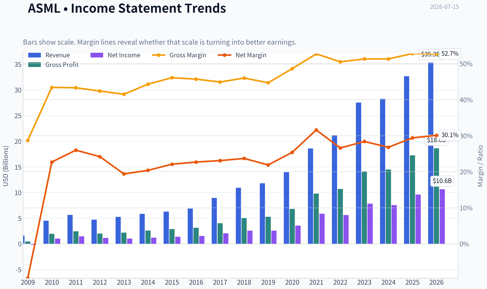

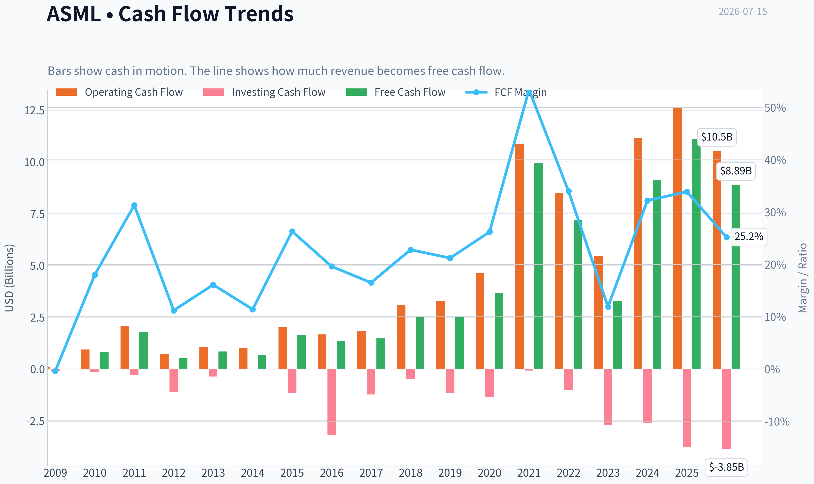

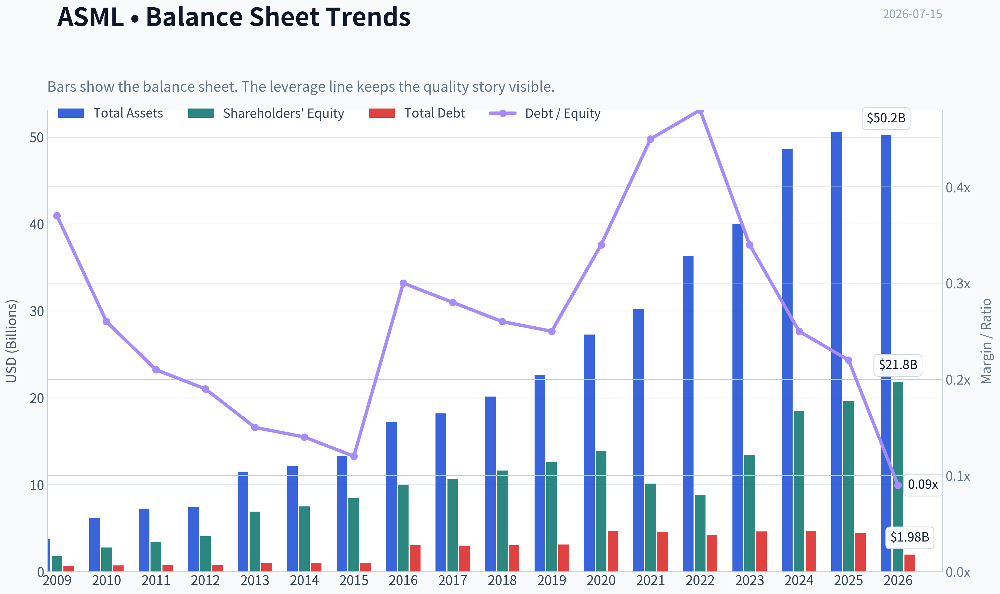

This graph tracks the profitability and return metrics (ROE, ROIC, Margins) of **ASML** over the past decade, highlighting capital efficiency trends.

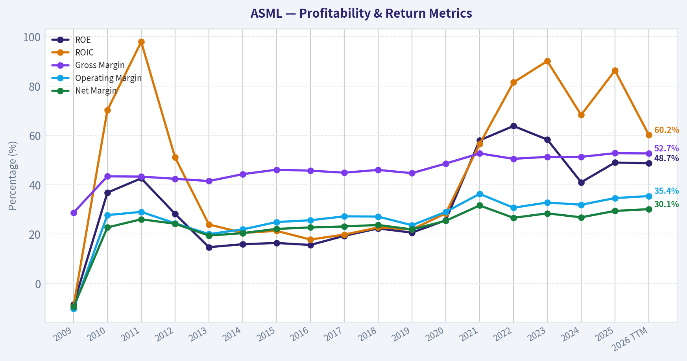

This chart illustrates the financial health of **ASML** over the last 10 years, mapping cash equivalents and free cash flow against total obligations (Debt).

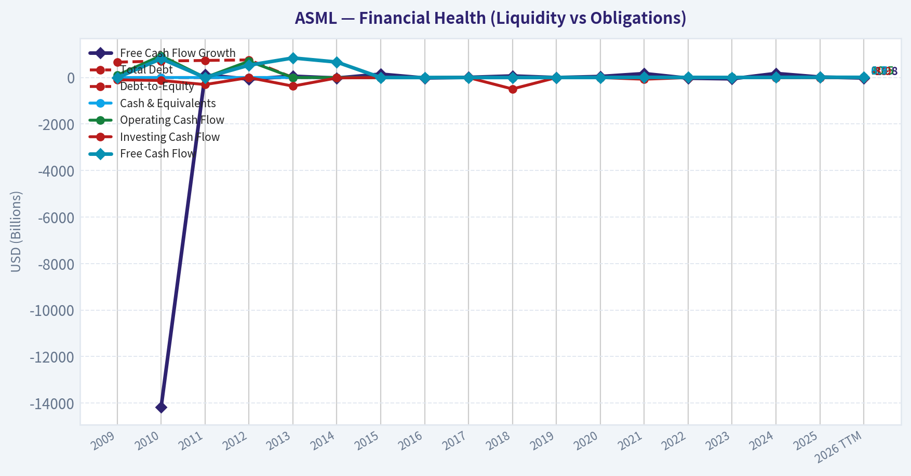

---

### Intrinsic Value Analysis (Buffett)

> *Following Warren Buffett's value investing philosophy: Circle of Competence, Economic Moat, Management Quality, and Margin of Safety.*

#### Intrinsic Value Snapshot

Price is what you pay. Intrinsic value is what the business may be worth based on the cash it can create for owners over time. We show a range, not one magic number.

- Current Price: $1,815.27
- Value Range (conservative to optimistic across both DCF methods): $136.05 to $2,164.99

##### Owner Earnings (Buffett Method)
- Net Income: $9,609,400,000.00
- Depreciation & Amortization: $1,025,900,000.00
- Capital Expenditures: $-1,573,600,000.00
- Working Capital Changes: $1,026,500,000.00
- Owner Earnings: $8,035,200,000.00

##### Intrinsic Value
###### Buffett Method
Uses owner earnings. Stricter, and usually more conservative.
- Conservative: $210.99
- Average: $651.63
- Optimistic: $1,342.17
- Discount Rate: 10.0%

###### Cash Flow Method
Uses free cash flow. Better for companies spending heavily today to grow tomorrow.
- Conservative: $136.05
- Average: $571.36
- Optimistic: $2,164.99
- Discount Rate: 10.0%

ANALYST STANCE: **WATCH**

#### ASML (ASML Holding) Buffett-Style Investment Review

#### 1. Go/No-Go Gate Assessment

| Gate | Verdict | Evidence |
|---|---|---|
| Circle of Competence & Simplicity | Pass | ASML sells lithography machines used by chipmakers to print circuits onto wafers. Its business is understandable: a few customers buy extremely expensive, mission-critical tools, plus service, upgrades, and installed-base support. |
| Long-Term Predictability | Pass | Ten years from now, advanced chips will still need increasingly precise patterning, and ASML is the key supplier in EUV and leading-edge lithography. Demand may be cyclical, but strategic relevance is highly predictable. |
| Technology Risk | Pass | ASML is enabled by technology rather than threatened by it. The bigger risk is execution and semiconductor capex cycles, not obsolescence by a simpler rival. |
| Moat Test | Pass | Gross margin around 52.8%, dominant position in EUV, deep customer integration, and enormous technical barriers strongly support a durable moat. |
| Management Quality | Pass | Management has historically balanced R&D investment, capacity expansion, and shareholder returns while preserving strong profitability and strategic control. |
| Industry Structure | Pass | This is a concentrated, high-barrier market with rational competition at the top end. Capital intensity is high, but industry structure is unusually favorable given ASML's near-monopoly position in critical tools. |

**Key Takeaways:**
ASML clears all four Buffett gates. The business is understandable, strategically essential, and protected by one of the strongest industrial moats in the world. The only major restraint is not business quality, but valuation.

---

#### 2. The Elementary School Test

ASML makes giant machines that help chip companies build tiny circuits on silicon wafers. The more advanced the chip, the more important ASML's machines become. Customers also pay ASML for service, maintenance, and upgrades after the machines are installed.

#### 3. Moat Analysis

| Moat Source | Assessment | Evidence |
|---|---|---|
| Intangible Assets | Very Strong | EUV leadership, deep know-how, decades of accumulated IP, and trusted strategic status with top chipmakers. |
| Switching Costs | Very Strong | Customers build fabs, workflows, process recipes, and yield optimization around ASML systems. Switching is operationally and economically painful. |
| Cost Advantage | Strong | Scale in R&D, supply-chain coordination, and installed base creates cost and capability advantages that are nearly impossible to replicate. |
| Network Effects | Moderate | Not a classic consumer network effect, but ecosystem scale matters: suppliers, software, service knowledge, and customer process learning reinforce leadership. |

**Moat Quality Rating: Wide & Widening**

| Moat Indicator | Current Reading |
|---|---:|
| Gross Margin | 52.8% |
| ROE | 49.0% |
| Competitive Position | Global leader; effectively irreplaceable in EUV |

**Key Takeaways:**
ASML's moat is real and exceptional. The strongest pillars are intangible assets, switching costs, and scale-based capability advantages. This is not just a good business; it is a strategic bottleneck business.

---

#### 4. Management Quality & Capital Allocation

| Question | Assessment | Commentary |
|---|---|---|
| Do they think like owners? | Generally Yes | Management has consistently favored long-cycle R&D leadership and capacity investment over short-term earnings optimization. |
| Are they honest and candid? | Mostly Yes | Communication has generally been direct about demand timing, customer node transitions, and cyclicality. |
| Are they rational capital allocators? | Yes | Capital has been directed toward technology leadership, supply-chain support, and shareholder returns without compromising the franchise. |

| Capital Allocation Area | View |
|---|---|
| R&D Spending | Excellent use of capital; essential to moat defense |
| Buybacks | Acceptable, but less compelling at elevated valuation |
| Dividends | Reasonable supplemental return of capital |
| Debt Usage | Appears manageable relative to business quality and cash generation |

**Key Takeaways:**
Management appears to behave like long-term franchise stewards rather than quarter-to-quarter operators. The strongest evidence is their willingness to keep investing heavily in technology leadership. At today's valuation, buybacks are less value-creative than reinvestment.

---

#### 5. Financial Summary

| Metric | Current / Recent |
|---|---:|
| Share Price | $1,815 |
| Market Cap | $697.25B |
| P/E | 60.25 |
| ROE | 49.0% |
| Gross Margin | 52.8% |
| Revenue Growth YoY | 15.6% |
| FCF Yield | 1.6% |
| Current Ratio | 1.26 |

**Key Takeaways:**
The operating quality is elite: high margins, high returns on equity, and continued growth. But the valuation is demanding, with a 60x earnings multiple and only a 1.6% free cash flow yield. That combination leaves little room for disappointment.

---

#### 6. Owner Earnings Assessment

Using Buffett's framework:

**Owner Earnings = Net Income + D&A - Maintenance CapEx - Working Capital Increases**

A precise audited owner-earnings build is best done from full annual statements, but the broad economic picture is clear:

- ASML converts a large share of accounting earnings into real cash.
- Service and installed-base revenue improve cash resilience.
- Maintenance capital needs are modest relative to the strategic value created by R&D.
- The main swing factor is working capital, especially around customer orders, inventory positioning, and supply-chain support.

**Qualitative conclusion:** Owner earnings are strong, but the stock price implies a very rich multiple of those owner earnings.

---

#### 7. Three-Scenario DCF Valuation

To anchor valuation, I use current market cap and yield signals as rough owner-earnings guides.

**Estimated owner earnings base:**
Using a 1.6% FCF yield on a $697.25B market cap implies normalized annual free cash flow / owner earnings of about **$11.2B**.

##### Scenario A: No Growth
Intrinsic Value = Owner Earnings / 10%
= $11.2B / 0.10
= **$112B**

##### Scenario B: GDP Growth (3%)
Intrinsic Value = Owner Earnings x 1.03 / (0.10 - 0.03)
= $11.2B x 1.03 / 0.07
= **$165B**

##### Scenario C: Historical Growth Haircut
ASML's recent growth is strong, but using a Buffett-style haircut, assume **8% growth** for 10 years, then 3% terminal growth.

Approximate value:
- PV of 10 years of owner earnings growth: **~$113B**
- PV of terminal value: **~$127B**
- Total intrinsic value: **~$240B**

| DCF Scenario | Intrinsic Value |
|---|---:|
| No Growth | $112B |
| 3% Growth | $165B |
| 8% Growth for 10 years, then 3% terminal | $240B |
| Current Market Cap | $697B |

**Key Takeaways:**
Across all three scenarios, ASML's market value sits far above conservative intrinsic value estimates. Even a favorable growth case does not justify the current capitalization using a 10% required return. This is a great business priced for extraordinary outcomes.

---

#### 8. Margin of Safety Analysis

| Item | Value |
|---|---:|
| Current Market Cap | $697B |
| Conservative IV Range | $112B-$165B |
| Optimistic IV | ~$240B |
| Margin of Safety vs Optimistic IV | Negative |
| Buffett Buy Threshold | Not met |

**Key Takeaways:**
There is no margin of safety here. In fact, the stock trades at a very large premium even to a generous appraisal. Buffett would admire the business but wait for a much better price.

---

#### 9. Final Buffett Scorecard

| Criterion | Weight | Score (1-5) | Weighted Score |
|---|---:|---:|---:|
| Business Understanding | 20% | 4.5 | 0.90 |
| Moat Width & Durability | 25% | 5.0 | 1.25 |
| Management Quality | 15% | 4.0 | 0.60 |
| Return on Equity | 15% | 5.0 | 0.75 |
| Reinvestment Runway | 10% | 4.5 | 0.45 |
| Balance Sheet Strength | 5% | 3.5 | 0.18 |
| Industry Structure | 5% | 4.5 | 0.23 |
| Valuation / Margin of Safety | 5% | 1.0 | 0.05 |
| **Total** | 100% |  | **4.41** |

**Key Takeaways:**
ASML scores like a wonderful business. The only weak area is valuation, and it is weak enough to change the practical investment stance. This is exactly the type of company to own only when price and value reconnect.

---

#### 10. Final Investment Stance

**Stance: WATCH**
**Conviction: High**

ASML is one of the best businesses in the global semiconductor ecosystem, possibly one of the strongest moated industrial companies anywhere. It has pricing power, customer captivity, technological leadership, and a central role in the future of computing.

But Buffett's discipline is not just about buying great businesses. It is about buying them at prices that still allow attractive long-term returns. At roughly 60x earnings and a 1.6% free cash flow yield, ASML looks like a superb company selling at an imprudent price.

**Bottom line:**
**Wonderful business, inadequate margin of safety. Watch it, don't chase it.**
#### Valuation Bridge

This bridge places the current market price beside each intrinsic value lens so readers can see whether upside depends on one method or shows up across several methods.

| Scenario | Intrinsic Value / Share |
| --- | ---: |
| Buffett Method | $651.63 |
| Cash Flow Method | $571.36 |
| Damodaran Method | $561.15 |
| Current Price | $1,815.27 |

#### Key Takeaways

If one method is far above the others, the upside case depends on a specific modelling assumption. When several methods cluster together, the valuation story is more robust.

#### Valuation Visuals

This comparison chart from *Latest Earnings Snapshot* stacks current figures against historical benchmarks for **ASML**, making it easy to see where the company trades relative to its own averages.

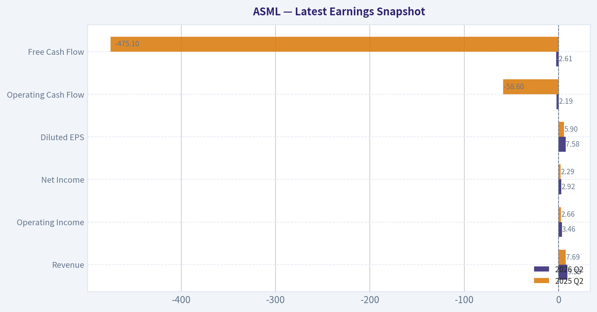

This comparison chart from *Current vs Historical Average Comparison* stacks current figures against historical benchmarks for **ASML**, making it easy to see where the company trades relative to its own averages.

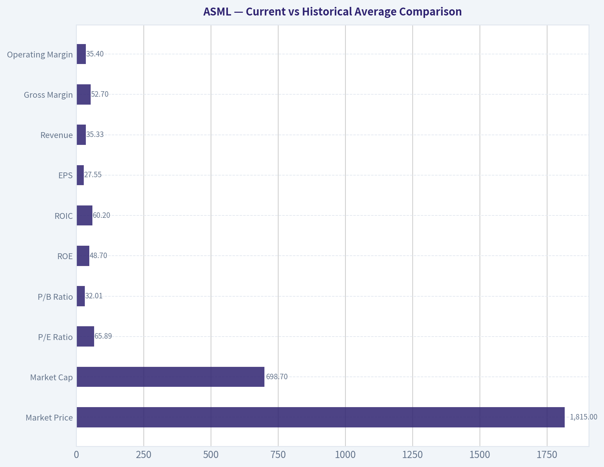

This comparison chart from *DCF Valuation - Buffett-Style Owner Earnings* stacks current figures against historical benchmarks for **ASML**, making it easy to see where the company trades relative to its own averages.

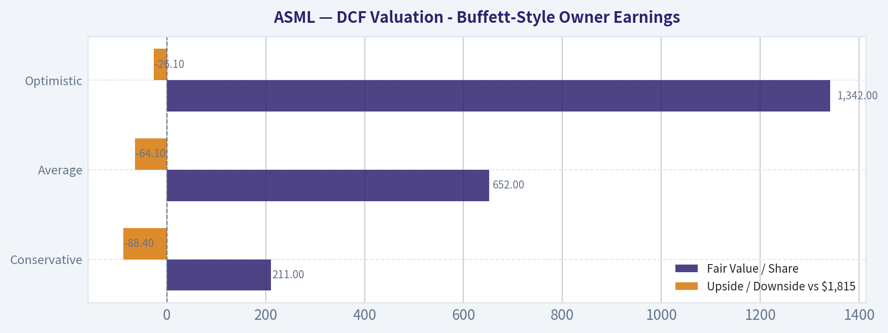

This comparison chart from *Moat Analysis* stacks current figures against historical benchmarks for **ASML**, making it easy to see where the company trades relative to its own averages.

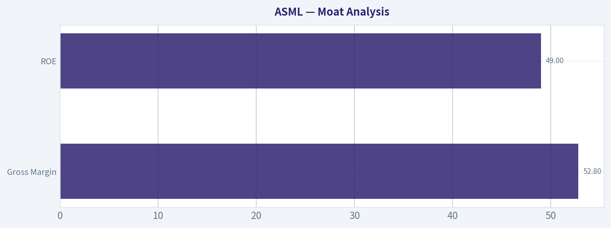

This comparison chart from *Financial Summary* stacks current figures against historical benchmarks for **ASML**, making it easy to see where the company trades relative to its own averages.

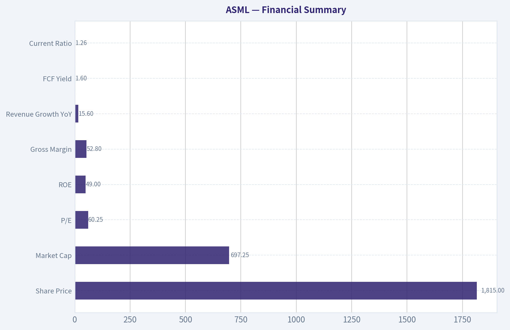

The following chart maps the **ASML** Owner Earnings DCF valuation scenarios (Conservative, Average, Optimistic) to visually represent the margin of safety based on intrinsic value calculations.

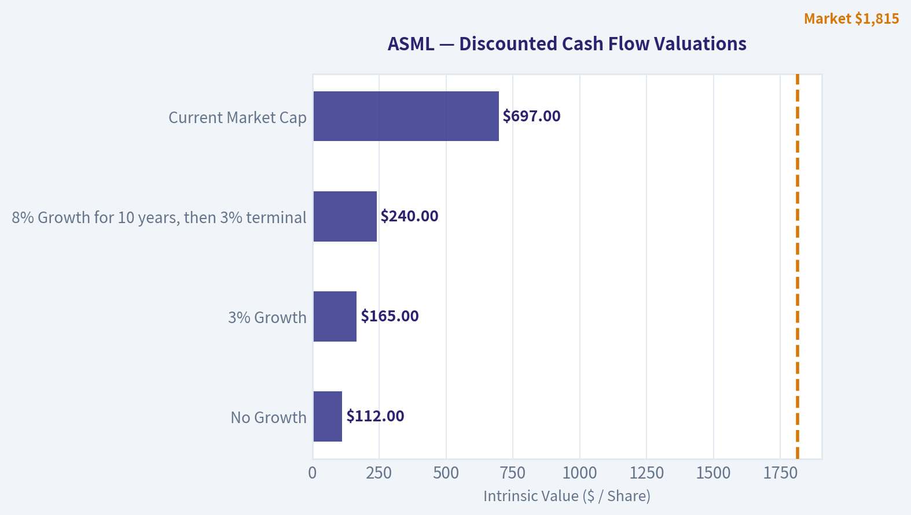

---

### Trend & Growth Analysis (Lynch/Druckenmiller/Fisher)

> *Following Peter Lynch's GARP, Stanley Druckenmiller's macro-aware approach, and Philip Fisher's scuttlebutt methodology.*

ANALYST STANCE: **WATCH**

#### 1. Lynch Classification

| Item | Assessment |
|---|---|
| Category | **Fast Grower / Quality Compounder** |
| Revenue growth | **15.6% YoY** |
| Why not stalwart? | Growth is still above mature large-cap industrial norms and tied to secular semiconductor capex cycles |
| Why not pure fast grower slam-dunk? | Growth is strong, but valuation already discounts a lot and the business is cyclical through customer capex |

**Key Takeaways:** ASML fits best as a fast grower, but with a cyclical overlay. It is not a slow, mature business; demand is driven by advanced chip manufacturing and a near-monopoly in extreme ultraviolet lithography. The catch is that even great semiconductor equipment companies can see lumpier order patterns than classic software compounders.

#### 2. The Story in 3 Bullets

| The Story | Why it matters |
|---|---|
| ASML sells the most advanced machines needed to manufacture cutting-edge semiconductors. | Without ASML's EUV and High-NA EUV tools, leading-edge chips are extremely hard to produce at scale. |
| AI, high-performance computing, and advanced memory all increase demand for more complex chips. | This expands demand for ASML's highest-value systems and service revenue. |
| The company has a deep technology moat, long customer relationships, and pricing power. | That supports durable margins and long-term growth even through short-term capex cycles. |

**Key Takeaways:** The simple version is that ASML is a toll collector on leading-edge chip production. As chip complexity rises, its machines become more essential, not less. That makes the long-term story compelling even if near-term memory and foundry spending fluctuate.

#### 3. TAM Analysis and 10x Test

| Metric | Value | Assessment |
|---|---:|---|
| Current revenue growth | 15.6% | Healthy secular growth |
| Market cap | $697.25B | Very large already |
| Current business scope | Leading-edge lithography + installed base services | Strong positioning |
| 10x test | **Fails in practical market-value terms** | A 10x revenue outcome from this base would imply an enormous share of total global wafer fab equipment and adjacent spend |
| Runway conclusion | **Large runway for continued growth, but not obvious 10-bagger from here** | Better framed as elite compounder than classic small-cap ten-bagger |

**Key Takeaways:** ASML still has room to grow because semiconductor complexity and capital intensity are rising. However, from today's very large scale and valuation, the classic Lynch-style 10-bagger setup looks unlikely. The opportunity is more about sustained compounding than explosive multi-bagger upside.

#### 4. Revenue Growth Trend

| Metric | Value | Read-through |
|---|---:|---|
| Revenue growth YoY | 15.6% | Solid, but not hypergrowth |
| Pattern | **Likely stable-to-moderate growth with cycle noise** | Not enough evidence here of sharp acceleration |
| Gross margin | 52.8% | Premium economics, indicates pricing power and product leadership |
| ROE | 49.0% | Exceptional capital efficiency |

**Key Takeaways:** The current picture shows a high-quality business with strong margins and returns on equity. Growth is healthy, but based on the data provided, there is not a clear revenue acceleration inflection right now. This looks more like durable secular growth layered on top of semiconductor cycle swings.

#### 5. Unit Economics

| Metric | Value | Assessment |
|---|---:|---|
| Gross margin | 52.8% | Excellent for capital equipment |
| FCF yield | 1.6% | Low, implies rich valuation |
| Current ratio | 1.26 | Adequate liquidity |
| Recurring/service component | Meaningful but not quantified here | Helps smooth cyclicality |
| LTV/CAC, NRR, Rule of 40 | **Not applicable / not disclosed in this dataset** | More relevant for SaaS than ASML |

**Key Takeaways:** ASML's unit economics are strong in the way that matters for this industry: high gross margins, strong returns, and a valuable installed base. The weak spot is not the business model but the valuation, as shown by the low free cash flow yield. This suggests investors are already paying heavily for quality and scarcity.

#### 6. Inflection Point Assessment

| Inflection type | Status | View |
|---|---|---|
| Product cycle inflection | **Yes** | High-NA EUV rollout is the most important long-term product catalyst |
| TAM inflection | **Yes** | AI and advanced packaging/memory complexity increase lithography intensity |
| Margin inflection | **Possible** | Premium tools and service mix can support margins, though ramp costs may offset near term |
| Market share inflection | **Already dominant** | Less about share gains, more about deepening wallet share per fab |
| Competitive inflection | **Favorable** | No true peer in EUV at the frontier |

**Key Takeaways:** The main inflection is technological, not competitive. ASML does not need to steal share in a crowded market; it needs the industry to keep moving to more advanced nodes, which drives demand for higher-value tools. High-NA EUV is the biggest reason the story can continue improving from an already strong base.

#### 7. Macro Setup Evaluation

| Macro factor | Current read | Impact on ASML |
|---|---|---|
| AI infrastructure buildout | Strong secular tailwind | Positive |
| Semiconductor capex cycle | Volatile | Mixed |
| Memory supply normalization | Near-term caution from recent coverage | Mild negative near term |
| Inflation/rates | Cooling inflation supports multiples | Positive |
| Geopolitics/export controls | Persistent risk | Negative overhang |

**Key Takeaways:** The macro backdrop is supportive overall because AI spending remains the dominant driver of advanced semiconductor demand. The biggest risks are not broad economic weakness, but capex digestion, geopolitics, and export restrictions. So the wind is at ASML's back structurally, though not perfectly in the next quarter or two.

#### 8. Fisher 15-Point Score

| Fisher Factor | Score (1-5) | Comment |
|---|---:|---|
| Market potential | 5 | Massive secular demand for advanced chips |
| New product development | 5 | High-NA EUV is a major innovation platform |
| R&D effectiveness | 5 | Best-in-class |
| Sales organization | 4 | Deep strategic customer relationships |
| Profit margin | 5 | Excellent |
| Improving margins | 4 | Strong, though cyclical mix can move margins |
| Labor/personnel relations | 3 | No strong data provided |
| Executive relations | 4 | Generally stable |
| Management depth | 4 | Strong engineering-led organization |
| Cost analysis/accounting | 4 | Historically solid |
| Outstanding moat | 5 | Unique technology and ecosystem moat |
| Long-range profit outlook | 5 | Strong secular demand |
| Dilution risk | 4 | Low relative risk |
| Candor | 4 | Generally credible disclosure |
| Integrity | 4 | No major red flags in provided data |

| Total | Score |
|---|---:|
| Fisher Score | **65 / 75** |

**Key Takeaways:** ASML scores at the high end of Fisher's framework because it combines innovation, market leadership, and durable long-term demand. The weakest areas are not strategic but informational, since we do not have fresh scuttlebutt-style evidence on culture and personnel. Overall, this is an outstanding business even if the stock may not be outstandingly priced.

#### 9. Valuation Analysis

| Metric | Value | Interpretation |
|---|---:|---|
| Price | $1,815 | - |
| P/E | 60.25x | Expensive on current earnings |
| Revenue growth | 15.6% | Solid but below multiple |
| PEG | **3.9x** | Expensive vs Lynch framework |
| FCF yield | 1.6% | Rich valuation |
| Market cap | $697.25B | Limits multiple expansion upside |

**Key Takeaways:** On classic Lynch valuation discipline, ASML screens expensive. The PEG ratio is far above the preferred range, which means investors are paying a premium well in excess of current growth. That does not make it a bad company, but it does reduce the margin of safety and future return potential from this entry point.

#### 10. Growth Investor Scorecard

| Criterion | Weight | Score (1-5) | Weighted Score |
|---|---:|---:|---:|
| The Story | 10% | 5.0 | 0.50 |
| TAM & Runway | 20% | 4.0 | 0.80 |
| Revenue Growth | 20% | 3.5 | 0.70 |
| Unit Economics | 15% | 4.5 | 0.68 |
| Competitive Position | 10% | 5.0 | 0.50 |
| Management Quality | 10% | 4.0 | 0.40 |
| Macro Setup | 5% | 4.0 | 0.20 |
| Profitability Path | 5% | 5.0 | 0.25 |
| Valuation | 5% | 1.5 | 0.08 |

| Result | Score |
|---|---:|
| Total Growth Score | **4.10 / 5.00** |

**Key Takeaways:** ASML scores very highly on business quality, strategic positioning, and long-term growth durability. The only real weak point is valuation, which is meaningful because it can cap returns even in a great business. That is why the stock earns a positive business score but only a WATCH stance at today's price.

#### 11. Position Size Stance

| Investor type | Stance | Position sizing thought |
|---|---|---|
| Existing long-term holder | **Hold / add only on pullbacks** | Core quality compounder |
| New growth investor | **WATCH** | Wait for better entry or stronger growth re-acceleration |
| Aggressive concentrated investor | **Small starter at most** | Only if willing to underwrite premium valuation and cycle noise |

**Key Takeaways:** The right framing is not "avoid forever," but "be selective on price." Existing owners likely should not rush to sell a uniquely advantaged business. New buyers, however, are better served waiting for either a valuation reset or clearer evidence of another growth acceleration phase.

#### 12. Key Risks and Catalysts

| Risks | Catalysts |
|---|---|
| Semiconductor capex digestion | High-NA EUV adoption ramps faster than expected |
| Memory/foundry order volatility | AI-driven leading-edge demand stays stronger for longer |
| Export controls / geopolitics | Margin upside from premium mix and service growth |
| Valuation compression | Better-than-feared bookings and backlog conversion |
| Customer concentration among top chipmakers | Broader advanced logic and memory node migration |

**Key Takeaways:** The major downside risks are cyclical order timing, geopolitics, and simple multiple compression from a high starting valuation. The biggest upside catalysts are tied to technology adoption, especially High-NA EUV, and a stronger-than-expected AI semiconductor investment cycle. In short, the business can outperform while the stock still needs the right setup to work well.

#### Bottom Line

| Final view | Conclusion |
|---|---|
| Business quality | Elite |
| Inflection point | Real, via High-NA EUV and AI-driven lithography intensity |
| Valuation | Too rich for high-conviction fresh buying |
| Stance | **WATCH** |

**Key Takeaways:** ASML is one of the highest-quality strategic assets in global technology, with a moat few companies can match. But at roughly 60 times earnings and a near-4 PEG, much of that quality is already reflected in the price. I would treat ASML as a premium watchlist name or a hold, rather than a full-throated new-money advocate today.

---

### Market Technical Analysis

#### ASML Technical Snapshot

ASML remains in a **strong long-term uptrend**, but the **short-term structure has cooled materially** after an explosive May-June advance. The stock peaked near the end of June, then entered a pullback/consolidation phase through early-to-mid July. That leaves the chart in an important state: **the primary trend is still bullish, while short-term momentum is still repairing**.

For this market context, the most relevant and complementary indicators are:

- `close_10_ema`
- `close_50_sma`
- `close_200_sma`
- `macd`
- `macdh`
- `rsi`
- `atr`
- `vwma`

These eight work well together because they cover:
- **short-term trend**: `close_10_ema`
- **medium-term trend/support**: `close_50_sma`
- **long-term trend regime**: `close_200_sma`
- **momentum direction**: `macd`
- **momentum acceleration/deceleration**: `macdh`
- **overbought/oversold balance**: `rsi`
- **risk/volatility sizing**: `atr`
- **volume-confirmed trend quality**: `vwma`

---

#### Trend Structure Analysis

Over the past year, ASML has staged a very large advance from the mid-$700s in mid-2025 to a peak just under $2,000 in late June 2026. That is not a random rise; it shows a sequence of trend legs:

1. **July-August 2025 collapse and stabilization**
   The stock suffered a sharp gap-down reset in mid-July 2025, then based in the high-$600s to mid-$700s.

2. **September 2025 to January 2026 breakout phase**
   Price transitioned from recovery into a forceful breakout trend, moving above prior resistance and pushing through the $1,000 and then $1,200-$1,400 areas.

3. **February-April 2026 digestion phase**
   There was notable volatility and a broad consolidation/pullback. Importantly, that phase did not destroy the long-term uptrend; it refreshed it.

4. **May-June 2026 trend acceleration**
   This was the strongest momentum leg of the year. Price climbed from roughly the low-$1400s into the $1900-$2000 zone, accompanied by rising trend measures and strong momentum readings.

5. **Late June-July 2026 pullback/consolidation**
   After the near-$2,000 test, price rotated lower into the mid-$1700s. This appears more like a **sharp cooling phase within a larger uptrend** than a confirmed long-term trend reversal.

The key distinction for traders is that ASML is **not behaving like a stock in structural decline**. It is behaving like a strong leader that became extended, then corrected sharply enough to damage short-term momentum while keeping the longer-term trend intact.

---

#### Moving Average Regime

The moving averages are decisively bullish in a multi-timeframe sense:

| Indicator | Latest Value | Interpretation |
|---|---:|---|
| Close (last available 2026-07-14) | 1775.64 | Current price is in pullback mode versus recent highs |
| `close_10_ema` | 1789.84 on 2026-07-14; 1794.46 on 2026-07-15 calc | Short-term trend has flattened to lower |
| `close_50_sma` | 1696.65 on 2026-07-14 | Medium-term trend still rising strongly |
| `close_200_sma` | 1341.79 on 2026-07-14 | Long-term trend remains firmly bullish |
| `vwma` | 1814.67 on 2026-07-14 | Price sits below volume-weighted trend benchmark |

Key Takeaways: ASML is still above both its 50-day and 200-day averages, which confirms the broader uptrend is intact. However, price is now below the 10-day EMA and below the VWMA, showing that near-term control has shifted away from buyers. This combination usually describes a bullish stock undergoing a short-term reset rather than a fully broken chart.

Nuanced read:
- The **10 EMA is falling** from above 1850 in early July to around 1790 by July 14, showing short-term sellers still have influence.
- The **50 SMA is still rising steadily**, from around 1400 in late April to nearly 1700 in mid-July. That slope matters: medium-term demand remains healthy.
- The **200 SMA is rising sharply**, now above 1340, confirming the stock remains in a structurally strong bull regime.
- The spread between the 50 SMA and 200 SMA is very wide, which usually reflects a mature bullish trend rather than an early breakout. Mature trends can continue, but they often require longer consolidation periods after vertical advances.
- Price being **below VWMA** suggests that the recent pullback has occurred with enough volume influence to weaken immediate upside traction.

The most practical chart level from this cluster is the **50-day SMA near 1704**. If ASML continues drifting lower, that zone becomes the first major trend-support test. A clean hold there would favor the "bullish consolidation" view. A decisive break below it would imply a deeper mean reversion is underway.

---

#### Momentum Analysis: MACD and MACD Histogram

Momentum remains positive in absolute terms but has weakened sharply.

| Indicator | Recent Reading | Message |
|---|---:|---|
| `macd` | 16.35 on 2026-07-15 | Still positive, but much lower than late-June levels |
| `macdh` | -15.59 on 2026-07-15 | Momentum is below signal line; downside pressure still present |
| Peak recent `macd` zone | ~97 in late June | Prior upside impulse was very strong |
| Recent `macdh` trend | Negative since late June/early July | Momentum deceleration persists |

Key Takeaways: The MACD line is still above zero, which means the bigger trend has not fully rolled over. But the histogram remains negative, telling us momentum is still weaker than its own recent average. In plain terms, the rally engine has not fully turned bearish, but it has clearly lost thrust.

Important nuance:
- A **positive MACD with negative histogram** is often the signature of a stock in pullback within an uptrend.
- The issue is not merely that momentum is weaker; it is that momentum collapsed from extremely elevated levels near the June peak. That means the stock may need time, not just one bounce day, to rebuild upside energy.
- The histogram has improved slightly from more negative readings around July 13-14, but it is still negative enough that traders should avoid assuming a clean momentum reversal is already confirmed.
- If price rebounds while `macdh` becomes less negative and then turns positive, that would be a higher-quality re-entry signal than price strength alone.
- If `macd` keeps falling toward zero while price loses the 50-day SMA, the correction would start looking less like a pause and more like a medium-term trend deterioration.

So the momentum picture is best described as **bullish regime, bearish short-term impulse**.

---

#### RSI Condition

RSI has normalized significantly.

| Date Context | `rsi` | Interpretation |
|---|---:|---|
| Mid-June strength | Mid-to-high 60s | Strong bullish momentum, nearing overbought |
| 2026-06-30 | 63.80 | Still constructive after the surge |
| 2026-07-13 | 46.84 | Pullback brought momentum near neutral-to-soft |
| 2026-07-14 | 50.05 | Slight stabilization |
| 2026-07-15 | 52.52 | Mild recovery, but not strong thrust |

Key Takeaways: RSI is no longer overbought, which removes one of the biggest headwinds created by the June surge. But it is also not showing powerful renewed momentum yet. The stock has moved from overheated to neutral, which is healthier for the bigger picture but not enough by itself to signal a fresh breakout.

This is a subtle but useful setup:
- In June, RSI readings in the mid-to-high 60s reflected strong directional buying.
- The recent drop toward the upper 40s/low 50s means that **excess froth has been worked off**.
- That is constructive for swing bulls if price starts holding higher lows.
- However, RSI around 50 is a **balance point**, not a strong edge. It says the market is undecided in the short run.

If RSI can push sustainably back through the mid-50s into the 60 area while price retakes the 10 EMA and VWMA, that would strengthen the case for another leg up. If RSI slips back under 45 while price tests the 50-day SMA, caution rises.

---

#### Volatility and Risk: ATR

ATR has risen dramatically over the last two months.

| Period | `atr` Approx. | Interpretation |
|---|---:|---|
| Late April | ~57-59 | More moderate movement |
| Late May | ~63-65 | Volatility rising with trend |
| Mid-June | ~82-86 | Larger daily swings during breakout |
| Early-to-mid July | ~89-97 | Elevated volatility remains in place |
| 2026-07-15 | 89.11 | Still high even after some cooling |

Key Takeaways: ASML is a high-volatility name right now, with daily ranges still far larger than they were in spring. That means traders should expect wider swings, looser stops, and more noise around support and resistance. A normal move in this stock is large enough to shake out positions that are sized too aggressively.

This matters a lot for execution:
- A stock with ATR near 89 can move roughly 5% in a routine swing around current price levels.
- That means tight stops just below obvious levels are more vulnerable to being hit.
- Elevated ATR also means breakouts need stronger confirmation, because false moves can be larger.
- For position traders, the reward can still be attractive, but **position sizing should be smaller than usual** if risk per trade is being held constant.

In other words, ASML may still be attractive directionally, but it is **not forgiving** operationally.

---

#### Volume-Weighted Read: VWMA

VWMA gives a useful filter here because ASML's recent advance and pullback both came with meaningful participation.

Price on July 14 closed at **1775.64**, while `vwma` was **1814.67**. That gap suggests:
- recent higher-volume trading has occurred at prices above the current close,
- the stock is presently trading beneath an important volume-informed trend reference,
- buyers have not yet fully regained control on a participation-adjusted basis.

That does not invalidate the bullish longer-term trend. It simply says that **the most recent meaningful volume has not yet endorsed the latest bounce attempt**.

For traders, this is especially useful:
- **Bullish confirmation**: price retakes and holds above VWMA with improving MACD histogram
- **Caution signal**: price repeatedly fails at or below VWMA, implying rallies are still being sold

---

#### What Traders Should Watch Next

The chart is at an inflection point between **healthy consolidation** and **deeper retracement**.

**Bullish scenario**
- Price reclaims the `close_10_ema` and then `vwma`
- `macdh` trends upward toward zero and turns positive
- RSI holds above 50 and pushes toward 55-60
- The `close_50_sma` continues rising underneath price, acting as untested support

Under this path, the late-June selloff would increasingly look like a normal reset after an overextended rally.

**Cautious / bearish swing scenario**
- Price remains trapped below `close_10_ema` and `vwma`
- `macd` continues to compress lower
- RSI falls back below the mid-40s
- Price drifts toward the `close_50_sma` near 1704 and struggles to hold it

That would indicate the pullback is not finished and may need a broader base before the trend can resume.

**Strategic trend investor view**
- As long as price remains well above the `close_200_sma`, the long-term trend argument remains favorable.
- But the stock is far above the 200-day average, so chasing weakness recovery too early can still be costly if a medium-depth correction unfolds.

---

#### Bottom Line

ASML is still a **long-term bullish stock**, supported by a strongly rising 50-day and 200-day moving average. However, the **short-term tape is not yet fully repaired**: price is below the 10-day EMA and VWMA, MACD momentum has decelerated sharply, and the MACD histogram remains negative.

The most likely near-term interpretation is:
- **primary uptrend intact**
- **short-term pullback/consolidation ongoing**
- **better confirmation needed before treating the current action as a fresh breakout setup**

For swing traders, patience may offer better odds than anticipation. For trend followers, the 50-day SMA is the key line to monitor. For risk managers, the elevated ATR means discipline on position size matters more than usual.

---

#### Key Summary Table

| Area | Indicator(s) | Current Read | Trading Implication |
|---|---|---|---|
| Long-term trend | `close_200_sma` | Rising strongly, price far above it | Structural bull trend remains intact |
| Medium-term trend | `close_50_sma` | Rising near 1704 | First major support zone in a deeper pullback |
| Short-term trend | `close_10_ema` | Falling near 1794 | Near-term momentum still soft |
| Volume confirmation | `vwma` | Near 1815, above current price | Recent volume does not yet confirm rebound |
| Momentum direction | `macd` | Positive but falling | Uptrend still alive, but momentum has cooled |
| Momentum acceleration | `macdh` | Negative | Sellers still control short-term momentum |
| Momentum balance | `rsi` | Around 50-53 | Neutral, no longer overbought, but not powerful |
| Risk/volatility | `atr` | ~89 | Large daily swings; use wider stops/smaller size |
| Overall stance | Combined view | Bullish long-term, cautious short-term | Favor confirmation over chasing |

Key Takeaways: ASML still looks strong on a long-term basis, but its short-term behavior remains fragile after a sharp pullback from late-June highs. The stock needs to reclaim key short-term averages and show improving momentum before the bullish case becomes tactical again. Until then, the 50-day moving average is the most important support to watch.

---

### Options Market Analysis

> *Reading options flow - put/call ratios, IV skew, and unusual activity - to gauge institutional positioning and event-driven risk.*

#### ASML Options Positioning Report
*Date: 2026-07-15*

ASML's near-term options tape leans **slightly bearish to cautious**, mainly because **put volume is running above call volume** and the weekly expiries show **heavier short-dated downside activity** than the aggregate open-interest picture alone would suggest. That said, confidence is only **moderate-to-low** because the reported open interest is fairly thin in some expiries, which can distort ratios and make the signal noisier than for ultra-liquid names.

#### Put/Call Ratio Analysis

| Expiration | Call OI | Put OI | Put/Call OI Ratio | Call Vol | Put Vol | Put/Call Vol Ratio |
|---|---:|---:|---:|---:|---:|---:|
| 2026-07-17 | 70 | 14 | 0.20 | 12,995 | 15,652 | 1.20 |
| 2026-07-24 | 94 | 100 | 1.06 | 2,770 | 2,314 | 0.84 |
| 2026-07-31 | 2 | 6 | 3.00 | 702 | 1,046 | 1.49 |
| **Near-term total** | **166** | **120** | **0.72** | **16,467** | **19,012** | **1.15** |

**Key Takeaways:**
The aggregate **put/call OI ratio of 0.72** is almost exactly at the historical neutral baseline, so the stock is not showing a strong legacy positioning bias in open interest. However, **put volume is higher than call volume at 1.15**, which points to a more defensive or bearish **fresh-flow** tone in the very near term. The front weekly expiry is especially notable: despite low put OI, traders are actively transacting more puts than calls, suggesting short-dated hedging demand.

**Interpretation**
- **OI ratio = 0.72:** broadly neutral versus the ~0.7 baseline.
- **Volume ratio = 1.15:** modestly bearish/cautious, since new activity is skewing toward puts.
- **Shift from neutral:** the important shift is not in existing positioning, but in **current flow**, which is leaning more defensive than the standing OI structure suggests.

#### Implied Volatility Assessment

| Expiration | ATM Call IV | ATM Put IV | ATM IV Bias | Read |
|---|---:|---:|---|---|
| 2026-07-17 | 4.8% | 2.3% | Call IV > Put IV | Upside premium in front week |
| 2026-07-24 | 1.5% | 2.0% | Put IV > Call IV | Mild downside skew |
| 2026-07-31 | 1.2% | 1.4% | Put IV > Call IV | Mild downside skew |

**Key Takeaways:**
The IV picture is unusual: the **front expiry shows call IV above put IV**, while the following two expiries revert to a more typical **put-over-call skew**. That suggests some very short-dated upside pricing or event-specific call demand, but the broader near-term term structure still carries a **mild downside hedge bias**.

**IV and skew interpretation**
- **Near-term ATM IV levels** do **not** look especially elevated on the data provided.
- The **07/17 expiry** has a notable **call-side premium**, which can imply:
  - upside speculation,
  - call overwriting distortions,
  - or event-driven demand for immediate upside optionality.
- The **07/24 and 07/31 expiries** show the more standard **put skew**, implying some downside concern beyond the immediate front week.
- Because no explicit catalyst schedule was provided in the data output, I can only say: **there is not strong evidence here of aggressively elevated IV ahead of a major known catalyst**. If ASML earnings or sector news is imminent, then the front-week call premium may reflect that.

#### Unusual Options Activity

| Screen Result | Observation |
|---|---|
| Volume > 5x OI contracts | None flagged in near-term expirations |

**Key Takeaways:**
There were **no contracts flagged with volume greater than 5x open interest**, which means there is **no clear standout "smart-money" contract** from the supplied near-term data. That reduces conviction in any aggressive directional read, because the market is not showing a single obvious large fresh bet.

**Interpretation**
- No strong evidence of a concentrated institutional sweep or block-style directional trade in the near-term expiries.
- The bearish/cautious tone comes more from **aggregate put-heavy volume**, not from a single high-conviction unusual contract.
- This makes the signal **broader but less forceful**.

#### Open Interest Concentration

| Expiration | Dominant OI Feature | Potential Interpretation |
|---|---|---|
| 2026-07-17 | Calls dominate OI (70 vs 14 puts) | Existing positioning leans call-heavy, but live flow is more defensive |
| 2026-07-24 | Balanced OI (94 calls vs 100 puts) | Possible pinning influence if spot trades near active strikes |
| 2026-07-31 | Very low OI overall (2 calls vs 6 puts) | Too thin for strong inference |

**Key Takeaways:**
The OI distribution does **not** show a strong, obvious gamma wall from the data provided because strike-level concentrations were not included. What we can say is that **07/24 appears the most balanced and potentially most relevant expiry for pinning effects**, while **07/17 has heavy trading activity but not a matching put OI base**, hinting at short-dated hedges rather than entrenched bearish positioning.

**Interpretation**
- Since strike-by-strike OI was not supplied, we cannot identify exact **pin levels**, **max pain**, or hard **gamma walls**.
- The most relevant "gravitational" expiry appears to be **2026-07-24**, where call and put OI are nearly balanced.
- **2026-07-17** could still produce outsized short-term movement because of very large volume, but the low OI base suggests more transient flow than durable positioning.
- **2026-07-31** is too illiquid/thin to carry much informational value.

#### Overall Options Sentiment Signal

**Signal: BEARISH (modest conviction)**

**Why**
1. **Put volume exceeds call volume overall (1.15)**, indicating fresh downside hedging or bearish speculation.
2. The **aggregate OI ratio is neutral (0.72)**, so the bearishness comes from **recent flow**, not established long-term positioning.
3. **Later near-term expiries show put-over-call IV**, reinforcing a mild downside-protection bias.
4. Lack of unusual contract activity means this is **not a high-conviction institutional stampede**, just a **measured defensive lean**.

**Caveats**
- Options OI is relatively thin in parts of the chain, especially 07/31, so confidence is lower than for mega-liquid names.
- The front expiry's **call IV premium** softens the bearish conclusion slightly and suggests some demand for upside optionality.
- Net result: not aggressively bearish, but **the tape currently favors caution rather than upside chase**.

#### Bottom Line

ASML's options market is sending a **cautiously bearish near-term signal**. The strongest evidence is the **put-heavy trading flow**, while open interest remains basically neutral. In plain English: traders are **adding more downside exposure or protection right now**, even though the longer-standing near-term positioning has not yet fully shifted bearish.

#### Summary Table

| Category | Reading | Interpretation |
|---|---|---|
| Put/Call Ratio | OI ratio **0.72**; volume ratio **1.15** | OI neutral, but fresh trading flow leans bearish/cautious |
| IV Level | ATM IV not obviously elevated | No clear sign of a major volatility panic |
| Skew Direction | Front week call-skewed; later weeks mild put skew | Immediate upside optionality demand, but broader near-term downside caution |
| Unusual Activity | None flagged (>5x OI) | No obvious high-conviction standout institutional contract |
| Overall Signal | **BEARISH** | Primary driver is **put-heavy near-term flow**, with only moderate conviction due to thin OI and lack of standout unusual trades |

---

## Research Team Commentary

> *The Research Manager synthesizes the Bull vs Bear debate into action-free commentary. This is a pre-risk view, not the final stance.*

The strongest bull argument is straightforward and compelling: ASML is one of the rarest moat businesses in the world. Its near-monopoly in EUV, likely strengthening position in High-NA, deep customer dependence, elite returns on capital, and real cash generation make it exactly the kind of business Buffett would admire. This is not a commodity chip-equipment vendor. It is a strategic bottleneck to advanced semiconductor progress, and that matters over a 10-year horizon far more than quarter-to-quarter order noise. The installed base and service revenue also make the earnings stream somewhat more resilient than a typical capital-equipment company.

The strongest bear argument is equally important: wonderful business does not automatically mean wonderful investment. At roughly 60x earnings, the market is already capitalizing years of exceptional execution. That leaves little margin of safety. ASML remains exposed to foundry and memory capex timing, a small handful of giant customers, export controls, and the reality that even monopoly-like semicap businesses can have lumpy order patterns. The key Buffett objection is not business quality but price versus predictability. This is a premium asset, but the current valuation asks investors to underwrite continued excellence with limited room for disappointment.

My takeaway is that the bull clearly wins on business quality, but the bear wins on value discipline. Past mistakes here matter. The lesson is not to use rigid DCF math to argue that ASML is "worth far less" in a simplistic way, because scarcity assets can sustain premium multiples for long periods. But the opposite mistake would be to let admiration for the moat erase the need for a margin of safety. I think the right synthesis is: exceptional business, mediocre current entry.

So my stance is WATCH.

Core takeaway: ASML remains one of the highest-quality industrial technology franchises in the world, and its long-term intrinsic value is likely to keep compounding, but the present stock price already reflects much of that quality. For a Buffett-style value portfolio, this is not an obvious buy today because the margin of safety is too thin relative to the business's cyclical and geopolitical exposures.

Why that leads me there: From a value-investing perspective, ASML passes the business-quality test easily. The moat is real, management appears rational, returns on capital are extraordinary, and cash conversion is strong. Those are rare traits. But Buffett's discipline is about buying great businesses at prices that allow attractive long-term returns even if some assumptions go wrong. Here, the market seems to assume durable high growth, successful High-NA ramp, continued pricing power, and no major geopolitical impairment. Maybe those things happen. But when the valuation is this elevated, you do not need the business to fail for the investment return to disappoint. You just need reality to be slightly less perfect than the price implies. That is the central issue.

I also want to incorporate the lesson from prior ASML mistakes. I should not confuse "too expensive for a strict value purchase" with "bad company" or "must fall soon." Premium monopoly assets can remain expensive and still work. So the right stance is not AVOID in the sense of calling the business flawed. It is WATCH in the sense of waiting for either a better entry, a period of earnings growth that catches up to the multiple, or a clearer setup where valuation risk is less dominant.

What I'd monitor over the next 1 to 4 quarters is pretty concrete. First, bookings quality and customer commentary: are TSMC, Samsung, and Intel sustaining advanced-node capex plans, or does timing start slipping? Second, High-NA adoption: not just technical milestones, but whether customers are deploying it in a way that supports durable economic returns. Third, gross margin and service mix: if margins remain firm and installed-base revenue keeps expanding, that strengthens the resilience argument. Fourth, export-control developments: the market may be too casual if geopolitical restrictions broaden meaningfully. Fifth, valuation versus earnings revisions: if earnings estimates keep rising fast enough, today's expensive multiple can normalize without a pullback; if estimates stall, the stock becomes more vulnerable. And finally, I would watch the stock setup itself, because with names like this, entry quality matters a lot. A meaningful pullback without business deterioration, or a fresh base followed by estimate upgrades, would improve the risk-reward.

What would strengthen the thesis enough to move more constructive? A better price, sustained order visibility from leading-edge customers, credible High-NA monetization, and evidence that service revenue is making cash flows less volatile than bears expect. What would weaken it? Order slippage, margin compression, broader export restrictions, or signs that customers are becoming more cautious on advanced-node ROI.

Bottom line: ASML is still a business I would like to own, just not one I feel compelled to buy aggressively at this valuation. In Buffett terms, it looks more like a wonderful company awaiting a better pitch than a fat-pitch bargain today.

WATCH

---

## Value Investing Team Commentary

> *The Investor translates the research view into an investment thesis before risk review. This is still not the final stance.*

ASML is exactly the sort of business a long-term owner wants to study carefully: mission-critical, hard to replicate, deeply embedded with a few indispensable customers, and protected by one of the strongest industrial technology moats in the world. If you strip away the ticker symbol and imagine buying the whole company, the qualitative case is obvious. ASML sits at a strategic choke point in advanced semiconductor manufacturing. EUV is not just a good product line; it is a capability the leading edge of the industry increasingly cannot function without. High-NA likely deepens that dependence if execution continues. On business quality alone, this is an exceptional franchise.

The economics support that view. ROE near 49%, ROIC around 83.9%, ROA of 19%, and gross margin above 52% are not the numbers of an ordinary capital equipment company. They indicate pricing power, customer dependence, efficient capital deployment, and a very high-value position in the ecosystem. The added point from the value analyst is important: this is not low-quality accounting profit. ASML converts earnings into cash, and the service/installed-base component gives the model more resilience than a purely transactional equipment vendor. That matters because it softens, though does not eliminate, cyclicality.

Now the key Buffett question: how much of this excellence is already in the price? At roughly 60x earnings, the market is not offering a bargain. It is asking you to prepay for years of continued superiority. That is where discipline matters. A great business can still be a mediocre investment if bought at too optimistic a price. The bear case here is not that ASML loses its moat. The bear case is that the current valuation leaves limited room for normal frictions: delayed foundry capex, a slower-than-hoped High-NA ramp, customer digestion periods, export-control tightening, or simply a few quarters where reality is good rather than perfect.

Selective contrarian thinking is useful here because sentiment around ASML often swings between awe and anxiety. When headlines praise AI, leading-edge logic, and semiconductor sovereignty, investors can treat ASML as untouchable royalty and ignore valuation. That is dangerous. A monopoly-like business is still exposed to timing risk when a few giant customers drive spending. On the other hand, when the market gets temporarily nervous about orders, geopolitics, or semicap cyclicality, it can create opportunity precisely because the underlying moat usually changes much less than the headline tone suggests. So the right contrarian posture is not "buy because sentiment is fearful" or "avoid because the stock is expensive." It is to ask whether current fears are temporary and whether current optimism has outrun realistic long-term economics.

What is the market possibly missing today? Two things, one on each side. First, bulls may underappreciate how much the current multiple depends on sustained confidence, not just solid operations. A small disappointment can compress the multiple even if the business remains first-rate. Second, bears may underappreciate how rare this asset is. Scarcity businesses with genuine technological lock-in can remain expensive for long periods because their intrinsic value compounds faster than conventional models assume. That is why rigid "it must fall because the P/E is high" thinking has been a mistake before.

So the correct synthesis is: wonderful business, but still a price-sensitive proposition. For a Buffett-style portfolio, the hurdle is not whether ASML is admirable. It clearly is. The hurdle is whether buying today gives enough margin of safety for a 5-10 year owner. At this valuation, I do not think that cushion is wide enough. I would be interested on a material pullback without business deterioration, or after a period where earnings growth catches up and de-risks the multiple. I would also become more constructive if order visibility improved meaningfully and High-NA monetization became more clearly durable.

What to watch over the next several quarters is straightforward:
- leading-edge customer capex intentions at TSMC, Samsung, and Intel
- booking quality, not just headline bookings
- service revenue mix and margin stability
- export-control developments
- evidence that High-NA expands economic moat without eroding returns
- whether earnings revisions continue rising fast enough to justify the premium

If temporary fear hits this stock on normal semicap lumpiness while the moat remains intact, that could become the opportunity. If enthusiasm stays high while fundamentals merely meet expectations, returns may disappoint despite a great business.

**ANALYST STANCE: WATCH**
ASML is a rare, high-quality compounding franchise with a formidable moat and excellent management economics, but the current valuation appears to offer too little margin of safety for a disciplined value investor. I would prefer to wait for either a better entry price or stronger evidence that earnings growth is catching up to the premium multiple.

---

## Deep Values Commentary

> *The Risk Management Team debates and the Risk Judge provides the final action-free verdict. This section determines the final ADVOCATE / WATCH / AVOID stance.*

#### Final Stance Scorecard

This scorecard converts the final research view into a weighted decision frame. It does not replace the narrative judgement, but it makes the main drivers of the verdict easier to scan.

| Criterion | Score | Weight | Commentary |
| --- | ---: | ---: | --- |
| Business Quality | 4.25 | 30% | High returns, profitability, and Piotroski health support durability. |
| Valuation Support | 1.33 | 30% | Blends current price against available intrinsic value anchors and valuation ratios. |
| Financial Strength | 3.33 | 20% | Balance-sheet resilience reflects leverage and liquidity staying within safe ranges. |
| Growth Durability | 4.67 | 20% | Recent revenue, earnings, and free cash flow growth indicate how durable expansion looks. |
| TOTAL / FINAL STANCE | 3.27 | 100% | WATCH |

#### Key Takeaways

The weighted score lands at **3.27 / 5.0**, while the final stance remains **WATCH**. This is useful as a quick calibration aid rather than a mechanical signal.

#### Risk Summary

Higher scores indicate more risk pressure. The watch threshold is a simple guardrail: above it, the position needs tighter monitoring or a wider margin of safety.

| Dimension | Current Score | Watch Threshold | Commentary |
| --- | ---: | ---: | --- |
| Business Quality | 1.75 | 3.00 | High returns, profitability, and Piotroski health support durability. |
| Valuation Support | 4.67 | 3.00 | Blends current price against available intrinsic value anchors and valuation ratios. |
| Financial Strength | 2.67 | 3.00 | Balance-sheet resilience reflects leverage and liquidity staying within safe ranges. |
| Growth Durability | 1.33 | 3.00 | Recent revenue, earnings, and free cash flow growth indicate how durable expansion looks. |

#### Key Takeaways

This view helps readers separate *where* the risk sits: valuation, business quality, balance sheet, or growth durability. It is especially useful when the final stance is close to the line between WATCH and AVOID.
