# ASML Deep Value Intelligence

**Analysis Date:** 2026-11-22

## Critical Disclaimer

*This analysis is generated by Deep Value Intelligence, an AI-powered multi-agent investing framework. Alleen educatie en onderzoek - geen financieel advies, geen financieel adviseur.*

---

## Table of Contents

1. Intelligence Summary
2. Analyst Team Reports
   - Fundamentals Analysis
   - Intrinsic Value Analysis (Buffett)
   - Trend & Growth Analysis (Lynch/Druckenmiller/Fisher)
   - Market Technical Analysis
   - Options Market Analysis
3. Research Team Commentary
4. Value Investing Team Commentary
5. Deep Values Commentary

---

## Intelligence Summary

### Thesis + Conditions

**Core Thesis:** ASML remains an exceptional franchise, supported by near-unique EUV capabilities, deep customer integration, and extraordinary economics: a 52.8% gross margin, 47.1% ROE, and 71.5% reported ROIC. AI, advanced logic, memory, and an expanding installed base provide credible long-term growth drivers.

**Key Risks:**
- The principal risk is not temporary market volatility or evident franchise deterioration. It is valuation. At approximately $1,266 and 32.98 times earnings, the market appears to require sustained growth, resilient margins, successful High-NA commercialization, and manageable export restrictions. No verified DeepValues intrinsic value, normalized free-cash-flow model, or complete balance-sheet reconciliation has been provided, so the required 10-15% quality-scaled margin of safety cannot be demonstrated.
- The Risky Analyst correctly emphasizes that ASML should not be analyzed as an ordinary cyclical equipment producer. Its profitability metrics indicate exceptional differentiation and pricing power rather than merely favorable industry conditions.
- A soft order quarter, weaker monthly share performance, or delayed customer spending would be temporary evidence unless accompanied by persistent backlog erosion, reduced pricing power, customer substitution, or structurally weaker cash generation.

**Confidence:** Low

---

## Analyst Team Reports

### Fundamentals Analysis

#### Latest Earnings Snapshot

*Most recent reported quarter anchored on 2026 Q3, with prior-year comparison when available.*

| Metric | 2026 Q3 | 2025 Q3 | YoY Change |
| --- | ---: | ---: | ---: |
| Revenue | $12.79B | $8.24B | +55.2% |
| Operating Income | $5.67B | $2.71B | +109.6% |
| Net Income | $5.44B | $2.33B | +133.5% |
| Diluted EPS | $14.18 | $6.01 | +135.9% |
| Operating Cash Flow | $12.94B | $613.3M | +2010.1% |
| Free Cash Flow | $12.45B | $267.3M | +4557.5% |

Key Takeaways: This snapshot anchors the most recent reported quarter before the narrative analysis. It helps readers separate long-run business quality from whatever changed in the latest earnings print.

#### 17-Year Financial Metrics for ASML

*All values below are computed deterministically from raw data - not estimated by AI.*

*Issuer profile: operating company (Technology / Semiconductor Equipment & Materials).*

#### 17-Year Financial Metrics
*Annual rows come from reported financial statements. The final TTM row is computed from the latest four quarters.*

| Metric | 2009 | 2010 | 2011 | 2012 | 2013 | 2014 | 2015 | 2016 | 2017 | 2018 | 2019 | 2020 | 2021 | 2022 | 2023 | 2024 | 2025 | 2026 TTM |
| --- | --- | --- | --- | --- | --- | --- | --- | --- | --- | --- | --- | --- | --- | --- | --- | --- | --- | --- |
| Market Price | $32 | $36 | $40 | $56 | $83 | $96 | $80 | $102 | $160 | $144 | $279 | $463 | $761 | $528 | $739 | $682 | $1,063 | $1,266 |
| Market Cap | $19.15B | $21.86B | $23.29B | $27.49B | $40.61B | $47.41B | $38.40B | $47.99B | $75.02B | $66.36B | $124.77B | $204.40B | $326.74B | $217.47B | $298.30B | $272.80B | $416.07B | $485.60B |
| P/E Ratio | -90.73 | 16.11 | 11.40 | 18.69 | 30.15 | 29.84 | 24.91 | 27.85 | 32.12 | 21.67 | 42.98 | 50.39 | 46.93 | 36.70 | 35.19 | 33.29 | 38.31 | 32.98 |
| P/B Ratio | 7.49 | 5.90 | 5.23 | 5.12 | 4.25 | 5.20 | 4.17 | 4.57 | 5.85 | 4.98 | 8.82 | 12.01 | 28.45 | 23.14 | 20.07 | 14.21 | 18.06 | 20.06 |
| ROE | -8.2% | 36.6% | 45.8% | 27.5% | 14.1% | 17.4% | 16.7% | 16.4% | 18.2% | 23.0% | 20.5% | 23.8% | 60.6% | 63.1% | 57.0% | 42.7% | 47.1% | 61.1% |
| ROIC | -9.4% | 63.5% | 96.7% | 29.0% | 13.8% | 18.0% | 17.7% | 14.4% | 15.5% | 20.7% | 17.9% | 23.6% | 71.2% | 94.0% | 67.7% | 73.8% | 74.3% | 79.0% |
| EPS | $-0.35 | $2.23 | $3.48 | $3.01 | $2.74 | $3.22 | $3.20 | $3.66 | $4.97 | $6.65 | $6.48 | $9.20 | $16.21 | $14.40 | $21.01 | $20.82 | $27.92 | $38.39 |
| Revenue | $2.23B | $5.98B | $7.87B | $6.08B | $6.97B | $7.78B | $6.98B | $7.61B | $10.13B | $12.92B | $13.23B | $15.95B | $22.02B | $22.31B | $29.80B | $30.58B | $36.91B | $43.30B |
| Gross Profit | $639.1M | $2.59B | $3.41B | $2.58B | $2.89B | $3.45B | $3.21B | $3.48B | $4.54B | $5.94B | $5.91B | $7.76B | $11.60B | $11.27B | $15.29B | $15.68B | $19.50B | $23.53B |
| Gross Margin | 28.7% | 43.4% | 43.3% | 42.4% | 41.5% | 44.3% | 46.1% | 45.7% | 44.9% | 46.0% | 44.7% | 48.6% | 52.7% | 50.5% | 51.3% | 51.3% | 52.8% | 54.3% |
| Operating Margin | -10.7% | 27.6% | 29.2% | 24.3% | 19.5% | 21.7% | 24.6% | 26.1% | 26.7% | 26.8% | 23.4% | 28.7% | 36.0% | 30.5% | 33.0% | 32.0% | 34.9% | 38.6% |
| Net Income | $-210.4M | $1.36B | $2.04B | $1.47B | $1.35B | $1.59B | $1.54B | $1.72B | $2.33B | $3.06B | $2.90B | $4.06B | $6.96B | $5.93B | $8.48B | $8.19B | $10.86B | $14.78B |
| Net Margin | -9.5% | 22.7% | 26.0% | 24.2% | 19.4% | 20.4% | 22.1% | 22.7% | 23.1% | 23.7% | 21.9% | 25.4% | 31.6% | 26.6% | 28.4% | 26.8% | 29.4% | 34.1% |
| Revenue Growth | N/A | 168.7% | 31.6% | -22.7% | 14.5% | 11.7% | -10.3% | 9.0% | 33.1% | 27.6% | 2.4% | 20.6% | 38.0% | 1.3% | 33.6% | 2.6% | 20.7% | 17.3% |
| Net Income Growth | N/A | -744.2% | 50.7% | -27.9% | -8.5% | 17.9% | -3.1% | 12.0% | 35.4% | 31.1% | -5.2% | 39.8% | 71.6% | -14.9% | 43.1% | -3.4% | 32.5% | 36.1% |
| Free Cash Flow Growth | N/A | -13490.9% | 128.9% | -72.3% | 63.9% | -20.9% | 107.2% | -18.6% | 11.9% | 76.6% | -4.8% | 48.9% | 181.2% | -35.5% | -53.2% | 176.9% | 27.2% | 83.9% |
| Total Book Value | $2.56B | $3.71B | $4.46B | $5.37B | $9.55B | $9.12B | $9.20B | $10.51B | $12.82B | $13.33B | $14.15B | $17.01B | $11.49B | $9.40B | $14.86B | $19.20B | $23.04B | $24.20B |
| Total Assets | $5.42B | $8.26B | $9.39B | $9.78B | $15.88B | $14.82B | $14.47B | $18.14B | $21.81B | $23.06B | $25.42B | $33.46B | $34.24B | $38.72B | $44.15B | $50.48B | $59.42B | $64.70B |
| Total Debt | $955.3M | $948.8M | $952.8M | $1.00B | $1.44B | $1.26B | $1.12B | $3.46B | $3.64B | $3.47B | $3.49B | $5.74B | $5.19B | $4.54B | $5.12B | $4.87B | $6.32B | $2.15B |
| Debt-to-Equity | 0.37 | 0.26 | 0.21 | 0.19 | 0.15 | 0.14 | 0.12 | 0.33 | 0.28 | 0.26 | 0.25 | 0.34 | 0.45 | 0.48 | 0.34 | 0.25 | 0.27 | 0.09 |
| Cash & Equivalents | $1.49B | $2.61B | $3.53B | $2.33B | $3.21B | $2.94B | $2.68B | $3.06B | $2.71B | $3.57B | $3.97B | $7.42B | $7.87B | $7.75B | $7.74B | $13.23B | $15.18B | $8.81B |
| Shareholders' Equity | $2.56B | $3.71B | $4.46B | $5.37B | $9.55B | $9.12B | $9.20B | $10.51B | $12.82B | $13.33B | $14.15B | $17.01B | $11.49B | $9.40B | $14.86B | $19.20B | $23.04B | $24.20B |
| Operating Cash Flow | $138.3M | $1.25B | $2.88B | $904.2M | $1.40B | $1.36B | $2.25B | $1.84B | $2.05B | $3.63B | $3.67B | $5.28B | $12.83B | $8.94B | $5.89B | $12.08B | $14.30B | $24.93B |
| Investing Cash Flow | $-136.8M | $-165.7M | $-418.9M | $-1.44B | $-489.2M | $-21.5M | $-1.29B | $-3.53B | $-1.39B | $-580.4M | $-1.30B | $-1.54B | $-85.2M | $-1.08B | $-2.91B | $-2.82B | $-4.27B | $-7.80B |
| Free Cash Flow | $-8.0M | $1.08B | $2.46B | $683.3M | $1.12B | $886.0M | $1.84B | $1.49B | $1.67B | $2.95B | $2.81B | $4.18B | $11.76B | $7.59B | $3.56B | $9.85B | $12.53B | $23.04B |
| FCF Margin | -0.4% | 18.0% | 31.3% | 11.2% | 16.1% | 11.4% | 26.3% | 19.6% | 16.5% | 22.8% | 21.2% | 26.2% | 53.4% | 34.0% | 11.9% | 32.2% | 33.9% | 53.2% |
| Dividends / Share | $0.00 | $0.00 | $0.00 | $0.00 | $0.00 | $0.00 | $0.00 | $0.00 | $0.00 | $0.00 | $0.00 | $0.00 | $0.00 | $6.82 | $6.38 | $6.84 | $7.19 | $0.00 |

#### Profitability Metrics
- Return on Equity (ROE): 47.1%
- Return on Invested Capital (ROIC): 71.5%
- Return on Assets (ROA): 18.3%
- Gross Margin: 52.8%
- Operating Margin: 34.9%
- Net Profit Margin: 29.4%

#### Liquidity Metrics
- Current Ratio: 1.26
- Quick Ratio: 0.63

#### Leverage Metrics
- Debt-to-Equity Ratio: 0.27
- Interest Coverage Ratio: 96.42
- Net Debt: $-8.29B

#### Growth Metrics (Year-over-Year)
- Revenue Growth: 20.7%
- Net Income Growth: 32.5%
- Free Cash Flow Growth: 27.2%
- Revenue CAGR (3-Year): 18.3%
- Revenue CAGR (5-Year): 18.3%

#### Valuation Metrics
- P/E Ratio (TTM): 32.98
- Forward P/E: N/A
- Price-to-Book: 20.16
- Price-to-Sales: 11.27
- PEG Ratio: 1.01
- EV/EBITDA: 26.73
- Free Cash Flow Yield: 2.6%
- Earnings Yield: 3.0%

#### Owner Earnings (Buffett Method, Code-Computed)
- Net Income: $10.86B
- + Non-cash, non-recurring items excluded (fair-value changes on convertibles/derivatives/SAFEs, impairments): $54.5M
- + Depreciation & Amortization: $1.13B
- - Capital Expenditures: $-1.78B
- + Working Capital (cash-flow statement; negative = cash tied up): $1.13B
- = **Owner Earnings: $11.07B**

#### Intrinsic Value (DVI estimate - no DeepValues app value for this ticker)
- Current Price: $1,266
- **Headline Intrinsic Value (DVI estimate, business-model routed): $1,205**
  Business model: operating company - weighted blend [Damodaran FCFF + reverse-DCF fair + owner-earnings DCF] (operating_company)
  Model spread (min-max across DCFs): $594 - $1,715
  Margin of safety vs. price (headline): -5.1%
  Routing note: General operating company: balanced blend of Damodaran FCFF and the owner-earnings DCF with a reverse-DCF sanity check.
- Buffett Method (Owner Earnings):
  Conservative: $645
  Average: $1,715
  Optimistic: $3,849
- Cash Flow Method (FCF):
  Conservative: $383
  Average: $1,452
  Optimistic: $5,658
- Damodaran FCFF (WACC + margins + reinvestment):
  Conservative: $292
  Average: $594
  Optimistic: $1,085
  Monte Carlo band (P10-P90): $388 - $802 (median $563)
  P(intrinsic value > price): 0.2%
- Reverse-DCF: price implies ~8.0%/yr owner-earnings growth for 10y; trailing 3y was 12.1%, 5y 34.4%.

#### Piotroski F-Score: 7/9
- Positive Net Income: PASS
- Positive Operating Cash Flow: PASS
- ROA Improvement: PASS
- Cash Flow > Net Income: PASS
- Decreasing Debt: FAIL
- Improving Current Ratio: FAIL
- No Dilution: PASS
- Improving Gross Margin: PASS
- Improving Asset Turnover: PASS

ANALYST STANCE: **Neutral - Neutraal**

#### Samenvatting

ASML is een uitzonderlijk kwaliteitsbedrijf met een zeer sterke technologische positie, hoge toetredingsbarrières, structurele vraag naar geavanceerde chipproductie en uitstekende kapitaalefficiëntie. De actuele financiële prestaties liggen duidelijk boven het langetermijngemiddelde: de TTM-omzet bedraagt $43,30 miljard, de operationele marge 38,6%, ROE 61,1% en ROIC 79,0%.

Daar staat een veeleisende waardering tegenover. De koers van $1.266 ligt circa 5,1% boven de DVI-intrinsieke waarde van $1.205. De Owner Earnings-modellen geven een brede bandbreedte van $645 tot $3.849 per aandeel, wat vooral laat zien hoe gevoelig de waardering is voor aannames over toekomstige groei. De marktprijs impliceert ongeveer 8,0% jaarlijkse Owner Earnings-groei gedurende tien jaar. Dat is lager dan de recente driejaarsgroei, maar vereist nog steeds een langdurige uitvoering zonder grote geopolitieke of cyclische verstoringen.

#### Kerngegevens en interpretatie

| Metric | Actueel | Historisch gemiddelde* | Interpretatie |
|---|---:|---:|---|
| Marktprijs | $1.266 | $314 | Sterke langetermijnherwaardering |
| Marktkapitalisatie | $485,60B | $157,48B | Schaal en marktverwachtingen zijn sterk toegenomen |
| P/E | 32,98 | 31,03 | Iets boven het genormaliseerde gemiddelde |
| P/B | 20,06 | circa 11,0 | Zeer hoog, maar beperkt bruikbaar bij een technologiebedrijf met sterke immateriële economische waarde |
| ROE | 61,1% TTM | 30,7% | Ver boven historisch gemiddelde |
| ROIC | 79,0% TTM | 41,3% | Uitzonderlijke kapitaalefficiëntie |
| Omzet | $43,30B | circa $15,95B | Ongeveer 2,7 maal het gemiddelde niveau |
| Brutowinstmarge | 54,3% TTM | circa 46,0% | Structurele margeverbetering |
| Operationele marge | 38,6% TTM | circa 25,1% | Sterke operationele hefboom |
| Nettomarge | 34,1% TTM | circa 23,7% | Winstgevendheid duidelijk verbeterd |
| Vrije kasstroom | $23,04B | circa $3,91B | Sterke recente kasstroomgeneratie |
| Schuld/eigen vermogen | 0,09 | 0,28 | Veel conservatiever dan gemiddeld |
| Cash en equivalenten | $8,81B | circa $6,83B | Solide liquiditeitsbuffer |
| FCF-yield | 2,6% | Niet vergelijkbaar op basis van verstrekte reeks | Lage lopende kasstroomopbrengst bij de huidige waardering |

\*Historische gemiddelden zijn berekend over de beschikbare jaargegevens 2009-2025; voor groeipercentages zijn uitzonderlijke overgangsjaren en de negatieve basis in 2009 niet mechanisch geïnterpreteerd.

**Key Takeaways:** ASML presteert operationeel aanzienlijk beter dan het historische gemiddelde, vooral op ROE, ROIC en marges. De waardering is echter niet goedkoop op basis van P/E of FCF-yield. P/B is bij ASML slechts een secundaire indicator: de economische waarde van EUV-technologie, intellectueel eigendom en de marktpositie wordt niet volledig door boekwaarde weergegeven.

#### Winstgevendheid en kwaliteit

De TTM-omzet van $43,30 miljard ligt 17,3% boven het vorige jaar en 20,7% boven de meest recent gerapporteerde vergelijkingsbasis in de dataset. De brutowinst bedraagt $23,53 miljard, met een brutomarge van 54,3%. Dat is een duidelijke verbetering ten opzichte van ongeveer 46% gemiddeld over de historische periode.

De operationele marge is opgelopen tot 38,6%, tegenover ongeveer 25% gemiddeld. Deze stijging wijst op sterke schaalvoordelen, prijszettingsmacht, een gunstige productmix en een hoge waarde per verkochte machine. De nettowinst bedraagt $14,78 miljard en de nettomarge 34,1%, eveneens aanzienlijk boven het historische gemiddelde.

ROE van 61,1% en ROIC van 79,0% zijn uitzonderlijk hoog. Het verschil tussen beide rendementen verdient aandacht: de hoge ROIC wijst op zeer productief ingezet operationeel kapitaal, terwijl de hoge ROE mede wordt versterkt door de relatief beperkte eigenvermogensbasis. Voor Buffett-achtige analyse is vooral de duurzame ROIC belangrijk, omdat die minder afhankelijk is van financiële hefboomwerking.

EPS is gestegen van $27,92 in 2025 naar $38,39 TTM. De nettowinstgroei bedraagt 36,1% in de TTM-reeks. Dit is sterk, maar ASML blijft blootgesteld aan halfgeleidercycli, timing van systeemleveringen en veranderende investeringsplannen van chipproducenten.

#### Groei en voorspelbaarheid

| Groeimetriek | Actueel | Historische context | Beoordeling |
|---|---:|---:|---|
| Omzetgroei | 17,3% TTM; 20,7% in de meest recente vergelijkingsmaatstaf | Gemiddeld circa 14,3% vanaf 2011, exclusief de uitzonderlijke 2010-basis | Boven trend |
| Nettowinstgroei | 36,1% TTM | Gemiddeld circa 18,1% vanaf 2011, exclusief overgangsjaren | Sterk boven trend |
| FCF-groei | 83,9% TTM | Gemiddeld circa 41%, sterk vertekend door lage vergelijkingsbases | Zeer sterk, maar volatiel |
| Omzet-CAGR, 3 jaar | 18,3% | - | Duurzame structurele groei |
| Omzet-CAGR, 5 jaar | 18,3% | - | Consistente meerjarige expansie |
| Historische omzetdalingen | Onder meer -22,7% in 2012 en -10,3% in 2015 | Cyclische volatiliteit aanwezig | Niet volledig recessiebestendig |

**Key Takeaways:** De groeicijfers zijn sterk en de driejaars- en vijfjaars-CAGR van 18,3% wijzen op meer dan een eenmalige opleving. Tegelijkertijd zijn vrije kasstroom en nettowinst cyclischer dan de omzet, omdat leveringsschema's, werkkapitaal en grote investeringscycli de jaarcijfers sterk kunnen beïnvloeden. De voorspelbaarheid is hoog op structureel niveau, maar lager op jaarbasis.

#### Balans en financiële kracht

| Balansmaatstaf | Actueel | Historisch gemiddelde of referentie | Interpretatie |
|---|---:|---:|---|
| Totale activa | $64,70B | circa $27,56B over 2009-2025 | Sterke schaalvergroting |
| Boekwaarde | $24,20B | circa $12,82B | Groei, maar lager dan de groei van de marktwaarde |
| Eigen vermogen | $24,20B | circa $12,82B | Solide kapitaalbasis |
| Totale schuld | $2,15B | circa $3,24B | Schuld duidelijk onder historisch niveau |
| Schuld/eigen vermogen | 0,09 | 0,28 | Zeer conservatieve leverage |
| Cash en equivalenten | $8,81B | circa $6,83B | Netto kaspositie van ongeveer $8,29B |
| Interest coverage | 96,42 | - | Zeer ruime dekking |
| Current ratio | 1,26 | - | Adequaat, maar niet uitzonderlijk ruim |
| Quick ratio | 0,63 | - | Voor een equipmentbedrijf mede beïnvloed door voorraad en vooruitbetalingen |

**Key Takeaways:** De balans is een duidelijke sterkte. ASML heeft een netto kaspositie, lage schuld ten opzichte van het eigen vermogen en een zeer ruime interestdekking. De current ratio is voldoende, maar de quick ratio onder 1 benadrukt dat operationele liquiditeit mede steunt op voorraadbeheer, klantvoorschotten en de normale bedrijfscyclus.

#### Kasstroom, kapitaalallocatie en dividend

De TTM-vrije kasstroom bedraagt $23,04 miljard, gelijk aan een uitzonderlijk hoge FCF-marge van 53,2%. De operationele kasstroom van $24,93 miljard overtreft de nettowinst van $14,78 miljard. Dat ondersteunt de kwaliteit van de gerapporteerde winst, hoewel een deel van de sterke kasstroom samenhangt met werkkapitaalbewegingen.

De berekende Owner Earnings bedragen $11,07 miljard:

| Berekening Owner Earnings | Bedrag |
|---|---:|
| Nettowinst | $10,86B |
| Niet-contante en niet-recurrente posten | +$0,05B |
| Afschrijvingen en amortisatie | +$1,13B |
| Kapitaaluitgaven | -$1,78B |
| Werkkapitaalbijdrage | +$1,13B |
| **Owner Earnings** | **$11,07B** |

**Key Takeaways:** De kasstroomkwaliteit is sterk, maar de verschillende definities van FCF en Owner Earnings leveren een belangrijk modelrisico op. De dataset rapporteert $23,04 miljard FCF TTM, terwijl de code-berekende Owner Earnings $11,07 miljard bedraagt. Voor waardering is het daarom verstandiger om meerdere kasstroomdefinities te gebruiken in plaats van één uitzonderlijk sterk TTM-cijfer te extrapoleren.

Het dividend bedroeg $7,19 per aandeel in 2025, maar de TTM-regel toont $0,00. Dit wijst eerder op timing of onvolledigheid in de TTM-dividendregistratie dan op een volledig dividendloos kapitaalallocatiebeleid. De onderneming heeft historisch perioden met dividenduitkeringen gecombineerd met substantiële herinvestering in technologie, productiecapaciteit en strategische flexibiliteit.

#### Economische moat

ASML beschikt over een van de sterkste economische moats binnen de wereldwijde technologiesector.

| Moat-element | Analyse |
|---|---|
| Technologische voorsprong | EUV-lithografie vertegenwoordigt een zeer hoge technische complexiteit en lange ontwikkelingscycli |
| Toetredingsbarrières | De combinatie van optica, software, precisie-engineering, toeleveranciers en proceskennis is moeilijk te repliceren |
| Klantintegratie | ASML-systemen zijn diep geïntegreerd in productieprocessen van grote chipfabrikanten |
| Schaalvoordelen | Hoge vaste onderzoeks- en ontwikkelingskosten worden over een groeiende omzetbasis verdeeld |
| Ecosysteem | Strategische afhankelijkheid van gespecialiseerde leveranciers versterkt het netwerk, maar creëert ook concentratierisico |
| Prijszettingsmacht | De hoge economische waarde van productiviteitsverbeteringen ondersteunt sterke marges |

**Key Takeaways:** De moat is gebaseerd op kennis, ecosysteem, schaal en jarenlange cumulatieve innovatie. Dit is geen eenvoudig merkvoordeel dat een concurrent snel kan kopiëren. De belangrijkste kwetsbaarheid is niet directe concurrentie, maar geopolitiek beleid, exportbeperkingen, klantconcentratie en een eventuele vertraging in de investeringscyclus van de chipindustrie.

#### Waardering

| Waarderingsmaatstaf | Waarde | Interpretatie |
|---|---:|---|
| Marktprijs | $1.266 | Actuele marktwaardering |
| Marktkapitalisatie | $488,02B | Zeer grote absolute schaal |
| P/E | 32,98 | Iets boven historisch genormaliseerd gemiddelde van circa 31 |
| Price-to-sales | 11,27 | Hoge omzetmultiple |
| EV/EBITDA | 26,73 | Prijst een hoge kwaliteit en groei in |
| FCF-yield | 2,6% | Lage directe kasstroomopbrengst |
| Earnings yield | 3,0% | Beperkte lopende winstopbrengst |
| DVI-intrinsieke waarde | $1.205 | Circa 5,1% onder de actuele prijs |
| Reverse DCF | Circa 8,0% groei per jaar gedurende 10 jaar | Vereist langdurige sterke uitvoering |
| 3-jaars omzet-CAGR | 18,3% | Hoger dan de impliciete waarderingsgroei, maar omzet is niet gelijk aan Owner Earnings |

**Key Takeaways:** Op basis van de headline DVI-waarde is ASML licht boven intrinsieke waarde gewaardeerd. De marktprijs lijkt niet afhankelijk van extreme groei zoals 30% tot 40% per jaar, maar vereist wel ongeveer 8% jaarlijkse Owner Earnings-groei gedurende een decennium. Dat is verdedigbaar voor een onderneming met deze moat, maar laat beperkte foutmarge toe wanneer marges, orders of geopolitieke omstandigheden verslechteren.

#### Buffett-stijl Owner Earnings DCF

De waardering gebruikt de Owner Earnings-basis van $11,07 miljard en een indicatief aandelen-equivalent van ongeveer 383,6 miljoen aandelen, afgeleid uit marktkapitalisatie gedeeld door marktprijs.

De basisformule is:

\[
\text{Waarde} =
\sum_{t=1}^{10}\frac{OE_t}{(1+r)^t}
+
\frac{OE_{10}(1+g_T)}{(r-g_T)}\times\frac{1}{(1+r)^{10}}
\]

waarbij:

- \(OE_0 = \$11,07\) miljard;
- \(r\) ongeveer 10% bedraagt;
- terminale groei \(g_T = 2,5\%\);
- groei in de expliciete prognoseperiode geleidelijk afneemt richting de terminale groei;
- netto kasmiddelen als ondersteunende balansfactor worden meegenomen, maar niet gebruikt om operationele kwaliteitsproblemen te maskeren.

| Scenario | Groei-aanname | Owner Earnings-waarde per aandeel | Indicatieve bandbreedte |
|---|---|---:|---:|
| Conservatief | Lage duurzame groei, met snelle normalisatie richting 2,5% terminale groei | $645 | $600-$800 |
| Gemiddeld | Sterke maar afnemende groei, passend bij de moat en het huidige investeringsniveau | $1.715 | $1.300-$1.900 |
| Optimistisch | Langere groeibaan door EUV, High-NA en structurele chipcomplexiteit | $3.849 | $2.500-$4.000 |

**Key Takeaways:** De Owner Earnings-waardering loopt extreem uiteen, van $645 tot $3.849 per aandeel. Dat verschil komt niet door de huidige winst, maar door de veronderstelde duur en snelheid van toekomstige groei. Het gemiddelde scenario ligt boven de marktprijs, terwijl de conservatieve variant een aanzienlijke neerwaartse afwijking aangeeft; dit is typisch voor hoogwaardige groeibedrijven met een lange duration.

Als aanvullende controle geeft de dataset de volgende waarderingsuitkomsten:

- Owner Earnings-model: $645 conservatief, $1.715 gemiddeld en $3.849 optimistisch.
- FCF-model: $383 conservatief, $1.452 gemiddeld en $5.658 optimistisch.
- Damodaran FCFF-model: $292 conservatief, $594 gemiddeld en $1.085 optimistisch.
- Monte Carlo-band voor FCFF: $388 tot $802, met mediaan $563.
- DVI-gewogen intrinsieke waarde: $1.205.
- Reverse DCF: de marktprijs impliceert ongeveer 8,0% jaarlijkse Owner Earnings-groei gedurende tien jaar.

De spreiding tussen de modellen - van $292 tot $5.658 - is uitzonderlijk groot. Dat betekent dat de kernvraag niet is of ASML een kwalitatief bedrijf is, maar hoeveel van de toekomstige EUV- en High-NA-groeicyclus al in de prijs is verwerkt.

#### Revenue Breakdown

De dataset bevat geen officiële recente omzetuitsplitsing per productlijn. Onderstaande verdeling is daarom een indicatieve benadering van de meest relevante rapportagecategorieën, gebaseerd op de gerapporteerde omzetbasis van 2025 van $36,91 miljard. De bedragen zijn afgerond.

| Revenue Source | Amount ($B) | % of Total |
|---|---:|---:|
| EUV-lithografiesystemen | $16,61B | 45% |
| DUV-lithografiesystemen | $12,92B | 35% |
| Metrologie en inspectie | $1,85B | 5% |
| Installed Base Management, service en upgrades | $5,53B | 15% |
| **Totaal** | **$36,91B** | **100%** |

**Key Takeaways:** EUV is de belangrijkste waardedrijver en ondersteunt de hoge marges en toetredingsbarrières. DUV zorgt voor een bredere omzetbasis, terwijl service en upgrades terugkerende inkomsten leveren. De concentratie in geavanceerde lithografie creëert een sterke moat, maar maakt de omzet ook gevoelig voor investeringsbeslissingen van een beperkt aantal grote chipproducenten.

#### Management en kapitaalallocatie

De stijgende ROE- en ROIC-trend wijst op effectieve herinvestering in een bedrijf met hoge rendementen op additioneel kapitaal. De verbetering van bruto- en operationele marges laat zien dat groei niet uitsluitend door volumetoename wordt gedreven; ook de economische waarde per systeem en de schaal van het ecosysteem zijn toegenomen.

De schuld is in de TTM-periode gedaald naar $2,15 miljard, tegenover $6,32 miljard in 2025. De netto kaspositie bedraagt ongeveer $8,29 miljard. De Piotroski F-score van 7/9 ondersteunt het beeld van financiële verbetering. De twee zwakke punten zijn de afname van schuld niet in alle historische vergelijkingen en het ontbreken van verbetering in de current ratio.

Het dividendbeleid is ondergeschikt aan de structurele herinvesteringsmogelijkheden. Voor een Buffett-analyse is dat logisch zolang ingehouden middelen tegen hoge rendementen kunnen worden ingezet. De belangrijkste toets is dus niet het dividendrendement, maar of toekomstige investeringen vergelijkbare economische rendementen blijven opleveren.

#### Risico's, rode vlaggen en kansen

| Onderwerp | Positieve factor | Risico of rode vlag |
|---|---|---|
| Technologie | Sterke EUV-positie en mogelijke High-NA-groeibaan | Technologische vertraging of productproblemen hebben grote gevolgen |
| Vraag | Structurele groei van rekenkracht en chipcomplexiteit | Halfgeleiderinvesteringen blijven cyclisch |
| Marges | Brutowinstmarge en operationele marge op recordniveau | Normalisatie kan de intrinsieke waarde sterk verlagen |
| Balans | Netto kaspositie en lage leverage | Kasniveau is lager dan in sommige recente jaren |
| Klanten | Diepe integratie bij toonaangevende chipfabrikanten | Hoge klant- en sectorconcentratie |
| Geopolitiek | Strategisch belang van geavanceerde chipproductie | Exportrestricties en spanningen rond China en Taiwan |
| Waardering | Reverse DCF vereist geen extreme recente groeicijfers | P/E rond 33 en FCF-yield van 2,6% laten weinig foutmarge |
| Kasstroom | TTM-FCF van $23,04B | Verschil met Owner Earnings van $11,07B vereist normalisatie |

**Key Takeaways:** De grootste kans is een langdurige uitbreiding van de lithografiemarkt door AI, geavanceerde logica, geheugenchips en toenemende chipcomplexiteit. De grootste rode vlag is waarderingsgevoeligheid: een beperkte verlaging van groei of marge kan een disproportioneel effect hebben op de contante waarde. Exportbeperkingen en klantconcentratie zijn structurele risico's, geen tijdelijke details.

#### Eindbeoordeling

ASML voldoet op ondernemingskwaliteit grotendeels aan Buffett-achtige criteria:

- sterke en moeilijk reproduceerbare moat;
- hoge ROIC en ROE;
- groeiende marges;
- sterke vrije kasstromen;
- netto kaspositie;
- beperkte financiële leverage;
- langdurige structurele vraag.

De waardering voldoet minder overtuigend aan een klassieke ruime veiligheidsmarge. De actuele prijs van $1.266 ligt boven de DVI-waarde van $1.205, terwijl de FCF-yield slechts 2,6% bedraagt. Het gemiddelde Owner Earnings-scenario ondersteunt een hogere waarde, maar de modelspreiding en de FCFF-uitkomsten tonen aan dat de conclusie zeer afhankelijk is van groei- en normalisatieaannames.

ANALYST STANCE: **Neutral - Neutraal**

De evidence ondersteunt een uitzonderlijk hoogwaardige onderneming, maar niet een brede waarderingsmarge bij $1.266. De marktwaardering is verdedigbaar wanneer ASML gedurende lange tijd hoge Owner Earnings-groei en marges realiseert; bij normalisatie richting meer gemiddelde sectorprestaties wijzen de modellen op aanzienlijke waarderingsgevoeligheid.

#### Samenvattende beoordeling

| Categorie | Beoordeling | Belangrijkste reden |
|---|---|---|
| Economische moat | Zeer sterk | EUV-technologie, ecosysteem en hoge toetredingsbarrières |
| Financiële kracht | Zeer sterk | Netto kaspositie, lage schuld en ruime interestdekking |
| Winstvoorspelbaarheid | Goed, maar cyclisch | Structurele groei met schommelingen in orders en investeringscycli |
| Winstgevendheid | Uitstekend | ROIC 79,0%, operationele marge 38,6% |
| Kasstroomkwaliteit | Sterk, met normalisatierisico | Hoge FCF, maar verschil tussen FCF en Owner Earnings |
| Kapitaalallocatie | Sterk | Hoge herinvesteringsrendementen en beperkte leverage |
| Waardering | Vol, modelgevoelig | P/E 32,98, FCF-yield 2,6%, DVI onder marktprijs |
| Belangrijkste kans | Structurele lithografiegroei | AI, geavanceerde logica, geheugen en High-NA |
| Belangrijkste risico | Groei- en geopolitieke normalisatie | Exportregels, klantconcentratie en cyclische capex |
| Eindstandpunt | Neutral - Neutraal | Bedrijfskwaliteit zeer sterk, veiligheidsmarge beperkt |

**Key Takeaways:** ASML combineert een uitzonderlijke moat met sterke financiële prestaties en een zeer gezonde balans. De centrale onzekerheid ligt bij de waardering, niet bij de kwaliteit van de onderneming. De neutrale Neutral-classificatie weerspiegelt daarom een verschil tussen bedrijfswaarde - zeer hoog - en waarderingsmarge - beperkt.

#### Fundamental Visuals

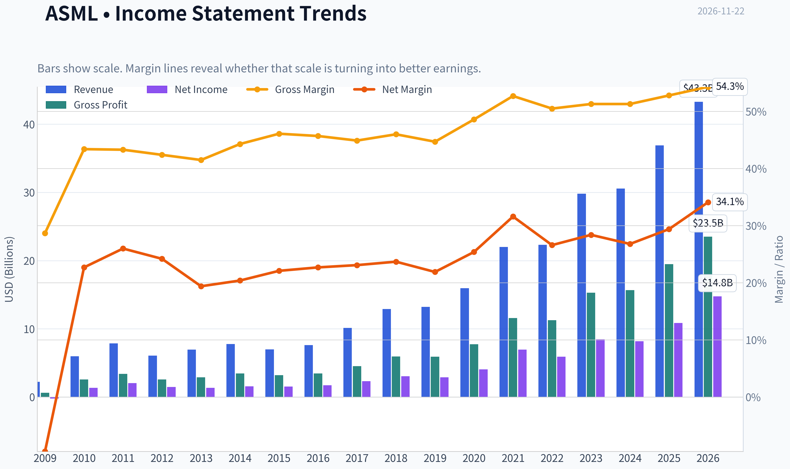

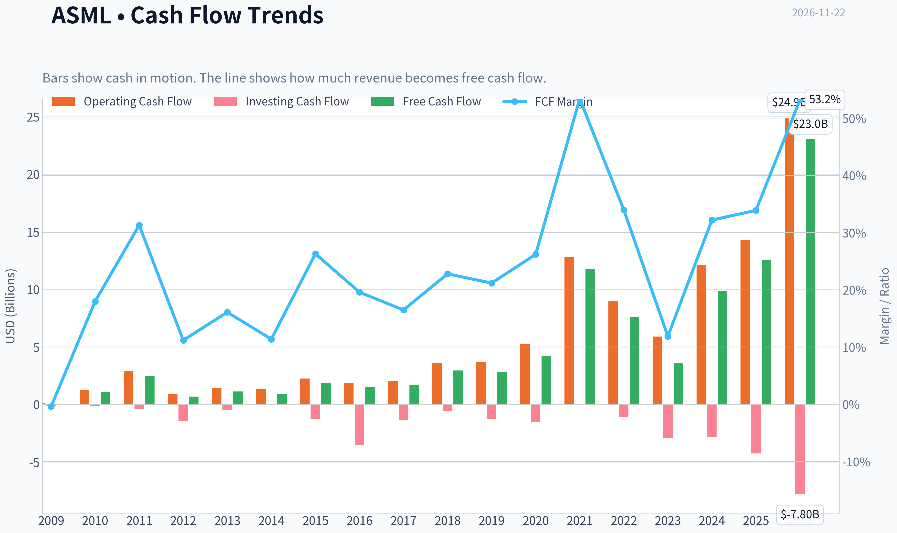

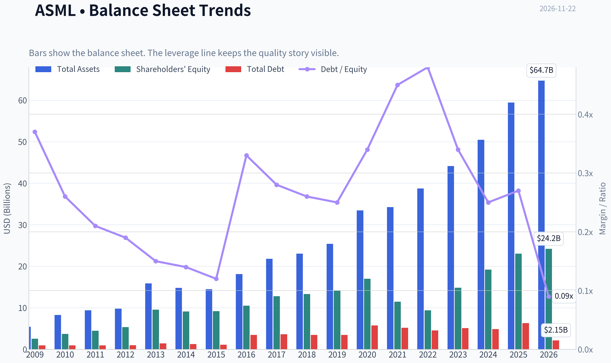

This graph tracks the profitability and return metrics (ROE, ROIC, Margins) of **ASML** over the past decade, highlighting capital efficiency trends.

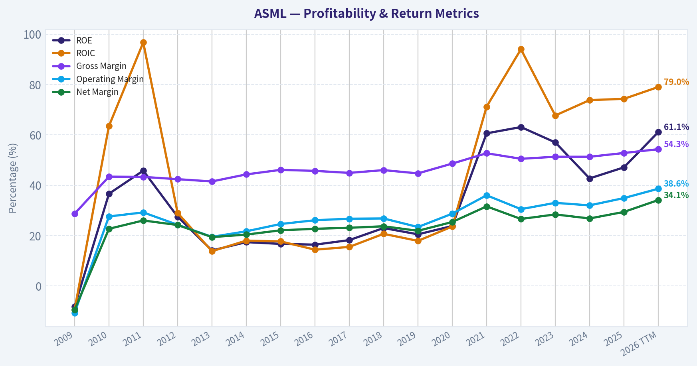

This chart illustrates the financial health of **ASML** over the last 10 years, mapping cash equivalents and free cash flow against total obligations (Debt).

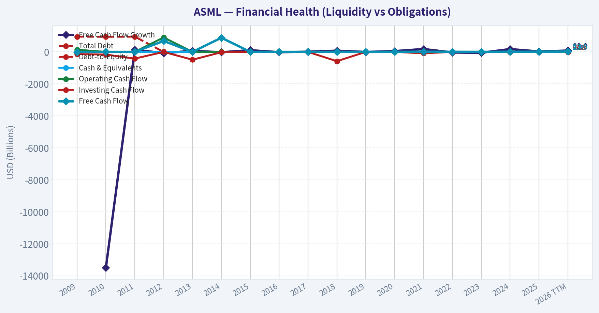

---

### Intrinsic Value Analysis (Buffett)

> *Following Warren Buffett's value investing philosophy: Circle of Competence, Economic Moat, Management Quality, and Margin of Safety.*

#### Intrinsic Value Snapshot

Price is what you pay. Intrinsic value is what the business may be worth based on the cash it can create for owners over time. We show a range, not one magic number.

- Current Price: $1,266.22
- Value Range (conservative to optimistic across both DCF methods): $383.01 to $5,658.35

##### Owner Earnings (Buffett Method)
- Net Income: $10,858,814,188.00
- Depreciation & Amortization: $1,125,383,930.08
- Capital Expenditures: $-1,778,199,472.00
- Working Capital Changes: $1,126,042,113.48
- Owner Earnings: $11,073,142,260.98

##### Intrinsic Value
###### Buffett Method
Uses owner earnings. Stricter, and usually more conservative.
- Conservative: $645.24
- Average: $1,714.98
- Optimistic: $3,848.71
- Discount Rate: 8.3%

###### Cash Flow Method
Uses free cash flow. Better for companies spending heavily today to grow tomorrow.
- Conservative: $383.01
- Average: $1,451.68
- Optimistic: $5,658.35
- Discount Rate: 10.0%

ANALYST STANCE: **Neutral - Neutraal**

#### Samenvatting

ASML bezit een uitzonderlijk sterke strategische positie in de halfgeleiderindustrie. De onderneming heeft vrijwel een monopolie op de meest geavanceerde EUV-lithografiesystemen, beschikt over hoge toetredingsbarrières en behaalt een ROE van 47,1% bij een brutomarge van 52,8%.

De waardering is echter veeleisend. Bij een koers van $1.266 ligt de koers ongeveer 5,1% boven de DVI-schatting van $1.205,14. Voor een onderneming met deze kwaliteit is een kleine premie verdedigbaar, maar de huidige prijs laat weinig ruimte voor tegenvallers door chipcycli, exportbeperkingen, klantconcentratie of vertraging in de AI-gerelateerde investeringscyclus.

#### Factor-scorecard

| Factor | Score | Beoordeling |
|---|---:|---|
| 1. Competentie en eenvoud | 4/5 | Het verdienmodel is begrijpelijk: ASML verkoopt zeer complexe machines waarmee chipfabrikanten patronen op wafers aanbrengen. De technologie is moeilijk te vervangen, maar de cyclus en geopolitieke afhankelijkheden verminderen de voorspelbaarheid. |
| 2. Duurzaam concurrentievoordeel | 5/5 | EUV-technologie, intellectueel eigendom, jarenlange ontwikkelingsvoorsprong, toeleveranciersnetwerk en hoge overstapkosten vormen een uitzonderlijk brede moat. |
| 3. Management en kapitaalallocatie | 4/5 | De onderneming heeft historisch sterk geïnvesteerd in technologische voorsprong en aandeelhoudersrendement. De beoordeling blijft iets onder maximaal door de complexiteit van grote ontwikkelingsprogramma's en de kapitaalintensiteit van de productieketen. |
| 4. Industrie-structuur | 4/5 | De markt voor geavanceerde lithografie is zeer geconcentreerd en rationeler dan de meeste technologie-industrieën. De eindmarkt blijft echter cyclisch en gevoelig voor exportbeleid en grote klanten. |

**Gate 5 - kwaliteit en solvabiliteit:** niet getriggerd. Er is geen aanwijzing voor een combinatie van verslechterende kasstromen en financiële distress. De beschikbare gegevens tonen sterke winstgevendheid en een hoge ROE.

**Key Takeaways:** ASML scoort zeer hoog op moat en structurele concurrentiekracht. De belangrijkste aftrekpunten zijn niet de kwaliteit van het bedrijf, maar de cyclische eindmarkt, geopolitieke risico's en de beperkte waarderingsmarge.

#### Moatanalyse

**Intangible assets en technologie - zeer sterk**

ASML's EUV-systemen zijn het resultaat van tientallen jaren onderzoek, honderden toeleveranciers en nauwe samenwerking met klanten. De combinatie van optica, lichtbronnen, software, mechatronica en proceskennis is voor concurrenten buitengewoon moeilijk te repliceren.

De brutomarge van 52,8% ondersteunt de conclusie dat ASML aanzienlijke waarde kan onttrekken aan zijn technologie. De onderneming verkoopt geen gestandaardiseerde apparatuur tegen commodityprijzen, maar essentiële productiemiddelen waarvoor klanten weinig directe alternatieven hebben.

**Switching costs - zeer sterk**

Een chipfabrikant kan niet eenvoudig van lithografieleverancier wisselen. Machines moeten worden geïntegreerd in complexe fabrieken, productieprocessen en software-omgevingen. Bovendien zijn betrouwbaarheid, service, kalibratie en procesdata cruciaal voor de opbrengst van een fabriek.

**Kostenvoordeel - sterk, maar niet primair**

ASML's voordeel komt minder uit de laagste productiekosten en meer uit schaal, kennis, intellectueel eigendom en systeemintegratie. De onderneming beheert een uniek ecosysteem van gespecialiseerde partners, waardoor de totale technologische voorsprong groter is dan die van één afzonderlijk patent.

**Netwerkeffecten - indirect maar betekenisvol**

Er is geen klassiek consumenten-netwerkeffect. Wel ontstaat een industrieel ecosysteem: meer klanten, meer procesdata, meer samenwerking met toeleveranciers en een grotere installed base versterken de servicecapaciteit en technologische ontwikkeling.

**Moat-rating:** breed en waarschijnlijk duurzaam - **5/5**.

#### Management en kapitaalallocatie

ASML's management heeft de afgelopen jaren kapitaal ingezet voor:

- voortdurende uitbreiding van EUV- en High-NA-technologie;
- ontwikkeling van service- en softwareactiviteiten;
- samenwerking met belangrijke klanten en toeleveranciers;
- dividend en aandeleninkoop naast noodzakelijke investeringen.

De hoge ROE en brutomarge suggereren dat ingehouden middelen een sterke economische opbrengst hebben gehad. De belangrijkste managementrisico's liggen bij grote investeringsbeslissingen, leveringsketens en het tijdig opschalen van nieuwe technologie.

Recente 13F-informatie laat zien dat Steve Cohen zijn gemelde belang in het derde kwartaal van 2026 met 52,1% verkleinde. Michael Burry had volgens de beschikbare oudere rapportage geen gemeld belang meer. Dit is marktinformatie, geen fundamenteel oordeel over ASML; 13F-rapportages zijn bovendien vertraagd.

#### Financiële samenvatting

| Kengetal | Waarde |
|---|---:|
| Koers | $1.266 |
| Marktkapitalisatie | $488,02 mld |
| PE | 32,98 |
| ROE | 47,1% |
| Brut marge | 52,8% |
| Omzetgroei op jaarbasis | 20,7% |
| FCF-yield | 2,6% |
| Afgeleide vrije kasstroom | circa $12,7 mld |
| Current ratio | 1,26 |
| Intrinsieke waarde, DVI-schatting | $1.205,14 |
| Marge van veiligheid tegenover de koers | -5,1% |
| Door de koers geïmpliceerde groei voor tien jaar | circa 8,0% per jaar |
| Historische groei, laatste drie jaar | 12,1% per jaar |
| Historische groei, laatste vijf jaar | 34,4% per jaar |

**Key Takeaways:** ASML combineert hoge marges, sterke groei en uitzonderlijke kapitaalrendementen. Tegelijkertijd impliceert een PE van bijna 33 dat de markt al een groot deel van de toekomstige kwaliteit en groei inprijst. De vrije kasstroom ondersteunt de onderneming, maar de FCF-yield van 2,6% wijst niet op een ruime waarderingsmarge.

#### Financiële kwaliteit

| Onderdeel | Analyse |
|---|---|
| Winstgevendheid | Zeer sterk; ROE van 47,1% en brutomarge van 52,8%. |
| Kasstroom | De vrije kasstroom bedraagt op basis van de FCF-yield ongeveer $12,7 miljard. |
| Kapitaalrendement | Waarschijnlijk ruim boven de vermogenskosten door de brede moat en hoge marges. |
| Balans | De current ratio van 1,26 is adequaat. Voor een definitieve score op netto schuld en rentedekking zijn geen afzonderlijke waarden beschikbaar in de meegeleverde samenvatting. |
| Cycliciteit | Materieel; investeringen van chipfabrikanten kunnen sterk versnellen of vertragen. |
| Geopolitiek | Materieel; exportbeperkingen en spanningen rond China en Taiwan kunnen omzet, levering en klantinvesteringen beïnvloeden. |

**Key Takeaways:** De operationele kwaliteit is uitstekend en de kasstroom is substantieel. De financiële analyse wordt vooral bepaald door de duurzaamheid van de investeringscyclus, niet door zwakke marges of een gebrekkig bedrijfsmodel.

#### Eigenarenwinst

De Buffett-definitie luidt:

**Eigenarenwinst = nettowinst + afschrijvingen en amortisatie - onderhouds-capex - toename van werkkapitaal.**

De meegeleverde waarderingssamenvatting bevat geen afzonderlijke bedragen voor nettowinst, D&A, onderhouds-capex en werkkapitaal. Daarom is een precieze eigenarenwinstberekening niet verantwoord. Als kasstroomproxy is de vrije kasstroom ongeveer $12,7 miljard, maar bij ASML moet rekening worden gehouden met het onderscheid tussen noodzakelijke uitbreidingsinvesteringen en onderhoudsinvesteringen.

De drie beschikbare waarderingsmodellen geven de volgende uitkomsten:

| Waarderingsbenadering | Waarde per aandeel |
|---|---:|
| Eigenarenwinst-DCF | $1.714,98 |
| FCF-benadering | $1.451,68 |
| Damodaran FCFF | $594,22 |
| Gewogen DVI-schatting | $1.205,14 |
| Huidige koers | $1.266 |

**Key Takeaways:** De modellen lopen sterk uiteen, wat de gevoeligheid voor groei, marges, kapitaaluitgaven en disconteringsvoet laat zien. De gewogen DVI-schatting ligt onder de marktprijs, terwijl de eigenarenwinst- en FCF-benaderingen hoger uitkomen. Dat maakt de waardering redelijk verdedigbaar bij sterke groei, maar niet duidelijk goedkoop.

#### Drie-scenario DCF

Omdat de beschikbare gegevens geen volledig afzonderlijke reeks voor nettowinst, D&A, onderhouds-capex en werkkapitaal bevatten, zijn de scenario's hieronder kwalitatief gekoppeld aan de beschikbare DVI-modellen.

| Scenario | Veronderstelling | Indicatie |
|---|---|---:|
| A. Geen groei | Eigenarenwinst gedeeld door 10% | Zeer gevoelig voor de gekozen eigenarenwinst; de Damodaran FCFF-uitkomst van $594,22 illustreert het neerwaartse risico bij conservatieve aannames. |
| B. GDP-groei | 3% groei en 10% disconteringsvoet | De FCF-waardering van $1.451,68 ligt boven de koers, maar vereist dat vrije kasstroom duurzaam blijft en niet structureel door uitbreidingsinvesteringen wordt opgeslokt. |
| C. Historische groei | 50-75% van historische groei, met een maximum van 10% | De hoge historische groei is niet volledig extrapoleerbaar; de DVI-gewogen uitkomst van $1.205,14 past bij een normalisatie van groei en marges. |

**Key Takeaways:** Een conservatieve waardering kan aanzienlijk onder de koers uitkomen, terwijl een groeigerichte FCF-benadering erboven ligt. De kernvraag is of ASML langdurig hoge groei kan combineren met hoge marges zonder dat cyclische investeringspauzes de kasstromen tijdelijk sterk verlagen.

#### Intrinsieke waarde en marge van veiligheid

De aangeleverde intrinsieke waarde is een **DVI-schatting**, niet een DeepValues-appwaarde. De schatting bedraagt **$1.205,14 per aandeel** en is gebaseerd op een gewogen combinatie van Damodaran FCFF, reverse-DCF en eigenarenwinst-DCF.

Bij een marktprijs van $1.266 bedraagt de marge van veiligheid:

**($1.205,14 - $1.266) / $1.266 = -5,1%**

De huidige koers impliceert ongeveer 8,0% jaarlijkse groei gedurende tien jaar. Dat ligt onder de historische driejaarsgroei van 12,1%, maar ver onder de uitzonderlijke vijfjaarsgroei van 34,4%. De markt veronderstelt dus geen buitensporige groei, maar wel een langdurige combinatie van omzetgroei, hoge marges en technologische dominantie.

Voor een onderneming met een brede moat en een ROE van 47,1% kan een beperkte korting voldoende zijn. De huidige negatieve marge tegenover de DVI-schatting biedt echter geen duidelijke veiligheidsbuffer.

#### Buffett-scorecard

| Criterium | Gewicht | Score | Gewogen score |
|---|---:|---:|---:|
| Breedte en duurzaamheid moat | 25% | 5/5 | 1,25 |
| Waardering en marge van veiligheid | 20% | 3/5 | 0,60 |
| Kapitaalrendement versus WACC | 15% | 5/5 | 0,75 |
| Begrijpelijkheid en voorspelbaarheid | 12% | 4/5 | 0,48 |
| Management en kapitaalallocatie | 12% | 4/5 | 0,48 |
| Herinvesteringsmogelijkheden | 8% | 5/5 | 0,40 |
| Balanssterkte | 4% | 3/5 | 0,12 |
| Industrie-structuur | 4% | 4/5 | 0,16 |
| **Totaal** | **100%** |  | **4,24/5** |

**Key Takeaways:** ASML behaalt een hoge totaalscore dankzij de uitzonderlijke moat, hoge ROE en aantrekkelijke herinvesteringsmogelijkheden. De waardering is het voornaamste zwakke onderdeel: niet omdat het bedrijf middelmatig is, maar omdat de huidige koers weinig ruimte laat voor operationele of macro-economische tegenvallers.

#### Eindbeoordeling

ASML is een van de sterkste industriële technologiebedrijven ter wereld. De combinatie van EUV-dominantie, hoge toetredingsbarrières, sterke marges en een lange technologische ontwikkelingsvoorsprong past goed bij een Buffett-achtige kwaliteitstoets.

De totale score van 4,24/5 wijst op een uitzonderlijk bedrijf. De DVI-waardering van $1.205,14 ligt echter onder de koers van $1.266, waardoor de huidige waardering geen overtuigende veiligheidsmarge bevat. De evidence ondersteunt de kwaliteit van ASML duidelijk sterker dan de huidige prijs.

**ANALYST STANCE: Neutral - Neutraal, met hoge overtuiging over de bedrijfs kwaliteit en gematigde overtuiging over de waardering.**
#### Valuation Bridge

This bridge places the current market price beside each intrinsic value lens so readers can see whether upside depends on one method or shows up across several methods.

| Scenario | Intrinsic Value / Share |
| --- | ---: |
| Buffett Method | $1,714.98 |
| Cash Flow Method | $1,451.68 |
| Damodaran Method | $594.22 |
| Current Price | $1,266.22 |

#### Key Takeaways

If one method is far above the others, the upside case depends on a specific modelling assumption. When several methods cluster together, the valuation story is more robust.

#### Valuation Visuals

This comparison chart from *Latest Earnings Snapshot* stacks current figures against historical benchmarks for **ASML**, making it easy to see where the company trades relative to its own averages.

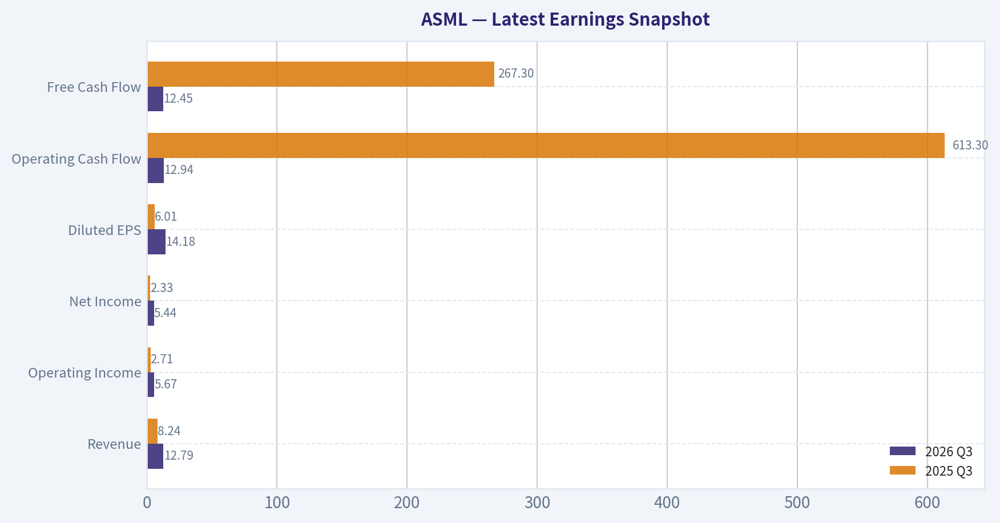

This comparison chart from *Kerngegevens en interpretatie* stacks current figures against historical benchmarks for **ASML**, making it easy to see where the company trades relative to its own averages.

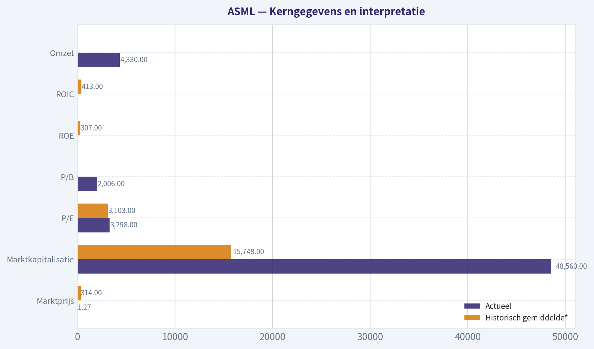

This comparison chart from *Balans en financiële kracht* stacks current figures against historical benchmarks for **ASML**, making it easy to see where the company trades relative to its own averages.

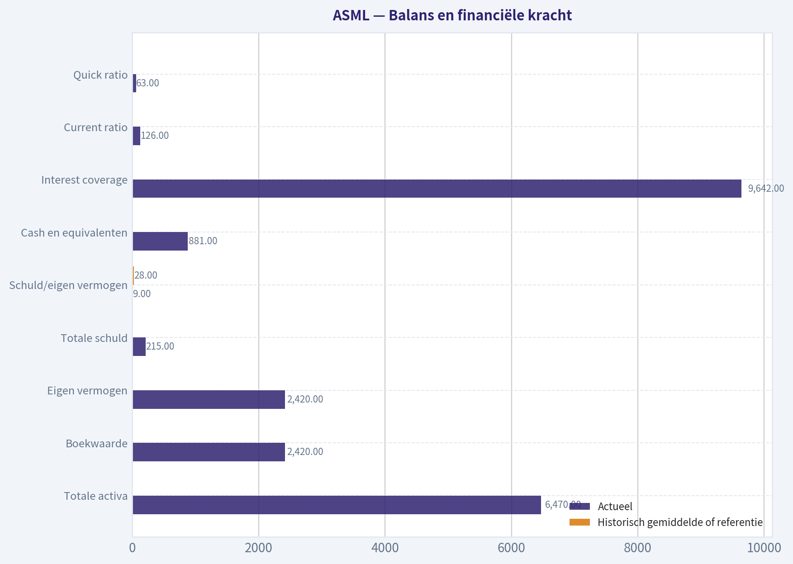

This comparison chart from *Kasstroom, kapitaalallocatie en dividend* stacks current figures against historical benchmarks for **ASML**, making it easy to see where the company trades relative to its own averages.

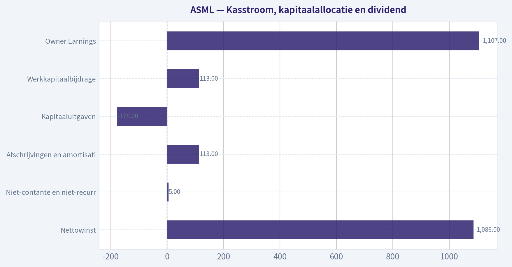

This comparison chart from *Waardering* stacks current figures against historical benchmarks for **ASML**, making it easy to see where the company trades relative to its own averages.

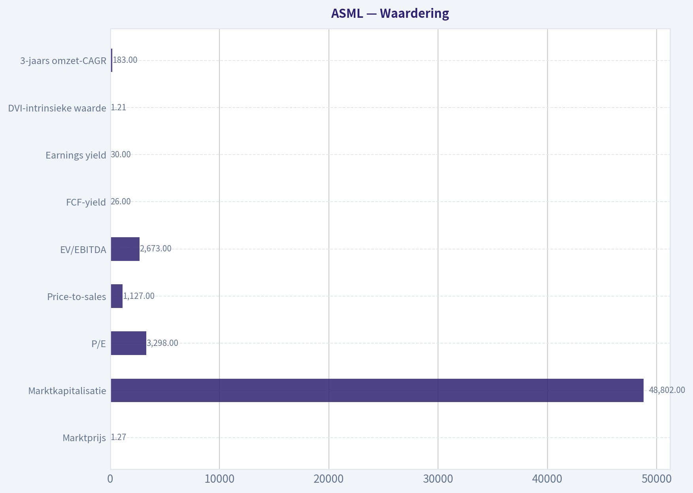

This comparison chart from *Buffett-stijl Owner Earnings DCF* stacks current figures against historical benchmarks for **ASML**, making it easy to see where the company trades relative to its own averages.

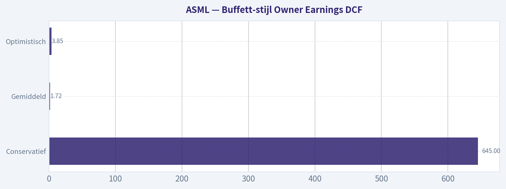

---

### Trend & Growth Analysis (Lynch/Druckenmiller/Fisher)

> *Following Peter Lynch's GARP, Stanley Druckenmiller's macro-aware approach, and Philip Fisher's scuttlebutt methodology.*

ANALYST STANCE: **Neutral - Neutraal**

#### 1. Lynch-classificatie

ASML is een **hybride van een fast grower en een cyclisch bedrijf**. De omzetgroei van 20,7% past bij Lynch' fast-growercategorie, maar de kapitaalintensieve halfgeleiderindustrie kent duidelijke investeringscycli en geopolitieke risico's.

| Kenmerk | Beoordeling |
|---|---:|
| Omzetgroei | 20,7% jaar-op-jaar |
| Winstkwaliteit | Hoog, met 47,1% ROE |
| Brutomarge | 52,8% |
| Cycliciteit | Hoog |
| Concurrentiepositie | Uitzonderlijk sterk |
| Lynch-categorie | Fast grower met cyclische kenmerken |

**Belangrijkste inzichten:** ASML groeit momenteel snel genoeg om als fast grower te kwalificeren. De cycliciteit maakt de groeivoorspelling echter minder lineair dan bij een typische SaaS-onderneming. De combinatie van hoge marges, ROE en technologische dominantie is uitzonderlijk, maar de waardering laat weinig ruimte voor structurele tegenvallers.

#### 2. Het verhaal in drie punten

1. ASML levert de meest geavanceerde lithografiesystemen die nodig zijn om steeds kleinere en krachtigere chips te produceren.
2. De onderneming heeft een vrijwel unieke positie in EUV-lithografie, waardoor toonaangevende chipfabrikanten sterk afhankelijk blijven van ASML.
3. AI, datacenters, geavanceerde logica en geheugenchips vergroten de langetermijnvraag, terwijl technologische complexiteit toetreding door concurrenten bemoeilijkt.

#### 3. TAM en de 10x-test

Een exacte omzetbasis en een betrouwbare totale TAM-berekening zijn in de beschikbare gegevens niet opgenomen. Daarom is de 10x-test kwalitatief ingevuld.

| Onderdeel | Analyse |
|---|---|
| Huidige markt | Geavanceerde lithografie voor halfgeleiders |
| Structurele vraagdrijvers | AI, datacenters, geavanceerde processoren, geheugen en chipsoevereiniteit |
| TAM-groei | Waarschijnlijk bovengemiddeld, maar cyclisch |
| Kan ASML 10x groeien? | Niet waarschijnlijk in omzet op korte termijn; wel bestaat een meerjarige expansieruimte |
| Beperking | ASML heeft al een zeer groot aandeel in het meest geavanceerde segment |

**Belangrijkste inzichten:** De TAM groeit door toenemende chipcomplexiteit en hogere investeringen per generatie. De 10x-test is minder overtuigend dan bij een kleinere groeionderneming, omdat ASML al een dominante positie en zeer grote omzetbasis heeft. De langetermijnkans ligt vooral in hogere systeemwaarde, nieuwe chiptechnologieën en een grotere lithografie-intensiteit per wafer.

#### 4. Omzetgroei en kwaliteit

| Indicator | Waarde | Interpretatie |
|---|---:|---|
| Recente omzetgroei | 20,7% | Sterke groei |
| Groei over drie jaar, volgens reverse-DCF-input | 12,1% gemiddeld | Versnelling naar recent niveau |
| Groei over vijf jaar, volgens reverse-DCF-input | 34,4% gemiddeld | Sterke maar waarschijnlijk cyclisch beïnvloede periode |
| Omzettrend | Recent sterk | Geen volledige kwartaalreeks beschikbaar |

**Belangrijkste inzichten:** De recente groei ligt duidelijk boven het stalwart-niveau. De beschikbare historische referenties wijzen op een herstel of versnelling ten opzichte van het driejaarsgemiddelde, maar het vijfjaarsgemiddelde suggereert dat de halfgeleidercyclus de cijfers sterk beïnvloedt. Een bevestiging over meerdere kwartalen zou nodig zijn om van een duurzame versnelling te spreken.

#### 5. Unit economics en operationele kwaliteit

Voor ASML zijn SaaS-maatstaven zoals NRR, CAC en LTV/CAC niet rechtstreeks toepasbaar. Het relevante equivalent bestaat uit technologische switching costs, service-inkomsten, brutomarge en klantafhankelijkheid.

| Maatstaf | Waarde / status | Beoordeling |
|---|---:|---|
| Brutomarge | 52,8% | Zeer sterk |
| ROE | 47,1% | Uitzonderlijk |
| NRR | Niet van toepassing | Geen abonnementsmodel |
| LTV/CAC | Niet beschikbaar | Niet zinvol voor machineverkoop |
| Rule of 40 | Niet van toepassing | Geen SaaS-bedrijfsmodel |
| Current ratio | 1,26 | Adequate liquiditeit |
| FCF-yield | 2,6% | Lage actuele kasstroomrendementen |

**Belangrijkste inzichten:** De hoge brutomarge en ROE bevestigen een sterk economisch model met hoge toegevoegde waarde. De lage FCF-yield weerspiegelt vooral de hoge waardering, niet noodzakelijk zwakke kasstroomkwaliteit. Het belangrijkste risico is de timing van grote kapitaaluitgaven bij klanten, niet een klassiek probleem van klantretentie.

#### 6. Inflectiepuntanalyse

| Mogelijk inflectiepunt | Status | Betekenis |
|---|---|---|
| Productcyclus | Positief | Verdere EUV- en High-NA-ontwikkeling kan systeemwaarde verhogen |
| Marktpositie | Positief | Technologische voorsprong blijft uitzonderlijk |
| TAM | Positief | AI en chipcomplexiteit vergroten structurele vraag |
| Marges | Sterk, maar te bevestigen | Schaalvoordelen zijn aanwezig |
| Concurrentie | Zeer gunstig | Alternatieven voor de meest geavanceerde systemen zijn beperkt |
| Groei | Positief, nog cyclisch | Recente groei is sterk, maar niet volledig bewezen als nieuwe versnelling |

**Belangrijkste inzichten:** Het sterkste inflectiepunt is de stijgende lithografie-intensiteit per generatie chip. De onderneming profiteert tegelijk van productinnovatie en van een groeiende markt. Het voornaamste onzekerheidspunt is of de recente omzetgroei structureel kan blijven versnellen, of slechts een fase in de halfgeleidercyclus vertegenwoordigt.

#### 7. Macro-evaluatie

| Macrofactor | Effect op ASML |
|---|---|
| AI-investeringen | Sterke rugwind |
| Datacenteruitgaven | Sterke rugwind |
| Rente | Hogere rente drukt de waarderingsmultiple |
| Halfgeleidercyclus | Positief bij herstel, negatief bij uitstel van fab-investeringen |
| Exportbeperkingen | Materieel geopolitiek risico |
| China-beleid | Kan omzetkansen en producttoegang beperken |
| Chipsoevereiniteit | Structurele vraagondersteuning |

**Belangrijkste inzichten:** De structurele macrotrend is gunstig door AI, datacenters en nationale chipstrategieën. Tegelijk is ASML gevoelig voor rente, exportregels en het uitstel van fabrieksinvesteringen. Vanuit Druckenmiller-perspectief is de fundamentele wind sterk, maar de macrotiming niet zonder risico.

#### 8. Fisher-score

| Fisher-criterium | Score / 5 |
|---|---:|
| Marktpotentieel | 5 |
| Productontwikkeling | 5 |
| R&D-effectiviteit | 5 |
| Verkooporganisatie | 4 |
| Winstmarge | 5 |
| Margeduurzaamheid | 4 |
| Personeelsrelaties | 4 |
| Managementrelaties | 4 |
| Managementdiepte | 5 |
| Kostenanalyse en verslaggeving | 4 |
| Technologische moat | 5 |
| Langetermijnwinstperspectief | 5 |
| Verwateringsrisico | 4 |
| Openheid over problemen | 4 |
| Integriteit | 5 |
| **Totaal** | **68 / 75** |

**Belangrijkste inzichten:** Een score van 68 wijst op een uitzonderlijk kwalitatief bedrijf volgens Fisher. De grootste pluspunten zijn R&D, technologische barrières, managementdiepte en langetermijnmarktpotentieel. De lagere scores betreffen vooral algemene onzekerheid rond cycli, geopolitiek en transparantie van toekomstige vraag.

#### 9. Waardering

| Maatstaf | Uitkomst | Interpretatie |
|---|---:|---|
| Huidige koers | $1.266 | Referentiewaarde |
| Marktkapitalisatie | $488,02 miljard | Zeer grote onderneming |
| P/E | 32,98 | Premiumwaardering |
| Verwachte/recente groeireferentie | 20,7% | Sterke groei |
| PEG | circa 1,59 | Redelijk tot volledig gewaardeerd |
| FCF-yield | 2,6% | Beperkte actuele kasstroomopbrengst |
| DVI-intrinsieke waarde | $1.205,14 | Circa 5,1% onder de koers |
| Reverse-DCF impliciete groei | 8,0% per jaar gedurende 10 jaar | Hoge maar niet extreme verwachting |

**Belangrijkste inzichten:** De PEG van ongeveer 1,59 past bij een kwalitatief topbedrijf, maar wijst niet op een duidelijke onderwaardering. De koers ligt ongeveer 5,1% boven de centrale DVI-schatting. De waardering vereist daarom aanhoudende groei, sterke marges en een relatief gunstige kapitaalcyclus.

#### 10. Waarderingsgevoeligheid

| Waarderingsmodel | Uitkomst |
|---|---:|
| Eigen vermogen/FCF-model | $1.451,68 |
| Owner-earnings-DCF | $1.714,98 |
| Damodaran FCFF-model | $594,22 |
| Centrale samengestelde schatting | $1.205,14 |
| Huidige koers | $1.266 |

**Belangrijkste inzichten:** De spreiding tussen de modellen is zeer groot: van $594 tot $1.715. Dat betekent dat de uitkomst sterk afhangt van aannames over cyclische normalisatie, marges, investeringen en terminale groei. De huidige waardering is niet extreem volgens de optimistische modellen, maar biedt volgens de centrale schatting geen duidelijke veiligheidsmarge.

#### 11. Groeibeleggers-scorecard

| Criterium | Gewicht | Score / 5 | Bijdrage |
|---|---:|---:|---:|
| Het verhaal | 10% | 4,5 | 0,45 |
| TAM en runway | 20% | 4,0 | 0,80 |
| Omzetgroei | 20% | 3,8 | 0,76 |
| Unit economics | 15% | 3,0 | 0,45 |
| Concurrentiepositie | 10% | 4,8 | 0,48 |
| Managementkwaliteit | 10% | 4,0 | 0,40 |
| Macro-opstelling | 5% | 2,5 | 0,13 |
| Winstgevendheidspad | 5% | 4,0 | 0,20 |
| Waardering | 5% | 2,2 | 0,11 |
| **Totaal** | **100%** |  | **3,78 / 5** |

**Belangrijkste inzichten:** ASML scoort sterk op technologie, marktpositie, marges en structurele vraag. De totale score wordt gedrukt door cycliciteit, geopolitiek en een waardering die weinig ruimte laat voor teleurstelling. Een score van 3,78 past bij **Neutral**: fundamenteel hoogwaardig, maar niet overtuigend goedkoop.

#### 12. Belangrijkste risico's en katalysatoren

| Katalysatoren | Risico's |
|---|---|
| Snellere adoptie van High-NA EUV | Exportbeperkingen en geopolitieke escalatie |
| Versnelde AI- en datacenterinvesteringen | Uitstel van fab-investeringen |
| Hogere lithografie-intensiteit per chip | Semiconductor-capexcyclus draait neerwaarts |
| Structurele groei van geavanceerd geheugen | Hogere rente en multiple-compressie |
| Verdere margeverbetering door schaal | Klantconcentratie bij enkele grote chipfabrikanten |
| Beperkte concurrentie in EUV | Technische vertragingen bij nieuwe productgeneraties |

**Eindconclusie:** ASML voldoet inhoudelijk aan veel kenmerken van een Fisher- en Lynch-kwaliteitsgroeier: sterke innovatie, hoge toetredingsbarrières, een groeiende TAM en uitzonderlijke economische kenmerken. De inflectie blijft vooral gekoppeld aan High-NA, AI-gerelateerde chipinvesteringen en toenemende lithografie-intensiteit. De huidige waardering rond $1.266 lijkt de kwaliteit grotendeels te erkennen; de beschikbare modellen geven daarom een **Neutral**-beeld in plaats van een duidelijke onderwaarderingscase.

---

### Market Technical Analysis

ANALYST STANCE: **Neutral - bearish met oversold tegenreactierisico**

#### Samenvatting

Deze analyse betreft uitsluitend **ASML Holding N.V.**, genoteerd onder ticker **ASML** op Nasdaq. De meest recente beschikbare handelsdag is **20 november 2026**, omdat 22 november in het weekend valt. De slotkoers bedroeg toen **1.266,22**.

Het technische beeld is duidelijk verzwakt. ASML is in korte tijd onder de 10-daagse EMA, de 50-daagse SMA en de 200-daagse SMA gezakt. Tegelijk staat de RSI onder 30 en noteert de koers rond de onderste Bollinger Band. Dat wijst op een sterk neerwaarts momentum, maar ook op een markt die op korte termijn technisch oversold is. De oversold-conditie is op zichzelf geen bevestiging van een duurzame bodem, omdat MACD, voortschrijdende gemiddelden en het recente handelsvolume nog steeds op verkoopdruk wijzen.

#### Prijsstructuur en trend

Vanaf de slotkoers van **1.864,85 op 2 oktober** daalde ASML naar **1.266,22 op 20 november**. Dat is een daling van ongeveer **32 procent** in minder dan twee maanden. De beweging verliep niet als één rechte lijn: er waren tijdelijke oplevingen rond 1.500 tot 1.550, maar iedere herstelpoging bleef onder eerdere toppen. Sinds de topzone van begin oktober is daardoor een patroon van lagere toppen en lagere bodems zichtbaar.

De daling versnelde vooral in de eerste helft van november. Op 5 november sloot ASML op 1.356,65, waarna een korte opleving richting 1.534,42 op 11 november volgde. Die opleving kon echter niet boven de dalende gemiddelden uitkomen. Vervolgens zakte de koers opnieuw, met een bijzonder zwakke slotdag op 20 november: een daling van ongeveer **6,2 procent**, bij een volume van **3,29 miljoen aandelen**. Dat volume lag duidelijk boven de gebruikelijke niveaus van de voorafgaande sessies en geeft de neerwaartse uitbraak extra betekenis.

#### Voortschrijdende gemiddelden

De laatste waarden van de belangrijkste gemiddelden zijn:

- **10 EMA: 1.408,60**
- **50 SMA: 1.623,35**
- **200 SMA: 1.597,56**
- **Slotkoers: 1.266,22**

De koers ligt ongeveer **10 procent onder de 10 EMA**, **22 procent onder de 50 SMA** en **21 procent onder de 200 SMA**. Dat is geen klein verschil dat alleen op dagelijkse ruis kan worden teruggevoerd. Het wijst op brede trendverzwakking over zowel korte, middellange als langere termijn.

De 50 SMA is bovendien vanaf ongeveer 1.740 in oktober gedaald naar 1.623. De 200 SMA blijft nog relatief vlakker, maar de koers bevindt zich daar inmiddels ruim onder. De lange trend is daarmee niet langer overtuigend positief. Het feit dat de 50 SMA nog boven de 200 SMA staat, voorkomt dat er al sprake is van een volledig bevestigde death cross, maar de richting van de middellange termijn is wel duidelijk negatief.

#### MACD en momentum

De MACD verslechterde van **+35,71 op 6 oktober** naar **-81,08 op 20 november**. De overgang van positief naar diep negatief momentum bevestigt dat de koersdaling niet uitsluitend door eenmalige volatiliteit wordt veroorzaakt.

Ook de recente MACD-richting is ongunstig:

- 13 november: **-54,94**
- 16 november: **-59,92**
- 18 november: **-67,32**
- 19 november: **-71,47**
- 20 november: **-81,08**

De MACD beweegt dus niet alleen onder nul, maar loopt verder weg van de nullijn. Dat suggereert dat neerwaartse versnelling op de meest recente handelsdagen sterker werd. Een technische opleving kan hierdoor wel plaatsvinden, maar de MACD levert nog geen bewijs dat het onderliggende momentum al is omgekeerd.

#### RSI: oversold, maar nog geen bevestigde ommekeer

De RSI daalde van **63,67 op 5 oktober** naar **28,90 op 20 november**. Een RSI onder 30 wordt doorgaans als oversold beschouwd. Dit is het belangrijkste tegenwicht tegen het verder bearish beeld: de koers is op korte termijn ver doorgeschoten ten opzichte van de recente handelsrange.

Toch moet de RSI zorgvuldig worden geïnterpreteerd. De indicator stond op 5 november al op **27,11**, waarna de koers tijdelijk herstelde. De oversold-status leidde dus eerder tot een kortstondige opleving, maar niet tot een structurele trendomslag. De RSI geeft op dit moment vooral aan dat de neerwaartse beweging gespannen is geworden; hij bevestigt nog niet dat verkopers de controle hebben verloren.

#### Bollinger Bands en volatiliteit

Op 20 november lagen de Bollinger Bands op:

- **Bovenste band: 1.710,35**
- **Onderste band: 1.273,66**
- **Slotkoers: 1.266,22**

De slotkoers eindigde ongeveer **7,44 punten onder de onderste band**. Dat is een duidelijke overschrijding en past bij een neerwaartse volatiliteitsuitbraak. De koers beweegt dus niet alleen richting de onderkant van de bandbreedte, maar sloot er zelfs onder.

De onderste band zelf daalde snel van ongeveer 1.560 begin oktober naar 1.274 op 20 november. Dat is belangrijk: de bandversmalling of -verbreding moet niet los van de trend worden bekeken. Een koers onder de onderste band kan soms een terugkeer naar het gemiddelde voorafgaan, maar wanneer de band zelf sterk naar beneden kantelt, kan de beweging ook wijzen op een aanhoudend neerwaarts regime.

De ATR steeg van circa **49 begin oktober** naar **68,64 op 20 november**. Tegenover de slotkoers vertegenwoordigt dit een gemiddelde dagelijkse bewegingsomvang van ongeveer **5,4 procent**. De markt is daarmee aanzienlijk onrustiger dan in september en begin oktober. Technische niveaus hebben in zo'n omgeving minder stabiliteit, en uitslagen kunnen sneller groter worden dan het gemiddelde.

#### Beoordeling van het technische risico

Het gecombineerde signaal is als volgt:

1. **Trend:** bearish op korte, middellange en lange termijn.
2. **Momentum:** sterk negatief; MACD daalt verder onder nul.
3. **Korte-termijnconditie:** oversold volgens RSI en Bollinger Bands.
4. **Volatiliteit:** verhoogd, met een oplopende ATR.
5. **Bevestiging door handelsactiviteit:** de sterke daling op 20 november ging gepaard met bovengemiddeld volume.
6. **Herstelkwaliteit:** eerdere oplevingen werden afgewezen onder belangrijke gemiddelden.

Daarom is het beeld niet simpelweg "gemengd". De dominante trend is neerwaarts en breed bevestigd. Het genuanceerde element is dat de markt technisch uitgeput kan raken: de RSI is onder 30 gezakt en de koers bevindt zich onder de onderste Bollinger Band. Dit verhoogt de kans op een scherpe, tijdelijke tegenreactie, maar verandert de hoofdtrend niet zolang koers en momentum onder hun belangrijke gemiddelden blijven.

Voor de waarderingsinterpretatie betekent dit dat de markt momenteel geen hoge premie voor sterk en stabiel technisch momentum ondersteunt. Een eventuele positieve waarderingslezing zou eerst meer bewijs nodig hebben van stabilisatie, afnemende volatiliteit en herstel van het momentum. Op basis van de beschikbare koersgegevens is dat bewijs nog niet aanwezig.

#### Geselecteerde indicatoren

De selectie bestaat uit acht complementaire indicatoren:

- **close_10_ema:** snelle trend- en momentumfilter.
- **close_50_sma:** middellange trendstructuur.
- **close_200_sma:** langetermijnregime.
- **macd:** richting en versnelling van momentum.
- **rsi:** mate van oververkochte of overgekochte condities.
- **boll_ub:** bovenzijde van het volatiliteitskanaal.
- **boll_lb:** onderzijde van het volatiliteitskanaal.
- **atr:** actuele volatiliteit en bewegingsgrootte.

De Bollinger Bands worden hier als paar gebruikt omdat de verhouding tussen koers en beide grenzen relevanter is dan één band afzonderlijk. De MACD-lijn en RSI vullen elkaar aan: MACD beoordeelt de richting van momentum, terwijl RSI beoordeelt hoe ver dat momentum op korte termijn is doorgeschoten.

| Onderdeel | Laatste waarde / observatie | Interpretatie |
|---|---:|---|
| Slotkoers, 20 nov. 2026 | 1.266,22 | Sterke recente daling; laagste slot in de getoonde recente periode |
| 10 EMA | 1.408,60 | Koers circa 10% eronder; kortetermijntrend bearish |
| 50 SMA | 1.623,35 | Koers circa 22% eronder; duidelijke middellangetermijnzwakte |
| 200 SMA | 1.597,56 | Koers circa 21% eronder; langetermijntrend niet langer overtuigend positief |
| MACD | -81,08 | Diep negatief en verder verslechterend momentum |
| RSI | 28,90 | Oversold; verhoogt kans op tijdelijke tegenreactie, maar bevestigt geen bodem |
| Bollinger onderste band | 1.273,66 | Slotkoers net onder de band; neerwaartse volatiliteitsuitbraak |
| ATR | 68,64 | Hoge volatiliteit; gemiddelde dagelijkse beweging circa 5,4% van de slotkoers |
| Handelsvolume, 20 nov. | 3,29 miljoen | Bovengemiddelde activiteit tijdens een sterke dalingsdag |
| Hoofdbeeld | Neerwaartse trend met oversold-conditie | Technische data ondersteunen geen hoge momentum-premie; stabilisatie is nog onbevestigd |

**Key Takeaways:** ASML bevindt zich in een breed bevestigde neerwaartse trend: de koers ligt onder alle drie de belangrijke gemiddelden en de MACD verslechtert verder. De RSI onder 30 en de slotkoers onder de onderste Bollinger Band wijzen wel op kortetermijnmatige uitputting en een mogelijk scherp herstel, maar niet op een bevestigde trendomslag. De combinatie van hoge volatiliteit en bovengemiddeld volume tijdens de daling houdt het technische risico verhoogd.

---

### Options Market Analysis

> *Reading options flow - put/call ratios, IV skew, and unusual activity - to gauge institutional positioning and event-driven risk.*

ANALYST STANCE: **Neutral** - Neutraal

#### ASML: optiesentiment per 22 november 2026

De beschikbare data omvatten de nabije expiraties van 27 november, 4 december en 11 december 2026. De totale open interest is vrijwel perfect in balans tussen calls en puts, terwijl de totale handelsvolumes eveneens dicht bij elkaar liggen. Dat wijst niet op een overtuigende directionele voorkeur.

#### Put/call-ratio

| Expiratie | Call OI | Put OI | Put/Call OI | Callvolume | Putvolume | Put/Call-volume |
|---|---:|---:|---:|---:|---:|---:|
| 27 nov. 2026 | 4.598 | 3.926 | 0,85 | 4.274 | 4.022 | 0,94 |
| 4 dec. 2026 | 2.199 | 1.656 | 0,75 | 1.099 | 487 | 0,44 |
| 11 dec. 2026 | 1.241 | 2.453 | 1,98 | 520 | 1.247 | 2,40 |
| **Totaal** | **8.038** | **8.035** | **1,00** | **5.893** | **5.756** | **0,98** |

**Key Takeaways:** De totale put/call-OI-ratio van 1,00 ligt duidelijk boven de historische neutrale referentie van ongeveer 0,70 en wijst op relatief veel putbescherming of bearish exposure. Daar staat tegenover dat het totale volume vrijwel exact in balans is. De sterke putconcentratie voor 11 december wordt deels gecompenseerd door calloverwicht in de eerdere expiraties, waardoor het totaalbeeld neutraal blijft met een lichte defensieve ondertoon.

#### Implied volatility en skew

| Expiratie | ATM IV calls | ATM IV puts | Verschil puts minus calls | Interpretatie |
|---|---:|---:|---:|---|
| 27 nov. 2026 | 81,7% | 81,4% | -0,3 procentpunt | Zeer hoge kortlopende IV, vrijwel vlak |
| 4 dec. 2026 | 74,2% | 72,5% | -1,7 procentpunt | Hoge IV, lichte call-premie |
| 11 dec. 2026 | 71,5% | 68,5% | -3,0 procentpunt | Hoge IV, lichte call-premie |

**Key Takeaways:** De ATM-IV is zeer hoog op korte termijn, met 81,7% voor calls en 81,4% voor puts in de expiratie van 27 november. De beschikbare data tonen geen steile put-skew; puts zijn op ATM-basis zelfs iets goedkoper geïmpliceerd dan calls. Dit kan wijzen op aanzienlijke gebeurtenis- of koersonzekerheid, maar er is geen bevestigde katalysator in de aangeleverde data waarmee de IV-stijging direct kan worden verklaard.

De dataset bevat geen afzonderlijke IV's voor OTM-strikes. Daarom kan een klassieke OTM-put versus OTM-call-skew niet volledig worden vastgesteld. Op basis van de ATM-verschillen is er geen duidelijke neerwaartse angstskew; eerder een bescheiden call-skew.

#### Ongebruikelijke optieactiviteit

| Criterium | Resultaat | Betekenis |
|---|---|---|
| Contracten met volume groter dan 5x OI | Geen | Geen aantoonbare verse, uitzonderlijke contractactiviteit |
| Uitzonderlijke calls | Geen | Geen bevestigde grote bullish flow |
| Uitzonderlijke puts | Geen | Geen bevestigde grote bearish hedge-flow |
| Smart-money-signaal | Niet vast te stellen | Geen sweep-, orderboek- of transactiedetails beschikbaar |

**Key Takeaways:** Er zijn geen contracten gevonden waarvan het volume meer dan vijf keer de open interest bedraagt. Daardoor is er geen sterke aanwijzing voor nieuwe, geconcentreerde directionele bets. Ook kan niet betrouwbaar worden vastgesteld of institutionele partijen of particuliere beleggers de dominante handelaren waren.

#### Open-interestconcentratie en mogelijke gamma-niveaus

| Expiratie | Totale OI | Aandeel van totale OI | Belangrijkste observatie |
|---|---:|---:|---|
| 27 nov. 2026 | 8.524 | 53,2% | Grootste concentratie en hoogste potentiële pinning rond expiratie |
| 4 dec. 2026 | 3.855 | 24,1% | Tweede concentratie, call-OI domineert |
| 11 dec. 2026 | 3.694 | 23,1% | Put-OI domineert sterk |
| **Totaal** | **16.073** | **100%** | - |

**Key Takeaways:** Meer dan de helft van alle gerapporteerde open interest vervalt op 27 november, waardoor deze expiratie het grootste potentiële pinning- of gamma-effect heeft. De exacte strikes met de hoogste OI zijn niet aangeleverd, zodat concrete gamma walls en mogelijke prijsniveaus niet kunnen worden geïdentificeerd. De putconcentratie op 11 december kan neerwaartse hedging versterken, maar de omvang ervan is onvoldoende om op zichzelf een bearish totaalbeeld te rechtvaardigen.

#### Samengevoegde beoordeling

De optiestructuur voor ASML geeft een **neutraal signaal met een defensieve ondertoon**. De belangrijkste bearish aanwijzing is de totale put/call-OI-ratio van 1,00, ruim boven de neutrale referentie van 0,70, plus de putconcentratie in de expiratie van 11 december. Daartegenover staan het vrijwel gelijke call- en putvolume, het ontbreken van ongebruikelijke contractactiviteit en de afwezigheid van een duidelijke put-skew.

De korte looptijden hebben bovendien een uitzonderlijk hoge IV, wat wijst op verhoogde onzekerheid en potentieel gebeurtenisrisico. Omdat exacte strikes, OTM-skew, actuele aandelenprijs en een bevestigde katalysator ontbreken, is de betrouwbaarheid van specifieke gamma- en richtingconclusies beperkt. De optiesmarkt ondersteunt daarmee geen uitgesproken bullish of bearish waarderingsinterpretatie.

#### Samenvatting

| Onderdeel | Beoordeling |
|---|---|
| Put/Call-ratio | OI 1,00; volume 0,98 - neutraal totaal, defensiever dan historische baseline |
| IV-niveau | Zeer hoog; ATM-IV circa 71,5% tot 81,7% |
| Skewrichting | Geen duidelijke put-skew; ATM-data tonen lichte call-skew |
| Ongebruikelijke activiteit | Geen contracten met volume groter dan 5x OI |
| Open-interestconcentratie | Grootste concentratie op 27 november; exacte gamma walls onbekend |
| Overall signal | **NEUTRAAL**, met defensieve ondertoon en verhoogd gebeurtenisrisico |

**Key Takeaways:** ASML's opties wijzen op hoge onzekerheid, maar niet op een overtuigend directioneel consensusbeeld. De verhoogde put-OI en de ratio boven de historische neutraliteitsgrens maken het sentiment licht defensief, terwijl de vlakke totale volumeverhouding en het ontbreken van unusual activity de bearish interpretatie beperken. Daarom is de passende classificatie **Neutral - Neutraal**, met lagere overtuigingskracht door ontbrekende strike- en OTM-skewdata.

---

## Research Team Commentary

> *The Research Manager synthesizes the Bull vs Bear debate into action-free commentary. This is a pre-risk view, not the final stance.*

Kernpunt

ASML is een uitzonderlijke onderneming, maar op circa $1.266 en ongeveer 33 keer de winst is nog niet aangetoond dat het aandeel met een voldoende veiligheidsmarge onder de intrinsieke waarde noteert. De sterkste conclusie uit het debat is daarom niet dat de kwaliteit twijfelachtig is, maar dat de waardering een veeleisende combinatie van groei, margestabiliteit en technologische uitvoering veronderstelt.

De EUV-positie, het geïntegreerde ecosysteem van leveranciers en klanten en de ontwikkeling van High-NA vormen een van de diepste technologische moats ter wereld. De brutomarge van 52,8% en de gerapporteerde ROIC van 71,5% ondersteunen dit beeld. Tegelijk ontbreken een geverifieerde DeepValues-intrinsieke waarde, genormaliseerde vrije kasstromen en volledige balansgegevens. Daardoor kan de vereiste korting van circa 10-15% voor zo'n hoogwaardige onderneming niet worden vastgesteld.

Stance: Neutral

De sterkste bull-argumenten

ASML verkoopt geen gemakkelijk vervangbare kapitaalgoederen. Het bedrijf combineert extreem complexe lichtbronnen, optica, software, proceskennis, leveranciersrelaties en integratie met de productieprocessen van klanten. Een concurrent zou dus een volledig ecosysteem moeten nabouwen, niet alleen een machine. Dat maakt de EUV-positie waarschijnlijk veel duurzamer dan een conventionele technologieleidende positie.

De langetermijnvraag is eveneens geloofwaardig. AI, datacenters, geavanceerde logica en hoogwaardige geheugenchips vragen steeds meer rekenkracht en energie-efficiëntie. Zelfs als de halfgeleidercyclus tussentijds verzwakt, verdwijnt de noodzaak van verdere procesverbetering niet. High-NA kan de technologische voorsprong bovendien naar volgende chipgeneraties verlengen.

De economische cijfers passen bij een werkelijk sterke franchise. Een brutomarge boven 50%, ROE van 47,1% en ROIC van 71,5% wijzen op differentiatie, prijszettingsmacht en een beperkte behoefte aan boekhoudkundig kapitaal. De uitbreiding van service, upgrades en software kan de levenslange opbrengst per geïnstalleerd systeem verhogen en de voorspelbaarheid van de kasstromen verbeteren.

Management verdient krediet voor de lange investeringshorizon. De ontwikkeling van EUV vergde jarenlang grote uitgaven voordat de technologie commercieel op schaal rendeerde. Dat trackrecord verhoogt de geloofwaardigheid van de High-NA-roadmap, al garandeert het geen vergelijkbaar financieel resultaat.

De sterkste bear-argumenten

De prijs laat weinig ruimte voor een middelmatig scenario. Een vereenvoudigde reverse-DCF suggereert dat een multiple rond 33 keer de winst bij gebruikelijke disconterings- en terminale groeivoeten langdurig ongeveer lage tot midden-tien procent winstgroei kan vereisen. De precieze uitkomst hangt sterk af van vrije-kasstroomconversie, maar duidelijk is dat de waardering meer veronderstelt dan bescheiden groei.

Daarvoor moeten meerdere zaken tegelijk goed verlopen: brede High-NA-adoptie, aanhoudend hoge klantinvesteringen, sterke AI-vraag, stabiele marges, beperkte geopolitieke schade en blijvende technologische dominantie. Elk onderdeel is afzonderlijk plausibel, maar de combinatie beperkt de veiligheidsmarge.

High-NA is daarnaast niet alleen een kans. Klanten moeten de productiviteit, yields en kosten per wafer economisch aantrekkelijk vinden. Een technisch geslaagd systeem kan commercieel langzamer worden ingevoerd dan de markt verwacht. Dat risico is relevant omdat de machines zeer duur zijn en een klein aantal klanten een groot deel van de vraag bepaalt.

Ook geopolitiek is structureel. Exportbeperkingen kunnen de toegang tot bepaalde markten beperken, terwijl ASML's status als strategisch knelpunt juist extra politieke controle aantrekt. De afhankelijkheid van gespecialiseerde leveranciers creëert bovendien mogelijke vertragingen en kostenstijgingen.

Ten slotte moet de ROIC van 71,5% zorgvuldig worden geïnterpreteerd. Een groot deel van ASML's economische activa - kennis, software, R&D en ecosysteemrelaties - staat niet volledig op de balans. De historische ROIC bewijst daarom vooral dat het bestaande bedrijf uitzonderlijk is, niet dat elke nieuwe investering hetzelfde rendement zal behalen. Genormaliseerde vrije kasstroom door een volledige cyclus is uiteindelijk de betere maatstaf.

Rationale

Vanuit Buffett's raamwerk scoort ASML zeer hoog op bedrijfskwaliteit, duurzaamheid van de moat, managementuitvoering en langetermijnvooruitzichten. Het is precies het soort modern, intellectueel en technologisch kapitaalintensief bedrijf waarvoor boekwaarde weinig zegt en een bovengemiddelde multiple rationeel kan zijn.

Toch mag kwaliteit niet als vervanging voor waardering worden gebruikt. Voor een franchise van dit kaliber zou een veiligheidsmarge van ongeveer 10-15% ten opzichte van een degelijk berekende intrinsieke waarde voldoende kunnen zijn. Het probleem is dat die intrinsieke waarde niet is aangeleverd. Zonder genormaliseerde vrije kasstroom, nettokas of nettoschuld, aandelenverwatering en expliciete groei- en margeaannames is niet vast te stellen of $1.266 onder, rond of boven de waarde ligt.

De bear-case bewijst evenmin ondubbelzinnig dat de waardering excessief is. Een winstmultiple van 33 kan economisch verdedigbaar zijn wanneer ASML langdurig dubbelcijferige kasstroomgroei realiseert en de kapitaalefficiëntie hoog blijft. De moat en structurele vraag maken dat scenario plausibel, alleen nog niet conservatief genoeg bewezen.

De belangrijkste analytische les is daarom tweeledig. Een uitzonderlijke onderneming is niet automatisch aantrekkelijk gewaardeerd, maar een hoge multiple is ook niet automatisch overwaardering. Tegelijk moet een zwak kwartaal in orderintake niet worden verward met aantasting van de franchise. De juiste maatstaf is de ontwikkeling van genormaliseerde vrije kasstroom en intrinsieke waarde over meerdere jaren.

Monitoringplan voor de komende één tot vier kwartalen

Ten eerste is de voortgang van High-NA doorslaggevend. Belangrijke signalen zijn systeemacceptaties, gerealiseerde productiviteit, uptime, yields, klantkwalificaties en concrete vervolgorders. Snellere commerciële acceptatie met goede systeemeconomie versterkt de groeihypothese; vertragingen, kostenoverschrijdingen of terughoudende klantroadmaps verzwakken haar.

Ten tweede moet de orderontwikkeling over een voortschrijdende periode worden gevolgd, niet per afzonderlijk kwartaal. Relevante punten zijn orderintake, backlogkwaliteit, annuleringen, omzetverantwoording en kapitaalbudgetten van de grootste logic- en memoryklanten. Aanhoudende vertraging over meerdere kwartalen zou meer betekenen dan normale timingvolatiliteit.

Ten derde verdienen brutomarge en vrije-kasstroomconversie extra aandacht. De brutomarge van 52,8% moet worden getoetst aan de kosten van High-NA-opschaling, leveranciersdruk en productmix. Sterke winstgroei zonder overeenkomstige vrije kasstroom zou de bruikbaarheid van de huidige P/E verminderen.

Ten vierde moet installed-base management aantoonbaar voor meer stabiliteit zorgen. Groei in service, software en upgrades, inclusief hun marges en aandeel in de totale omzet, laat zien of ASML daadwerkelijk minder afhankelijk wordt van nieuwe systeemleveringen.

Ten vijfde moeten exportregels en de China-mix worden gemonitord. Nieuwe beperkingen, licentieproblemen of tegenmaatregelen kunnen omzet en kosten structureel beïnvloeden. Omgekeerd zou succesvolle herallocatie van productiecapaciteit naar andere klanten het economische effect verzachten.

Ten slotte is een actuele waarderingsberekening nodig op basis van genormaliseerde vrije kasstroom, nettokas of nettoschuld, aandelen aantal en een expliciete reverse-DCF. Vooral de vraag welk tienjarig groeipad in $1.266 besloten ligt, is bepalend. Wanneer de prijs slechts groei impliceert die ASML op conservatieve aannames kan overtreffen, ontstaat een aantoonbare veiligheidsmarge. Wanneer lage tot midden-tien procent groei plus vrijwel stabiele recordmarges noodzakelijk blijft, blijft de waardering kwetsbaar voor zelfs beperkte tegenvallers.

Eindoordeel: ASML bezit een zeldzaam sterke en waarschijnlijk duurzame franchise. De operationele kwaliteit is overtuigend; de veiligheidsmarge bij $1.266 is met de beschikbare gegevens niet bewezen. Stance: Neutral.

---

## Value Investing Team Commentary

> *The Investor translates the research view into an investment thesis before risk review. This is still not the final stance.*

### ASML: contrarian value-investing commentary

ASML appears to be an exceptional business whose economic moat is considerably stronger than ordinary semiconductor-equipment companies. Its advantage is not merely a superior machine. It is an integrated system of optics, light sources, software, engineering expertise, supplier relationships, process data and close customer collaboration. Reproducing that ecosystem would require extraordinary technical competence, years of development and substantial financial resources.

The reported figures support the quality argument. A gross margin of 52.8%, ROE of 47.1% and ROIC of 71.5% indicate substantial differentiation and efficient use of capital. However, those metrics should be interpreted carefully. ASML's most valuable assets-research capability, software, engineering knowledge and ecosystem relationships-are only partly captured on the balance sheet. Historical ROIC therefore demonstrates the quality of the existing franchise, but does not automatically prove that every future investment will earn similar returns.

### What the market weakness may be revealing

The reported November decline and neutral options positioning suggest uncertainty rather than a clear change in long-term expectations. Balanced call and put activity is not a strong bullish or bearish signal; it may simply indicate that investors are waiting for greater clarity on orders, customer capital spending and export restrictions.

A contrarian interpretation is that short-term market weakness could be reflecting cyclical and geopolitical concerns more than deterioration in ASML's moat. Semiconductor-equipment orders are naturally uneven, and a weak quarter or delayed customer project does not necessarily impair the ten-year economics of EUV. The crucial distinction is between timing volatility and a structural reduction in the need for advanced lithography.

The opposite contrarian risk is equally important: investors may be treating every weakness as an opportunity because ASML is widely recognized as a "must-own" technology franchise. That reputation can cause the market to underweight valuation risk. A great business can still produce disappointing returns when the starting price already assumes a highly successful future.

### The valuation issue

At approximately $1,266 and 33 times earnings, the valuation is demanding but not automatically irrational. For a company with ASML's moat, high returns on capital and long growth runway, a premium multiple can be economically justified. The relevant question is not whether the P/E is high in isolation, but whether future normalized free cash flow can compound rapidly enough to support it.

The current valuation appears to require a combination of:

- sustained growth in advanced logic and memory investment;
- successful adoption of High-NA systems;
- durable gross margins despite production complexity;
- continued dominance in EUV;
- strong service, software and upgrade economics;
- limited long-term damage from export restrictions;
- disciplined capital allocation and limited dilution.

Each assumption is plausible. The concern is that the valuation depends on several favorable outcomes occurring together. That reduces the margin for execution errors, customer delays or prolonged semiconductor-cycle weakness.

The available information does not include a verified DeepValues intrinsic value, normalized through-cycle free cash flow, net cash or debt, share count changes, or explicit reverse-DCF assumptions. Consequently, the evidence does not establish that $1,266 is below intrinsic value. It also does not prove that the price is excessive. The correct conclusion is valuation uncertainty, not a definitive mispricing claim.

### High-NA: opportunity and test of the moat

High-NA is potentially a major extension of ASML's competitive advantage, but technical leadership alone is insufficient. Customers must achieve attractive productivity, uptime, yield and cost per wafer. If High-NA systems deliver compelling economics, they could extend ASML's growth runway and deepen customer dependence. If adoption is slower than anticipated, the market may discover that the revenue contribution arrives later while development and manufacturing costs occur earlier.

This creates a useful analytical test: actual customer acceptance and repeat orders are more informative than product announcements. The quality of High-NA demand should be assessed through system productivity, customer qualification, backlog conversion and service economics-not simply through the existence of technical milestones.

### Structural risks

ASML's strategic importance creates both protection and vulnerability. Its central role in the semiconductor supply chain reinforces customer dependence, but also attracts government scrutiny. Export restrictions can limit addressable demand, complicate planning and increase political risk. The effect should be judged over several years rather than by a single quarter, because capacity may be redirected toward other customers, but redirection may not fully offset lost market access.

Customer concentration is another structural consideration. A small number of very sophisticated customers represent significant purchasing power and can influence order timing. This does not necessarily weaken the moat, but it can increase earnings volatility and make near-term results a poor proxy for long-term value.

### What would strengthen the investment case

The evidence would become more favorable if the following trends developed together:

1. High-NA systems achieved strong productivity and customer qualification.
2. Order intake and backlog remained healthy across a full semiconductor cycle.
3. Service, software and upgrade revenue continued to expand with attractive margins.
4. Free-cash-flow growth broadly matched reported earnings growth.
5. Gross margins remained resilient during High-NA scaling.
6. Export restrictions produced manageable rather than permanently material economic damage.
7. The implied growth rate from a reverse-DCF fell to a level comfortably below what ASML's competitive advantages could plausibly support.

Conversely, persistent order cancellations, weak backlog quality, declining free-cash-flow conversion, margin pressure or delayed High-NA adoption would challenge the assumptions embedded in the valuation.

### Conclusion

ASML's business quality is compelling: its EUV monopoly-like position, intellectual-property depth, supplier ecosystem and customer integration represent one of the strongest modern moats in global industry. The recent sentiment data do not indicate broad panic or enthusiasm; they mainly reflect uncertainty. That may create analytical opportunity if market weakness is driven by temporary cycle concerns, but it may also expose valuation risk if investors are overconfident about High-NA, AI-driven demand and margin durability.

At approximately 33 times earnings, the price can be justified only by durable, substantial growth and continued exceptional capital efficiency. With no verified intrinsic-value estimate or normalized free-cash-flow model supplied, a sufficient quality-adjusted margin of safety has not been demonstrated.

**ANALYST STANCE: Neutral** - ASML is an outstanding franchise with a durable moat, but the available evidence does not yet establish that the valuation provides the required margin of safety.

---

## Deep Values Commentary

> *The Risk Management Team debates and the Risk Judge provides the final action-free verdict. This section determines the final Bullish / Neutral / Bearish stance.*

#### Final Stance Scorecard

This scorecard converts the final research view into a weighted decision frame. It does not replace the narrative judgement, but it makes the main drivers of the verdict easier to scan.

| Criterion | Score | Weight | Commentary |
| --- | ---: | ---: | --- |
| Business Quality | 4.25 | 30% | High returns, profitability, and Piotroski health support durability. |
| Valuation Support | 2.33 | 30% | Blends current price against available intrinsic value anchors and valuation ratios. |
| Financial Strength | 3.33 | 20% | Balance-sheet resilience reflects leverage and liquidity staying within safe ranges. |
| Growth Durability | 5.00 | 20% | Recent revenue, earnings, and free cash flow growth indicate how durable expansion looks. |
| TOTAL / FINAL STANCE | 3.64 | 100% | Neutral |

#### Key Takeaways

The weighted score lands at **3.64 / 5.0**, while the final stance remains **Neutral**. This is useful as a quick calibration aid rather than a mechanical signal.

#### Risk Summary

Higher scores indicate more risk pressure. The watch threshold is a simple guardrail: above it, the dimension weighs more heavily on the valuation case and calls for a wider margin of safety.

| Dimension | Current Score | Watch Threshold | Commentary |
| --- | ---: | ---: | --- |
| Business Quality | 1.75 | 3.00 | High returns, profitability, and Piotroski health support durability. |
| Valuation Support | 3.67 | 3.00 | Blends current price against available intrinsic value anchors and valuation ratios. |
| Financial Strength | 2.67 | 3.00 | Balance-sheet resilience reflects leverage and liquidity staying within safe ranges. |
| Growth Durability | 1.00 | 3.00 | Recent revenue, earnings, and free cash flow growth indicate how durable expansion looks. |

#### Key Takeaways

This view helps readers separate *where* the risk sits: valuation, business quality, balance sheet, or growth durability. It is especially useful when the final stance is close to the line between Neutral and Bearish.
