# ASML Deep Value Intelligence

**Analysis Date:** 2026-11-28

## Critical Disclaimer

*This analysis is generated by Deep Value Intelligence, an AI-powered multi-agent investing framework. Education & research only - not financial advice, not a financial advisor.*

---

## Table of Contents

1. Intelligence Summary
2. Analyst Team Reports
   - Fundamentals Analysis
   - Intrinsic Value Analysis (Buffett)
   - Trend & Growth Analysis (Lynch/Druckenmiller/Fisher)
   - Market Technical Analysis
   - Options Market Analysis
3. Research Team Commentary
4. Value Investing Team Commentary
5. Deep Values Commentary

---

## Intelligence Summary

### Thesis + Conditions

**Core Thesis:** ASML is an exceptional business, not an ordinary semiconductor-equipment cyclical. Its near-monopoly in EUV lithography, entrenched supplier ecosystem, installed-base revenue, and 52.8% gross margin demonstrate durable competitive advantages.

**Key Risks:**
- ASML is an exceptional business, not an ordinary semiconductor-equipment cyclical. Its near-monopoly in EUV lithography, entrenched supplier ecosystem, installed-base revenue, and 52.8% gross margin demonstrate durable competitive advantages. Reported ROE of 47.1% and ROIC of 71.5% further indicate extraordinary economics, even if normalized returns are lower.
- The Risky Analyst provides the strongest explanation of why ASML deserves a premium:
- The Safe Analyst correctly identifies the principal risk as **expectation risk**, not imminent business failure.

**Confidence:** Low

---

## Analyst Team Reports

### Fundamentals Analysis

#### Latest Earnings Snapshot

*Most recent reported quarter anchored on 2026 Q3, with prior-year comparison when available.*

| Metric | 2026 Q3 | 2025 Q3 | YoY Change |
| --- | ---: | ---: | ---: |
| Revenue | $12.80B | $8.25B | +55.2% |
| Operating Income | $5.68B | $2.71B | +109.6% |
| Net Income | $5.44B | $2.33B | +133.5% |
| Diluted EPS | $14.19 | $6.01 | +135.9% |
| Operating Cash Flow | $12.94B | $613.5M | +2010.1% |
| Free Cash Flow | $12.45B | $267.4M | +4557.5% |

Key Takeaways: This snapshot anchors the most recent reported quarter before the narrative analysis. It helps readers separate long-run business quality from whatever changed in the latest earnings print.

#### 17-Year Financial Metrics for ASML

*All values below are computed deterministically from raw data - not estimated by AI.*

*Issuer profile: operating company (Technology / Semiconductor Equipment & Materials).*

#### 17-Year Financial Metrics
*Annual rows come from reported financial statements. The final TTM row is computed from the latest four quarters.*

| Metric | 2009 | 2010 | 2011 | 2012 | 2013 | 2014 | 2015 | 2016 | 2017 | 2018 | 2019 | 2020 | 2021 | 2022 | 2023 | 2024 | 2025 | 2026 TTM |
| --- | --- | --- | --- | --- | --- | --- | --- | --- | --- | --- | --- | --- | --- | --- | --- | --- | --- | --- |
| Market Price | $32 | $36 | $40 | $56 | $83 | $96 | $80 | $102 | $160 | $144 | $279 | $463 | $761 | $528 | $739 | $682 | $1,063 | $1,326 |
| Market Cap | $19.15B | $21.86B | $23.29B | $27.49B | $40.61B | $47.41B | $38.40B | $47.99B | $75.02B | $66.36B | $124.77B | $204.40B | $326.74B | $217.47B | $298.30B | $272.80B | $416.07B | $508.45B |
| P/E Ratio | -90.73 | 16.11 | 11.40 | 18.69 | 30.15 | 29.84 | 24.91 | 27.85 | 32.12 | 21.67 | 42.98 | 50.39 | 46.93 | 36.70 | 35.19 | 33.29 | 38.31 | 34.52 |
| P/B Ratio | 7.49 | 5.90 | 5.23 | 5.12 | 4.25 | 5.20 | 4.17 | 4.57 | 5.85 | 4.98 | 8.82 | 12.01 | 28.45 | 23.14 | 20.07 | 14.21 | 18.06 | 21.00 |
| ROE | -8.2% | 36.6% | 45.8% | 27.5% | 14.1% | 17.4% | 16.7% | 16.4% | 18.2% | 23.0% | 20.5% | 23.8% | 60.6% | 63.1% | 57.0% | 42.7% | 47.1% | 61.1% |
| ROIC | -9.4% | 63.5% | 96.7% | 29.0% | 13.8% | 18.0% | 17.7% | 14.4% | 15.5% | 20.7% | 17.9% | 23.6% | 71.2% | 94.1% | 67.7% | 73.8% | 74.3% | 79.0% |
| EPS | $-0.35 | $2.23 | $3.48 | $3.01 | $2.74 | $3.22 | $3.20 | $3.66 | $4.97 | $6.65 | $6.48 | $9.20 | $16.21 | $14.40 | $21.01 | $20.82 | $27.92 | $38.40 |
| Revenue | $2.23B | $5.98B | $7.87B | $6.08B | $6.97B | $7.78B | $6.98B | $7.61B | $10.13B | $12.92B | $13.23B | $15.95B | $22.02B | $22.31B | $29.80B | $30.58B | $36.91B | $43.31B |
| Gross Profit | $639.1M | $2.59B | $3.41B | $2.58B | $2.89B | $3.45B | $3.21B | $3.48B | $4.54B | $5.94B | $5.91B | $7.76B | $11.60B | $11.27B | $15.29B | $15.68B | $19.50B | $23.53B |
| Gross Margin | 28.7% | 43.4% | 43.3% | 42.4% | 41.5% | 44.3% | 46.1% | 45.7% | 44.9% | 46.0% | 44.7% | 48.6% | 52.7% | 50.5% | 51.3% | 51.3% | 52.8% | 54.3% |
| Operating Margin | -10.7% | 27.6% | 29.2% | 24.3% | 19.5% | 21.7% | 24.6% | 26.1% | 26.7% | 26.8% | 23.4% | 28.7% | 36.0% | 30.5% | 33.0% | 32.0% | 34.9% | 38.6% |
| Net Income | $-210.4M | $1.36B | $2.04B | $1.47B | $1.35B | $1.59B | $1.54B | $1.72B | $2.33B | $3.06B | $2.90B | $4.06B | $6.96B | $5.93B | $8.48B | $8.19B | $10.86B | $14.78B |
| Net Margin | -9.5% | 22.7% | 26.0% | 24.2% | 19.4% | 20.4% | 22.1% | 22.7% | 23.1% | 23.7% | 21.9% | 25.4% | 31.6% | 26.6% | 28.4% | 26.8% | 29.4% | 34.1% |
| Revenue Growth | N/A | 168.7% | 31.6% | -22.7% | 14.5% | 11.7% | -10.3% | 9.0% | 33.1% | 27.6% | 2.4% | 20.6% | 38.0% | 1.3% | 33.6% | 2.6% | 20.7% | 17.3% |
| Net Income Growth | N/A | -744.2% | 50.7% | -27.9% | -8.5% | 17.9% | -3.1% | 12.0% | 35.4% | 31.1% | -5.2% | 39.8% | 71.6% | -14.9% | 43.1% | -3.4% | 32.5% | 36.1% |
| Free Cash Flow Growth | N/A | -13490.9% | 128.9% | -72.3% | 63.9% | -20.9% | 107.2% | -18.6% | 11.9% | 76.6% | -4.8% | 48.9% | 181.2% | -35.5% | -53.2% | 176.9% | 27.2% | 83.9% |
| Total Book Value | $2.56B | $3.71B | $4.46B | $5.37B | $9.55B | $9.12B | $9.20B | $10.51B | $12.82B | $13.33B | $14.15B | $17.01B | $11.49B | $9.40B | $14.86B | $19.20B | $23.04B | $24.21B |
| Total Assets | $5.42B | $8.26B | $9.39B | $9.78B | $15.88B | $14.82B | $14.47B | $18.14B | $21.81B | $23.06B | $25.42B | $33.46B | $34.24B | $38.72B | $44.15B | $50.48B | $59.42B | $64.71B |
| Total Debt | $955.3M | $948.8M | $952.8M | $1.00B | $1.44B | $1.26B | $1.12B | $3.46B | $3.64B | $3.47B | $3.49B | $5.74B | $5.19B | $4.54B | $5.12B | $4.87B | $6.32B | $2.15B |
| Debt-to-Equity | 0.37 | 0.26 | 0.21 | 0.19 | 0.15 | 0.14 | 0.12 | 0.33 | 0.28 | 0.26 | 0.25 | 0.34 | 0.45 | 0.48 | 0.34 | 0.25 | 0.27 | 0.09 |
| Cash & Equivalents | $1.49B | $2.61B | $3.53B | $2.33B | $3.21B | $2.94B | $2.68B | $3.06B | $2.71B | $3.57B | $3.97B | $7.42B | $7.87B | $7.75B | $7.74B | $13.23B | $15.18B | $8.81B |
| Shareholders' Equity | $2.56B | $3.71B | $4.46B | $5.37B | $9.55B | $9.12B | $9.20B | $10.51B | $12.82B | $13.33B | $14.15B | $17.01B | $11.49B | $9.40B | $14.86B | $19.20B | $23.04B | $24.21B |
| Operating Cash Flow | $138.3M | $1.25B | $2.88B | $904.2M | $1.40B | $1.36B | $2.25B | $1.84B | $2.05B | $3.63B | $3.67B | $5.28B | $12.83B | $8.94B | $5.89B | $12.08B | $14.30B | $24.93B |
| Investing Cash Flow | $-136.8M | $-165.7M | $-418.9M | $-1.44B | $-489.2M | $-21.5M | $-1.29B | $-3.53B | $-1.39B | $-580.4M | $-1.30B | $-1.54B | $-85.2M | $-1.08B | $-2.91B | $-2.82B | $-4.27B | $-7.80B |
| Free Cash Flow | $-8.0M | $1.08B | $2.46B | $683.3M | $1.12B | $886.0M | $1.84B | $1.49B | $1.67B | $2.95B | $2.81B | $4.18B | $11.76B | $7.59B | $3.56B | $9.85B | $12.53B | $23.04B |
| FCF Margin | -0.4% | 18.0% | 31.3% | 11.2% | 16.1% | 11.4% | 26.3% | 19.6% | 16.5% | 22.8% | 21.2% | 26.2% | 53.4% | 34.0% | 11.9% | 32.2% | 33.9% | 53.2% |
| Dividends / Share | $0.00 | $0.00 | $0.00 | $0.00 | $0.00 | $0.00 | $0.00 | $0.00 | $0.00 | $0.00 | $0.00 | $0.00 | $0.00 | $6.82 | $6.39 | $6.84 | $7.20 | $0.00 |

#### Profitability Metrics
- Return on Equity (ROE): 47.1%
- Return on Invested Capital (ROIC): 71.5%
- Return on Assets (ROA): 18.3%
- Gross Margin: 52.8%
- Operating Margin: 34.9%
- Net Profit Margin: 29.4%

#### Liquidity Metrics
- Current Ratio: 1.26
- Quick Ratio: 0.63

#### Leverage Metrics
- Debt-to-Equity Ratio: 0.27
- Interest Coverage Ratio: 96.42
- Net Debt: $-8.29B

#### Growth Metrics (Year-over-Year)
- Revenue Growth: 20.7%
- Net Income Growth: 32.5%
- Free Cash Flow Growth: 27.2%
- Revenue CAGR (3-Year): 18.3%
- Revenue CAGR (5-Year): 18.3%

#### Valuation Metrics
- P/E Ratio (TTM): 34.52
- Forward P/E: N/A
- Price-to-Book: 21.11
- Price-to-Sales: 11.80
- PEG Ratio: 1.06
- EV/EBITDA: 28.01
- Free Cash Flow Yield: 2.5%
- Earnings Yield: 2.9%

#### Owner Earnings (Buffett Method, Code-Computed)
- Net Income: $10.86B
- + Non-cash, non-recurring items excluded (fair-value changes on convertibles/derivatives/SAFEs, impairments): $54.5M
- + Depreciation & Amortization: $1.13B
- - Capital Expenditures: $-1.78B
- + Working Capital (cash-flow statement; negative = cash tied up): $1.13B
- = **Owner Earnings: $11.07B**

#### Intrinsic Value (DVI estimate - no DeepValues app value for this ticker)
- Current Price: $1,326
- **Headline Intrinsic Value (DVI estimate, business-model routed): $1,201**
  Business model: operating company - weighted blend [Damodaran FCFF + reverse-DCF fair + owner-earnings DCF] (operating_company)
  Model spread (min-max across DCFs): $594 - $1,709
  Margin of safety vs. price (headline): -10.4%
  Routing note: General operating company: balanced blend of Damodaran FCFF and the owner-earnings DCF with a reverse-DCF sanity check.
- Buffett Method (Owner Earnings):
  Conservative: $643
  Average: $1,709
  Optimistic: $3,833
- Cash Flow Method (FCF):
  Conservative: $383
  Average: $1,452
  Optimistic: $5,660
- Damodaran FCFF (WACC + margins + reinvestment):
  Conservative: $292
  Average: $594
  Optimistic: $1,085
  Monte Carlo band (P10-P90): $388 - $801 (median $562)
  P(intrinsic value > price): 0.1%
- Reverse-DCF: price implies ~9.4%/yr owner-earnings growth for 10y; trailing 3y was 12.1%, 5y 34.4%.

#### Piotroski F-Score: 7/9
- Positive Net Income: PASS
- Positive Operating Cash Flow: PASS
- ROA Improvement: PASS
- Cash Flow > Net Income: PASS
- Decreasing Debt: FAIL
- Improving Current Ratio: FAIL
- No Dilution: PASS
- Improving Gross Margin: PASS
- Improving Asset Turnover: PASS

ANALYST STANCE: **Neutral**

#### Executive Summary

ASML is an unusually high-quality semiconductor-equipment franchise with extreme technological barriers, strong pricing power, high returns on capital, and a strategically dominant position in advanced lithography. The deterministic dataset shows substantial long-term growth: revenue increased from $2.23 billion in 2009 to $43.31 billion on a 2026 TTM basis, while TTM free cash flow reached $23.04 billion.

The central issue is valuation. At $1,326 per share and approximately $510.99 billion of market capitalization, ASML trades at 34.5 times earnings and has only a 2.5% free-cash-flow yield. The DVI intrinsic-value estimate is $1,201, implying the current price is approximately 10.4% above that estimate. The valuation is supportable only if ASML sustains unusually strong owner-earnings growth, while the reverse DCF indicates that the market price implies approximately 9.4% annual owner-earnings growth for ten years.

The evidence supports **Neutral**: the business quality is exceptional, but the current valuation leaves limited tolerance for slower growth, export restrictions, customer delays, or margin normalization.

#### Current Metrics and Historical Comparison

The following comparison uses the 2016-2025 period for ten-year averages where appropriate. Growth averages exclude the abnormal early-period observations that would otherwise distort interpretation.

| Metric | Current / TTM | 10-Year Average | Interpretation |
|---|---:|---:|---|
| Market price | $1,326 | $492 | Current price is about 2.7 times the decade average, reflecting the structural re-rating of ASML |
| Market capitalization | $510.99B | $205.0B | Scale and valuation have expanded substantially |
| P/E ratio | 34.52x | 36.54x | Slightly below the decade average, but still a premium multiple |
| P/B ratio | 21.0x-21.1x | Approximately 12.0x | Not a useful standalone value signal for this asset-light, IP-intensive business |
| ROE | 47.1% headline; 61.1% in TTM annual row | 37.2% | Returns remain far above historical norms; the two current figures reflect different dataset period definitions |
| ROIC | 71.5% headline; 79.0% in TTM annual row | Approximately 43.5% | Exceptional capital efficiency, materially above the decade average |
| Revenue | $43.31B | $19.39B | Revenue is more than twice the decade average |
| Gross margin | 52.8% headline; 54.3% TTM row | 48.9% | Durable pricing power and favorable product mix |
| Operating margin | 34.9% headline; 38.6% TTM row | 29.8% | Significant structural improvement |
| Net income | $14.78B | $5.45B | Current earnings are well above the decade norm |
| Net margin | 29.4% headline; 34.1% TTM row | 26.0% | Profit conversion has strengthened |
| Revenue growth | 17.3% TTM row; 20.7% headline YoY | Approximately 20.0% | Growth remains strong but is slightly below the normalized decade average |
| Net income growth | 36.1% TTM row; 32.5% headline YoY | Approximately 25.6% | Earnings are growing faster than revenue because of operating leverage |
| Free-cash-flow growth | 83.9% TTM row; 27.2% headline YoY | Approximately 47.7%, highly volatile | Strong latest result, but history is heavily affected by working capital and investment cycles |
| Free cash flow | $23.04B | $5.84B | Current FCF is nearly four times the decade average |
| Total debt | $2.15B | $4.58B | Debt is substantially below the historical average |
| Cash and equivalents | $8.81B | $7.25B | Cash remains strong, although below the 2024-2025 peak |
| Debt-to-equity | 0.09 | 0.33 | Balance-sheet leverage is unusually low |
| Shareholders' equity | $24.21B | $13.58B | Equity has expanded despite shareholder distributions |
| Dividends per share | $0.00 in TTM row | $2.73 | The TTM dataset entry appears inconsistent with the preceding annual dividend history |

**Key Takeaways:** ASML's current profitability, cash generation, and capital efficiency are materially better than their ten-year norms. The P/E multiple is not especially high relative to ASML's own decade average, but the absolute valuation remains demanding because the earnings yield is only 2.9% and the FCF yield is 2.5%. The P/B ratio has little analytical value here because ASML's economic value is concentrated in proprietary technology, intellectual property, and strategic market position rather than tangible book assets.

#### Market Metrics

The current market price is $1,326 and the market capitalization is approximately $510.99 billion. The dataset's 34.52 times P/E ratio is below the ten-year average of roughly 36.5 times, but this does not make the shares inexpensive in absolute terms. The valuation assumes that ASML's elevated profitability is durable and that growth will remain materially above that of the broader industrial economy.

The 21-times P/B ratio should not be interpreted mechanically. ASML is an IP-intensive operating company with comparatively limited tangible book value relative to its earnings power. Buybacks, dividends, acquisitions, and accounting treatment of internally developed technology can also make book value a poor representation of economic value. Cash flow, returns on capital, and the durability of the lithography franchise are more relevant valuation anchors.

#### Profitability and Earnings Quality

ASML's latest reported dataset shows:

- Gross profit: $23.53 billion.
- Gross margin: 52.8% headline and 54.3% in the TTM annual row.
- Operating margin: 34.9% headline and 38.6% in the TTM annual row.
- Net income: $14.78 billion.
- Net margin: 29.4% headline and 34.1% in the TTM annual row.
- EPS: $38.40.
- ROE: 47.1% headline, with 61.1% in the TTM annual row.
- ROIC: 71.5% headline, with 79.0% in the TTM annual row.

The trend is more important than the exact period-definition differences. Gross margin has risen from 28.7% in 2009 to above 50% recently. Operating margin improved from negative territory in 2009 to the mid-to-high 30% range. This indicates that ASML has achieved operating leverage as its product portfolio shifted toward more advanced systems and as service revenue expanded.

The high ROE is partly amplified by a relatively modest equity base and shareholder distributions, so ROIC is the cleaner indicator of operating quality. ROIC above 70% is exceptional and suggests that ASML's competitive advantages are not merely accounting artifacts. However, maintaining these returns requires continued technological leadership and strong customer demand.

#### Growth Analysis

Revenue growth has been powerful but cyclical. ASML experienced declines in 2012, 2015, and 2022, while growing rapidly in 2017, 2020-2021, 2023, and 2025-2026. The three-year and five-year revenue CAGRs are both reported at approximately 18.3%, demonstrating that the long-term growth rate remains robust despite annual volatility.

Recent TTM revenue growth of 17.3% and headline year-over-year growth of 20.7% are close to the company's normalized long-term growth profile. Net income growth of 32.5% to 36.1% is stronger than revenue growth because of margin expansion and operating leverage.

Free-cash-flow growth is less predictable than accounting earnings. Large movements in working capital, customer deposits, inventory, production capacity, and capital expenditure produce sharp year-to-year changes. The latest $23.04 billion FCF result is excellent, but the historical record includes substantial declines, including in 2022-2023. This makes normalized owner earnings more useful than simply annualizing the latest cash-flow spike.

#### Balance Sheet and Financial Strength

ASML's balance sheet is a major strength:

- Cash and equivalents: $8.81 billion.
- Total debt: $2.15 billion.
- Net debt: negative $8.29 billion, meaning the company has net cash.
- Debt-to-equity: 0.09 versus a ten-year average of approximately 0.33.
- Interest coverage: 96.42 times.
- Total assets: $64.71 billion.
- Shareholders' equity: $24.21 billion.

The reduction in debt relative to equity is particularly notable. Debt rose during periods of capacity expansion, but current leverage is low relative to both assets and cash generation. The Piotroski F-score of 7 out of 9 supports the conclusion that current financial quality is strong. The two failed components were decreasing debt and improving current ratio; these should be monitored, although the absolute debt level is not concerning.

The current ratio is 1.26 and the quick ratio is 0.63. These liquidity ratios are not the primary valuation drivers for ASML, whose business has substantial customer advances, inventory, and working-capital dynamics. They should nevertheless be monitored during a semiconductor downturn because production commitments can cause cash to become temporarily tied up in inventory and receivables.

#### Cash Flow and Capital Allocation

The latest reported free cash flow of $23.04 billion represents a 53.2% FCF margin in the TTM row, an unusually high level. The owner-earnings calculation provides a more normalized framework:

| Owner-Earnings Component | Amount |
|---|---:|
| Net income | $10.86B |
| Add: selected non-cash and non-recurring items | $0.055B |
| Add: depreciation and amortization | $1.13B |
| Less: capital expenditures | $(1.78)B |
| Add: working-capital contribution | $1.13B |
| Estimated owner earnings | **$11.07B** |

**Key Takeaways:** The owner-earnings estimate of $11.07 billion is below the latest reported TTM FCF of $23.04 billion because the two measures use different period and adjustment conventions. The difference highlights the importance of normalizing working capital and capital spending rather than assuming the latest FCF margin will persist indefinitely.

Dividends increased from $6.82 per share in 2022 to $7.20 in 2025, although the TTM row reports zero, which appears to be a data-timing or period-definition issue. ASML's capital allocation has historically balanced dividends, research and development, capacity expansion, and shareholder returns. The primary reinvestment opportunity remains technological leadership rather than financial engineering.

#### Economic Moat and Business Durability

ASML's moat is among the strongest in the global industrial and technology landscape.

| Moat Driver | Evidence | Durability Assessment |
|---|---|---|
| EUV lithography leadership | ASML is the critical supplier of extreme ultraviolet systems required for leading-edge chip production | Extremely strong, with no comparable substitute at commercial scale |
| Technological complexity | Systems integrate optics, software, mechatronics, light sources, and precision manufacturing | High barriers to replication |
| Ecosystem dependence | Suppliers, customers, and research partners are deeply integrated with ASML's platform | Creates switching costs and network effects |
| Installed-base services | A growing installed base generates recurring service and upgrade revenue | Supports revenue visibility and customer retention |
| Customer economics | Leading chipmakers depend on access to ASML's most advanced tools to maintain process leadership | Increases strategic importance and pricing power |
| Intellectual property | Long development cycles and extensive proprietary know-how | Protects the franchise from short-term competition |

**Key Takeaways:** ASML's moat is based on technological systems integration, intellectual property, customer dependence, and an irreplaceable ecosystem rather than on a simple brand advantage. The moat appears durable, but geopolitical controls and semiconductor-capital-spending cycles can still affect the timing and geographic mix of revenue.

#### Revenue Breakdown

ASML's most economically meaningful reporting split is between systems sales and Installed Base Management, which includes service, field options, upgrades, and related recurring activities. Precise segment amounts are not included in the deterministic dataset, so the following is an approximate allocation using the latest $36.91 billion annual revenue base and publicly reported business mix.

| Revenue Source | Amount ($B) | % of Total |
|---|---:|---:|
| Semiconductor lithography systems, including EUV, DUV, and other systems | Approximately $29.5B | Approximately 80% |
| Installed Base Management, services, upgrades, and field options | Approximately $7.4B | Approximately 20% |
| **Total** | **Approximately $36.9B** | **100%** |

**Key Takeaways:** Systems remain the dominant source of revenue, while Installed Base Management provides a recurring and typically more resilient component. The service and upgrade base becomes increasingly valuable as ASML's installed fleet expands, helping reduce-but not eliminate-the cyclicality of new system shipments.

#### Buffett-Style Owner-Earnings DCF

The DVI dataset provides the following Buffett-method owner-earnings outputs:

| Scenario | Core Assumption | Implied Value per Share | Relation to $1,326 Price |
|---|---|---:|---|
| Conservative | Low normalized growth, approximately GDP-like over time; 10% discount rate; 2.5% terminal growth | $643 | 51.5% below current price |
| Average | Strong near-term growth that fades toward the terminal rate; approximately 10% discount rate; 2.5% terminal growth | $1,709 | 28.9% above current price |
| Optimistic | Higher but fading growth supported by EUV leadership and long reinvestment runway | $3,833 | 189.1% above current price |

**Key Takeaways:** The DCF range is exceptionally wide, from $643 to $3,833 per share, because valuation is highly sensitive to the duration of high growth. The average owner-earnings case supports a value above the current price, but the conservative case does not. This dispersion means the investment conclusion depends more on assumptions about growth durability than on near-term earnings estimates.

A simplified owner-earnings framework is:

\[
\text{Value} =
\sum_{t=1}^{10}\frac{OE_t}{(1+r)^t}
+
\frac{OE_{10}(1+g_T)}{(r-g_T)(1+r)^{10}}
\]

where:

- Starting owner earnings, \(OE_0\), are $11.07 billion.
- Discount rate, \(r\), is approximately 10%.
- Terminal growth, \(g_T\), is 2.5%.
- Near-term growth is scenario-dependent and fades toward the terminal rate.
- Implied shares are approximately 385 million, derived from market capitalization divided by market price.

The scenario logic is:

- **Conservative:** Uses a low, defensible growth path and emphasizes the possibility that semiconductor equipment growth normalizes sharply.
- **Average:** Allows ASML to compound owner earnings at a high rate during the explicit forecast period, supported by EUV adoption, service growth, and operating leverage, while fading growth toward 2.5%.
- **Optimistic:** Assumes an extended leading-edge investment cycle, strong pricing, sustained share of advanced lithography spending, and continued margin strength.

The DVI headline intrinsic value is **$1,201.45**, based on a weighted blend of Damodaran FCFF, reverse DCF, and owner-earnings DCF methods. That value is approximately 9.4% below the current $1,326 price. The broader model spread is $594 to $1,709 across the principal valuation approaches, illustrating substantial model risk.

The reverse DCF requires approximately 9.4% annual owner-earnings growth for ten years. This is below the reported trailing three-year owner-earnings growth of 12.1% and substantially below the five-year figure of 34.4%, but it still represents a demanding long-term requirement for a company already operating at very high margins.

#### Management and Capital Allocation

Management's performance is reflected in several strong indicators:

- ROIC has remained very high in recent years.
- Gross, operating, and net margins have expanded substantially over the decade.
- Revenue and earnings have compounded despite periodic semiconductor downturns.
- Debt is low relative to cash generation.
- The company continues to invest heavily in research, development, capacity, and ecosystem relationships.

The principal management challenge is not cost control but maintaining technological leadership while allocating capital through highly cyclical customer spending conditions. A company with a monopoly-like position can still produce disappointing shareholder returns if capital is committed at the peak of an equipment cycle or if market expectations become too aggressive.

The reported 13F data shows Steve Cohen's Point72 reduced its disclosed ASML holding by 52.1% as of September 30, 2026, while Michael Burry's tracked position was no longer reported in the latest referenced filing. These filings are lagged snapshots and do not alter the fundamental analysis, but they demonstrate that sophisticated investors may differ materially on the valuation of high-quality, high-multiple businesses.

#### Risks, Opportunities, and Red Flags

| Category | Specific Factor | Potential Significance |
|---|---|---|
| Opportunity | Continued EUV and high-NA EUV adoption | Could extend growth and reinforce ASML's strategic importance |
| Opportunity | Expanding installed-base service revenue | Improves recurring revenue and cyclicality characteristics |
| Opportunity | AI and advanced-compute demand | Supports leading-edge wafer-fabrication investment |
| Opportunity | Operating leverage | Revenue growth can translate into faster earnings growth while margins remain elevated |
| Risk | Export restrictions involving China and other jurisdictions | May limit addressable demand, service activity, or product shipments |
| Risk | Semiconductor capital-spending cycle | Customer order cancellations or delays can cause sharp annual volatility |
| Risk | Customer concentration | A small group of advanced chipmakers has significant influence over demand timing |
| Risk | Valuation compression | A lower growth expectation could materially reduce the valuation multiple |
| Risk | Margin normalization | Current margins are well above historical averages and may be difficult to sustain |
| Red flag | FCF volatility | Cash flow has experienced large year-to-year increases and declines |
| Red flag | DCF model dispersion | Values range from $594 in the FCFF model average to $1,709 in the owner-earnings average |
| Red flag | Current valuation premium | The price exceeds the headline intrinsic-value estimate by approximately 10.4% |

**Key Takeaways:** The largest opportunity is the continuation of ASML's technological monopoly into increasingly complex chipmaking processes. The largest risk is not business failure but valuation compression if growth, margins, or customer capital spending merely normalize. The wide DCF dispersion and low FCF yield show that expectations are already elevated.

#### Final Investment Stance

**Neutral**

The business merits a high-quality classification because of its moat, strong balance sheet, exceptional ROIC, margin expansion, and long-term revenue growth. Earnings are not perfectly predictable year to year, but the underlying franchise has been remarkably durable over the full dataset.

The valuation evidence is less compelling. The current price of $1,326 is above the $1,201 DVI intrinsic-value estimate, and the 2.5% FCF yield provides limited protection if growth slows. The average owner-earnings DCF supports a higher value, but that outcome requires continued high growth and a long runway for EUV-related reinvestment. The conservative DCF does not support the current valuation.

Therefore, the evidence supports **Neutral** rather than a stronger valuation stance: ASML is an outstanding business, but the current price requires sustained execution and a long duration of elevated growth.

#### Key Points Summary

| Area | Assessment | Evidence |
|---|---|---|
| Business quality | Exceptional | EUV leadership, high switching costs, proprietary technology |
| Growth | Strong but cyclical | 18.3% three- and five-year revenue CAGR; annual volatility remains |
| Profitability | Exceptional | ROIC approximately 71.5% headline and 79.0% in the TTM row |
| Balance sheet | Very strong | $8.81B cash, $2.15B debt, 0.09 debt-to-equity |
| Cash generation | Strong but volatile | $23.04B TTM FCF versus $11.07B owner earnings |
| Valuation | Demanding and assumption-sensitive | 34.5x P/E, 2.5% FCF yield, $1,201 headline intrinsic value |
| DCF range | Very wide | $643 conservative, $1,709 average, $3,833 optimistic |
| Main risk | Multiple compression | Market price implies approximately 9.4% annual owner-earnings growth for ten years |
| Final stance | **Neutral** | Excellent franchise, but limited valuation cushion at $1,326 |

#### Fundamental Visuals

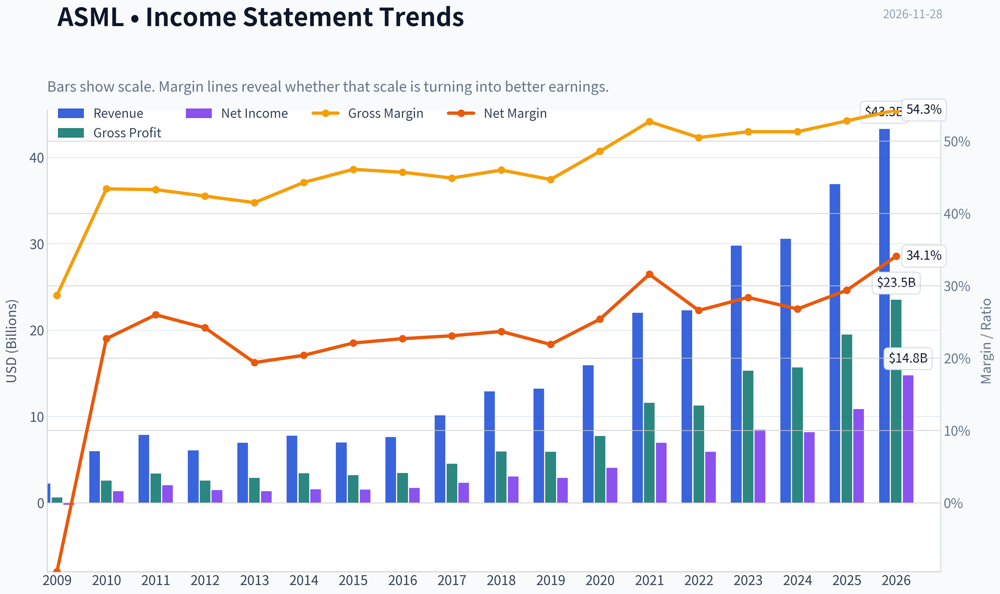

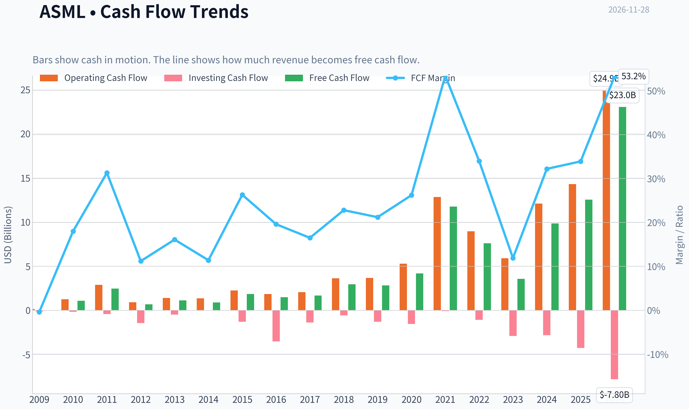

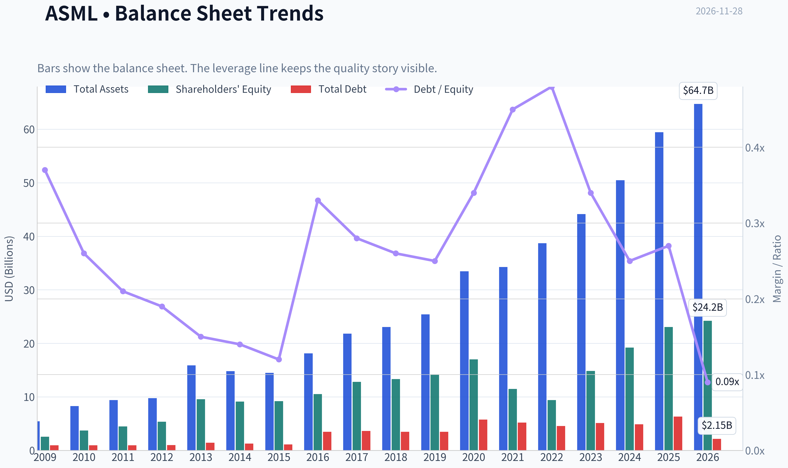

This graph tracks the profitability and return metrics (ROE, ROIC, Margins) of **ASML** over the past decade, highlighting capital efficiency trends.

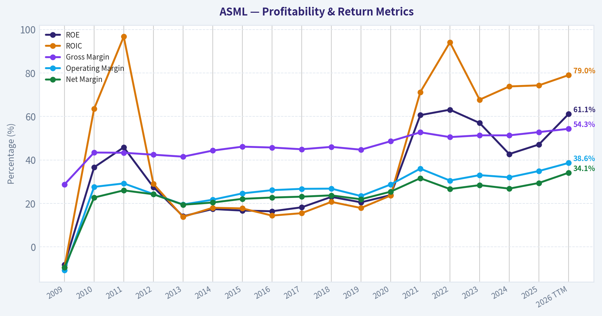

This chart illustrates the financial health of **ASML** over the last 10 years, mapping cash equivalents and free cash flow against total obligations (Debt).

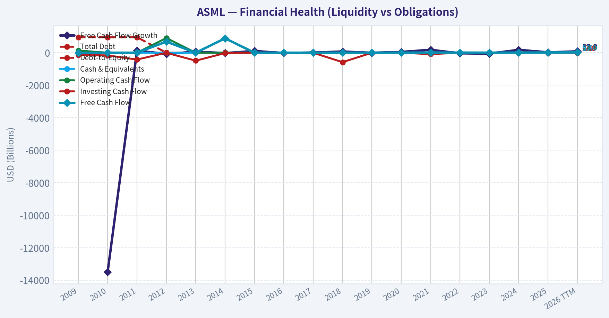

This breakdown chart from <em>Cash Flow and Capital Allocation</em> shows the proportional composition for **ASML** - useful for understanding what drives or risks the business.

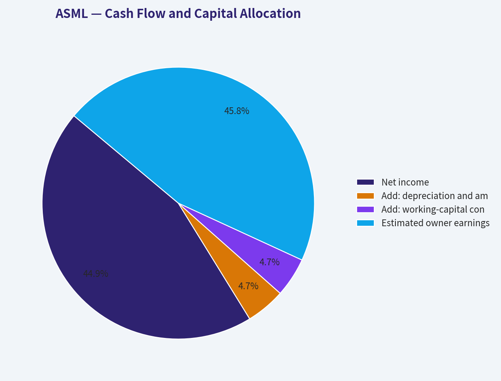

---

### Intrinsic Value Analysis (Buffett)

> *Following Warren Buffett's value investing philosophy: Circle of Competence, Economic Moat, Management Quality, and Margin of Safety.*

#### Intrinsic Value Snapshot

Price is what you pay. Intrinsic value is what the business may be worth based on the cash it can create for owners over time. We show a range, not one magic number.

- Current Price: $1,325.82
- Value Range (conservative to optimistic across both DCF methods): $383.09 to $5,659.59

##### Owner Earnings (Buffett Method)
- Net Income: $10,858,814,188.00
- Depreciation & Amortization: $1,125,630,847.33
- Capital Expenditures: $-1,778,199,472.00
- Working Capital Changes: $1,126,289,175.15
- Owner Earnings: $11,074,162,319.05

##### Intrinsic Value
###### Buffett Method
Uses owner earnings. Stricter, and usually more conservative.
- Conservative: $643.22
- Average: $1,708.66
- Optimistic: $3,833.20
- Discount Rate: 8.3%

###### Cash Flow Method
Uses free cash flow. Better for companies spending heavily today to grow tomorrow.
- Conservative: $383.09
- Average: $1,451.99
- Optimistic: $5,659.59
- Discount Rate: 10.0%

ANALYST STANCE: **Neutral**

#### Executive Assessment

ASML is an exceptional semiconductor-equipment franchise with a uniquely powerful competitive position in extreme ultraviolet lithography, or EUV. Its 52.8% gross margin, 47.1% ROE, 20.7% revenue growth, and long-term technological importance demonstrate outstanding economics.

The central issue is valuation. At $1,326 per share, the price is approximately 10.4% above the $1,201.45 DVI estimate. That valuation is demanding even for a wide-moat compounder, although the reverse-DCF indicates that the market is pricing in approximately 9.4% annual growth over the next decade, below the trailing three-year growth rate of 12.1%.

#### 1. Factor Scorecard

| Factor | Score | Assessment |
|---|---:|---|
| Circle of competence and simplicity | 3/5 | The basic model is understandable: ASML sells highly specialized machines used to manufacture advanced semiconductors. Predictability is reduced by semiconductor cycles, export controls, and major customer concentration. |
| Moat and competitive advantage | 5/5 | EUV leadership, enormous technological barriers, deep customer integration, intellectual property, and a highly specialized supplier ecosystem create an unusually strong moat. |
| Management and capital allocation | 3/5 | The long-term investment program and sustained R&D commitment appear rational. The available evidence is insufficient to award the highest score for owner-oriented compensation, acquisition discipline, and per-share capital allocation. |
| Industry structure | 3/5 | ASML operates in a strategically important, highly concentrated industry, but demand remains cyclical and geopolitical restrictions can materially affect sales. |

**Key Takeaways:** ASML scores highest on competitive advantage, not simplicity or valuation. The business is understandable at a high level, but earnings remain exposed to semiconductor cycles and government export policy.

#### 2. Moat Analysis

| Moat source | Evidence | Quality assessment |
|---|---|---|
| Intangible assets | EUV technology, patents, engineering expertise, and accumulated process knowledge | Exceptional |
| Switching costs | Chip manufacturers must qualify lithography systems within complex production processes; switching suppliers would be operationally and technologically difficult | Very strong |
| Cost and scale advantages | High R&D scale, specialized manufacturing, and a global supplier network reinforce ASML's lead | Strong |
| Network and ecosystem effects | ASML works within a tightly integrated ecosystem involving leading chipmakers, optics suppliers, and research partners | Strong |
| Financial evidence | 52.8% gross margin and 47.1% ROE | Consistent with substantial pricing power and capital efficiency |

ASML's moat is best described as **wide and durable**, with some widening characteristics through continued EUV innovation. The principal threat is not ordinary competition but government intervention, customer concentration, or a major technological transition that reduces the importance of ASML's current architecture.

**Key Takeaways:** ASML's moat is based on technological complexity, accumulated know-how, ecosystem integration, and customer dependence. Competitors would need to replicate decades of research, supplier relationships, and field experience rather than simply launch a competing product.

#### 3. Management Quality Assessment

Management's most important capital-allocation decision is sustained investment in research and development. That strategy has produced a strategically indispensable technology platform rather than merely expanding capacity in a commoditized market.

The main deductions are:

- Semiconductor equipment requires substantial long-cycle investment before commercial returns appear.
- Customer and government relationships require careful geopolitical management.
- The business must balance near-term order volatility against long-term technology leadership.
- The available data does not establish that management compensation is unusually aligned with per-share intrinsic value or that all acquisitions have been consistently value-creating.

Overall management quality is assessed at **3 out of 5**: strategically capable, but not awarded a top score without stronger evidence on compensation design, acquisitions, and shareholder distributions.

#### 4. Financial Summary

| Metric | Latest figure |
|---|---:|
| Share price | $1,326 |
| Market capitalization | $510.99 billion |
| P/E ratio | 34.5x |
| ROE | 47.1% |
| Gross margin | 52.8% |
| Revenue growth, year over year | 20.7% |
| Free-cash-flow yield | 2.5% |
| Implied free cash flow | Approximately $12.8 billion |
| Current ratio | 1.26x |
| Reverse-DCF price-implied annual growth, 10 years | Approximately 9.4% |
| Trailing three-year growth | 12.1% |
| Trailing five-year growth | 34.4% |

**Key Takeaways:** ASML combines very high profitability with strong recent growth. However, the 2.5% free-cash-flow yield and 34.5 times earnings multiple indicate that the market already assigns substantial value to future growth.

#### 5. Owner Earnings Calculation

The available valuation data provides a free-cash-flow yield but does not provide a separate maintenance-capital-expenditure figure. Therefore, free cash flow is used as a conservative owner-earnings proxy rather than treating all reported capital expenditure as maintenance spending.

| Owner-earnings component | Approximate amount |
|---|---:|
| Net income | Not separately provided in the research summary |
| Depreciation and amortization | Not separately provided |
| Less: maintenance capital expenditure | Not separately provided |
| Less: working-capital investment | Not separately provided |
| Free-cash-flow proxy for owner earnings | $12.8 billion |
| Implied shares outstanding | Approximately 385.4 million |
| Owner-earnings proxy per share | Approximately $33.15 |

The implied free cash flow is calculated as:

**$510.99 billion market capitalization x 2.5% FCF yield = approximately $12.8 billion.**

**Key Takeaways:** ASML's cash-generation ability is substantial, but a precise Buffett-style owner-earnings figure requires separating maintenance capital expenditure from growth investment. The available free-cash-flow proxy supports strong economics but also confirms that the current valuation reflects a low cash yield.

#### 6. Balance-Sheet and Solvency Assessment

| Balance-sheet indicator | Assessment |
|---|---|
| Current ratio | 1.26x |
| Debt-to-equity | Not provided in the research summary |
| Interest coverage | Not provided in the research summary |
| Net cash or net debt | Not provided in the research summary |
| Solvency conclusion | No evidence of financial distress |

ASML's strong profitability and cash generation do not indicate a deteriorating earnings or cash-flow trajectory. The Gate 5 hard floor is **not tripped**: there is no evidence here of both worsening fundamentals and a solvency red line such as interest coverage below 1x.

**Key Takeaways:** The available evidence supports financial viability rather than distress. The balance-sheet score is held at the middle level because complete debt, cash, and interest-coverage figures are not included in the research summary.

#### 7. Three-Scenario DCF Valuation

The following scenarios use the approximately $12.8 billion free-cash-flow proxy and approximately 385.4 million implied shares. They are sensitivity analyses, not the headline intrinsic value.

| Scenario | Key assumptions | Approximate value per share |
|---|---|---:|
| A: No growth | Owner-earnings proxy of $12.8 billion divided by a 10% discount rate | $332 |
| B: GDP growth | 3% annual growth and a 10% discount rate | $488 |
| C: Historical-growth sensitivity | 6.1% annual growth, representing 50% of the trailing three-year growth rate, with a 10% discount rate | $896 |
| DVI estimate | Weighted blend of owner-earnings, FCFF, and reverse-DCF methods | $1,201 |

The DVI model's component outputs are:

- Owner-earnings model: **$1,708.66**
- FCF model: **$1,451.99**
- Damodaran FCFF model: **$593.91**
- Weighted DVI estimate: **$1,201.45**

**Key Takeaways:** Conservative no-growth and GDP-growth methods produce values well below the current price, while a historical-growth sensitivity produces a much higher result. The wide spread demonstrates that ASML's valuation depends heavily on the assumed durability of above-average growth and the treatment of reinvestment cash flows.

#### 8. Margin of Safety Analysis

| Measure | Result |
|---|---:|
| Current price | $1,326 |
| DVI intrinsic-value estimate | $1,201.45 |
| Difference from intrinsic value | Approximately 10.4% above estimate |
| Required margin for a wide-moat compounder | Approximately 10%-15% below intrinsic value |
| Reverse-DCF implied annual growth | Approximately 9.4% |
| Trailing three-year annual growth | 12.1% |

ASML is a high-quality business for which a very large discount is not necessary. Nevertheless, the headline DVI estimate provides a negative margin of safety at the current price. The reverse-DCF is more favorable: a 9.4% implied growth rate is below the recent three-year rate, but it still requires sustained high-quality execution across a cyclical and politically sensitive industry.

**Key Takeaways:** The valuation is not supported by a conventional margin of safety against the DVI estimate. The price becomes more defensible if ASML can sustain growth near its recent historical rate, but the market is still assigning meaningful value to long-term execution.

#### 9. Final Buffett Scorecard

| Criterion | Weight | Score | Weighted contribution |
|---|---:|---:|---:|
| Moat width and durability | 25% | 5/5 | 1.25 |
| Valuation and margin of safety | 20% | 1/5 | 0.20 |
| Capital returns versus cost of capital | 15% | 4/5 | 0.60 |
| Business understanding and predictability | 12% | 3/5 | 0.36 |
| Management quality and capital allocation | 12% | 3/5 | 0.36 |
| Reinvestment runway | 8% | 4/5 | 0.32 |
| Balance-sheet strength | 4% | 3/5 | 0.12 |
| Industry structure | 4% | 3/5 | 0.12 |
| **Total** | **100%** |  | **3.33/5** |

**Key Takeaways:** ASML's quality score is elevated by its extraordinary moat, high returns, and long reinvestment runway. The valuation score is the decisive weakness, bringing the overall result into the Neutral range despite excellent business economics.

#### Investment Stance

**ANALYST STANCE: Neutral**

**Conviction: High on business quality; moderate-to-high on valuation concern.**

ASML is one of the strongest industrial technology franchises globally, with a moat that is difficult to replicate and a reinvestment runway supported by the continuing complexity of semiconductor manufacturing. The evidence implies that the business is excellent, financially productive, and strategically important.

At $1,326, however, the price is approximately 10.4% above the DVI intrinsic-value estimate, and the free-cash-flow yield is only 2.5%. The valuation could be justified by sustained growth near historical levels, but the margin of safety is not yet evident under conservative assumptions.
#### Valuation Bridge

This bridge places the current market price beside each intrinsic value lens so readers can see whether upside depends on one method or shows up across several methods.

| Scenario | Intrinsic Value / Share |
| --- | ---: |
| Buffett Method | $1,708.66 |
| Cash Flow Method | $1,451.99 |
| Damodaran Method | $593.91 |
| Current Price | $1,325.82 |

#### Key Takeaways

If one method is far above the others, the upside case depends on a specific modelling assumption. When several methods cluster together, the valuation story is more robust.

#### Valuation Visuals

This comparison chart from *Latest Earnings Snapshot* stacks current figures against historical benchmarks for **ASML**, making it easy to see where the company trades relative to its own averages.

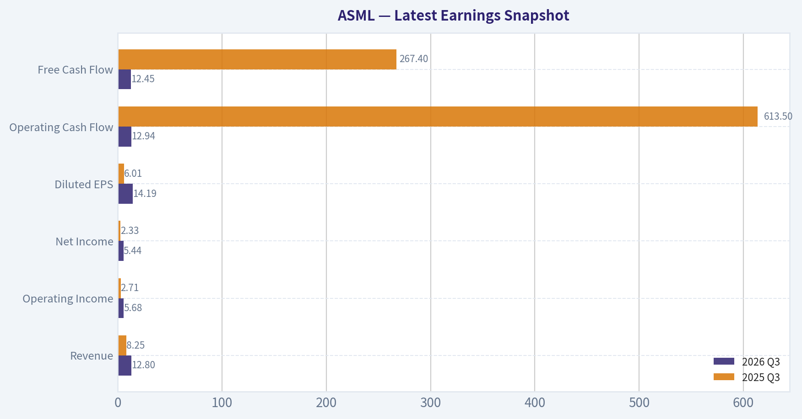

This comparison chart from *Current Metrics and Historical Comparison* stacks current figures against historical benchmarks for **ASML**, making it easy to see where the company trades relative to its own averages.

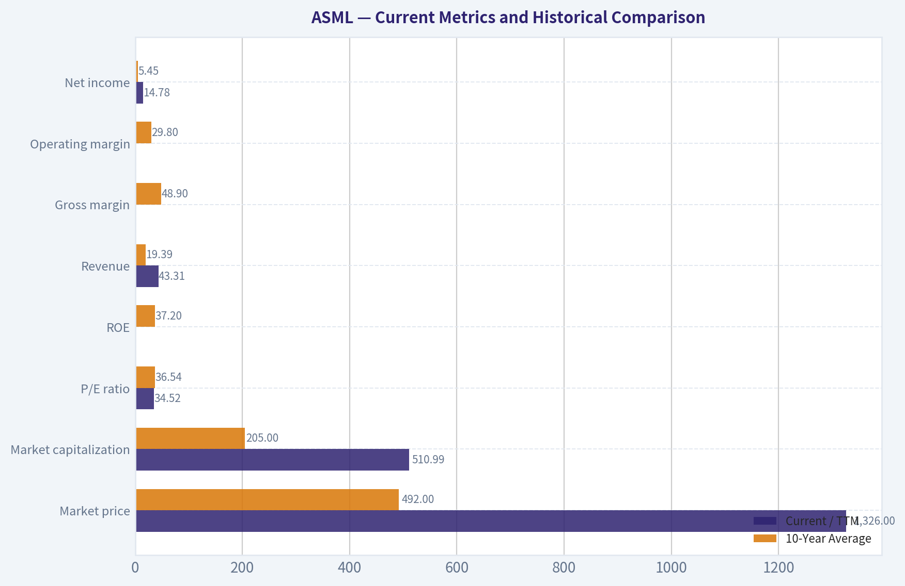

The following chart maps the **ASML** Owner Earnings DCF valuation scenarios (Conservative, Average, Optimistic) to visually represent the margin of safety based on intrinsic value calculations.

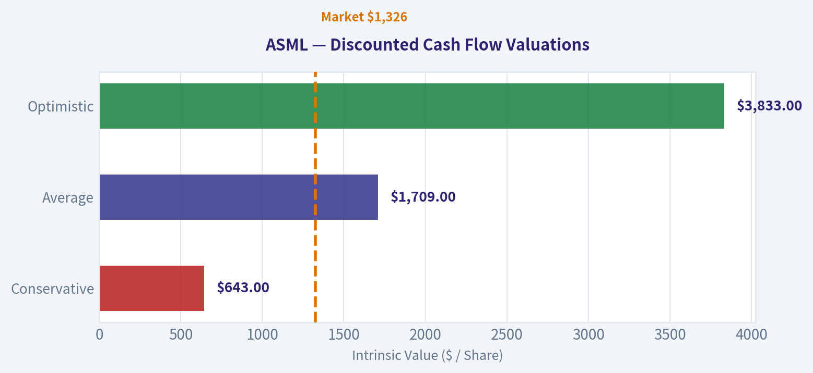

This comparison chart from *Financial Summary* stacks current figures against historical benchmarks for **ASML**, making it easy to see where the company trades relative to its own averages.

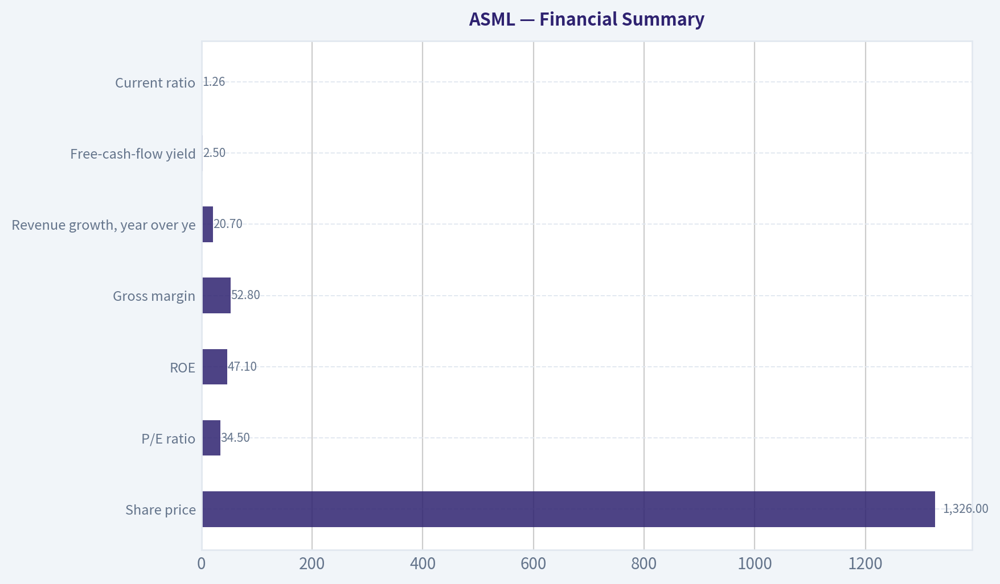

The following chart maps the **ASML** Owner Earnings DCF valuation scenarios (Conservative, Average, Optimistic) to visually represent the margin of safety based on intrinsic value calculations.

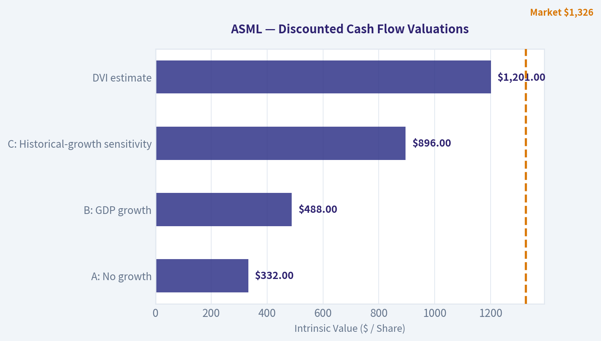

---

### Trend & Growth Analysis (Lynch/Druckenmiller/Fisher)

> *Following Peter Lynch's GARP, Stanley Druckenmiller's macro-aware approach, and Philip Fisher's scuttlebutt methodology.*

ANALYST STANCE: **Neutral**

#### Executive view

ASML is a **high-quality fast grower with an exceptional competitive moat**, but the current valuation already discounts substantial long-term growth. The company is the critical supplier of extreme ultraviolet, or EUV, lithography systems used to manufacture leading-edge semiconductors. Its strategic importance is reinforced by artificial intelligence, advanced computing, and semiconductor sovereignty spending.

The evidence supports a strong business and durable secular growth, but it does not clearly support the current price of **$1,326**, which is approximately **10.4% above the blended intrinsic-value estimate of $1,201**.

#### 1. Lynch classification

| Category | Assessment |
|---|---|
| Lynch classification | Fast grower, with cyclical characteristics |
| Recent revenue growth | 20.7% year over year |
| Competitive position | Global lithography leader and EUV monopoly |
| Growth durability | Strong, but linked to semiconductor capital-spending cycles |
| Main classification risk | High valuation and cyclical order timing |

**Key Takeaways:** ASML fits Lynch's fast-grower category because recent revenue growth exceeds 20% and the company still benefits from expanding semiconductor complexity. It is not a pure secular grower, however, because chip-equipment spending can be cyclical and customer orders can be lumpy.

#### 2. The story in three bullets

- **ASML sells the indispensable machines required to produce the world's most advanced chips.**
- **AI accelerators, high-performance computing, and advanced-node migration increase demand for more lithography intensity per chip.**
- **Its EUV technology, installed base, intellectual property, and ecosystem create unusually high barriers to entry.**

The simple version is: ASML is a toll collector on the leading edge of semiconductor manufacturing.

#### 3. TAM and the 10x test

ASML reported approximately **$35.9 billion** of 2025 revenue after conversion from euros using the supplied exchange rate. A literal 10x outcome would imply approximately **$359 billion** of annual revenue.

| TAM consideration | Assessment |
|---|---|
| Current revenue base | Approximately $35.9B |
| 10x revenue test | Approximately $359B |
| Core lithography market | Large and strategically important, but likely too small for a literal 10x ASML outcome |
| Broader opportunity | EUV, high-NA EUV, DUV, service, metrology-related ecosystem, and greater lithography intensity |
| TAM growth drivers | AI, advanced logic, memory complexity, chip localization, and smaller process nodes |
| 10x test result | Fails on the narrow lithography market; more plausible on a broader semiconductor infrastructure interpretation |

**Key Takeaways:** ASML has a long runway, but the strict 10x test is demanding. The company can grow materially through higher system prices, service revenue, high-NA EUV, and increased lithography intensity, yet a literal tenfold revenue outcome would require substantial expansion beyond today's core lithography market.

#### 4. Revenue growth trend

| Metric | Reading | Interpretation |
|---|---:|---|
| Year-over-year revenue growth | 20.7% | Fast-grower territory |
| Three-year implied growth reference | 12.1% trailing reference | Below the recent growth rate |
| Five-year implied growth reference | 34.4% trailing reference | Strong historical compounding, partly cyclical |
| Current pattern | Strong but cyclical | Not a clean, linear acceleration |

**Key Takeaways:** Recent growth is strong, but the available data does not establish a persistent acceleration pattern such as 20%, 25%, then 35%. ASML's historical growth has been powerful but uneven, reflecting semiconductor capital-spending cycles and shipment timing.

#### 5. Unit economics and operating quality

| Metric | Result | Assessment |
|---|---:|---|
| Gross margin | 52.8% | Excellent for industrial equipment |
| ROE | 47.1% | Exceptional capital productivity |
| Current ratio | 1.26 | Adequate liquidity |
| FCF yield | 2.5% | Indicates a demanding valuation |
| LTV/CAC | Not disclosed/applicable | Equipment model rather than subscription model |
| NRR | Not disclosed/applicable | Not a conventional SaaS business |
| Rule of 40 | Not calculable | FCF margin was not supplied |

**Key Takeaways:** ASML's gross margin and ROE demonstrate substantial pricing power, technological differentiation, and capital efficiency. SaaS metrics such as LTV/CAC and NRR are not meaningful here; the more relevant concerns are order visibility, service attachment, backlog quality, and semiconductor-cycle exposure.

#### 6. Inflection-point assessment

| Inflection area | Evidence | Assessment |
|---|---|---|
| Product cycle | EUV adoption and high-NA EUV development | Positive |
| TAM expansion | AI and advanced-node complexity | Positive |
| Market share | Dominant position in EUV | Already extremely strong |
| Margin inflection | 52.8% gross margin and high ROE | Positive, but expectations are elevated |
| Competitive inflection | No credible EUV substitute currently evident | Strong moat |
| Near-term earnings inflection | Dependent on customer fab ramps and order timing | Uncertain |

**Key Takeaways:** ASML's largest inflection is structural rather than newly emerging: EUV has become essential to leading-edge production. The next potential acceleration comes from high-NA EUV and AI-driven capacity expansion, but timing remains tied to semiconductor manufacturers' capital-allocation decisions.

#### 7. Macro setup

| Macro factor | Impact on ASML |
|---|---|
| AI and advanced computing | Strong structural tailwind |
| Semiconductor sovereignty | Supports regional fab investment |
| Interest rates | Lower rates support valuation; higher rates pressure the multiple |
| Semiconductor cycle | Important source of volatility |
| China export restrictions | Material revenue and service risk |
| Geopolitical fragmentation | Both a demand driver and operating constraint |

**Key Takeaways:** The secular macro backdrop is favorable because AI and national semiconductor strategies require significant equipment investment. The offset is geopolitical: export controls, restrictions involving China, and supply-chain fragmentation can limit addressable demand or increase operating complexity.

#### 8. Fisher 15-point assessment

| Fisher factor group | Score |
|---|---:|
| Market potential, innovation, and R&D | 14/15 |
| Sales organization, margins, and cost discipline | 13/15 |
| Labor, executive depth, and internal relationships | 11/15 |
| Competitive advantages and long-range outlook | 14/15 |
| Capital allocation, candor, and integrity | 12/15 |
| **Total** | **64/75** |

**Key Takeaways:** ASML scores in Fisher's "good" range, near the threshold for outstanding. The strongest attributes are market potential, engineering capability, customer integration, and technological barriers; the deductions reflect geopolitical exposure, cyclical visibility, and the difficulty of independently verifying forward execution.

#### 9. Valuation analysis

| Valuation measure | Result | Interpretation |
|---|---:|---|
| Current price | $1,326 | Reference market price |
| Market capitalization | $510.99B | Very large capitalization |
| P/E | 34.5x | Premium valuation |
| PEG proxy using 20.7% revenue growth | 1.67x | Fair-to-expensive; not a true earnings PEG |
| FCF yield | 2.5% | Expensive on current cash generation |
| Blended intrinsic-value estimate | $1,201 | Below current price |
| Headline margin versus intrinsic value | -10.4% | Valuation cushion is absent |
| Reverse-DCF implied growth | Approximately 9.4% annually for 10 years | Requires sustained long-term execution |

**Key Takeaways:** ASML is not valued like an ordinary industrial company. Its 34.5 times earnings multiple is defensible only if its monopoly, growth, and long-term margins remain unusually durable. The supplied valuation models collectively indicate that the current price contains a meaningful amount of future success.

#### 10. Valuation scenarios

These are analytical scenarios rather than estimated value or investment instructions.

| Scenario | Operating assumptions | Valuation implication |
|---|---|---|
| Bear | Semiconductor downturn, prolonged export restrictions, slower EUV adoption, multiple compression | Current valuation would be vulnerable |
| Base | Roughly high-teens revenue growth over several years, strong service contribution, stable premium multiple | Valuation appears broadly full |
| Bull | High-NA EUV ramps successfully, AI infrastructure spending remains strong, margins expand, premium persists | Upside requires sustained execution and favorable macro conditions |

**Key Takeaways:** The bear case has asymmetric sensitivity because ASML's valuation is premium and its end market is cyclical. The bull case is credible, but it requires several favorable conditions to occur together: continued AI spending, successful high-NA EUV adoption, robust customer capex, and limited geopolitical disruption.

#### 11. Growth investor scorecard

| Criterion | Weight | Score | Weighted result |
|---|---:|---:|---:|
| The story | 10% | 4.8/5 | 0.48 |
| TAM and runway | 20% | 4.0/5 | 0.80 |
| Revenue growth | 20% | 4.0/5 | 0.80 |
| Unit economics | 15% | 4.4/5 | 0.66 |
| Competitive position | 10% | 5.0/5 | 0.50 |
| Management quality | 10% | 4.2/5 | 0.42 |
| Macro setup | 5% | 3.8/5 | 0.19 |
| Profitability path | 5% | 4.7/5 | 0.24 |
| Valuation | 5% | 2.5/5 | 0.13 |
| **Total** | **100%** | - | **4.22/5** |

**Key Takeaways:** On business quality and growth characteristics, ASML scores very highly. The main deduction is valuation, followed by cyclicality and geopolitical risk; the overall score indicates an outstanding company whose market valuation leaves limited analytical margin for execution disappointments.

#### 12. Valuation sensitivity

| Variable | More favorable outcome | Less favorable outcome |
|---|---|---|
| EUV adoption | Faster high-NA ramp and greater tool intensity | Delayed customer adoption |
| Revenue growth | Sustained above 20% | Reversion toward low-teens growth |
| Gross margin | Mix and pricing support expansion | Product mix or investment pressure |
| China exposure | Stable access and service | Broader export restrictions |
| Multiple | Premium persists | Re-rating toward industrial-equipment norms |
| Interest rates | Falling or stable rates | Higher-for-longer rates |

**Key Takeaways:** The valuation is most sensitive to the combination of growth and the earnings multiple. Even a modest slowdown can matter because the current price assumes a long period of high-quality execution, while geopolitical restrictions and higher interest rates could compress the valuation independently of the company's technology leadership.

#### 13. Key risks and catalysts

| Catalysts | Risks |
|---|---|
| High-NA EUV production ramp | US, Dutch, or allied export restrictions |
| AI-related logic and memory investment | Semiconductor capital-spending downturn |
| Higher service and installed-base revenue | Customer concentration and order lumpiness |
| Greater chip complexity and lithography intensity | Delays at leading-edge foundries |
| Continued monopoly economics | China's domestic equipment development |
| Operating leverage from scale | Valuation compression from higher rates |

**Key Takeaways:** The principal catalysts are high-NA EUV, AI infrastructure demand, and recurring service growth. The principal risks are not technological obsolescence today, but cyclical spending, geopolitical restrictions, execution timing, and the premium valuation already embedded in the shares.

#### Bottom line

ASML is a **premier fast-growing technology infrastructure company** with one of the world's strongest competitive moats. Its business quality, innovation profile, and secular exposure are consistent with Lynch, Druckenmiller, and Fisher-style growth analysis.

However, the current valuation around **$1,326** appears demanding relative to the supplied intrinsic-value estimate and cash-flow yield. The evidence supports a **Neutral** stance: exceptional business quality, substantial long-term runway, but insufficient valuation cushion and meaningful sensitivity to semiconductor cycles and geopolitical developments.

---

### Market Technical Analysis

ANALYST STANCE: **Neutral**

#### ASML technical analysis

ASML's latest available Nasdaq price data is dated November 27, 2026, because November 28 was a non-trading day. The stock closed at **$1,325.82**, down from its June 30 closing peak of **$1,984.25**. That represents an approximately **33.2% decline from the peak**, although the stock remains about **25.8% above** its November 28, 2025 close of $1,053.54.

The selected indicators are **10 EMA, 50 SMA, 200 SMA, MACD, RSI, Bollinger Upper Band, Bollinger Lower Band, and ATR**. Together, they cover short-, medium-, and long-term trend, momentum, relative strength, volatility, and the investment case within the recent trading range without adding highly redundant signals.

#### Trend structure

The short-term trend is clearly weak. The close of **$1,325.82** is below the **10-day EMA at $1,366.55**, showing that the latest rebound has not yet repaired short-term momentum. More importantly, the price is substantially below both the **50-day SMA at $1,602.52** and the **200-day SMA at $1,596.00**.

The 50-day average has fallen from approximately $1,706 at the end of October to $1,603 by November 27. That is a meaningful deterioration in medium-term trend. The 200-day average has been comparatively stable near $1,596, so the long-term benchmark has not yet fully rolled over. However, the price being roughly **17% below the 200-day SMA** indicates that current market pricing is materially weaker than the longer historical trend.

The 50-day SMA remains just above the 200-day SMA by roughly **$6.52**, a narrow spread. This means the longer-term moving-average structure has not produced a decisive bearish crossover in the supplied data, but the declining 50-day average and the large price gap below both averages show substantial deterioration beneath that relatively stable long-term structure.

#### Momentum and MACD

MACD is deeply negative at **-80.43** on November 27. It deteriorated from **-29.16 on October 29**, confirming that downside momentum intensified during November. There was a small improvement from **-81.36 on November 25** to **-80.43**, but this is too limited to establish a durable momentum reversal.

The November sequence also shows that brief rebounds were repeatedly followed by renewed weakness. For example, the stock recovered from a November 5 close of $1,356.65 to $1,534.42 on November 11, but then fell to $1,266.22 by November 20. The subsequent recovery to $1,383.78 on November 23 failed to persist, and the stock closed lower on November 24 and November 25 before a modest November 27 bounce. This pattern reflects fragile countertrend strength rather than sustained upside momentum.

#### RSI and oversold conditions

RSI was **38.48** on November 27. It has improved from **28.90 on November 20**, which was technically oversold under the conventional 30 threshold. That rebound indicates that the most intense selling pressure has eased somewhat.

However, RSI remains below the neutral 50 area and has not reached a level associated with convincing bullish momentum. The distinction is important: the RSI reading suggests that the stock is no longer deeply oversold, but it does not yet show strong demand or a confirmed trend change. The November 20 oversold reading occurred during a sharp decline, and the subsequent RSI recovery has been accompanied by only a limited price rebound.

#### Bollinger Bands and price location

On November 27, the Bollinger Upper Band was **$1,614.36** and the Lower Band was **$1,248.24**. The implied middle band is approximately **$1,431.30**. ASML closed about **$105 below the middle band** and approximately **$77.58 above the lower band**.

This places the stock in the lower portion of its recent volatility envelope, but not directly at the lower band. The lower band itself has moved down from approximately $1,511 on October 29 to $1,248, reflecting a substantial expansion and downward migration of the recent trading range. That behavior is consistent with an established decline rather than a quiet consolidation.

The November 25 intraday low of $1,235.10 briefly moved below the November 27 lower-band reference, while the November 20 low reached $1,258.53. These tests of the lower range show persistent downside pressure. The November 27 close above the lower band is constructive over the very short term, but it does not offset the broader fact that both the Bollinger midpoint and upper band have been trending downward.

#### Volatility and risk characteristics

ATR stood at **$73.43** on November 27, up from **$52.50 on October 29**. Relative to the latest close, ATR is approximately **5.5% of price**, which is elevated for a large-cap stock. The increase in ATR confirms that daily price swings have become materially larger.

Recent trading illustrates this volatility. The stock fell from $1,495.16 on November 13 to $1,406.79 on November 16, then declined to $1,266.22 by November 20. It subsequently rebounded to $1,383.78 on November 23 before falling again to $1,303.08 on November 25. This combination of wide ranges and rapid reversals makes individual daily moves less reliable as evidence of a lasting trend shift.

#### Valuation implications

Technical indicators cannot determine intrinsic value or establish whether ASML is fundamentally inexpensive or expensive. They do show that the market has sharply reduced the price relative to the June high, while current trading remains beneath all three selected moving-average benchmarks.

The evidence therefore implies a market that is still discounting substantial uncertainty and weak near-term price momentum. The oversold RSI reading from November 20 and the modest November 27 rebound indicate potential short-term stabilization, but the negative MACD, declining 10-day and 50-day averages, lower Bollinger range, and elevated ATR do not yet provide strong technical confirmation that the valuation discount reflects a completed repricing.

#### Key indicator summary

| Indicator | Latest reading | Recent direction | Interpretation |
|---|---:|---|---|
| Closing price | $1,325.82 | Rebounded from $1,303.08, but remains near recent lows | Short-term stabilization within a broader decline |
| 10-day EMA | $1,366.55 | Falling sharply | Price remains below short-term trend |
| 50-day SMA | $1,602.52 | Declining from about $1,706 | Medium-term trend is decisively weak |
| 200-day SMA | $1,596.00 | Broadly flat to slightly higher | Long-term benchmark is stable, but price is far below it |
| MACD | -80.43 | Deeply negative; slight improvement from November 25 | Downside momentum remains dominant |
| RSI | 38.48 | Recovered from 28.90 | Prior oversold pressure eased, but momentum remains below neutral |
| Bollinger Bands | Upper $1,614.36; lower $1,248.24 | Bands shifted lower and widened | Price is in the lower part of a stressed volatility range |
| ATR | $73.43 | Up from $52.50 | Daily volatility is elevated and reversals are more pronounced |

Key Takeaways: ASML's price remains below its short-, medium-, and long-term moving averages, while MACD confirms substantial negative momentum. RSI has recovered from an oversold reading, but it remains below neutral, and the stock is still trading in the lower portion of a widening Bollinger range. The technical evidence points to tentative short-term stabilization within a broader weakened trend, with elevated volatility making the current valuation signal uncertain rather than decisively resolved.

---

### Options Market Analysis

> *Reading options flow - put/call ratios, IV skew, and unusual activity - to gauge institutional positioning and event-driven risk.*

ANALYST STANCE: **Neutral**

#### ASML Options Market Overview

The available data covers near-term expirations from December 4 through December 18, 2026. Aggregate open interest is nearly balanced, but trading volume is modestly put-heavy and the December 11 expiration shows a pronounced concentration of put open interest.

| Expiration | Call OI | Put OI | Put/Call OI Ratio | Call Volume | Put Volume | Put/Call Volume Ratio | ATM Call IV | ATM Put IV |
|---|---:|---:|---:|---:|---:|---:|---:|---:|
| Dec. 4, 2026 | 3,613 | 3,412 | 0.94 | 2,408 | 2,505 | 1.04 | 59.9% | 61.0% |
| Dec. 11, 2026 | 1,819 | 3,460 | 1.90 | 1,206 | 1,118 | 0.93 | 60.1% | 59.5% |
| Dec. 18, 2026 | 25,633 | 24,612 | 0.96 | 2,440 | 3,112 | 1.28 | 59.0% | 57.1% |
| **Total / Aggregate** | **31,065** | **31,484** | **1.01** | **6,054** | **6,735** | **1.11** | - | - |

**Key Takeaways:** Aggregate put/call open interest is 1.01, materially above the historical neutral reference of roughly 0.7 and therefore indicates more defensive or bearish positioning than a neutral options market. The strongest imbalance is at the December 11 expiry, where put open interest is almost twice call open interest. Volume is also put-heavy overall, although the imbalance is not extreme.

#### Put/Call Ratio Analysis

The aggregate open-interest ratio of 1.01 is approximately 44% above the 0.7 neutral reference. This suggests a meaningful tilt toward downside protection or bearish exposure, rather than broad upside speculation.

The December 4 and December 18 expirations are close to balanced on open interest, with ratios of 0.94 and 0.96. The December 11 ratio of 1.90 is the main bearish or hedging signal and may reflect concentrated event protection, calendar-specific hedging, or a localized bearish trade.

| Measure | Reading | Interpretation |
|---|---:|---|
| Aggregate put/call OI ratio | 1.01 | Defensive; above the 0.7 neutral baseline |
| Aggregate put/call volume ratio | 1.11 | Slightly stronger put activity than call activity |
| Highest put/call OI ratio | 1.90 on Dec. 11 | Concentrated downside protection or bearish exposure |
| Lowest put/call OI ratio | 0.94 on Dec. 4 | Roughly balanced |
| December 18 volume ratio | 1.28 | Put activity notably exceeds call activity in the largest OI expiry |

**Key Takeaways:** The options market is not signaling aggressive upside speculation. The overall ratio points to a defensive tilt, driven especially by the December 11 expiration and heavier put volume in the large December 18 open-interest pool.

#### Implied Volatility Assessment

Near-term at-the-money implied volatility ranges from 57.1% to 61.0%, which is elevated-looking for a large-cap semiconductor-equipment company, although a precise historical percentile is not provided. This indicates that the market is pricing substantial short-term movement.

The available data does not provide out-of-the-money call and put IV by strike, so a formal volatility skew calculation is not possible. At-the-money readings show a small put premium at the December 4 expiry, while calls have slightly higher ATM IV at December 11 and December 18.

| Expiration | Call ATM IV | Put ATM IV | ATM IV Difference | Skew Assessment |
|---|---:|---:|---:|---|
| Dec. 4, 2026 | 59.9% | 61.0% | Put IV +1.1 points | Mild downside protection premium |
| Dec. 11, 2026 | 60.1% | 59.5% | Call IV +0.6 points | Slight call-side premium |
| Dec. 18, 2026 | 59.0% | 57.1% | Call IV +1.9 points | Call-side ATM premium |
| **Range** | **59.0%-60.1%** | **57.1%-61.0%** | - | No consistent directional skew at ATM |

**Key Takeaways:** Implied volatility is high enough to signal meaningful near-term event or movement risk. The ATM data does not show a consistent put-skew pattern, but it also does not offset the bearish information from put-heavy open interest. A known catalyst cannot be confirmed from the supplied data, so the source of the elevated IV remains uncertain.

#### Unusual Options Activity

No contract met the supplied unusual-activity threshold of volume greater than five times open interest. Consequently, there is no confirmed fresh, high-conviction directional trade that can be classified as an institutional sweep or similarly aggressive transaction.

| Unusual-Activity Test | Result | Interpretation |
|---|---|---|
| Contracts with volume greater than 5x open interest | None | No clear fresh directional concentration |
| Fresh call activity | Not identified | No validated upside speculation signal |
| Fresh put activity | Not identified | No validated single-contract bearish sweep |
| Smart-money inference | Limited | Open-interest patterns provide more evidence than trade-level flow |

**Key Takeaways:** The bearish read comes from aggregate positioning rather than a single unusual contract. Because no contracts exceeded the volume-to-open-interest threshold, the data does not support confidently attributing the activity to a specific institutional trade or retail speculation pattern.

#### Open Interest Concentration and Gamma Considerations

The December 18 expiration contains by far the largest concentration of open interest, with 50,245 combined contracts. It therefore has the greatest potential to influence short-term pinning or dealer hedging behavior. However, strike-level open-interest data was not supplied, so specific gamma walls, maximum-pain strikes, and price-gravity levels cannot be identified.

| Expiration | Combined OI | Share of Reported OI | Market-Structure Significance |
|---|---:|---:|---|
| Dec. 4, 2026 | 7,025 | 11.2% | Smaller near-term expiration |
| Dec. 11, 2026 | 5,279 | 8.4% | Smallest OI pool but strongest put imbalance |
| Dec. 18, 2026 | 50,245 | 80.3% | Dominant concentration; greatest potential pinning effect |
| **Total** | **62,549** | **100.0%** | - |

**Key Takeaways:** December 18 is the dominant expiration and is the most relevant horizon for potential pinning or dealer-gamma effects. The absence of strike-level data prevents identifying whether calls or puts create the stronger gamma wall, so the direction and strength of any price-amplifying effect remain uncertain.

#### Overall Options Sentiment Signal

**Overall signal: BEARISH, with moderate confidence.**

The primary driver is the combination of an aggregate put/call open-interest ratio of 1.01, a put/call volume ratio of 1.11, and especially the 1.90 put/call open-interest ratio at the December 11 expiration. These readings indicate more downside protection or bearish exposure than expected under the historical neutral reference of approximately 0.7.

The bearish signal is moderated by the lack of unusual single-contract activity and the absence of a consistently steep put volatility skew. The data set is sufficiently active to show a directional tilt, but it does not provide enough strike-level detail to establish specific gamma levels or distinguish hedging from outright bearish speculation with high confidence. The options evidence implies that near-term valuation is being assessed with a meaningful downside-risk premium.

| Category | Assessment |
|---|---|
| Put/Call Ratio | **Bearish-leaning:** aggregate OI ratio 1.01 and volume ratio 1.11, both above neutral |
| IV Level | **Elevated:** near-term ATM IV approximately 57%-61% |
| Skew Direction | **Indeterminate overall:** mild put premium at Dec. 4, call premium at later expirations; OTM skew unavailable |
| Unusual Activity | **None detected:** no contract had volume above 5x open interest |
| Overall Signal | **BEARISH, moderate confidence:** defensive positioning dominates, but no major fresh sweep confirms conviction |

**Key Takeaways:** ASML's near-term options market carries a bearish defensive bias, primarily from elevated put open interest and slightly heavier put volume. High implied volatility signals substantial event or movement risk, while the lack of unusual activity and strike-level skew data limits confidence in the strength and precise source of the bearish signal.

---

## Research Team Commentary

> *The Research Manager synthesizes the Bull vs Bear debate into action-free commentary. This is a pre-risk view, not the final stance.*

Core takeaway: ASML is a wonderful business, but the evidence does not yet establish a wonderful valuation. Its near-monopoly in advanced lithography, extraordinary returns on capital, installed-base economics, and importance to advanced semiconductor production make its ten-year business prospects unusually strong. At roughly $1,326 and 34.5 times earnings, however, the market already assumes substantial growth, durable margins, successful technology transitions, and manageable geopolitical restrictions. Without a credible intrinsic-value estimate based on normalized free cash flow, the appropriate stance is Neutral.

The strongest bull argument is the quality and durability of ASML's moat. EUV lithography is not simply a patented product that a well-funded competitor can reproduce. It combines decades of accumulated knowledge in optics, light sources, precision engineering, software, materials science, and customer process integration. ASML also benefits from a specialized supplier network and an installed base that generates service, software, and upgrade revenue. Its customers may be powerful, but they lack a practical alternative for leading-edge lithography.

The economics support that assessment. A 52.8% gross margin, 47.1% ROE, and reported 71.5% ROIC are exceptional for an industrial technology company. Although the precise ROIC calculation may be elevated by the accounting treatment of internally developed intellectual property, the broader conclusion is difficult to dispute: ASML earns returns far above its cost of capital. AI accelerators, high-performance computing, and advanced-node migration should also increase long-term demand for lithography capability. Semiconductor capital spending will fluctuate, but the technological need for ASML's systems is unlikely to disappear with one downcycle.

Management deserves credit for turning EUV from a long-duration research effort into essential production infrastructure. That record demonstrates technical ambition, patience, and effective coordination with customers and suppliers. High-NA EUV could deepen the moat further if it delivers attractive productivity and cost-per-wafer economics.

The strongest bear argument is not that the franchise will fail. It is that current shareholders are being asked to capitalize much of this success in advance. A 34.5 times P/E represents an earnings yield of only about 2.9%. Depending on free-cash-flow conversion, discount rate, and terminal assumptions, that valuation generally requires sustained high-single-digit or better growth for many years. Such growth is plausible, but plausibility alone is not a margin of safety.

The valuation is also exposed to timing. ASML's customers can postpone orders, change capacity plans, and slow technology adoption even when their long-term roadmaps remain intact. Customer concentration therefore weakens year-to-year predictability. A delayed foundry expansion or memory-capex correction could produce a meaningful earnings pause without damaging ASML's underlying moat. At a premium multiple, merely good results can still disappoint the expectations embedded in the price.

Geopolitics is another genuine valuation variable. Export restrictions can reinforce ASML's strategic importance while simultaneously reducing its accessible market. Both effects can occur at once. Restrictions may limit particular products, raise compliance costs, alter the geographic mix of demand, and encourage state-backed substitution efforts. ASML's technology advantage makes successful substitution difficult, but investors should not treat a technically addressable market as automatically commercially accessible.

High-NA also cuts both ways. Successful adoption could extend ASML's leadership for another generation, but new platforms bring qualification, productivity, reliability, supplier-scaling, and customer-economics risks. Historical ROIC does not guarantee that the next large increment of capacity and R&D spending will earn the same return. Even substantial normalization from 71.5% ROIC would leave ASML an excellent business, but it could matter considerably to a valuation predicated on exceptional incremental economics.

The roughly 33% decline from the June peak improves the valuation relative to that peak, but it does not independently prove undervaluation. The shares remain about 26% above the prior-year comparison close, and the current multiple still contains a meaningful franchise premium. Similarly, put-heavy options activity may reveal near-term defensiveness or hedging, but it contributes little to a ten-year intrinsic-value assessment.

Rationale: The evidence clearly rules out treating ASML as an ordinary cyclical equipment manufacturer. Its moat, returns, management record, and structural runway warrant a premium. Equally, the supplied evidence does not include a DeepValues intrinsic-value estimate, normalized free-cash-flow model, or balance-sheet detail sufficient to demonstrate the quality-scaled 10-15% discount that an exceptional compounder would require under this framework. P/E alone cannot settle the question, especially when earnings may be at a favorable or unfavorable point in the semiconductor cycle.

The key analytical lesson is to keep business quality separate from security valuation. A past mistake in similar situations would be assuming that an exceptional moat or a large drawdown automatically creates a margin of safety. The opposite mistake would be demanding a deep-cyclical multiple from a scarce, high-ROIC technology franchise. Here, neither extreme is justified. The business merits admiration; the current price requires more explicit cash-flow support.

Monitoring plan: Over the next one to four quarters, the most important evidence will be order intake, backlog quality, shipment timing, and customer-capex commentary from major foundry, logic, and memory customers. Improving bookings across multiple customers-rather than dependence on one AI-related spending program-would strengthen confidence in the durability of growth. Repeated order deferrals or weaker backlog conversion would indicate that the premium valuation is more exposed to the cycle than the structural narrative suggests.

High-NA progress should be assessed through customer qualification, commercial-volume adoption, tool productivity, reliability, and cost per wafer. Successful deployments accompanied by firm follow-on demand would strengthen the moat and long-run cash-flow case. Delays, lower utilization, or customer reluctance based on economics would weaken it.

Gross margin and free-cash-flow conversion also matter. Stable margins near current levels, growing service revenue, disciplined working capital, and strong cash generation would support the view that ASML can convert technological leadership into shareholder economics. Rising inventory, slower customer payments, capacity spending ahead of demand, or sustained divergence between earnings and free cash flow would warrant greater valuation caution.

Finally, export-license developments, China revenue exposure, supplier bottlenecks, and incremental returns on new capacity should be monitored. The thesis improves if restricted revenue is replaced by diversified demand elsewhere without material margin erosion. It weakens if regulation permanently narrows the addressable market while capacity and R&D requirements continue rising.

Final stance: Neutral.

---

## Value Investing Team Commentary

> *The Investor translates the research view into an investment thesis before risk review. This is still not the final stance.*

ASML remains one of the rare industrial technology businesses with a genuinely exceptional moat. Its EUV leadership is supported by a difficult-to-replicate combination of optics, software, precision engineering, materials science, supplier coordination, intellectual property, and decades of process knowledge. The installed base adds service and upgrade economics, while customers have no practical substitute for the most advanced lithography systems. This is much more than a conventional semiconductor-equipment cycle.

The reported economics reinforce that conclusion. Gross margin of 52.8%, ROE of 47.1%, and ROIC of 71.5% indicate extraordinary value creation, although the ROIC figure should be interpreted carefully because accounting treatment and temporarily favorable working-capital conditions can influence the calculation. Even after normalization, ASML would likely remain a high-return business with substantial pricing power and strategic importance.

The contrarian opportunity is that current market pessimism may be focusing too heavily on order timing, semiconductor-capital-spending volatility, and the approximately 33% decline from the June peak. A customer postponing a tool shipment does not necessarily impair the ten-year demand for more advanced lithography. AI accelerators, high-performance computing, chiplet architectures, and leading-edge process migration continue to increase lithography intensity. If the current weakness primarily reflects digestion of customer capacity plans rather than technological disruption, sentiment could be exaggerating the durability of the slowdown.

However, selective contrarianism does not mean dismissing the concerns. The more important risk is not that ASML loses its moat, but that the market has already capitalized much of its future success. At approximately $1,326 and 34.5 times earnings, the earnings yield is roughly 2.9%. That valuation can be justified by sustained growth, durable margins, strong free-cash-flow conversion, and successful High-NA adoption, but it leaves less room for execution errors or a prolonged industry pause. A 33% decline from a peak is evidence of changed sentiment, not evidence by itself of undervaluation.

The market may also be underestimating the distinction between technical leadership and commercially accessible demand. Export restrictions can simultaneously validate ASML's strategic importance and reduce the revenue opportunity in affected regions. Restrictions may alter product mix, increase compliance costs, and encourage long-term substitution efforts, even if successful technological replication remains difficult. China exposure, supplier concentration, and government involvement therefore deserve treatment as structural valuation variables rather than temporary headlines.

High-NA EUV is another important test. Successful customer qualification, attractive cost per wafer, strong reliability, and follow-on orders could extend ASML's leadership for another technology generation. Conversely, delays or weaker customer economics would not destroy the franchise, but they could reduce the growth rate and incremental returns assumed in the current valuation. Historical ROIC is evidence of past excellence, not a guarantee that the next major round of research, manufacturing, and capacity investment will earn identical returns.

The options market provides limited insight into intrinsic value. A put/call open-interest ratio near 1.01 and concentrated put interest suggest defensive positioning or hedging, but these instruments mainly describe near-term risk management. They do not establish whether ASML's normalized ten-year cash flows justify the current price. Likewise, technical support or resistance has little relevance to the underlying ownership economics.

The most useful evidence from upcoming results will be the quality of backlog, order diversification, shipment conversion, service revenue, gross-margin stability, and free-cash-flow generation. Strong demand from several customer groups would be more meaningful than a single AI-related spending program. Persistent inventory growth, customer payment delays, or a sustained gap between accounting earnings and cash generation would make the valuation more dependent on optimistic assumptions.

The central conclusion is therefore balanced: ASML deserves a substantial premium over ordinary cyclical equipment companies because its moat, strategic scarcity, and long-term growth runway are exceptional. Yet the supplied information does not include a DeepValues intrinsic-value estimate or a normalized free-cash-flow model demonstrating the 10-15% quality-adjusted discount appropriate for a wonderful business. The evidence supports high business quality, but it does not yet establish a sufficient valuation margin of safety.

**ANALYST STANCE: Neutral** - ASML's long-term franchise remains unusually strong, and bearish sentiment may be overstating temporary order volatility. Nevertheless, the current valuation still requires sustained growth, successful High-NA execution, resilient margins, and manageable geopolitical restrictions; the available evidence does not yet demonstrate that those assumptions are priced with an adequate margin of safety.

---

## Deep Values Commentary

> *The Risk Management Team debates and the Risk Judge provides the final action-free verdict. This section determines the final Bullish / Neutral / Bearish stance.*

#### Final Stance Scorecard

This scorecard converts the final research view into a weighted decision frame. It does not replace the narrative judgement, but it makes the main drivers of the verdict easier to scan.

| Criterion | Score | Weight | Commentary |
| --- | ---: | ---: | --- |
| Business Quality | 4.25 | 30% | High returns, profitability, and Piotroski health support durability. |
| Valuation Support | 2.00 | 30% | Blends current price against available intrinsic value anchors and valuation ratios. |
| Financial Strength | 3.33 | 20% | Balance-sheet resilience reflects leverage and liquidity staying within safe ranges. |
| Growth Durability | 5.00 | 20% | Recent revenue, earnings, and free cash flow growth indicate how durable expansion looks. |
| TOTAL / FINAL STANCE | 3.54 | 100% | Neutral |

#### Key Takeaways

The weighted score lands at **3.54 / 5.0**, while the final stance remains **Neutral**. This is useful as a quick calibration aid rather than a mechanical signal.

#### Risk Summary

Higher scores indicate more risk pressure. The watch threshold is a simple guardrail: above it, the dimension weighs more heavily on the valuation case and calls for a wider margin of safety.

| Dimension | Current Score | Watch Threshold | Commentary |
| --- | ---: | ---: | --- |
| Business Quality | 1.75 | 3.00 | High returns, profitability, and Piotroski health support durability. |
| Valuation Support | 4.00 | 3.00 | Blends current price against available intrinsic value anchors and valuation ratios. |
| Financial Strength | 2.67 | 3.00 | Balance-sheet resilience reflects leverage and liquidity staying within safe ranges. |
| Growth Durability | 1.00 | 3.00 | Recent revenue, earnings, and free cash flow growth indicate how durable expansion looks. |

#### Key Takeaways

This view helps readers separate *where* the risk sits: valuation, business quality, balance sheet, or growth durability. It is especially useful when the final stance is close to the line between Neutral and Bearish.
