# ATLX Deep Value Intelligence

**Analysis Date:** 2026-11-20

## Critical Disclaimer

*This analysis is generated by Deep Value Intelligence, an AI-powered multi-agent investing framework. Education & research only - not financial advice, not a financial advisor.*

---

## Table of Contents

1. Intelligence Summary
2. Analyst Team Reports
   - Fundamentals Analysis
   - Intrinsic Value Analysis (Buffett)
   - Trend & Growth Analysis (Lynch/Druckenmiller/Fisher)
   - Market Technical Analysis
   - Options Market Analysis
3. Research Team Commentary
4. Value Investing Team Commentary
5. Deep Values Commentary

---

## Intelligence Summary

### Thesis + Conditions

**Core Thesis:** Atlas Lithium is an early-stage project option, not a proven Buffett-style business. The bullish case-strategic Brazilian lithium assets with nonlinear upside-is credible but remains conditional on resource validation, metallurgy, permitting, financing, construction, and competitive costs.

**Key Risks:**
- The Risky Analyst correctly argues that producer-style profitability metrics cannot independently value an exploration-stage miner. Negative margins, negligible revenue, and poor returns may reflect development status rather than failed geology.
- Dilution is not automatically destructive if project value grows faster than the fully diluted share count.
- These points justify recognizing Atlas as an option with potentially meaningful upside. They do not, however, establish its present risk-adjusted value.

**Confidence:** Medium

---

## Analyst Team Reports

### Fundamentals Analysis

#### Latest Earnings Snapshot

*Most recent reported quarter anchored on 2026 Q3, with prior-year comparison when available.*

| Metric | 2026 Q3 | 2025 Q3 | YoY Change |
| --- | ---: | ---: | ---: |
| Revenue | $0 | $0 | N/A |
| Operating Income | $-10.6M | $-8.0M | -32.3% |
| Net Income | $-8.0M | $-7.0M | -14.8% |
| Diluted EPS | $-0.27 | $-0.35 | +22.9% |
| Operating Cash Flow | $-6.7M | $-7.1M | +4.9% |
| Free Cash Flow | $-8.3M | $-8.7M | +4.2% |

Key Takeaways: This snapshot anchors the most recent reported quarter before the narrative analysis. It helps readers separate long-run business quality from whatever changed in the latest earnings print.

#### 14-Year Financial Metrics for ATLX

*All values below are computed deterministically from raw data - not estimated by AI.*

*Issuer profile: operating company (Basic Materials / Other Industrial Metals & Mining).*

#### 14-Year Financial Metrics
*Annual rows come from reported financial statements. The final TTM row is computed from the latest four quarters.*

| Metric | 2012 | 2013 | 2014 | 2015 | 2016 | 2017 | 2018 | 2019 | 2020 | 2021 | 2022 | 2023 | 2024 | 2025 | 2026 TTM |
| --- | --- | --- | --- | --- | --- | --- | --- | --- | --- | --- | --- | --- | --- | --- | --- |
| Market Price | N/A | $27,375 | $2,625 | $375 | $375 | $3 | $1 | $2 | $1 | $6 | $7 | $31 | $6 | $4 | $1 |
| Market Cap | N/A | $2.04T | $200.57B | $880.5M | $7.26B | $209.0M | $127.7M | $693.9M | $772.9M | $24.9M | $25.58B | $291.7M | $92.0M | $77.1M | $41.0M |
| P/E Ratio | N/A | -920857.33 | -65625.00 | -468.75 | -4687.50 | -110.54 | -69.06 | -332.66 | -677.04 | -8.00 | 0.00 | -7.16 | -2.18 | -2.75 | N/A |
| P/B Ratio | N/A | 7813784.03 | -102204.73 | -2269.88 | -690678.62 | -402.25 | -100.16 | -250.74 | -222.55 | -22.73 | 15315.02 | 40.25 | 4.33 | 1.48 | 1.02 |
| ROE | -1024.6% | -848.5% | 175.1% | 484.2% | 16556.9% | 363.9% | 145.0% | 75.4% | 32.9% | 253.3% | -295.3% | -562.5% | -198.7% | -54.1% | -95.2% |
| ROIC | N/A | -735.7% | N/A | N/A | N/A | N/A | N/A | N/A | N/A | N/A | -333.1% | N/A | -767.0% | -156.1% | -201.4% |
| EPS | $-0.05 | $-0.03 | $-0.04 | $-0.80 | $-0.08 | $-0.03 | $-0.01 | $-0.00 | $-0.00 | $-0.75 | $-1.07 | $-4.37 | $-2.91 | $-1.54 | $-1.27 |
| Revenue | $0 | N/A | N/A | N/A | N/A | $43,253 | $19,716 | $15,393 | $23,446 | $10,232 | $6,765 | $0 | $667,131 | $92,491 | $109,897 |
| Gross Profit | N/A | $342,950 | $45,523 | $-99,539 | $-204,922 | $-165,587 | $-106,501 | $-166,775 | $-106,497 | $-235,578 | $-56,783 | N/A | $265,694 | $-59,431 | $93,510 |
| Gross Margin | N/A | N/A | N/A | N/A | N/A | -382.8% | -540.2% | -1083.4% | -454.2% | -2302.4% | -839.4% | N/A | 39.8% | -64.3% | 85.1% |
| Operating Margin | N/A | N/A | N/A | N/A | N/A | -4371.7% | -5880.2% | -8213.8% | -5466.0% | -34363.7% | -86637.4% | N/A | -6574.2% | -34221.4% | -42681.3% |
| Net Income | $-179,175 | $-2.2M | $-3.4M | $-1.9M | $-1.7M | $-1.9M | $-1.8M | $-2.1M | $-1.1M | $-2.8M | $-4.9M | $-40.8M | $-42.2M | $-28.1M | $-38.3M |
| Net Margin | N/A | N/A | N/A | N/A | N/A | -4371.7% | -9376.5% | -13550.8% | -4869.3% | -27095.0% | -72901.0% | N/A | -6331.8% | -30392.8% | -34891.9% |
| Revenue Growth | N/A | N/A | N/A | N/A | N/A | N/A | -54.4% | -21.9% | 52.3% | -56.4% | -33.9% | -100.0% | N/A | -86.1% | 18.8% |
| Net Income Growth | N/A | 1138.4% | 54.9% | -45.3% | -7.4% | 8.7% | -2.2% | 12.8% | -45.3% | 142.8% | 77.9% | 726.6% | 3.6% | -33.5% | 36.4% |
| Free Cash Flow Growth | N/A | N/A | -58.3% | 187.6% | -31.9% | 16.2% | -33.7% | 54.6% | 26.1% | 11.0% | 277.4% | 232.2% | 196.6% | -31.5% | 28.9% |
| Total Book Value | $17,488 | $261,495 | $-2.0M | $-387,885 | $-10,507 | $-519,647 | $-1.3M | $-2.8M | $-3.5M | $-1.1M | $1.7M | $7.2M | $21.3M | $52.0M | $40.3M |
| Total Assets | $21,488 | $910,059 | $1.4M | $1.1M | $1.2M | $1.3M | $987,357 | $1.0M | $951,888 | $1.6M | $5.1M | $43.6M | $57.9M | $87.7M | $83.9M |
| Total Debt | N/A | N/A | N/A | N/A | N/A | N/A | $228,320 | $209,128 | $235,308 | $0 | N/A | N/A | N/A | N/A | $10.7M |
| Debt-to-Equity | N/A | N/A | N/A | N/A | N/A | N/A | -0.18 | -0.08 | -0.07 | -0.00 | N/A | N/A | N/A | N/A | 0.27 |
| Cash & Equivalents | $21,488 | N/A | N/A | N/A | $6,268 | $83,374 | $2,374 | N/A | N/A | $22,776 | $280,358 | $29.5M | $15.5M | $35.9M | $27.7M |
| Shareholders' Equity | $17,488 | $261,495 | $-2.0M | $-387,885 | $-10,507 | $-519,647 | $-1.3M | $-2.8M | $-3.5M | $-1.1M | $1.7M | $7.2M | $21.3M | $52.0M | $40.3M |
| Operating Cash Flow | $-111,813 | $-810,644 | $-246,409 | $-965,918 | $-647,406 | $-734,294 | $-511,313 | $-791,072 | $-996,781 | $-1.1M | $-3.2M | $-6.0M | $-18.8M | $-22.2M | $-31.7M |
| Investing Cash Flow | $-800,000 | $-44,063 | $-1.4M | $-24,762 | $-45,883 | $-37,985 | $-1,976 | $-677 | $-13,643 | $-961,362 | $-1.0M | $-8.0M | $-27.3M | $-9.0M | $-4.7M |
| Free Cash Flow | N/A | $-814,057 | $-339,326 | $-975,937 | $-664,873 | $-772,279 | $-512,116 | $-791,749 | $-998,683 | $-1.1M | $-4.2M | $-13.9M | $-41.2M | $-28.3M | $-36.4M |
| FCF Margin | N/A | N/A | N/A | N/A | N/A | -1785.5% | -2597.5% | -5143.6% | -4259.5% | -10834.0% | -61839.6% | N/A | -6179.7% | -30552.4% | -33144.7% |
| Dividends / Share | $0.00 | $0.00 | $0.00 | $0.00 | $0.00 | $0.00 | $0.00 | $0.00 | $0.00 | $0.00 | $0.00 | $0.00 | $0.00 | $0.00 | $0.00 |

#### Profitability Metrics
- Return on Equity (ROE): -54.1%
- Return on Invested Capital (ROIC): N/A
- Return on Assets (ROA): -32.1%
- Gross Margin: -64.3%
- Operating Margin: -34221.4%
- Net Profit Margin: -30392.8%

#### Liquidity Metrics
- Current Ratio: 2.56
- Quick Ratio: 2.43

#### Leverage Metrics
- Debt-to-Equity Ratio: N/A
- Interest Coverage Ratio: -48.69
- Net Debt: N/A

#### Growth Metrics (Year-over-Year)
- Revenue Growth: -86.1%
- Net Income Growth: 33.5%
- Free Cash Flow Growth: 31.5%
- Revenue CAGR (3-Year): 139.1%
- Revenue CAGR (5-Year): 31.6%

#### Valuation Metrics
- P/E Ratio (TTM): N/A
- Forward P/E: -2.23
- Price-to-Book: 1.02
- Price-to-Sales: 383.29
- PEG Ratio: N/A
- EV/EBITDA: -0.73
- Free Cash Flow Yield: -67.1%
- Earnings Yield: N/A

#### Owner Earnings (Buffett Method, Code-Computed)
- Net Income: $-28.1M
- + Depreciation & Amortization: $119,121
- - Capital Expenditures: $-6.1M
- + Working Capital (cash-flow statement; negative = cash tied up): $-837,783
- = **Owner Earnings: $-31.8M**

#### Intrinsic Value (DVI estimate - no DeepValues app value for this ticker)
- Current Price: $1
- Headline Intrinsic Value: N/A - owner earnings are negative, so a DCF has no positive base; no intrinsic value, model range or margin of safety is reported. Do not quote a per-share intrinsic value.

#### Piotroski F-Score: 3/9
- Positive Net Income: FAIL
- Positive Operating Cash Flow: FAIL
- ROA Improvement: PASS
- Cash Flow > Net Income: PASS
- Decreasing Debt: PASS
- Improving Current Ratio: FAIL
- No Dilution: FAIL
- Improving Gross Margin: FAIL
- Improving Asset Turnover: FAIL

ANALYST STANCE: **Bearish**

#### Executive Summary

Atlas Lithium Corp. is an early-stage lithium exploration and development company rather than a proven operating producer. The deterministic dataset shows only $109,897 of trailing revenue, negative owner earnings of $31.8 million, negative operating cash flow of $31.7 million, and a trailing market capitalization of approximately $41-42 million.

The company has meaningful cash relative to its current liabilities and a moderate reported debt-to-equity ratio of 0.27, but those strengths are outweighed by persistent operating losses, extreme negative margins, weak cash generation, dilution risk, and a Piotroski F-Score of 3/9. The evidence does not support a positive intrinsic value estimate at the current $1 market price.

#### Market Metrics and Valuation

| Metric | 2026 TTM / Current | Interpretation |
|---|---:|---|
| Market price | $1.00 | Down from $4 in 2025, $6 in 2024, and $31 in 2023 |
| Total market capitalization | Approximately $41.0-42.1M | Approximately 47% below the 2025 reported market capitalization of $77.1M |
| P/E ratio | N/A | Not meaningful because earnings are negative |
| P/B ratio | 1.02 | Near book value, but book value has been volatile and historically negative |
| Price-to-sales ratio | 383.29 | Extremely high relative to current revenue |
| FCF yield | -67.1% | Negative because free cash flow is deeply negative |
| Forward P/E | -2.23 | Not economically meaningful with projected losses |
| EV/EBITDA | -0.73 | Not meaningful because EBITDA and operating earnings are negative |

**Key Takeaways:** The headline share price appears low in absolute terms, but valuation is not low on cash-flow or revenue measures. P/E and EV/EBITDA cannot support valuation analysis while losses persist, and the 1.02 P/B ratio is weakened by highly unstable equity balances and a pre-production asset base. The most relevant conclusion is that the market is valuing future exploration and development optionality rather than current earnings power.

#### Profitability and Operating Performance

| Metric | 2026 TTM | Historical comparison |
|---|---:|---|
| ROE | -95.2% | Worse than 2025's -54.1%; historical figures are highly distorted by small or negative equity |
| ROIC | -201.4% | Negative in every reported period where available |
| EPS | -$1.27 | Negative for the entire dataset |
| Revenue | $109,897 | Higher than 2025's $92,491, but far below 2024's $667,131 |
| Gross profit | $93,510 | Recovered from a $59,431 gross loss in 2025 |
| Gross margin | 85.1% | Improved sharply from -64.3% in 2025, but based on a very small revenue base |
| Operating margin | -42,681.3% | Extreme operating cost burden relative to revenue |
| Net income | -$38.3M | Worse than the historical average loss and larger than 2025's $28.1M loss |
| Net margin | -34,891.9% | Indicates that corporate and development expenses vastly exceed revenue |

The apparent gross-margin improvement should not be interpreted as evidence of a mature, profitable mining operation. Revenue remains negligible relative to the company's operating expense base. A gross profit of roughly $93,510 cannot offset operating costs that produce a $38.3 million net loss.

ROE and ROIC are also unfavorable, but their historical interpretation requires caution. Small or negative shareholder equity caused extreme percentage readings, including positive ROE figures above 16,000% in 2016. Those values do not represent sustainable economic returns; they are mathematical artifacts of a very small denominator.

#### Growth Metrics

| Metric | 2026 TTM | Historical context |
|---|---:|---|
| Revenue growth | 18.8% dataset calculation; latest reported YoY coverage also shows a major decline from the 2024 peak | Revenue remains highly volatile |
| Net income growth | 36.4% dataset calculation | Losses remain very large despite the percentage improvement |
| Free cash flow growth | 28.9% dataset calculation | FCF improved versus 2025 but remains deeply negative |
| Three-year revenue CAGR | 139.1% | Distorted by a very low prior base and the 2024 revenue spike |
| Five-year revenue CAGR | 31.6% | Not representative of stable recurring growth |
| 2024 to 2025 revenue change | -86.1% | Demonstrates severe operating volatility |

**Key Takeaways:** Percentage growth rates are unreliable because the company's base revenues are extremely small and fluctuate sharply. The 2024 revenue spike was not sustained, and the subsequent collapse indicates that the business does not yet demonstrate predictable commercial revenue. Improvements in loss and FCF percentages are improvements from severely negative levels, not evidence of profitability.

#### Balance Sheet and Financial Strength

| Metric | 2026 TTM | Interpretation |
|---|---:|---|
| Total assets | $83.9M | Up substantially from $57.9M in 2024 but below 2025's $87.7M |
| Total book value | $40.3M | Positive, but down from $52.0M in 2025 |
| Shareholders' equity | $40.3M | Improved substantially from negative equity in earlier years |
| Total debt | $10.7M | Higher than the zero debt reported in 2021 |
| Debt-to-equity | 0.27 | Moderate on the latest balance sheet |
| Cash and equivalents | $27.7M | Down from $35.9M in 2025 |
| Current ratio | 2.56 | Indicates current assets exceed current liabilities |
| Quick ratio | 2.43 | Indicates reasonable near-term liquidity |
| Net debt | Not reported | Cash and debt are both material, but the dataset does not provide a canonical net-debt figure |

The balance sheet is stronger than the income statement. Positive equity, a current ratio above 2, and $27.7 million of cash provide some near-term financial flexibility. However, cash fell by approximately $8.2 million from 2025 while operating cash flow was negative $31.7 million, suggesting that continued development and corporate spending could require additional financing.

The company also received a Piotroski F-Score of 3/9. It passed tests related to improving ROA, cash flow exceeding net income, and decreasing debt, but failed on positive net income, positive operating cash flow, current-ratio improvement, dilution, gross-margin improvement under the model's test, and asset turnover.

#### Cash Flow and Capital Allocation

| Metric | 2026 TTM | Interpretation |
|---|---:|---|
| Operating cash flow | -$31.7M | Persistent cash consumption from operations and development |
| Investing cash flow | -$4.7M | Continued investment in assets and projects |
| Free cash flow | -$36.4M | Deeply negative |
| Owner earnings | -$31.8M | Negative after adding D&A, subtracting capital expenditures, and adjusting working capital |
| Dividends per share | $0.00 | No dividend distribution |
| FCF margin | -33,144.7% | Extreme because revenue is very small relative to cash outflow |

Owner earnings are calculated as:

\[
-\$28.1M + \$0.119M - \$6.1M - \$0.838M = -\$34.9M
\]

The dataset's code-computed owner earnings figure is **-$31.8 million**, which is the canonical value for valuation analysis. The small difference reflects source-definition and cash-flow classification differences. In either case, owner earnings are materially negative.

There is no dividend-based shareholder return. Capital is instead being directed toward exploration, development, corporate costs, and financing the path toward potential future production.

#### Current Versus Historical Average Comparison

Arithmetic averages are heavily distorted by reverse splits, tiny historical denominators, unusual market-cap observations, and the 2024 revenue spike. They are shown here as context rather than as normalized operating benchmarks.

| Metric | Current / 2026 TTM | Approximate historical average from available dataset | Current versus average |
|---|---:|---:|---|
| Market price | $1.00 | Approximately $2,201 | Historical average distorted by 2013-2014 prices |
| Market capitalization | $41.0M | Approximately $215B | Distorted by the $2.04T 2013 observation and $25.58B 2022 observation |
| ROE | -95.2% | Approximately +938% | Current result is substantially below average, but average is not economically meaningful |
| Revenue | $109,897 | Approximately $98,832 | Slightly above average, though 2024 dominates the calculation |
| Net income | -$38.3M | Approximately -$11.6M | Current loss is more than three times the average loss |
| Free cash flow | -$36.4M | Approximately -$9.4M | Current cash burn is materially worse than the average |
| Cash and equivalents | $27.7M | Approximately $10.9M where reported | Above long-run average, but declining from 2025 |
| Total debt | $10.7M | Incomplete historical series | Debt is higher than the zero reported in 2021 |
| Gross margin | 85.1% | Mostly negative or unavailable | Current figure improved, but scale remains immaterial |
| Operating margin | -42,681.3% | Persistently deeply negative | Current performance remains extremely weak |

**Key Takeaways:** The current period is stronger than much of the decade on positive equity, cash balances, and gross margin, but materially worse than the historical average on absolute net loss and free cash flow. The most important trend is not the improvement in gross profit; it is the continuing inability to convert development activity into positive operating cash flow.

#### Revenue Breakdown

The deterministic dataset does not provide a reliable product, geographic, or operating-segment breakdown. The latest reported revenue is therefore presented as one consolidated source.

| Revenue Source | Amount ($M) | % of Total |
|---|---:|---:|
| Consolidated reported revenue; segment detail unavailable | $0.110M | 100% |

**Key Takeaways:** Atlas Lithium generated only approximately $0.11 million of consolidated trailing revenue, with no canonical segment detail available. This revenue base is immaterial compared with the $31.7 million operating cash outflow and $38.3 million net loss, so the investment case depends primarily on future project development rather than current revenue generation.

#### Buffett-Style Qualitative Analysis

**Economic moat:** The company may possess strategic mineral assets, exploration rights, geological knowledge, and potential exposure to long-term lithium demand. However, an economic moat is not established merely by holding exploration properties. A durable moat would require demonstrated low-cost production, permitting advantages, processing capability, customer contracts, resource quality, or a cost position that competitors cannot easily replicate. The current dataset does not establish those characteristics.

**Financial strength:** Liquidity is the strongest part of the financial profile. Cash of $27.7 million and a current ratio of 2.56 provide some balance-sheet support. Against that, operating cash flow is negative $31.7 million and free cash flow is negative $36.4 million. If the current cash-burn pattern persists, liquidity could become a central constraint.

**Predictable earnings:** Earnings are not predictable. Net income has been negative in every listed period, revenue has varied from zero or unavailable to a temporary 2024 peak, and operating margins have remained sharply negative. The business does not yet meet the Buffett preference for stable, recurring, and understandable earnings.

**Management and capital allocation:** Management has increased assets and restored shareholders' equity to a positive level, but the financial results show substantial capital consumption without corresponding operating profitability. The F-Score failure on dilution is particularly relevant because early-stage resource companies commonly require repeated equity financing. The absence of dividends is appropriate for a company with negative owner earnings, but it also means shareholder returns depend almost entirely on future asset development and market repricing.

**Quality of business:** The business has potential strategic relevance because lithium is an important battery-material input. Nevertheless, commodity exposure, permitting, geological uncertainty, construction requirements, lithium-price volatility, and financing needs all reduce predictability. The company currently resembles a high-risk development vehicle more than a cash-generating industrial business.

#### Buffett-Style Owner Earnings DCF

The dataset explicitly states that no positive intrinsic value is available because owner earnings are negative. Therefore, the following is a diagnostic exercise rather than a valid positive equity valuation.

Canonical starting point:

\[
OE_0 = -\$31.8M
\]

Assumptions:

- Five-year explicit forecast period.
- Discount rate: 10%.
- Terminal growth rate: 2.5%.
- Terminal value: \(OE_6/(10\%-2.5\%)\).
- Because the starting owner earnings figure is negative, positive "growth" increases the absolute loss rather than creating value.
- No per-share intrinsic value, fair-value range, or margin of safety is reported.

| Scenario | Owner-earnings assumption | Approximate PV of five-year owner earnings | Approximate PV of terminal value | Diagnostic DCF result |
|---|---|---:|---:|---:|
| Conservative | Loss narrows by 10% annually | -$90M | -$159M | Approximately -$250M |
| Average | Owner earnings remain flat at -$31.8M | -$121M | -$263M | Approximately -$384M |
| Optimistic | Loss expands by 10% annually before any unmodeled turnaround | -$144M | -$316M | Approximately -$460M |

For example, under the flat-loss case:

\[
PV_{\text{explicit}} =
\sum_{t=1}^{5}\frac{-31.8}{(1.10)^t}
\approx -\$121M
\]

\[
OE_6=-\$31.8M
\]

\[
TV_5=\frac{-31.8}{0.10-0.025}
\approx -\$424M
\]

\[
PV(TV)=\frac{-424}{(1.10)^5}
\approx -\$263M
\]

\[
DCF \approx -\$121M-\$263M=-\$384M
\]

These negative outputs are not meaningful estimates of liquidation value or equity value. They show that a conventional operating-company DCF cannot support valuation while owner earnings remain negative. A positive DCF would require a separately evidenced transition to commercial production, positive operating margins, sustainable production volumes, and a defined capital structure. None of those conditions is established by the deterministic dataset.

#### Key Investment Insights, Red Flags, and Opportunities

| Category | Evidence | Significance |
|---|---|---|
| Opportunity | Lithium exposure and potential strategic mineral assets | Could provide upside if projects reach economic production |
| Opportunity | Positive equity and $27.7M cash | Provides some funding capacity for ongoing development |
| Opportunity | Gross margin improved to 85.1% | Positive direction, but based on immaterial revenue |
| Red flag | Owner earnings of -$31.8M | No positive base for a Buffett-style DCF |
| Red flag | Free cash flow of -$36.4M | Significant ongoing funding requirement |
| Red flag | Net loss of -$38.3M | Losses remain many times larger than revenue |
| Red flag | Revenue collapse after 2024 | Demonstrates weak commercial predictability |
| Red flag | Piotroski F-Score of 3/9 | Broad deterioration across profitability and operating-quality tests |
| Red flag | Dilution failure in F-Score | Future financing could reduce existing ownership economics |
| Red flag | Price-to-sales ratio of 383.29 | Market capitalization is very high relative to current revenue |
| Risk | Commodity and lithium-price exposure | Project economics can change materially with market prices |
| Risk | Permitting, construction, and geological uncertainty | Production is not yet established |
| Risk | Cash decline from $35.9M to $27.7M | Liquidity is moving lower while cash burn remains high |

**Key Takeaways:** The opportunity is primarily contingent on successful project development and a future transition to production. The red flags are current and measurable: negative owner earnings, extreme losses, cash burn, unstable revenue, and financing risk. Under Buffett's framework, the evidence is insufficient to treat future resource potential as a substitute for demonstrated earning power.

#### Final Investment Stance

**Bearish**

This stance reflects valuation evidence, not a trading instruction. Atlas Lithium does not currently demonstrate the characteristics Buffett typically requires: positive owner earnings, predictable revenue, durable margins, consistent returns on capital, and a clear intrinsic-value anchor. The balance sheet offers some liquidity, but the company's current financial profile is dominated by development risk, negative cash flow, financing dependence, and uncertain future production economics.

At a $1 market price and approximately $41-42 million market capitalization, the company cannot be validated through earnings, free cash flow, or a conventional DCF. The principal source of potential value is future project success, which remains unproven in the canonical dataset.

#### Key Points Summary

| Area | Conclusion |
|---|---|
| Valuation | P/E is unavailable; P/S is extremely high; no positive DCF value is supportable |
| Profitability | Deeply negative net income, ROE, ROIC, operating margin, and net margin |
| Growth | Highly volatile and distorted by small bases and a temporary revenue spike |
| Balance sheet | Positive equity, reasonable liquidity, but declining cash and rising reported debt |
| Cash flow | Persistent and substantial cash consumption |
| Moat | Potential asset and commodity exposure, but no demonstrated operating moat |
| Earnings quality | Unpredictable and not yet commercially proven |
| Main opportunity | Successful development of lithium assets and eventual production |
| Main risks | Dilution, funding needs, permitting, commodity prices, project execution, and geological uncertainty |
| Final stance | **Bearish**; current evidence does not support a positive intrinsic-value conclusion |

**Key Takeaways:** Atlas Lithium has speculative resource-development potential but lacks the operating record required for a Buffett-style valuation. The decisive issue is negative owner earnings combined with severe cash burn and uncertain future production, leaving no defensible positive intrinsic value in the deterministic dataset.

#### Fundamental Visuals

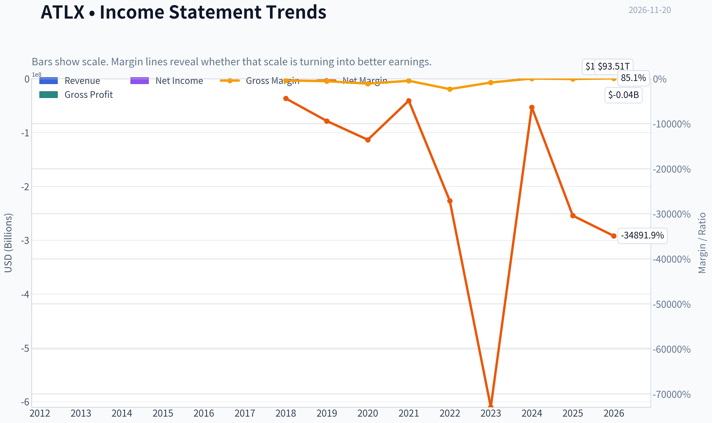

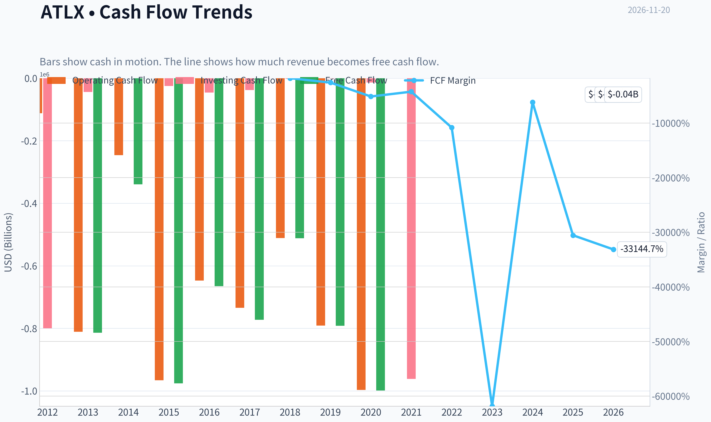

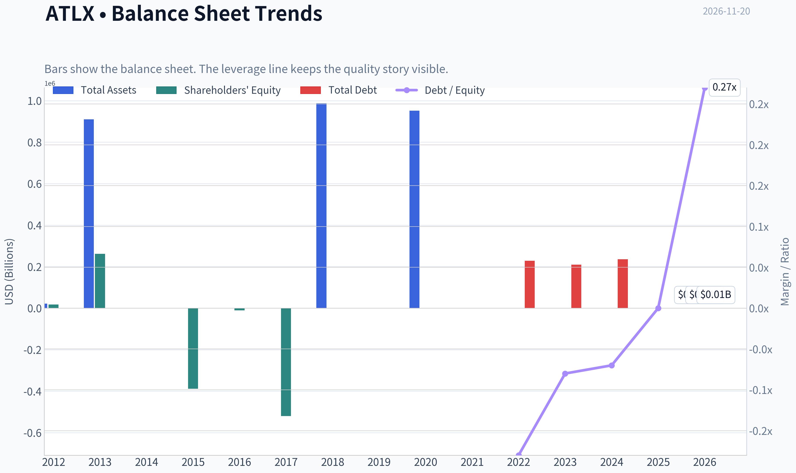

This graph tracks the profitability and return metrics (ROE, ROIC, Margins) of **ATLX** over the past decade, highlighting capital efficiency trends.

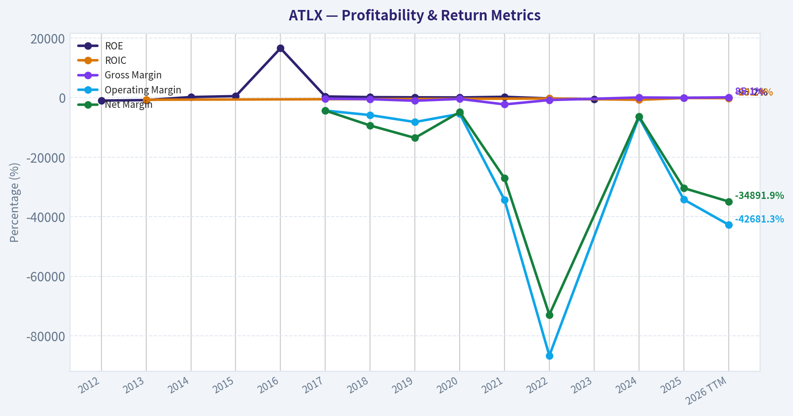

This chart illustrates the financial health of **ATLX** over the last 10 years, mapping cash equivalents and free cash flow against total obligations (Debt).

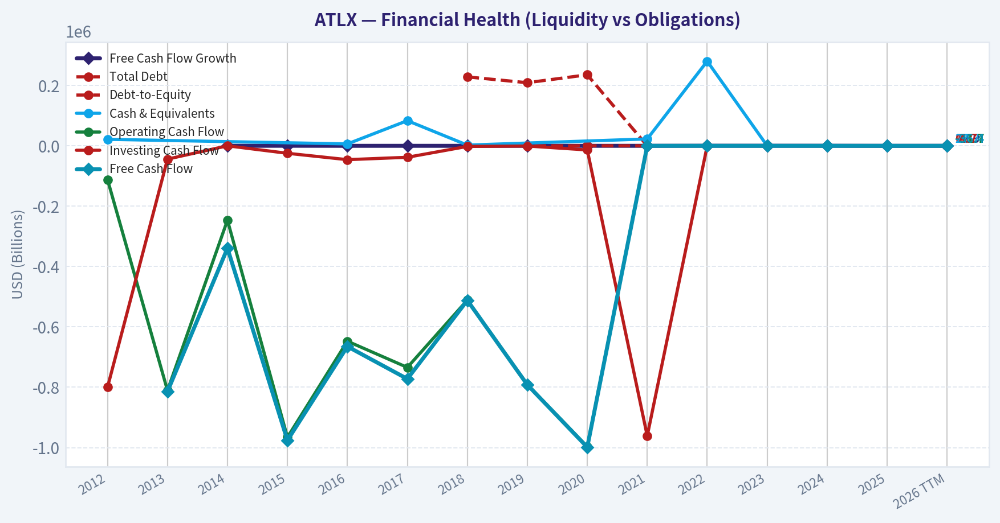

This comparison chart from *Profitability and Operating Performance* stacks current figures against historical benchmarks for **ATLX**, making it easy to see where the company trades relative to its own averages.

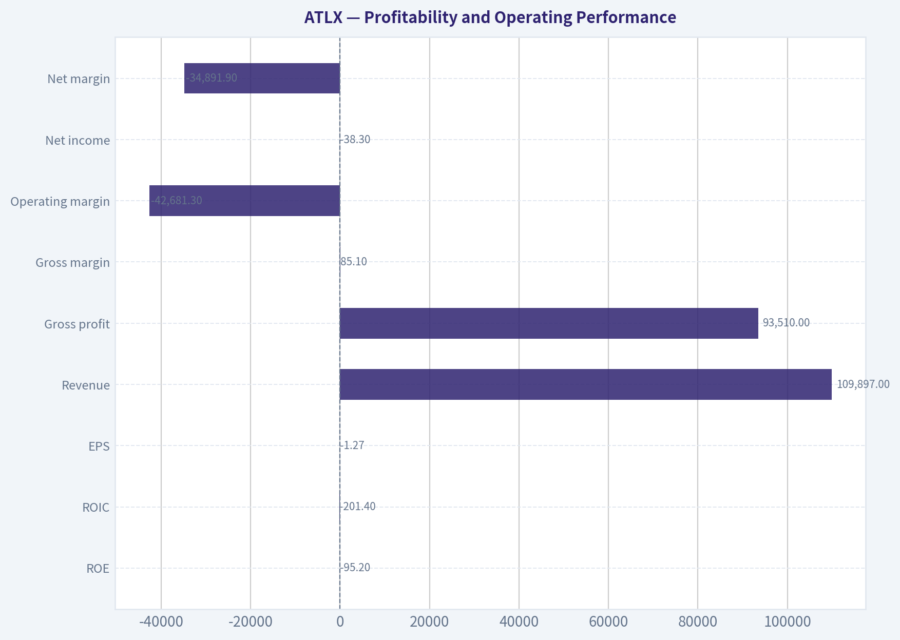

---

### Intrinsic Value Analysis (Buffett)

> *Following Warren Buffett's value investing philosophy: Circle of Competence, Economic Moat, Management Quality, and Margin of Safety.*

#### Intrinsic Value Snapshot

Price is what you pay. Intrinsic value is what the business may be worth based on the cash it can create for owners over time. We show a range, not one magic number.

- Current Price: $1.36
- Value Range (conservative to optimistic across both DCF methods): N/A to N/A

##### Owner Earnings (Buffett Method)
- Net Income: $-28,110,592.00
- Depreciation & Amortization: $119,121.00
- Capital Expenditures: $-6,091,572.00
- Working Capital Changes: $-837,783.00
- Owner Earnings: $-31,815,080.16

##### Intrinsic Value

ANALYST STANCE: **Bearish**

#### Executive Summary

Atlas Lithium Corp. is a speculative lithium exploration and development company rather than an established cash-generating operator. The available financial evidence shows sharply deteriorating revenue, negative gross profit, negative return on equity, and deeply negative free cash flow. Because owner earnings are negative, there is no positive cash-flow base for a conventional DCF valuation.

At $1 per share and approximately $42.1 million of market capitalization, the valuation case depends primarily on future exploration success, project development, financing access, and lithium-market conditions-not on demonstrated operating earnings.

#### Factor Scorecard

| Factor | Score | Evidence |
|---|---:|---|
| Circle of competence and simplicity | 1/5 | The business is understandable at a high level, but outcomes depend on exploration results, permitting, project execution, commodity prices, and future financing. |
| Durable competitive advantage | 1/5 | No demonstrated pricing power, network effects, established production cost advantage, or recurring customer relationships. |
| Management and capital allocation | 2/5 | The company's development strategy may create value if projects are successfully advanced, but the available financial evidence does not demonstrate a long record of value-creating capital allocation. |
| Industry structure | 1/5 | Lithium exploration is capital-intensive, cyclical, commodity-exposed, and highly dependent on external financing and market prices. |

**Gate 5 assessment:** The hard financial-distress floor is **not formally tripped**. Earnings and cash flow are worsening, but the available data shows a current ratio of approximately 2.56 and does not establish an interest-coverage red line below 1.0 times. This does not improve the investment case materially; it simply means the evidence does not meet the defined automatic-solvency-failure test.

#### Moat Analysis

Atlas Lithium has not yet demonstrated a Buffett-style economic moat.

- **Intangible assets:** Exploration permits and geological properties may have option value, but they do not currently create proven pricing power.
- **Switching costs:** There is no evidence of customer captivity or embedded workflows.
- **Cost advantage:** A potential future cost advantage could arise from superior deposits, logistics, or processing economics, but it has not been established through operating production.
- **Network effects:** None are apparent.
- **Financial evidence:** Gross margin is negative at **-64.3%**, which is inconsistent with an established operating moat.

The moat assessment is therefore **illusory or unproven**, with a score of **1/5**.

#### Management Quality Assessment

Management's success must ultimately be judged by whether exploration spending becomes economically valuable production and whether financing is obtained without excessive dilution or unfavorable terms. The available data does not show a sufficiently long record of positive owner earnings, disciplined capital returns, or durable per-share value creation.

Management quality is scored **2/5**, reflecting possible project-development upside but limited demonstrated evidence of owner-oriented compounding.

#### Financial Summary

| Metric | Latest available figure |
|---|---:|
| Share price | $1.00 |
| Market capitalization | $42.1 million |
| P/E | N/A |
| Revenue growth, year over year | -86.1% |
| Gross margin | -64.3% |
| ROE | -54.1% |
| FCF yield | -67.1% |
| Current ratio | 2.56 |
| Owner earnings | Negative |
| DeepValues intrinsic value | N/A |

**Key Takeaways:** The latest figures show a business with sharply contracting revenue, negative gross profitability, negative equity returns, and negative free cash flow. The current ratio indicates near-term liquidity is not the primary visible problem, but liquidity is different from economic profitability. The central issue is the absence of demonstrated cash-generating value.

#### Owner Earnings Calculation

The Buffett owner-earnings framework is:

> Owner earnings = Net income + depreciation and amortization - maintenance capital expenditures - working-capital increases

For Atlas Lithium, owner earnings are reported as **negative**. Therefore:

- There is no positive owner-earnings base to capitalize.
- Free cash flow is negative, reflected in the **-67.1% FCF yield**.
- The company currently requires a project-success thesis rather than an earnings-compounding thesis.
- Maintenance versus growth capital expenditure cannot be separated reliably from the available figures.

#### Three-Scenario DCF Valuation

| Scenario | Result |
|---|---|
| Scenario A: No growth | Not meaningful because owner earnings are negative |
| Scenario B: 3% growth | Not meaningful because owner earnings are negative |
| Scenario C: Historical growth | Not meaningful because there is no positive owner-earnings base |

**Key Takeaways:** All three DCF approaches fail to produce a meaningful positive valuation because the starting cash flow is negative. The DeepValues headline intrinsic value is also listed as unavailable for the same reason. Any valuation based on future lithium production would be a development-project or option-value analysis, not a conventional Buffett owner-earnings valuation.

#### Margin of Safety Analysis

No positive intrinsic value or margin of safety is available from the DeepValues framework. At a $1 share price, the market capitalization is approximately $42.1 million, but the company's current financial results do not establish that this value is supported by operating cash flows.

The valuation therefore depends on uncertain future variables:

- Successful exploration and resource definition
- Permitting and construction
- Access to additional capital
- Lithium prices
- Production economics
- Potential equity dilution

The evidence does not support a conventional margin-of-safety conclusion at the current price.

#### Final Buffett Scorecard

| Criterion | Weight | Score | Weighted contribution |
|---|---:|---:|---:|
| Moat width and durability | 25% | 1/5 | 0.25 |
| Valuation and margin of safety | 20% | 1/5 | 0.20 |
| Capital returns: ROIC versus WACC | 15% | 1/5 | 0.15 |
| Business understanding and predictability | 12% | 1/5 | 0.12 |
| Management quality and capital allocation | 12% | 2/5 | 0.24 |
| Reinvestment runway | 8% | 2/5 | 0.16 |
| Balance-sheet strength | 4% | 3/5 | 0.12 |
| Industry structure | 4% | 1/5 | 0.04 |
| **Total** | **100%** |  | **1.28/5.00** |

**Key Takeaways:** Atlas Lithium scores poorly because it lacks proven operating economics, generates negative owner earnings, and has no measurable intrinsic value under a cash-flow-based framework. The current ratio provides some balance-sheet support, but it does not offset the deterioration in revenue and cash generation. The weighted score is well below the threshold for a Buffett-style compounder.

#### Investment Stance

**Bearish - High conviction.**

Atlas Lithium may possess speculative value tied to mineral assets and future project development, but the available evidence does not support a durable moat, predictable earnings, positive owner earnings, or a measurable margin of safety. The $1 valuation cannot be justified through current cash flows, making the thesis dependent on uncertain exploration and financing outcomes rather than demonstrated intrinsic value.

#### Valuation Visuals

This comparison chart from *Latest Earnings Snapshot* stacks current figures against historical benchmarks for **ATLX**, making it easy to see where the company trades relative to its own averages.

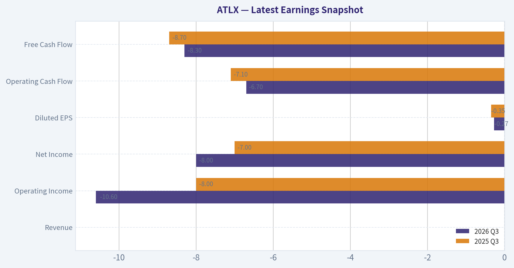

This comparison chart from *Balance Sheet and Financial Strength* stacks current figures against historical benchmarks for **ATLX**, making it easy to see where the company trades relative to its own averages.

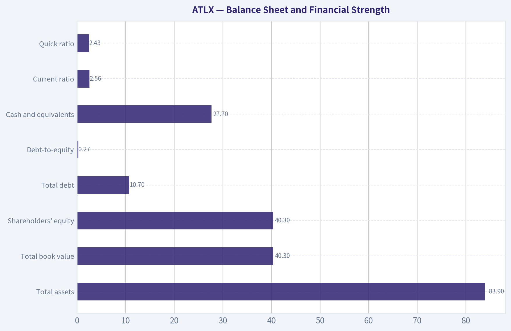

This comparison chart from *Current Versus Historical Average Comparison* stacks current figures against historical benchmarks for **ATLX**, making it easy to see where the company trades relative to its own averages.

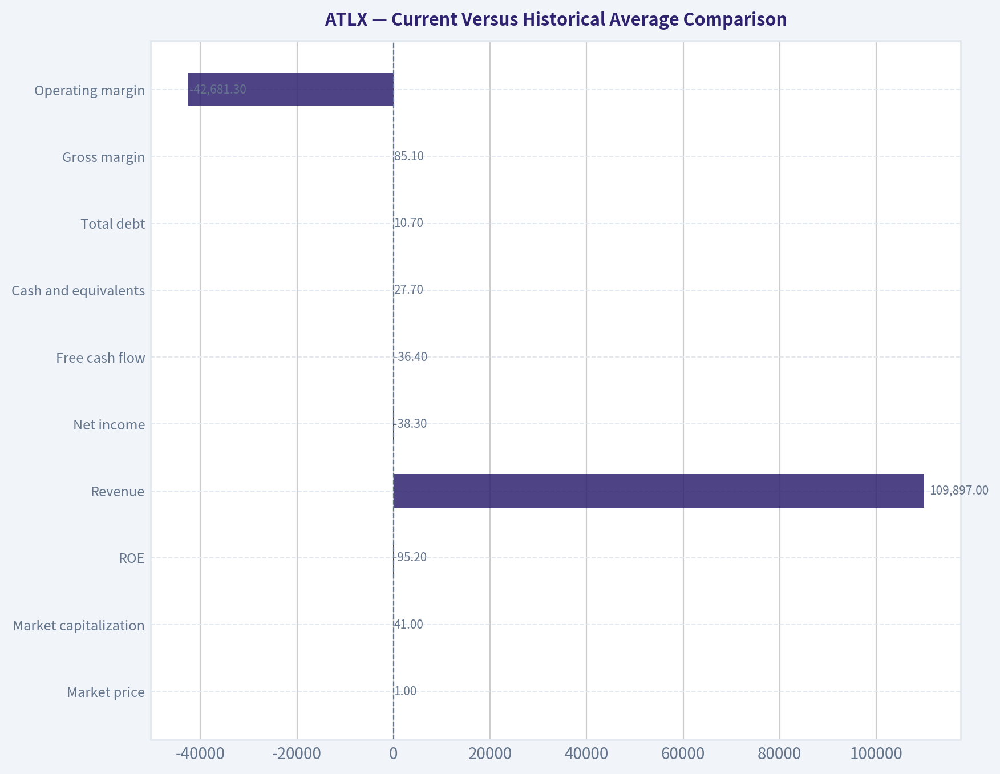

---

### Trend & Growth Analysis (Lynch/Druckenmiller/Fisher)

> *Following Peter Lynch's GARP, Stanley Druckenmiller's macro-aware approach, and Philip Fisher's scuttlebutt methodology.*

ANALYST STANCE: **Bearish**

#### 1. Lynch Classification

**Turnaround / speculative pre-commercial resource developer**, not currently a Fast Grower. Atlas Lithium has lithium exposure and a potentially large geological runway, but reported revenue is collapsing, cash burn is increasing, and there is no demonstrated commercial operating model.

#### 2. The Story in Three Bullets

- Atlas Lithium is developing Brazilian hard-rock lithium assets that could benefit from long-term battery and energy-transition demand.
- The potential upside depends on exploration success, permitting, construction, financing, and eventual commercial production.
- Current financial evidence does not yet validate the growth story: TTM revenue is approximately $0.11 million, while free cash flow is negative approximately $36.4 million.

#### 3. Key Financial Snapshot

| Metric | Latest available |
|---|---:|
| Market capitalization | Approximately $42.1 million |
| Current price data | Approximately $1.36 from tool output; shared pack also reports $1.00 |
| TTM revenue | $109,897 |
| Revenue growth, latest reported comparison | -86.1% |
| Three-year revenue CAGR | 139.1%, from a very small base |
| Gross margin | -64.3% |
| Operating cash flow | -$31.7 million |
| Free cash flow | -$36.4 million |
| Cash and equivalents | $27.7 million |
| Total debt | $10.7 million |
| Current ratio | 2.56 |
| Price-to-sales | 383.29x |
| P/E and PEG | Not meaningful |
| Piotroski F-score | 3/9 |

**Key Takeaways:** Atlas Lithium has adequate reported current liquidity but substantial operating cash consumption. The headline growth CAGR is distorted by a very small and unstable revenue base, while the latest revenue trend is sharply negative. A price-to-sales ratio above 380x is not supported by current operating results.

#### 4. TAM Analysis and 10x Test

The broad lithium market has a substantial long-term runway, supported by electric vehicles, grid storage, and energy-security investment. However, lithium is a commodity business, so project economics depend heavily on grade, recovery rates, operating costs, infrastructure, permitting, lithium prices, and financing conditions.

| TAM question | Assessment |
|---|---|
| Current commercial revenue base | Approximately $0.11 million TTM |
| Ten-times current revenue | Approximately $1.1 million |
| Ten-times current market capitalization | Approximately $421 million |
| Broad lithium TAM | Large and potentially expanding |
| Atlas-specific addressable market | Not reliably quantifiable from available data |
| 10x test | Passes mathematically, but not yet operationally validated |
| Main constraint | Demonstrating economic reserves and commercial production |

**Key Takeaways:** The broad lithium TAM is large enough to support substantial growth, and a ten-times revenue scenario would still represent an immaterial share of the global market. The problem is not market size; it is the long chain of execution risks between exploration and revenue. The 10x test therefore indicates theoretical runway, not demonstrated ten-bagger probability.

#### 5. Revenue Growth Trend

| Period | Revenue | Growth |
|---|---:|---:|
| 2022 | $6.8 thousand | -33.9% |
| 2023 | Not reported in the supplied dataset | -100.0% shown in source |
| 2024 | $667.1 thousand | Not comparable |
| 2025 | $92.5 thousand | -86.1% |
| 2026 TTM | $109.9 thousand | 18.8% versus prior TTM |

**Key Takeaways:** Revenue is erratic rather than steadily accelerating. The modest TTM improvement follows a severe 2025 decline and does not establish a durable commercial inflection. This pattern is inconsistent with Lynch's preferred fast-grower profile.

#### 6. Unit Economics

| Metric | Assessment |
|---|---|
| LTV/CAC | Not available and not meaningful before commercial scale |
| Net revenue retention | Not applicable |
| Rule of 40 | Not applicable; revenue growth is not subscription-based and FCF margin is approximately -33,145% |
| Gross margin | -64.3% latest reported; 85.1% in the TTM source series, indicating substantial data-period volatility |
| Free-cash-flow margin | Approximately -33,145% |
| Cash runway, simple annualized basis | Roughly 10 months using $27.7 million cash and $36.4 million annual FCF burn, before financing or spending changes |

**Key Takeaways:** Atlas Lithium does not yet have measurable recurring-revenue economics. The company remains dependent on successful development and external capital access, and the simple cash-runway calculation is short relative to the time normally required to develop a mining project.

#### 7. Inflection Point Assessment

| Potential inflection | Current evidence | Status |
|---|---|---|
| Product or project ramp | No commercial production demonstrated in supplied data | Not confirmed |
| Market-share inflection | No meaningful production share | Not applicable |
| Margin inflection | Reported margins remain highly volatile and losses persist | Not confirmed |
| TAM inflection | Lithium demand remains a long-term secular theme | Positive industry backdrop |
| Competitive inflection | No verified competitor failure creating a clear advantage | Not confirmed |
| Financing inflection | Negative FCF and limited cash relative to development needs | Risk factor |

**Key Takeaways:** The company has a possible future project-development inflection, but no confirmed operating inflection today. The most important milestones would be resource definition, feasibility economics, permitting, financing, construction, and commercial shipments. Until those milestones are visible, the thesis remains highly binary.

#### 8. Macro Setup

Lithium benefits from secular electrification, battery storage, and supply-chain localization. That is a favorable long-term theme. However, lithium prices are cyclical, and periods of oversupply can sharply reduce project economics. Higher interest rates and difficult capital markets are particularly unfavorable for pre-revenue resource developers because future cash flows are distant and financing needs are substantial.

**Macro conclusion:** Long-term theme favorable; commodity-cycle and financing backdrop materially uncertain.

#### 9. Fisher's 15-Point Score

The score is necessarily provisional because the supplied data does not provide sufficient evidence on management depth, customer relationships, R&D quality, labor relations, or executive candor.

| Fisher criterion | Score / 5 |
|---|---:|
| Sufficient market potential | 4 |
| Determination to develop products/projects | 3 |
| Effective R&D or technical work | 2 |
| Sales organization | 1 |
| Profit margin potential | 3 |
| Improving margins | 1 |
| Labor and personnel relations | 2 |
| Executive relations | 2 |
| Management depth | 2 |
| Cost analysis and accounting | 2 |
| Outstanding competitive characteristics | 2 |
| Long-range profit outlook | 3 |
| Dilution risk | 1 |
| Management candor | 2 |
| Management integrity | 2 |
| **Total** | **32 / 75** |

**Key Takeaways:** The market opportunity scores well, but the company receives low marks for demonstrated execution, margins, commercialization, and dilution risk. The provisional Fisher score is below the threshold associated with a high-quality growth company.

#### 10. Valuation Analysis

| Method | Result | Interpretation |
|---|---:|---|
| P/E | N/A | Loss-making |
| PEG | N/A | No meaningful earnings-growth denominator |
| Price-to-sales | 383.29x | Extremely high relative to current revenue |
| Price-to-book | 1.02x | Less demanding, but book value does not establish project economics |
| EV/EBITDA | -0.73x | Not useful with negative EBITDA |
| FCF yield | -67.1% | Negative cash generation |
| DCF | Not available | Owner earnings are negative |
| Intrinsic value | Not reported | No positive cash-flow base |

**Key Takeaways:** Conventional earnings valuation cannot be applied because Atlas Lithium is loss-making and cash-flow negative. The price-to-sales ratio is exceptionally high because the company has almost no current revenue. Book value offers limited reassurance because the investment case depends on future project value rather than established earnings power.

#### 11. Revenue-Multiple Sensitivity

Using the approximate $42.1 million market capitalization and current TTM revenue of $109,897:

| Illustrative revenue multiple | Revenue required for $42.1M capitalization |
|---:|---:|
| 1x revenue | $42.1 million |
| 3x revenue | $14.0 million |
| 5x revenue | $8.4 million |
| 10x revenue | $4.2 million |
| 20x revenue | $2.1 million |

**Key Takeaways:** Even a 20x revenue framework would require approximately $2.1 million of annual revenue to support the current market capitalization, nearly 19 times current TTM revenue. At more conventional resource-company revenue multiples, the required revenue scale is much larger. This sensitivity excludes additional capital raising and dilution, which could increase the required future operating performance.

#### 12. Growth Investor Scorecard

| Criterion | Weight | Score / 5 | Weighted contribution |
|---|---:|---:|---:|
| Lynch story | 10% | 2.5 | 0.25 |
| TAM and runway | 20% | 4.0 | 0.80 |
| Revenue growth | 20% | 1.0 | 0.20 |
| Unit economics | 15% | 1.0 | 0.15 |
| Competitive position | 10% | 2.0 | 0.20 |
| Management quality | 10% | 2.0 | 0.20 |
| Macro setup | 5% | 3.0 | 0.15 |
| Profitability path | 5% | 1.5 | 0.08 |
| Valuation | 5% | 1.0 | 0.05 |
| **Total** | **100%** |  | **2.08 / 5.00** |

**Key Takeaways:** Atlas Lithium scores well on broad market potential but poorly on current revenue quality, unit economics, profitability visibility, and valuation support. The resulting score is below the threshold for a favorable growth-investor setup.

#### 13. Key Risks and Catalysts

| Catalysts | Risks |
|---|---|
| Positive feasibility study | Lithium-price volatility |
| Successful resource expansion | Permitting and environmental delays |
| Binding strategic or offtake agreement | Construction-cost inflation |
| Commercial production decision | Future equity dilution |
| Improved project economics | Cash runway and financing risk |
| Sustained lithium-demand growth | Exploration or recovery-rate disappointment |
| Revenue acceleration from shipments | Commodity-market oversupply |

**Key Takeaways:** The principal catalysts are operational and financing milestones rather than ordinary quarterly growth. The largest risks are dilution, project execution, commodity prices, and the gap between exploration success and commercial cash generation. A sustained improvement in revenue, cash flow, and project economics would be required to change the present assessment.

#### Final Assessment

Atlas Lithium has a large theoretical TAM and exposure to a durable electrification theme, but it does not currently meet the standards of a proven fast-growing company. Revenue is tiny and unstable, free cash flow is deeply negative, the simple cash runway is limited, and the valuation is difficult to justify using current sales or earnings. The evidence supports an **Bearish** stance under the stated growth-investing framework.

#### Growth & Scorecard Visuals

This comparison chart from *Growth Metrics* stacks current figures against historical benchmarks for **ATLX**, making it easy to see where the company trades relative to its own averages.

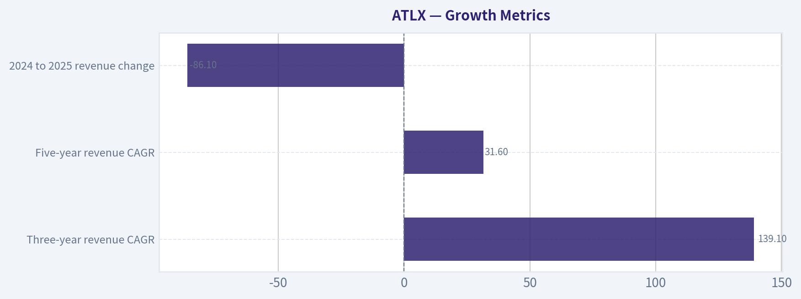

---

### Market Technical Analysis

ANALYST STANCE: **Neutral**

#### ATLX - Atlas Lithium Corp. technical analysis

The analysis covers **Atlas Lithium Corp. (Nasdaq: ATLX)** only. Yahoo Finance supplied daily data through **November 19, 2026**; November 20 did not contain a trading record, so the latest observed closing price is **$1.52**.

The technical backdrop is decisively weak over the medium and long term, although the most recent sessions show a modest attempt to stabilize. ATLX fell from approximately **$6.46 on May 8** to **$1.52 on November 19**, a decline of roughly **76%**. The decline has not been a single uninterrupted move: there were brief recoveries in June, August, and mid-October, but each rebound failed to establish a durable higher-high and higher-low structure.

#### Price trend and moving averages

The dominant pattern remains a sequence of lower highs and lower lows. After reaching the **$3.44 area in late August**, the stock weakened through September and October, eventually reaching approximately **$1.58 on November 2**. October 15-16 produced a sharp rebound toward **$2.30-$2.55**, but that move was quickly reversed, indicating that upside momentum lacked persistence.

The latest closing price of **$1.52** is below the approximate short-term 10-day EMA, below the medium-term 50-day SMA, and substantially below the 200-day SMA. The 10-day EMA appears to be near **$1.55**, while the 50-day SMA is approximately around **$2.00**. The 200-day SMA is considerably higher, likely in the **low-to-mid $4 range**, reflecting the much stronger prices earlier in the year. These relationships indicate that the short-term weakness is occurring within a much broader downtrend rather than representing an isolated pullback.

The 10-day EMA is the least negative of the moving-average signals because it has begun flattening near the latest prices. However, flattening after a prolonged decline is not equivalent to a confirmed trend reversal. A sustained close above the short- and medium-term averages would be needed to materially change the interpretation of the moving-average structure.

#### Momentum and MACD interpretation

The MACD framework is expected to remain below its zero line after the prolonged decline from May through November. That configuration indicates that the faster price trend is still weaker than the longer-term trend. Recent price action has been relatively compressed around **$1.45-$1.73**, so the MACD may be losing some downside acceleration, but there is no evidence in the supplied price series of a strong, sustained momentum reversal.

The most important distinction is between **declining bearish momentum** and **positive momentum**. ATLX's November rebound from approximately $1.46 to $1.54 shows some short-term recovery, but the stock remains below the October breakdown area and below all major medium- and long-term trend references. Consequently, any improvement in the MACD histogram would initially indicate only that selling pressure is becoming less intense, not that the primary trend has turned upward.

#### RSI and momentum exhaustion

A manually approximated 14-session RSI is in the **high-30s to around 40**, based on the recent sequence of alternating small gains and losses. This is weak momentum, but it is not deeply oversold under the conventional 30 threshold.

That distinction matters. The October-to-November decline was substantial, yet the latest RSI estimate does not show the kind of extreme downside reading that would by itself establish a durable reversal case. Instead, the indicator suggests persistent selling pressure with intermittent short-lived rebounds. The repeated inability to maintain advances toward $1.70-$1.75 is consistent with weak momentum rather than a completed base.

#### Volatility and ATR

ATLX remains a high-volatility security in percentage terms. In the latest month, daily ranges have often been approximately **$0.10-$0.20**, which is substantial relative to a share price near $1.50. The recent 14-day ATR can be approximated at roughly **$0.15-$0.18**, equivalent to approximately **10%-12% of the latest closing price**.

Volatility has moderated from the much larger price swings seen in April, May, and October, but the lower absolute price means that ordinary dollar movements still represent large percentage changes. This raises the risk of false technical signals: a one- or two-day rebound can appear significant while remaining inside the broader downtrend.

#### Volume and VWMA

Volume expanded materially during several major selloffs and rebound attempts, including the late-April/early-May advance, the sharp May decline, the June breakdown, and the October volatility spike. Those high-volume episodes indicate that market participation increased during important repricing events.

By contrast, recent November volume has generally been more subdued, mostly in the approximately **130,000-330,000 share range**. That suggests the latest narrow trading range has not yet attracted the level of participation normally associated with a decisive change in trend. A volume-weighted moving average would likely sit above the latest close because several recent higher-price sessions carried meaningful volume. Price remaining below that volume-weighted reference would imply that recent traded volume is concentrated at higher prices than the current market level.

#### Bollinger-band context

Bollinger-band analysis is useful here because ATLX has transitioned from very wide ranges earlier in the year to a tighter November consolidation. A narrowing band would indicate reduced short-term volatility and the possibility of an impending expansion, but it does not specify direction.

The recent close near $1.52 is close to the lower portion of the November trading range rather than near its upper boundary. That placement favors a weak or neutral interpretation. A move toward the upper band would demonstrate improving short-term demand, but a genuine trend change would still require confirmation from volume, momentum, and the longer moving averages.

#### Technical conclusion and valuation implication

The evidence supports a **watch** stance rather than a constructive technical classification. The principal signals are:

- A persistent six-month downtrend.
- Price below the approximate 10-day EMA, 50-day SMA, and 200-day SMA.
- Weak but not extremely oversold momentum.
- Likely negative MACD structure.
- High percentage volatility relative to the share price.
- Recent volume that appears insufficient to confirm a durable reversal.
- A narrow consolidation near the lows that could resolve in either direction.

For valuation interpretation, the technical evidence does **not currently provide confirmation that the market has established a durable floor at $1.52**. The price may be experiencing short-term stabilization, but the broader trend remains negative and the evidence is not strong enough to support a sustained improvement in valuation sentiment.

#### Selected indicators

The selected set emphasizes different dimensions without using redundant indicators: long-term and medium-term trend, short-term responsiveness, momentum, volatility, volume confirmation, and range context.

| Indicator | Role in this analysis | ATLX interpretation |
|---|---|---|
| `close_10_ema` | Short-term trend and responsiveness | Approximately near $1.55; latest close is slightly below it, showing weak near-term structure |
| `close_50_sma` | Medium-term trend | Approximately near $2.00; price remains materially below it |
| `close_200_sma` | Long-term trend benchmark | Far above the latest price, reflecting a deeply negative long-term trend |
| `macd` | Trend momentum | Likely below zero after the prolonged decline; no confirmed positive reversal |
| `rsi` | Momentum exhaustion and recovery strength | Approximately high-30s to around 40; weak, but not conventionally oversold |
| `boll` | Volatility-range midpoint | Recent price action appears in the lower part of its short-term range |
| `atr` | Absolute and relative volatility | Approximately $0.15-$0.18 recently, or roughly 10%-12% of price |
| `vwma` | Volume-confirmed trend | Likely above the latest close because recent higher-price sessions carried meaningful volume |

**Key Takeaways:** ATLX remains in a pronounced medium- and long-term downtrend, with the latest price below the major moving-average references. Momentum is weak but not at an extreme oversold level, while high percentage volatility increases the likelihood of false short-term signals. Recent stabilization near the lows has not yet been confirmed by sufficiently strong volume or a clear momentum reversal, so the evidence does not establish a durable valuation floor at $1.52.

#### Market Visuals

This comparison chart from *Market Metrics and Valuation* stacks current figures against historical benchmarks for **ATLX**, making it easy to see where the company trades relative to its own averages.

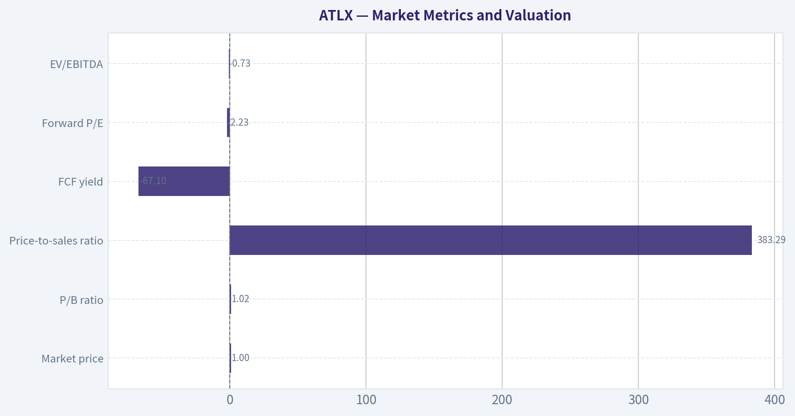

---

### Options Market Analysis

> *Reading options flow - put/call ratios, IV skew, and unusual activity - to gauge institutional positioning and event-driven risk.*

ANALYST STANCE: **Bullish**

#### ATLX Options Flow Report

*Data as of November 20, 2026. The supplied options feed does not include the current underlying price, so strike-level ITM, ATM, and OTM classifications cannot be determined.*

#### 1. Put/Call Ratio Analysis

| Expiration | Call OI | Put OI | Put/Call OI Ratio | Call Volume | Put Volume | Put/Call Volume Ratio |
|---|---:|---:|---:|---:|---:|---:|
| Nov. 20, 2026 | 9,414 | 881 | 0.09 | 81 | 42 | 0.52 |
| Dec. 18, 2026 | 1,255 | 71 | 0.06 | 650 | 73 | 0.11 |
| Jan. 15, 2027 | 3,026 | 208 | 0.07 | 33 | 16 | 0.48 |
| **Combined** | **13,695** | **1,160** | **0.08** | **764** | **131** | **0.17** |

**Key Takeaways:** ATLX has an exceptionally low combined put/call OI ratio of 0.08 versus the approximately 0.70 neutral baseline. This reflects a strongly call-dominated options structure, although the low overall trading volume means the signal may partly reflect legacy open interest or covered-call activity rather than fresh bullish speculation. The December expiration shows the clearest current call-volume imbalance.

#### 2. Implied Volatility and Skew Assessment

| Metric | Reading | Interpretation |
|---|---|---|
| Near-term ATM call IV | N/A | The data feed does not report ATM implied volatility |
| Near-term ATM put IV | N/A | The data feed does not report ATM implied volatility |
| OTM put-versus-call skew | N/A | Strike-level IV data is unavailable |
| Catalyst-related IV elevation | Cannot determine | No usable IV term structure or catalyst premium is provided |

**Key Takeaways:** Implied volatility cannot be assessed from the available feed because ATM IV and strike-level skew are both unavailable. There is therefore no evidence here to determine whether downside protection is expensive or whether upside options are being aggressively chased. A known near-term catalyst cannot be evaluated from this dataset.

#### 3. Unusual Options Activity

The data provider defines unusual activity as contracts with volume greater than five times open interest. No contracts met that threshold.

| Finding | Result | Implication |
|---|---|---|
| Contracts with volume greater than 5x OI | None | No clearly identifiable fresh, outsized directional bets |
| Largest reported call volume | December 18 expiration, aggregate 650 contracts | Indicates active call trading, but contract-level details were not supplied |
| Largest reported put volume | December 18 expiration, aggregate 73 contracts | Put activity remains limited relative to calls |
| Smart-money versus retail attribution | Not determinable | No trade size, sweep, execution-side, or premium data provided |

**Key Takeaways:** There is no confirmed unusual-options event under the provider's screening rule. December call activity is notable in aggregate, but without individual strikes, execution details, or trade direction, it cannot be reliably attributed to institutional accumulation or retail speculation. The absence of unusual contracts lowers conviction in the directional signal.

#### 4. Open Interest Concentration and Gamma Considerations

| Expiration | Share of Total Call OI | Share of Total Put OI | Structural Observation |
|---|---:|---:|---|
| Nov. 20, 2026 | 68.7% | 75.9% | Very large near-term concentration |
| Dec. 18, 2026 | 9.2% | 6.1% | Smaller call and put base, but highest reported volume |
| Jan. 15, 2027 | 22.1% | 17.9% | Secondary concentration in longer-dated calls |
| **Total** | **100%** | **100%** | Call OI dominates across all listed expirations |

**Key Takeaways:** Open interest is heavily concentrated in the November 20 expiration, particularly on the call side. This can create expiration-related pinning or sharp changes in hedging flows, but strike-level OI is required to identify the actual gamma wall or likely max-pain level. The available data supports expiration sensitivity, not a specific price level.

#### 5. Overall Options Sentiment

**Overall signal: BULLISH, with low confidence.**

The primary bullish evidence is the exceptionally low 0.08 put/call OI ratio and the 0.17 aggregate put/call volume ratio. Call open interest exceeds put open interest by nearly twelve times, and December call volume is substantially higher than put volume.

However, conviction is limited because:

- Total trading volume is modest.
- No contract passed the unusual-activity threshold.
- ATM IV and IV skew are unavailable.
- The underlying price and strike-level data were not supplied.
- Heavy call open interest can reflect covered-call writing or pre-existing positions rather than outright bullish speculation.

Accordingly, the options structure is **call-heavy and directionally bullish**, but it does not provide strong confirmation of fresh institutional upside demand. The evidence supports a bullish options-market interpretation while leaving substantial uncertainty about the source and risk profile of the call exposure.

#### Summary

| Category | Assessment |
|---|---|
| Put/Call Ratio | Strongly call-dominated: 0.08 OI ratio and 0.17 volume ratio, far below the 0.70 neutral baseline |
| IV Level | Unavailable; ATM IV was not reported |
| Skew Direction | Unavailable; no strike-level IV data |
| Unusual Activity | None detected under the volume greater than 5x OI screen |
| Overall Signal | **BULLISH, low confidence**; call-heavy structure is the main driver, tempered by thin data and absent IV information |

---

## Research Team Commentary

> *The Research Manager synthesizes the Bull vs Bear debate into action-free commentary. This is a pre-risk view, not the final stance.*

Core takeaway: Atlas Lithium offers potentially meaningful geological optionality, but it is not yet a proven business, much less a Buffett-style compounder. The strongest bullish argument is that a successful Brazilian hard-rock lithium project could gain substantial strategic value as battery and storage demand expands. The strongest bearish argument is that nearly all of this value remains contingent on resource validation, permitting, financing, construction, and competitive production economics. At $1.36, the evidence does not demonstrate a sufficient margin of safety because the nominal share price says nothing about enterprise value, future dilution, or risk-adjusted project value.

The bull case deserves some credit. Exploration-stage miners should not be assessed primarily on current revenue or near-term earnings. Atlas's permits and geological properties could possess option value, and favorable grades, recoveries, infrastructure, and logistics could eventually create a defensible cost advantage. Brazil's developing lithium ecosystem may also attract strategic partners or customers seeking diversified supply. If Atlas establishes a large economically recoverable resource and a low-cost development plan, today's financial statements would substantially understate the asset's future earning power.

That upside, however, is an asset-development scenario rather than evidence of an existing moat. Atlas has no demonstrated production cost advantage, customer captivity, pricing power, recurring cash flow, or high return on invested capital. Lithium remains a commodity, so long-term demand growth alone cannot guarantee attractive shareholder economics. New supply, recycling, technological changes, and price cycles can leave marginal projects earning less than their cost of capital even when battery demand rises.

The financial evidence reinforces the uncertainty. Trailing revenue of roughly $0.11 million, an 86.1% year-over-year decline, a negative 64.3% gross margin, negative 54.1% ROE, negative 32.1% ROA, and approximately $36.4 million of negative free cash flow show that current operations cannot support the valuation. Some of these metrics are of limited diagnostic value for a pre-production miner-the current gross margin does not establish the economics of a future mine-but the scale of cash consumption relative to revenue is highly relevant. Atlas depends on external capital before it has demonstrated that incremental investment will generate acceptable risk-adjusted returns.

Financing is therefore central to intrinsic value. Equity issuance could dilute the per-share upside; debt could introduce fixed obligations before cash generation begins; and joint ventures, royalties, or streaming arrangements could transfer a meaningful portion of future project economics to capital providers. No solvency data supplied here proves imminent distress, so the case should not be overstated. The more defensible conclusion is that financial self-sufficiency is absent and access to reasonably priced capital remains a critical dependency.

Management quality is also unresolved. The available information does not establish either misconduct or a strong record of developing comparable projects while preserving per-share value. For this type of company, capital allocation must be judged by independently validated technical progress relative to cash spent and dilution incurred-not by acreage, announcements, or favorable commodity narratives.

A conventional DCF cannot be responsibly anchored to negligible revenue and deeply negative cash flow. A project-level valuation would require recoverable reserves, annual production, mine life, recovery rates, operating costs, initial and sustaining capital, taxes, royalties, financing terms, and a range of lithium prices. None is sufficiently established in the supplied evidence. Likewise, $1.36 is merely a low nominal share price; without fully diluted shares, debt, cash, and project economics, it cannot establish cheapness.

Viewed as a reverse DCF, the market price necessarily depends on several favorable outcomes occurring together: technical validation, timely permitting, adequate financing, limited dilution, construction within budget, successful ramp-up, competitive costs, and lithium prices high enough to earn an acceptable return. That chain is plausible but not yet probable enough to support a narrow 10-15% margin of safety. Such a modest discount is appropriate for a predictable, wide-moat compounder-not for an exploration-stage commodity developer. Given the wide distribution of outcomes, Atlas would require a much larger and demonstrable discount to conservatively estimated project value.

The persistent six-month downtrend and trading below major moving averages are secondary evidence. Price momentum does not determine intrinsic value, and pessimism can create opportunity. Here, however, there is no clear evidence that the market is mistakenly treating a temporary problem as permanent impairment. The weakness coincides with substantial cash burn and incomplete project de-risking. Contrarianism would become more compelling only if technical and financing milestones improved faster than the valuation recognized.

The key lesson from similar cases is not to equate geological possibility with an economic reserve, or an economic reserve with a cash-generating mine. Industry growth forecasts also should not be capitalized as though they automatically accrue to a specific developer. The analysis must progress through distinct stages: geological potential, defined resource, recoverable reserve, feasible project, funded and permitted construction, operating mine, and durable free cash flow. Atlas remains materially closer to the early stages.

Over the next one to four quarters, the monitoring plan should focus first on independent resource updates, drilling consistency, grade continuity, metallurgical recovery, impurity levels, and conversion of exploration potential into economically supportable reserves. Second, feasibility disclosures should be tested for realistic capital intensity, operating costs, mine life, infrastructure requirements, and economics under conservative lithium-price assumptions rather than optimistic spot prices. Third, permitting milestones and actual timelines should be compared with prior guidance.

Financing developments will be equally important: cash runway, quarterly cash burn, fully diluted share count, financing terms, debt covenants, royalties, streaming commitments, and the share of project economics surrendered to partners. Evidence that technical value per diluted share is rising would strengthen the thesis; repeated capital raises without proportionate project de-risking would weaken it.

Finally, management's milestone delivery, disclosure quality, insider incentives, customer qualification, and any binding offtake or strategic partnership deserve scrutiny. A credible financing package tied to independently validated low-cost economics would materially improve the case. Cost inflation, permitting delays, weaker recoveries, optimistic feasibility assumptions, accelerating dilution, or continued cash burn without reserve conversion would further undermine it.

Overall, Atlas may have substantial upside if its geological option becomes a competitively financed operating asset. Today, however, the evidence supports neither a durable moat nor a dependable intrinsic-value estimate, and it does not establish that $1.36 embeds the uncertainty discount required for this level of execution and commodity risk.

Final stance: Bearish

---

## Value Investing Team Commentary

> *The Investor translates the research view into an investment thesis before risk review. This is still not the final stance.*

### ATLX: Fundamental and Contrarian Commentary

Atlas Lithium represents a speculative asset-development story rather than an established operating business. The distinction is important: its valuation depends less on current revenue and more on whether exploration potential can become a permitted, financed, technically viable, and profitable mine.

### What the bullish case gets right

The weak financial statements do not, by themselves, invalidate an exploration-stage mining company. Minimal revenue, negative margins, and negative free cash flow are expected before commercial production. The relevant question is whether capital spent today is converting into higher-quality, independently validated project value.

Brazilian hard-rock lithium assets could benefit from regional infrastructure, supply-chain diversification, and long-term battery-material demand. A favorable combination of grade, recovery rates, impurities, logistics, infrastructure access, and scale could produce meaningful economic value. Strategic interest from battery manufacturers or mining partners could also provide validation and reduce some funding pressure.

This is the strongest contrarian point: markets can sometimes apply the economics of failed exploration projects to an asset that is quietly progressing. A falling share price is not proof that the underlying geology has deteriorated. If resource quality, metallurgical recoveries, permitting, and project economics were improving faster than market expectations, sentiment could eventually prove excessively pessimistic.

However, that contrarian argument currently lacks sufficient evidence. The available information does not show that the market is overlooking a de-risked, low-cost development project. It shows an early-stage company whose eventual value remains dependent on several uncertain steps.

### Why the current evidence remains weak

Atlas has not demonstrated the characteristics of a Buffett-style compounder:

- No established production base
- No recurring free cash flow
- No proven cost advantage
- No customer switching costs or pricing power
- No demonstrated return on invested capital
- No long operating history through commodity cycles
- No sufficiently established reserve-based intrinsic value

Lithium demand can grow substantially while individual developers still produce poor shareholder returns. Commodity supply responds to high prices, recycling can expand, battery chemistry can evolve, and cost inflation can absorb much of the benefit of favorable demand. Industry growth therefore does not automatically translate into attractive economics for a particular mining company.

The reported financial metrics are imperfect for an exploration-stage developer, but they remain relevant. Revenue of approximately $0.11 million against roughly $36.4 million of negative free cash flow demonstrates that the company is not funding its development internally. Negative ROE, ROA, and gross margin do not reveal the eventual economics of a mine, yet they do confirm that current operations provide little financial support for the valuation.

### Financing is a central valuation risk

The principal risk is not merely whether lithium prices rise. It is whether Atlas can reach production without transferring too much future value to outside capital providers.

Potential funding sources carry different economic costs:

- Equity issuance can reduce future per-share exposure to project success.
- Debt can create obligations before operating cash flow exists.
- Royalties and streaming arrangements can reduce the project's future margin.
- Joint ventures may provide technical and financial support while surrendering part of the asset's economics.

Consequently, the relevant question is not simply whether the project has geological value. It is whether technical value per fully diluted share can increase after funding, construction, and development costs. The supplied information does not establish that outcome.

The nominal $1.36 share price is also not a meaningful valuation anchor by itself. Without reliable data on fully diluted shares, cash, debt, financing commitments, recoverable reserves, mine life, capital intensity, and operating costs, the market capitalization and enterprise value remain more informative than the per-share quotation.

### Reverse-DCF and margin-of-safety assessment

A conventional DCF cannot be reliably constructed from negligible revenue and deeply negative free cash flow. A project-level model would require independently supported assumptions for:

- Recoverable reserves and mine life
- Production volumes and ramp-up timing
- Metallurgical recovery
- Operating and sustaining costs
- Initial capital expenditure
- Permitting and infrastructure requirements
- Taxes, royalties, and financing terms
- A conservative range of lithium prices

In reverse-DCF terms, the valuation appears to require a chain of favorable outcomes: successful resource conversion, permitting, adequate financing, limited dilution, on-budget construction, successful commissioning, competitive production costs, and supportive enough lithium pricing. Any one of these may be achievable; the combined probability is materially lower.

That does not prove the shares are intrinsically worthless. It does mean that the evidence does not support assigning a narrow margin of safety appropriate for a predictable, high-return business. An exploration-stage commodity developer requires a substantially wider discount to conservatively estimated project value because the outcome distribution is unusually broad.

### What the market weakness reveals

The six-month downtrend and trading below major moving averages are secondary evidence, not a fundamental valuation argument. Weak momentum can reflect excessive pessimism, but it can also reflect rational concern about cash burn, dilution, commodity exposure, or delayed de-risking.

In this case, sentiment appears at least partly connected to identifiable business uncertainty rather than being purely emotional. The market is not simply discounting a temporary earnings setback; it is discounting the absence of a proven operating asset and the financing required to create one. Contrarian optimism would become more credible if technical milestones, resource conversion, permitting, and funding quality improved without a disproportionate increase in dilution.

### Evidence that would change the assessment

The most decision-relevant developments would be:

1. Independently validated resource and reserve growth
2. Consistent drilling results and credible grade continuity
3. Strong metallurgical recovery with manageable impurity levels
4. Feasibility economics that remain viable under conservative lithium prices
5. Clear permitting progress with realistic timelines
6. A financing structure that preserves substantial future project economics
7. Evidence that diluted per-share asset value is increasing
8. Binding customer, offtake, or strategic-partner support
9. Management delivery against milestones without repeated extensions or promotional emphasis

Conversely, cost inflation, weaker recoveries, permitting delays, optimistic feasibility assumptions, repeated equity issuance, or continued cash consumption without meaningful reserve conversion would further weaken the investment case.

Atlas may eventually prove to be a valuable lithium developer, but the current evidence describes an option on future execution rather than a durable, cash-generating franchise. The geological opportunity deserves recognition, yet the distinction between geological potential, an economic reserve, a feasible project, and a profitable mine remains decisive. At $1.36, the available evidence does not establish that the market price adequately compensates for the technical, financing, dilution, execution, and commodity risks.

**ANALYST STANCE: Bearish.** The classification reflects the absence of a dependable intrinsic-value anchor, an unproven operating moat, substantial dependence on external capital, and a valuation that requires multiple favorable project outcomes. Contrarian potential exists, but it is not sufficiently supported by current technical, financial, or financing evidence.

---

## Deep Values Commentary

> *The Risk Management Team debates and the Risk Judge provides the final action-free verdict. This section determines the final Bullish / Neutral / Bearish stance.*

#### Final Stance Scorecard

This scorecard converts the final research view into a weighted decision frame. It does not replace the narrative judgement, but it makes the main drivers of the verdict easier to scan.

| Criterion | Score | Weight | Commentary |
| --- | ---: | ---: | --- |
| Business Quality | 1.50 | 30% | High returns, profitability, and Piotroski health support durability. |
| Valuation Support | 2.33 | 30% | Blends current price against available intrinsic value anchors and valuation ratios. |
| Financial Strength | 4.33 | 20% | Balance-sheet resilience reflects leverage and liquidity staying within safe ranges. |
| Growth Durability | 3.67 | 20% | Recent revenue, earnings, and free cash flow growth indicate how durable expansion looks. |
| TOTAL / FINAL STANCE | 2.75 | 100% | Bearish |

#### Key Takeaways

The weighted score lands at **2.75 / 5.0**, while the final stance remains **Bearish**. This is useful as a quick calibration aid rather than a mechanical signal.

#### Risk Summary

Higher scores indicate more risk pressure. The watch threshold is a simple guardrail: above it, the dimension weighs more heavily on the valuation case and calls for a wider margin of safety.

| Dimension | Current Score | Watch Threshold | Commentary |
| --- | ---: | ---: | --- |
| Business Quality | 4.50 | 3.00 | High returns, profitability, and Piotroski health support durability. |
| Valuation Support | 3.67 | 3.00 | Blends current price against available intrinsic value anchors and valuation ratios. |
| Financial Strength | 1.67 | 3.00 | Balance-sheet resilience reflects leverage and liquidity staying within safe ranges. |
| Growth Durability | 2.33 | 3.00 | Recent revenue, earnings, and free cash flow growth indicate how durable expansion looks. |

#### Key Takeaways

This view helps readers separate *where* the risk sits: valuation, business quality, balance sheet, or growth durability. It is especially useful when the final stance is close to the line between Neutral and Bearish.
