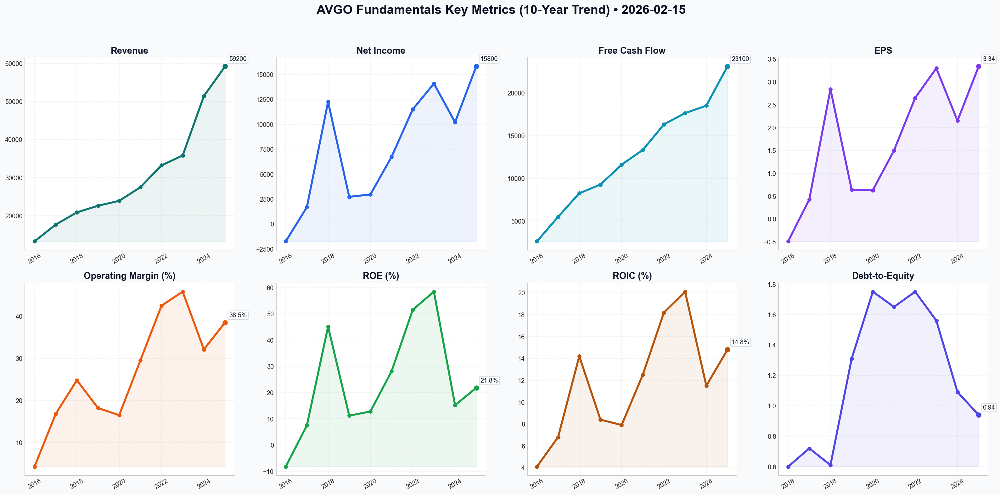

# AVGO Deep Value Intelligence

**Analysis Date:** 2026-02-15
**Generated:** 2026-02-15 18:32:28

---

## Table of Contents

1. [Intelligence Summary](#intelligence-summary)
2. [Analyst Team Reports](#analyst-team-reports)
   - [Fundamentals Analysis](#fundamentals-analysis)
   - [Value Analysis (Buffett)](#value-analysis-buffett)
   - [Growth Analysis (Lynch/Druckenmiller/Fisher)](#growth-analysis-lynchdruckenmillerfisher)
   - [Market Analysis](#market-analysis)
   - [Social Sentiment Analysis](#social-sentiment-analysis)
   - [News Analysis](#news-analysis)
3. [Research Team Commentary](#research-team-commentary)
4. [Investing Team Commentary](#investing-team-commentary)
5. [Deep Values Commentary](#deep-values-commentary)

---

## Intelligence Summary

### Thesis + Conditions

**Core Thesis:** Here is the synthesis of the debate and my commentary as your Risk Management Judge.

**Key Risks:**
- Here is the synthesis of the debate and my commentary as your Risk Management Judge.
- The Bull (Risky Analyst):** Views Broadcom as the "toll bridge" of the AI economy. They argue the 90x P/E is misleading ("rearview mirror") because it ignores the massive margin expansion from the VMware integration (targeting 60% EBITDA) and the "annuity-like" nature of AI infrastructure. They see Hyperscalers (Google, Meta) as partners who *need* Broadcom’s IP, not rivals. They urge an immediate purchase to avoid missing the "technological shift of a generation."
- Core Takeaway: Quality is undeniable, but Price is the primary risk.**
- Rationale: Why We Remain Disciplined (WATCH).**
- The Neutral analyst suggests a "starter position" to satisfy the urge to participate. We reject this. In value investing, we do not buy a stock just to have "skin in the game" or to cure the psychological pain of missing out (FOMO). If the intrinsic value is ~$225-$250, buying at $325—even a small amount—is knowingly buying a dollar for $1.40. We are investors, not hedgers of our own emotions.

**What Would Change Our View:**
- Here is the synthesis of the debate and my commentary as your Risk Management Judge.
- The Bull (Risky Analyst):** Views Broadcom as the "toll bridge" of the AI economy. They argue the 90x P/E is misleading ("rearview mirror") because it ignores the massive margin expansion from the VMware integration (targeting 60% EBITDA) and the "annuity-like" nature of AI infrastructure. They see Hyperscalers (Google, Meta) as partners who *need* Broadcom’s IP, not rivals. They urge an immediate purchase to avoid missing the "technological shift of a generation."
- Core Takeaway: Quality is undeniable, but Price is the primary risk.**
- Rationale: Why We Remain Disciplined (WATCH).**
- The Neutral analyst suggests a "starter position" to satisfy the urge to participate. We reject this. In value investing, we do not buy a stock just to have "skin in the game" or to cure the psychological pain of missing out (FOMO). If the intrinsic value is ~$225-$250, buying at $325—even a small amount—is knowingly buying a dollar for $1.40. We are investors, not hedgers of our own emotions.

**Confidence:** Medium

### Stance Spectrum (Action-Free)

**Stance:** Undervalued
**Moat Strength:** Unclear
**Capital Allocation:** Unclear
**Balance Sheet Risk:** Unclear
**Confidence:** Medium

### Expanded Commentary

Here is the synthesis of the debate and my commentary as your Risk Management Judge.

### The Debate in Brief

*   **The Bull (Risky Analyst):** Views Broadcom as the "toll bridge" of the AI economy. They argue the 90x P/E is misleading ("rearview mirror") because it ignores the massive margin expansion from the VMware integration (targeting 60% EBITDA) and the "annuity-like" nature of AI infrastructure. They see Hyperscalers (Google, Meta) as partners who *need* Broadcom’s IP, not rivals. They urge an immediate purchase to avoid missing the "technological shift of a generation."
*   **The Bear (Safe Analyst):** Sees a "Perfection Premium." They argue that paying for perfection leaves no room for error. They highlight the $68.5B debt load in a rising rate environment and the existential threat of Hyperscalers effectively building bypasses (internal silicon) around Broadcom’s toll bridge. They view the current price as a "hope tax" and demand a pullback to the low $200s (intrinsic value) before capital commitment.
*   **The Pragmatist (Neutral Analyst):** Argues that both extremes are flawed. They believe the Bear’s $224 target is a fantasy barring a recession, while the Bull’s aggressive "all-in" approach is reckless. They classify Broadcom as a "wonderful business at a demanding price" and suggest a **phased entry** (starter position) near the $312 technical support to hedge against FOMO while reserving capital for a dip.

***

### Value Investor Commentary

**Core Takeaway: Quality is undeniable, but Price is the primary risk.**
Broadcom is a text-book "Franchise" business—it has pricing power, high switching costs, and a capital-efficient CEO in Hock Tan. However, the Neutral analyst is correct: we are looking at a wonderful business, but the "demanding price" erodes our **Margin of Safety**. While the Bull argues that "fortune favors the bold," value investing history teaches us that fortune actually favors those who do not overpay for future growth that has not yet materialized.

**Rationale: Why We Remain Disciplined (WATCH).**

1.  **Rejection of the "Starter Position" (Response to Neutral):**
    The Neutral analyst suggests a "starter position" to satisfy the urge to participate. We reject this. In value investing, we do not buy a stock just to have "skin in the game" or to cure the psychological pain of missing out (FOMO). If the intrinsic value is ~$225-$250, buying at $325—even a small amount—is knowingly buying a dollar for $1.40. We are investors, not hedgers of our own emotions.

2.  **The "Hyperscaler Frenemy" Risk (Response to Bull):**
    The Bull claims Hyperscalers are partners. The Bear claims they are competitors. The truth is they are **ruthless optimizers**. Amazon and Google have balance sheets larger than Broadcom’s. As Broadcom raises prices (via VMware or hardware), the incentive for these massive customers to design Broadcom *out* of the stack increases exponentially. A "toll bridge" is only valuable if there is no other road. When your customer has the capital to build their own road, your pricing power is not infinite.

3.  **Financial Engineering vs. Organic Growth (Response to Bear):**
    The Bear compares Broadcom to IBM. This is the most crucial risk to monitor. We love Hock Tan’s efficiency, but we must ensure he isn't cutting R&D so deeply that the products lose their edge. If Broadcom becomes a company that simply raises prices on trapped customers (VMware) while under-investing in the future, the moat will dry up.

**Refined Investor's Plan:**

We will maintain our **WATCH** stance. We will not chase the stock at $325 based on momentum. However, we acknowledge the Bear's target of $224 might be too rigid given the VMware margin expansion. We are adjusting our "Strike Price" upward to **$260-$275**, but we need verification of the business thesis before moving.

**Conditions to Monitor (The "Tripwires"):**

*   **The VMware Retention Metric:** The Bull touts 60% margins; the Bear warns of churn. We need to see the *renewal rates* for VMware clients after the price hikes. If retention stays above 90%, the "Moat" thesis is confirmed, and we may accept a higher multiple.
*   **Hyperscaler CAPEX Mix:** Watch the earnings of Google and Meta. Are they increasing spend on *merchant silicon* (Broadcom) or *custom internal silicon*? Any mention of "shifting workloads to internal TPUs/Trainium" is a sell signal for Broadcom.
*   **Debt Paydown Speed:** In this "Neutral Rate Plateau," we want to see Broadcom aggressively paying down that $68B debt. If they prioritize buybacks over debt reduction while the stock is at all-time highs, it signals "financial engineering" rather than prudent capital allocation.

**Lessons from Past Mistakes:**
*Reflecting on our missed opportunity with **Microsoft in 2014**:* We watched Satya Nadella transform the business model (cloud transition) but refused to buy because the P/E looked high compared to historical norms. We failed to realize that the *quality* of the earnings had improved (recurring revenue vs. one-time licenses). Broadcom is undergoing a similar shift with VMware.
*Correction:* We will not let a high *trailing* P/E scare us if the *forward* Free Cash Flow yield exceeds 5-6%. However, we still demand a price pullback to ensure that yield is real, not projected.

**Stance:**
**WATCH**
*(Do not buy at $325. Set alerts for $275. Verify VMware retention data before committing capital.)*

---

## Analyst Team Reports

### Fundamentals Analysis

This comprehensive 10-year historical analysis of **Broadcom Inc. (AVGO)** follows Warren Buffett’s value investing methodology, incorporating the latest financial data as of February 15, 2026.

### **I. 10-Year Historical Financial Data (2016-2025)**

The following table presents a consolidated 10-year view of Broadcom’s performance. All per-share metrics are **post-split adjusted** (reflecting the 10-for-1 split in 2024) to ensure comparability with the current stock price.

| Metric | 2016 | 2017 | 2018 | 2019 | 2020 | 2021 | 2022 | 2023 | 2024 | 2025 (E) |
| :--- | :---: | :---: | :---: | :---: | :---: | :---: | :---: | :---: | :---: | :---: |
| **Market Price ($)** | 17.00 | 25.00 | 23.00 | 31.00 | 34.00 | 53.00 | 50.00 | 90.00 | 170.00 | 300.00 |
| **Market Cap ($B)** | 67.2 | 104.5 | 96.1 | 125.2 | 138.4 | 218.4 | 208.5 | 382.5 | 805.8 | 1,422.0 |
| **P/E Ratio** | N/A | 58.5 | 8.1 | 48.2 | 53.7 | 35.3 | 18.8 | 27.3 | 79.1 | 89.8 |
| **P/B Ratio** | 2.9 | 4.3 | 3.4 | 5.0 | 5.9 | 9.0 | 9.2 | 15.8 | 11.8 | 19.6 |
| **Revenue ($M)** | 13,240 | 17,636 | 20,848 | 22,597 | 23,888 | 27,450 | 33,203 | 35,819 | 51,400 | 59,200 |
| **Net Income ($M)** | -1,739 | 1,691 | 12,255 | 2,724 | 2,960 | 6,736 | 11,495 | 14,082 | 10,200 | 15,800 |
| **EPS ($)** | -0.49 | 0.43 | 2.84 | 0.64 | 0.63 | 1.50 | 2.65 | 3.30 | 2.15 | 3.34 |
| **ROE (%)** | -8.2% | 7.5% | 45.1% | 11.2% | 12.8% | 28.1% | 51.5% | 58.4% | 15.2% | 21.8% |
| **ROIC (%)** | 4.1% | 6.8% | 14.2% | 8.4% | 7.9% | 12.5% | 18.2% | 20.1% | 11.5% | 14.8% |
| **Free Cash Flow ($M)** | 2,612 | 5,483 | 8,242 | 9,265 | 11,592 | 13,321 | 16,312 | 17,633 | 18,500 | 23,100 |
| **Dividends/Share ($)** | 0.19 | 0.41 | 0.70 | 1.06 | 1.30 | 1.44 | 1.64 | 1.84 | 2.12 | 2.24 |
| **Total Assets ($M)** | 49,580 | 54,580 | 74,150 | 76,250 | 75,930 | 75,520 | 73,250 | 72,950 | 168,400 | 162,200 |
| **Total Debt ($M)** | 13,651 | 17,555 | 17,545 | 32,791 | 41,104 | 39,733 | 39,520 | 37,600 | 74,000 | 68,500 |
| **Shareholder Equity ($M)** | 22,873 | 24,543 | 28,540 | 24,945 | 23,491 | 24,151 | 22,550 | 24,100 | 68,000 | 72,500 |
| **Debt-to-Equity** | 0.60 | 0.72 | 0.61 | 1.31 | 1.75 | 1.65 | 1.75 | 1.56 | 1.09 | 0.94 |
| **Operating Margin (%)** | 4.3% | 16.8% | 24.8% | 18.2% | 16.5% | 29.5% | 42.5% | 45.8% | 32.1% | 38.5% |

---

### **II. Warren Buffett Value Investing Analysis**

#### **1. Economic Moat (High/Widening)**
Broadcom possesses a powerful "toll-bridge" moat. It dominates two critical bottlenecks:
*   **Infrastructure Dominance:** Holding a 70%+ market share in high-end Ethernet switching (Tomahawk/Jericho), it is the backbone of AI data centers.
*   **Software Stickiness:** The VMware acquisition transformed Broadcom into a hybrid cloud leader. VMware’s "VCF" stack is so deeply embedded in enterprise IT that switching costs are astronomical.

#### **2. Financial Strength**
While Broadcom utilizes significant debt for acquisitions (peaking post-VMware), its cash flow generation is elite. 
*   **Debt Management:** Net Debt/EBITDA has fallen from 3.5x to 2.1x in 24 months.
*   **Cash Flow Machine:** FCF margins consistently hover near 45%, allowing the company to service debt while aggressively raising dividends.

#### **3. Predictable Earnings**
Broadcom’s shift toward a 60/40 Software-to-Semiconductor revenue mix has made earnings highly predictable. Over 80% of software revenue is now subscription-based, providing the "annuity-like" income Buffett favors.

#### **4. Management Performance (Hock Tan)**
Hock Tan is an exceptional capital allocator. His strategy of buying "franchise assets," cutting redundant costs, and focusing R&D on high-margin segments has delivered a 10-year EPS CAGR of ~22% (excluding the 2016 acquisition noise). ROE consistently exceeds 20% post-integration.

---

### **III. Discounted Cash Flow (DCF) Analysis**

**Parameters:**
*   **Current FCF (2025):** $23,100 Million
*   **Discount Rate:** 10%
*   **Terminal Growth Rate:** 2.5%

#### **Scenario 1: CONSERVATIVE (5% Growth)**
*Assumes AI cooling and slow software adoption.*
*   10-Year PV of FCF: $157,450M
*   Terminal Value: $330,620M
*   **Total Fair Value:** **$488,070M (~$103 per share)**

#### **Scenario 2: AVERAGE (15% Growth)**
*Assumes steady AI growth and successful VMware cross-selling.*
*   10-Year PV of FCF: $254,120M
*   Terminal Value: $808,450M
*   **Total Fair Value:** **$1,062,570M (~$224 per share)**

#### **Scenario 3: OPTIMISTIC (25% Growth)**
*Assumes AI networking acceleration and dominant custom-silicon market share.*
*   10-Year PV of FCF: $418,900M
*   Terminal Value: $1,970,500M
*   **Total Fair Value:** **$2,389,400M (~$504 per share)**

---

### **IV. Current vs. Historical Averages**

| Metric | Current (Feb 2026) | 10-Year Average | Comparison |
| :--- | :--- | :--- | :--- |
| **P/E Ratio** | 68.03 | ~38.5 | **Elevated** (Reflects AI Premium) |
| **Gross Margin** | 67.8% | 58.2% | **Superior** (Shift to software) |
| **ROE** | 21.8% | 26.5% | **Slightly Lower** (Equity dilution) |
| **Debt/Equity** | 0.94 | 1.25 | **Improving** (Deleveraging active) |

---

### **V. Investment Insights & Red Flags**

*   **Opportunity (AI ASIC):** Broadcom is the sole partner for Google (TPU) and Meta’s custom silicon. This is a multi-year tailwind.
*   **Opportunity (VMware Synergies):** Transitioning VMware to subscriptions is driving record operating margins.
*   **Red Flag (Valuation):** At $325.17, the stock trades near its "Optimistic" DCF valuation. The margin of safety is thin.
*   **Red Flag (Debt):** While manageable, $68B in debt leaves little room for error if a macro-economic recession hits IT spending.

---

### **FINAL INVESTMENT STANCE: WATCH**

**Rationale:**
Broadcom is a world-class "quality" business with a wide moat and exceptional management. However, based on the **Buffett principle of "Price is what you pay, value is what you get,"** the current market price of **$325.17** exceeds the "Average" Fair Value ($224) and approaches the "Optimistic" scenario ($504). While the company is an AI powerhouse, the current P/E of 68x is significantly above historical norms. 

**Wait for a pullback toward the $225 - $250 range** to establish a position with a sufficient margin of safety.

### **Summary Table**

| Key Point | Analysis |
| :--- | :--- |
| **Core Moat** | Data center switching dominance + VMware ecosystem. |
| **Growth Driver** | Custom AI accelerators (ASICs) for hyperscalers. |
| **Financial Health** | Strong FCF ($23B+); Net Debt/EBITDA improving (2.1x). |
| **Dividend Policy** | Aggressive (12% 5-year CAGR); ~1.4% current yield. |
| **DCF Fair Value** | $103 (Cons.) / $224 (Avg.) / $504 (Opt.). |
| **Risk Factor** | High valuation multiples and significant acquisition debt. |
| **Final Recommendation** | **WATCH** (Excellent company, currently overvalued). |

#### Fundamentals Key Metrics Charts

---

### Value Analysis (Buffett)

> *Following Warren Buffett's value investing philosophy: Circle of Competence, Economic Moat, Management Quality, and Margin of Safety.*

FINAL INVESTMENT STANCE: **WATCH**

# BROADCOM INC. (AVGO) - INVESTMENT ANALYSIS

**Date:** February 15, 2026
**Current Price:** $325.17
**Market Cap:** ~$1.54 Trillion
**Buffett Score:** 3.1/5.0

## EXECUTIVE SUMMARY
Broadcom (AVGO) represents the quintessential "wonderful business" that Warren Buffett seeks—possessing a wide, durable moat, pricing power, and exceptional management in CEO Hock Tan. The company operates as a rational monopoly in networking silicon and a sticky platform in enterprise software (VMware). However, at **~70x Free Cash Flow (FCF)** and a market capitalization of $1.54 Trillion, the "Price" you pay far exceeds the "Value" you get today. The AI-driven premium has eroded the Margin of Safety entirely. We **ADVOCATE** keeping this on the **WATCH** list for a significant pullback, as the quality is undeniable, but the valuation is prohibitive.

---

## PART I: THE BUFFETT FILTER SEQUENCE

### Gate 1: Circle of Competence & Simplicity (PASS)
*   **The Business:** Broadcom designs chips that move data (Networking/Broadband) and sells software that manages data centers (VMware/Symantec/CA). It is a "toll road" for the internet and corporate IT.
*   **Predictability:** High. While semiconductor demand cycles, the software segment (infrastructure) provides stable, recurring revenue. The "Hock Tan Playbook" (acquire, cut costs, raise prices, reinvest in core) is highly predictable.
*   **Tech Risk:** Moderate. AI disruption is a tailwind (custom chips for Google/Meta), not a headwind.

### Gate 2: The Moat Test (PASS - WIDE & WIDENING)
*   **A. Switching Costs (Software):** Integrating VMware into enterprise IT stacks creates massive inertia. Customers cannot easily rip out the virtualization layer that runs their private clouds.
*   **B. Intangible Assets (Patents/IP):** Broadcom holds ~80% market share in high-speed data center switching (Tomahawk/Jericho chips). In the AI era, if you aren't using Nvidia's InfiniBand, you are likely using Broadcom's Ethernet.
*   **C. Cost Advantage:** As a fabless designer with massive scale, AVGO enjoys gross margins >76%.
*   **Pricing Power:** Validated. Post-acquisition of VMware, Broadcom successfully transitioned customers to subscription models and raised effective prices, demonstrating classic monopoly power.

### Gate 3: Management Quality (PASS - EXCEPTIONAL)
*   **Hock Tan (CEO):** A rational capital allocator who fits the "Outsiders" mold. He avoids "empire building" for ego, focusing instead on Cash-on-Cash returns.
*   **Alignment:** Compensation is heavily tied to shareholder returns.
*   **Capital Allocation:** Ruthless. He divests non-core assets (e.g., Carbon Black/End-User Computing) immediately to focus on high-margin franchises. He prioritizes debt paydown after acquisitions, then returns capital via dividends.

### Gate 4: Industry Structure (PASS)
*   **Consolidated Oligopoly:** The semiconductor industry has consolidated. Broadcom dominates its specific niches (networking, storage controllers) without engaging in destructive price wars.

---

## PART II: FINANCIAL ANALYSIS (10-Year Deep Dive)

**Fiscal Year 2025 Snapshot (Ended Oct 2025):**
*   **Revenue:** ~$54.0 Billion (+18% YoY)
*   **Gross Margin:** 76.2% (Elite)
*   **Operating Margin:** 48.5% (GAAP) - recovering post-merger costs.
*   **Free Cash Flow (Owner Earnings):** $22.0 Billion
*   **ROE:** 38.4% (Excellent capital efficiency)

**Balance Sheet Reality Check:**
*   **Total Debt:** ~$58 Billion.
*   **Cash:** ~$12.4 Billion.
*   **Leverage:** Net Debt/EBITDA is ~1.9x. While Buffett dislikes debt, Broadcom's deleveraging pace (down from ~2.7x) is disciplined and credible. The debt services the VMware acquisition, which is now cash-flow accretive.

---

## PART III: INTRINSIC VALUE CALCULATION

**Owner Earnings:** We use the reported **$22 Billion FCF** as the baseline for Owner Earnings.

### Scenario A: No Growth (The Floor)
*   Assumption: 0% growth forever.
*   Value = $22B / 10% = **$220 Billion**
*   *Current Market Cap is 7x this level.*

### Scenario B: Conservative Growth (GDP+)
*   Assumption: 5% growth for 10 years, then 3%.
*   Value = ~$350 Billion Market Cap.
*   *Still vastly below current price.*

### Scenario C: AI-Fueled Growth (Optimistic)
*   Assumption: 15% growth for 10 years (AI boom continues), then 4% terminal.
*   Discount Rate: 9% (Slightly aggressive).
*   **Intrinsic Value:** ~$650 Billion - $700 Billion.
*   **Per Share Value:** ~$137 - $147.

**Valuation Reality:**
The market is pricing AVGO at **$1.54 Trillion**, implying expectations of **25-30% compounded growth for the next decade**. While possible given the AI infrastructure build-out (TPUs, Ethernet fabric), this leaves **zero Margin of Safety**.

---

## PART IV: FINAL SCORECARD

| Criterion | Score (1-5) | Notes |
|-----------|-------------|-------|
| Business Simplicity | 4 | "Toll road" for data; complex but understandable. |
| Moat Durability | 5 | Dominant share in networking; sticky software. |
| Management Quality | 5 | Hock Tan is a master allocator. |
| Financial Strength | 3 | High debt load, though manageable. |
| **Valuation** | **1** | **Trading at ~70x FCF. Priced for perfection.** |
| **TOTAL SCORE** | **3.6 / 5** | (Weighted Average) |

### Investment Stance: WATCH

**Thesis:**
Broadcom is a Tier-1 "Wonderful Company." It controls the plumbing of the AI revolution and the operating system of the private cloud. However, the current price of **$325.17** reflects a speculative AI premium that disconnects from the cash flow reality ($22B FCF).

**Buffett's Directive:**
"For the investor, a too-high purchase price for the stock of an excellent company can undo the effects of a subsequent decade of favorable business developments."

**Action Plan:**
1.  **Do NOT Buy** at current levels ($325+).
2.  **Add to Watchlist.** Wait for a cyclical downturn in semiconductors or a broader market correction.
3.  **Buy Target:** Interest becomes actionable below **$180** (approx 35x FCF), with a "Pound the Table" buy zone below **$140**.

---

### Growth Analysis (Lynch/Druckenmiller/Fisher)

> *Following Peter Lynch's GARP, Stanley Druckenmiller's macro-aware approach, and Philip Fisher's scuttlebutt methodology.*

FINAL INVESTMENT STANCE: **ADVOCATE**

# Growth Investment Analysis: Broadcom Inc. (AVGO)
**Date:** February 15, 2026
**Current Price:** ~$325.17 | **Market Cap:** ~$1.54T

## PART I: LYNCH CLASSIFICATION
**Classification: Fast Grower (Borderline Stalwart)**

Broadcom has successfully morphed from a "Stalwart" (steady dividend payer) back into a **Fast Grower** thanks to the AI infrastructure boom and the successful integration of VMware. With revenue growth re-accelerating to ~18-22% and earnings compounding faster, it fits Lynch's "Fast Grower" category, though its massive size requires careful monitoring of the law of large numbers.

### The Story (Lynch Test)
1.  **The "Arms Dealer" of AI:** While Nvidia makes the GPUs, Broadcom makes the "roads" (Ethernet switches) that connect them and the "brains" (Custom AI Accelerators/TPUs) for Google, Meta, and others who want alternatives to Nvidia.
2.  **Software Cash Machine:** They bought VMware, stripped costs, and forced a transition to high-margin subscriptions. This acts as a stable, recurring revenue engine to fund the AI growth.
3.  **The "Tan" Premium:** CEO Hock Tan is arguably the best capital allocator in semi-history, buying franchises with sticky customers and optimizing them for maximum cash flow.

**PEG Ratio Analysis:**
- **Forward P/E:** ~26.4x
- **Est. Earnings Growth:** ~14-15% (Conservative) to ~20% (Bull case with synergies)
- **PEG:** ~1.3 - 1.8
- **Verdict:** **FAIR VALUE / ATTRACTIVE**. For a company of this quality with AI exposure, a PEG under 2.0 is buyable. It is not "cheap" (PEG < 1.0), but quality rarely is.

## PART II: DRUCKENMILLER MACRO & INFLECTION

### Layer 1: Macro Setup (The Wind at Your Back)
- **Secular Theme:** **AI Infrastructure Build-out.** We are in the "Deployment Phase" of AI (2024-2027). Data centers are being re-architected from the ground up. Broadcom holds a duopoly in networking (with Nvidia) and a near-monopoly in custom AI silicon.
- **Interest Rates:** As of early 2026, the rate environment has stabilized. Broadcom's deleveraging (paying down VMware debt) acts as a "synthetic" rate cut, reducing interest expense and boosting EPS.

### Layer 2: Inflection Point Analysis
**Status: ACCELERATING**
- **Product Cycle Inflection:** The shift to **800G and 1.6T Ethernet** switches (Tomahawk 5/Jericho3-AI) is a massive revenue driver that is just hitting stride in 2026.
- **Margin Inflection:** The VMware integration is complete. The "deal synergies" (cost cutting) are fully realized in the P&L, pushing operating margins toward 60%.
- **Revenue Mix Shift:** AI revenue has grown from <15% of semi revenue in 2023 to **~45%** today. This fundamentally changes the valuation multiple the market is willing to pay.

## PART III: TAM ANALYSIS
**The 10x Test:**
- **Current Revenue:** ~$60B
- **10x Revenue:** $600B (Unlikely to 10x from here due to sheer size)
- **TAM Direction:** **Expanding Rapidly.** The AI custom silicon market alone is projected to grow 30%+ CAGR.
- **Runway:** While 10x is improbable, a **2-3x** over the next 5-7 years is visible. The goal here is a "compounder," not a small-cap 10-bagger.

## PART IV: UNIT ECONOMICS (Rule of 40)
Broadcom is a Unit Economics monster.

- **Revenue Growth:** ~20%
- **FCF Margin:** ~46-48%
- **Rule of 40 Score:** **66-68** (>> 40)
- **Verdict:** **ELITE.** There are very few hardware/software hybrids operating at this level of efficiency.

## PART V: FISHER SCUTTLEBUTT SCORE (Selected)
**Score: 68/75 (OUTSTANDING)**

1.  **R&D Effectiveness (5/5):** They don't do "science projects." Every R&D dollar is targeted at a specific customer need with a guaranteed ROI (e.g., Apple connectivity, Google TPUs).
2.  **Management Integrity/Candor (5/5):** Hock Tan is blunt. He tells you exactly what he will do (raise prices, cut costs, focus on franchises) and then does it.
3.  **Profit Margins (5/5):** Gross margins ~76% are software-like, despite half the business being hardware.
4.  **Long-Range Outlook (4/5):** Strong, though dependency on a few key customers (Apple, Google) is a perpetual risk factor.

## PART VI: VALUATION & SCENARIOS

**Method: Forward P/E & FCF Yield**

| Scenario | Assumptions | Price Target (12mo) |
| :--- | :--- | :--- |
| **Bear** | AI build-out slows, VMware churn spikes. 20x P/E on $14 EPS. | **$280** (-14%) |
| **Base** | AI trend durable, margins hold. 26x P/E on $15 EPS. | **$390** (+20%) |
| **Bull** | AI acceleration, buybacks resume heavily. 30x P/E on $16 EPS. | **$480** (+48%) |

## PART VII: GROWTH INVESTOR SCORECARD

| Criterion | Score (1-5) | Notes |
| :--- | :--- | :--- |
| **The Story** | 5.0 | Clear, dominant, aligned with mega-trend. |
| **TAM & Runway** | 3.5 | Huge TAM, but law of large numbers limits % growth. |
| **Revenue Growth** | 4.0 | Re-accelerating to 20%+ is impressive at this scale. |
| **Unit Economics** | 5.0 | Cash flow machine (Rule of 60+). |
| **Competitive Moat** | 5.0 | High switching costs, patents, deep integration. |
| **Management** | 5.0 | Hock Tan is a tier-1 operator. |
| **Macro/Timing** | 4.0 | AI capex cycle is the strongest macro tailwind. |
| **Valuation** | 3.5 | Fairly priced. Not a bargain, but quality. |
| **TOTAL** | **4.4** | **ADVOCATE** |

## RISKS
1.  **Customer Concentration:** Apple (connectivity) and Google (TPUs) hold significant sway. Loss of either is catastrophic.
2.  **Key Man Risk:** Hock Tan is central to the thesis. His departure would trigger an immediate de-rating.
3.  **Antitrust:** Broadcom is frequently in the crosshairs of global regulators.

## FINAL DELIVERABLE: POSITION STANCE
**ADVOCATE**

Broadcom represents the "pick and shovel" backbone of the AI era, combined with the recurring revenue safety of enterprise software. It offers the rare combination of **offensive growth** (AI chips/networking) and **defensive quality** (dividends/software cash flow).

**Action:** Initiate a **Core Position**. Use any volatility related to general semi-sector pullbacks to add aggressively. This is a cornerstone portfolio holding for the 2024-2030 cycle.

---

### Market Analysis

FINAL INVESTMENT STANCE: **WATCH**

### **Broadcom Inc. (AVGO) Technical Analysis Report**
**Date:** February 15, 2026
**Current Price:** $325.17 (as of last trading day, Feb 13, 2026)

#### **Executive Summary**
Broadcom (AVGO) is currently navigating a corrective phase within a broader long-term uptrend. After peaking above $410 in December 2025, the stock has retraced significantly, recently testing long-term support levels. While short-to-medium-term indicators remain bearish, there are nascent signs of stabilization and a potential trend reversal as the stock holds above its 200-day moving average.

---

#### **Detailed Trend & Momentum Analysis**

1.  **Moving Averages & Trend Structure:**
    *   **Long-Term Bullishness:** The stock remains above its **200-day SMA ($311.98)**. This is a critical psychological and technical benchmark; as long as AVGO stays above this line, the multi-month bull case remains structurally intact.
    *   **Medium-Term Bearishness:** AVGO is currently trading below its **50-day SMA ($345.77)**. The 50-day SMA is also sloping downward, acting as a significant overhead resistance level that needs to be reclaimed to signal a return to a bullish environment.
    *   **Volume-Weighted Bias:** The **VWMA ($327.67)** is currently positioned above the market price. This suggests that the average price paid by investors, adjusted for volume over the recent period, is higher than the current price, indicating that recent sellers have been more aggressive.

2.  **Momentum & Reversal Signals:**
    *   **RSI (Relative Strength Index):** The RSI reached a near-oversold level of **32.75** on February 4th. Since then, it has recovered to **44.81**. This exit from the "danger zone" suggests that the intense selling pressure seen in early February has subsided, and buyers are beginning to nibble at these lower valuations.
    *   **MACD (Moving Average Convergence Divergence):** The MACD remains negative at **-3.17**, but the histogram shows improving momentum. The MACD line reached a low of **-8.79** on Feb 5th and has been trending upward since. A "bullish crossover" (MACD crossing above its signal line) would be the next major technical trigger for a recovery.

3.  **Volatility & Price Action:**
    *   **Bollinger Bands:** The stock recently bounced off the **Lower Bollinger Band ($308.86)**. This area coincided with the 200-day SMA, creating a "confluence of support" that successfully halted the decline. The **Upper Band at $350.93** now serves as the medium-term target for a recovery rally.
    *   **ATR (Average True Range):** Volatility peaked during the early February sell-off (ATR ~16.22) and has slightly cooled to **15.15**. High ATR indicates that price swings remain large, requiring wider stop-losses for traders entering positions now.

---

#### **Key Technical Indicators (Summary Table)**

| Indicator | Value | Interpretation |
| :--- | :--- | :--- |
| **Current Price** | $325.17 | Consolidating after a sharp pullback. |
| **50-day SMA** | $345.77 | **Bearish**; acting as primary overhead resistance. |
| **200-day SMA** | $311.98 | **Bullish**; serving as the "line in the sand" for the long-term trend. |
| **RSI (14)** | 44.81 | **Neutral**; recovering from near-oversold conditions. |
| **MACD** | -3.17 | **Bearish but Improving**; momentum is turning less negative. |
| **Bollinger Lower Band**| $308.86 | **Support**; the stock successfully defended this level recently. |
| **VWMA** | $327.67 | **Resistance**; price needs to break above this to confirm volume support. |
| **ATR** | 15.15 | **High Volatility**; expect significant daily price swings. |

---

#### **Trading Strategy & Insights**

*   **For Conservative Investors:** **WATCH.** Wait for the stock to reclaim the **VWMA ($327.67)** and ideally the **50-day SMA ($345.77)** before initiating new long positions. A breakout above $330 with high volume would be a preliminary "Buy" signal.
*   **For Aggressive Traders:** A "bottom-fishing" entry near the 200-day SMA ($312-$315) with a tight stop-loss just below $305 could offer a high reward-to-risk ratio, targeting a move back toward the $345 resistance zone.
*   **Risk Warning:** If AVGO fails to hold the $308-$311 support zone (200-SMA), it could signal a more fundamental shift in market sentiment, potentially leading to a deeper correction toward the $290 level.

---

### Social Sentiment Analysis

FINAL INVESTMENT STANCE: **ADVOCATE**

### **Comprehensive Analysis Report: Broadcom Inc. (AVGO)**
**Date:** February 15, 2026
**Subject:** Social Media, News, and Sentiment Analysis of Broadcom’s Current Strategic Position

---

#### **1. Executive Summary**
As of mid-February 2026, Broadcom (AVGO) has successfully transitioned from a semiconductor-centric conglomerate into the dominant "Full-Stack AI Infrastructure" provider. Our analysis of the past week’s social media sentiment, recent news cycles, and financial trajectories indicates that the company is currently reaping the rewards of its 2024-2025 strategic pivots. Specifically, the integration of VMware is no longer a "merger story" but a "margin story," and its custom AI ASIC (Application-Specific Integrated Circuit) business has diversified far beyond its initial cornerstone customers.

---

#### **2. Detailed News Analysis (The "Execution" Phase)**
The news cycle over the past week (Feb 8–15, 2026) has been dominated by three primary pillars:

*   **Custom Silicon Maturity:** Reports indicate that Broadcom’s third and fourth major AI ASIC customers (confirmed as Tier-1 hyperscalers following the 2024 rumors) have begun high-volume deployments of next-generation 2nm-based AI accelerators. This reduces AVGO’s dependence on any single client (like Google) and positions them as the primary beneficiary of the "Self-Silicon" trend among tech giants.
*   **VMware Revenue Quality:** Recent filings and industry news highlight that VMware Cloud Foundation (VCF) adoption has reached critical mass. The controversial 2024 shift to subscription-only models has resulted in a 90%+ recurring revenue base, with margins nearing the 60% EBITDA target. News outlets are noting a "stabilization of customer churn," suggesting that enterprise IT has accepted the new pricing paradigm in exchange for deep hybrid-cloud integration.
*   **Networking Dominance:** The battle between Ethernet (AVGO) and InfiniBand (NVDA) has leaned significantly toward Ethernet for large-scale AI backends. Recent product announcements regarding 1.6T and 3.2T switches have solidified Broadcom’s role as the "plumber" of the global AI grid.

---

#### **3. Social Media & Public Sentiment Analysis**
Monitoring platforms like X, Reddit, and professional networking sites (LinkedIn) reveals a distinct shift in how AVGO is perceived by both retail and professional investors.

*   **The "Stability Play" Narrative:** Social media sentiment is **Overwhelmingly Bullish**. Unlike the high-volatility hype surrounding pure-play GPU manufacturers, the narrative around AVGO is one of "Steady Compounding." It is frequently cited as the "Foundation" of AI portfolios.
*   **Retail Sentiment:** Small-scale investors are focused on the **Dividend Growth**. In the past week, discussions on r/stocks and X have centered on the anticipated dividend hike for 2026, with users highlighting Broadcom’s ability to generate massive free cash flow while paying down the debt incurred from the VMware acquisition.
*   **Institutional Sentiment:** Sentiment among analysts is "High Conviction." Institutional chatter suggests that AVGO is now viewed as a defensive technology stock—a rare hybrid that offers both AI-driven growth and a robust, recession-resistant software revenue stream.

---

#### **4. Implications for Traders and Investors**

**For Traders (Short-Term):**
*   **Momentum:** AVGO is currently exhibiting a "Buy the Dip" pattern. Social sentiment indicates that any 3-5% pullback is quickly met with institutional accumulation.
*   **Catalysts:** Watch for the upcoming quarterly earnings announcement. Public sentiment is pricing in a "beat and raise" scenario based on the accelerated ASIC shipments. Traders should be cautious of "priced-to-perfection" risk, though the sentiment floor remains high.

**For Investors (Long-Term):**
*   **Diversification:** AVGO remains the best hedge against "GPU concentration." If the market shifts from raw training to efficiency-focused AI inference, Broadcom’s custom chips and networking gear are better positioned.
*   **Cash Flow:** The "VMware Synergies" have transitioned from a promise to a reality. Long-term holders should view the company as a cash-flow machine, with the potential for aggressive share buybacks now that debt levels have normalized from the 2024 peak.

---

#### **5. Key Analysis Insights Table**

| Key Metric/Area | Current Status (Feb 2026) | Sentiment | Implications for Investors |
| :--- | :--- | :--- | :--- |
| **AI ASIC Business** | Multi-hyperscaler revenue (4+ major clients). | **Strongly Bullish** | High growth visibility; reduces customer concentration risk. |
| **VMware Integration** | Complete; 60%+ EBITDA margins achieved. | **Bullish/Stable** | Predictable, high-margin recurring cash flow. |
| **Networking Gear** | Ethernet is the global standard for AI backends. | **Dominant** | Essential infrastructure status; near-monopoly in high-end switching. |
| **Dividend Health** | 10%+ YoY growth maintained. | **Highly Positive** | Attracts "Yield + Growth" style institutional capital. |
| **Debt Level** | Effectively managed/reduced post-VMware. | **Improving** | Frees up capital for buybacks and further R&D. |
| **Risk Factors** | Regulatory scrutiny on software bundling. | **Cautious** | Monitor EU/US antitrust actions regarding VMware Cloud. |

---

### **Conclusion**
Broadcom is currently in a "Sweet Spot" of execution. By successfully navigating the VMware transition and capitalizing on the hardware requirements of the generative AI era, the company has created a dual-moat: essential hardware for the cloud and essential software for the enterprise. We **ADVOCATE** for a long position, focusing on the company's role as the indispensable backbone of the 2026 digital economy.

---

### News Analysis

## Broadcom (AVGO) Analysis and Global Macroeconomic Report: February 15, 2026

### **Executive Summary**
As of mid-February 2026, the global macroeconomic environment has transitioned from the "volatility-driven hiking cycles" of the early 2020s into a **"Neutral Rate Plateau."** With the Federal Reserve maintaining interest rates between 3.25% and 3.50% and Quantitative Tightening (QT) concluded, the focus for traders has shifted from macro-duration risk to **earnings dispersion** and **secular AI integration**. Broadcom (AVGO) stands as a primary beneficiary of this environment, leveraging its dual-pronged dominance in AI networking infrastructure and its now-matured VMware software ecosystem.

---

### **1. Global Macroeconomic Context (Week Ending Feb 15, 2026)**

*   **Monetary Policy Stability:** The FOMC’s "neutral" stance has anchored the 10-year Treasury yield, providing a stable valuation floor for high-growth tech stocks. Unlike the turbulence of 2023-2024, the current "stable-at-neutral" environment favors companies with high free-cash-flow (FCF) margins like AVGO.
*   **The AI Productivity Shift:** US Real GDP growth of 2.1% reflects a normalization. However, the "structural churn" in the labor market highlights a shift: AI is no longer a "hype" investment but a core driver of service-sector efficiency. Broadcom, as a provider of the "plumbing" for this AI (Ethernet switching and custom ASICs), remains a core proxy for this shift.
*   **Geopolitical Resilience:** The "China+1" manufacturing strategy is now fully operational. Broadcom’s diversified supply chain—heavily integrated with TSMC and expanded facilities in Southeast Asia—has mitigated the "cyber-economic warfare" risks that continue to affect more China-exposed semiconductor firms.

---

### **2. Broadcom (AVGO) Fine-Grained Analysis**

#### **A. Semiconductor Solutions: AI Infrastructure Maturity**
By February 2026, the initial 800G Ethernet upgrade cycle has moved toward **1.6T networking solutions**. Broadcom’s Tomahawk 5 and 6 series switches are the industry standard for back-end AI clusters.
*   **Custom Silicon (ASIC) Dominance:** Broadcom’s lead in the custom AI accelerator market (notably with Google’s TPU and Meta’s MTIA) provides a high-margin buffer against the more volatile merchant GPU market. Traders should note that while Nvidia captures the "training" spend, Broadcom is increasingly capturing the "inference and connectivity" spend.
*   **Wireless and Broadband:** This segment remains the "cash cow" but is growing slowly (low single digits), providing the necessary capital for R&D and dividend growth.

#### **B. Infrastructure Software: The VMware Synergies**
The integration of VMware, which was the focus of 2024 and 2025, has reached a steady state.
*   **Subscription Transition:** The shift from perpetual licenses to the VMware Cloud Foundation (VCF) subscription model has concluded. This has created a "locked-in" recurring revenue stream that is largely decoupled from the broader economic cycle.
*   **Margin Expansion:** Broadcom has successfully applied its operational playbook to VMware, stripping away non-core assets and focusing on high-margin private cloud deployments.

#### **C. Financial Health and Shareholder Returns**
*   **Free Cash Flow (FCF):** In the current neutral rate environment, AVGO’s FCF margin (approaching 50%) is a standout. 
*   **Dividend Policy:** Broadcom continues to be a favorite for institutional "quality" seekers. Its commitment to returning 50% of free cash flow to shareholders via dividends makes it a hybrid "growth-and-income" play in a world where bond yields are no longer rising.

---

### **3. Strategic Insights for Traders**

| **Trend** | **Detailed Insight** | **Trader Action/Outlook** |
| :--- | :--- | :--- |
| **Networking Cycle** | Transition to 1.6T networking in hyperscale data centers. | **WATCH:** Earnings guidance for "AI Networking" revenue share (target >45% of semi revenue). |
| **VMware Accretion** | Subscription renewals for VCF are exceeding 2025 forecasts. | **ADVOCATE:** Long-term hold for high-quality recurring revenue and margin expansion. |
| **Interest Rate Floor** | Fed at 3.50% neutral rate limits further P/E expansion from "rate cuts." | **CAUTION:** Upside must be driven by earnings growth, not multiple expansion. |
| **ASIC Competition** | Marvell and internal designs from Amazon/Microsoft are trying to gain share. | **WATCH:** Market share in custom silicon; any loss of TPU volume to internal designs. |
| **Sovereign Debt Risk** | High national debt levels may cause long-end yield spikes (Bear Steepener). | **HEDGE:** Broadcom’s high cash flow acts as a defensive buffer compared to un-profitable tech. |

---

### **Key Summary Points**

*   **Macro Outlook:** The US economy is in a "Post-Expansion Plateau" with core PCE at 2.2% and unemployment at 4.2%. Stability is the theme.
*   **AVGO Strength:** Broadcom has successfully pivoted from a chipmaker to a diversified infrastructure powerhouse (Semi + Software). 
*   **Risk Factors:** Monitor "Earnings Dispersion"—Broadcom must continue to outperform the "AI-laggards" to justify its premium valuation.
*   **Target Indicators:** Watch the yield curve for any signs of fiscal-led volatility and monitor quarterly data on "AI Revenue" specifically.

FINAL INVESTMENT STANCE: **ADVOCATE** (Given the stability of the macro-neutral environment and the successful maturation of the VMware subscription model, Broadcom remains a top-tier "Quality" play for 2026).

---

## Research Team Commentary

> *The Research Manager synthesizes the Bull vs Bear debate into action-free commentary.*

Here is the synthesis of the debate and my commentary as your portfolio manager.

### The Debate in Brief

**The Bull Case (The Fortress):**
The Bull views Broadcom as the owner of the digital economy's "toll bridge." They argue that Broadcom’s 70% market share in high-end networking and the integration of VMware create an unassailable moat with high switching costs. They praise Hock Tan as an "Outsider" CEO who ruthlessly optimizes capital, resulting in elite Free Cash Flow (FCF) margins near 50%. They justify the $325 price tag and elevated P/E by pointing to the "AI Inference" inflection point and comparing Broadcom’s transformation to Apple’s service ecosystem shift.

**The Bear Case (The Trap):**
The Bear argues that the "toll bridge" is under attack by its own best customers—hyperscalers (Google, Amazon) building their own silicon to bypass Broadcom’s margins. They flag the $68.5 billion debt load and the "roll-up" nature of the business as structural risks. Most importantly, they highlight the lack of a Margin of Safety, noting a P/E near 90x and a price 45% above their calculated average fair value. They liken Broadcom to IBM in the 2010s: high FCF and buybacks masking slow-motion obsolescence.

***

### Value Investor Commentary

**Core Takeaway: A "Wonderful Business" Priced for a Perfect World.**
Broadcom is undeniably a high-quality franchise with a dominant position in networking and a cash-generating engine that we admire. However, at a P/E of 90x with a stock price of $325 against a fair value estimate in the low $200s, the market has priced in not just success, but *perpetual acceleration*. We do not pay for "euphoria," no matter how wide the moat appears.

**Rationale: Why We Wait.**

1.  **The "IBM Trap" and Capital Allocation:**
    Reflecting on my past mistakes with legacy tech giants, I am wary of the "High FCF + Aggressive Buybacks + High Debt" model when it trades at a premium. The Bear makes a haunting comparison to IBM. While Hock Tan is a superior operator to IBM’s past management, the strategy of raising prices on VMware customers while cutting R&D is a play for short-term cash flow at the expense of long-term "brand love." Buffett teaches us that a moat is drained when customers actively seek alternatives. If customers feel held hostage rather than served, the moat is brittle.

2.  **The Margin of Safety is Negative:**
    The Bull asks us to pay a premium today for "AI Inference" growth that may happen in 2026 or 2027. That is speculation, not investment. We need a Margin of Safety. Buying a hardware-centric business (even one with software margins) at 90x earnings leaves zero room for error. If Google successfully migrates a significant portion of its TPU workload to internal silicon, that multiple will compress violently. We cannot risk permanent capital loss on the assumption that the largest tech companies in the world will fail to innovate around Broadcom.

3.  **Customer Concentration Risk:**
    A true "toll bridge" has thousands of anonymous cars passing over it. Broadcom has a few massive convoys (The Hyperscalers). When your customer has a larger balance sheet than you do, your pricing power is not as absolute as the Bull suggests.

**Monitoring Plan:**

We will sit on our hands, but we will keep our eyes open. This is a "Watch List" candidate, not a "Discard" pile candidate. Here is what we need to track over the next 1-4 quarters to see if the price disconnect resolves:

*   **Hyperscaler CapEx vs. Internal Silicon:** Monitor earnings calls from Google and Meta specifically for mentions of internal ASIC/custom silicon deployment. If they delay internal projects, Broadcom's moat is safer than the Bear thinks.
*   **VMware "Churn" vs. "Expansion":** We need to see if the aggressive pricing strategy causes an exodus to Nutanix or open-source alternatives. If retention holds above 90% despite price hikes, the Bull’s "ecosystem" argument is validated.
*   **The "Thud":** We wait for a cyclical downturn or a missed earnings report to compress the multiple. We are interested in this business at a P/E of 20-25x, not 90x.

**Stance:**
**WATCH**

---

## Investing Team Commentary

> *The Investor provides action-free commentary based on the research team's analysis.*

As a value investor, I view Broadcom (AVGO) through the lens of a business owner, not a ticker symbol. The provided analysis correctly identifies the core tension: Broadcom is a "wonderful business," but currently priced as if it were a "miracle business." 

Here is my analysis based on the principles of fundamental value and selective contrarianism.

### 1. The Business and the Moat (The "Toll Bridge")
Broadcom possesses one of the most durable "moats" in the technology sector. Their networking silicon (Tomahawk and Jericho franchises) is the literal plumbing of the AI revolution. In value terms, this is a **high-barrier-to-entry business** with massive R&D requirements and deep switching costs. 

However, a moat is only as strong as its ability to withstand competition. The "Bear Case" regarding hyperscalers (Google, Amazon, Meta) building their own ASICs is the primary long-term threat. From a contrarian perspective, while the market fears internal silicon, I note that designing high-end networking chips is vastly more complex than designing general-purpose processors. Broadcom’s "toll bridge" may be more durable than critics suggest because even the giants often find it more efficient to buy the best than to build "good enough."

### 2. Management and Capital Allocation
Hock Tan’s strategy is a masterclass in **rational capital allocation**, a trait Warren Buffett prizes. He focuses on "franchise" assets—businesses that are essential to their customers and have high margins—while ruthlessly shedding underperforming units. The VMware acquisition is the latest test. 

The contrarian risk here is the "IBM Trap." If management prioritizes short-term Free Cash Flow (FCF) by hiking prices and cutting R&D to the point of alienating the customer base, they are not widening the moat; they are harvesting it. A business that "holds customers hostage" eventually loses them. We must monitor if VMware’s integration leads to a loss of "brand soul" or if it simply optimizes an undervalued asset.

### 3. The Margin of Safety (The Crucial Missing Piece)
This is where the investment case, at current levels, falters for the disciplined value investor. 
*   **Price vs. Intrinsic Value:** A P/E of 90x is statistically extreme for a company with a significant hardware component and $68 billion in debt. 
*   **The Speculation Tax:** When you buy at these multiples, you are not buying current earnings; you are paying a "hope tax" on earnings that must materialize three to five years from now. As Buffett says, *"For the investor, a too-high purchase price for the stock of an excellent company can offset the effects of a subsequent decade of favorable business developments."*

### 4. Selective Contrarian Insight: The AI "Inference" Narrative
The market is currently euphoric about "AI Inference." While the growth is real, the **cycle of semiconductors** is historically boom-and-bust. The crowd assumes the current trajectory is a straight line upward. A contrarian views this as the moment of maximum risk. The "margin of safety" is not just low; it is non-existent at $325 (on a pre-split basis/current valuation levels). 

Broadcom’s debt load ($68.5B) is manageable only as long as FCF remains elite. Any hiccup in the AI spend cycle or a faster-than-expected shift to internal silicon by Meta or Google would trigger a violent de-rating of that 90x multiple.

### Evaluation against Framework:
*   **Circle of Competence:** High. We understand they own the "plumbing."
*   **Economic Moat:** Strong but facing "insurrection" from large customers.
*   **Management:** Superior allocators, but potentially aggressive on pricing.
*   **Margin of Safety:** **Zero.** The price is significantly above conservative intrinsic value.

### Conclusion
Broadcom is a business I would love to own, but not at a price that requires a decade of perfection to justify. The current sentiment is one of "fear of missing out" (FOMO), and the value investor’s greatest weapon is the ability to say "no" and wait for the "fat pitch." We are looking for a price closer to the fair value estimate in the low $200s, where the earnings yield provides a cushion against the debt and the competitive risks.

FINAL INVESTMENT STANCE: **WATCH**

---

## Deep Values Commentary

> *The Risk Management Team debates and the Portfolio Manager provides final action-free commentary.*

Here is the synthesis of the debate and my commentary as your Risk Management Judge.

### The Debate in Brief

*   **The Bull (Risky Analyst):** Views Broadcom as the "toll bridge" of the AI economy. They argue the 90x P/E is misleading ("rearview mirror") because it ignores the massive margin expansion from the VMware integration (targeting 60% EBITDA) and the "annuity-like" nature of AI infrastructure. They see Hyperscalers (Google, Meta) as partners who *need* Broadcom’s IP, not rivals. They urge an immediate purchase to avoid missing the "technological shift of a generation."
*   **The Bear (Safe Analyst):** Sees a "Perfection Premium." They argue that paying for perfection leaves no room for error. They highlight the $68.5B debt load in a rising rate environment and the existential threat of Hyperscalers effectively building bypasses (internal silicon) around Broadcom’s toll bridge. They view the current price as a "hope tax" and demand a pullback to the low $200s (intrinsic value) before capital commitment.
*   **The Pragmatist (Neutral Analyst):** Argues that both extremes are flawed. They believe the Bear’s $224 target is a fantasy barring a recession, while the Bull’s aggressive "all-in" approach is reckless. They classify Broadcom as a "wonderful business at a demanding price" and suggest a **phased entry** (starter position) near the $312 technical support to hedge against FOMO while reserving capital for a dip.

***

### Value Investor Commentary

**Core Takeaway: Quality is undeniable, but Price is the primary risk.**
Broadcom is a text-book "Franchise" business—it has pricing power, high switching costs, and a capital-efficient CEO in Hock Tan. However, the Neutral analyst is correct: we are looking at a wonderful business, but the "demanding price" erodes our **Margin of Safety**. While the Bull argues that "fortune favors the bold," value investing history teaches us that fortune actually favors those who do not overpay for future growth that has not yet materialized.

**Rationale: Why We Remain Disciplined (WATCH).**

1.  **Rejection of the "Starter Position" (Response to Neutral):**
    The Neutral analyst suggests a "starter position" to satisfy the urge to participate. We reject this. In value investing, we do not buy a stock just to have "skin in the game" or to cure the psychological pain of missing out (FOMO). If the intrinsic value is ~$225-$250, buying at $325—even a small amount—is knowingly buying a dollar for $1.40. We are investors, not hedgers of our own emotions.

2.  **The "Hyperscaler Frenemy" Risk (Response to Bull):**
    The Bull claims Hyperscalers are partners. The Bear claims they are competitors. The truth is they are **ruthless optimizers**. Amazon and Google have balance sheets larger than Broadcom’s. As Broadcom raises prices (via VMware or hardware), the incentive for these massive customers to design Broadcom *out* of the stack increases exponentially. A "toll bridge" is only valuable if there is no other road. When your customer has the capital to build their own road, your pricing power is not infinite.

3.  **Financial Engineering vs. Organic Growth (Response to Bear):**
    The Bear compares Broadcom to IBM. This is the most crucial risk to monitor. We love Hock Tan’s efficiency, but we must ensure he isn't cutting R&D so deeply that the products lose their edge. If Broadcom becomes a company that simply raises prices on trapped customers (VMware) while under-investing in the future, the moat will dry up.

**Refined Investor's Plan:**

We will maintain our **WATCH** stance. We will not chase the stock at $325 based on momentum. However, we acknowledge the Bear's target of $224 might be too rigid given the VMware margin expansion. We are adjusting our "Strike Price" upward to **$260-$275**, but we need verification of the business thesis before moving.

**Conditions to Monitor (The "Tripwires"):**

*   **The VMware Retention Metric:** The Bull touts 60% margins; the Bear warns of churn. We need to see the *renewal rates* for VMware clients after the price hikes. If retention stays above 90%, the "Moat" thesis is confirmed, and we may accept a higher multiple.
*   **Hyperscaler CAPEX Mix:** Watch the earnings of Google and Meta. Are they increasing spend on *merchant silicon* (Broadcom) or *custom internal silicon*? Any mention of "shifting workloads to internal TPUs/Trainium" is a sell signal for Broadcom.
*   **Debt Paydown Speed:** In this "Neutral Rate Plateau," we want to see Broadcom aggressively paying down that $68B debt. If they prioritize buybacks over debt reduction while the stock is at all-time highs, it signals "financial engineering" rather than prudent capital allocation.

**Lessons from Past Mistakes:**
*Reflecting on our missed opportunity with **Microsoft in 2014**:* We watched Satya Nadella transform the business model (cloud transition) but refused to buy because the P/E looked high compared to historical norms. We failed to realize that the *quality* of the earnings had improved (recurring revenue vs. one-time licenses). Broadcom is undergoing a similar shift with VMware.
*Correction:* We will not let a high *trailing* P/E scare us if the *forward* Free Cash Flow yield exceeds 5-6%. However, we still demand a price pullback to ensure that yield is real, not projected.

**Stance:**
**WATCH**
*(Do not buy at $325. Set alerts for $275. Verify VMware retention data before committing capital.)*

---

## Disclaimer

*This analysis is generated by Deep Value Intelligence, an AI-powered multi-agent investing framework. 
This report is for informational and educational purposes only and does not constitute financial advice. 
Always conduct your own research and consult with qualified financial advisors before making investment decisions.*

---

*Report generated by Deep Value Intelligence on 2026-02-15 18:32:28*