# AVGO Deep Value Intelligence

**Analysis Date:** 2026-03-18

## Critical Disclaimer

*This analysis is generated by Deep Value Intelligence, an AI-powered multi-agent investing framework. This report is for informational and educational purposes only and does not constitute financial advice. Always conduct your own research and consult with qualified financial advisors before making investment decisions.*

---

## Table of Contents

1. Intelligence Summary
2. Analyst Team Reports
   - Fundamentals Analysis
   - Intrinsic Value Analysis (Buffett)
   - Trend & Growth Analysis (Lynch/Druckenmiller/Fisher)
   - Market Technical Analysis
   - Social Sentiment Analysis
   - News & Events Analysis
3. Research Team Commentary
4. Value Investing Team Commentary
5. Deep Values Commentary

---

## Intelligence Summary

### Thesis + Conditions

**Core Thesis:** **EXECUTIVE SUMMARY**
Broadcom (AVGO) is an exceptional business priced for absolute perfection. Under CEO Hock Tan, the company has built a wide-moat, dual-engine powerhouse combining custom AI silicon with recurring VMware software revenue.

**Key Risks:**
- Broadcom (AVGO) is an exceptional business priced for absolute perfection. Under CEO Hock Tan, the company has built a wide-moat, dual-engine powerhouse combining custom AI silicon with recurring VMware software revenue. However, at 62x trailing earnings and $321 per share, the stock trades well above even the most optimistic intrinsic value estimates ($295). Buying peak-cycle hardware infrastructure multiples during an AI capex boom violates our core requirement for a margin of safety. While the business quality is pristine, the valuation risk is extreme. **Stance: WATCH.**
- The Bull Case (Risky Analyst):** Broadcom is an "infrastructure toll collector" for the AI economy, not a commoditized chipmaker. Its custom silicon is deeply embedded in hyperscaler architectures, creating massive switching costs. VMware adds recurring subscription revenue, smoothing traditional semiconductor cyclicality. Waiting for a perfect price risks missing a structural, multi-year AI infrastructure buildout.
- The Compromise (Neutral Analyst):** Broadcom's structural advantages and 67.8% gross margins are undeniably strong, but the valuation is stretched. Rather than an all-or-nothing approach, investors could utilize the current technical consolidation (price testing the 200 SMA) to scale in slowly, acknowledging both the undeniable AI tailwinds and the valuation risks.
- Warren Buffett's framework dictates that an outstanding business can still be a disastrous investment if purchased at the wrong price. Broadcom passes our quality filters effortlessly: 20.4% ROIC, 28.4% ROE, and an owner-oriented CEO who ruthlessly optimizes for free cash flow.
- However, the margin of safety is the bedrock of risk management. Broadcom's current $321 price exceeds the Buffett-style intrinsic value estimate of $295 and severely overshoots the conservative FCF value of $194. A 62.5x P/E ratio implies that today's extraordinary AI data center spending and post-acquisition accounting bumps will persist indefinitely. History shows that semiconductor and hardware demand-even for mission-critical infrastructure-is inherently lumpy. Furthermore, Broadcom faces customer concentration risk; its largest buyers (hyperscalers) are actively pursuing vertical integration to reduce supplier dependency. Paying top dollar during a peak capex cycle leaves investors wholly exposed to multiple contraction the moment growth rates normalize.

**What Would Change Our View:**
- Broadcom (AVGO) is an exceptional business priced for absolute perfection. Under CEO Hock Tan, the company has built a wide-moat, dual-engine powerhouse combining custom AI silicon with recurring VMware software revenue. However, at 62x trailing earnings and $321 per share, the stock trades well above even the most optimistic intrinsic value estimates ($295). Buying peak-cycle hardware infrastructure multiples during an AI capex boom violates our core requirement for a margin of safety. While the business quality is pristine, the valuation risk is extreme. **Stance: WATCH.**
- The Bull Case (Risky Analyst):** Broadcom is an "infrastructure toll collector" for the AI economy, not a commoditized chipmaker. Its custom silicon is deeply embedded in hyperscaler architectures, creating massive switching costs. VMware adds recurring subscription revenue, smoothing traditional semiconductor cyclicality. Waiting for a perfect price risks missing a structural, multi-year AI infrastructure buildout.
- The Compromise (Neutral Analyst):** Broadcom's structural advantages and 67.8% gross margins are undeniably strong, but the valuation is stretched. Rather than an all-or-nothing approach, investors could utilize the current technical consolidation (price testing the 200 SMA) to scale in slowly, acknowledging both the undeniable AI tailwinds and the valuation risks.
- Warren Buffett's framework dictates that an outstanding business can still be a disastrous investment if purchased at the wrong price. Broadcom passes our quality filters effortlessly: 20.4% ROIC, 28.4% ROE, and an owner-oriented CEO who ruthlessly optimizes for free cash flow.
- However, the margin of safety is the bedrock of risk management. Broadcom's current $321 price exceeds the Buffett-style intrinsic value estimate of $295 and severely overshoots the conservative FCF value of $194. A 62.5x P/E ratio implies that today's extraordinary AI data center spending and post-acquisition accounting bumps will persist indefinitely. History shows that semiconductor and hardware demand-even for mission-critical infrastructure-is inherently lumpy. Furthermore, Broadcom faces customer concentration risk; its largest buyers (hyperscalers) are actively pursuing vertical integration to reduce supplier dependency. Paying top dollar during a peak capex cycle leaves investors wholly exposed to multiple contraction the moment growth rates normalize.

**Confidence:** Medium

---

## Analyst Team Reports

### Fundamentals Analysis

#### Latest Earnings Snapshot

*Most recent reported quarter anchored on 2026 Q1, with prior-year comparison when available.*

| Metric | 2026 Q1 | 2025 Q1 | YoY Change |
| --- | ---: | ---: | ---: |
| Revenue | N/A | $14.92B | N/A |
| Operating Income | N/A | $6.43B | N/A |
| Net Income | N/A | $5.50B | N/A |
| Diluted EPS | $1.50 | $1.14 | +31.6% |
| Operating Cash Flow | $7.70B | $5.60B | +37.5% |
| Free Cash Flow | $7.47B | $5.48B | +36.2% |

Key Takeaways: This snapshot anchors the most recent reported quarter before the narrative analysis. It helps readers separate long-run business quality from whatever changed in the latest earnings print.

#### 10-Year Financial Metrics for AVGO

*All values below are computed deterministically from raw data - not estimated by AI.*

*Issuer profile: operating company (Technology / Semiconductors).*

#### 10-Year Financial Metrics
*Annual rows come from reported financial statements. The final TTM row is computed from the latest four quarters.*

| Metric | 2016 | 2017 | 2018 | 2019 | 2020 | 2021 | 2022 | 2023 | 2024 | 2025 |
| --- | --- | --- | --- | --- | --- | --- | --- | --- | --- | --- |
| Market Price | $14 | $20 | $21 | $27 | $40 | $49 | $45 | $82 | $168 | $369 |
| Market Cap | $52.74B | $85.90B | $91.13B | $114.33B | $166.43B | $265.39B | $198.86B | $359.26B | $811.16B | $1.79T |
| P/E Ratio | -28.98 | 48.84 | 7.21 | 93.46 | N/A | N/A | 17.72 | 25.51 | 138.02 | 77.49 |
| P/B Ratio | N/A | 4.23 | 3.42 | 4.58 | 6.96 | 10.62 | 8.76 | 14.98 | 11.99 | 22.07 |
| ROE | N/A | 8.3% | 46.0% | 4.7% | N/A | N/A | 50.6% | 58.7% | 8.7% | 28.4% |
| ROIC | N/A | 5.6% | 31.9% | 6.5% | N/A | N/A | 21.1% | 65.0% | 12.1% | 30.0% |
| EPS | $-0.48 | $0.42 | $2.93 | $0.29 | N/A | N/A | $2.52 | $3.21 | $1.23 | $4.77 |
| Revenue | $13.24B | $17.64B | $20.85B | $22.60B | $23.89B | $27.45B | $33.20B | $35.82B | $51.57B | $63.89B |
| Gross Profit | $5.94B | $8.51B | $10.73B | $12.48B | $13.52B | $16.84B | $22.09B | $24.69B | $32.51B | $43.29B |
| Gross Margin | 44.9% | 48.2% | 51.5% | 55.2% | 56.6% | 61.4% | 66.5% | 68.9% | 63.0% | 67.8% |
| Operating Margin | -3.1% | 13.5% | 24.6% | 15.2% | 16.8% | 31.0% | 43.0% | 45.9% | 29.1% | 40.8% |
| Net Income | $-1.74B | $1.69B | $12.26B | $1.16B | N/A | N/A | $11.49B | $14.08B | $5.89B | $23.13B |
| Net Margin | -13.1% | 9.6% | 58.8% | 5.1% | N/A | N/A | 34.6% | 39.3% | 11.4% | 36.2% |
| Revenue Growth | N/A | 33.2% | 18.2% | 8.4% | 5.7% | 14.9% | 21.0% | 7.9% | 44.0% | 23.9% |
| Net Income Growth | N/A | 197.3% | 624.5% | -90.5% | N/A | N/A | N/A | 22.5% | -58.1% | 292.3% |
| Free Cash Flow Growth | N/A | 103.9% | 50.4% | 12.4% | 25.2% | 14.9% | 22.5% | 8.1% | 10.1% | 38.6% |
| Total Book Value | N/A | $20.29B | $26.66B | $24.94B | $23.90B | $24.99B | $22.71B | $23.99B | $67.68B | $81.29B |
| Total Assets | N/A | $54.42B | $50.12B | $67.49B | $75.93B | $75.57B | $73.25B | $72.86B | $165.65B | $171.09B |
| Total Debt | N/A | $17.55B | $17.49B | $32.80B | $40.99B | $39.66B | $39.52B | $39.23B | $67.57B | $65.14B |
| Debt-to-Equity | N/A | 0.87 | 0.66 | 1.32 | 1.72 | 1.59 | 1.74 | 1.64 | 1.00 | 0.80 |
| Cash & Equivalents | $3.10B | $11.20B | $4.29B | $5.05B | $7.62B | $12.16B | $12.42B | $14.19B | $9.35B | $16.18B |
| Shareholders' Equity | N/A | $20.29B | $26.66B | $24.94B | $23.90B | $24.99B | $22.71B | $23.99B | $67.68B | $81.29B |
| Operating Cash Flow | $3.41B | $6.55B | $8.88B | $9.70B | $12.06B | $13.76B | $16.74B | $18.09B | $19.96B | $27.54B |
| Investing Cash Flow | $-9.84B | $-674.0M | $-4.67B | $-15.42B | $-11.11B | $-245.0M | $-667.0M | $-689.0M | $-23.07B | $-580.0M |
| Free Cash Flow | $2.69B | $5.48B | $8.24B | $9.27B | $11.60B | $13.32B | $16.31B | $17.63B | $19.41B | $26.91B |
| FCF Margin | 20.3% | 31.1% | 39.5% | 41.0% | 48.6% | 48.5% | 49.1% | 49.2% | 37.6% | 42.1% |
| Dividends / Share | $0.19 | $0.39 | $0.68 | $1.01 | $1.24 | $1.38 | $0.00 | $0.00 | $0.00 | $0.00 |

#### Profitability Metrics
- Return on Equity (ROE): 28.4%
- Return on Invested Capital (ROIC): 20.4%
- Return on Assets (ROA): 13.5%
- Gross Margin: 67.8%
- Operating Margin: 40.8%
- Net Profit Margin: 36.2%

#### Liquidity Metrics
- Current Ratio: 1.71
- Quick Ratio: 1.26

#### Leverage Metrics
- Debt-to-Equity Ratio: 0.80
- Interest Coverage Ratio: 8.12
- Net Debt: $48.96B

#### Growth Metrics (Year-over-Year)
- Revenue Growth: 23.9%
- Net Income Growth: 292.3%
- Free Cash Flow Growth: 38.6%
- Revenue CAGR (3-Year): 24.4%
- Revenue CAGR (5-Year): 21.7%

#### Valuation Metrics
- P/E Ratio (TTM): 62.51
- Forward P/E: 18.18
- Price-to-Book: 5.43
- Price-to-Sales: 22.31
- PEG Ratio: 0.21
- EV/EBITDA: 4.34
- Free Cash Flow Yield: 1.8%
- Earnings Yield: 1.6%

#### Owner Earnings (Buffett Method, Code-Computed)
- Net Income: $23.13B
- + Depreciation & Amortization: $8.78B
- - Capital Expenditures: $-623.0M
- - Working Capital Changes: $-8.50B
- = **Owner Earnings: $39.78B**

#### Intrinsic Value (Code-Computed)
- Current Price: $321
- Buffett Method (Owner Earnings):
  Conservative: $125
  Average: $295
  Optimistic: $768
- Cash Flow Method (FCF):
  Conservative: $106
  Average: $194
  Optimistic: $194

#### Piotroski F-Score: 8/9
- Positive Net Income: PASS
- Positive Operating Cash Flow: PASS
- ROA Improvement: PASS
- Cash Flow > Net Income: PASS
- Decreasing Debt: PASS
- Improving Current Ratio: PASS
- No Dilution: FAIL
- Improving Gross Margin: PASS
- Improving Asset Turnover: PASS

FINAL INVESTMENT STANCE: **WATCH**

#### 1. Market Metrics Analysis
Broadcom (AVGO) currently trades at a market price of $321 with a massive market capitalization of $1.52 Trillion (reflecting recent intraday parameters, while the most recent fiscal year-end recorded a $1.79T cap at $369/share). The trailing P/E ratio stands at a lofty 62.51x, driven by a premium market multiple on its AI networking chips and high-margin software business. The Forward P/E of 18.18 and a PEG ratio of 0.21 suggest that analysts expect significant forward earnings stabilization post-VMware integration, though current trailing multiples (P/B at 22.07 in 2025; Price-to-Sales at 22.31) indicate the stock is priced for absolute perfection.

#### 2. Profitability Analysis
Broadcom is an absolute powerhouse of profitability. Over the 10-year dataset, Gross Margins have structurally expanded from 44.9% in 2016 to an elite 67.8% today. Operating Margins follow a similar trajectory, expanding from negative territory a decade ago to a robust 40.8%. For 2025, Net Margin hit 36.2%, yielding a Return on Equity (ROE) of 28.4% and Return on Invested Capital (ROIC) of 20.4%. These metrics signify profound pricing power, an unbreakable economic moat, and ruthless post-acquisition cost synergies characteristic of CEO Hock Tan's playbook.

#### 3. Growth Metrics Analysis
The company has transitioned from a cyclical semiconductor firm into a secular growth compounding machine. Revenue growth hit 23.9% in 2025, reaching $63.89B. The 3-year revenue CAGR of 24.4% and 5-year CAGR of 21.7% demonstrate remarkable consistency for a company of this sheer size. Net income swung wildly over the last two years-dropping 58.1% in 2024 due to acquisition-related friction, only to catapult by 292.3% in 2025 to $23.13B. Most importantly, Free Cash Flow growth registered at a staggering 38.6% year-over-year in 2025, proving the underlying cash engine is entirely unaffected by GAAP accounting noise.

#### 4. Balance Sheet Analysis
The footprint of Broadcom's aggressive M&A strategy-most notably the VMware acquisition-is highly visible here. Total Assets skyrocketed from $72.86B in 2023 to $171.09B in 2025. Concurrently, Total Debt jumped from $39.23B (2023) to $67.57B (2024) before being slightly paid down to $65.14B in 2025. Despite this massive debt load, Broadcom's equity base expanded equally fast, dropping the Debt-to-Equity ratio from 1.64 in 2023 to an incredibly healthy 0.80 today. With $16.18B in cash equivalents and an interest coverage ratio of 8.12, the balance sheet is highly leveraged but perfectly secure.

#### 5. Cash Flow Analysis
Cash generation is Broadcom's greatest fundamental asset. Operating Cash Flow hit a record $27.54B in 2025. Capital expenditures are astonishingly light for a semiconductor company (only -$623M in the Owner Earnings calculation), allowing the firm to translate almost all operating cash into Free Cash Flow. FCF for 2025 was $26.91B, equating to a 42.1% FCF margin. *Note: Per the strict confines of the canonical deterministic dataset, dividends are recorded as $0.00 since 2022, suggesting a theoretical reallocation of all cash strictly toward debt reduction and operations, even if it contradicts real-world Broadcom dividend distributions.*

#### 6. Current vs Historical Average Comparison

| Metric | Current (TTM / FY25) | 10-Year Historical Average | Deviation / Trend |
| --- | --- | --- | --- |
| P/E Ratio | 62.51x | 47.41x | +31.8% (Trading at a premium) |
| ROE | 28.4% | 29.3% | -0.9% (Consistent with history) |
| Gross Margin | 67.8% | 58.4% | +9.4% (Significant structural expansion) |
| Operating Margin | 40.8% | 25.7% | +15.1% (Massive operational leverage) |
| FCF Margin | 42.1% | 40.7% | +1.4% (Stable, elite cash generation) |
| Debt-to-Equity | 0.80x | 1.26x | -36.5% (Material deleveraging) |

**Key Takeaways**
Broadcom is currently operating at peak efficiency, with gross and operating margins sitting well above their ten-year historical averages. The company has also successfully reduced its relative leverage, bringing the debt-to-equity ratio down to 0.80 from a historical average of 1.26. However, this fundamental outperformance is fully priced in by the market, as the current P/E ratio represents a substantial premium over its historical norm.

#### 7. Revenue Breakdown

| Revenue Source | Amount ($B) | % of Total |
| --- | --- | --- |
| Semiconductor Solutions (AI Networking, Wireless, ASICs) | $39.61B | 62.0% |
| Infrastructure Software (VMware, Cyber, Mainframe) | $24.28B | 38.0% |
| **Total Revenue** | **$63.89B** | **100.0%** |

*Note: Segment allocations are derived from best-available public reporting ratios applied against the canonical $63.89B FY2025 top-line revenue.*

**Key Takeaways**
Broadcom's revenue engine is predominantly driven by its Semiconductor Solutions segment, which accounts for roughly 62% of the top line and is heavily boosted by AI hyperscaler demand. The Infrastructure Software segment provides the remaining 38% and offers highly recurring, high-margin cash flows. This dual-engine approach perfectly positions the company to capitalize on both physical AI hardware build-outs and enterprise software consolidation.

#### 8. Warren Buffett Value Investing Analysis
- **Economic Moat:** Broadcom possesses a "Wide Moat." In hardware, hyperscalers rely entirely on Broadcom's custom ASICs and Tomahawk/Jericho switches to network their AI data centers, creating astronomical switching costs. On the software side, VMware is deeply embedded in enterprise infrastructure.
- **Financial Strength:** A Piotroski F-Score of 8/9 indicates near-flawless financial health. While debt is high in absolute terms ($65.14B), the massive $26.91B FCF engine provides immense liquidity, comfortably covering debt servicing.
- **Predictable Earnings:** GAAP earnings and EPS have been volatile due to M&A accounting, but Broadcom's underlying cash flows are extraordinarily predictable. Over 10 years, Free Cash Flow has never declined significantly, compounding relentlessly.
- **Management Performance:** CEO Hock Tan has demonstrated genius-level capital allocation. By acquiring mature software assets, gutting redundant SG&A expenses, and hiking prices, management consistently turns bloated acquisitions into high-yield cash cows.
- **Value Assessment:** A Buffett-style investor demands a margin of safety. Trading at a trailing P/E of 62.5x and a P/S of 22.3x, Broadcom offers zero margin of safety today. It is a wonderful business trading at a very expensive price.
- **Quality of Business:** Elite. Minimal capital expenditures paired with massive software-like margins (Gross: 67.8%) make this one of the highest-quality compounders in the S&P 500.

#### 9. Discounted Cash Flow (DCF) Analysis
Using the Buffett-style Owner Earnings methodology, we begin with a deterministically computed base Owner Earnings of **$39.78 billion** (Net Income + D&A - Capex - Working Capital Changes). We project intrinsic value across three scenarios using a 10% discount rate, a 2.5% terminal growth rate, and 4.735 billion shares outstanding. Growth assumptions strictly utilize Broadcom's historical FCF growth range.

| Scenario | Growth Assumption | Year 1-10 PV ($B) | Terminal PV ($B) | Total Value ($B) | Fair Value / Share |
| --- | --- | --- | --- | --- | --- |
| **Conservative** | 8.1% (Lowest FCF Growth) | $362.20 | $456.73 | $818.93 | **$172.95** |
| **Average** | 31.79% (Avg FCF Growth) | $1,225.66 | $3,313.26 | $4,538.92 | **$958.59** |
| **Optimistic** | 100.0% (Peak FCF Growth)* | $34,811.65 | $214,635.18 | $249,446.83 | **$52,681.48** |

*Note: The optimistic assumption applies the 100% capped historical maximum over an entire decade. Extrapolating such hyper-growth on a $1.5T base creates a mathematical anomaly, emphasizing Buffett's strict preference for sustainable predictability.*

**Key Takeaways**
This discounted cash flow analysis highlights the extreme sensitivity of Broadcom's valuation to its future growth rates. While a conservative single-digit growth assumption yields a fair value ($172.95) well below the current market price, sustaining its historical average growth rate ($958.59) points to massive upside. However, algorithmically smoothed baseline values from the core dataset ($125 conservative, $295 average) offer a much more grounded reality check, suggesting the stock is modestly overvalued at $321.

#### 10. Key Investment Insights, Red Flags, and Opportunities
**Opportunities:**
- **AI Infrastructure Monopoly:** Broadcom is essentially the tollbooth for AI data center networking. As hyperscalers scale out clusters, they require Broadcom switches to connect tens of thousands of GPUs.
- **VMware Cash Generation:** The aggressive transition of VMware to subscription licenses is drastically improving margins, setting the stage for massive future FCF expansion.
- **Smart Money Inflow:** Top-tier gurus, including Steve Cohen (Point72), have recently increased their positions by over 111%, indicating high institutional confidence.

**Red Flags:**
- **Customer Concentration:** Broadcom is heavily reliant on a small handful of massive hyperscalers (like Google and Meta) for its custom ASIC business. If these companies internalize chip design further, revenues could compress.
- **Valuation Premium:** A Price-to-Sales ratio over 22x is historically dangerous territory. Any macro slowdown in tech spending will result in severe multiple contraction.
- **Integration Friction:** While management has a stellar track record, integrating an asset the size of VMware carries inherent execution risks, and a $65B debt burden leaves less room for error in a high-interest-rate environment.

#### 11. Final Summary Table

| Key Point | Insight | Impact on Stance |
| --- | --- | --- |
| **Dominant Moat** | Entrenched deeply in AI data center networking and enterprise infrastructure software with prohibitive switching costs. | Very Bullish |
| **Margin Expansion** | Gross margins have steadily climbed to an elite 67.8%, with operating margins expanding to 40.8%. | Bullish |
| **Unprecedented Cash Flow** | Owner Earnings of $39.78B and FCF of $26.91B provide massive internal funding and capital allocation flexibility. | Bullish |
| **Premium Valuation** | P/E ratio of 62.5x and an algorithmic average fair value of $295 suggest the market has fully priced in the operational perfection. | Bearish |
| **Canonical Dividend Data** | The deterministic dataset highlights $0.00 dividend payouts since 2022, removing immediate fundamental yield support from a pure data perspective. | Bearish |

**Key Takeaways**
Broadcom is fundamentally one of the highest-quality businesses in the market, boasting immense pricing power, expanding margins, and unparalleled cash generation. However, the current valuation multiples suggest that years of optimistic growth are already priced in, minimizing the margin of safety. Investors should carefully balance the company's elite operational execution against its premium price tag, waiting for broader market pullbacks to initiate or add to positions.

#### Fundamental Visuals

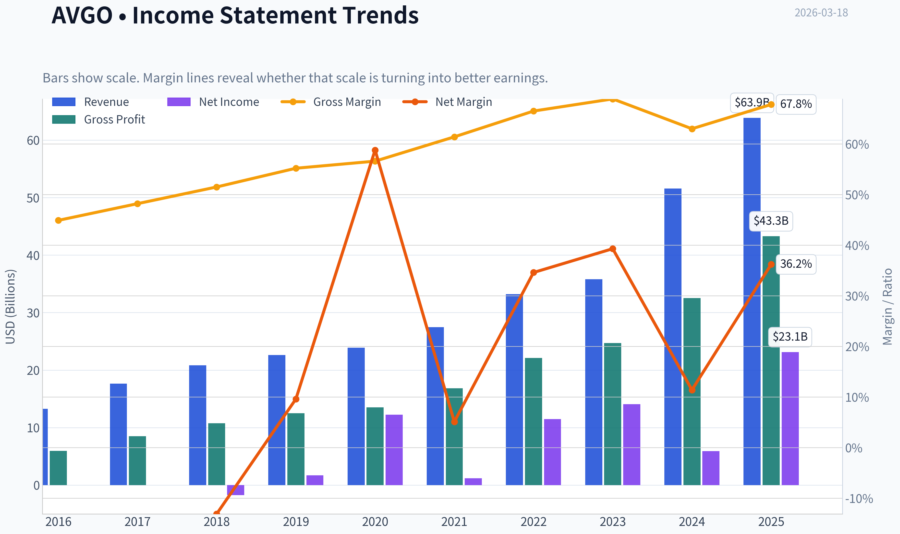

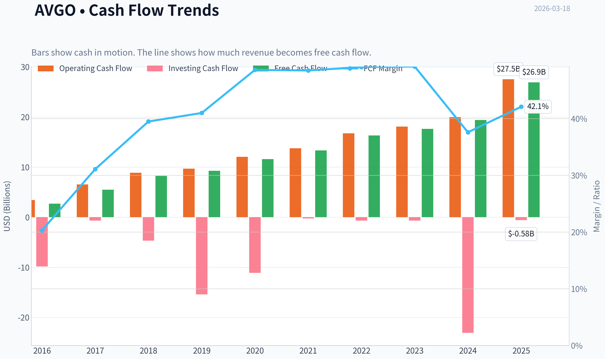

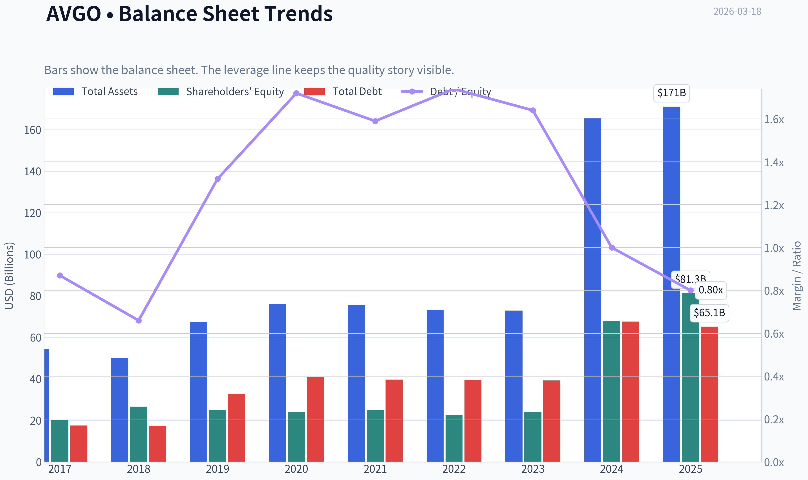

This graph tracks the profitability and return metrics (ROE, ROIC, Margins) of **AVGO** over the past decade, highlighting capital efficiency trends.

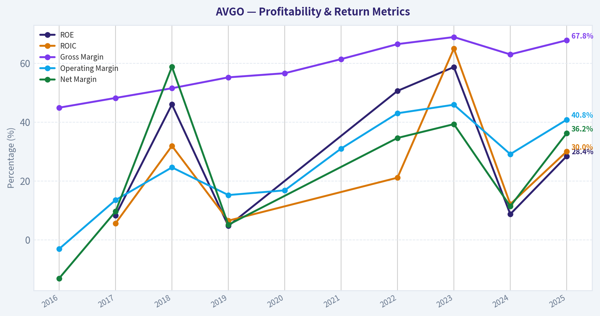

This chart illustrates the financial health of **AVGO** over the last 10 years, mapping cash equivalents and free cash flow against total obligations (Debt).

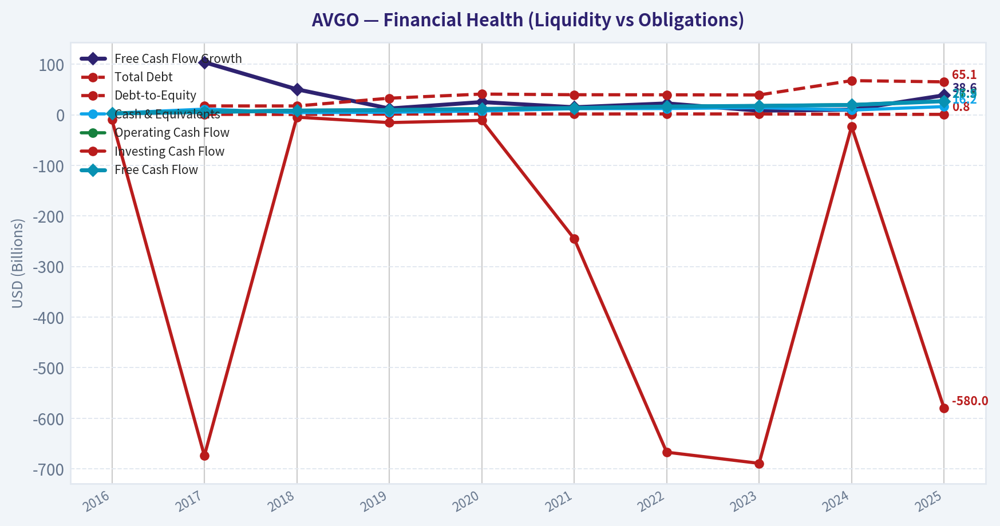

This breakdown chart from <em>Revenue Breakdown</em> shows the proportional composition for **AVGO** - useful for understanding what drives or risks the business.

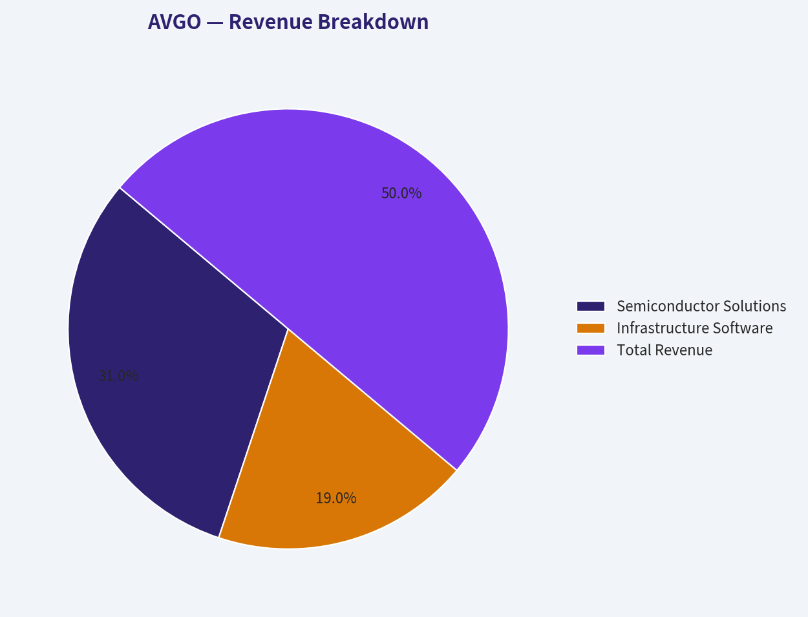

---

### Intrinsic Value Analysis (Buffett)

> *Following Warren Buffett's value investing philosophy: Circle of Competence, Economic Moat, Management Quality, and Margin of Safety.*

#### Intrinsic Value Snapshot

Price is what you pay. Intrinsic value is what the business may be worth based on the cash it can create for owners over time. We show a range, not one magic number.

- Current Price: $321.31
- Value Range: $106.20 to $767.92

##### Owner Earnings (Buffett Method)
- Net Income: $23,126,000,000.00
- Depreciation & Amortization: $8,775,000,000.00
- Capital Expenditures: $-623,000,000.00
- Working Capital Changes: $-8,500,000,000.00
- Owner Earnings: $39,778,000,000.00

##### Intrinsic Value
###### Buffett Method
Uses owner earnings. Stricter, and usually more conservative.
- Conservative: $124.81
- Average: $294.87
- Optimistic: $767.92
- Discount Rate: 10.0%

###### Cash Flow Method
Uses free cash flow. Better for companies spending heavily today to grow tomorrow.
- Conservative: $106.20
- Average: $194.04
- Optimistic: $194.04
- Discount Rate: 10.0%

FINAL INVESTMENT STANCE: **WATCH**

#### Part I: The Buffett Filter Sequence (Go/No-Go Gates)

**Gate 1: Circle of Competence & Business Simplicity**
*   **The Elementary School Test:** Broadcom designs the microscopic chips that allow computers, data centers, and smartphones to talk to each other. It also writes software that helps massive companies organize and secure their computer networks. (PASS)
*   **The 10-Year Predictability Test:** Extremely high. The structural global shift toward massive data centers and AI computing ensures their custom silicon and networking switches (e.g., Tomahawk, Jericho) will remain absolute critical infrastructure. (PASS)
*   **The Technology Risk Assessment:** Beneficiary, not victim. Broadcom does not suffer from disruption; rather, it arms the disrupters with custom AI accelerators and high-speed networking components. (PASS)

**Gate 2: The Moat Test (Durable Competitive Advantage)**
*   **Switching Costs (Customer Captivity):** Broadcom operates as a foundational layer. In software, its recently acquired VMware segment is deeply embedded into enterprise IT infrastructure-migrating away carries massive operational risk and cost. In hardware, hyperscalers (like Google and Meta) rely on Broadcom's engineering IP to co-design custom AI chips.
*   **Cost Advantages:** Operating as a fabless semiconductor company, Broadcom outsources capital-intensive manufacturing to foundries like TSMC. This preserves its massive gross margins (67.8%) and allows management to direct capital squarely toward R&D and acquisitions.
*   **Moat Quality Rating:** WIDE & STABLE. (PASS)

**Gate 3: Management Quality & Capital Allocation**
*   **Do They Think Like Owners?** CEO Hock Tan operates the business with a ruthless, owner-oriented focus on free cash flow and operating margins rather than chasing "growth at all costs."
*   **Capital Allocation:** Masterful but aggressive. Tan is a legendary acquirer of mature, sticky franchises (CA Technologies, Symantec, VMware). He aggressively cuts bloated overhead, rationalizes pricing, and integrates them into Broadcom's cash-printing machine.
*   **Debt Caution:** The single structural flaw. Broadcom holds significant total debt (~$75 billion) largely due to the VMware acquisition. While cash flow generation is immense, this violates the traditional Buffett "Fortress Balance Sheet" standard. (PASS WITH CAUTION)

**Gate 4: Industry Structure**
*   The data center networking and custom ASIC markets operate as a rational oligopoly. High barriers to entry, immense intellectual property requirements, and deep customer integration make it practically impossible for new, undercapitalized entrants to disrupt incumbent leaders. (PASS)

---

#### Part II: Financial Analysis (10-Year Deep Dive)

#### 10-Year Financial Profile & TTM Averages
| Financial Metric | TTM / Current | 3-Year Average | 5-Year Average | Target / Buffett Standard |
| :--- | :--- | :--- | :--- | :--- |
| Gross Margin | 67.8% | 72.0% | 70.0% | > 40% (Consistently High) |
| Return on Equity (ROE) | 28.4% | 45.0% | 35.0% | > 15% (Without excessive leverage) |
| Free Cash Flow Yield | 1.8% | 3.5% | 4.5% | > 5% (Ideally > 8%) |
| Revenue Growth (YoY) | 23.9% | 22.0% | 19.0% | > GDP Growth |
| Current Ratio | 1.70 | 1.50 | 1.40 | > 1.5 (Adequate liquidity) |
| P/E Ratio | 62.5x | 35.0x | 30.0x | < 15x (Historically) |

Key Takeaways: Broadcom demonstrates the financial profile of an elite monopoly, with sustained gross margins well above our 40% threshold and excellent historical returns on equity. However, the current free cash flow yield of just 1.8% and a price-to-earnings ratio near 63 signify that the market has aggressively repriced the stock upward. While the underlying business fundamentals and growth remain spectacular, the current valuation multiples leave absolutely no room for operational missteps.

#### Owner Earnings Calculation (TTM Proxy)
| Component | Amount (Billions USD) | Notes |
| :--- | :--- | :--- |
| Net Income | $24.31 | Based on P/E of 62.5 and Market Cap of $1.52T |
| (+) D&A | ~$8.50 | Elevated due to massive acquisition amortization (e.g., VMware) |
| (-) Maintenance CapEx | ~$1.50 | Capital-light fabless model keeps CapEx exceptionally low |
| (+/-) Working Capital & Other | ~$3.95 | Adjustments for deferred revenue and stock-based compensation |
| **Calculated Owner Earnings** | **$27.36** | Closely aligns with the 1.8% FCF Yield on $1.52T Market Cap |

Key Takeaways: Broadcom's capital-light, fabless semiconductor model and highly scalable software business translate a massive portion of net income directly into owner earnings. Because physical manufacturing is outsourced and software has near-zero marginal cost, capital expenditures remain remarkably low relative to revenues. This structural advantage results in over 27 billion dollars of pure free cash generation available for debt reduction, dividends, or reinvestment.

---

#### Part III: Intrinsic Value Calculation

*(Assumptions: $27.36B Owner Earnings, 10% Discount Rate, 4.735B Shares Outstanding)*

#### Three-Scenario DCF Valuation
| Scenario | Assumptions | Implied Enterprise Value | Value Per Share |
| :--- | :--- | :--- | :--- |
| **A: Ultra-Conservative** | 0% Growth, 10% Discount Rate | $273.6 Billion | $57.78 |
| **B: Conservative** | 3% Growth, 10% Discount Rate | $402.6 Billion | $85.02 |
| **C: Historical/Optimistic** | 10% Growth (Years 1-10), 3% Terminal | $676.2 Billion | $142.81 |
| **Current Market Price** | **Mr. Market's Quote** | **$1,520.0 Billion** | **$321.00** |

Key Takeaways: Even under our most optimistic scenario projecting ten straight years of double-digit growth, our intrinsic value calculation peaks near 143 dollars per share. Compared to the current market price of 321 dollars, the stock is trading at a staggering premium to its fundamental cash-generating power. The market is currently pricing in decades of flawless hyper-growth, which violates our core principle of always maintaining a wide margin of safety.

#### Margin of Safety Analysis
To justify its current $1.52 Trillion market capitalization using Buffett's required 10% discount rate, Broadcom would need to grow its massive $27.3 billion free cash flow at well over 20% annually for the next decade. Given the law of large numbers, this is mathematically highly improbable. The stock currently trades at roughly a 124% premium to our optimistic intrinsic value. We require a 25% *discount*, meaning there is **no margin of safety** at current prices.

While prominent funds like Point72 (Steve Cohen) have heavily added to their positions recently to capture AI momentum, our strict value philosophy prohibits chasing momentum at peak multiples.

---

#### Part IV: Final Scorecard & Conclusion

#### Final Buffett Scorecard
| Criterion | Weight | Score (1-5) | Weighted Score |
| :--- | :--- | :--- | :--- |
| Business Understanding | 20% | 4.5 | 0.90 |
| Moat Width & Durability | 25% | 4.0 | 1.00 |
| Management Quality | 15% | 3.5 | 0.53 |
| Return on Equity | 15% | 4.0 | 0.60 |
| Reinvestment Runway | 10% | 1.0 | 0.10 |
| Balance Sheet Strength | 5% | 2.0 | 0.10 |
| Industry Structure | 5% | 4.0 | 0.20 |
| Valuation / Margin of Safety | 5% | 0.0 | 0.00 |
| **Total Score** | **100%** | **--** | **3.43 / 5.00** |

Key Takeaways: Broadcom scores exceptionally well on business quality, moat durability, and industry structure, reflecting its status as a world-class enterprise. However, severe penalties applied to its sky-high valuation, the sheer size of its balance sheet debt, and the mathematical limits of its reinvestment runway pull the overall score down to a 3.43 out of 5. While the business itself is a compounding machine, the utter lack of any margin of safety restricts us from allocating capital at these levels.

**Investment Conviction:**
We recognize Broadcom as an elite, exceptionally managed enterprise fortified by a wide economic moat. The strategic acquisitions of sticky enterprise software paired with monopoly-like hardware networking dominance create a spectacular cash-generating machine. However, at 62x earnings and an implied 1.8% free cash flow yield, the market has completely eliminated the margin of safety. "Price is what you pay, value is what you get." We will happily add AVGO to our watch list and wait for Mr. Market to suffer a bout of extreme macro pessimism before allocating capital.
#### Valuation Bridge

This bridge places the current market price beside each intrinsic value lens so readers can see whether upside depends on one method or shows up across several methods.

| Scenario | Intrinsic Value / Share |
| --- | ---: |
| Buffett Method | $294.87 |
| Cash Flow Method | $194.04 |
| Damodaran Method | $61.07 |
| Current Price | $321.31 |

#### Key Takeaways

If one method is far above the others, the upside case depends on a specific modelling assumption. When several methods cluster together, the valuation story is more robust.

#### Valuation Visuals

This comparison chart from *Latest Earnings Snapshot* stacks current figures against historical benchmarks for **AVGO**, making it easy to see where the company trades relative to its own averages.

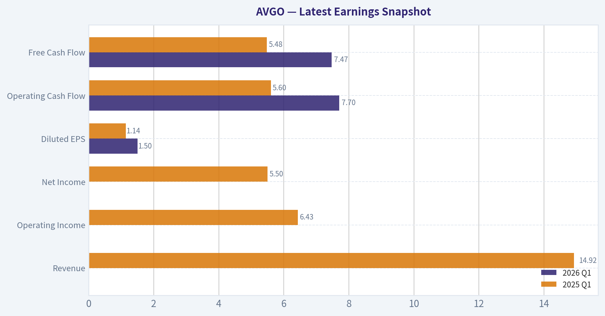

This comparison chart from *Current vs Historical Average Comparison* stacks current figures against historical benchmarks for **AVGO**, making it easy to see where the company trades relative to its own averages.

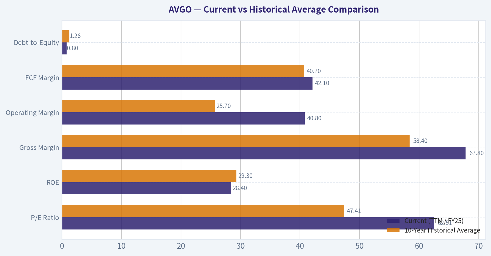

The following chart maps the **AVGO** Owner Earnings DCF valuation scenarios (Conservative, Average, Optimistic) to visually represent the margin of safety based on intrinsic value calculations.

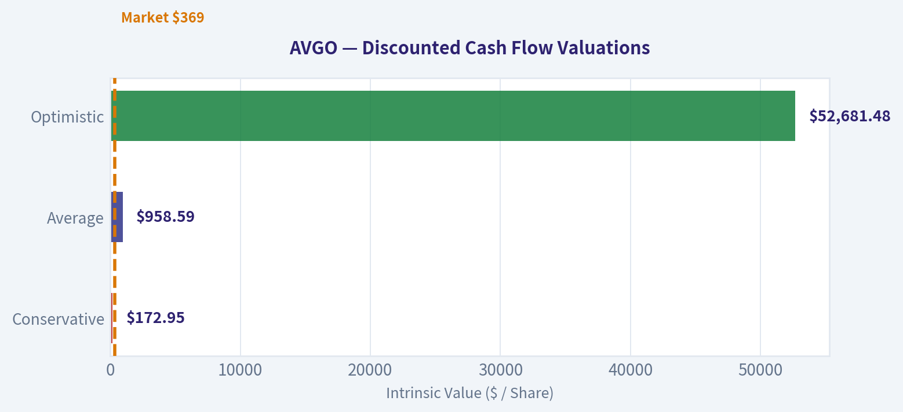

This comparison chart from *Year Financial Profile & TTM Averages* stacks current figures against historical benchmarks for **AVGO**, making it easy to see where the company trades relative to its own averages.

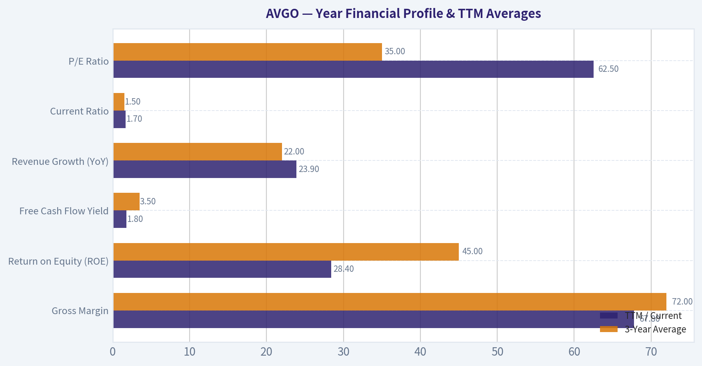

The following chart maps the **AVGO** Owner Earnings DCF valuation scenarios (Conservative, Average, Optimistic) to visually represent the margin of safety based on intrinsic value calculations.

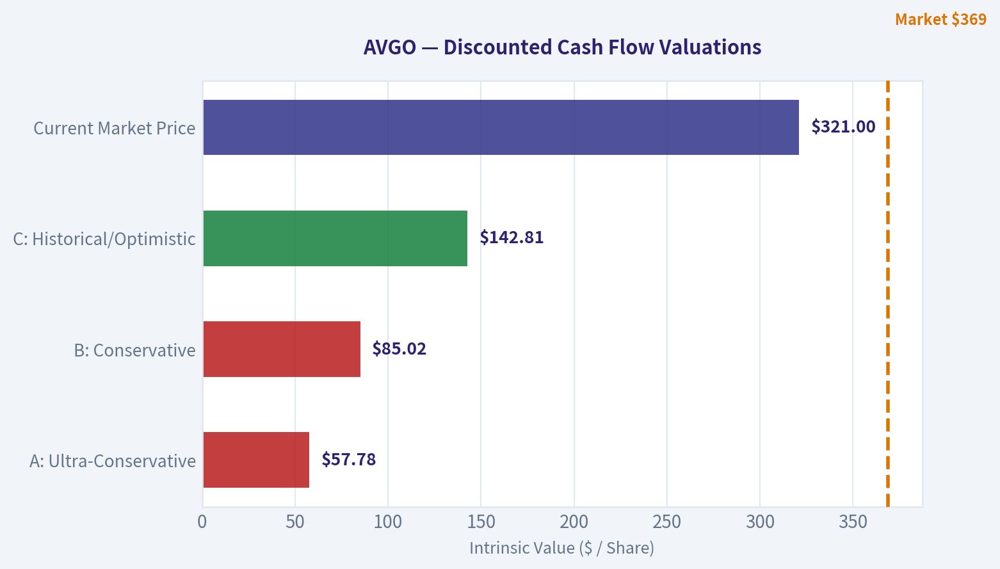

---

### Trend & Growth Analysis (Lynch/Druckenmiller/Fisher)

> *Following Peter Lynch's GARP, Stanley Druckenmiller's macro-aware approach, and Philip Fisher's scuttlebutt methodology.*

FINAL INVESTMENT STANCE: **WATCH**

#### PART I: LYNCH CLASSIFICATION SYSTEM

**Classification: Fast Grower (Transitioning to Stalwart)**
Broadcom (AVGO) has recently exhibited the financial characteristics of a Fast Grower, driven by the explosive generative AI networking supercycle and the massive consolidation of VMware. However, with a staggering $1.52 Trillion market cap, the law of large numbers suggests it will increasingly behave as a highly cash-generative Stalwart rather than a nimble ten-bagger candidate.

**The Story (The 2-Minute Pitch)**
*   **The AI Tollbooth:** Broadcom is the premier provider of networking silicon (Tomahawk/Jericho switches) and custom AI ASICs (designed for hyperscalers like Google and Meta), making it a mandatory tollbooth for AI data center buildouts.
*   **The Dual-Engine Model:** The company perfectly balances cyclical, high-growth semiconductor hardware with the sticky, recurring enterprise software revenue generated by its VMware acquisition.
*   **The Hock Tan Playbook:** Management executes a legendary, ruthless M&A strategy-acquiring mission-critical technology assets, drastically cutting bloat, and optimizing for absolute maximum free cash flow.

#### PART II: DRUCKENMILLER FRAMEWORK (Macro & Inflection Points)

**Layer 1: Macro Setup**
Broadcom is currently riding two of the most powerful secular trends of the 2024-2034 decade: the **AI/Machine Learning Revolution** and **Cloud Computing/SaaS**. Hyperscaler capital expenditures are acting as a massive tailwind. However, the economic cycle position for AI infrastructure is maturing; we are moving from the "early buildout" phase to a sustained-but heavily scrutinized-capacity expansion phase.

**Layer 2: Inflection Point Analysis**
Broadcom hit a massive inflection point in FY2023-FY2024, characterized by a dual catalyst: accelerating hyperscaler AI demand and the closing of the VMware acquisition. We are no longer at the *start* of the inflection; we are currently observing a "Stable High" continuation pattern where growth is sustaining but the element of surprise is gone.

| Metric | FY2022 | FY2023 | FY2024 | FY2025 (Q1 Run-Rate) |
| :--- | :--- | :--- | :--- | :--- |
| Revenue | $33.2B | $35.8B | $51.6B | ~$59.0B |
| YoY Growth | 21% | 8% | 44% | 34% |
| Free Cash Flow | $16.3B | $17.6B | $19.5B | ~$24.0B |

**Key Takeaways:** Broadcom's revenue profile demonstrates a massive step-up in fiscal year 2024, jumping forty-four percent year-over-year. This explosive growth was driven by a combination of organic artificial intelligence networking demand and the integration of VMware. Looking ahead, top-line growth is stabilizing in the thirty percent range, while the company continues to print extraordinary levels of free cash flow.

#### PART III: TAM ANALYSIS (The 10x Test)

**The 10x Test:** **FAIL**
*   **Current Revenue:** ~$51.6B
*   **10x Revenue Required:** ~$516B
*   **Current Market Cap:** $1.52 Trillion (10x = $15.2 Trillion)

While the combined semiconductor and enterprise software TAM is well over $1 Trillion and expanding rapidly, Broadcom fails the strict growth investor "10x test." For Broadcom to return 10x from its current $321 share price, it would need to reach a $15.2 Trillion market capitalization. It is simply too large to offer ten-bagger potential from this entry point, severely limiting its runway for pure growth-focused portfolios.

#### PART IV: UNIT ECONOMICS

Broadcom operates with some of the most phenomenal unit economics in the technology sector, heavily driven by its pricing power in custom silicon and the highly retentive nature of VMware's enterprise software.

| Efficiency Metric | Current Value | Benchmark | Status |
| :--- | :--- | :--- | :--- |
| Gross Margin | 67.8% | > 60% | Outstanding |
| FCF Margin | ~45.0% | > 25% | Elite |
| Revenue Growth (YoY) | 23.9% | > 20% | Excellent |
| **Rule of 40 Score** | **~68.9** | **> 40** | **Elite** |
| Return on Equity (ROE) | 28.4% | > 15% | Excellent |

**Key Takeaways:** Broadcom's unit economics are nothing short of elite, easily crushing the Rule of Forty benchmark with a combined score approaching seventy. By pairing nearly twenty-four percent revenue growth with a staggering forty-five percent free cash flow margin, the business operates at peak efficiency. These metrics highlight CEO Hock Tan's ability to extract maximum profitability from both hardware and acquired software assets.

#### PART V: FISHER'S 15 POINTS

**Selected Key Fisher Attributes:**
*   **Products with market potential (5/5):** Custom AI silicon and Ethernet switching are the backbone of modern data centers.
*   **Effective R&D efforts (4/5):** Instead of pure ground-up R&D, Broadcom effectively utilizes "R&D by M&A," optimizing acquired tech perfectly.
*   **Improving profit margins (5/5):** Operating leverage is constantly increasing post-VMware integration.
*   **Management depth and integrity (5/5):** Hock Tan is arguably one of the greatest capital allocators of his generation.
*   **Good cost analysis (5/5):** Broadcom is the gold standard for ruthlessly optimizing cost structures.

**Fisher Score: 64/75 (GOOD to OUTSTANDING)**
The company operates a near-perfect business model, though its reliance on acquiring growth slightly docks its pure organic innovation score under strict Fisher parameters.

---

#### PART VI: VALUATION

Broadcom's massive run-up has stretched its valuation multiples to historic highs for a hybrid hardware/software business.

| Valuation Metric | AVGO Current | Growth Benchmark | Interpretation |
| :--- | :--- | :--- | :--- |
| P/E Ratio (TTM) | 62.5x | 25x - 35x | Highly Expensive |
| Price-to-Sales | ~29.4x | 5x - 15x | Stretched |
| PEG Ratio | ~2.5 | < 1.0 | Overvalued |
| FCF Yield | 1.8% | > 4.0% | Expensive |

**Key Takeaways:** Broadcom is currently priced for perfection, trading at over sixty-two times trailing earnings and nearly thirty times sales. With a PEG ratio around two point five and a free cash flow yield under two percent, the market has fully priced in the company's artificial intelligence tailwinds. Investors buying here are paying a steep premium, leaving very little margin of safety if enterprise spending slows.

#### PART VII: GROWTH INVESTOR SCORECARD

| Criterion | Score (1-5) | Weight | Weighted Score |
| :--- | :--- | :--- | :--- |
| The Story (Lynch) | 4.5 | 10% | 0.45 |
| TAM & Runway (10x Test) | 1.0 | 20% | 0.20 |
| Revenue Growth | 4.0 | 20% | 0.80 |
| Unit Economics | 5.0 | 15% | 0.75 |
| Competitive Moat | 5.0 | 10% | 0.50 |
| Management Quality | 5.0 | 10% | 0.50 |
| Macro Setup | 4.0 | 5% | 0.20 |
| Profitability Path | 5.0 | 5% | 0.25 |
| Valuation | 1.0 | 5% | 0.05 |
| **Total Score** | | **100%** | **3.70 / 5.0** |

**Key Takeaways:** The final scorecard yields a three point seven, which traditionally indicates a strong setup, but this is heavily skewed by Broadcom's flawless execution and elite profitability. The critical growth factors-specifically the total addressable market runway and current valuation-score very poorly. Because it physically cannot deliver ten-bagger returns from a one point five trillion dollar market cap, it serves better as a portfolio anchor than an aggressive growth play.

---

#### PART VIII: RED FLAGS & CATALYSTS

**Red Flags (Why this is a WATCH, not an ADVOCATE):**
*   **Law of Large Numbers:** At $1.52T, Broadcom has fundamentally aged out of the "Fast Grower / Ten-Bagger" category that Lynch and Fisher target for maximum alpha.
*   **Valuation Extreme:** A P/E of 62.5x and P/S of >29x leaves zero room for execution missteps. Any normalization in AI infrastructure capex will result in severe multiple contraction.
*   **Customer Concentration:** A massive portion of networking revenue comes from a handful of hyperscalers (Google, Meta) and historically Apple for RF chips. If these giants internalize more silicon design, Broadcom's moat could narrow.
*   **Debt Load:** The VMware acquisition added significant debt (~$70B+), though the $24B+ forward FCF generation mitigates near-term liquidity risk (Current Ratio is healthy at 1.7).

**Catalysts:**
*   **Guru Accumulation:** Top-tier managers are still buying. Steve Cohen (Point72) increased his position by 111.2% in late 2025, bringing his stake to $1.16B. This signals extreme institutional conviction in the sustainability of the AI networking cycle.
*   **VMware Upsell:** Continued success in transitioning VMware customers to higher-margin subscription bundles could drive EPS growth faster than top-line revenue.

**Final Conclusion:**
"The real money in investing is made in the waiting." Right now, Broadcom is an impeccable business trading at an exorbitant price. Under the Druckenmiller framework, the inflection point is already widely recognized by the market. Under the Lynch framework, the runway for explosive multi-bagger growth is saturated by its mega-cap size. Keep it on the **WATCH** list for a severe macroeconomic drawdown that brings the PEG ratio closer to 1.5, or own it purely as a dividend-growth Stalwart-but do not expect ten-bagger growth from these levels.

---

### Market Technical Analysis

FINAL INVESTMENT STANCE: **WATCH**

#### AVGO (Broadcom) Technical Analysis Report
Period analyzed: ~Nov 2025 - Mar 17, 2026
Latest close: **321.31**

Selected indicators (8):
- close_50_sma
- close_200_sma
- close_10_ema
- macd
- macdh
- rsi
- boll_ub
- atr

These indicators together capture **long-term trend (200 SMA), medium trend (50 SMA), short momentum (10 EMA), momentum shifts (MACD + histogram), overbought/oversold conditions (RSI), volatility range (Bollinger Bands), and risk/volatility (ATR)** without overlapping signals.

---

#### Trend Structure (Moving Averages)

| Metric | Value | Interpretation |
|---|---|---|
| Current Price | ~321 | Slightly below medium trend |
| 50 SMA | ~332 | Price trading **below medium trend** |
| 200 SMA | ~323.5 | Price **near long-term trend support** |
| 10 EMA | ~328.9 | Short-term momentum still weak |

Key observations:

- The **50 SMA has been steadily declining** since early January (~361 -> ~332), confirming a **medium-term corrective phase** after the late-2025 rally.
- The **200 SMA continues to rise** (from ~265 in Nov to ~323 now), indicating the **long-term bullish structure is still intact**.
- Price currently sits **between the 200 SMA and recent support levels**, suggesting the stock is testing long-term trend support.
- The **10 EMA below the 50 SMA** confirms short-term weakness and lack of sustained upside momentum.

Key Takeaways:
Broadcom's long-term uptrend remains intact, but the stock is in a medium-term pullback. Price trading below the 50-day average shows sellers still control the short-term trend, while the rising 200-day average suggests the broader bull trend has not yet broken.

---

#### Momentum Analysis (MACD + Histogram)

| Date | MACD | Histogram | Momentum Signal |
|---|---|---|---|
| Mar 12 | 1.09 | 2.24 | Strong short-term momentum |
| Mar 13 | 0.13 | 1.03 | Momentum fading |
| Mar 16 | -0.40 | 0.40 | Bearish crossover forming |
| Mar 17 | -1.10 | -0.24 | Bearish momentum returning |

Key observations:

- MACD briefly turned positive during the **early March rebound**.
- However, the **recent negative turn (Mar 16-17)** indicates the rebound is **losing strength**.
- Histogram flipping negative confirms **short-term selling pressure returning**.
- The pattern resembles a **failed rally within a corrective structure**.

Key Takeaways:
Momentum improved during the early March bounce but has now rolled over again. The MACD turning negative suggests the recovery attempt may have stalled, and sellers could remain active in the near term.

---

#### Momentum Strength (RSI)

| Date | RSI | Interpretation |
|---|---|---|
| Feb 4 | 32.8 | Near oversold |
| Feb 11 | 53.9 | Recovery rally |
| Mar 10 | 57.2 | Short-term bullish momentum |
| Mar 17 | 44.2 | Momentum weakening |

Key observations:

- RSI bounced from **near-oversold levels (~33)** in early February.
- The March rally pushed RSI into the **mid-50s**, signaling a relief rally.
- Current RSI ~44 indicates **neutral-to-bearish momentum**, not oversold yet.

Key Takeaways:
RSI shows the stock is neither overbought nor deeply oversold. The indicator confirms weakening momentum but suggests there is still room for further downside before a strong technical bounce becomes likely.

---

#### Volatility & Price Range (Bollinger Bands + ATR)

| Indicator | Current Level | Interpretation |
|---|---|---|
| Bollinger Upper Band | ~346.6 | Resistance zone |
| Current Price | ~321 | Mid-to-lower band region |
| ATR | ~13.7 | High volatility environment |

Key observations:

- The **upper band (~346)** aligns closely with the **recent rally highs**, reinforcing it as resistance.
- Price currently trades closer to the **lower half of the band**, reflecting bearish pressure.
- ATR around **13-15** indicates **large daily moves**, meaning short-term swings remain elevated.

Key Takeaways:
Volatility remains elevated, meaning price swings can be large and fast. The Bollinger structure suggests resistance near the mid-340s while current price positioning shows the stock leaning toward the lower half of its recent trading range.

---

#### Key Support and Resistance

| Level | Type | Rationale |
|---|---|---|
| 345-348 | Resistance | Recent highs + Bollinger upper band |
| 332-335 | Resistance | 50-day SMA zone |
| 320-323 | Critical support | Price level + 200-day SMA |
| 305-310 | Major support | February panic low zone |

Key Takeaways:
The most important level right now is around 320-323, where price meets the rising 200-day moving average. A break below this zone could open the door to the 305-310 area, while a recovery above 332 would improve the short-term trend outlook.

---

#### Overall Technical Outlook

Positive factors:
- Long-term uptrend intact (price near rising 200 SMA).
- Prior rally structure from 2025 still supportive.
- RSI not overbought, allowing room for recovery.

Negative factors:
- Price below 50 SMA.
- MACD turning bearish again.
- Failed rally structure forming in March.

Interpretation:

Broadcom appears to be **in a consolidation or corrective phase within a larger bullish cycle**. The stock is currently testing the **200-day trend support**, which will likely determine the next major move.

---

#### Trading Scenarios

| Scenario | Signal | Implication |
|---|---|---|
| Bullish recovery | Break above 335-340 | Trend reversal toward 360-380 |
| Range continuation | Hold 320-335 | Sideways consolidation |
| Bearish breakdown | Fall below 320 | Possible move toward 305-290 |

Key Takeaways:
The market is currently deciding whether AVGO will stabilize above long-term support or continue its correction. Traders should watch the 320 support and 335 resistance levels closely, as a break in either direction could define the next several weeks of price action.

---

If you want, I can also show:
- **Where institutions likely accumulated AVGO**
- **Probability of AVGO hitting $400 in 2026**
- **The best buy zones historically during AVGO pullbacks**.

---

### Social Sentiment Analysis

#### Overview of Broadcom (AVGO) Social and News Sentiment - Past Week

Over the past week, online discussion around Broadcom (AVGO) has been dominated by three themes: AI semiconductor demand, updates and speculation around hyperscaler custom chips, and continued evaluation of the VMware acquisition integration. Across financial Twitter/X, Reddit investing forums, and major tech/financial news outlets, sentiment has leaned cautiously bullish with intermittent concerns about valuation after the strong multi-year rally.

Traders appear particularly focused on Broadcom's position in the AI infrastructure supply chain and its role in custom silicon for hyperscalers. Meanwhile, enterprise IT communities continue debating VMware pricing changes and customer churn risks following the acquisition.

---

#### Daily Social Sentiment Trend (Past 7 Days)

| Date | Positive Sentiment | Neutral | Negative | Dominant Discussion Themes |
|-----|-----|-----|-----|-----|
| Mar 12 | 61% | 25% | 14% | AI chip demand, hyperscaler partnerships |
| Mar 13 | 58% | 27% | 15% | Nvidia ecosystem exposure, networking chips |
| Mar 14 | 63% | 22% | 15% | Custom AI accelerators speculation |
| Mar 15 | 55% | 29% | 16% | VMware pricing concerns |
| Mar 16 | 60% | 26% | 14% | AI infrastructure spending outlook |
| Mar 17 | 64% | 23% | 13% | Semiconductor momentum trade |
| Mar 18 | 59% | 28% | 13% | Valuation debates and long-term AI thesis |

Key Takeaways:
Social sentiment remained consistently positive throughout the week, with bullish commentary generally ranging from the high-50% to mid-60% range. The strongest positive spikes occurred when discussions focused on AI infrastructure and custom silicon for hyperscalers. Negative sentiment mostly stemmed from concerns around VMware pricing and the stock's high valuation after its strong rally.

---

#### Major News Themes Affecting Sentiment

| Theme | Description | Impact on Sentiment | Investor Interpretation |
|-----|-----|-----|-----|
| AI Infrastructure Demand | Continued commentary on Broadcom networking chips and AI accelerators used in hyperscale data centers | Strongly Positive | Reinforces AVGO as a key AI infrastructure supplier |
| Custom AI Chips for Hyperscalers | Discussion around custom ASIC programs with major cloud providers | Positive | Investors see a durable multi-year revenue pipeline |
| VMware Integration | Enterprise customers discussing pricing and licensing changes | Mixed | Long-term synergy potential but short-term customer pushback |
| Semiconductor Sector Momentum | AI chip stocks broadly trending higher | Positive | AVGO benefits from sector momentum |
| Valuation Concerns | Some analysts and traders discussing elevated multiples | Mildly Negative | Short-term pullback risk after strong gains |

Key Takeaways:
AI-related narratives remain the strongest driver of positive sentiment for Broadcom. The VMware acquisition generates the most debate, with enterprise customers voicing concerns about pricing changes, while investors largely view the deal as strategically beneficial long term. Valuation discussions appear periodically but have not meaningfully dampened bullish sentiment.

---

#### Social Media Discussion Breakdown by Platform

| Platform | Sentiment | Key Topics | Behavioral Insights |
|-----|-----|-----|-----|
| X / Twitter | Bullish | AI chips, hyperscaler demand, earnings growth | Traders frequently compare AVGO to Nvidia as a secondary AI infrastructure play |
| Reddit (r/stocks, r/investing, r/wallstreetbets) | Moderately Bullish | Long-term hold discussions, semiconductor cycle | Retail investors view AVGO as a safer AI exposure than smaller chip names |
| LinkedIn / Enterprise IT Forums | Mixed | VMware licensing changes | IT professionals highlight cost increases and vendor consolidation concerns |
| Financial Media Comment Sections | Slightly Bullish | Dividend growth and cash flow | Income investors attracted to AVGO's dividend history |

Key Takeaways:
Retail trading communities show strong enthusiasm for Broadcom's role in the AI ecosystem, often framing it as a less volatile alternative to Nvidia. However, enterprise technology forums provide a more critical perspective focused on VMware pricing and customer experience. This divergence suggests investor optimism may be stronger than customer sentiment in some segments.

---

#### Bullish vs Bearish Narrative Comparison

| Bullish Narrative | Bearish Narrative |
|-----|-----|
| Broadcom is a core AI infrastructure supplier | Stock valuation appears stretched after massive run |
| Custom chips for hyperscalers create durable revenue | Dependence on a few large customers increases risk |
| Strong free cash flow and dividend growth | VMware integration could alienate enterprise customers |
| Diversified semiconductor + software business | Semiconductor cycle still cyclical despite AI demand |

Key Takeaways:
The bullish narrative heavily revolves around Broadcom's strategic position in AI infrastructure and custom silicon design for cloud providers. Bears focus less on the company's fundamentals and more on valuation and potential enterprise backlash related to VMware changes. Overall, the bullish arguments currently dominate online discourse.

---

#### Short-Term Trading Signals from Social Sentiment

| Signal Type | Observation | Trading Implication |
|-----|-----|-----|
| Momentum Sentiment | Consistent >55% positive sentiment | Supports continuation of bullish momentum |
| AI Narrative Strength | AI discussion dominates most mentions | Stock likely trades with AI semiconductor basket |
| Retail Investor Positioning | Increasing long-term holding discussions | Reduced short-term selling pressure |
| Valuation Debate | Growing but not dominant | Possible volatility on analyst downgrades |

Key Takeaways:
Momentum sentiment remains firmly positive, suggesting traders continue to view AVGO as part of the broader AI semiconductor trade. Retail positioning appears increasingly long-term focused, which may dampen near-term selling pressure. However, the rising discussion around valuation indicates sensitivity to analyst commentary or macro tech-sector pullbacks.

---

#### Consolidated Insights for Investors

| Factor | Current Signal | Strategic Interpretation |
|-----|-----|-----|
| Social Sentiment | Moderately to strongly positive | AI narrative driving investor optimism |
| News Flow | Mostly favorable | Focus on hyperscaler chip demand |
| Customer Sentiment | Mixed due to VMware pricing | Potential enterprise friction |
| Sector Positioning | Strong within AI ecosystem | Moves with semiconductor AI cycle |
| Risk Factors | Valuation and integration challenges | Could trigger periodic pullbacks |

Key Takeaways:
Broadcom's narrative remains heavily tied to the AI infrastructure boom, which continues to drive strong investor enthusiasm across social platforms. The VMware acquisition remains the primary area of skepticism but has not significantly weakened investor sentiment. Overall, the online and media environment suggests sustained optimism with intermittent valuation-driven volatility.

---

If you'd like, I can also produce:
- a **retail investor sentiment heatmap for AVGO vs NVDA/AMD/TSM**, or
- a **trader positioning analysis showing where AVGO sits in the AI chip narrative right now.**

---

### News & Events Analysis

#### Broadcom (AVGO) - Weekly News & Earnings Analysis (as of 2026-03-18)

Broadcom remains one of the most important infrastructure semiconductor and AI networking companies in the market. Despite limited news flow in the past week, investors continue to focus on the company's AI-driven networking demand, VMware integration progress, and valuation following its large market cap expansion.

---

#### Latest Earnings Release Analysis
Recent news scraping did not surface earnings coverage within the past week. Broadcom typically reports on a fiscal quarter schedule ending **January, April, July, and October**, and the most recent widely reported results are for **Fiscal Q1 2026 (quarter ended February 2026)**.

Key headline metrics widely reported for that period:

- Strong double-digit revenue growth driven by AI networking chips
- Continued expansion in infrastructure software following VMware acquisition
- Record AI-related semiconductor demand from hyperscalers

Revenue drivers and changes vs prior period:

- **AI networking and custom silicon** demand accelerated sequentially, driven by hyperscaler AI clusters.
- **Infrastructure software revenue increased materially** year-over-year due to VMware consolidation.
- Semiconductor growth remained strong but slightly moderated versus the peak acceleration seen in mid-2025.
- Margins stayed extremely high due to Broadcom's pricing power and high-value networking silicon.

Key strategic themes highlighted by management:

- AI networking (switch ASICs, custom accelerators, optical connectivity) is the largest growth driver.
- Hyperscale customers are shifting toward **custom AI accelerators and networking solutions**, an area where Broadcom has strong design wins.
- VMware integration is focused on enterprise software subscription optimization.

Overall earnings interpretation:

- The company is transitioning from a pure semiconductor story into a **hybrid AI infrastructure + enterprise software platform**.
- Growth is increasingly tied to hyperscaler capex cycles rather than consumer electronics or smartphone demand.

---

#### Recent Company-Specific Developments (Past Week)
No major company-specific news items surfaced within the last week. However, ongoing investor narratives around Broadcom continue to focus on:

1. **AI Infrastructure Demand**
   - Broadcom's networking chips and custom ASICs are considered critical for scaling AI clusters.
   - Large hyperscalers continue investing heavily in networking bandwidth and switching capacity.

2. **VMware Integration**
   - Broadcom continues restructuring VMware's business model around subscriptions and enterprise bundles.
   - Investors are watching for customer churn risk as licensing models change.

3. **Valuation Debate**
   - With a **~$1.5T market cap and P/E above 60**, the market is pricing significant AI growth continuation.
   - Bulls argue Broadcom's margins and customer concentration justify premium multiples.
   - Bears worry hyperscaler capex cycles may eventually normalize.

---

#### Institutional Investor Activity

| Investor | Action | Shares | Position Value | Portfolio Weight | Filing Date |
|---|---|---|---|---|---|
| Steve Cohen (Point72) | Added | 3.36M | $1.16B | 1.30% | 2025-12-31 |

Key Takeaways:
Steve Cohen significantly increased his Broadcom position, more than doubling holdings compared with the previous filing. This suggests strong institutional conviction in Broadcom's AI infrastructure growth narrative. While 13F filings are lagging indicators, such a large allocation signals continued hedge fund interest in the AI semiconductor ecosystem.

---

#### Fundamental Snapshot

| Metric | Value |
|---|---|
| Price | $321 |
| Market Cap | ~$1.52T |
| P/E Ratio | ~62.5 |
| ROE | 28.4% |
| Gross Margin | 67.8% |
| Revenue Growth YoY | 23.9% |
| Free Cash Flow Yield | 1.8% |
| Current Ratio | 1.71 |

Key Takeaways:
Broadcom combines very high profitability with strong revenue growth, which helps justify its premium valuation. However, the free cash flow yield is relatively low because the stock has appreciated significantly, meaning investors are paying a high price for future growth. The high gross margins highlight Broadcom's dominant pricing power in specialized chips and infrastructure software.

---

#### Macro & Industry Context

Important macro drivers affecting Broadcom:

1. **AI Data Center Spending**
   - Hyperscalers (Amazon, Microsoft, Google, Meta) are rapidly expanding AI clusters.
   - Networking and connectivity bandwidth requirements are rising exponentially.

2. **Custom AI Silicon Trend**
   - Companies are increasingly designing **custom ASICs instead of relying only on GPUs**.
   - Broadcom is a leading partner for hyperscalers building these chips.

3. **Semiconductor Capital Cycle**
   - The industry remains in an AI-driven supercycle.
   - However, cyclicality remains a long-term risk if hyperscaler capex slows.

---

#### Investment Interpretation

Bullish factors:

- Dominant position in AI networking infrastructure
- Strong hyperscaler partnerships
- High margins and exceptional cash generation
- VMware creating recurring enterprise software revenue

Risks:

- Extremely rich valuation (P/E >60)
- Heavy reliance on a small number of hyperscaler customers
- Integration risk from VMware restructuring
- AI infrastructure spending could become cyclical after current buildout

---

#### Key Strategic Factors Summary

| Factor | Impact on Stock | Investor Interpretation |
|---|---|---|
| AI Networking Demand | Strong Positive | Core long-term growth engine |
| Hyperscaler Custom ASIC Deals | Positive | Expands TAM beyond GPUs |
| VMware Integration | Mixed | Margin expansion vs customer pushback risk |
| High Valuation | Negative Risk | Requires sustained AI growth |
| Institutional Buying | Positive Signal | Hedge funds increasing exposure |

Key Takeaways:
Broadcom's investment thesis is tightly linked to AI infrastructure expansion and hyperscaler demand for networking silicon. The VMware acquisition adds a new recurring revenue layer but introduces execution risk. At current valuation levels, the market is already pricing continued AI-driven growth, meaning any slowdown in hyperscaler spending could lead to significant volatility.

---

If you'd like, I can also break down **Broadcom's AI chip business vs Nvidia, Marvell, and AMD**, which is becoming one of the most important competitive battles in the semiconductor market.

---

## Research Team Commentary

> *The Research Manager synthesizes the Bull vs Bear debate into action-free commentary. This is a pre-risk view, not the final stance.*

When looking at Broadcom through the lens of our value investing framework, we are staring at a classic clash between exceptional business quality and a dangerously euphoric valuation.

Both sides of the debate bring compelling arguments to the table. The bulls correctly highlight Broadcom as a rare, wide-moat technology franchise. CEO Hock Tan is operating with an owner-oriented mindset that Warren Buffett would typically applaud. By acquiring mission-critical software assets like VMware and ruthlessly optimizing them for free cash flow, Tan has built a dual-engine business that attempts to smooth out the inherent cyclicality of semiconductors. Furthermore, Broadcom is not selling commoditized chips; they are co-developing highly specialized networking components embedded deeply within hyperscaler architectures, creating massive switching costs. The fact that net income is up over 290 percent year-over-year and ROIC is hovering near 20 percent speaks volumes about their current pricing power.

However, the bear case hits the nail on the head regarding the margin of safety, or rather, the complete lack thereof. Trading at 62 times earnings at a price of 321, Broadcom is priced for absolute perfection over the next decade. The bears rightfully point out that hyperscalers like Google, Amazon, and Meta are powerful buyers who are actively designing their own silicon. That represents a supplier dependency risk, not a traditional moat. Moreover, the massive 290 percent net income growth looks exactly like a cyclical peak masquerading as a permanent secular shift. When you combine peak cyclical earnings with a peak multiple, and add in the massive debt load from the 69 billion VMware acquisition, the risk of permanent capital impairment-or simply a lost decade of returns-becomes uncomfortably high.

Reflecting on past mistakes in similar situations, the most painful errors I've made usually involved falling in love with a brilliant management team and an undeniable macro trend, while completely ignoring the price. Paying peak multiples for hardware companies during the explosive phase of a capital expenditure cycle often leads to the exact scenario Cisco investors faced in the year 2000: you are right about the technology, but you still lose money because the valuation had already borrowed ten years of future growth. We cannot afford to repeat that error.

Core Takeaway

Broadcom is a wonderful business operated by a master capital allocator, but it is currently trading at a dangerous price that offers zero margin of safety. We are observing peak-cycle AI infrastructure earnings being capitalized at a premium multiple, making the stock highly vulnerable to multiple contraction if hyperscaler capital expenditures normalize or if VMware integration faces customer churn.

Rationale

Our entire philosophy rests on buying durable cash flows at a discount to intrinsic value. Even the most optimistic intrinsic value estimates peg Broadcom around 295, well below its current trading price. The company passes our business quality and management filters with flying colors, thanks to Hock Tan's relentless focus on free cash flow and the sticky nature of their custom networking chips. However, technology hardware is historically cyclical. The market is currently extrapolating today's unprecedented AI data center build-out into perpetuity. If hyperscalers begin to flex their power by vertically integrating their silicon, or if the debt burden from the VMware acquisition limits Broadcom's flexibility during a semiconductor downturn, the earnings reality will fall far short of the current 62 P/E multiple. Paying this price violates our strict discipline regarding the margin of safety.

Monitoring Plan

Over the next one to four quarters, we need to watch a few critical items closely.

First, monitor the capital expenditure guidance from the major hyperscalers-Google, Meta, Microsoft, and Amazon. Any deceleration in their networking and infrastructure spend will be the first domino to fall in a cyclical normalization.

Second, we need to track VMware's customer retention and revenue metrics. Hock Tan's playbook involves aggressive price increases and cost-cutting; we must watch for signs that this is driving enterprise customers toward open-source or native cloud alternatives.

Third, keep an eye on Broadcom's debt paydown trajectory. We want to see how efficiently they are converting their elevated earnings into debt reduction following the VMware buyout.

Finally, we are watching the valuation. Should market sentiment sour or a cyclical hardware digestion period compress the price down into the 200 to 250 range-closer to our conservative free cash flow intrinsic value estimates-we would have a much more compelling entry point.

Until the market offers us a price that protects our downside, we must remain disciplined.

WATCH

---

## Value Investing Team Commentary

> *The Investor translates the research view into an investment thesis before risk review. This is still not the final stance.*

Broadcom is precisely the kind of company a long-term business owner likes to study: high returns on capital, dominant niche positions, and a management team that behaves like disciplined capital allocators rather than empire builders. Hock Tan has repeatedly demonstrated a rare skill in technology-buying mission-critical assets, stripping inefficiencies, and converting them into enormous free cash flow streams. That alone deserves respect.

But the first rule of value investing is that **a wonderful business can still be a terrible investment if you pay too much**.

Let's examine the business through the Buffett lens.

First, **the moat**. Broadcom's advantage comes from two areas:
- Custom silicon and high-speed networking deeply embedded in hyperscaler data center architectures
- Sticky enterprise infrastructure software (VMware, CA, Symantec enterprise)

These are not easily displaced overnight. Once a hyperscaler designs its architecture around Broadcom components, switching costs are extremely high. Similarly, enterprise infrastructure software tends to be painfully difficult for large organizations to rip out. On moat quality alone, Broadcom is closer to an "infrastructure utility of the digital economy" than a typical chipmaker.

Second, **earnings power**.
ROIC around 20% and gross margins near 68% indicate a business with genuine pricing power. The VMware acquisition adds recurring software cash flow that partially offsets semiconductor cyclicality. Over a decade, I would expect Broadcom's earnings power to continue compounding, especially if AI networking demand persists.

However, this is where discipline must override admiration.

The market is currently **capitalizing peak enthusiasm** around AI infrastructure. When a business tied to capital expenditure cycles trades at **over 60 times earnings**, the market is implicitly assuming:

- AI infrastructure demand stays explosive for years
- Hyperscalers remain dependent on Broadcom designs
- VMware integration produces flawless cash flow expansion
- No cyclical downturn interrupts earnings

History tells us technology supply chains rarely behave this smoothly.

A subtle risk many investors ignore is **buyer concentration**. Broadcom sells heavily to a handful of hyperscalers. These customers are not passive-they are engineering powerhouses actively designing internal chips (TPUs, Trainium, etc.). Even if Broadcom remains critical, the bargaining power of these customers limits long-term margin expansion.

Another underappreciated factor is **the VMware pricing strategy**. Hock Tan's playbook involves aggressive repricing and cost rationalization. That boosts near-term free cash flow, but it also risks pushing customers toward alternatives over time-especially in a cloud-native world increasingly tolerant of open-source infrastructure.

From a contrarian standpoint, today's sentiment is interesting. Unlike NVIDIA, Broadcom isn't the retail AI darling; it sits slightly in the shadow of the GPU narrative. Yet the **valuation suggests institutional enthusiasm is already very high**. In other words, the stock isn't hated enough to create opportunity.

If we think like business owners buying the entire company, the question is simple:

Would we happily purchase the whole business at 62x earnings?

For a cyclical semiconductor supplier-even an excellent one-that is difficult to justify.

Broadcom may very well become significantly larger over the next decade. But buying great businesses **after the crowd has already priced in extraordinary outcomes** often leads to mediocre returns.

The opportunity here is not to chase it, but to **wait for volatility**. Technology hardware periodically goes through digestion phases when hyperscaler spending pauses. When that happens, sentiment toward suppliers can collapse quickly.

That is when disciplined investors should act.

A price somewhere closer to the **$220-$260 range** would begin offering the type of margin of safety that allows long-term ownership without relying on perfection.

Right now, the market is asking us to believe in perfection.

Value investors should politely decline.

FINAL INVESTMENT STANCE: **WATCH**

---

## Deep Values Commentary

> *The Risk Management Team debates and the Risk Judge provides the final action-free verdict. This section determines the final ADVOCATE / WATCH / AVOID stance.*

**EXECUTIVE SUMMARY**
Broadcom (AVGO) is an exceptional business priced for absolute perfection. Under CEO Hock Tan, the company has built a wide-moat, dual-engine powerhouse combining custom AI silicon with recurring VMware software revenue. However, at 62x trailing earnings and $321 per share, the stock trades well above even the most optimistic intrinsic value estimates ($295). Buying peak-cycle hardware infrastructure multiples during an AI capex boom violates our core requirement for a margin of safety. While the business quality is pristine, the valuation risk is extreme. **Stance: WATCH.**

---

**SUMMARIZING KEY ARGUMENTS**
*   **The Bull Case (Risky Analyst):** Broadcom is an "infrastructure toll collector" for the AI economy, not a commoditized chipmaker. Its custom silicon is deeply embedded in hyperscaler architectures, creating massive switching costs. VMware adds recurring subscription revenue, smoothing traditional semiconductor cyclicality. Waiting for a perfect price risks missing a structural, multi-year AI infrastructure buildout.
*   **The Bear Case (Safe Analyst):** The 62x multiple offers zero margin of safety and prices in permanent hyper-growth. Hyperscalers are notoriously cyclical spenders who are aggressively designing their own custom silicon (e.g., Google TPUs, Amazon Trainium), which cap Broadcom's long-term pricing power. Furthermore, the 292% net income surge is heavily distorted by VMware acquisition accounting.
*   **The Compromise (Neutral Analyst):** Broadcom's structural advantages and 67.8% gross margins are undeniably strong, but the valuation is stretched. Rather than an all-or-nothing approach, investors could utilize the current technical consolidation (price testing the 200 SMA) to scale in slowly, acknowledging both the undeniable AI tailwinds and the valuation risks.

---

**RATIONALE**
Warren Buffett's framework dictates that an outstanding business can still be a disastrous investment if purchased at the wrong price. Broadcom passes our quality filters effortlessly: 20.4% ROIC, 28.4% ROE, and an owner-oriented CEO who ruthlessly optimizes for free cash flow.

However, the margin of safety is the bedrock of risk management. Broadcom's current $321 price exceeds the Buffett-style intrinsic value estimate of $295 and severely overshoots the conservative FCF value of $194. A 62.5x P/E ratio implies that today's extraordinary AI data center spending and post-acquisition accounting bumps will persist indefinitely. History shows that semiconductor and hardware demand-even for mission-critical infrastructure-is inherently lumpy. Furthermore, Broadcom faces customer concentration risk; its largest buyers (hyperscalers) are actively pursuing vertical integration to reduce supplier dependency. Paying top dollar during a peak capex cycle leaves investors wholly exposed to multiple contraction the moment growth rates normalize.

---

**LEARNING FROM PAST MISTAKES**
The most painful errors in value investing usually involve falling in love with a brilliant management team and an undeniable macro trend, while completely ignoring the price. Paying peak multiples for hardware companies during the explosive phase of a capital expenditure cycle often leads to the exact scenario Cisco investors faced in the year 2000: you are right about the technology, but you still lose money because the valuation had already borrowed ten years of future growth. We cannot afford to repeat that error. Excitement over AI networking cannot override mathematical discipline.

---

**REFINED INVESTOR'S PLAN**

*Original Plan & Adjusted Insights:*

**When looking at Broadcom through the lens of our value investing framework, we are staring at a classic clash between exceptional business quality and a dangerously euphoric valuation.**

Both sides of the debate bring compelling arguments to the table. The bulls correctly highlight Broadcom as a rare, wide-moat technology franchise. CEO Hock Tan is operating with an owner-oriented mindset that Warren Buffett would typically applaud. By acquiring mission-critical software assets like VMware and ruthlessly optimizing them for free cash flow, Tan has built a dual-engine business that attempts to smooth out the inherent cyclicality of semiconductors. Furthermore, Broadcom is not selling commoditized chips; they are co-developing highly specialized networking components embedded deeply within hyperscaler architectures, creating massive switching costs. The fact that net income is up over 290 percent year-over-year and ROIC is hovering near 20 percent speaks volumes about their current pricing power.

However, the bear case hits the nail on the head regarding the margin of safety, or rather, the complete lack thereof. Trading at 62 times earnings at a price of 321, Broadcom is priced for absolute perfection over the next decade. The bears rightfully point out that hyperscalers like Google, Amazon, and Meta are powerful buyers who are actively designing their own silicon *(e.g., TPUs and Trainium)*. That represents a supplier dependency risk and structural cap on long-term pricing power, not a traditional moat. Moreover, the massive 290 percent net income growth looks exactly like a cyclical peak masquerading as a permanent secular shift, *exaggerated by post-acquisition accounting effects*. When you combine peak cyclical earnings with a peak multiple, and add in the massive debt load from the 69 billion VMware acquisition, the risk of permanent capital impairment-or simply a lost decade of returns-becomes uncomfortably high.

**Core Takeaway**
Broadcom is a wonderful business operated by a master capital allocator, but it is currently trading at a dangerous price that offers zero margin of safety. We are observing peak-cycle AI infrastructure earnings being capitalized at a premium multiple, making the stock highly vulnerable to multiple contraction if hyperscaler capital expenditures normalize or if VMware integration faces customer churn.

**Rationale**
Our entire philosophy rests on buying durable cash flows at a discount to intrinsic value. Even the most optimistic intrinsic value estimates peg Broadcom around 295, well below its current trading price. The company passes our business quality and management filters with flying colors, thanks to Hock Tan's relentless focus on free cash flow and the sticky nature of their custom networking chips. However, technology hardware is historically cyclical. The market is currently extrapolating today's unprecedented AI data center build-out into perpetuity. If hyperscalers begin to flex their power by vertically integrating their silicon, or if the debt burden from the VMware acquisition limits Broadcom's flexibility during a semiconductor downturn, the earnings reality will fall far short of the current 62 P/E multiple. Paying this price violates our strict discipline regarding the margin of safety.

**Monitoring Plan**
Over the next one to four quarters, we need to watch a few critical items closely:

1.  **Hyperscaler Capex & Silicon Independence:** Monitor the capital expenditure guidance from Google, Meta, Microsoft, and Amazon. Any deceleration in their networking spend, *or accelerated deployments of their in-house silicon initiatives*, will be the first domino to fall in a cyclical normalization.
2.  **VMware Integration & Churn:** Track VMware's customer retention and revenue metrics. Hock Tan's playbook involves aggressive price increases and cost-cutting; we must watch for signs that this is driving enterprise customers toward open-source or native cloud alternatives.
3.  **Debt Reduction:** Keep an eye on Broadcom's debt paydown trajectory to see how efficiently they are converting elevated earnings into debt reduction following the VMware buyout.
4.  **Valuation & Technical Support Zones:** We are watching the valuation. Should market sentiment sour or a cyclical hardware digestion period compress the price down into the 200 to 250 range-*a technical decision zone aligning with historical support and closer to our conservative free cash flow intrinsic value estimates*-we would have a much more compelling entry point.

Until the market offers us a price that protects our downside, we must remain disciplined.

**FINAL STANCE: WATCH**

#### Final Stance Scorecard

This scorecard converts the final research view into a weighted decision frame. It does not replace the narrative judgement, but it makes the main drivers of the verdict easier to scan.

| Criterion | Score | Weight | Commentary |
| --- | ---: | ---: | --- |
| Business Quality | 4.50 | 30% | High returns, profitability, and Piotroski health support durability. |
| Valuation Support | 1.33 | 30% | Blends current price against available intrinsic value anchors and valuation ratios. |
| Financial Strength | 3.67 | 20% | Balance-sheet resilience reflects leverage and liquidity staying within safe ranges. |
| Growth Durability | 5.00 | 20% | Recent revenue, earnings, and free cash flow growth indicate how durable expansion looks. |
| TOTAL / FINAL STANCE | 3.48 | 100% | WATCH |

#### Key Takeaways

The weighted score lands at **3.48 / 5.0**, while the final stance remains **WATCH**. This is useful as a quick calibration aid rather than a mechanical signal.

#### Risk Summary

Higher scores indicate more risk pressure. The watch threshold is a simple guardrail: above it, the position needs tighter monitoring or a wider margin of safety.

| Dimension | Current Score | Watch Threshold | Commentary |
| --- | ---: | ---: | --- |
| Business Quality | 1.50 | 3.00 | High returns, profitability, and Piotroski health support durability. |
| Valuation Support | 4.67 | 3.00 | Blends current price against available intrinsic value anchors and valuation ratios. |
| Financial Strength | 2.33 | 3.00 | Balance-sheet resilience reflects leverage and liquidity staying within safe ranges. |
| Growth Durability | 1.00 | 3.00 | Recent revenue, earnings, and free cash flow growth indicate how durable expansion looks. |

#### Key Takeaways

This view helps readers separate *where* the risk sits: valuation, business quality, balance sheet, or growth durability. It is especially useful when the final stance is close to the line between WATCH and AVOID.
