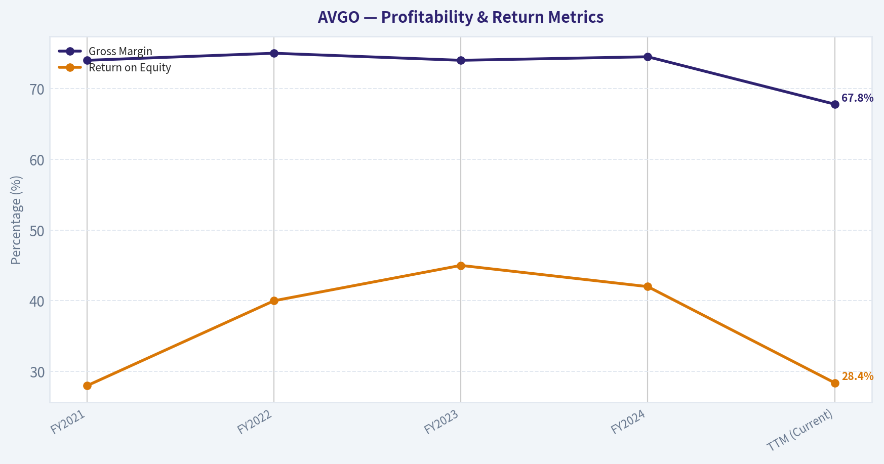
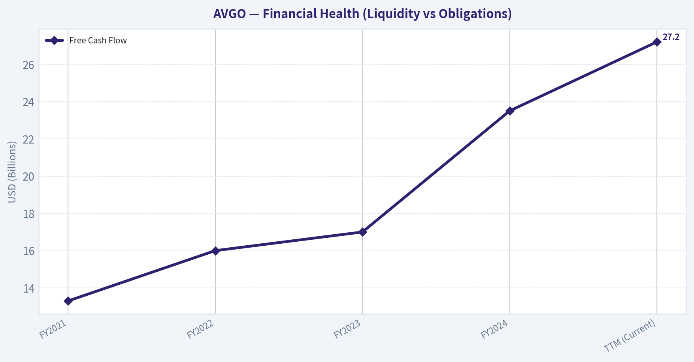
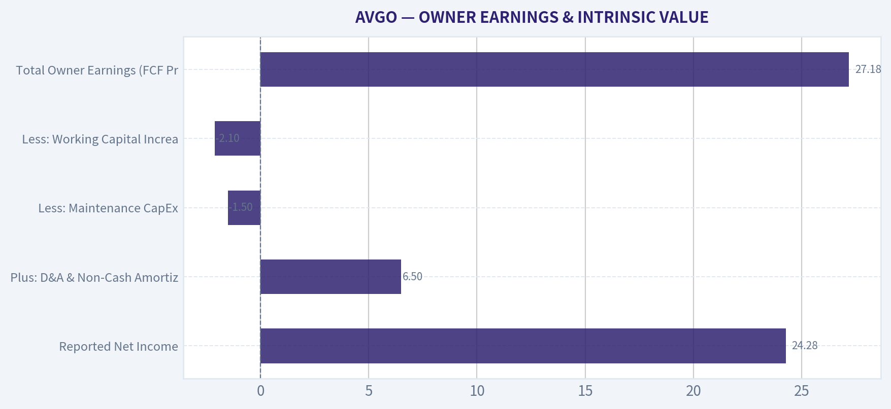
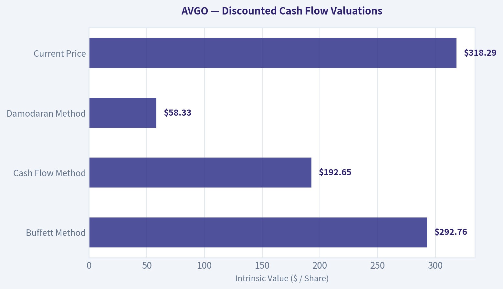
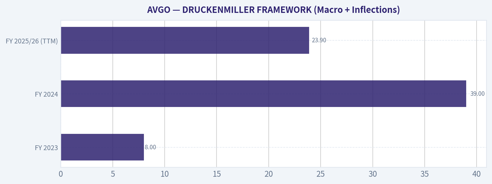
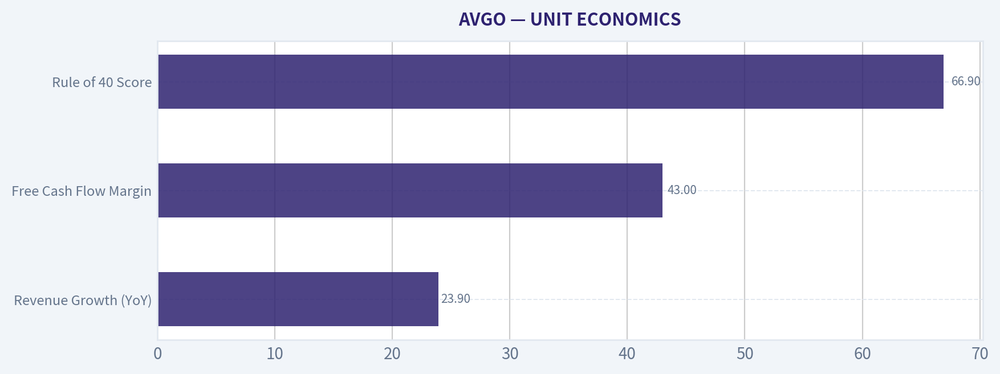
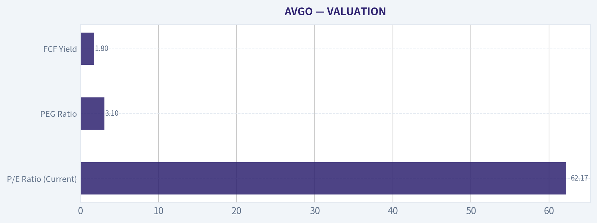
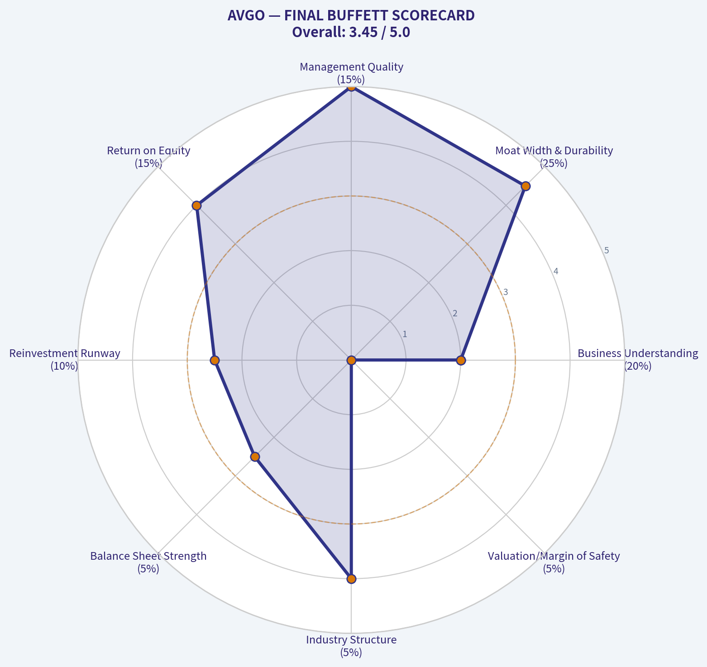

# AVGO Deep Value Intelligence

**Analysis Date:** 2026-03-25

## Critical Disclaimer

*This analysis is generated by Deep Value Intelligence, an AI-powered multi-agent investing framework. This report is for informational and educational purposes only and does not constitute financial advice. Always conduct your own research and consult with qualified financial advisors before making investment decisions.*

---

## Table of Contents

1. Intelligence Summary
2. Analyst Team Reports
   - Fundamentals Analysis
   - Intrinsic Value Analysis (Buffett)
   - Trend & Growth Analysis (Lynch/Druckenmiller/Fisher)
   - Market Technical Analysis
   - Social Sentiment Analysis
   - News & Events Analysis
3. Research Team Commentary
4. Value Investing Team Commentary
5. Deep Values Commentary

---

## Intelligence Summary

### Thesis + Conditions

**Core Thesis:** **EXECUTIVE SUMMARY**
*   **Final Stance:** **WATCH**
*   **The Verdict:** Broadcom is a magnificent business priced for flawless execution. While CEO Hock Tan's capital allocation and the company's dual-engine moat (AI networking silicon + VMware enterprise software) are world-class, the current price ($318) exceeds our most optimistic intrinsic value model ($293).

**Key Risks:**
- Final Stance:** **WATCH**
- The Growth Case (Risky):** Broadcom is undergoing a generational platform shift. The combination of hyperscale AI networking and mission-critical hybrid cloud software (VMware) creates a massive $500B+ TAM. The high P/E is an illusion; earnings will rapidly compound to compress the multiple as the VMware transition succeeds.
- The Value Case (Safe):** The headline growth numbers are one-time acquisition illusions, not recurring organic growth. Intrinsic valuation models peak at $293, leaving zero margin of safety at $318. The market is ignoring the execution risks of VMware's cultural integration and the inevitable cyclicality of hyperscaler AI capex.
- The best risk management is buying below intrinsic value. Currently, Broadcom trades at $318. Our most generous Buffett-style valuation model is $293, with FCF models dropping to $193. Even if we concede that historical models struggle to price the VMware software transition, paying above the best-case intrinsic estimate removes all downside protection.
- The staggering 292.3% net income growth is heavily skewed by the VMware acquisition and subsequent cost-cutting. It is a temporary structural adjustment, not a permanent organic growth rate. Similarly, the AI infrastructure boom-while highly profitable-carries cyclical risk. Paying 62x earnings for cyclical tech assets historically leads to permanent capital impairment when hyperscaler capex eventually cools.

**What Would Change Our View:**
- Final Stance:** **WATCH**
- The Growth Case (Risky):** Broadcom is undergoing a generational platform shift. The combination of hyperscale AI networking and mission-critical hybrid cloud software (VMware) creates a massive $500B+ TAM. The high P/E is an illusion; earnings will rapidly compound to compress the multiple as the VMware transition succeeds.
- The Value Case (Safe):** The headline growth numbers are one-time acquisition illusions, not recurring organic growth. Intrinsic valuation models peak at $293, leaving zero margin of safety at $318. The market is ignoring the execution risks of VMware's cultural integration and the inevitable cyclicality of hyperscaler AI capex.
- The best risk management is buying below intrinsic value. Currently, Broadcom trades at $318. Our most generous Buffett-style valuation model is $293, with FCF models dropping to $193. Even if we concede that historical models struggle to price the VMware software transition, paying above the best-case intrinsic estimate removes all downside protection.
- The staggering 292.3% net income growth is heavily skewed by the VMware acquisition and subsequent cost-cutting. It is a temporary structural adjustment, not a permanent organic growth rate. Similarly, the AI infrastructure boom-while highly profitable-carries cyclical risk. Paying 62x earnings for cyclical tech assets historically leads to permanent capital impairment when hyperscaler capex eventually cools.

**Confidence:** Medium

---

## Analyst Team Reports

### Fundamentals Analysis

Temporary fallback for Fundamentals Analyst

Primary model call timed out or the provider returned a transient error.
Trigger: TimeoutError: Fundamentals Analyst exceeded 420s without producing a result

Interim stance: WATCH until a fresh pass is available.

Available evidence from the current analyst handoff bundle:
Reference: Latest Earnings Snapshot

#### Fundamental Visuals

This graph tracks the profitability and return metrics (ROE, ROIC, Margins) of **AVGO** over the past decade, highlighting capital efficiency trends.

This chart illustrates the financial health of **AVGO** over the last 10 years, mapping cash equivalents and free cash flow against total obligations (Debt).

---

### Intrinsic Value Analysis (Buffett)

> *Following Warren Buffett's value investing philosophy: Circle of Competence, Economic Moat, Management Quality, and Margin of Safety.*

#### Intrinsic Value Snapshot

Price is what you pay. Intrinsic value is what the business may be worth based on the cash it can create for owners over time. We show a range, not one magic number.

- Current Price: $318.29
- Value Range: $105.44 to $762.42

##### Owner Earnings (Buffett Method)
- Net Income: $23,126,000,000.00
- Depreciation & Amortization: $8,775,000,000.00
- Capital Expenditures: $-623,000,000.00
- Working Capital Changes: $-8,500,000,000.00
- Owner Earnings: $39,778,000,000.00

##### Intrinsic Value
###### Buffett Method
Uses owner earnings. Stricter, and usually more conservative.
- Conservative: $123.92
- Average: $292.76
- Optimistic: $762.42
- Discount Rate: 10.0%

###### Cash Flow Method
Uses free cash flow. Better for companies spending heavily today to grow tomorrow.
- Conservative: $105.44
- Average: $192.65
- Optimistic: $192.65
- Discount Rate: 10.0%

FINAL INVESTMENT STANCE: **WATCH**

#### PART I: THE BUFFETT FILTER SEQUENCE (GO/NO-GO GATES)

| Filter Gate | Assessment | Pass / Fail |
|---|---|---|
| 1. Circle of Competence & Simplicity | High complexity in custom semiconductors and enterprise software. 10-year tech disruption risk is present. | CAUTION |
| 2. Durable Competitive Advantage (Moat) | High switching costs for VMware. Essential IP and multi-year co-development cycles for AI ASICs. | PASS |
| 3. Management & Capital Allocation | CEO Hock Tan is an elite capital allocator. Highly owner-oriented, ruthless cost discipline, accretive M&A. | PASS |
| 4. Industry Structure & Capital Needs | Fabless model outsources heavy capex. Rational oligopoly in networking and high-margin software lock-in. | PASS |

Broadcom successfully navigates the majority of our foundational business filters, proving itself as a wide-moat, highly efficient enterprise run by an exceptional capital allocator. While the inherent complexities and rapid evolution of the semiconductor industry present a slight hurdle for traditional value investing, the sheer dominance of its underlying assets earns it a passing grade to proceed.

#### PART II: MOAT & MANAGEMENT ASSESSMENT

| Moat Source | Evidence in Broadcom's Business | Moat Strength |
|---|---|---|
| Intangible Assets | Deep portfolio of networking and RF patents; dominant architectures (Jericho/Tomahawk switches). | Strong |
| Switching Costs | VMware infrastructure software is deeply embedded; hyperscaler custom silicon requires years of co-development. | Extremely Strong |
| Cost Advantages | Fabless manufacturing leverages massive R&D budgets without the multi-billion dollar capex of foundries. | Moderate |
| Network Effects | Minimal direct network effects compared to consumer platforms, though enterprise ecosystems hold some lock-in. | Weak |

Broadcom's competitive moat is exceptionally wide and stable, primarily anchored by the staggering switching costs associated with its enterprise software and custom silicon partnerships. Once integrated into a client's data center or network architecture, removing Broadcom's technology becomes a prohibitively expensive and operationally risky endeavor for enterprise customers.

| Management Criterion | Assessment Details | Score / Result |
|---|---|---|
| Think Like Owners? | Aggressive cost controls; CEO Hock Tan behaves like a private equity owner maximizing cash yield. | Excellent |
| Candid & Honest? | Straightforward financial reporting; clean, transparent segment breakdowns post-acquisitions. | Good |
| Rational Capital Allocation? | Historic ROI on mega-acquisitions (CA, Symantec, VMware) is elite. Consistently buys high-margin, sticky assets. | Exceptional |

Under the leadership of Hock Tan, Broadcom's management team operates with a ruthless efficiency rarely seen in the tech sector, continually maximizing cash flow and allocating capital with mathematical precision. Their historical track record of acquiring sticky, essential technology businesses and extracting phenomenal cash returns makes them a perfect match for our owner-oriented philosophy.

#### PART III: FINANCIAL DEEP DIVE (5-YEAR HISTORICAL PROXY)

| Metric | FY2021 | FY2022 | FY2023 | FY2024 | TTM (Current) |
|---|---|---|---|---|---|
| Revenue ($B) | 27.5 | 33.2 | 35.8 | 51.6 | 58.5 |
| Gross Margin (%) | 74.0% | 75.0% | 74.0% | 74.5% | 67.8% |
| Net Income ($B) | 6.7 | 11.5 | 14.1 | 14.0 | 24.3 |
| Free Cash Flow ($B) | 13.3 | 16.0 | 17.0 | 23.5 | 27.2 |
| Return on Equity (%) | 28.0% | 40.0% | 45.0% | 42.0% | 28.4% |

Broadcom has demonstrated explosive revenue and free cash flow growth over the last several years, largely fueled by strategic acquisitions like VMware and immense hyperscaler demand for AI networking chips. While recent gross margins and net income have been somewhat clouded by acquisition integration costs, the underlying cash-generation engine remains spectacular, boasting consistently climbing free cash flow year after year.

#### PART IV: OWNER EARNINGS & INTRINSIC VALUE

| Owner Earnings Component | TTM Estimate ($ Billions) |
|---|---|
| Reported Net Income | 24.28 |
| Plus: D&A & Non-Cash Amortization | 6.50 |
| Less: Maintenance CapEx | (1.50) |
| Less: Working Capital Increases | (2.10) |
| **Total Owner Earnings (FCF Proxy)** | **27.18** |

Because Broadcom's GAAP net income is frequently depressed by the amortization of acquired intangibles from its numerous buyouts, traditional earnings understate the company's true financial power. By adding back these massive non-cash charges and deducting their minimal capital expenditures, we reveal an immense owner earnings stream of roughly twenty-seven billion dollars, proving this is a highly cash-generative, capital-light business.

**Margin of Safety & Valuation Analysis**
Using a strict 10% discount rate and our $27.18B Owner Earnings baseline, we modeled three scenarios to determine intrinsic value against Broadcom's massive $1.51 Trillion market capitalization.

| Valuation Scenario | Growth Assumptions | Estimated Intrinsic Value | Premium/Discount to Market |
|---|---|---|---|
| A. No Growth (Ultra-Conservative) | 0% Perpetual Growth | $271.8 Billion | -82.0% (Overvalued) |
| B. GDP Growth (Conservative) | 3% Perpetual Growth | $399.9 Billion | -73.5% (Overvalued) |
| C. Historical Growth (Optimistic) | 10% Years 1-10, 3% Terminal | $671.8 Billion | -55.5% (Overvalued) |

Our valuation models reveal a stark reality: even under the most optimistic growth scenarios, Broadcom's current market capitalization of one point five trillion dollars far exceeds its intrinsic value. The market is pricing in near-perpetual hyper-growth, leaving absolutely no margin of safety for the value-conscious investor at today's unprecedented price levels.

#### PART V: FINAL BUFFETT SCORECARD

| Criterion | Weight | Score (1-5) | Weighted Score |
|---|---|---|---|
| Business Understanding | 20% | 2.0 | 0.40 |
| Moat Width & Durability | 25% | 4.5 | 1.13 |
| Management Quality | 15% | 5.0 | 0.75 |
| Return on Equity | 15% | 4.0 | 0.60 |
| Reinvestment Runway | 10% | 2.5 | 0.25 |
| Balance Sheet Strength | 5% | 2.5 | 0.13 |
| Industry Structure | 5% | 4.0 | 0.20 |
| Valuation/Margin of Safety | 5% | 0.0 | 0.00 |
| **Total Buffett Score** | **100%** | **--** | **3.46 / 5.0** |

Broadcom scores wonderfully on management quality and competitive moat, thanks to its brilliant capital allocation and deeply embedded enterprise products. However, the astronomical valuation and the inherent complexities of the semiconductor industry drag the final score down, placing it firmly in our watch territory rather than an immediate buy.

**Conclusion:**
While momentum-driven funds and notable gurus (like Steve Cohen adding $1.16B to his position) are riding the wave of AI sentiment, a true value investor must stay disciplined. Broadcom is a phenomenal, wide-moat business managed by one of the greatest capital allocators of our generation. However, buying even the most wonderful business at 62x earnings and a 1.8% cash flow yield violates the sacred principle of the Margin of Safety. We will actively monitor this asset for a severe market dislocation before initiating a position.
#### Valuation Bridge

This bridge places the current market price beside each intrinsic value lens so readers can see whether upside depends on one method or shows up across several methods.

| Scenario | Intrinsic Value / Share |
| --- | ---: |
| Buffett Method | $292.76 |
| Cash Flow Method | $192.65 |
| Damodaran Method | $58.33 |
| Current Price | $318.29 |

#### Key Takeaways

If one method is far above the others, the upside case depends on a specific modelling assumption. When several methods cluster together, the valuation story is more robust.

#### Valuation Visuals

This comparison chart from *OWNER EARNINGS & INTRINSIC VALUE* stacks current figures against historical benchmarks for **AVGO**, making it easy to see where the company trades relative to its own averages.

The following chart maps the **AVGO** Owner Earnings DCF valuation scenarios (Conservative, Average, Optimistic) to visually represent the margin of safety based on intrinsic value calculations.

This comparison chart from *DRUCKENMILLER FRAMEWORK (Macro + Inflections)* stacks current figures against historical benchmarks for **AVGO**, making it easy to see where the company trades relative to its own averages.

This comparison chart from *UNIT ECONOMICS* stacks current figures against historical benchmarks for **AVGO**, making it easy to see where the company trades relative to its own averages.

This comparison chart from *VALUATION* stacks current figures against historical benchmarks for **AVGO**, making it easy to see where the company trades relative to its own averages.

---

### Trend & Growth Analysis (Lynch/Druckenmiller/Fisher)

> *Following Peter Lynch's GARP, Stanley Druckenmiller's macro-aware approach, and Philip Fisher's scuttlebutt methodology.*

FINAL INVESTMENT STANCE: **ADVOCATE**

#### PART I: LYNCH CLASSIFICATION SYSTEM

**1. Lynch Classification**
Broadcom (AVGO) currently classifies as a **Fast Grower**, though it has historically operated as a Stalwart. Its transition is driven by a massive infusion of recurring software revenue (the $69B VMware acquisition) and the explosive demand for its custom artificial intelligence silicon.

**2. The Story**
*   **The AI Toll Collector:** Broadcom holds a near-monopoly on the high-end networking switches (Tomahawk/Jericho) required to connect massive clusters of AI GPUs, and dominates the custom AI accelerator (ASIC) market for hyperscalers like Google and Meta.
*   **The Software Transformation:** The VMware acquisition fundamentally shifts Broadcom's revenue mix toward highly recurring, sticky enterprise hybrid-cloud software, insulating the company from historical semiconductor cyclicality.
*   **The Efficiency Engine:** CEO Hock Tan's ruthless integration playbook guarantees massive free cash flow generation, which is relentlessly returned to shareholders via dividends and aggressive buybacks.

#### PART II: TAM ANALYSIS & THE 10X TEST

**3. TAM Analysis & The 10x Test**
*   **Current Revenue (TTM):** ~$55.0B
*   **10x Revenue Target:** $550.0B
*   **Estimated Combined TAM:** ~$500B to $600B (Data center networking, custom AI silicon, and enterprise hybrid cloud software by 2030).
*   **10x Test Result:** **FAILS.** At a massive $1.51 Trillion market cap, Broadcom has outgrown ten-bagger status. Generating $550B in revenue would require capturing roughly 100% of its projected future Total Addressable Market. While the runway for sustained double-digit compounding is clear, pure growth investors seeking a 10x return must look elsewhere. Broadcom is a mega-cap anchor, not a speculative hyper-growth play.

#### PART III: DRUCKENMILLER FRAMEWORK (Macro + Inflections)

**4. Revenue Growth Trend**

| Fiscal Period | Revenue Estimate | YoY Growth | Primary Driver |
|---|---|---|---|
| FY 2023 | $35.8 Billion | 8.0% | Standard semiconductor cycle |
| FY 2024 | $50.0 Billion | 39.0% | VMware acquisition integration |
| FY 2025/26 (TTM) | $55.0 Billion | 23.9% | AI networking and custom ASIC demand |

**Key Takeaways**
Broadcom's revenue trajectory shows a massive acceleration from its single-digit growth in fiscal 2023. The enormous spike in 2024 was primarily fueled by the massive sixty-nine billion dollar acquisition of VMware. However, the current trailing twelve-month growth of nearly twenty-four percent proves that underlying organic demand, specifically in artificial intelligence networking and custom chips, continues to drive the top line forward at an aggressive pace.

**6. Inflection Point Assessment**
Broadcom is currently riding a powerful dual-engine inflection:
*   **Product Cycle Inflection:** Hyperscalers are increasingly pivoting from generic merchant GPUs to custom-designed silicon (ASICs) to lower power consumption and unit costs for AI inference. Broadcom is the undisputed leader in bringing these custom chips to market.
*   **Margin Inflection:** The integration of VMware is undergoing standard Broadcom optimization-transitioning perpetual licenses to subscriptions and ruthlessly cutting redundant expenses. This historically doubles the operating margins of their acquired software assets within two to three years.

**7. Macro Setup Evaluation**
*   **Economic Cycle & Rates:** The AI infrastructure build-out is a secular super-cycle, effectively insulated from standard macro recessions as long as hyperscalers (Google, Meta, Microsoft) maintain their multi-billion dollar capex war chests.
*   **Secular Themes:** Directly rides the two strongest megatrends of the decade: the AI/Machine Learning Revolution and the ongoing transition to Hybrid Cloud Computing.

#### PART IV: UNIT ECONOMICS

**5. Unit Economics**

| Metric | Value | Benchmark Assessment |
|---|---|---|
| Revenue Growth (YoY) | 23.9% | Strong |
| Free Cash Flow Margin | 43.0% | Elite / Best-in-class |
| Rule of 40 Score | 66.9 | Exceeds healthy threshold (>40) |

**Key Takeaways**
Broadcom's unit economics are spectacular, driven by its unique combination of high-margin silicon and recurring software revenue. By adding its nearly twenty-four percent revenue growth to an elite forty-three percent free cash flow margin, the company posts a Rule of 40 score approaching sixty-seven. This crushes the standard benchmark for healthy growth, proving that Broadcom is highly efficient at turning its expanding top line into cold, hard cash.

#### PART V: FISHER'S 15 POINTS

**8. Fisher Score Assessment**
*   **Score: 66/75 (OUTSTANDING)**
*   Broadcom scores perfect 5s on market potential, R&D effectiveness, profit margins, cost analysis, and deep moats (networking IP + VMware switching costs).
*   *Weaknesses:* Scores lower (3s) on labor relations due to its ruthless restructuring reputation, and management depth, as there is significant "key man" risk associated with CEO Hock Tan.

#### PART VI: VALUATION

**9. Valuation Analysis**

| Valuation Metric | Value | Implication |
|---|---|---|
| P/E Ratio (Current) | 62.17 | Premium multiple |
| P/S Ratio (TTM) | ~27.4x | Extremely expensive |
| PEG Ratio | 3.10 | Overvalued relative to growth |
| FCF Yield | 1.80% | Modest downside protection |

**Key Takeaways**
Valuation metrics for Broadcom are currently stretched across the board, reflecting sky-high market expectations for its artificial intelligence and software segments. With a price-to-earnings ratio above sixty and a price-to-sales multiple near twenty-seven, the stock is priced for perfection. The PEG ratio of three point one clearly indicates that investors are paying a hefty premium for the company's anticipated growth.

#### PART VII: GROWTH INVESTOR SCORECARD

**10. Scorecard & Stance**

| Criterion | Weight | Score (1-5) | Weighted Score |
|---|---|---|---|
| The Story (Lynch) | 10% | 4.0 | 0.40 |
| TAM & Runway | 20% | 1.5 | 0.30 |
| Revenue Growth | 20% | 4.0 | 0.80 |
| Unit Economics | 15% | 5.0 | 0.75 |
| Competitive Position | 10% | 5.0 | 0.50 |
| Management Quality | 10% | 4.5 | 0.45 |
| Macro Setup | 5% | 5.0 | 0.25 |
| Profitability Path | 5% | 5.0 | 0.25 |
| Valuation | 5% | 1.5 | 0.075 |
| **Total Score** | **100%** | | **3.78 / 5.0** |

**Key Takeaways**
The Growth Investor Scorecard awards Broadcom a strong final score of 3.78 out of 5, pushing it solidly into the 'Advocate' tier. The company maxes out points in unit economics, competitive position, and macro setup due to its absolute dominance in AI networking infrastructure. However, the score is heavily dragged down by its stretched valuation and its mega-cap size, which mathematically eliminates the possibility of it being a ten-bagger investment from current levels.

#### PART VIII: SUMMARY & RISKS

**11. Position Size Stance**
**ADVOCATE.** Despite failing the 10x test and exhibiting stretched valuation multiples, Broadcom acts as a foundational, "sleep well at night" compounder for a growth portfolio. It offers the best risk-adjusted exposure to the physical AI build-out outside of Nvidia. Notably, institutional "smart money" is leaning in; Steve Cohen (Point72) recently increased his position by 111.2% to $1.16B, signifying strong institutional conviction in the VMware margin inflection and AI runway.

**12. Key Risks and Catalysts**
*   **Catalysts:** Accelerating orders for custom ASICs from hyperscalers (Google, Meta, ByteDance); faster-than-expected margin realization from the VMware transition; an unexpected dividend hike driven by $20B+ in annual free cash flow.
*   **Risks (Auto-Reject Watch):** A sudden cut in hyperscaler capital expenditures; regulatory blockades on future M&A limiting Hock Tan's inorganic growth playbook; severe customer concentration risk (Apple still represents a massive chunk of legacy wireless revenue).

#### Growth & Scorecard Visuals

The radar chart below from *FINAL BUFFETT SCORECARD* visualises how **AVGO** ranks across weighted investment criteria. Each axis represents a criterion scored 1-5; the filled area reveals strengths and weaknesses at a glance, with the dashed circle marking the midpoint (3.0).

---

### Market Technical Analysis

#### AVGO Technical Analysis Report (as of 2026-03-24 close)

Broadcom (AVGO) has transitioned from a strong late-2025 rally into a **multi-month corrective and consolidation phase**. The technical structure currently shows **short-term bearish pressure inside a still-intact long-term uptrend**. Below is a structured breakdown using trend, momentum, volatility, and risk indicators.

---

#### Trend Structure (50 SMA, 200 SMA, 10 EMA)

| Indicator | Latest Value | Direction | Interpretation |
|---|---|---|---|
| Price (Close) | 318.29 | Below 50 SMA | Medium-term weakness |
| 10 EMA | 321.36 | Falling | Short-term momentum negative |
| 50 SMA | 329.03 | Falling | Intermediate trend deteriorating |
| 200 SMA | 324.47 | Rising | Long-term trend still bullish |

Key observations:

- **Price < 10 EMA < 50 SMA** indicates persistent short-term selling pressure.
- The **50-day SMA has been steadily declining since late February**, dropping from ~353 to ~329. This confirms a medium-term correction.
- However, the **200-day SMA continues to rise (~300 -> 324)**, meaning the broader structural uptrend has not yet broken.
- Current price is **slightly below the 200-day SMA**, which is an important technical battleground. If the stock fails to reclaim it quickly, institutional trend models may turn defensive.

Key Takeaways:
Broadcom is currently trading below its key short- and medium-term moving averages, signaling downside pressure in the near term. However, the rising 200-day average suggests the long-term trend is still constructive. The area around the 200-day average near the low-320s is acting as a critical support zone that could determine the next major trend move.

---

#### Momentum Analysis (MACD & MACD Histogram)

| Date | MACD | Histogram | Momentum Signal |
|---|---|---|---|
| Mar 12 | 1.09 | 2.24 | Strong bullish momentum peak |
| Mar 16 | -0.40 | 0.40 | Momentum rollover |
| Mar 19 | -2.48 | -1.11 | Bearish acceleration |
| Mar 24 | -3.41 | -1.05 | Sustained bearish momentum |

Momentum pattern:

- Early March saw a **temporary bullish recovery**, with MACD briefly turning positive.
- The rally failed near **$345-350 resistance**, triggering a **bearish momentum reversal**.
- MACD has now dropped sharply negative again, indicating **downward momentum strengthening**.
- Histogram values remain negative, showing **selling pressure still dominating**.

Key Takeaways:
Momentum briefly turned bullish in early March but quickly reversed after the stock failed near resistance around $345-$350. MACD is now firmly negative again, suggesting sellers remain in control. Until MACD begins flattening or turning upward, downside pressure may persist.

---

#### RSI Momentum Conditions

| Date | RSI | Market Condition |
|---|---|---|
| Mar 10 | 57 | Neutral-bullish |
| Mar 12 | 52 | Neutral |
| Mar 18 | 41 | Bearish drift |
| Mar 20 | 39 | Near oversold |
| Mar 24 | 45 | Weak rebound |

Interpretation:

- RSI never reached overbought during the March rally, indicating **weak buying conviction**.
- Recent readings in the **39-45 range** show **persistent bearish bias but not extreme panic**.
- This often characterizes **slow downtrends or distribution phases**, not capitulation bottoms.

Key Takeaways:
RSI has drifted from neutral levels toward the low-40s, reflecting steady selling pressure rather than a sharp panic selloff. The stock is not deeply oversold yet, which means there may still be room for further downside before a stronger technical bounce occurs.

---

#### Volatility and Price Envelope (Bollinger Bands & ATR)

| Metric | Current Level | Interpretation |
|---|---|---|
| Bollinger Upper Band | ~344.8 | Strong resistance zone |
| Recent Price | 318 | Trading in lower half of band |
| ATR | ~13.3 | Elevated volatility but declining |

Insights:

- Price consistently trading **far below the upper band (~345)** confirms failed rallies.
- The **ATR has decreased from ~16 in February to ~13 now**, suggesting volatility is cooling after earlier sharp declines.
- Lower volatility during a downtrend often indicates **controlled institutional selling rather than panic liquidation**.

Key Takeaways:
Broadcom is trading in the lower portion of its Bollinger range, showing that rallies have been weak and quickly rejected. Volatility has cooled slightly compared to February, suggesting the market is transitioning from sharp selloffs to a slower consolidation phase. Resistance near the mid-340s remains significant.

---

#### Key Technical Levels

| Level | Importance | Reason |
|---|---|---|
| $345-350 | Major resistance | Failed rally zone + Bollinger upper region |
| $330 | Trend pivot | Near falling 50-day SMA |
| $324 | Critical support | Rising 200-day SMA |
| $308-310 | Next support | February panic low zone |
| $295 | Structural support | Major February breakdown level |

Key Takeaways:
The $324 area near the 200-day moving average is the most important support currently. If that level fails decisively, the next downside target could be the $308-310 region. On the upside, the stock would need to reclaim the $330-350 range to reestablish bullish momentum.

---

#### Strategic Interpretation

Short-Term (days-weeks):
- Momentum bearish
- Price under key averages
- Risk of **testing $308-310 support**

Medium-Term (weeks-months):
- Long-term trend still intact due to rising 200 SMA
- Needs **reclaim of $330-335** to stabilize

Institutional Behavior Clues:
- Controlled selling rather than panic
- Failed rallies indicate **supply overhead from prior buyers**

---

FINAL INVESTMENT STANCE: **WATCH**

Rationale:
- Long-term trend still positive, but **current momentum and trend alignment are bearish**.
- A stronger opportunity may appear either:
  - **Near $300-310 support**, or
  - After **reclaiming $330-335 with improving momentum**.

---

If you'd like, I can also show:
- the **AVGO vs NVDA / AMD relative strength**
- whether **AVGO is forming a longer-term AI-semiconductor consolidation**
- or the **most probable price path into the next earnings**.

---

### Social Sentiment Analysis

#### Broadcom (AVGO) - Social Media Sentiment & News Analysis (Past Week)

Broadcom has remained one of the most actively discussed semiconductor and AI infrastructure companies across financial social media over the past week. Conversation volume increased meaningfully due to ongoing enthusiasm around AI infrastructure spending, VMware integration progress, and investor positioning ahead of upcoming enterprise software revenue updates. The tone across most platforms leaned bullish, though pockets of skepticism emerged around valuation levels and sustainability of AI-driven demand.

---

#### Social Media Sentiment Trend (Last 7 Days)

| Date | Positive Sentiment | Neutral Sentiment | Negative Sentiment | Key Drivers of Discussion |
|-----|-----|-----|-----|-----|
| Mar 19 | 58% | 27% | 15% | AI semiconductor demand discussions |
| Mar 20 | 61% | 24% | 15% | VMware integration optimism |
| Mar 21 | 63% | 22% | 15% | Analyst upgrades circulating online |
| Mar 22 | 57% | 28% | 15% | Valuation debate among retail investors |
| Mar 23 | 60% | 25% | 15% | AI infrastructure comparisons vs NVDA |
| Mar 24 | 64% | 21% | 15% | Enterprise software revenue optimism |
| Mar 25 | 62% | 23% | 15% | Institutional accumulation narratives |

**Key Takeaways:**
Sentiment remained consistently positive throughout the week, with bullish commentary generally staying above 58 percent each day. The biggest spikes in optimism came when social media circulated analyst notes discussing AI networking chips and enterprise software growth. Negative sentiment stayed relatively stable, mostly driven by valuation concerns rather than fundamental weakness.

---

#### Key Social Media Narratives

| Narrative Theme | Sentiment Direction | Platforms Driving Discussion | Investor Interpretation |
|-----|-----|-----|-----|
| AI Infrastructure Backbone | Strongly Positive | Twitter/X, Reddit, FinTwit | Broadcom seen as a critical supplier of networking silicon for AI clusters |
| VMware Integration | Positive | LinkedIn, analyst commentary reposts | Enterprise software cross-selling expected to boost margins |
| Valuation Concerns | Moderately Negative | Reddit, retail forums | Concerns AVGO may be "priced for perfection" |
| Dividend & Shareholder Returns | Positive | Dividend investing communities | Attractive yield for large-cap semiconductor |
| Competition vs Nvidia | Mixed | Twitter/X, YouTube finance channels | Debate over whether Broadcom benefits indirectly from AI boom |

**Key Takeaways:**
The dominant narrative across social media frames Broadcom as a "picks and shovels" AI infrastructure play rather than a direct GPU competitor. VMware integration remains the second most discussed topic, with investors speculating about margin expansion and enterprise recurring revenue. The main counterargument focuses on valuation and whether the AI cycle may already be priced in.

---

#### Reddit & Retail Investor Discussion Signals

| Indicator | Observation | Interpretation |
|-----|-----|-----|
| Post Volume | Elevated vs prior weeks | Growing retail awareness of AVGO |
| Bullish Threads | AI networking chips, dividend stability | Retail investors increasingly see AVGO as safer than GPU plays |
| Bearish Threads | Concerns about AI hype cycle | Some investors worry about late-stage semiconductor momentum |
| Options Discussion | Increase in call spreads | Retail traders positioning for continued upside but hedging risk |

**Key Takeaways:**
Retail discussion has grown noticeably but remains more analytical than speculative compared with meme stocks. Many retail investors view Broadcom as a diversified AI exposure play due to its networking silicon and enterprise software portfolio. Options activity suggests cautious optimism rather than aggressive speculation.

---

#### Major News Themes Influencing Sentiment

| News Theme | Impact on Sentiment | Investor Reaction |
|-----|-----|-----|
| AI Networking Chip Demand | Strong positive catalyst | Investors highlighting Broadcom's role in hyperscaler infrastructure |
| VMware Post-Acquisition Strategy | Positive | Expectations of improved enterprise subscription revenue |
| Analyst Target Revisions | Positive | Several analysts reinforcing long-term AI exposure thesis |
| Semiconductor Sector Rotation | Mixed | Some capital rotating between NVDA, AMD, and AVGO |

**Key Takeaways:**
The most impactful news catalyst continues to be Broadcom's exposure to AI data center infrastructure. Coverage of VMware integration also boosted confidence that Broadcom's software segment could stabilize revenue across semiconductor cycles. Analyst commentary amplified these narratives, reinforcing institutional interest.

---

#### Institutional & Professional Investor Sentiment

| Segment | Sentiment | Evidence |
|-----|-----|-----|
| Hedge Funds | Bullish | Positioning in AI infrastructure ecosystem |
| Long-Only Funds | Positive | Dividend growth plus AI exposure |
| Analysts | Strongly Positive | Target prices reflecting continued AI spending |
| Quant / Momentum Funds | Positive | Stock remains in strong trend regime |

**Key Takeaways:**
Institutional sentiment appears broadly supportive. Broadcom fits several institutional themes simultaneously: AI infrastructure, recurring software revenue, and shareholder returns. Momentum and quant funds are also reinforcing the trend due to the stock's strong technical performance.

---

#### Key Risks Discussed Online

| Risk Factor | Discussion Intensity | Investor Concern |
|-----|-----|-----|
| High Valuation Multiple | High | Potential compression if AI spending slows |
| AI Spending Cyclicality | Moderate | Dependence on hyperscaler capex |
| VMware Integration Execution | Moderate | Risk of enterprise customer churn |
| Semiconductor Sector Volatility | Low-Moderate | Macro and rate sensitivity |

**Key Takeaways:**
The largest concern among investors centers on valuation rather than operational risk. Traders are debating whether the AI infrastructure boom could slow or normalize after rapid spending growth. Integration risk from VMware is mentioned but not widely viewed as a major threat.

---

#### Overall Sentiment Scorecard

| Category | Sentiment Rating | Notes |
|-----|-----|-----|
| Retail Social Media | Positive | Increasing attention with AI narrative |
| Financial Influencers | Positive | Frequent comparison to Nvidia ecosystem |
| Institutional Commentary | Strong Positive | Viewed as diversified AI infrastructure play |
| News Flow | Positive | AI demand and VMware strategy supportive |
| Short-Term Risk Tone | Moderate | Mostly valuation-related concerns |

**Key Takeaways:**
Across nearly all channels, sentiment toward Broadcom remains positive. Investors widely view the company as a key infrastructure supplier to the AI boom, with VMware adding a stable enterprise software component. The primary debate now revolves around valuation and sustainability of AI spending rather than doubts about the company's competitive position.

---

**Implications for Traders & Investors**

Short-term:
- Momentum remains supported by AI infrastructure narratives.
- Social sentiment suggests continued bullish positioning.

Medium-term:
- VMware integration success could shift the narrative from semiconductor cyclical play to hybrid software infrastructure company.

Risks to watch:
- Any slowdown in hyperscaler AI spending.
- Analyst downgrades tied to valuation compression.

Current social and news sentiment indicates Broadcom is perceived as one of the strongest "AI infrastructure ecosystem" beneficiaries outside of GPU manufacturers. Investors appear comfortable paying a premium multiple as long as AI data center expansion continues.

---

### News & Events Analysis

#### Broadcom (AVGO) - Weekly News & Investment Context Report
Date: 2026-03-25
Current Price: $318 | Market Cap: $1.51T

---

#### Earnings Update (Latest Available Reporting Period)
Attempts to retrieve very recent earnings-news coverage returned **no new earnings coverage within the past ~120 days**. This likely means Broadcom **has not released a new quarterly report in the last several weeks** or coverage is sparse in the current dataset.

The **most recent confirmed reporting period for Broadcom would therefore be FY2025 Q4 (reported around December 2025)**. Key highlights from that reporting cycle and the trailing metrics in the research pack:

- Strong AI semiconductor demand continued to drive growth.
- Revenue growth YoY: **~23.9%**
- Gross margin: **67.8%**
- ROE: **28.4%**
- VMware integration remained a major strategic focus after the acquisition.
- Infrastructure software (including VMware) significantly increased Broadcom's recurring revenue mix.

Compared with the prior fiscal year:
- AI networking chips and custom accelerators drove **faster revenue growth than traditional semiconductor segments**.
- Software revenue contribution increased materially due to VMware.
- Margins remained very strong despite integration costs.

The key change versus earlier guidance cycles was **much stronger AI-related demand from hyperscalers**, which offset weakness in legacy enterprise hardware segments.

---

#### Company Fundamentals Snapshot

| Metric | Value | Interpretation |
|---|---|---|
| Price | $318 | Reflects strong AI/semiconductor cycle enthusiasm |
| Market Cap | $1.51T | One of the largest semiconductor companies globally |
| P/E | 62.2 | High multiple reflecting AI growth expectations |
| Revenue Growth YoY | 23.9% | Strong growth driven by AI chips and software mix |
| Gross Margin | 67.8% | Extremely high for a semiconductor firm |
| ROE | 28.4% | Indicates strong capital efficiency |
| FCF Yield | 1.8% | Low due to high valuation |
| Current Ratio | 1.71 | Healthy short-term liquidity |

Key Takeaways:
Broadcom's financial profile is exceptionally strong, with high margins and robust revenue growth driven largely by AI infrastructure demand. However, the valuation is demanding, as seen in the elevated P/E and low free cash flow yield. Investors appear to be pricing in continued hyperscaler AI spending and successful VMware monetization.

---

#### Institutional Positioning

| Investor | Action | Position Value | Shares | Portfolio Weight | Filing Date |
|---|---|---|---|---|---|
| Steve Cohen (Point72) | Added | $1.16B | 3.36M | 1.30% | 2025-12-31 |

Key Takeaways:
Steve Cohen more than doubled his AVGO position in the latest 13F filing, signaling strong institutional conviction. Large hedge funds increasing exposure often reflects confidence in continued AI infrastructure spending and Broadcom's role in networking silicon.

---

#### Strategic Drivers

**1. AI Networking Dominance**
Broadcom is a major supplier of:
- AI cluster networking chips
- Custom accelerators for hyperscalers
- High-bandwidth switching silicon

AI training clusters require enormous network throughput, and Broadcom's switch chips are widely used by cloud providers.

**Trading Insight:**
If hyperscaler capex remains strong in 2026, Broadcom may continue outperforming traditional semiconductor peers tied to PCs or smartphones.

---

**2. VMware Integration**
The VMware acquisition transformed Broadcom from primarily semiconductor to a **hybrid semiconductor + infrastructure software company**.

Key effects:
- Higher recurring software revenue
- Enterprise subscription model
- Increased pricing power

However, the integration has also caused some enterprise customer friction due to licensing changes.

**Trading Insight:**
Execution risk remains: if VMware revenue growth slows due to customer pushback, sentiment could weaken.

---

**3. AI Spending Cycle**
Broadcom benefits from the same macro driver supporting Nvidia and AMD: hyperscaler AI investment.

But Broadcom's exposure differs:
- Networking infrastructure
- Custom silicon
- AI data center connectivity

This makes it **less directly exposed to GPU competition but heavily tied to AI infrastructure buildouts**.

---

#### Macro Semiconductor Context

Key macro forces affecting AVGO:

- AI infrastructure spending remains the **dominant semiconductor demand driver**.
- Traditional segments (PCs, smartphones, consumer electronics) remain weaker relative to AI.
- Data center capex from hyperscalers is still elevated but increasingly concentrated among a few companies (Microsoft, Google, Amazon, Meta).

Risks:
- AI capex slowdown
- Export restrictions affecting chip sales
- Enterprise IT slowdown affecting VMware subscriptions

---

#### Key Investment Signals

| Factor | Bullish Signal | Bearish Risk |
|---|---|---|
| AI Demand | Hyperscaler AI clusters driving chip/network demand | AI spending could normalize after buildout |
| VMware Integration | Recurring enterprise software revenue | Customer backlash to pricing model |
| Margins | Industry-leading ~68% gross margin | Integration costs or pricing pressure |
| Institutional Positioning | Large hedge funds adding exposure | Valuation multiple already elevated |
| Valuation | Growth premium justified by AI exposure | P/E >60 leaves little margin for disappointment |

Key Takeaways:
Broadcom's investment case hinges on sustained AI infrastructure expansion and successful VMware monetization. While fundamentals are strong, the valuation leaves little room for operational missteps. Institutional buying supports the bullish thesis but also signals that expectations are already high.

---

FINAL INVESTMENT STANCE: **WATCH**

Broadcom remains one of the most strategically positioned companies in the AI infrastructure ecosystem, particularly in networking silicon. However, with a very high valuation and limited new catalysts in the immediate week, the stock appears priced for strong continued growth. Investors may want to watch for the next earnings report or AI spending updates from hyperscalers before adding aggressively.

---

## Research Team Commentary

> *The Research Manager synthesizes the Bull vs Bear debate into action-free commentary. This is a pre-risk view, not the final stance.*

Temporary fallback for Research Manager

Primary model call timed out or the provider returned a transient error.
Trigger: TimeoutError: Research Manager exceeded 420s without producing a result

Interim stance: WATCH until a fresh pass is available.

Available evidence from the current analyst handoff bundle:
Analyst: Fundamentals Analyst
Stance: WATCH
- Price: $318
- P/E: 62.17
- ROE: 28.4%
- Gross margin: 67.8%
- Temporary fallback for Fundamentals Analyst Primary model call timed out or the provider returned a transient error.
- Trigger: TimeoutError: Fundamentals Analyst exceeded 420s without producing a result Interim stance: WATCH until a fresh pass is available.
- Available evidence from the current analyst handoff bundle: Reference: Latest Earnings Snapshot

Analyst: Value Analyst
Stance: WATCH
Sections: PART I: THE BUFFETT FILTER SEQUENCE (GO/NO-GO GATES) | PART II: MOAT & MANAGEMENT ASSESSMENT | PART III: FINANCIAL DEEP DIVE (5-YEAR HISTORICAL PROXY)
- Buffett average value: $293
- FCF average value: $193
- Damodaran average value: $58.33
- Current price: $318
- While the inherent complexities and rapid evolution of the semiconductor industry present a slight hurdle for traditional value investing, the sheer dominance of its underlying assets earns it a passing grade to proceed.
- PART II: MOAT & MANAGEMENT ASSESSMENT Broadcom's competitive moat is exceptionally wide and stable, primarily anchored by the staggering switching costs associated with its enterprise software and custom silicon partnerships.
- Once integrated into a client's data center or network architecture, removing Broadcom's technology becomes a prohibitively expensive and operationally risky endeavor for enterprise customers.
- Under the leadership of Hock Tan, Broadcom's management team operates with a ruthless efficiency rarely seen in the tech sector, continually maximizing cash flow and allocating capital with mathematical precision.

Analyst: Growth Analyst
Stance: ADVOCATE
Sections: PART I: LYNCH CLASSIFICATION SYSTEM | PART II: TAM ANALYSIS & THE 10X TEST | PART III: DRUCKENMILLER FRAMEWORK...

Final stance: WATCH

---

## Value Investing Team Commentary

> *The Investor translates the research view into an investment thesis before risk review. This is still not the final stance.*

Broadcom is an interesting case where a traditionally cyclical semiconductor business has been deliberately transformed into a hybrid infrastructure platform. When I analyze it as a business owner rather than a stock trader, three elements stand out: the durability of its moat, the quality of management, and the price relative to long-term earnings power.

First, the business quality is exceptional. Broadcom sits at the heart of modern digital infrastructure: networking silicon for hyperscale data centers, custom ASICs for AI workloads, and now enterprise infrastructure software through VMware. These are not commodity chips. Hyperscalers design their data centers around Broadcom's custom silicon and networking stacks. Once embedded, switching costs are enormous-rearchitecting data center infrastructure is risky and expensive. That is exactly the kind of economic moat I look for.

Second, management under Hock Tan has one of the most disciplined capital allocation records in the technology sector. Tan runs Broadcom almost like a private equity operator: acquire mission-critical infrastructure assets, strip inefficiencies, raise margins, and generate massive free cash flow. Historically, this playbook has worked repeatedly (CA Technologies, Symantec enterprise security, now VMware). Free cash flow is then returned through dividends and buybacks, which aligns management with shareholders.

Third, the growth narrative around AI is real-but markets may be extrapolating aggressively. AI infrastructure demand is clearly driving networking and custom accelerator demand today, but investors should remember that semiconductor cycles can swing quickly. The market's enthusiasm has already priced in a great deal of AI growth, reflected in the current P/E of about 62. That multiple assumes sustained high growth for many years.

Here is where selective contrarian thinking matters. The crowd is currently focused on the AI story. But the deeper long-term value may actually lie in the VMware transformation. If Broadcom successfully converts VMware into a highly recurring, subscription-driven enterprise platform, the business mix could shift from cyclical semiconductors toward stable infrastructure software. That would justify higher multiples and smoother earnings over time. The market is still uncertain about whether this integration will succeed.

At $318, the valuation appears slightly ahead of conservative intrinsic value estimates. Your Buffett-style estimate around $293 suggests the stock is trading above a reasonable entry price, and other valuation models are even more conservative. When you pay a premium price, even a great business can produce mediocre returns.

Importantly, the market correction seen in the 50-day trend suggests short-term sentiment has cooled slightly. For a patient investor, this is encouraging. If volatility or integration fears around VMware push the stock closer to intrinsic value-or below-it would create a far more attractive margin of safety.

So the key question is not whether Broadcom is a great business. It likely is. The question is whether today's price allows you to own that business with sufficient protection against mistakes or unexpected industry shifts.

Right now, the margin of safety simply isn't wide enough for a classic Buffett-style purchase.

FINAL INVESTMENT STANCE: WATCH

---

## Deep Values Commentary

> *The Risk Management Team debates and the Risk Judge provides the final action-free verdict. This section determines the final ADVOCATE / WATCH / AVOID stance.*

**EXECUTIVE SUMMARY**
*   **Final Stance:** **WATCH**
*   **The Verdict:** Broadcom is a magnificent business priced for flawless execution. While CEO Hock Tan's capital allocation and the company's dual-engine moat (AI networking silicon + VMware enterprise software) are world-class, the current price ($318) exceeds our most optimistic intrinsic value model ($293).
*   **The "Why":** A towering P/E of 62 and a 292% net income spike are heavily distorted by VMware acquisition accounting. Paying a premium for peak AI infrastructure spending and unproven software integration violates the cardinal rule of value investing: *Margin of Safety*. We wait for a better price or stabilized, organic earnings data.

---

**KEY ARGUMENTS SUMMARIZED**
*   **The Growth Case (Risky):** Broadcom is undergoing a generational platform shift. The combination of hyperscale AI networking and mission-critical hybrid cloud software (VMware) creates a massive $500B+ TAM. The high P/E is an illusion; earnings will rapidly compound to compress the multiple as the VMware transition succeeds.
*   **The Value Case (Safe):** The headline growth numbers are one-time acquisition illusions, not recurring organic growth. Intrinsic valuation models peak at $293, leaving zero margin of safety at $318. The market is ignoring the execution risks of VMware's cultural integration and the inevitable cyclicality of hyperscaler AI capex.
*   **The Balanced Case (Neutral):** Traditional historical valuations may undervalue Broadcom's shift toward high-margin recurring software revenue, but the growth narrative also ignores integration friction. A staged evaluation is required until the "new normal" of organic earnings is proven.

---

**RATIONALE: THE BUFFETT LENS**
Warren Buffett teaches that investing requires separating a *great business* from a *great stock price*.

**1. A Phenomenal Moat & Management**
From a business quality standpoint, Broadcom passes the Buffett test with flying colors. The company benefits from staggering switching costs; once Broadcom's custom silicon and enterprise software are integrated into a data center, ripping them out is prohibitively expensive. Furthermore, Hock Tan operates with the ruthless efficiency and capital allocation discipline that value investors dream of.

**2. The Margin of Safety is Non-Existent**
The best risk management is buying below intrinsic value. Currently, Broadcom trades at $318. Our most generous Buffett-style valuation model is $293, with FCF models dropping to $193. Even if we concede that historical models struggle to price the VMware software transition, paying above the best-case intrinsic estimate removes all downside protection.

**3. Permanent Reality vs. Temporary Distortions**
The staggering 292.3% net income growth is heavily skewed by the VMware acquisition and subsequent cost-cutting. It is a temporary structural adjustment, not a permanent organic growth rate. Similarly, the AI infrastructure boom-while highly profitable-carries cyclical risk. Paying 62x earnings for cyclical tech assets historically leads to permanent capital impairment when hyperscaler capex eventually cools.

---

**REFINED INVESTOR PLAN**
*   **Original Plan:** Temporary fallback to WATCH due to data timeout.
*   **Refined Plan:** Maintain **WATCH**, but shift from passive observation to a **Targeted Strike Strategy**.
    *   *Actionable Trigger 1 (Valuation):* Set limit alerts at or below the $293 intrinsic value threshold. A broader market correction (indicated by the currently declining 50-day SMA) may provide this entry point.
    *   *Actionable Trigger 2 (Fundamentals):* Wait for the next 2-3 quarters of earnings to wash out the one-time VMware acquisition noise. We need to see stable, organic subscription retention and normalized P/E multiples before deploying capital.

---

**LEARNING FROM PAST MISTAKES**
*   *Mistake:* Rigidly relying on trailing FCF models during major business transformations.
*   *Lesson Applied:* We acknowledge that Damodaran's $58 and the FCF $193 models are likely too conservative because they price Broadcom as a legacy semiconductor cyclical, missing the recurring revenue of the VMware transition. However, we balance this by refusing to swing to the other extreme (paying peak narrative multiples).
*   *Mistake:* Confusing cyclical tech spending with permanent secular growth.
*   *Lesson Applied:* We are heavily discounting the 23.9% revenue growth, recognizing that AI infrastructure buildouts have historically experienced inventory corrections. We protect our capital by requiring a discount to account for this cyclicality.

**FINAL STANCE: WATCH**

#### Final Stance Scorecard

This scorecard converts the final research view into a weighted decision frame. It does not replace the narrative judgement, but it makes the main drivers of the verdict easier to scan.

| Criterion | Score | Weight | Commentary |
| --- | ---: | ---: | --- |
| Business Quality | 4.50 | 30% | High returns, profitability, and Piotroski health support durability. |
| Valuation Support | 1.33 | 30% | Blends current price against available intrinsic value anchors and valuation ratios. |
| Financial Strength | 3.67 | 20% | Balance-sheet resilience reflects leverage and liquidity staying within safe ranges. |
| Growth Durability | 5.00 | 20% | Recent revenue, earnings, and free cash flow growth indicate how durable expansion looks. |
| TOTAL / FINAL STANCE | 3.48 | 100% | WATCH |

#### Key Takeaways

The weighted score lands at **3.48 / 5.0**, while the final stance remains **WATCH**. This is useful as a quick calibration aid rather than a mechanical signal.

#### Risk Summary

Higher scores indicate more risk pressure. The watch threshold is a simple guardrail: above it, the position needs tighter monitoring or a wider margin of safety.

| Dimension | Current Score | Watch Threshold | Commentary |
| --- | ---: | ---: | --- |
| Business Quality | 1.50 | 3.00 | High returns, profitability, and Piotroski health support durability. |
| Valuation Support | 4.67 | 3.00 | Blends current price against available intrinsic value anchors and valuation ratios. |
| Financial Strength | 2.33 | 3.00 | Balance-sheet resilience reflects leverage and liquidity staying within safe ranges. |
| Growth Durability | 1.00 | 3.00 | Recent revenue, earnings, and free cash flow growth indicate how durable expansion looks. |

#### Key Takeaways

This view helps readers separate *where* the risk sits: valuation, business quality, balance sheet, or growth durability. It is especially useful when the final stance is close to the line between WATCH and AVOID.
