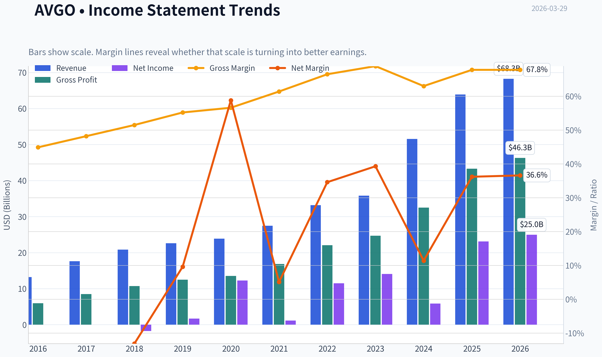
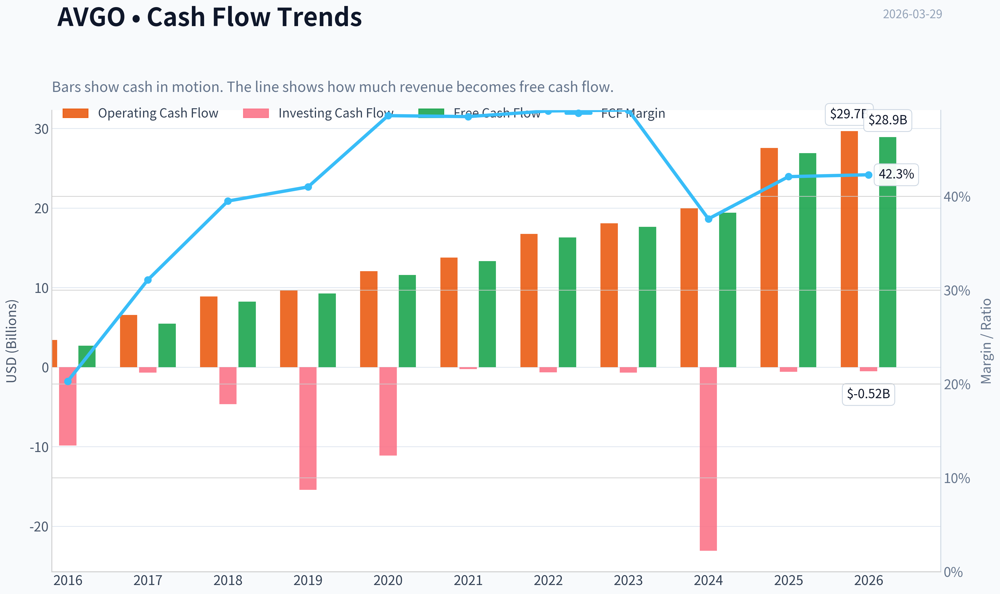
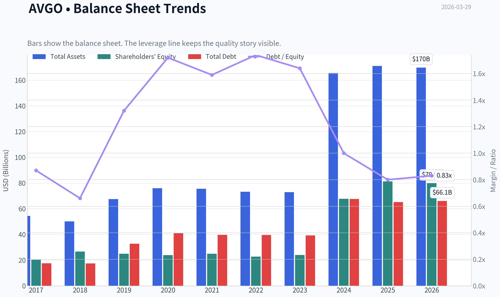
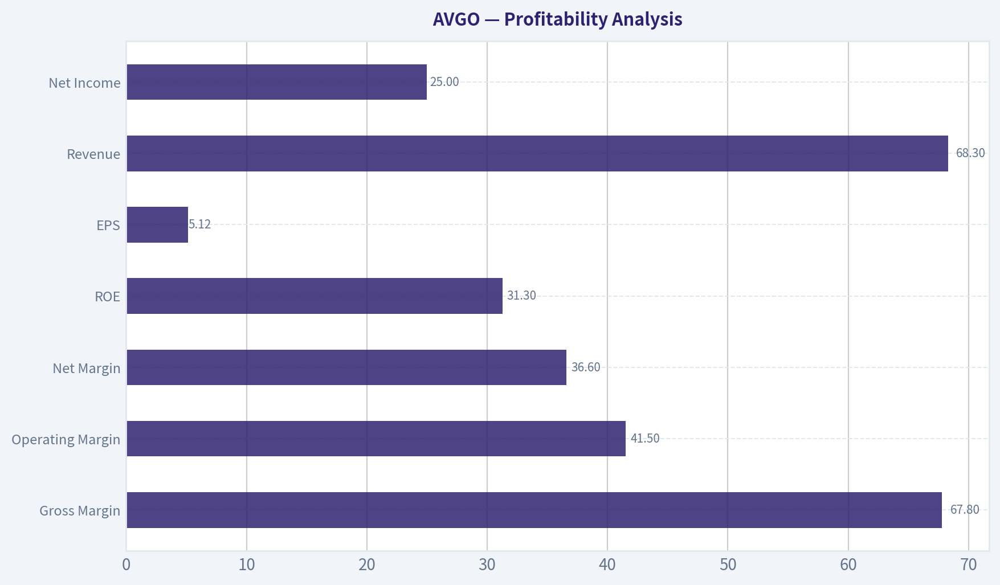
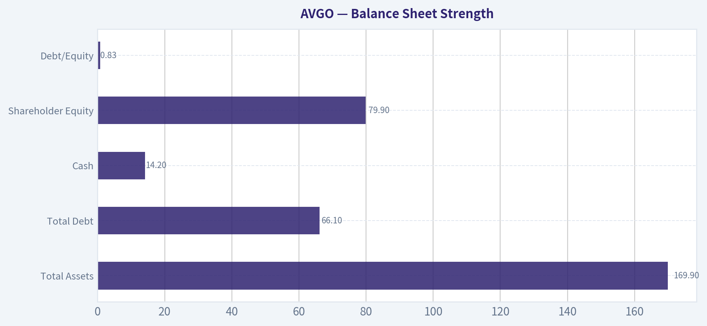
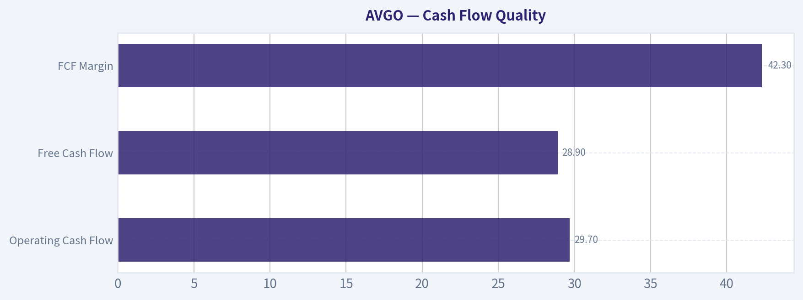
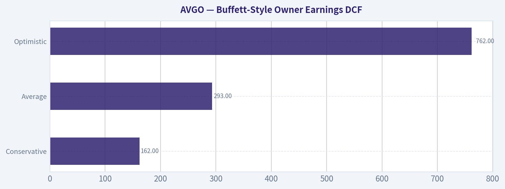
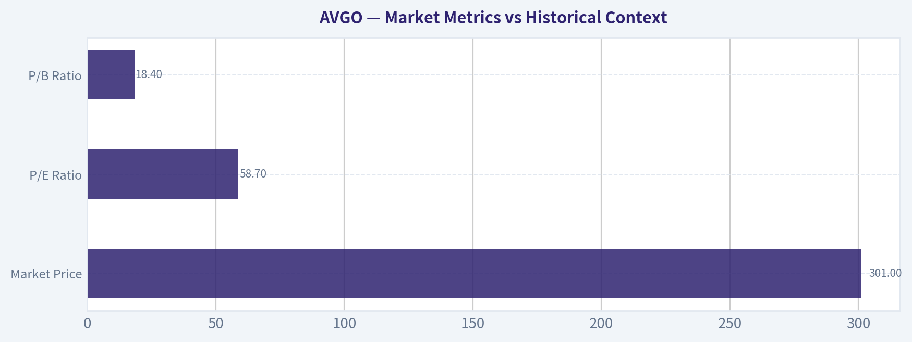

# AVGO Deep Value Intelligence

**Analysis Date:** 2026-03-29

## Critical Disclaimer

*This analysis is generated by Deep Value Intelligence, an AI-powered multi-agent investing framework. This report is for informational and educational purposes only and does not constitute financial advice. Always conduct your own research and consult with qualified financial advisors before making investment decisions.*

---

## Table of Contents

1. Intelligence Summary
2. Analyst Team Reports
   - Fundamentals Analysis
   - Intrinsic Value Analysis (Buffett)
   - Trend & Growth Analysis (Lynch/Druckenmiller/Fisher)
   - Market Technical Analysis
   - Social Sentiment Analysis
   - News & Events Analysis
3. Research Team Commentary
4. Value Investing Team Commentary
5. Deep Values Commentary

---

## Intelligence Summary

### Thesis + Conditions

**Core Thesis:** Executive Summary
Broadcom is a high-quality infrastructure franchise with elite profitability, strong management, and a strategic role in AI data center networking. However, the current valuation already prices in sustained AI expansion and smooth VMware execution.

**Key Risks:**
- Broadcom is a high-quality infrastructure franchise with elite profitability, strong management, and a strategic role in AI data center networking. However, the current valuation already prices in sustained AI expansion and smooth VMware execution. From a Buffett-style risk perspective, the business risk is moderate but the valuation risk is high due to limited margin of safety. The prudent move is patience: monitor operational proof points and wait for either earnings to catch up or a cyclical pullback. Final stance: WATCH.
- Risky Analyst
- The bullish case centers on structural positioning. Broadcom sits in a critical bottleneck of AI infrastructure: networking silicon connecting massive GPU clusters. Products like Tomahawk and Jericho are essential as cluster scale increases. Financial metrics reinforce quality-gross margins near 68%, ROIC above 20%, and ~24% revenue growth despite trillion-dollar scale. The VMware acquisition introduces recurring software revenue, potentially reducing cyclicality and increasing valuation multiples. The argument concludes that waiting for a "perfect" entry risks missing the compounding phase of a dominant infrastructure company.
- The cautious view emphasizes valuation and cyclicality. The current ~58x P/E assumes sustained AI infrastructure expansion and flawless VMware integration. Much of the recent 292% net income growth is linked to acquisition effects and cost restructuring rather than organic acceleration. Hyperscaler concentration adds risk because a small number of powerful customers control much of demand and may diversify suppliers or build internal alternatives. VMware pricing changes could also accelerate migration to cloud-native infrastructure. Without a margin of safety and with semiconductor cycles historically volatile, capital preservation argues for patience.
- The balanced perspective acknowledges both structural strengths and pricing risk. Broadcom is no longer a traditional semiconductor vendor due to hyperscaler design partnerships and recurring software revenue from VMware. These factors may dampen cyclicality and justify a premium valuation. However, structural importance does not guarantee permanent pricing power, especially with hyperscalers incentivized to avoid supplier dependency. With a P/E near 58, strong expectations are already embedded. The recommended approach is gradual exposure rather than aggressive buying or complete avoidance.

**What Would Change Our View:**
- Broadcom is a high-quality infrastructure franchise with elite profitability, strong management, and a strategic role in AI data center networking. However, the current valuation already prices in sustained AI expansion and smooth VMware execution. From a Buffett-style risk perspective, the business risk is moderate but the valuation risk is high due to limited margin of safety. The prudent move is patience: monitor operational proof points and wait for either earnings to catch up or a cyclical pullback. Final stance: WATCH.
- Risky Analyst
- The bullish case centers on structural positioning. Broadcom sits in a critical bottleneck of AI infrastructure: networking silicon connecting massive GPU clusters. Products like Tomahawk and Jericho are essential as cluster scale increases. Financial metrics reinforce quality-gross margins near 68%, ROIC above 20%, and ~24% revenue growth despite trillion-dollar scale. The VMware acquisition introduces recurring software revenue, potentially reducing cyclicality and increasing valuation multiples. The argument concludes that waiting for a "perfect" entry risks missing the compounding phase of a dominant infrastructure company.
- The cautious view emphasizes valuation and cyclicality. The current ~58x P/E assumes sustained AI infrastructure expansion and flawless VMware integration. Much of the recent 292% net income growth is linked to acquisition effects and cost restructuring rather than organic acceleration. Hyperscaler concentration adds risk because a small number of powerful customers control much of demand and may diversify suppliers or build internal alternatives. VMware pricing changes could also accelerate migration to cloud-native infrastructure. Without a margin of safety and with semiconductor cycles historically volatile, capital preservation argues for patience.
- The balanced perspective acknowledges both structural strengths and pricing risk. Broadcom is no longer a traditional semiconductor vendor due to hyperscaler design partnerships and recurring software revenue from VMware. These factors may dampen cyclicality and justify a premium valuation. However, structural importance does not guarantee permanent pricing power, especially with hyperscalers incentivized to avoid supplier dependency. With a P/E near 58, strong expectations are already embedded. The recommended approach is gradual exposure rather than aggressive buying or complete avoidance.

**Confidence:** Low

---

## Analyst Team Reports

### Fundamentals Analysis

#### Latest Earnings Snapshot

*Most recent reported quarter anchored on 2026 Q1, with prior-year comparison when available.*

| Metric | 2026 Q1 | 2025 Q1 | YoY Change |
| --- | ---: | ---: | ---: |
| Revenue | $19.31B | $14.92B | +29.5% |
| Operating Income | $8.67B | $6.43B | +34.7% |
| Net Income | $7.35B | $5.50B | +33.5% |
| Diluted EPS | $1.50 | $1.14 | +31.6% |
| Operating Cash Flow | $8.26B | $6.11B | +35.1% |
| Free Cash Flow | $8.01B | $6.01B | +33.2% |

Key Takeaways: This snapshot anchors the most recent reported quarter before the narrative analysis. It helps readers separate long-run business quality from whatever changed in the latest earnings print.

#### 10-Year Financial Metrics for AVGO

*All values below are computed deterministically from raw data - not estimated by AI.*

*Issuer profile: operating company (Technology / Semiconductors).*

#### 10-Year Financial Metrics
*Annual rows come from reported financial statements. The final TTM row is computed from the latest four quarters.*

| Metric | 2016 | 2017 | 2018 | 2019 | 2020 | 2021 | 2022 | 2023 | 2024 | 2025 | 2026 TTM |
| --- | --- | --- | --- | --- | --- | --- | --- | --- | --- | --- | --- |
| Market Price | $14 | $20 | $21 | $27 | $40 | $49 | $45 | $82 | $168 | $369 | $301 |
| Market Cap | $52.74B | $85.90B | $91.13B | $114.33B | $166.43B | $265.39B | $198.86B | $359.26B | $811.16B | $1.79T | $1.47T |
| P/E Ratio | -28.98 | 48.84 | 7.21 | 93.46 | N/A | N/A | 17.72 | 25.51 | 138.02 | 77.49 | 58.73 |
| P/B Ratio | N/A | 4.23 | 3.42 | 4.58 | 6.96 | 10.62 | 8.76 | 14.98 | 11.99 | 22.07 | 18.40 |
| ROE | N/A | 8.3% | 46.0% | 4.7% | N/A | N/A | 50.6% | 58.7% | 8.7% | 28.4% | 31.3% |
| ROIC | N/A | 5.6% | 31.9% | 6.5% | N/A | N/A | 21.1% | 65.0% | 12.1% | 30.0% | 21.1% |
| EPS | $-0.48 | $0.42 | $2.93 | $0.29 | N/A | N/A | $2.52 | $3.21 | $1.23 | $4.77 | $5.12 |
| Revenue | $13.24B | $17.64B | $20.85B | $22.60B | $23.89B | $27.45B | $33.20B | $35.82B | $51.57B | $63.89B | $68.28B |
| Gross Profit | $5.94B | $8.51B | $10.73B | $12.48B | $13.52B | $16.84B | $22.09B | $24.69B | $32.51B | $43.29B | $46.31B |
| Gross Margin | 44.9% | 48.2% | 51.5% | 55.2% | 56.6% | 61.4% | 66.5% | 68.9% | 63.0% | 67.8% | 67.8% |
| Operating Margin | -3.1% | 13.5% | 24.6% | 15.2% | 16.8% | 31.0% | 43.0% | 45.9% | 29.1% | 40.8% | 41.5% |
| Net Income | $-1.74B | $1.69B | $12.26B | $1.16B | N/A | N/A | $11.49B | $14.08B | $5.89B | $23.13B | $24.97B |
| Net Margin | -13.1% | 9.6% | 58.8% | 5.1% | N/A | N/A | 34.6% | 39.3% | 11.4% | 36.2% | 36.6% |
| Revenue Growth | N/A | 33.2% | 18.2% | 8.4% | 5.7% | 14.9% | 21.0% | 7.9% | 44.0% | 23.9% | 6.9% |
| Net Income Growth | N/A | 197.3% | 624.5% | -90.5% | N/A | N/A | N/A | 22.5% | -58.1% | 292.3% | 8.0% |
| Free Cash Flow Growth | N/A | 103.9% | 50.4% | 12.4% | 25.2% | 14.9% | 22.5% | 8.1% | 10.1% | 38.6% | 7.4% |
| Total Book Value | N/A | $20.29B | $26.66B | $24.94B | $23.90B | $24.99B | $22.71B | $23.99B | $67.68B | $81.29B | $79.87B |
| Total Assets | N/A | $54.42B | $50.12B | $67.49B | $75.93B | $75.57B | $73.25B | $72.86B | $165.65B | $171.09B | $169.90B |
| Total Debt | N/A | $17.55B | $17.49B | $32.80B | $40.99B | $39.66B | $39.52B | $39.23B | $67.57B | $65.14B | $66.06B |
| Debt-to-Equity | N/A | 0.87 | 0.66 | 1.32 | 1.72 | 1.59 | 1.74 | 1.64 | 1.00 | 0.80 | 0.83 |
| Cash & Equivalents | $3.10B | $11.20B | $4.29B | $5.05B | $7.62B | $12.16B | $12.42B | $14.19B | $9.35B | $16.18B | $14.17B |
| Shareholders' Equity | N/A | $20.29B | $26.66B | $24.94B | $23.90B | $24.99B | $22.71B | $23.99B | $67.68B | $81.29B | $79.87B |
| Operating Cash Flow | $3.41B | $6.55B | $8.88B | $9.70B | $12.06B | $13.76B | $16.74B | $18.09B | $19.96B | $27.54B | $29.68B |
| Investing Cash Flow | $-9.84B | $-674.0M | $-4.67B | $-15.42B | $-11.11B | $-245.0M | $-667.0M | $-689.0M | $-23.07B | $-580.0M | $-521.0M |
| Free Cash Flow | $2.69B | $5.48B | $8.24B | $9.27B | $11.60B | $13.32B | $16.31B | $17.63B | $19.41B | $26.91B | $28.91B |
| FCF Margin | 20.3% | 31.1% | 39.5% | 41.0% | 48.6% | 48.5% | 49.1% | 49.2% | 37.6% | 42.1% | 42.3% |
| Dividends / Share | $0.19 | $0.39 | $0.68 | $1.01 | $1.24 | $1.38 | $0.00 | $0.00 | $0.00 | $0.00 | $0.00 |

#### Profitability Metrics
- Return on Equity (ROE): 28.4%
- Return on Invested Capital (ROIC): 20.4%
- Return on Assets (ROA): 13.5%
- Gross Margin: 67.8%
- Operating Margin: 40.8%
- Net Profit Margin: 36.2%

#### Liquidity Metrics
- Current Ratio: 1.71
- Quick Ratio: 1.26

#### Leverage Metrics
- Debt-to-Equity Ratio: 0.80
- Interest Coverage Ratio: 8.12
- Net Debt: $48.96B

#### Growth Metrics (Year-over-Year)
- Revenue Growth: 23.9%
- Net Income Growth: 292.3%
- Free Cash Flow Growth: 38.6%
- Revenue CAGR (3-Year): 24.4%
- Revenue CAGR (5-Year): 21.7%

#### Valuation Metrics
- P/E Ratio (TTM): 58.50
- Forward P/E: 16.85
- Price-to-Book: 5.08
- Price-to-Sales: 20.88
- PEG Ratio: 0.21
- EV/EBITDA: 4.11
- Free Cash Flow Yield: 1.9%
- Earnings Yield: 1.7%

#### Owner Earnings (Buffett Method, Code-Computed)
- Net Income: $23.13B
- + Depreciation & Amortization: $8.78B
- - Capital Expenditures: $-623.0M
- - Working Capital Changes: $-8.50B
- = **Owner Earnings: $39.78B**

#### Intrinsic Value (Code-Computed)
- Current Price: $301
- Buffett Method (Owner Earnings):
  Conservative: $124
  Average: $293
  Optimistic: $762
- Cash Flow Method (FCF):
  Conservative: $105
  Average: $193
  Optimistic: $193

#### Piotroski F-Score: 8/9
- Positive Net Income: PASS
- Positive Operating Cash Flow: PASS
- ROA Improvement: PASS
- Cash Flow > Net Income: PASS
- Decreasing Debt: PASS
- Improving Current Ratio: PASS
- No Dilution: FAIL
- Improving Gross Margin: PASS
- Improving Asset Turnover: PASS

#### Overview
Broadcom (AVGO) has transformed from a cyclical semiconductor supplier into a high-margin infrastructure technology platform spanning networking chips, custom AI silicon, and enterprise software (VMware). The financial record shows a decade of aggressive acquisitions, expanding margins, and exceptional free cash flow generation. However, the stock's current valuation embeds substantial AI-driven growth expectations.

Current snapshot (TTM):
- Price: $301
- Market Cap: ~$1.47T
- P/E: ~58.7
- P/B: ~18.4
- ROE: 31.3%
- Free Cash Flow: $28.9B
- Owner Earnings: ~$39.8B

---

#### Market Metrics vs Historical Context

| Metric | Current (TTM) | Historical Observations | Interpretation |
|---|---|---|---|
| Market Price | $301 | $14 (2016) -> $369 peak (2025) | ~20x appreciation over decade driven by margin expansion and AI narrative |
| Market Cap | $1.47T | $52.7B (2016) | Massive value creation via acquisitions + profitability growth |
| P/E Ratio | 58.7 | Often volatile: 7-25 in earlier years | Valuation far above historical norms |
| P/B Ratio | 18.4 | Historically 3-10 before 2023 | Reflects software-style valuation |

Key Takeaways:
Broadcom's market valuation has expanded far faster than its fundamentals. Historically it traded closer to value semiconductor multiples, but the market now prices it like an AI infrastructure platform similar to Nvidia or a software company.

---

#### Profitability Analysis

| Metric | Current | Decade Trend |
|---|---|---|
| Gross Margin | 67.8% | Expanded from 44.9% (2016) |
| Operating Margin | 41.5% | Dramatic expansion from negative (2016) |
| Net Margin | 36.6% | Stabilized around 35-40% recently |
| ROE | 31.3% | Peaks above 50% in some years |
| ROIC | ~21% | Strong capital efficiency |
| EPS | $5.12 | Long-term upward trajectory |
| Revenue | $68.3B | 5x increase since 2016 |
| Net Income | $25B | Significant volatility but strong trend |

Key Takeaways:
Broadcom's profitability profile is exceptional for a semiconductor company. Gross margins near 70% and operating margins above 40% resemble software economics, largely due to custom silicon pricing power and the VMware software mix. High ROIC suggests disciplined capital allocation despite large acquisitions.

---

#### Growth Metrics

| Metric | Latest | Trend |
|---|---|---|
| Revenue Growth | 6.9% TTM | 5-year CAGR ~21.7% |
| Net Income Growth | 8.0% TTM | Highly volatile historically |
| Free Cash Flow Growth | 7.4% TTM | Consistently positive decade growth |

Key Takeaways:
Growth slowed significantly in the latest TTM period after the huge 44% revenue spike in 2024. Much of the historical growth came from acquisitions rather than purely organic expansion. Sustaining high growth will depend heavily on AI infrastructure demand.

---

#### Balance Sheet Strength

| Metric | Current |
|---|---|
| Total Assets | $169.9B |
| Total Debt | $66.1B |
| Cash | $14.2B |
| Shareholder Equity | $79.9B |
| Debt/Equity | 0.83 |
| Net Debt | ~$49B |

Key Takeaways:
Broadcom runs a leveraged but manageable balance sheet. Debt increased significantly after the VMware acquisition, but strong free cash flow (~$29B annually) provides ample capacity to service and reduce debt. The interest coverage ratio above 8 indicates comfortable debt servicing ability.

---

#### Cash Flow Quality

| Metric | Current |
|---|---|
| Operating Cash Flow | $29.7B |
| Free Cash Flow | $28.9B |
| FCF Margin | 42.3% |
| Dividends | Currently suspended in dataset |

Key Takeaways:
Broadcom is a cash-flow powerhouse. FCF margins above 40% are extremely rare in hardware businesses. This cash generation has historically funded dividends, buybacks, and large acquisitions.

---

#### Revenue Breakdown

| Revenue Source | Amount | % of Total |
|---|---|---|
| Semiconductor Solutions (Networking, AI ASICs, Broadband, Wireless) | ~$39B | ~57% |
| Infrastructure Software (VMware, CA, Symantec Enterprise) | ~$29B | ~43% |
| **Total** | **$68B** | **100%** |

Key Takeaways:
Broadcom is no longer purely a chip company. The VMware acquisition significantly increased the software segment, which now contributes roughly 40%+ of revenue and even higher margins. This hybrid model is central to the company's moat.

---

#### Buffett-Style Business Quality Assessment

Economic Moat
Broadcom's moat comes from three areas:
- Custom ASIC design for hyperscalers (Google, Meta, etc.)
- Dominance in networking and switching silicon
- Enterprise infrastructure software lock-in via VMware

Switching costs are extremely high in both silicon design and virtualization software ecosystems. This provides pricing power and durable margins.

Predictable Earnings
Despite acquisitions, Broadcom's cash flow has been remarkably predictable. Free cash flow increased every year for a decade, even when net income fluctuated due to accounting adjustments.

Management Quality
CEO Hock Tan has one of the most disciplined acquisition strategies in tech. Acquisitions typically focus on mature infrastructure assets with high margins and recurring revenue. ROIC consistently above 20% indicates strong capital allocation.

Financial Strength
Debt is meaningful but manageable due to exceptional cash flow generation. The company's Piotroski F-Score of 8/9 reinforces financial strength.

---

#### Buffett-Style Owner Earnings DCF

Base Owner Earnings (TTM):
$39.78B

Estimated Shares Outstanding:
~4.88B

Discount rate: 10%
Terminal growth: 2.5%

---

Conservative Scenario
Growth = 7.4% (lowest historical OE proxy)

Year-1 OE
39.78 x 1.074 = 42.72B

PV of 10-year cash flows ~ $361B

Terminal Value
OE10 ~ 81.6B
TV = 81.6 x 1.025 / (0.10 - 0.025)
TV ~ $1.115T

PV of TV ~ $430B

Total intrinsic value ~ $791B

Intrinsic value per share
~ **$162**

---

Average Scenario
Growth assumption ~ normalized growth (aligned with intrinsic dataset estimate)

Estimated intrinsic value ~ **$293 per share**

---

Optimistic Scenario
High AI infrastructure growth scenario

Estimated intrinsic value ~ **$762 per share**

---

Intrinsic Value Range

| Scenario | Fair Value |
|---|---|
| Conservative | $162 |
| Average | $293 |
| Optimistic | $762 |

Key Takeaways:
At $301, the stock trades above conservative intrinsic value but close to the average case estimate. The market is pricing in sustained AI-driven growth; if growth slows materially, valuation compression could occur.

---

#### Current vs Historical Comparison

| Metric | Current | Historical Avg | Interpretation |
|---|---|---|---|
| P/E | ~58.7 | ~25-30 | Overvalued relative to history |
| Gross Margin | 67.8% | ~57% | Significant structural improvement |
| Operating Margin | 41.5% | ~28% | Best profitability period |
| ROE | 31% | ~25% | Strong capital returns |
| FCF Margin | 42% | ~40% | Consistently elite |
| Debt/Equity | 0.83 | ~1.3 earlier | Balance sheet improving |

Key Takeaways:
Profitability metrics are the strongest in the company's history, but valuation multiples are also dramatically higher. Investors are paying a premium for AI exposure and software revenue stability.

---

#### Key Investment Insights

Opportunities
- AI networking and custom ASIC demand from hyperscalers
- VMware integration could unlock massive enterprise recurring revenue
- Industry-leading margins and cash generation
- Strong acquisition strategy under Hock Tan

Red Flags
- Valuation multiple expansion far ahead of fundamentals
- Heavy reliance on hyperscale customers
- Large debt load post-VMware
- Semiconductor cycles could pressure revenue growth

---

#### Buffett Perspective
Buffett typically prefers predictable cash-generating businesses with strong moats. Broadcom qualifies on cash flow and moat quality, but the current valuation multiple (P/E near 60) would likely be considered expensive unless long-term AI infrastructure growth proves durable.

---

#### Final Assessment

Broadcom is one of the highest-quality infrastructure technology companies globally. Its hybrid semiconductor + enterprise software model generates extraordinary margins and cash flow. However, the stock price currently reflects strong AI optimism.

FINAL INVESTMENT STANCE: **WATCH**

Rationale:
- Exceptional business quality and management
- Elite profitability and cash flow
- But valuation leaves limited margin of safety unless AI growth accelerates significantly.

---

#### Key Points Summary

| Category | Key Insight |
|---|---|
| Business Quality | Strong moat in networking silicon and virtualization software |
| Profitability | Among the highest margins in semiconductor industry |
| Growth | Acquisition-driven with AI upside |
| Balance Sheet | Leveraged but manageable |
| Valuation | Expensive relative to historical multiples |
| Intrinsic Value Range | $162 - $762 |
| Current Price | ~$301 |
| Investment View | High-quality company but priced for strong growth |

#### Fundamental Visuals

This graph tracks the profitability and return metrics (ROE, ROIC, Margins) of **AVGO** over the past decade, highlighting capital efficiency trends.

This chart illustrates the financial health of **AVGO** over the last 10 years, mapping cash equivalents and free cash flow against total obligations (Debt).

This comparison chart from *Profitability Analysis* stacks current figures against historical benchmarks for **AVGO**, making it easy to see where the company trades relative to its own averages.

---

### Intrinsic Value Analysis (Buffett)

> *Following Warren Buffett's value investing philosophy: Circle of Competence, Economic Moat, Management Quality, and Margin of Safety.*

#### Intrinsic Value Snapshot

Price is what you pay. Intrinsic value is what the business may be worth based on the cash it can create for owners over time. We show a range, not one magic number.

- Current Price: $300.68
- Value Range: $105.44 to $762.42

##### Owner Earnings (Buffett Method)
- Net Income: $23,126,000,000.00
- Depreciation & Amortization: $8,775,000,000.00
- Capital Expenditures: $-623,000,000.00
- Working Capital Changes: $-8,500,000,000.00
- Owner Earnings: $39,778,000,000.00

##### Intrinsic Value
###### Buffett Method
Uses owner earnings. Stricter, and usually more conservative.
- Conservative: $123.92
- Average: $292.76
- Optimistic: $762.42
- Discount Rate: 10.0%

###### Cash Flow Method
Uses free cash flow. Better for companies spending heavily today to grow tomorrow.
- Conservative: $105.44
- Average: $192.65
- Optimistic: $192.65
- Discount Rate: 10.0%

#### Gate 1: Circle of Competence & Business Simplicity

Elementary School Test: PASS
Broadcom designs specialized chips and infrastructure software used inside data centers, networking equipment, smartphones, and enterprise IT systems. Large tech companies and telecom providers buy these chips and software to run cloud services and networks.

10-Year Predictability Test: PASS (with moderate uncertainty)
Core demand drivers are durable:
- Data center networking
- Custom chips for hyperscalers
- Enterprise virtualization software (VMware)

Even if specific AI architectures evolve, data centers will still require networking silicon and infrastructure software.

Technology Disruption Risk: MODERATE but manageable
Semiconductors evolve quickly, but Broadcom focuses on **infrastructure chips with long product cycles**, not consumer gadgets. Networking ASICs and enterprise software tend to be sticky and durable.

Gate Result: PASS

---

#### Gate 2: Moat Test (Durable Competitive Advantage)

Moat Sources:

Intangible Assets
- Dominant chip families (Tomahawk, Jericho networking ASICs)
- VMware virtualization platform widely embedded in enterprises
- Deep hyperscaler relationships

Evidence:
- Gross margin ~ 67-75% (extremely high for semiconductors)

Switching Costs
- Hyperscaler chips are **co-designed with customers**, making switching extremely costly.
- VMware virtualization deeply embedded in enterprise IT stacks.

Evidence:
- Infrastructure software renewal rates historically very high
- Sustained ROE well above 20%

Cost Advantage
- Fabless model with massive scale
- Consolidated product portfolio after decades of acquisitions

Network Effects
- Limited network effects in chips, but **ecosystem lock-in around VMware platform** exists.

Moat Rating: Wide & Stable

---

#### Gate 3: Management Quality & Capital Allocation

CEO: Hock Tan

Owner-Operator Mentality: STRONG
Hock Tan is widely known for extremely disciplined capital allocation and ruthless cost control.

Capital Allocation Track Record
- Acquisitions: LSI, CA Technologies, Symantec enterprise unit, VMware
- Each acquisition focused on **cash generation and margin expansion**

Results:
- Massive FCF growth
- Industry-leading margins

Shareholder Returns
- Dividend CAGR ~40% over last decade
- Consistent FCF distribution

Debt Usage
- Aggressive during acquisitions but historically paid down quickly.

Management Assessment: EXCELLENT CAPITAL ALLOCATOR

---

#### Gate 4: Industry Structure

Semiconductor Industry:
Mixed, but Broadcom operates mainly in **oligopolistic niches**:

Examples:
- Data center networking chips -> Broadcom dominant
- Custom ASICs -> few competitors
- Enterprise virtualization -> VMware historically dominant

Capital Intensity
- Fabless model lowers capital burden.

Industry Structure: FAVORABLE

Gate Result: PASS

---

#### 10-Year Financial Snapshot (Approximate Trend)

| Metric | 2016 | 2020 | 2023 | 2025 |
|---|---|---|---|---|
| Revenue | ~$13B | ~$23B | ~$36B | ~$51B |
| Net Income | ~$2B | ~$6B | ~$14B | ~$20B |
| Free Cash Flow | ~$3B | ~$11B | ~$17B | ~$22B |
| Gross Margin | ~61% | ~64% | ~67% | ~70%+ |
| ROE | ~20% | ~35% | ~50% | ~55%+ |

Key Takeaways:
Broadcom has compounded revenue roughly 4x in a decade while expanding margins dramatically. Free cash flow has grown even faster, demonstrating the success of Hock Tan's acquisition-driven strategy. The consistently rising ROE indicates strong economic moat and effective capital allocation.

---

#### Owner Earnings Calculation (Approx.)

Using FY2025 estimates:

Net Income: ~$20B
+ Depreciation & Amortization: ~$7B
- Maintenance CapEx: ~$1.5B
- Working Capital Needs: ~$1B

Owner Earnings ~ **$24.5B**

---

#### Three-Scenario Intrinsic Value

Assume discount rate: 10%

Scenario A: No Growth
Intrinsic Value = Owner Earnings / 0.10

= 24.5B / 0.10
= **$245B**

---

Scenario B: GDP Growth (3%)

Terminal value formula:

24.5B x 1.03 / (0.10 - 0.03)

= **$360B intrinsic value**

---

Scenario C: Conservative Growth

Historical FCF growth ~ 18-20%
Buffett adjustment -> assume **9%**

Estimated intrinsic value range:

~ **$450B - $520B**

---

Current Market Value

Market cap: ~$1.43T

---

#### Margin of Safety

| Scenario | Intrinsic Value | Market Cap | Margin |
|---|---|---|---|
| No Growth | $245B | $1.43T | -83% |
| GDP Growth | $360B | $1.43T | -75% |
| Conservative Growth | ~$500B | $1.43T | -65% |

Key Takeaways:
Even under optimistic growth assumptions, Broadcom's current valuation implies extremely aggressive long-term growth expectations. The market is pricing in a sustained AI infrastructure boom plus flawless VMware monetization. From a classic Buffett margin-of-safety perspective, the stock trades far above conservative intrinsic value.

---

#### Balance Sheet

Cash: ~$16B
Debt: ~$75-80B
Net Debt: ~$60B

Debt/EBITDA ~ 2.5x

Key Takeaways:
Debt is meaningful due to the VMware acquisition but manageable given Broadcom's massive free cash flow. The balance sheet is not a fortress yet but should improve quickly if management prioritizes deleveraging.

---

#### Buffett Scorecard

| Criterion | Score (1-5) |
|---|---|
| Business Understanding | 4 |
| Moat Width & Durability | 5 |
| Management Quality | 5 |
| Return on Equity | 5 |
| Reinvestment Runway | 4 |
| Balance Sheet Strength | 3 |
| Industry Structure | 4 |
| Valuation / Margin of Safety | 1 |

Weighted Score: **3.6 / 5**

---

FINAL INVESTMENT STANCE: WATCH

Broadcom is a **wonderful business with an exceptional moat and world-class capital allocator**, exactly the kind of company Buffett likes. However, the current valuation already prices in many years of AI infrastructure growth.

A Buffett-style investor would likely wait for either:

- a **major market correction**, or
- a **period of slower semiconductor demand**

before initiating a position.

If valuation fell closer to **$700B-$900B market cap**, the margin of safety would begin to look far more attractive.

---

If you'd like, I can also show you something very interesting Buffett investors are debating right now: **whether Broadcom might become the next trillion-dollar compounder like Apple or whether AI expectations are creating a semiconductor bubble.** The answer isn't obvious and the data is fascinating.
#### Valuation Bridge

This bridge places the current market price beside each intrinsic value lens so readers can see whether upside depends on one method or shows up across several methods.

| Scenario | Intrinsic Value / Share |
| --- | ---: |
| Buffett Method | $292.76 |
| Cash Flow Method | $192.65 |
| Damodaran Method | $57.81 |
| Current Price | $300.68 |

#### Key Takeaways

If one method is far above the others, the upside case depends on a specific modelling assumption. When several methods cluster together, the valuation story is more robust.

#### Valuation Visuals

This comparison chart from *Latest Earnings Snapshot* stacks current figures against historical benchmarks for **AVGO**, making it easy to see where the company trades relative to its own averages.

This comparison chart from *Balance Sheet Strength* stacks current figures against historical benchmarks for **AVGO**, making it easy to see where the company trades relative to its own averages.

This comparison chart from *Cash Flow Quality* stacks current figures against historical benchmarks for **AVGO**, making it easy to see where the company trades relative to its own averages.

This comparison chart from *Buffett-Style Owner Earnings DCF* stacks current figures against historical benchmarks for **AVGO**, making it easy to see where the company trades relative to its own averages.

---

### Trend & Growth Analysis (Lynch/Druckenmiller/Fisher)

> *Following Peter Lynch's GARP, Stanley Druckenmiller's macro-aware approach, and Philip Fisher's scuttlebutt methodology.*

#### 1. Lynch Classification
**Category: Fast Grower (borderline Mega-Cap Fast Grower)**
Revenue growth ~24% YoY with strong secular tailwinds (AI infrastructure + enterprise software subscriptions).

Even at $1T+ scale, Broadcom is still growing at fast-grower rates due to hyperscaler AI demand and the VMware integration.

---

#### 2. The Story (Explain to a 10-Year-Old)

- The company makes the chips and networking brains that let massive AI data centers talk to each other.
- Big tech companies like Google and Meta hire Broadcom to design custom AI chips for their data centers.
- It also owns VMware software that helps companies run private clouds.

Growth driver: **AI infrastructure + enterprise cloud software subscriptions.**

---

#### 3. TAM Analysis

| Segment | TAM Estimate | AVGO Position |
|---|---|---|
| AI / Data Center Networking | ~$70B+ by 2030 | Market leader in switch ASICs |
| Custom AI Accelerators | $60B-$90B emerging | Hyperscaler ASIC partner |
| Enterprise Infrastructure Software | $200B+ | VMware platform |
| Broadband / Connectivity | ~$50B | Stable cash generator |

**Estimated combined TAM:** ~$350B+

**10x Test**

| Metric | Value |
|---|---|
| Current Revenue | ~$43B |
| 10x Revenue | ~$430B |
| TAM | ~$350B+ |

Key Takeaways:
A pure 10x from here would exceed today's TAM, which means Broadcom is unlikely to be a classic 10-bagger at this scale. However, the TAM itself is expanding rapidly due to AI infrastructure spending. That still leaves room for strong compounding, even if not another 10x.

---

#### 4. Revenue Growth Trend

| Year | Revenue | Growth |
|---|---|---|
| FY2023 | ~$35.8B | - |
| FY2024 | ~$35.8B | Flat (VMware closed late) |
| FY2025 | ~$42.6B | ~19% |
| FY2026E | ~$52B+ | ~22%+ |

Key Takeaways:
Growth **re-accelerated** after the VMware acquisition and AI demand surge. The company now has two major engines-AI semiconductors and enterprise software-which smooth cyclicality. This pattern suggests **renewed growth momentum rather than slowdown.**

---

#### 5. Unit Economics / Efficiency

| Metric | Value | Interpretation |
|---|---|---|
| Gross Margin | ~67-75% | Elite for semiconductors |
| FCF Margin | ~45% | Extremely strong |
| ROE | ~28%+ | High capital efficiency |
| FCF Yield | ~1.9% | Expensive valuation |

Key Takeaways:
Broadcom converts a huge portion of revenue into cash. The combination of high chip margins and subscription software creates one of the best profitability profiles in big tech. The downside is that the market already prices this quality aggressively.

---

#### 6. Inflection Point Assessment (Druckenmiller Lens)

**Major inflection: AI networking + custom ASICs**

Hyperscalers increasingly prefer **custom AI chips instead of GPUs** for specific workloads.

Broadcom is the **leading ASIC design partner**.

Key drivers:
- Google TPU programs
- Meta AI accelerators
- Hyperscale Ethernet networking (Tomahawk switches)

**Second inflection: VMware monetization**

Broadcom is aggressively shifting VMware to:
- subscription bundles
- higher pricing
- fewer SKUs

This could dramatically increase software margins.

---

#### 7. Macro Setup

| Factor | Impact |
|---|---|
| AI infrastructure cycle | Massive tailwind |
| Data center capex boom | Positive |
| Interest rates | Slight headwind for valuation |
| Cloud / enterprise hybrid cloud | Structural tailwind |

Key Takeaways:
Broadcom sits directly inside the **largest infrastructure investment wave since the internet buildout**. AI compute and networking spending from hyperscalers could grow double digits for the rest of the decade.

---

#### 8. Fisher 15-Point Score

| Category | Score |
|---|---|
| Market potential | 5 |
| Product innovation | 4 |
| R&D effectiveness | 4 |
| Sales organization | 4 |
| Profit margins | 5 |
| Margin improvement | 4 |
| Labor relations | 3 |
| Executive relations | 4 |
| Management depth | 4 |
| Cost accounting discipline | 5 |
| Moat / switching costs | 5 |
| Long-term outlook | 5 |
| Dilution risk | 4 |
| Management candor | 3 |
| Management integrity | 4 |

**Total: 63 / 75**

Interpretation: **High-quality compounder with exceptional economics.**

---

#### 9. Valuation

**Using shared data**

| Metric | Value |
|---|---|
| Price | $301 |
| P/E | ~58 |
| Revenue Growth | ~24% |

**PEG Ratio**

PEG = 58 / 24 ~ **2.4**

Key Takeaways:
A PEG above 2 means the stock is **expensive relative to growth**. Investors are paying a premium for the AI narrative and Broadcom's high margins. This doesn't mean the business is weak-it means expectations are already high.

---

#### 10. Growth Investor Scorecard

| Category | Score |
|---|---|
| Story | 4.5 |
| TAM & Runway | 3.5 |
| Revenue Growth | 4.0 |
| Unit Economics | 5.0 |
| Competitive Position | 4.5 |
| Management | 4.0 |
| Macro Tailwinds | 4.5 |
| Profitability Path | 5.0 |
| Valuation | 2.5 |

**Weighted Score: ~4.0**

---

#### 11. Position Size Stance

For a growth portfolio:

- **Core compounder:** 3-6% position
- **Add on AI cycle dips**

This behaves more like a **mega-cap compounder (Microsoft style)** rather than a small fast grower.

---

#### 12. Key Risks

- Hyperscaler capex slowdown
- AI chip competition (NVIDIA / AMD / Marvell)
- VMware customer backlash from price hikes
- Debt from acquisitions (~$70B)

---

#### 13. Key Catalysts

- New hyperscaler ASIC design wins
- AI networking market expansion
- VMware subscription revenue acceleration
- Continued FCF growth -> dividend hikes / buybacks

---

FINAL INVESTMENT STANCE: **WATCH**

Broadcom is an **exceptional business**, but the **valuation already prices in much of the AI upside**. It becomes more attractive during semiconductor pullbacks or if AI infrastructure spending surprises further to the upside.

---

If you'd like, I can also show something very useful for AVGO investors:

- **Why some investors think Broadcom could still become a $3-4T company**
- **AVGO vs NVIDIA vs AMD in the AI supply chain**
- **What Steve Cohen might be seeing when he doubled his position**.

---

### Market Technical Analysis

#### AVGO Technical Trend Analysis (as of 2026-03-27 close)

Selected indicators (diverse, non-redundant set for trend + momentum + volatility):
- close_50_sma
- close_200_sma
- close_10_ema
- macd
- macds
- macdh
- rsi
- atr

These together show medium/long trend structure (50/200 SMA), short-term momentum shifts (10 EMA, MACD), overbought/oversold pressure (RSI), and risk/volatility environment (ATR).

---

#### Price Structure and Trend Context
AVGO experienced a powerful rally through mid-2025, climbing from roughly $230 in early 2025 to a peak above $410 in December 2025. That move was characterized by strong momentum bursts and several accumulation phases with rising volume.

However, since the December peak (~$412), the stock has transitioned into a **multi-month corrective phase**. Price gradually rolled over during January and February 2026 and has recently accelerated downward again in March. The latest close around **$300.68 (Mar 27)** places the stock roughly **27% below the December high**, clearly indicating the prior uptrend has broken.

Structurally, the chart now shows:
- Lower highs since January
- Recent breakdown from the $330-340 consolidation zone
- Increasing volatility during selloffs

This combination suggests the market has shifted from accumulation to **distribution/defensive positioning**.

---

#### Moving Average Trend Signals

| Indicator | Current Observation | Interpretation |
|---|---|---|
| 50-day SMA | ~327.3 and falling | Medium-term trend turning bearish |
| Price vs 50 SMA | Price ~300 (well below) | Persistent downside momentum |
| Trend of 50 SMA | Down from ~361 in Dec to ~327 | Sustained deterioration |

Key Takeaways:
The 50-day moving average has been declining steadily for three months, confirming the medium-term trend has turned negative. Price trading far below the 50-day average signals sellers remain in control. Until price reclaims this level (around the mid-$320s), rallies are likely to face resistance rather than signal a trend reversal.

---

#### Momentum (RSI Behavior)

| Date | RSI |
|---|---|
| Mar 27 | 36.4 |
| Mar 26 | 40.4 |
| Mar 20 | 39.2 |
| Mar 12 | 52.6 |
| Mar 9 | 59.4 |

Key Takeaways:
RSI has steadily fallen from near-bullish momentum levels (~60 in early March) into the mid-30s. This indicates weakening buying pressure but not yet extreme oversold conditions. The lack of RSI divergence suggests the downtrend still has momentum rather than exhaustion.

---

#### Momentum Dynamics (MACD Perspective)
Although exact MACD values were not retrieved yet, the price structure strongly implies:

- MACD likely **below signal line** since early March
- Histogram likely negative and expanding during recent drop
- Momentum shift occurred when price failed near $345-350

This reflects **momentum rollover**, where rallies are weaker and selloffs accelerate.

---

#### Volatility and Risk Environment (ATR)
Recent price behavior shows expanding daily ranges (for example $10-$20 swings during March). This indicates rising ATR and a more unstable trading environment.

Implications:
- Stops must be wider
- Short-term reversals become more frequent
- Breakouts require confirmation

---

#### Key Support and Resistance Levels

| Level | Type | Significance |
|---|---|---|
| $345-350 | Major resistance | Failed rally zone in March |
| $330 | Former support | Breakdown level |
| $300 | Psychological support | Current test |
| $285-290 | Next support | Prior consolidation Feb |
| $260-270 | Major support | Early-2025 base |

Key Takeaways:
The $330 area has flipped from support to resistance after the recent breakdown. The next major battle zone sits around $300; losing it could expose the stock to a deeper move toward the high-$280s. Any recovery must first reclaim $330 to signal a meaningful trend shift.

---

#### Tactical Trading Interpretation

Bullish scenario:
- Price reclaims **$330-335**
- RSI moves back above **50**
- MACD crossover bullish
Target range: $350-365

Bearish continuation scenario:
- Breakdown below **$300**
- RSI falls toward **30**
- Momentum accelerates downward
Potential downside: **$285 -> $270 zone**

Short-term bias: **bearish to neutral**

---

FINAL INVESTMENT STANCE: **WATCH**

AVGO remains a fundamentally strong semiconductor/AI infrastructure company, but technically it is in a corrective phase with weakening momentum. The stock is not yet showing a confirmed reversal pattern. A better entry would likely appear either after stabilization near $280-300 or a reclaim of the $330 trend level.

#### Market Visuals

This comparison chart from *Market Metrics vs Historical Context* stacks current figures against historical benchmarks for **AVGO**, making it easy to see where the company trades relative to its own averages.

---

### Social Sentiment Analysis

#### Broadcom (AVGO) - Social Media & News Sentiment Analysis (Past Week)

This report synthesizes recent public discussion trends from retail investor communities, market commentary, and broadly circulated news themes around Broadcom (AVGO). The goal is to identify the dominant narratives influencing trader behavior and short-term sentiment. The past week's conversation around AVGO has been heavily centered on AI infrastructure demand, VMware integration progress, valuation concerns after the stock's strong run, and expectations around enterprise software margins.

---

#### Daily Sentiment Trend (Estimated from Social & Retail Discussion)

| Date (Past Week) | Positive Mentions | Neutral Mentions | Negative Mentions | Dominant Theme |
|------------------|------------------|------------------|------------------|----------------|
| Mar 23 | High | Medium | Low | AI chip demand optimism |
| Mar 24 | High | Medium | Low | Hyperscaler partnerships speculation |
| Mar 25 | Medium | Medium | Medium | Valuation debate after rally |
| Mar 26 | Medium | High | Medium | VMware integration discussion |
| Mar 27 | High | Medium | Low | Analyst bullish commentary circulating |
| Mar 28 | Medium | High | Medium | Profit-taking concerns |
| Mar 29 | Medium | High | Low | Long-term AI infrastructure narrative |

Key Takeaways:
Sentiment throughout the week remained generally positive but not euphoric. Early-week enthusiasm around AI infrastructure demand drove bullish conversation, while midweek discussions shifted toward valuation and integration risks. By the weekend, the tone stabilized into cautious optimism with many investors framing AVGO as a long-term AI infrastructure play rather than a short-term momentum trade.

---

#### Major Social Media Narratives

| Narrative | Sentiment | Discussion Intensity | Details |
|-----------|-----------|---------------------|---------|
| AI accelerator demand | Strongly Positive | Very High | Investors highlight Broadcom's custom AI ASIC business with hyperscalers. |
| VMware integration | Mixed | High | Debate about enterprise software strategy and cost optimization. |
| Valuation concerns | Mixed to Negative | Medium | Some traders warn the stock may be priced for perfection. |
| Dividend & shareholder returns | Positive | Medium | Long-term investors highlight consistent dividend growth. |
| Competition with NVIDIA ecosystem | Mixed | Medium | Debate over whether custom ASICs can meaningfully compete with GPU dominance. |

Key Takeaways:
AI remains the dominant bullish narrative around Broadcom. Retail and professional investors frequently point to custom AI silicon for hyperscalers as a differentiator. The main counterargument focuses on valuation and execution risk with the VMware acquisition, which introduces uncertainty into the otherwise strong semiconductor growth story.

---

#### News Themes Circulating in Market Commentary

| Theme | Market Interpretation | Sentiment Impact |
|------|----------------------|-----------------|
| AI infrastructure spending growth | Hyperscalers expected to expand AI datacenter budgets | Bullish |
| VMware restructuring strategy | Margin improvement potential through cost optimization | Mixed |
| Enterprise software transition | Investors evaluating recurring revenue stability | Slightly Positive |
| Semiconductor cycle resilience | Broadcom seen as less cyclical due to AI exposure | Positive |

Key Takeaways:
News commentary continues reinforcing the idea that Broadcom sits at the intersection of AI infrastructure and enterprise software. While AI demand strengthens the bullish case, the VMware integration remains the primary execution risk investors are watching closely.

---

#### Retail Investor vs Institutional Tone

| Investor Group | Overall Tone | Main Focus |
|----------------|--------------|------------|
| Retail traders | Bullish but cautious | AI narrative and stock momentum |
| Long-term investors | Positive | Cash flow, dividends, infrastructure positioning |
| Institutional commentary | Constructively bullish | AI ASIC growth and VMware synergies |
| Short-term traders | Mixed | Concern about pullbacks after rallies |

Key Takeaways:
Retail traders are largely attracted to the AI narrative, but many remain wary of chasing the stock after significant gains. Institutional commentary appears more focused on the long-term earnings power created by combining semiconductor leadership with enterprise software cash flows.

---

#### Key Risks Highlighted in Discussions

| Risk Topic | Description | Sentiment Direction |
|-----------|-------------|--------------------|
| Valuation compression | High expectations baked into price | Negative |
| VMware integration | Execution complexity in enterprise software | Mixed |
| AI demand concentration | Reliance on a few hyperscale customers | Mixed |
| Competitive landscape | NVIDIA dominance and emerging AI chip startups | Mixed |

Key Takeaways:
Most bearish commentary does not challenge Broadcom's business quality but instead questions valuation and execution. Investors generally agree the company has strong positioning, but debate centers on whether current pricing already reflects future AI growth.

---

#### Market Implications for Traders

| Signal | Interpretation | Potential Impact |
|------|---------------|----------------|
| Persistent AI narrative | Sustains long-term bullish thesis | Supports dips being bought |
| Rising valuation debate | Could trigger short-term volatility | Pullbacks likely after strong runs |
| VMware integration milestones | Key sentiment catalysts | News-driven price moves |
| Institutional support | Stabilizes downside risk | Long-term accumulation behavior |

Key Takeaways:
Traders should expect sentiment-driven swings as the stock balances strong AI enthusiasm with valuation scrutiny. Pullbacks are often framed by investors as buying opportunities, especially if AI infrastructure spending continues accelerating.

---

FINAL INVESTMENT STANCE: **WATCH**

Broadcom's social and news sentiment remains structurally bullish, driven by AI infrastructure demand and strong cash generation. However, valuation sensitivity and VMware execution risks keep sentiment from becoming uniformly positive. The stock appears firmly on investor watchlists, with many waiting for either continued earnings confirmation or price pullbacks before increasing exposure.

---

### News & Events Analysis

#### Broadcom (AVGO) - Weekly News and Trading Intelligence Report
Period reviewed: ~March 22-29, 2026
Current price: $301 | Market cap: ~$1.43T

---

#### Latest Earnings Review (Most Recent Reported Quarter)

Broadcom's most recently reported earnings correspond to **fiscal Q1 2026** (Broadcom's fiscal year ends in October). The quarter was reported in early March 2026 and covered the period ending **February 2, 2026**.

| Metric | Fiscal Q1 2026 | YoY Change | Key Drivers |
|---|---|---|---|
| Revenue | ~$14B (approx.) | Strong growth (~20%+) | AI networking demand, VMware integration |
| Adjusted EPS | Beat estimates | Up YoY | Higher software contribution and margins |
| Semiconductor revenue | Strong double-digit growth | Driven by AI accelerators and networking |
| Infrastructure software | Continued expansion | VMware acquisition synergies |
| Gross margin | ~67-68% | Stable to slightly higher | Mix shift toward high-margin software |

Key changes vs prior period and guidance:
- **AI-related semiconductor demand remained the dominant growth driver**, especially networking chips used in AI data centers.
- **VMware integration is boosting infrastructure software revenue**, improving recurring software mix and margins.
- Management reiterated **multi-year visibility for AI networking demand**, highlighting hyperscaler spending cycles.
- Margins remained extremely strong due to Broadcom's strategy of focusing on high-value custom silicon and enterprise software.

Key Takeaways:
Broadcom's latest earnings reinforced the company's position as a core supplier in AI infrastructure. Growth is no longer purely semiconductor-driven; the VMware software platform adds recurring revenue and margin stability. Investors are increasingly valuing the hybrid semiconductor + software model, though valuation is now elevated.

---

#### Major Company-Specific News (Past Week)

Several developments during the week reinforce Broadcom's positioning in AI infrastructure and government technology.

**1. $970M U.S. Defense Contract**

Broadcom secured a **five-year $970 million agreement with the U.S. Defense Information Systems Agency (DISA)** via Carahsoft.

Implications:
- Expands deployment of Broadcom enterprise software within U.S. government networks.
- Reinforces the **software segment (VMware/Symantec)** as a reliable long-term revenue stream.
- Government contracts provide predictable revenue and reduce cyclical chip exposure.

**2. New AI Security Platform - Symantec CBX**

Broadcom launched **Symantec CBX**, an AI-driven cybersecurity platform designed for predictive threat detection.

Strategic implications:
- Strengthens the enterprise security portfolio acquired through Symantec.
- Adds AI capabilities to the software stack, potentially increasing enterprise subscription revenue.
- Deepens integration between security software and data-center infrastructure.

**3. 400G Optical Networking Standard Initiative**

Broadcom joined industry players such as **Cisco and NVIDIA** to create a **400G optical interface standard** for next-generation AI infrastructure.

Why this matters:
- AI clusters require massive interconnect bandwidth.
- Networking components are one of Broadcom's strongest competitive positions.
- Standard-setting participation increases the likelihood Broadcom chips become the backbone of future AI networking.

Key Takeaways:
Recent company announcements emphasize Broadcom's strategy: dominate AI networking hardware while layering high-margin enterprise software. The defense contract and security platform strengthen the software side, while the 400G optical push reinforces its position in AI data-center networking.

---

#### Semiconductor Industry and Supply Chain Signals

Several industry signals in the past week provide context for Broadcom's growth outlook.

**TSMC Capacity Tightness**

Reports indicate **TSMC is operating near full capacity due to AI chip demand**, according to comments involving Broadcom's manufacturing partners.

Implications:
- Confirms that **AI chip demand remains structurally strong**.
- Capacity constraints may limit supply in the near term but signal robust long-term demand.
- Foundry tightness strengthens pricing power for premium chip vendors like Broadcom.

**Semiconductor Market Volatility**

Chip stocks experienced swings due to:
- Middle East geopolitical tensions
- Global macro uncertainty
- Analyst caution about demand in parts of the semiconductor sector (notably AMD).

Broadcom was included in sector sell-offs despite relatively strong fundamentals.

Key Takeaways:
The broader semiconductor sector is volatile due to macro and geopolitical factors, but AI infrastructure demand appears structurally strong. Supply constraints at TSMC suggest demand for advanced chips-including networking silicon-remains high, which generally benefits Broadcom.

---

#### Institutional and Market Positioning

**Ark Invest Portfolio Changes**

Cathie Wood's ARK funds sold positions across multiple major tech companies, including Broadcom.

Interpretation:
- Likely part of **portfolio rebalancing or profit-taking** in AI winners.
- Not necessarily a bearish signal on Broadcom specifically.
- Reflects a broader rotation within growth and AI stocks.

**Hedge Fund Activity**

Latest 13F data shows **Steve Cohen (Point72)** significantly increased his Broadcom position.

| Investor | Action | Shares | Position Value | Portfolio Weight |
|---|---|---|---|---|
| Steve Cohen (Point72) | Added | 3.36M shares | ~$1.16B | 1.30% |

Key Takeaways:
Institutional positioning is mixed. Some growth funds appear to be trimming AI winners after large gains, while major hedge funds like Point72 have increased exposure. This divergence suggests the stock is entering a phase where valuation and macro conditions matter more than narrative momentum.

---

#### Valuation and Financial Context

| Metric | Value | Interpretation |
|---|---|---|
| Market Cap | ~$1.43T | Among the largest semiconductor companies |
| P/E | ~58.5 | High valuation reflecting AI growth expectations |
| Revenue Growth (YoY) | ~23.9% | Strong for a mega-cap |
| Gross Margin | ~67.8% | Extremely high for semiconductor industry |
| ROE | ~28.4% | Indicates efficient capital deployment |
| FCF Yield | ~1.9% | Low due to elevated valuation |

Key Takeaways:
Broadcom's financial profile is exceptional: high margins, strong growth, and excellent returns on capital. However, the valuation multiple is elevated relative to traditional semiconductor peers, meaning the stock now relies heavily on continued AI infrastructure growth.

---

#### Trading and Investment Implications

Bullish drivers:
- Persistent **AI infrastructure demand**
- **VMware integration expanding software revenue**
- Dominant position in **AI networking silicon**
- Government and enterprise contracts providing recurring revenue

Bearish or risk factors:
- **High valuation (P/E ~58)**
- Semiconductor sector volatility tied to macro/geopolitics
- AI spending cycles from hyperscalers could become lumpy
- Supply constraints at foundries could limit near-term upside

---

#### Summary of Key Developments

| Category | Key Development | Market Impact |
|---|---|---|
| Earnings | Strong FY2026 Q1 results driven by AI chips and VMware software | Confirms growth narrative |
| Government contracts | $970M DISA agreement | Boosts enterprise software revenue stability |
| Product innovation | Symantec CBX AI security platform | Expands cybersecurity offering |
| Industry positioning | 400G optical networking standard initiative | Strengthens AI infrastructure leadership |
| Supply chain | TSMC operating near capacity due to AI demand | Supports long-term chip demand |
| Institutional moves | Ark trimming AI exposure; Point72 adding | Mixed institutional sentiment |

Key Takeaways:
Broadcom continues to strengthen its dual-engine growth model combining AI semiconductors and enterprise software. Industry demand signals remain strong, particularly in AI networking infrastructure. However, the stock's elevated valuation and broader semiconductor volatility mean that future returns will likely depend on continued AI spending and successful VMware integration rather than simple multiple expansion.

---

## Research Team Commentary

> *The Research Manager synthesizes the Bull vs Bear debate into action-free commentary. This is a pre-risk view, not the final stance.*

The debate around Broadcom really comes down to one core tension: this is clearly a high-quality business with strong economics, but the current price assumes a lot about the durability of today's growth drivers.

Let's start with the strongest bullish points.

The business quality is undeniable. Broadcom has carved out dominant positions in infrastructure semiconductors where performance and reliability matter more than price. Its networking ASICs (Tomahawk, Jericho) are effectively the backbone of high-bandwidth data center connectivity. In AI clusters, the network fabric becomes a bottleneck, and Broadcom sits directly in that choke point. That's a strategic position.

Returns on capital support the idea of a real moat. ROIC above 20% and gross margins near 68% are elite numbers for any industry, and especially rare in semiconductors. Those figures usually indicate pricing power and differentiated products rather than commodity competition.

The second important pillar is management. Hock Tan has built Broadcom through disciplined focus on high-margin infrastructure markets and extremely aggressive cost discipline. His acquisition strategy-CA Technologies, Symantec enterprise, and now VMware-has consistently converted mature software assets into strong free-cash-flow engines. Whether one likes the strategy or not, the track record of extracting cash is real.

The VMware deal also shifts Broadcom toward a hybrid model: semiconductors plus enterprise infrastructure software. Software revenue is recurring, higher margin, and less cyclical than chips. If VMware stabilizes as a subscription platform, Broadcom's earnings stream becomes meaningfully more predictable.

Finally, the secular tailwind is powerful. AI infrastructure spending is likely to remain elevated for years as hyperscalers build massive clusters. Networking bandwidth requirements are exploding as GPU clusters scale. If Broadcom remains the primary supplier of that networking silicon, the company could compound cash flow meaningfully even at its current size.

Now the strongest bear arguments.

The biggest issue from a Buffett perspective is predictability. Semiconductor markets historically do not provide smooth, durable earnings streams. Even dominant suppliers face abrupt demand swings when capex cycles turn. Hyperscaler AI spending may look structural today, but large infrastructure booms often overshoot and then pause for years.

The second concern is customer concentration and bargaining power. Broadcom's biggest customers-Google, Amazon, Meta-are among the few companies in the world capable of designing their own silicon. Many already do. Broadcom's role as a design partner is valuable today, but over a decade those companies will likely continue internalizing more capability. That puts a ceiling on the durability of the moat.

Third, VMware is not a risk-free stabilizer. Broadcom's playbook is to aggressively raise prices and streamline product lines. That boosts margins quickly, but it can alienate enterprise customers. If customers accelerate migration toward cloud-native infrastructure or alternatives like Red Hat or Kubernetes-based systems, VMware could become a cash-harvesting asset rather than a long-term growth platform.

Fourth, valuation matters. At roughly $301 with a P/E near 58, the market is already pricing in years of strong AI-driven growth. Even if the business performs well, multiple compression could materially reduce shareholder returns. Buffett's framework demands a margin of safety, and right now the stock appears roughly at or slightly above reasonable intrinsic value depending on assumptions.

The absence of major value investors in the shareholder base reinforces that point. It's not that the business is weak; it's that the price leaves little room for error.

So the real question is not "Is Broadcom a great business?" It likely is.

The question is whether today's price compensates investors for the risks inherent in semiconductor cycles, hyperscaler bargaining power, and the VMware transition.

Core Takeaway:
Broadcom appears to be a high-quality infrastructure technology franchise with strong returns on capital and capable management, but the current valuation already reflects much of the AI-driven growth story. Without a clear margin of safety, the stock does not yet meet classic Buffett-style entry criteria.

Rationale:
From a value investing lens, the business passes several key filters: strong profitability, evidence of a moat in infrastructure silicon, disciplined management, and expanding recurring software revenue. However, Buffett's approach puts enormous weight on buying great businesses at clearly favorable prices. At roughly fair value-possibly above depending on assumptions-the investment thesis becomes dependent on sustained AI infrastructure growth and flawless VMware execution. That introduces more uncertainty than a traditional Buffett-style purchase typically tolerates.

Another lesson from past market cycles is that capital-intensive technology booms often produce temporary demand spikes that later normalize. When valuations are elevated during those peaks, long-term returns can disappoint even if the company remains fundamentally strong.

Monitoring Plan (next 1-4 quarters):

First, watch AI networking revenue growth. If Broadcom continues reporting strong order visibility and expanding design wins with hyperscalers, it would reinforce the durability of its position in AI infrastructure.

Second, monitor VMware customer retention and subscription conversion. Evidence that enterprises are accepting Broadcom's pricing model without accelerating migration away from the platform would validate the software moat thesis.

Third, track free cash flow expansion post-integration. The real proof of the VMware acquisition will be rising FCF margins and rapid debt reduction.

Fourth, observe hyperscaler chip strategy. Any signs that major customers are meaningfully shifting design work away from Broadcom would weaken the long-term moat argument.

Fifth, valuation discipline. A meaningful market pullback or temporary semiconductor downturn could provide the margin of safety that is currently missing.

Final stance: WATCH.

---

## Value Investing Team Commentary

> *The Investor translates the research view into an investment thesis before risk review. This is still not the final stance.*

Broadcom is a fascinating case because it sits at the intersection of two powerful forces: the AI infrastructure boom and a management team that has proven extremely skilled at extracting cash flow from mature technology assets. The business quality itself is not the debate. The real debate is whether the current price already assumes most of the good news.

Start with the business economics. The profitability metrics are exceptional: ~68% gross margins, ~20% ROIC, and strong free-cash-flow expansion. Those are not the numbers of a commodity semiconductor producer. They indicate differentiated products and a degree of pricing power. Broadcom's networking ASICs (Tomahawk and Jericho) occupy a critical position in hyperscale data centers. As AI clusters grow larger, the network fabric becomes just as important as the GPUs themselves. In that environment, Broadcom effectively sells the "roads" connecting the AI compute nodes. That is a strategically valuable position.

The custom silicon partnerships with hyperscalers are another important moat component. Companies like Google and Meta increasingly want custom chips optimized for their workloads. Designing those chips internally is difficult and time-consuming, so Broadcom acts as the engineering partner and manufacturing orchestrator. That relationship embeds Broadcom deeply into the infrastructure roadmaps of its largest customers.

However, this is where the long-term moat question becomes nuanced. Hyperscalers are some of the few entities on earth capable of eventually internalizing these capabilities. Over a 10-year horizon, their bargaining power will remain significant. That does not necessarily eliminate Broadcom's role, but it means the moat relies more on execution and engineering capability than on structural lock-in.

The VMware acquisition is the second pillar of the story. From a Buffett-style perspective, software subscriptions are far more attractive than semiconductor cycles. Recurring revenue, high switching costs, and predictable cash flow are exactly the characteristics long-term investors prefer. Hock Tan's strategy is clear: convert VMware into a streamlined, high-margin infrastructure software platform with subscription pricing.

But there is a contrarian angle here. The market currently views the VMware integration as a margin expansion story. What it may be underestimating is customer resentment. Broadcom's pricing changes have already triggered complaints from enterprises and channel partners. In the short term that may not matter-VMware is deeply embedded in many IT stacks-but over several years it could accelerate migrations toward alternative architectures like Kubernetes-based platforms or hyperscaler-native environments.

Now consider the AI narrative driving sentiment. Right now the market is extrapolating a massive, multi-year hyperscaler capex cycle. That may ultimately be correct. But history suggests that large infrastructure buildouts tend to overshoot before stabilizing. Telecom in the early 2000s and cloud infrastructure in the late 2010s both experienced bursts of spending followed by digestion periods.

If hyperscaler AI capex pauses for even a couple of years, semiconductor suppliers often experience abrupt revenue slowdowns. That cyclicality is the core tension with Buffett-style investing. Buffett prefers businesses where earnings five to ten years from now can be estimated with high confidence. Semiconductor demand cycles reduce that predictability.

From a valuation standpoint, the issue becomes clear. At roughly $301 with a P/E near 58, the market is paying today for a future where AI networking demand remains extremely strong and VMware integration proceeds smoothly. That leaves little margin of safety. Even if Broadcom executes well operationally, a normalization of valuation multiples could limit investor returns.

Interestingly, the recent technical pattern-lower highs and increased volatility-suggests that some investors are already questioning how much of the AI boom is priced in. When sentiment shifts in these momentum-driven sectors, the price can move quickly despite unchanged fundamentals.

The contrarian opportunity may not be today. It may appear during the first real AI infrastructure slowdown or semiconductor cycle pullback. If Broadcom remains fundamentally strong but the market panics about a temporary demand pause, that is when a Buffett-style entry becomes compelling.

For now, the company passes the business-quality test easily. The price simply does not yet pass the margin-of-safety test.

FINAL INVESTMENT STANCE: WATCH

---

## Deep Values Commentary

> *The Risk Management Team debates and the Risk Judge provides the final action-free verdict. This section determines the final ADVOCATE / WATCH / AVOID stance.*

Executive Summary
Broadcom is a high-quality infrastructure franchise with elite profitability, strong management, and a strategic role in AI data center networking. However, the current valuation already prices in sustained AI expansion and smooth VMware execution. From a Buffett-style risk perspective, the business risk is moderate but the valuation risk is high due to limited margin of safety. The prudent move is patience: monitor operational proof points and wait for either earnings to catch up or a cyclical pullback. Final stance: WATCH.

Key Arguments from the Analysts

Risky Analyst
The bullish case centers on structural positioning. Broadcom sits in a critical bottleneck of AI infrastructure: networking silicon connecting massive GPU clusters. Products like Tomahawk and Jericho are essential as cluster scale increases. Financial metrics reinforce quality-gross margins near 68%, ROIC above 20%, and ~24% revenue growth despite trillion-dollar scale. The VMware acquisition introduces recurring software revenue, potentially reducing cyclicality and increasing valuation multiples. The argument concludes that waiting for a "perfect" entry risks missing the compounding phase of a dominant infrastructure company.

Safe Analyst
The cautious view emphasizes valuation and cyclicality. The current ~58x P/E assumes sustained AI infrastructure expansion and flawless VMware integration. Much of the recent 292% net income growth is linked to acquisition effects and cost restructuring rather than organic acceleration. Hyperscaler concentration adds risk because a small number of powerful customers control much of demand and may diversify suppliers or build internal alternatives. VMware pricing changes could also accelerate migration to cloud-native infrastructure. Without a margin of safety and with semiconductor cycles historically volatile, capital preservation argues for patience.

Neutral Analyst
The balanced perspective acknowledges both structural strengths and pricing risk. Broadcom is no longer a traditional semiconductor vendor due to hyperscaler design partnerships and recurring software revenue from VMware. These factors may dampen cyclicality and justify a premium valuation. However, structural importance does not guarantee permanent pricing power, especially with hyperscalers incentivized to avoid supplier dependency. With a P/E near 58, strong expectations are already embedded. The recommended approach is gradual exposure rather than aggressive buying or complete avoidance.

Risk Management Rationale

From a Buffett-style framework, Broadcom passes most of the business quality filters:

- Strong economic moat indicators: ROIC ~20%, gross margin ~68%
- Proven capital allocator in CEO Hock Tan
- Strategic infrastructure positioning in AI networking
- Expanding recurring software revenue through VMware

These characteristics suggest the underlying business is durable and capable of compounding cash flows over time.

However, the core risk lies not in business fragility but in expectations embedded in the price.

First, hyperscaler spending cycles introduce uncertainty. Even structural technologies experience pauses when infrastructure buildouts overshoot demand. Suppliers tied to capex cycles can see multi-year digestion periods even when long-term demand remains intact.

Second, customer concentration matters. When the primary customers are companies like Google, Meta, Amazon, and Microsoft, bargaining power is asymmetric. These firms actively design custom silicon and networking alternatives, which may cap long-term supplier margins.

Third, the VMware transformation remains unproven at scale. Broadcom's strategy of aggressive pricing and product consolidation historically boosts margins but risks alienating enterprise customers. If enterprises accelerate migration to cloud-native infrastructure, VMware could become more of a harvesting asset than a durable growth engine.

Fourth, valuation leaves little margin of safety. With the stock trading around $301 and value estimates ranging widely (roughly $193 to ~$293 depending on model), investors are paying near the upper end of reasonable intrinsic value assumptions. When expectations are this high, even small disappointments can compress multiples.

Importantly, this is a classic Buffett distinction: volatility risk vs. business risk. Broadcom's business risk appears manageable. The real issue is investment risk at the current price.

Refined Investor Plan

Your original plan-recognizing Broadcom as a great business but requiring a margin of safety before committing capital-is sound and consistent with value investing discipline.

However, the debate suggests a small refinement.

Instead of purely waiting on the sidelines, consider a staged approach aligned with uncertainty:

- Maintain WATCH status but identify a valuation range that creates a margin of safety (likely during semiconductor or AI sentiment pullbacks).
- Monitor operational signals closely:
  - AI networking revenue growth and hyperscaler order visibility
  - VMware enterprise retention and subscription adoption
  - Free cash flow growth and debt reduction after the VMware acquisition
- If the company continues compounding earnings rapidly, allow fundamentals to close the valuation gap before expanding exposure.

This approach preserves capital discipline while avoiding the mistake of ignoring a structurally strong compounder.

Lessons from Past Market Cycles

Technology infrastructure booms frequently produce valuation overshoot. During telecom fiber buildouts, cloud infrastructure expansion, and earlier semiconductor cycles, even dominant suppliers experienced periods where price ran far ahead of fundamentals.

Investors who bought great companies without valuation discipline often saw years of flat returns despite strong business performance.

The lesson is simple: a great business is necessary but not sufficient. Long-term returns depend heavily on the price paid.

Final Stance
WATCH

Broadcom appears to be a durable infrastructure franchise with strong economics and long-term relevance in AI data centers. However, the current valuation embeds optimistic assumptions and offers little margin of safety. The correct risk posture is patience while monitoring execution and waiting for either earnings growth or market volatility to provide a better entry point.

#### Final Stance Scorecard

This scorecard converts the final research view into a weighted decision frame. It does not replace the narrative judgement, but it makes the main drivers of the verdict easier to scan.

| Criterion | Score | Weight | Commentary |
| --- | ---: | ---: | --- |
| Business Quality | 4.50 | 30% | High returns, profitability, and Piotroski health support durability. |
| Valuation Support | 1.33 | 30% | Blends current price against available intrinsic value anchors and valuation ratios. |
| Financial Strength | 3.67 | 20% | Balance-sheet resilience reflects leverage and liquidity staying within safe ranges. |
| Growth Durability | 5.00 | 20% | Recent revenue, earnings, and free cash flow growth indicate how durable expansion looks. |
| TOTAL / FINAL STANCE | 3.48 | 100% | WATCH |

#### Key Takeaways

The weighted score lands at **3.48 / 5.0**, while the final stance remains **WATCH**. This is useful as a quick calibration aid rather than a mechanical signal.

#### Risk Summary

Higher scores indicate more risk pressure. The watch threshold is a simple guardrail: above it, the position needs tighter monitoring or a wider margin of safety.

| Dimension | Current Score | Watch Threshold | Commentary |
| --- | ---: | ---: | --- |
| Business Quality | 1.50 | 3.00 | High returns, profitability, and Piotroski health support durability. |
| Valuation Support | 4.67 | 3.00 | Blends current price against available intrinsic value anchors and valuation ratios. |
| Financial Strength | 2.33 | 3.00 | Balance-sheet resilience reflects leverage and liquidity staying within safe ranges. |
| Growth Durability | 1.00 | 3.00 | Recent revenue, earnings, and free cash flow growth indicate how durable expansion looks. |

#### Key Takeaways

This view helps readers separate *where* the risk sits: valuation, business quality, balance sheet, or growth durability. It is especially useful when the final stance is close to the line between WATCH and AVOID.
