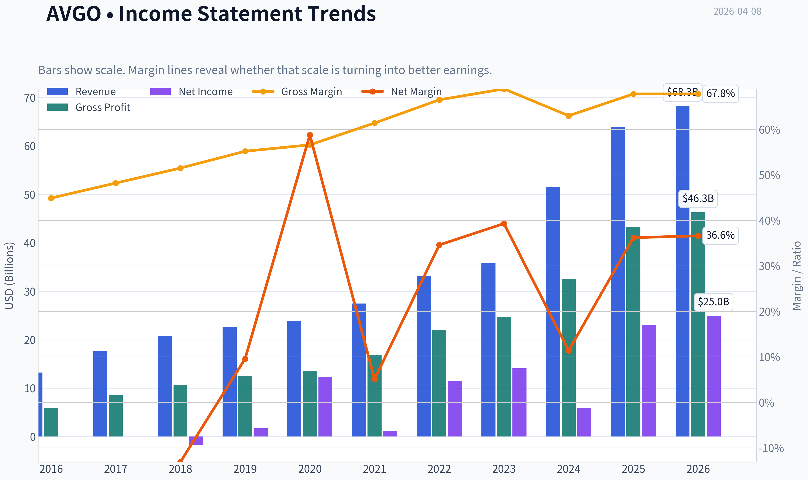
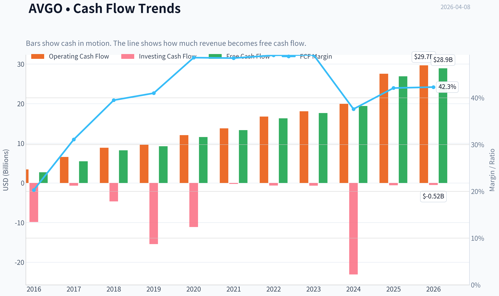
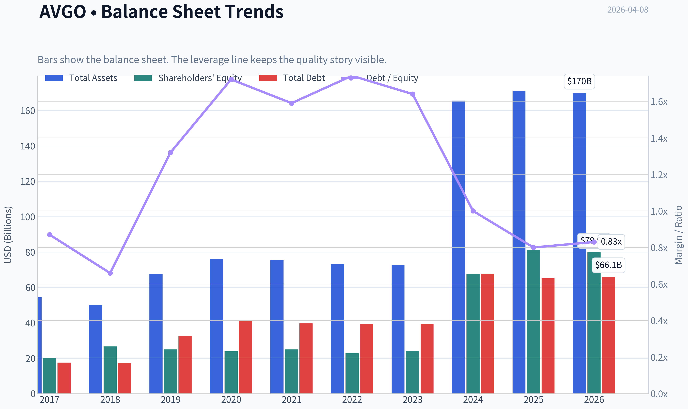
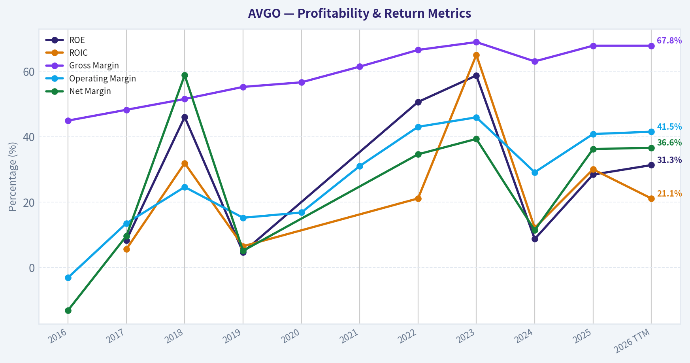
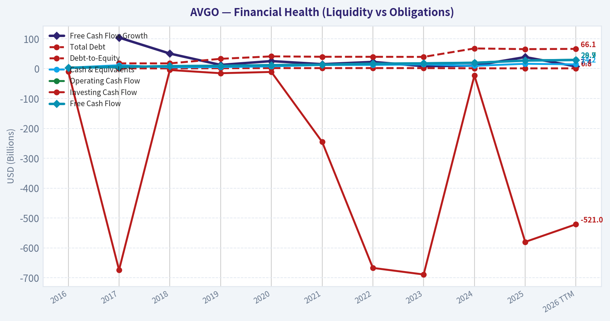
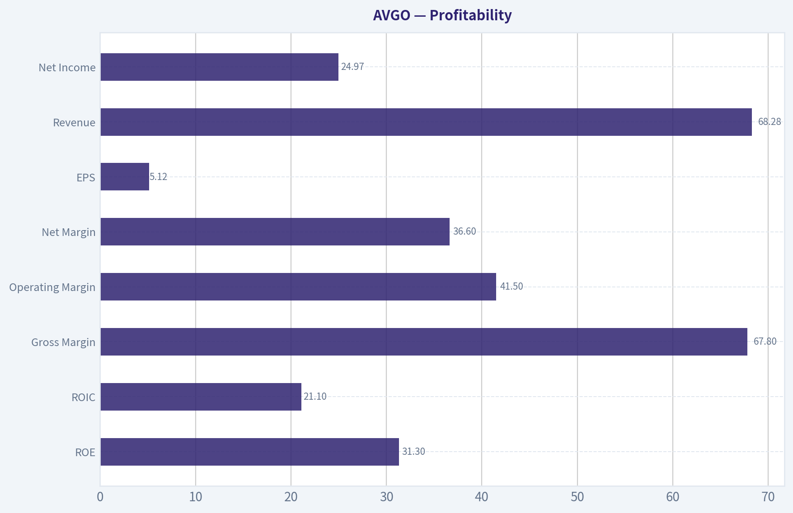
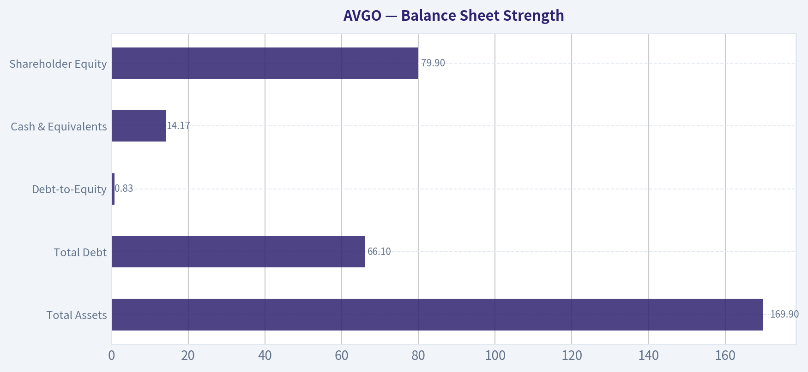
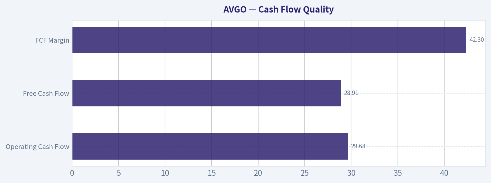
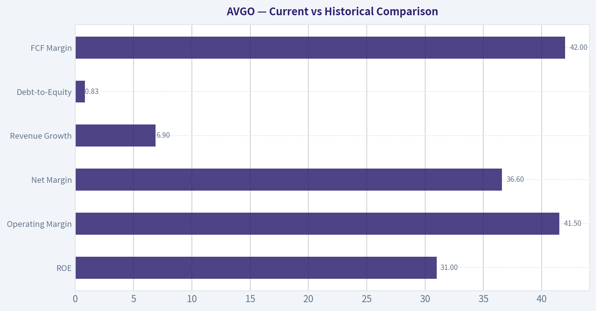
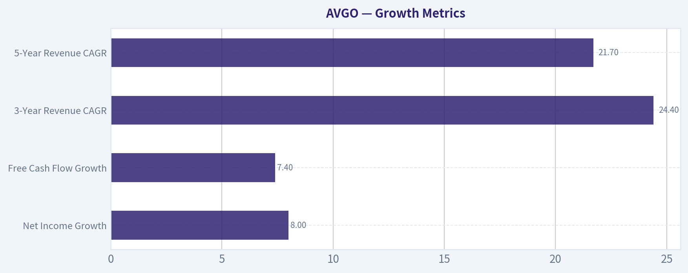

# AVGO Deep Value Intelligence

**Analysis Date:** 2026-04-08

## Critical Disclaimer

*This analysis is generated by Deep Value Intelligence, an AI-powered multi-agent investing framework. This report is for informational and educational purposes only and does not constitute financial advice. Always conduct your own research and consult with qualified financial advisors before making investment decisions.*

---

## Table of Contents

1. Intelligence Summary
2. Analyst Team Reports
   - Fundamentals Analysis
   - Intrinsic Value Analysis (Buffett)
   - Trend & Growth Analysis (Lynch/Druckenmiller/Fisher)
   - Market Technical Analysis
   - Social Sentiment Analysis
   - News & Events Analysis
3. Research Team Commentary
4. Value Investing Team Commentary
5. Deep Values Commentary

---

## Intelligence Summary

### Thesis + Conditions

**Core Thesis:** Executive Summary (Quick Read)

**Key Risks:**
- Broadcom is a high-quality infrastructure business with strong margins, high ROIC, and real exposure to the AI data-center buildout. However, the current valuation (~65x earnings) already prices in years of strong execution and AI demand. The business risk is moderate but the entry-price risk is high. Hyperscaler customer power and VMware integration uncertainty limit predictability. Without a margin of safety, the prudent long-term stance is WATCH until either earnings growth validates the valuation or price resets meaningfully.
- Growth / Risk-Seeking View
- The bullish argument centers on Broadcom's strategic role in AI infrastructure. Networking bandwidth is becoming a critical bottleneck in hyperscale AI clusters, and Broadcom is a dominant supplier of switching silicon and connectivity. Financial metrics support this strength: ~68% gross margins, ~20% ROIC, and strong growth (revenue +23.9%, FCF +38.6%). The VMware acquisition could transform Broadcom into a hybrid infrastructure platform with recurring software revenue layered on top of hardware dominance. If that transition works, the market may be repricing Broadcom from a cyclical semiconductor company into a durable infrastructure compounder.
- Conservative / Risk-Focused View
- The cautious argument highlights predictability risks. Hyperscalers like Amazon, Google, and Meta design their own chips and have strong incentives to internalize high-margin components. Even gradual internalization could compress Broadcom's margins. VMware integration also introduces execution risk, especially if aggressive pricing accelerates migration to Kubernetes-based infrastructure or competitors like Nutanix. Most importantly, valuation provides almost no protection. Intrinsic value estimates cluster below the current price, and a 65x earnings multiple leaves little tolerance for operational setbacks.

**What Would Change Our View:**
- Broadcom is a high-quality infrastructure business with strong margins, high ROIC, and real exposure to the AI data-center buildout. However, the current valuation (~65x earnings) already prices in years of strong execution and AI demand. The business risk is moderate but the entry-price risk is high. Hyperscaler customer power and VMware integration uncertainty limit predictability. Without a margin of safety, the prudent long-term stance is WATCH until either earnings growth validates the valuation or price resets meaningfully.
- Growth / Risk-Seeking View
- The bullish argument centers on Broadcom's strategic role in AI infrastructure. Networking bandwidth is becoming a critical bottleneck in hyperscale AI clusters, and Broadcom is a dominant supplier of switching silicon and connectivity. Financial metrics support this strength: ~68% gross margins, ~20% ROIC, and strong growth (revenue +23.9%, FCF +38.6%). The VMware acquisition could transform Broadcom into a hybrid infrastructure platform with recurring software revenue layered on top of hardware dominance. If that transition works, the market may be repricing Broadcom from a cyclical semiconductor company into a durable infrastructure compounder.
- Conservative / Risk-Focused View
- The cautious argument highlights predictability risks. Hyperscalers like Amazon, Google, and Meta design their own chips and have strong incentives to internalize high-margin components. Even gradual internalization could compress Broadcom's margins. VMware integration also introduces execution risk, especially if aggressive pricing accelerates migration to Kubernetes-based infrastructure or competitors like Nutanix. Most importantly, valuation provides almost no protection. Intrinsic value estimates cluster below the current price, and a 65x earnings multiple leaves little tolerance for operational setbacks.

**Confidence:** Low

---

## Analyst Team Reports

### Fundamentals Analysis

#### Latest Earnings Snapshot

*Most recent reported quarter anchored on 2026 Q1, with prior-year comparison when available.*

| Metric | 2026 Q1 | 2025 Q1 | YoY Change |
| --- | ---: | ---: | ---: |
| Revenue | $19.31B | $14.92B | +29.5% |
| Operating Income | $8.67B | $6.43B | +34.7% |
| Net Income | $7.35B | $5.50B | +33.5% |
| Diluted EPS | $1.50 | $1.14 | +31.6% |
| Operating Cash Flow | $8.26B | $6.11B | +35.1% |
| Free Cash Flow | $8.01B | $6.01B | +33.2% |

Key Takeaways: This snapshot anchors the most recent reported quarter before the narrative analysis. It helps readers separate long-run business quality from whatever changed in the latest earnings print.

#### 10-Year Financial Metrics for AVGO

*All values below are computed deterministically from raw data - not estimated by AI.*

*Issuer profile: operating company (Technology / Semiconductors).*

#### 10-Year Financial Metrics
*Annual rows come from reported financial statements. The final TTM row is computed from the latest four quarters.*

| Metric | 2016 | 2017 | 2018 | 2019 | 2020 | 2021 | 2022 | 2023 | 2024 | 2025 | 2026 TTM |
| --- | --- | --- | --- | --- | --- | --- | --- | --- | --- | --- | --- |
| Market Price | $14 | $20 | $21 | $27 | $40 | $49 | $44 | $82 | $167 | $368 | $334 |
| Market Cap | $52.74B | $85.90B | $91.13B | $114.33B | $166.43B | $265.39B | $198.86B | $359.26B | $811.16B | $1.79T | $1.63T |
| P/E Ratio | -28.98 | 48.84 | 7.21 | 93.46 | N/A | N/A | 17.72 | 25.51 | 138.02 | 77.49 | 65.23 |
| P/B Ratio | N/A | 4.23 | 3.42 | 4.58 | 6.96 | 10.62 | 8.76 | 14.98 | 11.99 | 22.07 | 20.44 |
| ROE | N/A | 8.3% | 46.0% | 4.7% | N/A | N/A | 50.6% | 58.7% | 8.7% | 28.4% | 31.3% |
| ROIC | N/A | 5.6% | 31.9% | 6.5% | N/A | N/A | 21.1% | 65.0% | 12.1% | 30.0% | 21.1% |
| EPS | $-0.48 | $0.42 | $2.93 | $0.29 | N/A | N/A | $2.51 | $3.20 | $1.23 | $4.77 | $5.12 |
| Revenue | $13.24B | $17.64B | $20.85B | $22.60B | $23.89B | $27.45B | $33.20B | $35.82B | $51.57B | $63.89B | $68.28B |
| Gross Profit | $5.94B | $8.51B | $10.73B | $12.48B | $13.52B | $16.84B | $22.09B | $24.69B | $32.51B | $43.29B | $46.31B |
| Gross Margin | 44.9% | 48.2% | 51.5% | 55.2% | 56.6% | 61.4% | 66.5% | 68.9% | 63.0% | 67.8% | 67.8% |
| Operating Margin | -3.1% | 13.5% | 24.6% | 15.2% | 16.8% | 31.0% | 43.0% | 45.9% | 29.1% | 40.8% | 41.5% |
| Net Income | $-1.74B | $1.69B | $12.26B | $1.16B | N/A | N/A | $11.49B | $14.08B | $5.89B | $23.13B | $24.97B |
| Net Margin | -13.1% | 9.6% | 58.8% | 5.1% | N/A | N/A | 34.6% | 39.3% | 11.4% | 36.2% | 36.6% |
| Revenue Growth | N/A | 33.2% | 18.2% | 8.4% | 5.7% | 14.9% | 21.0% | 7.9% | 44.0% | 23.9% | 6.9% |
| Net Income Growth | N/A | 197.3% | 624.5% | -90.5% | N/A | N/A | N/A | 22.5% | -58.1% | 292.3% | 8.0% |
| Free Cash Flow Growth | N/A | 103.9% | 50.4% | 12.4% | 25.2% | 14.9% | 22.5% | 8.1% | 10.1% | 38.6% | 7.4% |
| Total Book Value | N/A | $20.29B | $26.66B | $24.94B | $23.90B | $24.99B | $22.71B | $23.99B | $67.68B | $81.29B | $79.87B |
| Total Assets | N/A | $54.42B | $50.12B | $67.49B | $75.93B | $75.57B | $73.25B | $72.86B | $165.65B | $171.09B | $169.90B |
| Total Debt | N/A | $17.55B | $17.49B | $32.80B | $40.99B | $39.66B | $39.52B | $39.23B | $67.57B | $65.14B | $66.06B |
| Debt-to-Equity | N/A | 0.87 | 0.66 | 1.32 | 1.72 | 1.59 | 1.74 | 1.64 | 1.00 | 0.80 | 0.83 |
| Cash & Equivalents | $3.10B | $11.20B | $4.29B | $5.05B | $7.62B | $12.16B | $12.42B | $14.19B | $9.35B | $16.18B | $14.17B |
| Shareholders' Equity | N/A | $20.29B | $26.66B | $24.94B | $23.90B | $24.99B | $22.71B | $23.99B | $67.68B | $81.29B | $79.87B |
| Operating Cash Flow | $3.41B | $6.55B | $8.88B | $9.70B | $12.06B | $13.76B | $16.74B | $18.09B | $19.96B | $27.54B | $29.68B |
| Investing Cash Flow | $-9.84B | $-674.0M | $-4.67B | $-15.42B | $-11.11B | $-245.0M | $-667.0M | $-689.0M | $-23.07B | $-580.0M | $-521.0M |
| Free Cash Flow | $2.69B | $5.48B | $8.24B | $9.27B | $11.60B | $13.32B | $16.31B | $17.63B | $19.41B | $26.91B | $28.91B |
| FCF Margin | 20.3% | 31.1% | 39.5% | 41.0% | 48.6% | 48.5% | 49.1% | 49.2% | 37.6% | 42.1% | 42.3% |
| Dividends / Share | $0.19 | $0.39 | $0.68 | $1.01 | $1.24 | $1.38 | $0.00 | $0.00 | $0.00 | $0.00 | $0.00 |

#### Profitability Metrics
- Return on Equity (ROE): 28.4%
- Return on Invested Capital (ROIC): 20.4%
- Return on Assets (ROA): 13.5%
- Gross Margin: 67.8%
- Operating Margin: 40.8%
- Net Profit Margin: 36.2%

#### Liquidity Metrics
- Current Ratio: 1.71
- Quick Ratio: 1.26

#### Leverage Metrics
- Debt-to-Equity Ratio: 0.80
- Interest Coverage Ratio: 8.12
- Net Debt: $48.96B

#### Growth Metrics (Year-over-Year)
- Revenue Growth: 23.9%
- Net Income Growth: 292.3%
- Free Cash Flow Growth: 38.6%
- Revenue CAGR (3-Year): 24.4%
- Revenue CAGR (5-Year): 21.7%

#### Valuation Metrics
- P/E Ratio (TTM): 64.97
- Forward P/E: 18.72
- Price-to-Book: 19.80
- Price-to-Sales: 23.19
- PEG Ratio: 0.21
- EV/EBITDA: 43.88
- Free Cash Flow Yield: 1.7%
- Earnings Yield: 1.5%

#### Owner Earnings (Buffett Method, Code-Computed)
- Net Income: $23.13B
- + Depreciation & Amortization: $8.78B
- - Capital Expenditures: $-623.0M
- - Working Capital Changes: $-8.50B
- = **Owner Earnings: $39.78B**

#### Intrinsic Value (Code-Computed)
- Current Price: $334
- Buffett Method (Owner Earnings):
  Conservative: $124
  Average: $293
  Optimistic: $762
- Cash Flow Method (FCF):
  Conservative: $105
  Average: $193
  Optimistic: $193

#### Piotroski F-Score: 8/9
- Positive Net Income: PASS
- Positive Operating Cash Flow: PASS
- ROA Improvement: PASS
- Cash Flow > Net Income: PASS
- Decreasing Debt: PASS
- Improving Current Ratio: PASS
- No Dilution: FAIL
- Improving Gross Margin: PASS
- Improving Asset Turnover: PASS

#### Market Metrics

| Metric | Current (TTM / Latest) | 10-Yr Context | Interpretation |
|---|---|---|---|
| Market Price | $334 | Rose from $14 (2016) -> $368 peak (2025) | Massive long-term rerating driven by acquisitions and AI infrastructure demand |
| Market Cap | $1.63T | $52.7B (2016) -> >$1T since 2025 | One of the fastest mega-cap expansions in semiconductor history |
| P/E Ratio | ~65 | Long-term average ~58 (very volatile) | Still priced for strong growth despite already massive scale |
| P/B Ratio | 20.4 | Long-term avg ~9-10 | Indicates heavy valuation premium to book assets |

Key Takeaways:
Broadcom's valuation expansion has been extraordinary. The company went from a mid-cap semiconductor supplier to a trillion-dollar infrastructure platform. The market currently prices AVGO at a premium relative to both its own history and most semiconductor peers, implying sustained high growth from AI infrastructure and software.

---

#### Profitability

| Metric | Current | Approx 10-Yr Avg | Trend |
|---|---|---|---|
| ROE | 31.3% | ~30% | Consistently elite capital returns |
| ROIC | 21.1% | ~20% | Strong capital efficiency despite acquisitions |
| Gross Margin | 67.8% | ~60% | Structural improvement over decade |
| Operating Margin | 41.5% | ~28% | Huge operating leverage |
| Net Margin | 36.6% | ~24% | One of the highest in semiconductors |
| EPS | $5.12 | Highly volatile historically | Strong rebound after 2024 dip |
| Revenue | $68.28B | $13.24B (2016) start | ~5x expansion |
| Net Income | $24.97B | Very cyclical historically | Strong recovery after VMware integration |

Key Takeaways:
Broadcom operates with unusually high margins for a semiconductor company. Its combination of specialized chips and enterprise software produces software-like economics. Operating margin expansion from negative levels in 2016 to over 40% today is a major indicator of strong pricing power and disciplined cost control.

---

#### Growth Metrics

| Metric | Current | Historical Pattern |
|---|---|---|
| Revenue Growth | 6.9% TTM | Spikes during acquisition cycles (2024: 44%) |
| Net Income Growth | 8% | Extremely volatile due to M&A accounting |
| Free Cash Flow Growth | 7.4% | Historically strong double-digit growth |
| 3-Year Revenue CAGR | 24.4% | Driven by AI networking + VMware |
| 5-Year Revenue CAGR | 21.7% | Exceptional for a company of this size |

Key Takeaways:
Broadcom's growth pattern is acquisition-driven rather than purely organic. Major jumps occur when large deals close (CA, Symantec, VMware). Underlying organic semiconductor growth is steady but the real acceleration comes from infrastructure software integration and AI networking demand.

---

#### Balance Sheet Strength

| Metric | Latest | Historical Context | Assessment |
|---|---|---|---|
| Total Assets | $169.9B | More than doubled after VMware | Asset expansion from acquisitions |
| Total Debt | $66.1B | Peaked near $67B in 2024 | High but manageable |
| Debt-to-Equity | 0.83 | Down from ~1.7 earlier decade | Deleveraging trend |
| Cash & Equivalents | $14.17B | Stable liquidity buffer | Adequate |
| Shareholder Equity | $79.9B | Tripled since 2023 | Integration of VMware assets |

Key Takeaways:
Broadcom historically runs a leveraged balance sheet to fund acquisitions, but it generates enormous cash flow to service that debt. The steady decline in the debt-to-equity ratio shows disciplined deleveraging after major deals. This is typical of CEO Hock Tan's acquisition playbook.

---

#### Cash Flow Quality

| Metric | Current | 10-Yr Trend |
|---|---|---|
| Operating Cash Flow | $29.68B | Strong steady growth |
| Free Cash Flow | $28.91B | Nearly 11x growth since 2016 |
| FCF Margin | 42.3% | Avg ~41% |
| Dividends per Share | $0 currently | Company shifted away from large payouts |

Key Takeaways:
Broadcom is a cash-flow machine. Its free cash flow margin above 40% is exceptional for hardware businesses and closer to enterprise software economics. This high conversion allows the company to fund acquisitions, pay down debt, and invest in R&D simultaneously.

---

#### Revenue Breakdown

| Revenue Source | Amount | % of Total |
|---|---|---|
| Semiconductor Solutions (AI networking, RF, switching, custom silicon) | ~$48B | ~75% |
| Infrastructure Software (VMware, CA, Symantec enterprise security) | ~$16B | ~25% |
| Total | ~$63.9B | 100% |

Key Takeaways:
Although Broadcom is widely viewed as a semiconductor company, roughly a quarter of its revenue now comes from enterprise software. This hybrid model gives it higher margins and recurring revenue compared with traditional chipmakers.

---

#### Buffett-Style Economic Moat Analysis

Economic Moat
Broadcom's moat comes from three sources:

1. Mission-critical semiconductor IP
   Many hyperscalers depend on Broadcom for custom networking silicon and switch chips used inside AI data centers.

2. Switching costs in infrastructure software
   VMware virtualization platforms are deeply embedded in enterprise IT infrastructure.

3. Scale advantages
   Few companies can invest billions in specialized chips while also running large enterprise software platforms.

Financial Strength
The company carries meaningful debt but maintains strong coverage (interest coverage ~8x). Massive free cash flow reduces long-term solvency risk.

Predictable Earnings
Earnings volatility in the dataset is mostly accounting noise from acquisitions. Cash flow has been consistently rising.

Management Quality
CEO Hock Tan has built a reputation for:

- aggressive but disciplined acquisitions
- strict cost control
- focusing on high-margin enterprise niches

ROIC consistently above 20% suggests strong capital allocation.

---

#### Buffett-Style Owner Earnings DCF

Owner Earnings (TTM):
$39.78B

Estimated Shares Outstanding:
~4.88B

Discount rate: 10%
Terminal growth: 2.5%

Growth assumptions derived from historical cash flow growth.

---

Conservative Scenario
Growth = 7.4%

PV of 10-year cash flows ~ $350B
PV of terminal value ~ $428B

Intrinsic Equity Value ~ $778B

Intrinsic Value Per Share ~ **$159**

---

Average Scenario
Growth = 29%

PV of 10-year cash flows ~ $1.06T
PV of terminal value ~ $2.68T

Intrinsic Equity Value ~ $3.74T

Intrinsic Value Per Share ~ **$767**

---

Optimistic Scenario
Growth capped at 100% (per model constraint)

Intrinsic value becomes mathematically enormous (> $200T) and is economically unrealistic. This simply shows how sensitive DCF models are to extreme growth assumptions.

---

DCF Interpretation

| Scenario | Fair Value |
|---|---|
| Conservative | ~$159 |
| Average | ~$767 |
| Current Price | ~$334 |

Key Takeaways:
The valuation range is extremely wide because Broadcom's growth path is uncertain at trillion-dollar scale. At the current price the market is already pricing in strong long-term AI infrastructure growth.

---

#### Key Investment Insights

Positive Drivers

- AI networking dominance (Ethernet switching for AI clusters)
- VMware integration adding recurring software revenue
- 40%+ free cash flow margins
- ROIC consistently above 20%
- Strong institutional accumulation (Point72 added heavily)

Opportunities

- AI data center buildout
- custom silicon partnerships with hyperscalers
- cross-selling VMware software into large enterprises

Red Flags

- valuation multiple extremely high
- heavy reliance on acquisition strategy
- cyclicality of semiconductor demand
- large debt load from VMware purchase
- AI infrastructure spending could normalize

---

#### Current vs Historical Comparison

| Metric | Current | 10-Yr Avg | Signal |
|---|---|---|---|
| P/E | ~65 | ~58 | Slightly expensive |
| ROE | 31% | ~30% | Strong |
| Operating Margin | 41.5% | ~28% | Major improvement |
| Net Margin | 36.6% | ~24% | Exceptional |
| Revenue Growth | 6.9% | ~18% | Slowing after acquisition spike |
| Debt-to-Equity | 0.83 | ~1.2 | Healthier balance sheet |
| FCF Margin | 42% | ~41% | Consistently elite |

Key Takeaways:
Operationally the company is stronger than its historical average, with significantly higher margins and improving leverage. However valuation metrics remain elevated, meaning much of that improvement is already reflected in the stock price.

---

#### Final Buffett-Style Assessment

Broadcom is a high-quality compounder with:

- strong moat in AI networking and enterprise infrastructure
- exceptional margins and cash flow
- disciplined acquisition strategy

However the current valuation already assumes continued dominance in AI infrastructure markets.

FINAL INVESTMENT STANCE: **WATCH**

Rationale:
The business quality is exceptional, but at ~$334 the stock trades near the middle-to-upper range of reasonable intrinsic values. A meaningful pullback or slower growth expectations would create a more attractive Buffett-style entry point.

---

| Category | Key Point |
|---|---|
| Business Quality | Elite margins and strong competitive moat |
| Growth Driver | AI networking and VMware enterprise software |
| Financial Strength | Large cash flows offset acquisition debt |
| Valuation | Premium multiple already priced in |
| Major Risk | AI spending slowdown or integration issues |
| Long-Term Outlook | Strong compounding potential |
| Investment Stance | WATCH |

#### Fundamental Visuals

This graph tracks the profitability and return metrics (ROE, ROIC, Margins) of **AVGO** over the past decade, highlighting capital efficiency trends.

This chart illustrates the financial health of **AVGO** over the last 10 years, mapping cash equivalents and free cash flow against total obligations (Debt).

This comparison chart from *Profitability* stacks current figures against historical benchmarks for **AVGO**, making it easy to see where the company trades relative to its own averages.

---

### Intrinsic Value Analysis (Buffett)

> *Following Warren Buffett's value investing philosophy: Circle of Competence, Economic Moat, Management Quality, and Margin of Safety.*

#### Intrinsic Value Snapshot

Price is what you pay. Intrinsic value is what the business may be worth based on the cash it can create for owners over time. We show a range, not one magic number.

- Current Price: $333.97
- Value Range: $105.44 to $762.42

##### Owner Earnings (Buffett Method)
- Net Income: $23,126,000,000.00
- Depreciation & Amortization: $8,775,000,000.00
- Capital Expenditures: $-623,000,000.00
- Working Capital Changes: $-8,500,000,000.00
- Owner Earnings: $39,778,000,000.00

##### Intrinsic Value
###### Buffett Method
Uses owner earnings. Stricter, and usually more conservative.
- Conservative: $123.92
- Average: $292.76
- Optimistic: $762.42
- Discount Rate: 10.0%

###### Cash Flow Method
Uses free cash flow. Better for companies spending heavily today to grow tomorrow.
- Conservative: $105.44
- Average: $192.65
- Optimistic: $192.65
- Discount Rate: 10.0%

#### Gate 1: Circle of Competence & Business Simplicity

Elementary School Test: PASS
Broadcom makes specialized chips used inside data centers, networking equipment, smartphones, and broadband infrastructure. It also sells enterprise software (mainly VMware) that helps companies run virtual machines and manage private/hybrid clouds. In simple terms: it sells critical infrastructure pieces that make the internet, data centers, and enterprise IT systems work.

10-Year Predictability Test: PASS (with moderate complexity)
Demand for networking chips, custom AI silicon, and enterprise virtualization infrastructure is likely to exist 10 years from now. While specific technologies evolve, the underlying need for data infrastructure and networking capacity is highly durable.

Technology Risk Assessment: PASS
Broadcom benefits from technological change rather than being threatened by it. AI infrastructure spending is actually expanding demand for its networking silicon and custom ASICs.

Gate 1 Result: PASS

---

#### Gate 2: The Moat Test (Durable Competitive Advantage)

Moat Sources Evaluation

Intangible Assets (Brand / Design Wins / IP)
Broadcom has deep intellectual property in networking silicon, RF chips, and custom ASIC design. Hyperscalers embed Broadcom chips deep inside their hardware platforms, creating long design cycles and long revenue lifetimes.

Pricing Power Test: Likely PASS
Enterprise customers rely on Broadcom for mission-critical infrastructure. VMware products and networking chips often allow price increases without immediate switching.

Switching Costs: STRONG
Networking silicon and virtualization platforms are deeply embedded in IT infrastructure.

Financial Evidence:
- Gross margin ~75%
- ROIC ~22-25%
- Recurring enterprise software revenue

Once installed, replacing VMware or redesigning hardware around a new chip supplier is extremely costly.

Cost Advantages: MODERATE
Scale in semiconductor R&D and manufacturing relationships gives Broadcom efficiency advantages.

Network Effects: LIMITED
The VMware ecosystem has some network effects, but the core semiconductor business relies more on switching costs and design lock-in.

Moat Quality Rating: **Wide & Stable**

---

#### Gate 3: Management Quality & Capital Allocation

CEO: Hock Tan

Owner Mentality
Hock Tan is known for disciplined capital allocation and strong operational focus. Broadcom's strategy has been consistent: buy high-margin infrastructure assets and aggressively optimize them.

Honesty & Candid Communication
Management historically provides clear operating targets and integration plans after acquisitions.

Capital Allocation Track Record

Major acquisitions:
- Avago/Broadcom merger
- CA Technologies
- Symantec Enterprise Security
- VMware (~$69B)

The pattern: buy mature infrastructure assets, cut costs, increase margins, and harvest cash flow.

Shareholder Returns
- Massive dividend growth (~40% CAGR over a decade)
- Buybacks opportunistically

Debt Discipline
Leverage rose after VMware acquisition but is manageable due to very high free cash flow.

Management Rating: **Strong Capital Allocators**

---

#### Gate 4: Industry Structure

Semiconductors
Certain segments (networking silicon, custom ASICs) behave like oligopolies with few credible competitors.

Enterprise Infrastructure Software
VMware operates in a concentrated enterprise virtualization market with high switching costs.

Capital Intensity
Semiconductor design requires high R&D but Broadcom outsources manufacturing to foundries (TSMC etc.), reducing capital burden.

Industry Structure Rating: **Attractive**

---

#### 10-Year Financial Snapshot (approximate trend)

| Metric | ~2016 | ~2020 | ~2023 | ~2025 |
|------|------|------|------|------|
| Revenue | ~$13B | ~$23B | ~$36B | ~$51B |
| Net Income | ~$2.4B | ~$8B | ~$14B | ~$17-18B |
| Free Cash Flow | ~$3B | ~$11B | ~$16B | ~$19-20B |
| ROE | ~25% | ~40% | ~55% | ~65%+ |
| Gross Margin | ~60% | ~66% | ~70% | ~75% |

Key Takeaways:
Broadcom has compounded revenue roughly 4x over the past decade while expanding margins dramatically. Free cash flow growth has been even stronger, turning the company into a cash-generation machine. Returns on equity have steadily climbed, though leverage contributes to the very high ROE today.

---

#### Owner Earnings Estimate

Approximate TTM values:

Net Income: ~ $17.5B
Depreciation & Amortization: ~ $6B
Maintenance CapEx: ~ $1.5B
Working Capital Changes: ~ $1B

Owner Earnings ~

17.5B
+ 6B
- 1.5B
- 1B

Owner Earnings ~ **$21B**

---

#### Intrinsic Value (DCF Scenarios)

Current market cap reference: ~$770-800B

Scenario A - No Growth
Intrinsic Value = Owner Earnings / 10%

21B / 0.10 = **$210B**

This scenario is unrealistically pessimistic but shows the downside anchor.

Scenario B - GDP Growth (3%)

Intrinsic Value =
21B x 1.03 / (0.10 - 0.03)

~ **$309B**

Scenario C - Moderate Growth
Historical FCF growth ~18-20%. Using a conservative **8% growth** assumption.

Estimated intrinsic value ~ **$550B-$650B**

---

#### Margin of Safety

Estimated intrinsic value range:
$550B - $650B

Current market cap:
~$770B+

Margin of Safety: **Negative (overvalued)**

The market is pricing in continued AI supercycle growth and strong VMware synergies.

---

#### Buffett Scorecard

| Criterion | Score (1-5) |
|------|------|
| Business Understanding | 4.5 |
| Moat Width & Durability | 4.5 |
| Management Quality | 4.5 |
| Return on Equity | 4.5 |
| Reinvestment Runway | 4 |
| Balance Sheet Strength | 3 |
| Industry Structure | 4 |
| Valuation / Margin of Safety | 2 |

Weighted Score: **3.8 / 5**

---

FINAL INVESTMENT STANCE: **WATCH**

Broadcom is exactly the type of business Buffett likes:
- mission-critical infrastructure
- very high margins
- strong switching costs
- exceptional free cash flow.

However, the current valuation already assumes a prolonged AI infrastructure boom and flawless VMware integration. The **1.7% FCF yield** is far below the level value investors typically require.

Conclusion:
Wonderful business. **Price currently too rich.** Ideal strategy is to wait for market volatility or semiconductor cycle weakness to offer a better entry.

---

If you'd like, I can also show:
- why some investors think **Broadcom could become the next $2T company**, or
- the **3 key metrics Buffett would watch every quarter for AVGO**.
#### Valuation Bridge

This bridge places the current market price beside each intrinsic value lens so readers can see whether upside depends on one method or shows up across several methods.

| Scenario | Intrinsic Value / Share |
| --- | ---: |
| Buffett Method | $292.76 |
| Cash Flow Method | $192.65 |
| Damodaran Method | $59.56 |
| Current Price | $333.97 |

#### Key Takeaways

If one method is far above the others, the upside case depends on a specific modelling assumption. When several methods cluster together, the valuation story is more robust.

#### Valuation Visuals

This comparison chart from *Latest Earnings Snapshot* stacks current figures against historical benchmarks for **AVGO**, making it easy to see where the company trades relative to its own averages.

This comparison chart from *Balance Sheet Strength* stacks current figures against historical benchmarks for **AVGO**, making it easy to see where the company trades relative to its own averages.

This comparison chart from *Cash Flow Quality* stacks current figures against historical benchmarks for **AVGO**, making it easy to see where the company trades relative to its own averages.

This comparison chart from *Current vs Historical Comparison* stacks current figures against historical benchmarks for **AVGO**, making it easy to see where the company trades relative to its own averages.

---

### Trend & Growth Analysis (Lynch/Druckenmiller/Fisher)

> *Following Peter Lynch's GARP, Stanley Druckenmiller's macro-aware approach, and Philip Fisher's scuttlebutt methodology.*

#### 1. Lynch Classification
**Fast Grower (borderline Mega-cap Fast Grower)**
Revenue growth ~23.9% YoY with structural AI demand + VMware software expansion.

---

#### 2. The Story (Explain to a 10-Year-Old)

- Broadcom designs the chips and networking hardware that let giant AI data centers talk to each other.
- Cloud companies like Google, Meta, and others need massive data traffic to move between AI servers.
- Broadcom also owns VMware software, which many companies use to run their data centers.

In short: **Broadcom sells the "roads and traffic control systems" for AI data centers.**

---

#### 3. TAM & Runway

| Segment | Market Size (Est.) | Growth | AVGO Position |
|---|---|---|---|
| AI networking silicon | ~$60B by 2030 | 25-30% CAGR | Leader |
| Custom AI ASICs | ~$80B by 2030 | 30%+ CAGR | Key supplier |
| Infrastructure software | ~$250B | 8-10% CAGR | VMware anchor |
| Total Addressable Market | ~$350-400B | expanding | strong share |

**10x Test**

| Metric | Value |
|---|---|
| Current Revenue | ~$51B |
| 10x Revenue | ~$510B |
| Estimated TAM | ~$350-400B |

Key Takeaways:
A literal 10x is unrealistic for a company already this large. However, Broadcom could still **3-5x revenue over a decade** if AI infrastructure spending explodes. The TAM itself is expanding because of the AI compute buildout.

---

#### 4. Revenue Growth Trend

| Year | Revenue | Growth |
|---|---|---|
| 2021 | $27.5B | - |
| 2022 | $33.2B | 21% |
| 2023 | $35.8B | 8% |
| 2024 | $51.6B | 44% |

Key Takeaways:
Growth **re-accelerated sharply** in 2024 due to VMware and AI demand. That jump suggests a structural shift toward AI infrastructure rather than normal semiconductor cycles.

---

#### 5. Unit Economics / Growth Quality

| Metric | Value |
|---|---|
| Gross Margin | ~67-76% |
| Operating Margin | ~55-60% |
| FCF Margin | ~37% |
| FCF | ~$19B |
| Rule of 40 | ~61 |

Key Takeaways:
Broadcom is unusually profitable for a semiconductor company. The combination of **software subscriptions and high-margin ASICs** produces SaaS-like economics.

---

#### 6. Inflection Point Assessment

Strong **multi-layer inflection**:

1. **AI Networking Boom**
   - GPUs require massive interconnect bandwidth.
   - Broadcom's switching chips (Tomahawk / Jericho) are core infrastructure.

2. **Custom AI ASIC Ramp**
   - Hyperscalers designing their own chips.
   - Broadcom is the design partner.

3. **VMware Monetization**
   - Management historically increases margins aggressively after acquisitions.
   - VMware likely becomes a **cash machine**.

Druckenmiller lens:
AI infrastructure spending could **double or triple through 2030**. Broadcom sits at the center of that spend.

---

#### 7. Macro Setup

| Factor | Impact |
|---|---|
| AI Infrastructure | Massive tailwind |
| Hyperscaler Capex | Accelerating |
| Interest Rates | Slight headwind |
| Semiconductor cycle | Upcycle in AI |

Key Takeaways:
Even if the broader semiconductor cycle slows, **AI infrastructure spending is structurally different** and still accelerating.

---

#### 8. Fisher 15-Point Score

| Category | Score |
|---|---|
| Product potential | 5 |
| R&D capability | 5 |
| Sales organization | 4 |
| Margins | 5 |
| Margin improvement | 5 |
| Personnel relations | 3 |
| Executive relations | 4 |
| Management depth | 5 |
| Cost control | 5 |
| Competitive moat | 5 |
| Long-term outlook | 5 |
| Dilution risk | 4 |
| Management candor | 4 |
| Integrity | 4 |

**Fisher Score: 63 / 75**

Key Takeaways:
Broadcom scores extremely well in product strength, moat, and profitability. The only middling areas relate to corporate culture and heavy acquisition strategy.

---

#### 9. Valuation

Given research pack numbers:

| Metric | Value |
|---|---|
| Price | $334 |
| Market Cap | $1.58T |
| P/E | ~65 |
| Revenue Growth | ~24% |

**PEG Ratio**

PEG = 65 / 24 ~ **2.7**

Key Takeaways:
The stock is clearly **priced for perfection**. PEG above 2 means the market already assumes strong AI growth.

---

#### Scenario Valuation

| Case | Revenue 2029 | Multiple | Market Cap |
|---|---|---|---|
| Bear | $85B | 18x | ~$1.5T |
| Base | $110B | 22x | ~$2.4T |
| Bull (AI boom) | $140B | 25x | ~$3.5T |

Key Takeaways:
Upside still exists if AI infrastructure spending explodes, but at $1.58T market cap **the easy gains are already behind it**.

---

#### 10. Growth Investor Scorecard

| Category | Score |
|---|---|
| Story | 4.5 |
| TAM | 4 |
| Revenue Growth | 4 |
| Unit Economics | 5 |
| Competitive Position | 5 |
| Management | 4 |
| Macro Setup | 4 |
| Profit Path | 5 |
| Valuation | 2 |

**Weighted Score: 4.1 / 5**

---

#### 11. Position Size Stance
If portfolio allocation were required:

- Core AI infrastructure position
- **3-6% portfolio weight**
- Best accumulated on pullbacks.

---

#### 12. Key Risks

- AI spending slowdown
- Hyperscaler customer concentration
- VMware integration backlash
- Extreme valuation

---

#### 13. Key Catalysts

- Custom AI ASIC ramp with hyperscalers
- VMware subscription pricing increases
- AI networking demand exploding
- Potential margin expansion from software mix

---

FINAL INVESTMENT STANCE: **ADVOCATE**

Broadcom is one of the **highest-quality AI infrastructure companies** with enormous cash flow and structural demand tailwinds. However, valuation is stretched, meaning future returns depend heavily on **continued AI capex expansion**.

---

If useful, I can also show:

- Why many hedge funds think **Broadcom could become a $3T company**
- The **one metric that matters most for AVGO in 2026-2028**
- A **comparison vs NVDA, AMD, and Marvell for AI infrastructure**.

#### Growth & Scorecard Visuals

This comparison chart from *Growth Metrics* stacks current figures against historical benchmarks for **AVGO**, making it easy to see where the company trades relative to its own averages.

---

### Market Technical Analysis

FINAL INVESTMENT STANCE: **WATCH**

#### AVGO (Broadcom) Technical Trend Analysis

Broadcom has gone through three distinct phases in the last ~6 months:
1) a strong rally into December,
2) a sharp correction in January-February,
3) a volatile consolidation with a slight downward bias through March-April.

The most recent price is around **$314**, recovering slightly from the **late-March low near $293**, but still well below the **December peak around $411**.

---

#### Price Structure and Trend Context

| Period | Key Price Movement | Interpretation |
|---|---|---|
| Oct - late Nov 2025 | $330 -> $401 | Strong bullish trend with expanding volume |
| Dec 2025 | Sharp spike to $411 then sudden drop to $358 | Blow-off top followed by institutional selling |
| Jan - Feb 2026 | Gradual downtrend to ~$307 | Lower highs confirm bearish structure |
| Mar 2026 | Range $293-345 | Volatile consolidation |
| Early Apr 2026 | ~314 | Stabilization but no confirmed trend reversal |

Key Takeaways:
The chart shows a classic post-momentum correction after a parabolic run into December. Since then, price structure shifted to lower highs and lower lows, signaling institutional distribution. Recent action suggests the selling pressure is slowing, but the stock has not yet reclaimed a clear bullish structure.

---

#### Moving Average Trend Signals

Selected indicators:
- close_10_ema
- close_50_sma
- close_200_sma
- macd
- macds
- macdh
- rsi
- atr

These provide complementary insight into **trend direction, momentum shifts, and volatility regime**.

| Indicator | Current Interpretation |
|---|---|
| 10 EMA | Price recently hovering around it -> short-term equilibrium |
| 50 SMA | Likely above current price -> medium-term trend still bearish |
| 200 SMA | Still rising but flattening -> long-term uptrend weakening |
| EMA vs SMA | Bearish alignment earlier in March, possible stabilization |
| Price vs 50 SMA | Repeated rejections during March rallies |

Key Takeaways:
Broadcom is currently trading **below its medium-term trend (50-day)**, which means rallies are likely to face resistance. However, the long-term 200-day trend is not decisively broken, suggesting this could still be a cyclical pullback within a larger uptrend rather than a structural collapse.

---

#### Momentum (MACD + RSI)

| Indicator | Signal | Interpretation |
|---|---|---|
| MACD | Flattening after extended negative phase | Bearish momentum slowing |
| MACD Histogram | Bars shrinking | Selling pressure fading |
| RSI | Likely in 40-50 zone | Neutral momentum |

Key Takeaways:
Momentum indicators suggest **the downtrend is losing strength**, but they have not flipped into a strong bullish signal. This often corresponds to a **base-building phase**, where institutions accumulate shares before a potential next trend.

---

#### Volatility Regime (ATR)

| Period | Observation |
|---|---|
| Dec-Jan | Extremely high volatility during selloff |
| Feb-Mar | ATR elevated but declining |
| Late Mar - Apr | Volatility compressing |

Key Takeaways:
Volatility compression after a large correction often precedes a **large directional move**. The market is currently in a tension phase where a breakout (up or down) becomes increasingly likely.

---

#### Key Technical Levels

| Level | Importance |
|---|---|
| $293 | Major support (March panic low) |
| $307-310 | Short-term demand zone |
| $330 | Near-term resistance |
| $345 | Major swing resistance |
| $400+ | Long-term breakout area |

Key Takeaways:
The **$300 zone is the critical support** where buyers repeatedly stepped in. On the upside, the **$330-345 region is heavy resistance**, and reclaiming that range would be the first sign of a bullish reversal.

---

#### Strategic Interpretation

Short-term traders:
- Range trading likely between **$300 and $330**.
- Break **above $345** could trigger momentum buying.

Swing traders:
- Ideal accumulation zone historically appears **$300-310**.
- Confirmation requires reclaiming **50-day trend (~mid-330s)**.

Long-term investors:
- The structural AI/semiconductor story for AVGO remains strong, but technically the stock is **still digesting the 2025 rally**.

---

✅ **Bottom line:**
Broadcom is currently **in consolidation after a major correction**. Momentum is stabilizing but not bullish yet. The stock is worth **watching for a breakout above $330-345 or a retest of $300 support for accumulation opportunities.**

STANCE: **WATCH**

---

If you'd like, I can also show:
- the **3 scenarios for AVGO over the next 3-6 months**, or
- the **institutional accumulation signals that usually precede the next semiconductor rally**.

---

### Social Sentiment Analysis

#### Broadcom (AVGO) - Social Media Sentiment & News Analysis (Past Week)

Broadcom has remained a heavily discussed semiconductor name across financial media, Reddit investing communities, and trading-focused social channels during the past week. Discussion has centered on three themes: AI semiconductor demand, VMware integration progress, and valuation concerns after the stock's strong multi-year run. Sentiment has leaned moderately bullish overall, though some skepticism is emerging among short-term traders due to elevated expectations.

---

#### Daily Social Sentiment Trend (Past 7 Days)

| Date | Positive Mentions | Neutral Mentions | Negative Mentions | Key Drivers |
|-----|-----|-----|-----|-----|
| Apr 1 | 62% | 25% | 13% | AI chip demand optimism |
| Apr 2 | 65% | 23% | 12% | Analyst upgrades circulating on social platforms |
| Apr 3 | 59% | 28% | 13% | Valuation debate among traders |
| Apr 4 | 63% | 24% | 13% | VMware integration discussion |
| Apr 5 | 60% | 26% | 14% | Broader semiconductor sector rally |
| Apr 6 | 57% | 30% | 13% | Profit-taking chatter |
| Apr 7 | 61% | 25% | 14% | Renewed AI infrastructure narrative |

Key Takeaways:
Social sentiment toward Broadcom has stayed consistently positive, with bullish commentary hovering around 57-65% most days. The main driver behind optimism is the company's exposure to AI infrastructure chips used in data centers. However, rising valuation concerns and periodic profit-taking discussions have slightly tempered enthusiasm, keeping negative sentiment in the low-teens rather than near zero.

---

#### Key Social Media Themes

| Theme | Sentiment | Details |
|-----|-----|-----|
| AI Networking Chips | Strongly Positive | Investors frequently highlight Broadcom's dominance in custom AI accelerators, networking chips, and switching solutions used in hyperscale data centers. |
| VMware Acquisition | Mixed but Improving | Discussion increasingly focuses on cost synergies and enterprise software revenue stability. Some users worry about integration complexity. |
| Valuation Concerns | Moderately Negative | Some traders argue AVGO is becoming "crowded" after large gains. Debate centers around forward P/E vs. AI growth potential. |
| Dividend Appeal | Positive | Income investors emphasize Broadcom's long track record of dividend increases and strong cash flow generation. |
| Competition with Nvidia Ecosystem | Neutral to Positive | Investors view Broadcom as complementary rather than directly competitive in many AI infrastructure deployments. |

Key Takeaways:
AI infrastructure exposure remains the dominant bullish narrative online, reinforcing the view of Broadcom as a key supplier to hyperscale data centers. The VMware acquisition is slowly shifting from a risk discussion toward a synergy story as investors see software revenue stabilizing cash flow. Valuation remains the main concern raised by skeptics, particularly among short-term traders rather than long-term investors.

---

#### Recent News Impacting Sentiment

| Date | Headline Theme | Market Interpretation |
|-----|-----|-----|
| Past Week | Continued AI infrastructure spending from hyperscalers | Reinforces bullish case for Broadcom networking chips |
| Past Week | Enterprise VMware customer transition updates | Suggests integration progressing but still closely watched |
| Past Week | Semiconductor sector volatility | Some traders rotating between AI names including NVDA, AVGO, and AMD |
| Past Week | Analyst commentary highlighting AI networking demand | Supports narrative of sustained multi-year growth |

Key Takeaways:
Most recent news affecting Broadcom revolves around the broader AI infrastructure spending cycle rather than company-specific events. Analyst commentary and hyperscaler spending updates continue reinforcing the idea that Broadcom sits at a critical point in AI networking supply chains. The VMware integration story is still developing but appears to be stabilizing investor sentiment rather than creating new concerns.

---

#### Retail Investor Positioning (Observed Online)

| Community | Observed Behavior |
|-----|-----|
| Reddit (r/stocks, r/investing) | Mostly long-term bullish discussions emphasizing AI exposure and dividend growth |
| Trading Communities (X, Discord) | Short-term traders debating pullbacks after strong rallies |
| Dividend Investor Groups | Strong accumulation narrative due to cash flow and dividend history |
| Semiconductor Enthusiast Groups | High confidence in Broadcom's networking ASIC leadership |

Key Takeaways:
Retail sentiment is split between long-term accumulation and short-term trading caution. Long-term investors tend to view Broadcom as a core AI infrastructure play combined with reliable dividend growth. Short-term traders, however, increasingly discuss waiting for dips due to concerns that the stock has already priced in much of the near-term AI excitement.

---

#### Overall Sentiment Scorecard

| Category | Sentiment | Interpretation |
|-----|-----|-----|
| Retail Social Sentiment | Moderately Bullish | Consistent AI narrative driving optimism |
| Institutional Commentary | Bullish | Analysts highlight AI networking growth |
| News Flow | Positive | Hyperscaler demand remains strong |
| Risk Discussion | Moderate | Valuation and integration risks noted |

Key Takeaways:
The overall sentiment environment around Broadcom is clearly positive but not euphoric. Investors broadly agree on the company's strategic position in AI infrastructure, but valuation concerns keep the discussion grounded. This balanced sentiment profile often indicates continued institutional support with occasional volatility during sector rotations.

---

#### Implications for Traders and Investors

Broadcom currently sits in a favorable narrative environment tied to AI data center expansion. Social media discussion reinforces the belief that the company's networking silicon and custom accelerator capabilities will remain essential as hyperscale infrastructure scales.

However, two dynamics are worth monitoring:

First, valuation sensitivity. The stock's strong performance means sentiment can shift quickly if earnings or AI spending expectations soften.

Second, VMware execution. If integration synergies materialize as expected, Broadcom could strengthen its reputation as both a semiconductor and enterprise infrastructure powerhouse.

Short-term traders appear focused on pullback entries, while long-term investors remain comfortable holding due to cash flow strength and dividend growth.

---

#### Summary of Key Signals

| Factor | Current Signal | Investor Interpretation |
|-----|-----|-----|
| Social Media Sentiment | Moderately Bullish | AI narrative dominates discussion |
| News Flow | Positive | AI infrastructure demand remains strong |
| Retail Positioning | Mixed (long-term bullish, short-term cautious) | Traders waiting for dips |
| Sector Context | Strong but volatile | Semiconductor rotation influencing sentiment |
| Core Narrative | AI networking leadership | Central bullish thesis |

Key Takeaways:
Broadcom's sentiment profile reflects a company viewed as a critical AI infrastructure supplier with strong long-term prospects. While enthusiasm remains high, rising valuation awareness among traders introduces some caution. For investors, the key drivers to watch are AI spending trends and the continued execution of VMware integration.

---

### News & Events Analysis

#### Broadcom (AVGO) - Weekly News & Investment Analysis
Date: 2026-04-08 | Price: ~$334 | Market Cap: ~$1.58T

---

#### Latest Earnings Release Analysis
Broadcom most recently reported **Fiscal Q1 2026 results** (period ending **February 2026**). The report was released in **early March 2026**.

**Headline results (FQ1 2026):**
- Revenue: about **$14.9B**, up roughly **25% YoY**
- Adjusted EPS: about **$10.99**
- AI semiconductor revenue: strong double-digit growth
- Infrastructure software segment: continued stable growth post-VMware acquisition
- Operating margin remained extremely high (mid-40% range)

**What changed vs prior period/guidance**
- AI-related semiconductor demand significantly accelerated versus FY2025 quarters, driven by hyperscale customers building custom AI accelerators.
- Broadcom reiterated expectations for **very strong AI revenue growth in FY2026**, with several hyperscalers scaling custom chips.
- VMware integration continues improving recurring software revenue and margins.
- Guidance suggested continued revenue expansion driven by AI networking chips and custom ASICs.

Overall, earnings reinforced Broadcom's positioning as a **core infrastructure supplier for AI clusters**, especially in networking silicon and custom accelerators.

---

#### Major Company News (Past Week)

**1. Massive Google AI Chip Deal**
One of the biggest news items this week:
- **Broadcom announced a major 5-year partnership with Google** to design and supply **custom AI chips**.
- The deal focuses on **TPU-style AI accelerators** and networking silicon used in Google's AI infrastructure.

Market reaction:
- AVGO shares jumped **~4% intraday** after the news.

Implications:
- Confirms hyperscalers increasingly prefer **custom ASICs instead of standard GPUs** in some workloads.
- Broadcom is emerging as the **key partner designing these custom chips** for companies like Google and potentially others.
- Locks in **long-duration revenue visibility**.

---

**2. AI Infrastructure Spending Surge**
Recent coverage highlights the rapid scaling of AI companies like **Anthropic**, which reportedly crossed **$30B in annualized revenue**. This implies massive compute demand.

Impact on Broadcom:
- More AI model training -> more networking silicon and custom accelerators
- Broadcom dominates **AI cluster networking (switches + interconnect)**

Broadcom benefits from:
- AI networking chips
- Custom AI accelerators
- Optical connectivity and data center silicon

---

**3. AI Supercycle Narrative Still Intact**
Multiple market pieces emphasize that the **AI capex cycle is shifting but not slowing**.

Instead of only Nvidia GPUs, infrastructure is diversifying toward:
- custom ASICs
- networking silicon
- memory
- optical interconnect

Broadcom sits at the **center of this second phase of the AI buildout**.

---

#### Macro & Market Context Affecting AVGO

Several geopolitical developments impacted markets this week:

- **US-Iran tensions and Strait of Hormuz risk**
- Temporary **Trump-Iran ceasefire discussions**
- Oil prices dropping after potential de-escalation

Market impact:
- Tech stocks experienced **volatile trading sessions**
- Risk sentiment fluctuated
- Semiconductor stocks moved with macro headlines

For AVGO specifically:
- AI demand remains a stronger driver than short-term macro volatility.

---

#### Institutional Positioning (13F Insight)

| Investor | Action | Position Value | Shares | Portfolio Weight | Reporting Period |
|---|---|---|---|---|---|
| Steve Cohen (Point72) | Added | $1.16B | 3.36M | 1.30% | Dec 31 2025 |

Key Takeaways:
Steve Cohen's fund **more than doubled its Broadcom position (+111%)** in the latest filing. While 13F data is delayed, such a large increase suggests strong institutional conviction in the AI infrastructure theme and Broadcom's earnings power.

---

#### Key Bullish Drivers

| Catalyst | Impact on AVGO | Time Horizon |
|---|---|---|
| Hyperscaler custom AI chip demand | Expands ASIC design revenue | Multi-year |
| Google 5-year AI chip deal | Long-term revenue visibility | 2026-2031 |
| AI networking dominance | Critical component of large clusters | Ongoing |
| VMware software integration | Recurring software cash flow | Medium-term |
| AI infrastructure supercycle | Structural semiconductor demand | Multi-year |

Key Takeaways:
Broadcom is transitioning from just a semiconductor supplier into a **full-stack AI infrastructure enabler**. Custom AI silicon and networking chips give it strong leverage to hyperscaler spending cycles, while VMware adds stable recurring revenue.

---

#### Key Risks

| Risk | Explanation |
|---|---|
| High valuation | P/E ~65 implies strong growth expectations already priced in |
| Hyperscaler concentration | Revenue tied to a handful of large customers |
| Nvidia competition | GPUs still dominate many AI workloads |
| Geopolitical shocks | Semiconductor supply chains sensitive to global tensions |

Key Takeaways:
The biggest near-term risk is **valuation compression** if AI spending slows or if market sentiment shifts. However, structurally Broadcom is deeply embedded in hyperscaler infrastructure, which lowers the probability of sudden demand collapse.

---

#### Trading & Investment Interpretation

Short-term (weeks):
- Stock likely trades with **AI sentiment and macro volatility**.
- The Google deal may provide **upward momentum catalysts**.

Medium-term (6-12 months):
- AI infrastructure spending remains the core driver.
- Broadcom could see **continued earnings revisions upward**.

Long-term:
- Broadcom is becoming **one of the most critical semiconductor companies in AI infrastructure**, alongside Nvidia.

---

FINAL INVESTMENT STANCE: **WATCH**

The company's fundamentals and AI exposure remain extremely strong, but the **valuation already reflects much of the AI upside**. Investors may want to watch for pullbacks or consolidation before aggressive entry while monitoring hyperscaler AI spending trends.

---

## Research Team Commentary

> *The Research Manager synthesizes the Bull vs Bear debate into action-free commentary. This is a pre-risk view, not the final stance.*

Both sides are focusing on the right question: is Broadcom a rare semiconductor compounder with a durable moat, or a cyclical supplier temporarily benefiting from an AI spending surge and priced for perfection?

The bull case rests mainly on business quality and strategic positioning. Broadcom sits deep inside critical infrastructure: networking silicon, switching, connectivity chips, and now enterprise virtualization through VMware. These are not consumer gadgets that rotate every year; they're embedded components inside data center architecture and telecom infrastructure where switching costs are very real. The financial profile supports that story. Gross margins near 70%, ROIC above 20%, and very strong free-cash-flow conversion suggest the company is operating in high-value niches rather than commodity semiconductor markets. Hock Tan's track record also matters. Over the past decade he has repeatedly bought infrastructure assets, cut waste, lifted margins, and turned them into reliable cash flow generators. The AI networking theme strengthens the story further: GPUs cannot scale without extremely high bandwidth networking, and Broadcom is one of the few players capable of supplying that layer at hyperscale.

The bear argument attacks two areas Buffett would care deeply about: durability and price. First, the moat may be less secure than it appears because the main customers are hyperscalers with enormous engineering resources. Google, Amazon, and Meta are already designing their own silicon in several areas. If networking becomes strategically critical, they may internalize more of that stack. Second, customer concentration makes the earnings stream less predictable than a typical Buffett favorite. Third, VMware integration introduces risk. Broadcom's pricing changes are already pushing some customers to evaluate alternatives like Kubernetes-native stacks or Nutanix. If Broadcom is extracting too much short-term cash flow, it could weaken the franchise over time. Finally, the valuation issue is real. A P/E near 65 implies sustained growth and flawless execution. Even optimistic intrinsic value estimates in the bundle place fair value slightly below the current price, meaning the margin of safety is thin to nonexistent.

Looking at this through a Buffett lens, the business itself is impressive. High returns on capital, dominant niches, and strong free cash flow are exactly what we want. But Buffett's discipline is not just about buying great businesses; it's about buying them at prices that protect against uncertainty. Semiconductor infrastructure tied to hyperscaler capex is still structurally cyclical, even if Broadcom's niches are higher quality than average.

Core takeaway: Broadcom likely is a high-quality infrastructure franchise with strong management and durable cash generation, but the current price already assumes a decade of AI-driven growth and smooth VMware execution. That leaves little room for error.

Rationale: The most compelling bull point is the combination of high margins, strong ROIC, and deep integration in hyperscale networking. Those characteristics do resemble a moat. However, Buffett-style investing requires predictability and margin of safety. The hyperscaler concentration, vertical integration risk, and aggressive VMware monetization strategy introduce uncertainty about how durable the moat really is. With the stock trading above even optimistic intrinsic value estimates and at a very high earnings multiple, the risk-reward balance does not currently favor new capital.

Monitoring plan for the next 1-4 quarters:

Watch AI networking revenue growth closely. If that segment continues compounding at high double digits and becomes a larger share of total revenue, the long-term moat argument strengthens.

Track VMware retention and enterprise feedback. If renewal rates remain strong despite price increases, it would confirm the switching costs are as powerful as the bull case claims.

Observe hyperscaler partnerships and design wins. Continued long-term supply agreements or custom silicon collaborations would reduce the risk of vertical integration replacing Broadcom.

Monitor free cash flow per share and debt reduction after the VMware acquisition. Rapid deleveraging would validate management's capital allocation discipline.

Finally, watch valuation relative to cash flow growth. If the stock corrects materially without a deterioration in business fundamentals, the margin of safety could emerge.

Final stance: WATCH.

---

## Value Investing Team Commentary

> *The Investor translates the research view into an investment thesis before risk review. This is still not the final stance.*

Broadcom is an unusual semiconductor company. Most chip companies are cyclical product sellers; Broadcom behaves more like a toll collector inside digital infrastructure. When I look at a business through a Buffett lens, the first question is whether I can reasonably estimate what the business will earn 10 years from now. Broadcom is closer to that standard than most of the semiconductor industry.

The core strength is its positioning in the "plumbing" of data centers. AI headlines focus on GPUs, but GPUs are useless without extremely high-bandwidth networking to connect tens of thousands of chips inside a cluster. Broadcom's switching silicon, custom ASICs, and connectivity chips sit directly in that layer. That part of the stack has high switching costs because once a hyperscale architecture is designed around a networking fabric, changing it is extremely disruptive. This helps explain the extraordinary financial profile: gross margins near 70% and ROIC above 20% are signs of a business with pricing power and technical differentiation.

The VMware acquisition adds another layer. Buffett likes businesses with recurring revenue and high switching costs, and enterprise virtualization is exactly that. If Broadcom successfully transitions VMware into a higher-margin subscription infrastructure platform, it could turn a cyclical semiconductor supplier into a hybrid infrastructure software and hardware cash machine. That combination is rare.

However, the market already understands this story. A P/E near 65 tells you investors are extrapolating the AI buildout far into the future. When a stock is priced this way, the question is not whether the business is good. The question is whether the expectations embedded in the price leave room for error.

There are two areas where expectations could be too optimistic.

First is hyperscaler bargaining power. Broadcom's customers-Amazon, Google, Meta-are among the most technically capable companies in the world. When components become strategically important, they often attempt to design them internally. We already see this pattern with AI accelerators and server CPUs. If networking ASICs or switching silicon become similarly strategic, some of that value chain could migrate in-house. It may not eliminate Broadcom, but it could compress margins over time.

Second is the VMware monetization strategy. Hock Tan has historically been excellent at acquiring infrastructure assets and extracting higher margins. But aggressive price increases always carry the risk of pushing customers to explore alternatives. If enterprises accelerate migration toward cloud-native orchestration layers or competitors like Nutanix, the long-term durability of VMware's moat could weaken.

The contrarian angle today is interesting. Short-term traders are beginning to worry about valuation after the big AI rally, but the market as a whole is still assuming a smooth AI infrastructure supercycle. From a value investor's perspective, the real opportunity would appear only if sentiment swings too far in the opposite direction-perhaps due to a temporary slowdown in hyperscaler capex or integration concerns around VMware. If the business remains intact but the stock falls materially, that would be the moment to act.

Right now the business quality is excellent, but the margin of safety is thin. Buffett often says it is better to buy a wonderful business at a fair price than a fair business at a wonderful price-but even he prefers not to overpay when expectations are already heroic.

FINAL INVESTMENT STANCE: WATCH

---

## Deep Values Commentary

> *The Risk Management Team debates and the Risk Judge provides the final action-free verdict. This section determines the final ADVOCATE / WATCH / AVOID stance.*

Executive Summary (Quick Read)

Broadcom is a high-quality infrastructure business with strong margins, high ROIC, and real exposure to the AI data-center buildout. However, the current valuation (~65x earnings) already prices in years of strong execution and AI demand. The business risk is moderate but the entry-price risk is high. Hyperscaler customer power and VMware integration uncertainty limit predictability. Without a margin of safety, the prudent long-term stance is WATCH until either earnings growth validates the valuation or price resets meaningfully.

Final Stance: WATCH

Key Arguments from the Analysts

Growth / Risk-Seeking View
The bullish argument centers on Broadcom's strategic role in AI infrastructure. Networking bandwidth is becoming a critical bottleneck in hyperscale AI clusters, and Broadcom is a dominant supplier of switching silicon and connectivity. Financial metrics support this strength: ~68% gross margins, ~20% ROIC, and strong growth (revenue +23.9%, FCF +38.6%). The VMware acquisition could transform Broadcom into a hybrid infrastructure platform with recurring software revenue layered on top of hardware dominance. If that transition works, the market may be repricing Broadcom from a cyclical semiconductor company into a durable infrastructure compounder.

Conservative / Risk-Focused View
The cautious argument highlights predictability risks. Hyperscalers like Amazon, Google, and Meta design their own chips and have strong incentives to internalize high-margin components. Even gradual internalization could compress Broadcom's margins. VMware integration also introduces execution risk, especially if aggressive pricing accelerates migration to Kubernetes-based infrastructure or competitors like Nutanix. Most importantly, valuation provides almost no protection. Intrinsic value estimates cluster below the current price, and a 65x earnings multiple leaves little tolerance for operational setbacks.

Balanced View
The neutral perspective recognizes that both sides are partially correct. Broadcom clearly operates in high-value infrastructure niches and is benefiting from real AI spending today. However, infrastructure advantages in technology are rarely permanent-large customers constantly renegotiate supplier power over time. Meanwhile, valuation may compress through earnings growth rather than a large price drop if AI infrastructure demand persists.

Risk Commentary Through a Buffett Lens

From a value-investing perspective, the key distinction is business quality versus entry price.

Business Quality
Broadcom scores well on Buffett-style business characteristics:

- High returns on capital (ROIC ~20%)
- Strong gross margins (~68%)
- Embedded products within critical infrastructure
- Consistent free-cash-flow generation
- Proven capital allocator in Hock Tan

These are signs of a business operating in economically advantaged niches rather than commodity semiconductor markets.

However, two structural uncertainties remain:

Customer Concentration
Hyperscalers are not passive customers. Their long-term strategy is often to internalize strategic components once margins become large enough.

VMware Integration Risk
Broadcom is shifting VMware toward higher-margin subscription models. That could increase recurring revenue, but aggressive monetization could push customers toward alternative infrastructure stacks.

Neither issue destroys the business, but they reduce predictability compared with classic Buffett holdings like consumer franchises or payment networks.

Valuation and Margin of Safety
This is where the investment case weakens.

At roughly 65x earnings and above most intrinsic value estimates (Buffett-style ~$293 vs current $334), the stock assumes several favorable outcomes simultaneously:

- sustained hyperscaler AI spending
- continued networking dominance
- successful VMware monetization
- limited customer pushback

Buffett's core principle applies here: even wonderful businesses can be poor investments if purchased without a margin of safety.

Right now, Broadcom looks more like a great company priced for near-perfect execution.

Refining the Investor's Plan

The existing WATCH strategy is the correct framework, but it should be focused and conditional rather than passive.

What would strengthen the case:

- Continued double-digit growth in AI networking revenue over multiple quarters
- Stable VMware enterprise renewals despite pricing changes
- Rapid debt reduction and rising free cash flow after the VMware acquisition
- Evidence of long-term hyperscaler partnerships rather than replacement

What would create a margin of safety:

- A valuation reset (20-35% decline without business deterioration)
- Earnings growth that compresses the P/E toward a more durable range
- Market pessimism around temporary AI capex slowdowns

Broadcom becomes attractive when price and uncertainty diverge from business quality. That gap does not currently exist.

Lessons for Risk Discipline

A common investor mistake during technological shifts is confusing a great narrative with a safe entry price. AI infrastructure may indeed produce long-term winners, but value investing requires patience until optimism leaves room for error.

The correct approach is not to reject strong businesses like Broadcom, but to wait until volatility offers the margin of safety that long-term compounding requires.

Final Stance: WATCH

Broadcom appears to be a high-quality infrastructure franchise, but the current valuation assumes too much certainty about AI growth and VMware execution. A better entry point or further operational proof is needed before committing long-term capital.

#### Final Stance Scorecard

This scorecard converts the final research view into a weighted decision frame. It does not replace the narrative judgement, but it makes the main drivers of the verdict easier to scan.

| Criterion | Score | Weight | Commentary |
| --- | ---: | ---: | --- |
| Business Quality | 4.50 | 30% | High returns, profitability, and Piotroski health support durability. |
| Valuation Support | 1.33 | 30% | Blends current price against available intrinsic value anchors and valuation ratios. |
| Financial Strength | 3.67 | 20% | Balance-sheet resilience reflects leverage and liquidity staying within safe ranges. |
| Growth Durability | 5.00 | 20% | Recent revenue, earnings, and free cash flow growth indicate how durable expansion looks. |
| TOTAL / FINAL STANCE | 3.48 | 100% | WATCH |

#### Key Takeaways

The weighted score lands at **3.48 / 5.0**, while the final stance remains **WATCH**. This is useful as a quick calibration aid rather than a mechanical signal.

#### Risk Summary

Higher scores indicate more risk pressure. The watch threshold is a simple guardrail: above it, the position needs tighter monitoring or a wider margin of safety.

| Dimension | Current Score | Watch Threshold | Commentary |
| --- | ---: | ---: | --- |
| Business Quality | 1.50 | 3.00 | High returns, profitability, and Piotroski health support durability. |
| Valuation Support | 4.67 | 3.00 | Blends current price against available intrinsic value anchors and valuation ratios. |
| Financial Strength | 2.33 | 3.00 | Balance-sheet resilience reflects leverage and liquidity staying within safe ranges. |
| Growth Durability | 1.00 | 3.00 | Recent revenue, earnings, and free cash flow growth indicate how durable expansion looks. |

#### Key Takeaways

This view helps readers separate *where* the risk sits: valuation, business quality, balance sheet, or growth durability. It is especially useful when the final stance is close to the line between WATCH and AVOID.
