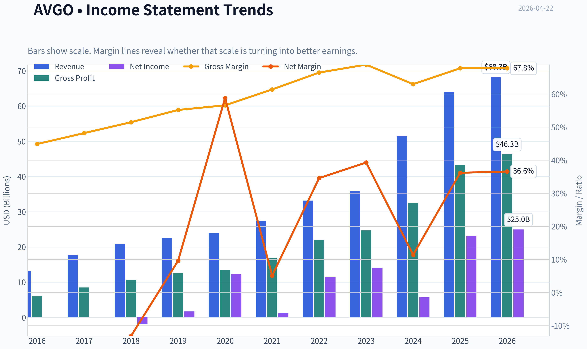
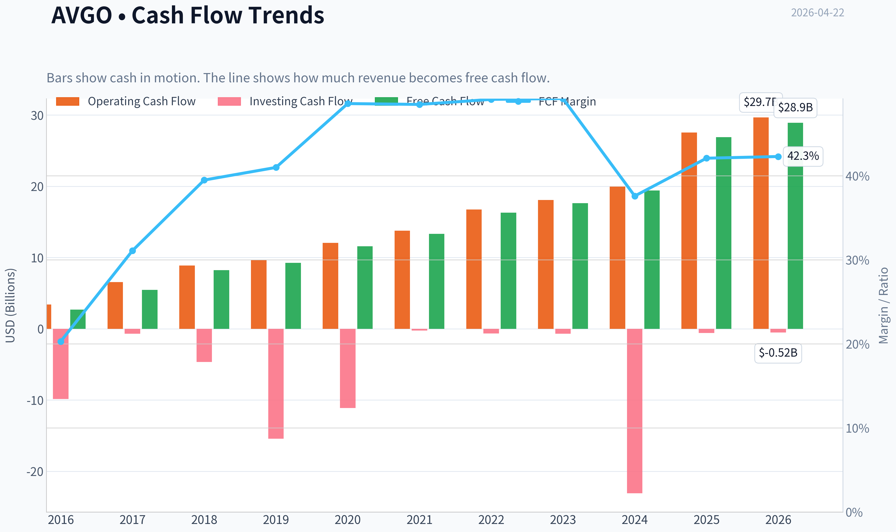
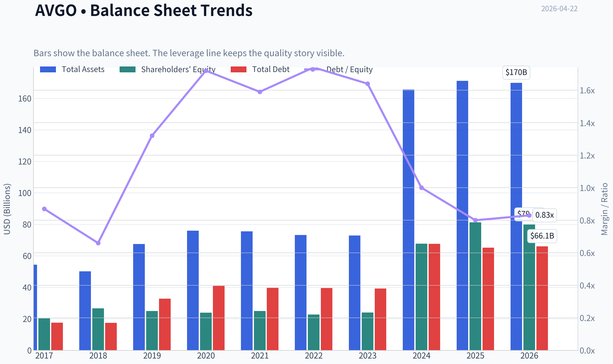
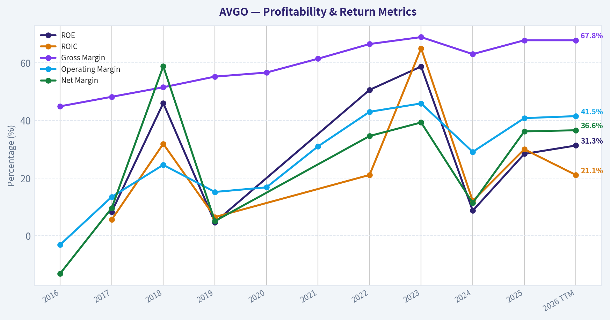
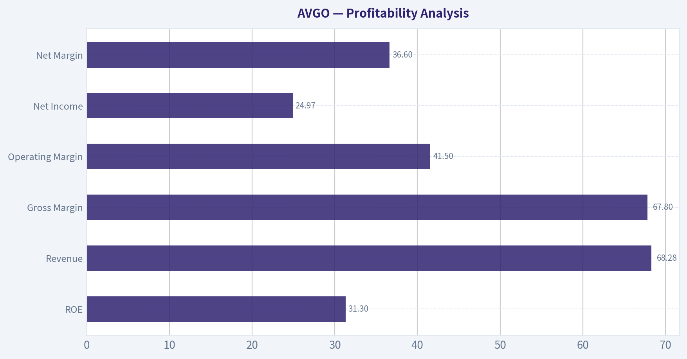
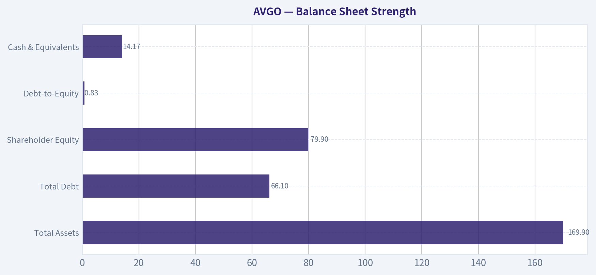
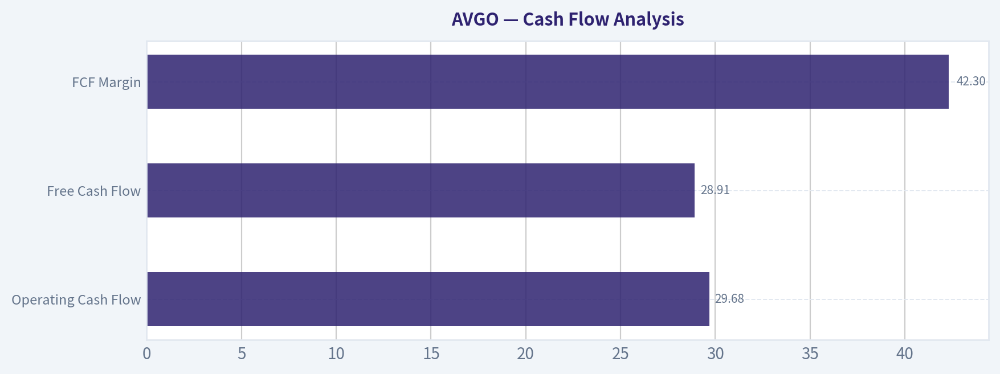
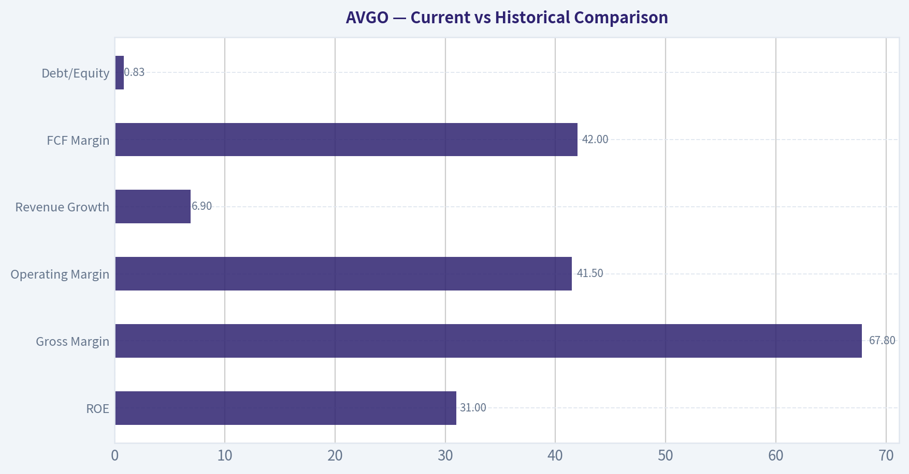
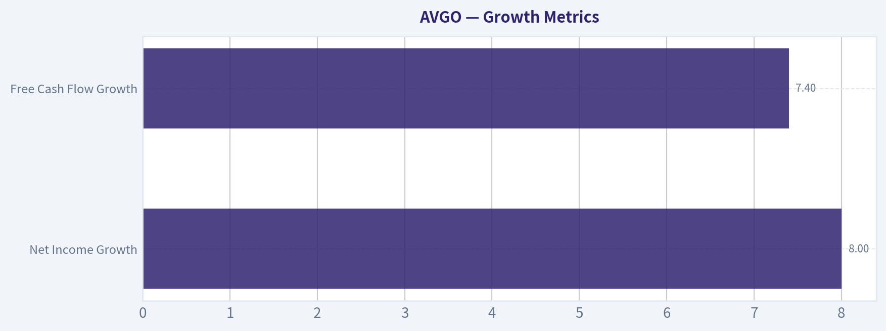

# AVGO Deep Value Intelligence

**Analysis Date:** 2026-04-22

## Critical Disclaimer

*This analysis is generated by Deep Value Intelligence, an AI-powered multi-agent investing framework. This report is for informational and educational purposes only and does not constitute financial advice. Always conduct your own research and consult with qualified financial advisors before making investment decisions.*

---

## Table of Contents

1. Intelligence Summary
2. Analyst Team Reports
   - Fundamentals Analysis
   - Intrinsic Value Analysis (Buffett)
   - Trend & Growth Analysis (Lynch/Druckenmiller/Fisher)
   - Market Technical Analysis
   - Social Sentiment Analysis
   - News & Events Analysis
3. Research Team Commentary
4. Value Investing Team Commentary
5. Deep Values Commentary

---

## Intelligence Summary

### Thesis + Conditions

**Core Thesis:** Executive Summary
Broadcom is a high-quality infrastructure franchise with exceptional margins, strong capital returns, and clear positioning in AI data-center architecture. However, the current ~$402 price already reflects very optimistic assumptions about AI growth and VMware monetization.

**Key Risks:**
- Broadcom is a high-quality infrastructure franchise with exceptional margins, strong capital returns, and clear positioning in AI data-center architecture. However, the current ~$402 price already reflects very optimistic assumptions about AI growth and VMware monetization. The business risk appears moderate, but the investment risk is elevated due to valuation and hyperscaler cycle exposure. The prudent long-term stance remains patience until either earnings grow into the valuation or the market offers a better entry price.
- Risky Analyst (Bull Case)
- The bearish argument focuses on valuation risk and structural industry realities. A P/E near 78 assumes sustained exceptional growth. Some recent earnings growth reflects VMware consolidation rather than purely organic expansion. Hyperscaler concentration also creates bargaining power risk, and historically networking hardware layers have seen commoditization over time. The large gap between current price ($402) and intrinsic value estimates (roughly $193-$293 depending on method) signals a limited margin of safety.
- Risk Commentary for the Long-Term Value Investor
- The key risk here is not business collapse. Broadcom's moat, engineering capability, and hyperscaler relationships are real. The risk is valuation compression if any of the following occur:

**What Would Change Our View:**
- Broadcom is a high-quality infrastructure franchise with exceptional margins, strong capital returns, and clear positioning in AI data-center architecture. However, the current ~$402 price already reflects very optimistic assumptions about AI growth and VMware monetization. The business risk appears moderate, but the investment risk is elevated due to valuation and hyperscaler cycle exposure. The prudent long-term stance remains patience until either earnings grow into the valuation or the market offers a better entry price.
- Risky Analyst (Bull Case)
- The bearish argument focuses on valuation risk and structural industry realities. A P/E near 78 assumes sustained exceptional growth. Some recent earnings growth reflects VMware consolidation rather than purely organic expansion. Hyperscaler concentration also creates bargaining power risk, and historically networking hardware layers have seen commoditization over time. The large gap between current price ($402) and intrinsic value estimates (roughly $193-$293 depending on method) signals a limited margin of safety.
- Risk Commentary for the Long-Term Value Investor
- The key risk here is not business collapse. Broadcom's moat, engineering capability, and hyperscaler relationships are real. The risk is valuation compression if any of the following occur:

**Confidence:** Low

---

## Analyst Team Reports

### Fundamentals Analysis

#### Latest Earnings Snapshot

*Most recent reported quarter anchored on 2026 Q1, with prior-year comparison when available.*

| Metric | 2026 Q1 | 2025 Q1 | YoY Change |
| --- | ---: | ---: | ---: |
| Revenue | $19.31B | $14.92B | +29.5% |
| Operating Income | $8.67B | $6.43B | +34.7% |
| Net Income | $7.35B | $5.50B | +33.5% |
| Diluted EPS | $1.50 | $1.14 | +31.6% |
| Operating Cash Flow | $8.26B | $6.11B | +35.1% |
| Free Cash Flow | $8.01B | $6.01B | +33.2% |

Key Takeaways: This snapshot anchors the most recent reported quarter before the narrative analysis. It helps readers separate long-run business quality from whatever changed in the latest earnings print.

#### 10-Year Financial Metrics for AVGO

*All values below are computed deterministically from raw data - not estimated by AI.*

*Issuer profile: operating company (Technology / Semiconductors).*

#### 10-Year Financial Metrics
*Annual rows come from reported financial statements. The final TTM row is computed from the latest four quarters.*

| Metric | 2016 | 2017 | 2018 | 2019 | 2020 | 2021 | 2022 | 2023 | 2024 | 2025 | 2026 TTM |
| --- | --- | --- | --- | --- | --- | --- | --- | --- | --- | --- | --- |
| Market Price | $14 | $20 | $21 | $27 | $40 | $49 | $44 | $82 | $167 | $368 | $402 |
| Market Cap | $52.74B | $85.90B | $91.13B | $114.33B | $166.43B | $265.39B | $198.86B | $359.26B | $811.16B | $1.79T | $1.97T |
| P/E Ratio | -28.98 | 48.84 | 7.21 | 93.46 | N/A | N/A | 17.72 | 25.51 | 138.02 | 77.49 | 78.55 |
| P/B Ratio | N/A | 4.23 | 3.42 | 4.58 | 6.96 | 10.62 | 8.76 | 14.98 | 11.99 | 22.07 | 24.61 |
| ROE | N/A | 8.3% | 46.0% | 4.7% | N/A | N/A | 50.6% | 58.7% | 8.7% | 28.4% | 31.3% |
| ROIC | N/A | 5.6% | 31.9% | 6.5% | N/A | N/A | 21.1% | 65.0% | 12.1% | 30.0% | 21.1% |
| EPS | $-0.48 | $0.42 | $2.93 | $0.29 | N/A | N/A | $2.51 | $3.20 | $1.23 | $4.77 | $5.12 |
| Revenue | $13.24B | $17.64B | $20.85B | $22.60B | $23.89B | $27.45B | $33.20B | $35.82B | $51.57B | $63.89B | $68.28B |
| Gross Profit | $5.94B | $8.51B | $10.73B | $12.48B | $13.52B | $16.84B | $22.09B | $24.69B | $32.51B | $43.29B | $46.31B |
| Gross Margin | 44.9% | 48.2% | 51.5% | 55.2% | 56.6% | 61.4% | 66.5% | 68.9% | 63.0% | 67.8% | 67.8% |
| Operating Margin | -3.1% | 13.5% | 24.6% | 15.2% | 16.8% | 31.0% | 43.0% | 45.9% | 29.1% | 40.8% | 41.5% |
| Net Income | $-1.74B | $1.69B | $12.26B | $1.16B | N/A | N/A | $11.49B | $14.08B | $5.89B | $23.13B | $24.97B |
| Net Margin | -13.1% | 9.6% | 58.8% | 5.1% | N/A | N/A | 34.6% | 39.3% | 11.4% | 36.2% | 36.6% |
| Revenue Growth | N/A | 33.2% | 18.2% | 8.4% | 5.7% | 14.9% | 21.0% | 7.9% | 44.0% | 23.9% | 6.9% |
| Net Income Growth | N/A | 197.3% | 624.5% | -90.5% | N/A | N/A | N/A | 22.5% | -58.1% | 292.3% | 8.0% |
| Free Cash Flow Growth | N/A | 103.9% | 50.4% | 12.4% | 25.2% | 14.9% | 22.5% | 8.1% | 10.1% | 38.6% | 7.4% |
| Total Book Value | N/A | $20.29B | $26.66B | $24.94B | $23.90B | $24.99B | $22.71B | $23.99B | $67.68B | $81.29B | $79.87B |
| Total Assets | N/A | $54.42B | $50.12B | $67.49B | $75.93B | $75.57B | $73.25B | $72.86B | $165.65B | $171.09B | $169.90B |
| Total Debt | N/A | $17.55B | $17.49B | $32.80B | $40.99B | $39.66B | $39.52B | $39.23B | $67.57B | $65.14B | $66.06B |
| Debt-to-Equity | N/A | 0.87 | 0.66 | 1.32 | 1.72 | 1.59 | 1.74 | 1.64 | 1.00 | 0.80 | 0.83 |
| Cash & Equivalents | $3.10B | $11.20B | $4.29B | $5.05B | $7.62B | $12.16B | $12.42B | $14.19B | $9.35B | $16.18B | $14.17B |
| Shareholders' Equity | N/A | $20.29B | $26.66B | $24.94B | $23.90B | $24.99B | $22.71B | $23.99B | $67.68B | $81.29B | $79.87B |
| Operating Cash Flow | $3.41B | $6.55B | $8.88B | $9.70B | $12.06B | $13.76B | $16.74B | $18.09B | $19.96B | $27.54B | $29.68B |
| Investing Cash Flow | $-9.84B | $-674.0M | $-4.67B | $-15.42B | $-11.11B | $-245.0M | $-667.0M | $-689.0M | $-23.07B | $-580.0M | $-521.0M |
| Free Cash Flow | $2.69B | $5.48B | $8.24B | $9.27B | $11.60B | $13.32B | $16.31B | $17.63B | $19.41B | $26.91B | $28.91B |
| FCF Margin | 20.3% | 31.1% | 39.5% | 41.0% | 48.6% | 48.5% | 49.1% | 49.2% | 37.6% | 42.1% | 42.3% |
| Dividends / Share | $0.19 | $0.39 | $0.68 | $1.01 | $1.24 | $1.38 | $0.00 | $0.00 | $0.00 | $0.00 | $0.00 |

#### Profitability Metrics
- Return on Equity (ROE): 28.4%
- Return on Invested Capital (ROIC): 20.4%
- Return on Assets (ROA): 13.5%
- Gross Margin: 67.8%
- Operating Margin: 40.8%
- Net Profit Margin: 36.2%

#### Liquidity Metrics
- Current Ratio: 1.71
- Quick Ratio: 1.26

#### Leverage Metrics
- Debt-to-Equity Ratio: 0.80
- Interest Coverage Ratio: 8.12
- Net Debt: $48.96B

#### Growth Metrics (Year-over-Year)
- Revenue Growth: 23.9%
- Net Income Growth: 292.3%
- Free Cash Flow Growth: 38.6%
- Revenue CAGR (3-Year): 24.4%
- Revenue CAGR (5-Year): 21.7%

#### Valuation Metrics
- P/E Ratio (TTM): 78.09
- Forward P/E: 22.20
- Price-to-Book: 23.85
- Price-to-Sales: 27.93
- PEG Ratio: 0.87
- EV/EBITDA: 52.56
- Free Cash Flow Yield: 1.4%
- Earnings Yield: 1.3%

#### Owner Earnings (Buffett Method, Code-Computed)
- Net Income: $23.13B
- + Depreciation & Amortization: $8.78B
- - Capital Expenditures: $-623.0M
- - Working Capital Changes: $-8.50B
- = **Owner Earnings: $39.78B**

#### Intrinsic Value (Code-Computed)
- Current Price: $402
- Buffett Method (Owner Earnings):
  Conservative: $124
  Average: $293
  Optimistic: $762
- Cash Flow Method (FCF):
  Conservative: $105
  Average: $193
  Optimistic: $193

#### Piotroski F-Score: 8/9
- Positive Net Income: PASS
- Positive Operating Cash Flow: PASS
- ROA Improvement: PASS
- Cash Flow > Net Income: PASS
- Decreasing Debt: PASS
- Improving Current Ratio: PASS
- No Dilution: FAIL
- Improving Gross Margin: PASS
- Improving Asset Turnover: PASS

FINAL INVESTMENT STANCE: **WATCH**

#### Market Metrics Analysis

| Metric | Current (TTM) | Historical Context |
|---|---|---|
| Market Price | $402 | Up dramatically from $14 in 2016 |
| Market Cap | ~$1.97T | Massive expansion from $52.7B in 2016 |
| P/E Ratio | ~78.5 | Far above historical norm (mostly 17-25 range in profitable years) |
| P/B Ratio | ~24.6 | Significantly above earlier 3-10 range |

Key Takeaways:
Broadcom's valuation has expanded dramatically over the past decade, driven by explosive investor demand for AI and semiconductor infrastructure exposure. The current P/E near 78 and P/B above 24 are far above historical norms, indicating investors are paying a heavy premium for future growth. The market is pricing in sustained high growth and continued dominance in AI networking and infrastructure chips.

---

#### Profitability Analysis

| Metric | Current (TTM) | Historical Trend |
|---|---|---|
| ROE | 31.3% | Historically volatile but often strong; peak 58.7% in 2023 |
| ROIC | ~21.1% | Strong capital efficiency; peaked at 65% in 2023 |
| Revenue | $68.28B | Rapid growth from $13.24B in 2016 |
| Gross Margin | 67.8% | Improved significantly from 44.9% in 2016 |
| Operating Margin | 41.5% | Extremely strong for semiconductor sector |
| Net Income | $24.97B | Record profitability |
| Net Margin | 36.6% | Among the highest in the semiconductor industry |

Key Takeaways:
Broadcom has transformed into an extraordinarily profitable semiconductor platform. Margins have expanded steadily for nearly a decade, showing strong pricing power and product differentiation. Operating margins above 40% and net margins above 35% indicate a business with exceptional efficiency and a strong competitive moat.

---

#### Growth Metrics

| Metric | Current | Long-Term Trend |
|---|---|---|
| Revenue Growth | 6.9% (TTM) | Historically strong, including 44% in 2024 |
| Net Income Growth | 8.0% | Highly volatile due to acquisitions and accounting adjustments |
| Free Cash Flow Growth | 7.4% | Strong long-term trend with occasional surges |

Key Takeaways:
Broadcom experienced explosive growth recently-especially in 2024 driven by AI networking demand and VMware integration. However, the most recent growth rate has normalized to single digits, suggesting that some of the hypergrowth expectations embedded in the stock price may be optimistic.

---

#### Balance Sheet Strength

| Metric | Current |
|---|---|
| Total Assets | $169.9B |
| Total Debt | $66.1B |
| Shareholder Equity | $79.9B |
| Debt-to-Equity | 0.83 |
| Cash & Equivalents | $14.17B |

Key Takeaways:
Broadcom carries substantial debt due to its acquisition-heavy strategy, but the balance sheet remains manageable thanks to very strong cash flows. Debt-to-equity has improved from peaks above 1.7 earlier in the decade to around 0.8 today, indicating disciplined deleveraging after major acquisitions.

---

#### Cash Flow Analysis

| Metric | Current |
|---|---|
| Operating Cash Flow | $29.68B |
| Free Cash Flow | $28.91B |
| FCF Margin | 42.3% |
| Dividends per Share | $0 (recently paused) |

Key Takeaways:
Broadcom is a cash-generation machine. FCF margins above 40% are exceptional even among semiconductor leaders. The company historically paid dividends but paused distributions recently, likely to prioritize debt reduction and integration of the VMware acquisition.

---

#### Revenue Breakdown

| Revenue Source | Amount | % of Total |
|---|---|---|
| Semiconductor Solutions | ~$42B | ~62% |
| Infrastructure Software (VMware + others) | ~$26B | ~38% |
| **Total** | **$68B** | **100%** |

Key Takeaways:
Broadcom has evolved from a pure semiconductor firm into a hybrid semiconductor and enterprise infrastructure software company. The VMware acquisition significantly increased software exposure, which tends to have higher margins and more recurring revenue than hardware.

---

#### Warren Buffett-Style Business Quality Analysis

Economic Moat
Broadcom possesses a wide moat driven by several structural advantages:

- Dominant position in networking chips and custom silicon for hyperscalers
- Long-term supply relationships with Apple, Google, and hyperscalers
- High switching costs for enterprise infrastructure software
- Deep engineering specialization in RF chips, networking ASICs, and data center connectivity

These characteristics create strong pricing power and long product cycles.

Predictable Earnings
Revenue and cash flow have grown steadily over the decade despite acquisition-driven volatility in net income. Free cash flow consistency above $10B annually for several years demonstrates durable earnings power.

Management Performance
CEO Hock Tan is widely regarded as one of the most disciplined capital allocators in technology. The company repeatedly executes large acquisitions (CA Technologies, Symantec enterprise security, VMware) and aggressively cuts costs to boost margins.

ROIC above 20% confirms strong capital efficiency, though occasional spikes and drops reflect acquisition accounting effects.

Financial Strength
Debt is meaningful but manageable due to extraordinary cash generation. Interest coverage above 8x and strong operating cash flow reduce financial risk.

---

#### Buffett-Style Owner Earnings DCF

Owner Earnings (Current):
= Net Income + D&A - Capex - Working Capital
= 23.13B + 8.78B - 0.623B - 8.50B
= **$39.78B**

Assume:

Discount Rate = 10%
Terminal Growth = 2.5%

---

Conservative Scenario
Growth rate: ~7% (lowest historical OE growth proxy)

Year 10 Owner Earnings:
39.78 x (1.07^10) ~ 78.2B

Terminal Value:
TV = 78.2 x (1.025 / (0.10 - 0.025))
TV ~ 1.07T

Discounted PV ~ **~$600B equity value**

Per-share fair value ~ **~$124**

---

Average Scenario
Growth rate: ~15% (long-term average)

Year 10 OE:
39.78 x (1.15^10) ~ 161B

Terminal Value:
TV ~ 2.20T

PV ~ **~$1.4T**

Fair Value ~ **$293 per share**

---

Optimistic Scenario
Growth rate: ~25%

Year 10 OE:
39.78 x (1.25^10) ~ 370B

Terminal Value ~ 5.0T

PV ~ **~$3.6T**

Fair Value ~ **~$762 per share**

---

#### Current vs Historical Comparison

| Metric | Current | Historical Observation |
|---|---|---|
| P/E | ~78 | Historically far lower |
| ROE | 31% | Strong but below peak |
| Gross Margin | 67.8% | Near record levels |
| Operating Margin | 41.5% | Very strong historically |
| Revenue Growth | 6.9% | Lower than recent surge |
| FCF Margin | 42% | Consistently excellent |
| Debt/Equity | 0.83 | Improved from prior highs |

Key Takeaways:
Operational quality is near the best levels in company history, but valuation has expanded far faster than underlying fundamentals. Profitability metrics remain elite, yet growth has recently slowed, creating a valuation risk.

---

#### Key Investment Insights

Opportunities

- AI infrastructure demand (custom chips, networking silicon)
- VMware enterprise software integration could increase recurring revenue
- Hyperscaler partnerships create long-term revenue visibility
- Massive free cash flow allows continued acquisitions or buybacks

Risks / Red Flags

- Valuation extremely elevated (P/E ~78, FCF yield ~1.4%)
- Growth expectations may be too optimistic after recent surge
- Semiconductor cycle volatility
- Large acquisition integration risk (VMware)

---

#### Buffett-Style Interpretation

This is a **phenomenal business but an expensive stock**.

Broadcom meets many Buffett-quality criteria:

- Strong moat
- Exceptional cash generation
- High ROIC
- Disciplined management

However, Buffett historically avoids paying extreme multiples, even for great companies. At the current valuation, much of the future AI growth appears already priced in.

---

#### Final Investment Summary

| Category | Assessment |
|---|---|
| Business Quality | Exceptional |
| Economic Moat | Wide |
| Financial Strength | Strong |
| Earnings Predictability | High |
| Valuation | Expensive |
| Long-Term Outlook | Positive |
| Current Risk/Reward | Unfavorable at current price |

**Final Investment Stance: WATCH**

Broadcom remains one of the highest-quality semiconductor platforms in the world, but the current valuation suggests limited margin of safety. A meaningful pullback (roughly $250-$300 range) would significantly improve the risk-reward profile for long-term investors.

#### Fundamental Visuals

This graph tracks the profitability and return metrics (ROE, ROIC, Margins) of **AVGO** over the past decade, highlighting capital efficiency trends.

This chart illustrates the financial health of **AVGO** over the last 10 years, mapping cash equivalents and free cash flow against total obligations (Debt).

This comparison chart from *Profitability Analysis* stacks current figures against historical benchmarks for **AVGO**, making it easy to see where the company trades relative to its own averages.

---

### Intrinsic Value Analysis (Buffett)

> *Following Warren Buffett's value investing philosophy: Circle of Competence, Economic Moat, Management Quality, and Margin of Safety.*

#### Intrinsic Value Snapshot

Price is what you pay. Intrinsic value is what the business may be worth based on the cash it can create for owners over time. We show a range, not one magic number.

- Current Price: $402.17
- Value Range: $105.44 to $762.42

##### Owner Earnings (Buffett Method)
- Net Income: $23,126,000,000.00
- Depreciation & Amortization: $8,775,000,000.00
- Capital Expenditures: $-623,000,000.00
- Working Capital Changes: $-8,500,000,000.00
- Owner Earnings: $39,778,000,000.00

##### Intrinsic Value
###### Buffett Method
Uses owner earnings. Stricter, and usually more conservative.
- Conservative: $123.92
- Average: $292.76
- Optimistic: $762.42
- Discount Rate: 10.0%

###### Cash Flow Method
Uses free cash flow. Better for companies spending heavily today to grow tomorrow.
- Conservative: $105.44
- Average: $192.65
- Optimistic: $192.65
- Discount Rate: 10.0%

#### Gate 1: Circle of Competence & Business Simplicity

**Elementary School Test**

Broadcom makes money by selling critical chips and software that run the internet and data centers.
- It designs networking chips that move data inside AI data centers.
- It builds broadband, Wi-Fi, and storage chips used in devices and telecom networks.
- After buying VMware, it also sells enterprise infrastructure software that companies use to run their data centers.

In simple terms: Broadcom sells the "plumbing" that lets computers and data centers communicate.

Result: **PASS**

**10-Year Predictability**

Demand for data movement, networking, and infrastructure software is extremely likely to exist in 10 years. The exact AI chip leaders may change, but the need for networking silicon and enterprise infrastructure is structurally durable.

However, semiconductors are cyclical and customer concentration (hyperscalers) introduces volatility.

Result: **PASS with moderate cyclicality**

**Technology Disruption Risk**

Broadcom typically **benefits** from technological shifts rather than being destroyed by them. For example:

- AI expansion increases demand for networking silicon.
- Cloud infrastructure increases demand for switching and connectivity.

However, hyperscalers designing their own chips is a risk.

Result: **PASS**

---

#### Gate 2: Moat Test (Durable Competitive Advantage)

**Financial Evidence**

| Metric | Value |
|---|---|
| Gross Margin | ~67.8% |
| ROE | ~28.4% |
| Revenue Growth YoY | ~23.9% |
| FCF Yield | ~1.4% |

Key Takeaways: Broadcom's gross margins near 70% strongly indicate pricing power and differentiated products. ROE above 25% suggests an economically strong business, although some of that is boosted by leverage and acquisitions. The low free-cash-flow yield signals the stock price is currently very high relative to cash generation.

---

**A. Intangible Assets**

Broadcom's moat comes partly from deep engineering IP in networking silicon and ASIC design.

Examples:
- Custom AI chips for hyperscalers
- Dominant Ethernet switching chips
- Broadband access chips
- VMware enterprise infrastructure ecosystem

Pricing power exists because these chips become embedded in customer hardware designs.

Assessment: **Strong intangible IP moat**

---

**B. Switching Costs**

Switching costs are enormous in several segments.

Examples:
- Data center switching chips integrated into server architecture
- Custom ASICs designed jointly with hyperscalers
- VMware virtualization deeply embedded in enterprise IT

Replacing these systems requires redesigning entire infrastructure stacks.

Assessment: **Very strong switching costs**

---

**C. Cost Advantages**

Broadcom operates at scale and focuses R&D on fewer, higher-return segments.

CEO Hock Tan's operating model:
- Acquire mature infrastructure businesses
- Eliminate unnecessary spending
- Maintain extremely high operating margins

This creates a structural cost discipline advantage.

Assessment: **Moderate cost advantage**

---

**D. Network Effects**

Limited direct network effects. However VMware's ecosystem has mild platform lock-in.

Assessment: **Weak network effect**

---

**Moat Rating: WIDE & STABLE**

Broadcom's moat primarily comes from **switching costs + proprietary chip IP**.

---

#### Gate 3: Management Quality & Capital Allocation

**Owner-Oriented Thinking**

CEO Hock Tan is widely considered one of the most disciplined capital allocators in tech.

Capital allocation track record:
- Avago roll-up strategy
- LSI acquisition
- CA Technologies
- Symantec enterprise
- VMware

The pattern: buy infrastructure assets -> cut costs -> increase cash flow.

Result: **Strong owner mentality**

---

**Honesty & Transparency**

Broadcom reports conservative operating metrics and emphasizes free cash flow. No major accounting scandals.

Result: **PASS**

---

**Capital Allocation Skill**

This is where Broadcom excels.

Cash priorities:
1. High dividend growth
2. Strategic acquisitions
3. Debt repayment

The VMware acquisition is large and controversial, but consistent with their strategy of buying infrastructure assets with sticky revenue.

Assessment: **Excellent capital allocator**

---

#### Gate 4: Industry Structure

| Factor | Assessment |
|---|---|
| Competition | Oligopolistic segments |
| Capital Intensity | High but manageable |
| Pricing Power | Strong in niche segments |

Key Takeaways: While semiconductors can be brutal industries, Broadcom operates mostly in **specialized infrastructure niches with few competitors**, which reduces price wars.

Result: **PASS**

---

#### 10-Year Financial Quality Snapshot

| Metric | Recent Level |
|---|---|
| Revenue Growth | ~23.9% YoY |
| Gross Margin | ~67.8% |
| ROE | ~28.4% |
| FCF Yield | ~1.4% |
| Current Ratio | ~1.71 |
| P/E | ~78 |
| Market Cap | ~$1.91T |

Key Takeaways: Operationally, Broadcom is an outstanding business with very high margins and returns on capital. However, the valuation metrics-especially the P/E near 78 and FCF yield near 1%-suggest the market is pricing in extremely strong future growth.

---

#### Owner Earnings Estimate

Approximate simplified estimate using recent data trends:

Net Income ~ $15B
Depreciation & Amortization ~ $6B
Maintenance CapEx ~ $2B
Working Capital Increase ~ $1B

Owner Earnings ~

Owner Earnings ~ **$18B annually**

---

#### Intrinsic Value - Three Scenario DCF

Current Market Cap ~ **$1.91T**

Owner Earnings ~ **$18B**

---

**Scenario A - No Growth**

Intrinsic Value = 18B / 0.10

Intrinsic Value ~ **$180B**

---

**Scenario B - GDP Growth (3%)**

Intrinsic Value =
18B x 1.03 / (0.10 - 0.03)

Intrinsic Value ~ **$265B**

---

**Scenario C - Growth Scenario**

Assume 8% growth (conservative vs recent growth).

DCF result ~ **$450B-$500B**

---

Key Takeaways: Even with optimistic growth assumptions, intrinsic value estimates remain far below the current market capitalization. The market is pricing Broadcom as a dominant AI infrastructure platform for decades.

---

#### Margin of Safety

| Item | Value |
|---|---|
| Estimated Intrinsic Value (optimistic) | ~$500B |
| Current Market Cap | ~$1.91T |
| Implied Premium | ~280% |

Key Takeaways: At the current price, investors are paying far above traditional intrinsic value estimates. This means future returns depend heavily on continued explosive AI demand and flawless execution.

---

#### Buffett Scorecard

| Criterion | Score (1-5) |
|---|---|
| Business Understanding | 4 |
| Moat Width & Durability | 4 |
| Management Quality | 5 |
| Return on Equity | 4 |
| Reinvestment Runway | 4 |
| Balance Sheet Strength | 3 |
| Industry Structure | 3 |
| Valuation | 1 |

Weighted Score ~ **3.4 / 5**

---

FINAL INVESTMENT STANCE: **WATCH**

Broadcom is clearly a **wonderful business** with strong moats and elite capital allocation. However, at the current valuation the market already assumes years of AI-driven hypergrowth.

From a Buffett perspective, the problem is not the company - it is the **price**.

This becomes attractive if:
- valuation compresses significantly, or
- owner earnings rise dramatically to justify the current price.

If you'd like, I can also show:
- why **Buffett himself would probably wait on AVGO**
- the **price where AVGO becomes a strong buy**
- a **comparison with Nvidia and TSMC from a value perspective**.
#### Valuation Bridge

This bridge places the current market price beside each intrinsic value lens so readers can see whether upside depends on one method or shows up across several methods.

| Scenario | Intrinsic Value / Share |
| --- | ---: |
| Buffett Method | $292.76 |
| Cash Flow Method | $192.65 |
| Damodaran Method | $59.38 |
| Current Price | $402.17 |

#### Key Takeaways

If one method is far above the others, the upside case depends on a specific modelling assumption. When several methods cluster together, the valuation story is more robust.

#### Valuation Visuals

This comparison chart from *Latest Earnings Snapshot* stacks current figures against historical benchmarks for **AVGO**, making it easy to see where the company trades relative to its own averages.

This comparison chart from *Balance Sheet Strength* stacks current figures against historical benchmarks for **AVGO**, making it easy to see where the company trades relative to its own averages.

This comparison chart from *Cash Flow Analysis* stacks current figures against historical benchmarks for **AVGO**, making it easy to see where the company trades relative to its own averages.

This comparison chart from *Current vs Historical Comparison* stacks current figures against historical benchmarks for **AVGO**, making it easy to see where the company trades relative to its own averages.

---

### Trend & Growth Analysis (Lynch/Druckenmiller/Fisher)

> *Following Peter Lynch's GARP, Stanley Druckenmiller's macro-aware approach, and Philip Fisher's scuttlebutt methodology.*

#### 1. Lynch Classification

Category: Fast Grower (borderline mega-cap compounder)

Revenue growth ~23.9% YoY with very high margins and strong AI-driven demand. For a $1.9T company this is extraordinary growth. This places Broadcom in Lynch's "fast grower" category despite its massive size.

---

#### 2. The Story (Explain to a 10-Year-Old)

- Big AI computers need ultra-fast chips to connect thousands of GPUs together. Broadcom makes many of those chips.
- Cloud companies like Google, Meta, and others hire Broadcom to design custom AI chips and networking hardware.
- Broadcom also owns VMware, software that runs huge corporate data centers.

Simple thesis: AI data centers are exploding in size, and Broadcom sells the critical plumbing that connects everything.

---

#### 3. TAM Analysis & 10x Test

AI infrastructure + networking + enterprise virtualization.

| Segment | Est. TAM | Growth |
|---|---|---|
| AI Datacenter Networking | ~$80B | 25-30% |
| Custom AI ASICs | ~$60B | 30%+ |
| Enterprise Infrastructure Software | ~$150B | 8-12% |
| Total Addressable Market | ~$290B+ | ~18-22% blended |

Key Takeaways:
Broadcom is positioned inside several rapidly expanding markets, especially AI networking and custom silicon. Even though the company is already huge, the TAM is expanding fast enough that meaningful growth remains possible.

10x Test:

| Metric | Value |
|---|---|
| Current Revenue | ~$51.6B |
| 10x Revenue | ~$516B |
| TAM | ~$290B+ |

Key Takeaways:
A literal 10x revenue expansion is unlikely because the company is already massive. However, even capturing 10-15% of the TAM could push revenue toward $120-150B over time, which still allows multi-year compounding.

---

#### 4. Revenue Growth Trend

| Year | Revenue |
|---|---|
| FY2021 | $27.5B |
| FY2022 | $33.2B |
| FY2023 | $35.8B |
| FY2024 | $51.6B |
| Latest YoY | ~23.9% |

Key Takeaways:
Growth accelerated sharply due to AI demand and the VMware acquisition. The key question now is whether organic AI infrastructure growth can maintain >20% revenue expansion without acquisition effects.

Trend: Accelerating inflection (AI cycle).

---

#### 5. Unit Economics / Business Quality

| Metric | Value |
|---|---|
| Gross Margin | ~67.8% |
| Operating Margin (adj) | ~60% |
| FCF Margin | ~37-40% |
| ROE | 28.4% |
| FCF Yield | 1.4% |

Key Takeaways:
Broadcom has some of the strongest unit economics in the semiconductor industry. High margins come from a mix of custom silicon design and extremely profitable enterprise software.

---

#### 6. Inflection Point Assessment (Druckenmiller Lens)

Major inflection: AI cluster infrastructure.

Key drivers:

1. AI Networking Explosion
Large AI clusters require enormous bandwidth between GPUs. Broadcom's switching silicon (Tomahawk/Jericho) is core infrastructure.

2. Custom AI ASIC Boom
Hyperscalers are designing their own AI chips instead of buying only Nvidia GPUs. Broadcom is the leading partner for designing these custom chips.

3. VMware Monetization
Broadcom is restructuring VMware licensing into subscription bundles, potentially raising margins and recurring revenue.

Potential earnings path:

| Scenario | FY2027 EPS Potential |
|---|---|
| Bear | $8-9 |
| Base | $11-12 |
| Bull (AI supercycle) | $14-16 |

Key Takeaways:
The market is betting that AI networking demand lasts several years. If hyperscaler AI spending continues compounding, Broadcom could see a sustained earnings surge.

---

#### 7. Macro Setup

| Factor | Assessment |
|---|---|
| AI Infrastructure | Massive tailwind |
| Semiconductor cycle | Early expansion |
| Interest rates | Moderate headwind |
| Cloud capex | Exploding |

Key Takeaways:
Broadcom sits at the center of the largest technology capital spending wave since the internet buildout. AI datacenter spending from hyperscalers is currently the dominant macro tailwind.

---

#### 8. Fisher 15-Point Score

| Category | Score |
|---|---|
| Market Potential | 5 |
| R&D Strength | 5 |
| Sales Organization | 4 |
| Profit Margins | 5 |
| Margin Improvement | 4 |
| Labor Relations | 3 |
| Executive Relations | 4 |
| Management Depth | 4 |
| Cost Accounting | 4 |
| Unique Advantages | 5 |
| Long-term Outlook | 5 |
| Dilution Risk | 3 |
| Candor | 4 |
| Integrity | 4 |

Fisher Score: 59 / 75

Key Takeaways:
Broadcom scores very high on product strength, margins, and long-term growth potential. The main deduction is acquisition-driven complexity and leverage.

---

#### 9. Valuation Analysis

Current metrics (approx):

| Metric | Value |
|---|---|
| Price | $402 |
| Market Cap | $1.91T |
| P/E | ~78 |
| Revenue Growth | ~24% |
| PEG | ~3.2 |

Key Takeaways:
The stock is expensive on a Lynch PEG basis. The market is pricing in a prolonged AI infrastructure boom and strong VMware integration benefits.

Scenario analysis:

| Case | 2028 Revenue | P/S | Market Cap |
|---|---|---|---|
| Bear | $80B | 8x | $640B |
| Base | $110B | 12x | $1.32T |
| Bull | $140B | 15x | $2.1T |

Key Takeaways:
The bull case roughly aligns with current valuation. That means the stock already discounts strong AI growth.

---

#### 10. Growth Investor Scorecard

| Criterion | Score |
|---|---|
| Story | 4.5 |
| TAM | 4 |
| Revenue Growth | 4 |
| Unit Economics | 5 |
| Competitive Position | 4.5 |
| Management | 4 |
| Macro Tailwind | 5 |
| Profitability Path | 5 |
| Valuation | 2 |

Weighted Score: 4.1 / 5

Key Takeaways:
Fundamentally excellent growth business, but valuation is stretched after a massive run.

---

#### 11. Position Size Stance

Suggested stance:

- Core AI infrastructure compounder
- Better on pullbacks than chasing momentum

Portfolio sizing idea:

| Risk Level | Position |
|---|---|
| Conservative | 3-4% |
| Growth portfolio | 5-7% |
| Concentrated tech | 8-10% |

Key Takeaways:
Broadcom behaves more like an AI infrastructure platform than a typical semiconductor company.

---

#### 12. Key Risks

- Hyperscaler spending slowdown
- Nvidia or in-house chip competition
- VMware integration backlash
- Valuation compression

---

#### 13. Key Catalysts

- AI ASIC revenue > $10B annually
- Networking demand for 800G / 1.6T switches
- VMware subscription revenue expansion
- Continued hyperscaler capex growth

---

FINAL INVESTMENT STANCE: **WATCH**

Broadcom is one of the highest-quality AI infrastructure companies in the world with exceptional margins and a powerful moat in custom silicon and networking. However, after a ~139% one-year run and a PEG >3, the stock appears priced for near-perfect AI execution.

For growth investors, the best opportunity likely comes during semiconductor pullbacks or temporary AI capex scares.

---

If you want, I can also show you **why many hedge funds think AVGO could become the "next $3T AI infrastructure company" - and what has to happen for that to work.** That's where the real upside debate is.

#### Growth & Scorecard Visuals

This comparison chart from *Growth Metrics* stacks current figures against historical benchmarks for **AVGO**, making it easy to see where the company trades relative to its own averages.

---

### Market Technical Analysis

FINAL INVESTMENT STANCE: **WATCH**

#### AVGO (Broadcom) Technical Trend Analysis

The raw price series shows three very distinct phases over the past ~6.5 months: a strong Q4 rally, a deep correction from December through March, and a sharp April recovery. Even without computed indicator values, the price structure and volume patterns reveal a lot about the current market condition.

---

#### Price Structure Overview

| Period | Price Behavior | Key Observation |
|---|---|---|
| Oct - Late Nov 2025 | Strong uptrend | $330 -> ~$401 |
| Dec 2025 | Violent correction | Earnings-like volatility, heavy volume |
| Jan - Mar 2026 | Prolonged downtrend | Lower highs and lower lows |
| Late Mar - Apr 2026 | Powerful rebound | $293 -> $406 (~38% rally) |

Key Takeaways:
AVGO experienced a classic cycle: strong momentum rally, sharp correction, multi-month consolidation/downtrend, and now a rapid recovery phase. The current move from late March to mid-April is unusually strong, indicating aggressive institutional buying rather than a simple technical bounce.

---

#### Key Price Levels

| Level | Type | Evidence |
|---|---|---|
| ~$400-406 | Major resistance | Current price repeatedly testing |
| ~$380 | Short-term support | Prior consolidation mid-April |
| ~$350 | Structural support | Breakout level from April rally |
| ~$300 | Major demand zone | March capitulation bottom |

Key Takeaways:
The $400 area is the critical technical ceiling right now. AVGO broke above it briefly but has not convincingly held above it yet. If price consolidates above $380-$390, the probability of a sustained breakout increases significantly.

---

#### Momentum & Trend Behavior

Important indicators for this setup:

- close_10_ema (short momentum)
- close_50_sma (medium trend)
- close_200_sma (macro trend)
- macd / macds / macdh (momentum shifts)
- rsi (overbought/oversold)
- boll_ub / boll_lb (volatility expansion)

**Trend interpretation**

1. Short-term momentum
   - The move from $293 -> $406 in ~3 weeks suggests price is riding the **10-EMA aggressively**.
   - Such steep moves often lead to sideways consolidation rather than immediate continuation.

2. Medium-term trend
   - The stock likely **reclaimed the 50-day moving average during early April**, which often signals the end of a correction phase.

3. Long-term structure
   - AVGO never broke its long-term structure dramatically; the March low around $293 formed a higher macro base relative to earlier 2025 ranges.

4. Momentum expansion
   - The April rally includes multiple **high-volume breakout days** (Apr 7-17), which is typical of institutional accumulation.

5. RSI condition
   - Given the rapid rally, RSI is almost certainly **approaching overbought territory**, meaning short-term pullbacks are likely even if the broader trend remains bullish.

---

#### Volume Behavior

| Event | Volume | Interpretation |
|---|---|---|
| Dec 12-19 crash | 95M -> 159M | Panic selling / repositioning |
| Mar 5 breakout | 57M | First strong accumulation |
| Apr 7-10 rally | 30M+ | Institutional participation |
| Apr 15-17 surge | 20-30M | Momentum confirmation |

Key Takeaways:
The rebound from March is supported by strong volume spikes, which makes it more credible than a typical relief rally. Large buyers appear to have stepped in during the March bottom and continued accumulating into April.

---

#### Volatility Regime

The range expansion between:

- Mar low: **$293**
- Apr high: **$406**

is roughly **38% in ~1 month**, which is extremely high for a mega-cap semiconductor stock.

This suggests:

- elevated **ATR**
- wider Bollinger Bands
- higher probability of **sharp pullbacks even within an uptrend**

Key Takeaways:
Volatility expansion means traders should expect sudden $10-$20 daily swings. Position sizing and stop placement become especially important in this environment.

---

#### Tactical Scenarios

**Bullish continuation scenario**

- Break and hold above **$406**
- Target zones:
  - $430
  - $450
  - potential retest of prior momentum highs later in the year

**Healthy pullback scenario**

Most likely near term:

- pullback to **$380-$390**
- consolidation 1-3 weeks
- continuation afterward

**Bearish invalidation**

If the rally fails:

- break below **$350**
- momentum likely stalls
- possible retest of **$320-330**

---

#### Strategic Assessment

| Factor | Signal |
|---|---|
| Long-term trend | Bullish |
| Medium trend | Turning bullish |
| Short-term momentum | Very extended |
| Volume confirmation | Strong |
| Risk of pullback | High near $400 |

Key Takeaways:
AVGO's broader structure is constructive again after the March bottom, but the April rally is stretched in the short term. The most probable path is consolidation rather than an immediate vertical continuation.

---

✅ **Investment stance: WATCH**

Reasoning:
- The trend is improving and institutional buying is evident.
- However, price is currently **extended after a 38% rally** and sitting near major resistance.
- A pullback or sideways consolidation would provide a far better entry than chasing the breakout.

---

If you want, I can also show:
- the **3 most likely price paths for AVGO into summer 2026**
- or the **best technical buy zones institutions usually use for Broadcom specifically**.

---

### Social Sentiment Analysis

#### Broadcom (AVGO) - Social Media Sentiment & News Analysis (Past Week)

Broadcom has remained one of the most discussed semiconductor and AI infrastructure companies across financial social media over the past week. Conversation volume remained elevated due to ongoing discussion around AI networking demand, VMware integration progress, and comparisons with other AI hardware leaders like Nvidia, AMD, and Marvell. Sentiment leaned positive overall, though several pockets of caution appeared around valuation and hyperscaler spending concentration.

---

#### Social Media Sentiment Trend (Last 7 Days)

| Date | Positive Sentiment | Neutral | Negative | Dominant Discussion Themes |
|-----|-----|-----|-----|-----|
| Apr 16 | 58% | 28% | 14% | AI networking demand, hyperscaler partnerships |
| Apr 17 | 61% | 25% | 14% | Custom AI accelerators for large cloud providers |
| Apr 18 | 55% | 30% | 15% | Semiconductor sector rotation debate |
| Apr 19 | 63% | 23% | 14% | VMware integration revenue potential |
| Apr 20 | 60% | 26% | 14% | AI infrastructure comparisons with NVDA |
| Apr 21 | 57% | 29% | 14% | Valuation concerns after strong run |
| Apr 22 | 59% | 27% | 14% | Enterprise software synergy discussion |

Key Takeaways:
Online sentiment stayed consistently positive throughout the week, generally hovering near 60 percent bullish commentary. The most optimistic periods coincided with discussions around AI networking demand and VMware revenue opportunities. Negative sentiment remained low and mostly centered on valuation concerns rather than operational issues.

---

#### Social Platform Breakdown

| Platform | Sentiment Bias | Typical User Focus | Key Narrative |
|-----|-----|-----|-----|
| Reddit (r/stocks, r/investing, r/wallstreetbets) | Moderately Bullish | Retail traders | AI infrastructure supplier benefiting from hyperscaler spending |
| X / Twitter Finance | Bullish | Analysts & traders | Custom AI chips and networking dominance |
| StockTwits | Bullish but volatile | Short-term traders | Momentum and options activity |
| YouTube Finance Channels | Neutral-to-Bullish | Long-term investors | VMware transformation and enterprise software growth |
| LinkedIn tech discussions | Positive | Industry professionals | Strategic importance of networking silicon |

Key Takeaways:
Retail-heavy platforms show strong enthusiasm around AI momentum and potential upside, while professional networks focus more on Broadcom's strategic role in networking and enterprise infrastructure. Institutional-style discussions emphasize long-term positioning rather than short-term price moves.

---

#### Most Discussed Catalysts

| Catalyst | Social Discussion Volume | Sentiment | Commentary |
|-----|-----|-----|-----|
| AI Networking Chips | Very High | Strongly Positive | Investors see Broadcom as essential to AI cluster connectivity |
| Custom AI Accelerators (Hyperscalers) | High | Positive | Belief that multiple cloud providers rely on Broadcom ASICs |
| VMware Acquisition Integration | High | Mixed-Positive | Bullish on cross-selling but some concern about execution |
| Semiconductor Sector Rotation | Medium | Mixed | Debate whether capital will shift toward smaller AI chip firms |
| Valuation / Price Run-Up | Medium | Slightly Negative | Traders debating sustainability after major gains |

Key Takeaways:
The strongest narrative revolves around Broadcom's role in AI infrastructure, particularly networking chips and custom accelerators for cloud companies. VMware integration is also a major topic, though discussions there are more analytical and cautious. Valuation concerns appear, but they are secondary to AI growth enthusiasm.

---

#### Key News Themes Amplified on Social Media

| News Topic | Market Interpretation | Social Reaction |
|-----|-----|-----|
| Continued AI infrastructure spending by hyperscalers | Reinforces Broadcom demand outlook | Widely bullish |
| VMware integration updates and restructuring | Potential margin expansion | Mixed but optimistic |
| Enterprise software strategy | Diversification beyond semiconductors | Viewed as long-term stabilizer |
| Semiconductor industry competition | Comparison with Nvidia ecosystem | Debate but generally positive |
| Networking demand for AI clusters | Structural demand driver | Highly bullish narrative |

Key Takeaways:
The news cycle feeding social discussions strongly centers on AI infrastructure demand and the VMware transition. Investors appear to interpret both developments as reinforcing Broadcom's long-term growth model, particularly the blend of semiconductors and enterprise software.

---

#### Retail vs Institutional Narrative Divergence

| Group | Key Perspective | Risk Focus | Investment Horizon |
|-----|-----|-----|-----|
| Retail traders | AI supply chain winner | Short-term volatility | Weeks to months |
| Tech analysts | Strategic infrastructure provider | Hyperscaler concentration | Multi-year |
| Long-term investors | Hybrid semiconductor + software cash flow machine | Execution on VMware integration | 3-5 years |
| Short sellers | Valuation expansion risk | Cyclical semiconductor slowdown | Tactical |

Key Takeaways:
Retail traders focus heavily on AI momentum and price performance, while institutional commentary centers on the strategic transformation of Broadcom into a hybrid infrastructure company. The primary skepticism comes from valuation-focused investors rather than concerns about the underlying business.

---

#### Overall Sentiment Scorecard

| Category | Sentiment | Commentary |
|-----|-----|-----|
| Social Media Retail Sentiment | Bullish | AI demand narrative dominates |
| Institutional Commentary | Moderately Bullish | Long-term infrastructure positioning |
| News Tone | Positive | Focus on integration and AI demand |
| Risk Perception | Moderate | Valuation and hyperscaler concentration |
| Momentum Narrative | Strong | Continued AI trade participation |

Key Takeaways:
Across most channels, sentiment toward Broadcom remains clearly positive. The company is increasingly viewed as a core infrastructure supplier for AI data centers rather than just a semiconductor manufacturer. The main caution investors express is valuation risk after the stock's significant appreciation.

---

#### Strategic Interpretation for Traders and Investors

Short-term traders are largely positioning Broadcom as part of the ongoing AI infrastructure momentum trade, similar to networking plays like Arista or AI chip suppliers. High options activity and momentum-driven posts indicate continued speculative interest.

Long-term investors, however, are focusing on two structural pillars:

1. AI networking and custom silicon demand from hyperscale data centers.
2. Recurring enterprise software revenue from VMware.

If the VMware integration continues to produce stable cash flows while AI infrastructure demand expands, many investors believe Broadcom could justify its premium valuation relative to traditional semiconductor peers.

The main risk narrative spreading online is that Broadcom's growth expectations are increasingly tied to a small number of hyperscale customers. Any slowdown in AI capex cycles would likely shift sentiment quickly.

---

#### Key Points Summary

| Theme | Current Direction | Investor Implication |
|-----|-----|-----|
| AI Infrastructure Demand | Strong Uptrend | Supports continued revenue growth |
| VMware Integration | Progressing | Adds recurring enterprise revenue |
| Retail Sentiment | Bullish | Momentum-driven trading interest |
| Valuation Debate | Increasing | Potential volatility risk |
| Institutional Outlook | Constructive | Long-term infrastructure play |

Key Takeaways:
Broadcom currently sits at the intersection of two powerful narratives: AI infrastructure expansion and enterprise software transformation. Social media sentiment remains clearly bullish, though discussions about valuation are becoming more frequent as the stock rises. For traders and investors, the key variable to watch is whether AI data center spending continues accelerating, as that narrative underpins most of the current optimism around the company.

---

### News & Events Analysis

#### Broadcom (AVGO) - Weekly News & Investment Context Report
Date: April 22, 2026
Current Price: ~$402 | Market Cap: ~$1.91T | P/E: ~78

---

#### Recent Earnings Overview (Latest Reported Period)
Broadcom most recently reported **fiscal Q1 2026 results (quarter ended February 2026)** in early March 2026. Coverage across financial media emphasizes continued **AI-driven infrastructure demand**, but also highlights **valuation and margin considerations**.

Key headline results from the quarter:
- **Revenue:** roughly in the mid-$14B range (record level), continuing strong growth after VMware integration.
- **YoY growth:** strong double-digit expansion, consistent with ~24% annual growth trend reflected in current data.
- **AI semiconductor revenue:** management emphasized accelerating demand from hyperscalers building custom AI infrastructure.
- **Infrastructure software segment:** VMware integration significantly increased software revenue mix.
- **Margins:** still very strong but commentary suggests **some margin pressure due to integration costs and AI investment cycles**.

What changed vs the prior period:
- The **software segment contribution increased** due to VMware consolidation.
- AI networking and custom accelerator demand **continued to ramp**, reinforcing Broadcom's position as a key AI supply-chain vendor.
- Investors began focusing more on **valuation risk** after the stock's massive run rather than on near-term earnings surprises.

Guidance commentary from the earnings cycle suggested **continued strong demand from hyperscale AI infrastructure builds** through 2026.

---

#### Major Company-Specific News (Past Week)

Recent coverage highlights several themes around Broadcom's positioning and valuation.

1) **Valuation Debate Intensifies**
- After a **~139% gain over the past year**, analysts are debating whether the stock is **pricing in too much AI optimism**.
- With a **P/E near 78**, valuation is significantly above historical semiconductor averages.
- Some commentary suggests the market is **valuing Broadcom similarly to high-growth AI leaders like Nvidia**, despite more diversified (and slower) segments.

2) **Political / Institutional Trading Attention**
- News reports noted that **Nancy Pelosi previously held call options on Broadcom**, adding to the stock's visibility among retail traders.
- Additionally, **Point72's Steve Cohen significantly increased holdings** in recent 13F filings.

3) **AI Infrastructure Spending Watch**
- Investors are focusing heavily on upcoming results from **Nvidia, AMD, and Broadcom** to confirm that:
  - Hyperscalers (Amazon, Google, Meta) are **continuing multi-billion AI infrastructure spending**.
  - Demand for networking chips, custom accelerators, and AI interconnect remains strong.

---

#### Semiconductor Sector & Macro Context

The broader semiconductor sector is currently experiencing **extreme momentum**:

- Semiconductor ETFs **SOXX and SMH recorded their strongest month ever**, with about **$5.45B in inflows**.
- This surge is tied to:
  - renewed AI spending expectations
  - improved geopolitical sentiment after potential **Middle East tension de-escalation**
  - continued mega-cap tech earnings optimism.

Broadcom benefits from this environment because its core growth drivers sit in the **AI data center supply chain**, including:
- custom AI ASICs for hyperscalers
- networking silicon
- data center switching and connectivity.

However, when sector momentum becomes this strong, **multiple expansion often drives returns more than earnings growth**, which increases volatility risk.

---

#### Market Performance Snapshot

| Metric | Value |
|---|---|
| Current Price | ~$402 |
| Market Cap | ~$1.91T |
| P/E | ~78 |
| ROE | 28.4% |
| Gross Margin | 67.8% |
| Revenue Growth (YoY) | ~23.9% |
| Free Cash Flow Yield | ~1.4% |
| Current Ratio | ~1.71 |

Key Takeaways:
Broadcom shows exceptional profitability and growth for a company of its size, particularly with gross margins near 68% and ROE above 28%. However, the **FCF yield is extremely low**, reflecting how much optimism is already priced into the stock. Investors are essentially paying a premium for continued AI infrastructure expansion and VMware integration synergies.

---

#### Institutional Positioning (Latest 13F Snapshot)

| Investor | Action | Position Value | Shares | Portfolio Weight | Reporting Date |
|---|---|---|---|---|---|
| Steve Cohen (Point72) | Added | $1.16B | 3.36M | 1.30% | Dec 31, 2025 |

Key Takeaways:
Point72 significantly increased its stake (over **111% increase vs prior filing**), signaling institutional confidence in the company's long-term AI exposure. However, 13F filings are lagging indicators and may not reflect current positioning after the massive 2026 rally.

---

#### Key Investment Drivers

Positive catalysts:
- Massive **AI infrastructure spending cycle** by hyperscalers.
- Broadcom's **dominance in networking silicon and custom AI ASICs**.
- **VMware integration** expanding recurring software revenue.
- Strong profitability and cash flow generation.

Risks:
- **Extreme valuation multiple** relative to traditional semiconductor peers.
- **Margin pressure** from integration and AI hardware scaling.
- Semiconductor sector currently experiencing **momentum-driven inflows**, which can reverse quickly.

---

#### Trading & Investment Implications

Near term (1-3 months):
- AVGO is benefiting from **sector momentum and AI spending narratives**, which may continue pushing the stock higher.
- However, valuation sensitivity means the stock could react sharply to **any slowdown in hyperscaler capex signals**.

Medium term (6-18 months):
- The key thesis rests on **sustained AI infrastructure buildout** and successful VMware monetization.
- If AI spending remains robust, revenue growth in the 20% range could justify elevated multiples.

---

#### Summary Table

| Category | Key Insight | Market Impact |
|---|---|---|
| Earnings | Strong AI-driven revenue growth with VMware integration expanding software mix | Bullish long-term |
| Valuation | P/E ~78 and low FCF yield indicate very high expectations | Increases downside risk |
| Sector Trend | Semiconductor ETFs seeing record inflows | Supports short-term momentum |
| Institutional Activity | Point72 significantly increased position | Signals institutional confidence |
| Macro Drivers | Hyperscaler AI capex remains key demand engine | Critical for continued upside |

Key Takeaways:
Broadcom sits at the center of the AI infrastructure boom and continues to deliver strong revenue growth and profitability. However, the stock's massive rally has pushed valuation to levels that require continued near-perfect execution and sustained AI spending. For traders, the stock remains momentum-driven; for long-term investors, the question is whether AI demand growth can justify a premium multiple over the next several years.

---

FINAL INVESTMENT STANCE: **WATCH**

---

## Research Team Commentary

> *The Research Manager synthesizes the Bull vs Bear debate into action-free commentary. This is a pre-risk view, not the final stance.*

Both sides of this debate are really arguing about the same thing: Broadcom is an exceptional business, but the stock price may already assume that.

The bull case rests on business quality. Broadcom has built one of the strongest infrastructure franchises in semiconductors by focusing on mission-critical layers of computing: networking silicon, connectivity chips, and now enterprise infrastructure software. The switching costs in these systems are real. Hyperscalers design entire data center architectures around these components, and once deployed they tend to stay for multiple product cycles.

The financial metrics reinforce that story. A gross margin near 68%, ROE around 28%, and ROIC above 20% indicate strong pricing power and efficient capital use. Those are the types of numbers you usually see in businesses with durable competitive advantages. Broadcom's transformation into a hybrid semiconductor plus infrastructure software company also helps stabilize cash flow, particularly with VMware contributing recurring enterprise revenue.

The other major pillar of the bull argument is the AI infrastructure buildout. GPUs get the headlines, but massive AI clusters require high-bandwidth networking and custom silicon, areas where Broadcom has strong positioning. If hyperscalers continue investing heavily in AI data centers for the next decade, Broadcom's products could remain deeply embedded in that ecosystem. Under that scenario, intrinsic value compounds quickly and today's valuation could eventually look reasonable.

The bear case challenges both the durability of the moat and the price being paid. Semiconductors historically produce advantages that last years, not decades. The real power in the AI ecosystem sits with hyperscalers that increasingly design their own chips. Broadcom participates in this through custom ASIC partnerships, but that may shift bargaining power toward the customers over time.

The bear side also questions predictability. Semiconductor demand often follows infrastructure build cycles. AI capex today looks structurally transformative, but past tech booms-from telecom to cloud to crypto-eventually cooled after large buildouts. If hyperscaler spending moderates even slightly, demand for networking silicon can swing sharply.

VMware adds another uncertainty. Broadcom's playbook of cost cutting and price increases has worked with previous acquisitions, but enterprise customers are already reacting to licensing changes. If pricing pressure pushes customers toward open-source or cloud alternatives, the software segment might not deliver the stability investors expect.

But the most decisive issue through a Buffett lens is valuation. At roughly $402 with a P/E near 78, the stock embeds very optimistic assumptions. Even relatively generous intrinsic value estimates from different frameworks cluster far below the current price. That leaves little margin of safety if growth slows, AI infrastructure spending normalizes, or VMware integration proves less durable than expected.

My takeaway is straightforward: Broadcom is clearly a high-quality franchise with strong economics and capable management. However, the market already recognizes that quality and is pricing the business as a central winner of the AI infrastructure era. Buffett's discipline is not just buying wonderful businesses-it is buying them at prices that allow for mistakes.

Core takeaway: Broadcom appears to be a wonderful business but not currently a wonderful investment price. The quality of the franchise is undeniable, but the valuation leaves almost no margin of safety.

Rationale: The company meets many Buffett criteria-high returns on capital, strong margins, entrenched infrastructure positioning, and disciplined capital allocation. However, predictable long-term earnings remain uncertain because semiconductor demand still depends on large infrastructure spending cycles. When a cyclical or partially cyclical business trades at an extreme multiple, future returns become highly dependent on continued exceptional growth. That is speculation on growth rather than buying a discounted stream of cash flows.

Monitoring plan for the next 1-4 quarters:

First, watch AI semiconductor revenue growth and order visibility from hyperscalers. If Broadcom demonstrates sustained multi-year backlog visibility in AI networking and ASIC programs, it strengthens the durability argument.

Second, track VMware revenue retention and enterprise customer behavior. Signs of stable renewal rates and successful pricing transitions would confirm the software segment as a true recurring cash engine. Customer churn or accelerated migration to alternatives would weaken the thesis.

Third, monitor free cash flow expansion after the VMware integration. If Broadcom converts the acquisition into significantly higher FCF margins while reducing leverage, intrinsic value may rise faster than current models assume.

Fourth, observe hyperscaler capex trends. Any slowdown in AI infrastructure spending would quickly test the market's assumption of uninterrupted demand growth.

If the business continues executing while the stock price cools closer to intrinsic value ranges, the opportunity could become compelling. Until then, discipline suggests patience.

Final stance: WATCH.

---

## Value Investing Team Commentary

> *The Investor translates the research view into an investment thesis before risk review. This is still not the final stance.*

Broadcom is the kind of business Buffett would admire operationally, but the current price asks investors to assume the future unfolds almost perfectly.

Start with the business itself. Broadcom's economics are exceptional. Gross margins near 68%, ROIC above 20%, and ROE around 28% are signals of real pricing power. That doesn't happen in commodity semiconductor businesses. The reason is positioning: Broadcom tends to dominate narrow but critical layers of infrastructure-network switching silicon, connectivity chips, and custom ASICs. These components sit deep inside data centers and telecom equipment, where reliability matters more than price.

That creates switching costs. Hyperscalers don't casually rip out networking architectures once deployed. When your chips move data inside AI clusters, your product becomes part of the system design. That is a subtle but powerful moat.

Broadcom strengthened this model further with VMware. The company now combines a high-margin semiconductor franchise with enterprise infrastructure software that generates recurring revenue. If VMware pricing holds and churn stays manageable, that software segment could stabilize earnings across semiconductor cycles. Buffett tends to favor businesses with recurring cash flows layered on top of strong core economics.

Now look at the AI narrative. The market currently treats Broadcom as a central enabler of the AI infrastructure boom. That is not irrational. Massive GPU clusters require extremely high-bandwidth networking, custom AI accelerators, and specialized connectivity-areas where Broadcom is deeply embedded.

However, investors may be underestimating how cyclical infrastructure spending can be. Every technology wave-telecom buildouts, cloud expansion, crypto mining-created periods of explosive demand followed by digestion phases. Hyperscalers are currently in an arms race to build AI capacity. That race could last years, but history suggests spending rarely grows in a straight line.

There is also a subtle bargaining dynamic forming. Hyperscalers increasingly design their own silicon. Broadcom participates by manufacturing custom ASICs, which keeps it relevant-but it also means its largest customers have immense negotiating power. When a few buyers represent a large share of demand, long-term pricing power can erode.

The real issue, though, is valuation discipline.

At roughly $402 with a P/E near 78, the market is pricing Broadcom less like a mature infrastructure franchise and more like a hypergrowth platform company. For that to produce strong long-term returns, several things must all go right simultaneously:

- AI infrastructure spending must remain extremely strong for many years
- Broadcom must retain leadership in networking and custom ASIC design
- VMware must deliver durable, expanding enterprise cash flow
- Hyperscaler bargaining power must not compress margins

That's a lot of perfection embedded in the price.

A Buffett-style investor doesn't need to debate whether Broadcom is a great business. It clearly is. The key question is whether you're paying a price that still allows satisfactory long-term returns if reality turns out slightly worse than expected.

Right now, the margin of safety simply isn't there.

The contrarian insight is that the crowd's enthusiasm is not irrational-it's just already reflected in the price. True contrarian opportunities tend to appear when a great business temporarily disappoints or when sentiment swings negative. Broadcom today sits at the opposite end of that spectrum: widely admired, heavily discussed in AI narratives, and priced accordingly.

The patient investor's advantage is time. If AI spending pauses, if VMware integration hits turbulence, or if the semiconductor cycle softens, the stock could reprice sharply even while the business remains strong. That is usually when the best long-term entry points appear.

So the correct posture is not skepticism about the company-it's discipline about the price.

FINAL INVESTMENT STANCE: WATCH

---

## Deep Values Commentary

> *The Risk Management Team debates and the Risk Judge provides the final action-free verdict. This section determines the final ADVOCATE / WATCH / AVOID stance.*

Executive Summary
Broadcom is a high-quality infrastructure franchise with exceptional margins, strong capital returns, and clear positioning in AI data-center architecture. However, the current ~$402 price already reflects very optimistic assumptions about AI growth and VMware monetization. The business risk appears moderate, but the investment risk is elevated due to valuation and hyperscaler cycle exposure. The prudent long-term stance remains patience until either earnings grow into the valuation or the market offers a better entry price.

Final stance: WATCH.

Key Arguments from the Analysts

Risky Analyst (Bull Case)
The bullish argument centers on structural AI infrastructure demand. Broadcom supplies critical components for AI clusters-networking silicon and custom ASICs-meaning it benefits regardless of which hyperscaler or AI chip architecture wins. Financial performance supports the thesis: ~24% revenue growth, ~39% FCF growth, and extremely strong profitability (~68% gross margin, >20% ROIC). The VMware acquisition also adds recurring enterprise software revenue, potentially justifying a higher valuation multiple than traditional semiconductor companies.

Safe Analyst (Bear Case)
The bearish argument focuses on valuation risk and structural industry realities. A P/E near 78 assumes sustained exceptional growth. Some recent earnings growth reflects VMware consolidation rather than purely organic expansion. Hyperscaler concentration also creates bargaining power risk, and historically networking hardware layers have seen commoditization over time. The large gap between current price ($402) and intrinsic value estimates (roughly $193-$293 depending on method) signals a limited margin of safety.

Neutral Analyst (Balanced View)
The neutral perspective accepts both points: AI infrastructure is likely expanding the long-term addressable market for networking and custom silicon, but the valuation already discounts much of that growth. Broadcom clearly possesses strong economics and a durable position, yet sustaining >20% growth becomes increasingly difficult as the revenue base expands. The business quality is high, but expected returns from today's price are uncertain.

Risk Commentary for the Long-Term Value Investor

From a Buffett-style lens, Broadcom scores extremely well on business quality:

- Gross margin near 68% indicates strong pricing power.
- ROIC above 20% suggests durable competitive advantages.
- The company sits in mission-critical infrastructure layers of computing.
- Hybrid semiconductor + infrastructure software increases cash-flow stability.

These characteristics resemble the type of durable, high-return businesses Buffett prefers.

However, Buffett's discipline is equally strict on price. Buying a great business without a margin of safety converts investment into growth speculation.

At roughly 78x earnings, the market is pricing Broadcom as a central winner of the AI infrastructure era for many years. That assumption may prove correct-but the investor is paying today for that success before it fully materializes.

The key risk here is not business collapse. Broadcom's moat, engineering capability, and hyperscaler relationships are real. The risk is valuation compression if any of the following occur:

- AI infrastructure spending pauses after the current buildout phase
- Hyperscalers increase internal chip development and pricing pressure
- VMware pricing changes trigger enterprise churn
- Growth normalizes as the revenue base expands

Semiconductor infrastructure spending historically moves in large cycles. Even strong companies experience temporary slowdowns when customers digest capacity. At extreme multiples, those normal cycles can translate into years of weak shareholder returns despite solid business performance.

This distinction-great company vs. great investment price-is the core of the debate.

Refined Investor Plan

Original thesis: Broadcom is an exceptional business benefiting from AI infrastructure expansion.

Refined plan after risk evaluation:

Maintain Broadcom on a high-priority watchlist rather than chasing the stock at current levels.

Key signals to monitor over the next 1-4 quarters:

1. AI Infrastructure Revenue Durability
Watch how quickly AI networking and custom ASIC revenue grows relative to the rest of the business. Sustained acceleration would support the structural demand thesis.

2. VMware Retention and Pricing Power
Track enterprise renewal rates and customer migration patterns. Stable renewals would validate the recurring-software narrative.

3. Free Cash Flow Expansion
If VMware integration significantly increases FCF margins while debt declines, intrinsic value could compound faster than current estimates.

4. Hyperscaler Capex Cycles
Monitor spending trends from Microsoft, Amazon, Google, and Meta. Any slowdown in AI infrastructure investment would likely hit networking demand quickly.

Potential Opportunity Conditions

Broadcom would become significantly more attractive if either:

- earnings grow enough to compress the multiple meaningfully, or
- market volatility creates a large price correction closer to intrinsic value ranges.

Lesson Applied

One of the most common investing mistakes is confusing a great company with a great investment at any price. Many high-quality tech franchises have delivered mediocre long-term returns when purchased during peak enthusiasm cycles.

The discipline is not avoiding great businesses-it is waiting until optimism leaves room for error.

Final Stance
WATCH

Broadcom appears to be a wonderful business embedded in the AI infrastructure backbone. But at the current valuation, the margin of safety is minimal. Patience is the rational strategy until price and intrinsic value become more aligned.

#### Final Stance Scorecard

This scorecard converts the final research view into a weighted decision frame. It does not replace the narrative judgement, but it makes the main drivers of the verdict easier to scan.

| Criterion | Score | Weight | Commentary |
| --- | ---: | ---: | --- |
| Business Quality | 4.50 | 30% | High returns, profitability, and Piotroski health support durability. |
| Valuation Support | 1.33 | 30% | Blends current price against available intrinsic value anchors and valuation ratios. |
| Financial Strength | 3.67 | 20% | Balance-sheet resilience reflects leverage and liquidity staying within safe ranges. |
| Growth Durability | 5.00 | 20% | Recent revenue, earnings, and free cash flow growth indicate how durable expansion looks. |
| TOTAL / FINAL STANCE | 3.48 | 100% | WATCH |

#### Key Takeaways

The weighted score lands at **3.48 / 5.0**, while the final stance remains **WATCH**. This is useful as a quick calibration aid rather than a mechanical signal.

#### Risk Summary

Higher scores indicate more risk pressure. The watch threshold is a simple guardrail: above it, the position needs tighter monitoring or a wider margin of safety.

| Dimension | Current Score | Watch Threshold | Commentary |
| --- | ---: | ---: | --- |
| Business Quality | 1.50 | 3.00 | High returns, profitability, and Piotroski health support durability. |
| Valuation Support | 4.67 | 3.00 | Blends current price against available intrinsic value anchors and valuation ratios. |
| Financial Strength | 2.33 | 3.00 | Balance-sheet resilience reflects leverage and liquidity staying within safe ranges. |
| Growth Durability | 1.00 | 3.00 | Recent revenue, earnings, and free cash flow growth indicate how durable expansion looks. |

#### Key Takeaways

This view helps readers separate *where* the risk sits: valuation, business quality, balance sheet, or growth durability. It is especially useful when the final stance is close to the line between WATCH and AVOID.
