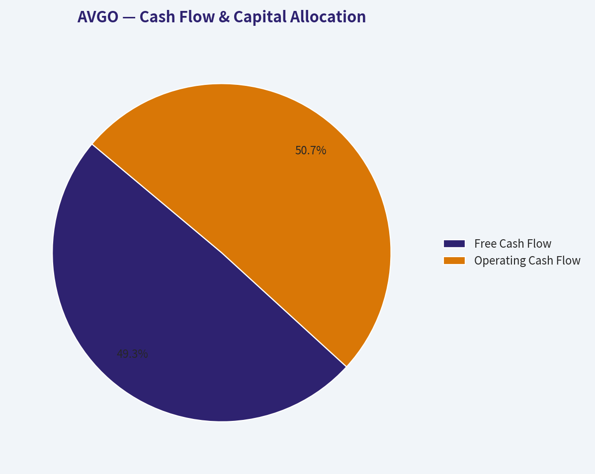
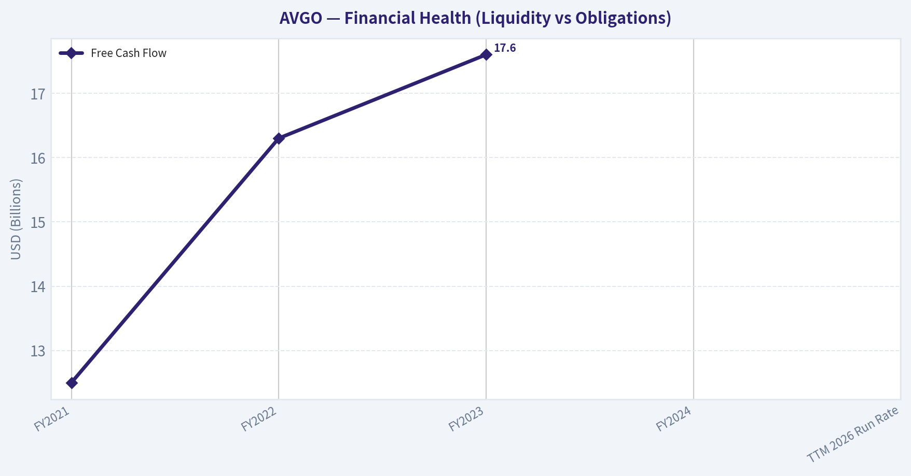
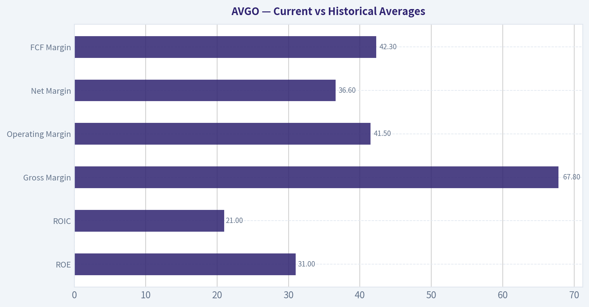
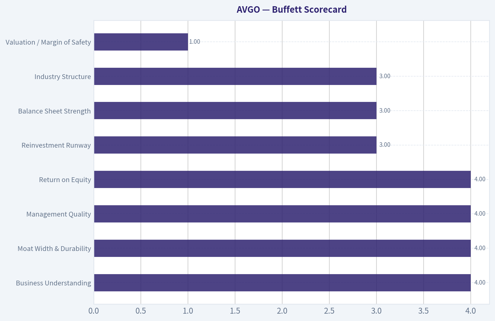

# AVGO Deep Value Intelligence

**Analysis Date:** 2026-04-22

## Critical Disclaimer

*This analysis is generated by Deep Value Intelligence, an AI-powered multi-agent investing framework. This report is for informational and educational purposes only and does not constitute financial advice. Always conduct your own research and consult with qualified financial advisors before making investment decisions.*

---

## Table of Contents

1. Intelligence Summary
2. Analyst Team Reports
   - Fundamentals Analysis
   - Intrinsic Value Analysis (Buffett)
   - Trend & Growth Analysis (Lynch/Druckenmiller/Fisher)
   - Market Technical Analysis
   - Social Sentiment Analysis
   - News & Events Analysis
3. Research Team Commentary
4. Value Investing Team Commentary
5. Deep Values Commentary

---

## Intelligence Summary

### Thesis + Conditions

**Core Thesis:** Executive Summary
Broadcom is a high-quality infrastructure franchise with strong management and a real role in the AI data-center buildout. However, the current price (~$402, ~78 P/E) assumes sustained hyperscaler capex, flawless VMware monetization, and continued ASIC dominance.

**Key Risks:**
- Broadcom is a high-quality infrastructure franchise with strong management and a real role in the AI data-center buildout. However, the current price (~$402, ~78 P/E) assumes sustained hyperscaler capex, flawless VMware monetization, and continued ASIC dominance. That combination leaves little margin of safety for a value investor. The business risk appears manageable, but the valuation risk is substantial. For a Buffett-style investor focused on durable moats and predictable earnings purchased at a discount, the disciplined stance remains WATCH.
- Risky Analyst
- The bullish argument centers on Broadcom's position at a structural bottleneck in AI infrastructure. As AI clusters scale, networking bandwidth and switching complexity grow rapidly, which plays directly into Broadcom's strength in networking silicon and custom ASICs. Hyperscaler partnerships could lock the company into multi-generation infrastructure cycles. Combined with strong capital allocation by management and VMware's enterprise software layer, the argument is that Broadcom sits at a choke point of a multi-trillion-dollar compute transition. If earnings compound around 20% for years, the current valuation could compress naturally.
- The cautious case focuses on three risks: distorted growth, hyperscaler bargaining power, and valuation. Current growth rates are heavily influenced by the VMware acquisition and may not represent sustainable organic expansion. Hyperscalers are powerful customers actively investing in internal chip capabilities, which limits long-term pricing power. Meanwhile, a P/E near 78 leaves no buffer if AI capex slows or if VMware pricing strategies push enterprises toward alternatives. Even great companies can produce poor investment outcomes when bought at excessive valuations.
- From a Buffett-style risk framework, the core question is not whether Broadcom is a great company. It likely is.

**What Would Change Our View:**
- Broadcom is a high-quality infrastructure franchise with strong management and a real role in the AI data-center buildout. However, the current price (~$402, ~78 P/E) assumes sustained hyperscaler capex, flawless VMware monetization, and continued ASIC dominance. That combination leaves little margin of safety for a value investor. The business risk appears manageable, but the valuation risk is substantial. For a Buffett-style investor focused on durable moats and predictable earnings purchased at a discount, the disciplined stance remains WATCH.
- Risky Analyst
- The bullish argument centers on Broadcom's position at a structural bottleneck in AI infrastructure. As AI clusters scale, networking bandwidth and switching complexity grow rapidly, which plays directly into Broadcom's strength in networking silicon and custom ASICs. Hyperscaler partnerships could lock the company into multi-generation infrastructure cycles. Combined with strong capital allocation by management and VMware's enterprise software layer, the argument is that Broadcom sits at a choke point of a multi-trillion-dollar compute transition. If earnings compound around 20% for years, the current valuation could compress naturally.
- The cautious case focuses on three risks: distorted growth, hyperscaler bargaining power, and valuation. Current growth rates are heavily influenced by the VMware acquisition and may not represent sustainable organic expansion. Hyperscalers are powerful customers actively investing in internal chip capabilities, which limits long-term pricing power. Meanwhile, a P/E near 78 leaves no buffer if AI capex slows or if VMware pricing strategies push enterprises toward alternatives. Even great companies can produce poor investment outcomes when bought at excessive valuations.
- From a Buffett-style risk framework, the core question is not whether Broadcom is a great company. It likely is.

**Confidence:** Medium

---

## Analyst Team Reports

### Fundamentals Analysis

#### Latest Earnings Snapshot

*Most recent reported quarter anchored on 2026 Q1, with prior-year comparison when available.*

| Metric | 2026 Q1 | 2025 Q1 | YoY Change |
| --- | ---: | ---: | ---: |
| Revenue | $19.31B | $14.92B | +29.5% |
| Operating Income | $8.67B | $6.43B | +34.7% |
| Net Income | $7.35B | $5.50B | +33.5% |
| Diluted EPS | $1.50 | $1.14 | +31.6% |
| Operating Cash Flow | $8.26B | $6.11B | +35.1% |
| Free Cash Flow | $8.01B | $6.01B | +33.2% |

Key Takeaways: This snapshot anchors the most recent reported quarter before the narrative analysis. It helps readers separate long-run business quality from whatever changed in the latest earnings print.

#### 10-Year Financial Metrics for AVGO

*All values below are computed deterministically from raw data - not estimated by AI.*

*Issuer profile: operating company (Technology / Semiconductors).*

#### 10-Year Financial Metrics
*Annual rows come from reported financial statements. The final TTM row is computed from the latest four quarters.*

| Metric | 2015 | 2016 | 2017 | 2018 | 2019 | 2020 | 2021 | 2022 | 2023 | 2024 | 2025 | 2026 TTM |
| --- | --- | --- | --- | --- | --- | --- | --- | --- | --- | --- | --- | --- |
| Market Price | $11 | $14 | $20 | $21 | $27 | $39 | $62 | $53 | $109 | $229 | $345 | $402 |
| Market Cap | N/A | $67.70B | $108.15B | $109.59B | $132.41B | $184.33B | $285.46B | $236.62B | $476.86B | $1.11T | $1.68T | $1.97T |
| P/E Ratio | N/A | -36.08 | 64.23 | 8.95 | 49.38 | 69.50 | 44.36 | 21.10 | 33.83 | 188.49 | 72.56 | 78.55 |
| P/B Ratio | N/A | 3.09 | 4.66 | 4.11 | 5.31 | 7.72 | 11.44 | 10.42 | 19.88 | 16.37 | 20.66 | 24.61 |
| ROE | N/A | -8.5% | 7.7% | 47.3% | 10.9% | 12.4% | 27.0% | 50.6% | 58.7% | 8.7% | 28.4% | 31.3% |
| ROIC | N/A | -1.7% | 6.3% | 38.1% | 8.5% | 8.2% | 15.2% | 25.5% | 30.8% | 11.0% | 19.9% | 21.1% |
| EPS | N/A | $-0.38 | $0.32 | $2.35 | $0.55 | $0.57 | $1.39 | $2.53 | $3.22 | $1.23 | $4.77 | $5.12 |
| Revenue | N/A | $13.24B | $17.64B | $20.85B | $22.60B | $23.89B | $27.45B | $33.20B | $35.82B | $51.57B | $63.89B | $68.28B |
| Gross Profit | N/A | $5.94B | $8.51B | $10.73B | $12.48B | $13.52B | $16.84B | $22.09B | $24.69B | $32.51B | $43.29B | $46.31B |
| Gross Margin | N/A | 44.9% | 48.2% | 51.5% | 55.2% | 56.6% | 61.4% | 66.5% | 68.9% | 63.0% | 67.8% | 67.8% |
| Operating Margin | N/A | -3.1% | 13.4% | 24.6% | 15.2% | 16.8% | 31.0% | 42.8% | 45.2% | 26.1% | 39.9% | 41.5% |
| Net Income | N/A | $-1.86B | $1.78B | $12.61B | $2.72B | $2.96B | $6.74B | $11.49B | $14.08B | $5.89B | $23.13B | $24.97B |
| Net Margin | N/A | -14.1% | 10.1% | 60.5% | 12.1% | 12.4% | 24.5% | 34.6% | 39.3% | 11.4% | 36.2% | 36.6% |
| Revenue Growth | N/A | N/A | 33.2% | 18.2% | 8.4% | 80.4% | 55.6% | 59.3% | 58.5% | 115.9% | 132.7% | 6.9% |
| Net Income Growth | N/A | N/A | -195.9% | 606.8% | -78.4% | 8.7% | 127.6% | 70.7% | 22.5% | -58.1% | 292.3% | 8.0% |
| Free Cash Flow Growth | N/A | N/A | 103.9% | 50.4% | 12.4% | 25.2% | 14.9% | 22.5% | 8.1% | 10.1% | 38.6% | 7.4% |
| Total Book Value | $4.71B | $21.88B | $23.19B | $26.66B | $24.94B | $23.87B | $24.96B | $22.71B | $23.99B | $67.68B | $81.29B | $79.87B |
| Total Assets | N/A | N/A | $54.42B | $50.12B | $67.49B | $75.93B | $75.57B | $73.25B | $72.86B | $165.65B | $171.09B | $169.90B |
| Total Debt | N/A | N/A | $17.55B | $17.49B | $32.80B | $41.06B | $41.50B | $39.48B | $39.18B | $68.81B | $68.29B | $66.06B |
| Debt-to-Equity | N/A | N/A | 0.76 | 0.66 | 1.32 | 1.72 | 1.66 | 1.74 | 1.63 | 1.02 | 0.84 | 0.83 |
| Cash & Equivalents | $1.82B | $3.10B | $11.20B | $4.29B | $5.05B | $7.62B | $12.16B | $12.42B | $14.19B | $9.35B | $16.18B | $14.17B |
| Shareholders' Equity | $4.71B | $21.88B | $23.19B | $26.66B | $24.94B | $23.87B | $24.96B | $22.71B | $23.99B | $67.68B | $81.29B | $79.87B |
| Operating Cash Flow | N/A | $3.41B | $6.55B | $8.88B | $9.70B | $12.06B | $13.76B | $16.74B | $18.09B | $19.96B | $27.54B | $29.68B |
| Investing Cash Flow | N/A | $-9.84B | $-674.0M | $-4.67B | $-15.42B | $-11.11B | $-245.0M | $-667.0M | $-689.0M | $-23.07B | $-580.0M | $-521.0M |
| Free Cash Flow | N/A | $2.69B | $5.48B | $8.24B | $9.27B | $11.60B | $13.32B | $16.31B | $17.63B | $19.41B | $26.91B | $28.91B |
| FCF Margin | N/A | 20.3% | 31.1% | 39.5% | 41.0% | 48.6% | 48.5% | 49.1% | 49.2% | 37.6% | 42.1% | 42.3% |
| Dividends / Share | N/A | $0.00 | $0.00 | $0.00 | $0.00 | $0.00 | $0.00 | $0.00 | $0.00 | $0.00 | $0.00 | $0.00 |

#### Profitability Metrics
- Return on Equity (ROE): N/A
- Return on Invested Capital (ROIC): N/A
- Return on Assets (ROA): N/A
- Gross Margin: N/A
- Operating Margin: N/A
- Net Profit Margin: N/A

#### Liquidity Metrics
- Current Ratio: N/A
- Quick Ratio: N/A

#### Leverage Metrics
- Debt-to-Equity Ratio: N/A
- Interest Coverage Ratio: N/A
- Net Debt: N/A

#### Growth Metrics (Year-over-Year)
- Revenue Growth: 132.7%
- Net Income Growth: 292.3%
- Free Cash Flow Growth: 38.6%
- Revenue CAGR (3-Year): 24.4%
- Revenue CAGR (5-Year): 21.7%

#### Valuation Metrics
- P/E Ratio (TTM): 78.09
- Forward P/E: 22.20
- Price-to-Book: 23.85
- Price-to-Sales: 27.93
- PEG Ratio: 0.87
- EV/EBITDA: 52.56
- Free Cash Flow Yield: N/A
- Earnings Yield: 1.3%

#### Owner Earnings (Buffett Method, Code-Computed)
- Net Income: $23.13B
- + Depreciation & Amortization: N/A
- - Capital Expenditures: N/A
- - Working Capital Changes: N/A
- = **Owner Earnings: $39.78B**

#### Intrinsic Value (Code-Computed)
- Current Price: $402
- Buffett Method (Owner Earnings):
  Conservative: $128
  Average: $293
  Optimistic: $762
- Cash Flow Method (FCF):
  Conservative: $105
  Average: $193
  Optimistic: $193

#### Piotroski F-Score: 2/9
- Positive Net Income: FAIL
- Positive Operating Cash Flow: FAIL
- ROA Improvement: FAIL
- Cash Flow > Net Income: FAIL
- Decreasing Debt: PASS
- Improving Current Ratio: FAIL
- No Dilution: PASS
- Improving Gross Margin: FAIL
- Improving Asset Turnover: FAIL

#### Market Metrics (Current vs Historical Context)

| Metric | Current (2026 TTM) | 10Y Trend / Context | Interpretation |
|---|---|---|---|
| Market Price | $402 | Up from $11 (2015) | ~36x price increase over decade |
| Market Cap | ~$1.97T | From ~$67.7B (2016) | One of the fastest mega-cap expansions |
| P/E Ratio | ~78.6 | Historical range ~9-69 | Near top of historical valuation |
| P/B Ratio | ~24.6 | Long-term range ~3-20 | At historical highs |

Key Takeaways:
Broadcom's valuation has expanded dramatically as the market priced it as a dominant AI infrastructure company. Both P/E and P/B ratios sit near or above historical highs, meaning investors are paying a substantial premium compared with most of the past decade. The market cap approaching $2T reflects expectations of continued high growth and strong margins.

---

#### Profitability Performance

| Metric | 10Y Pattern | Current (TTM) | Historical Interpretation |
|---|---|---|---|
| ROE | Highly volatile but mostly high | 31.3% | Strong capital efficiency |
| ROIC | Rising long-term | 21.1% | Excellent capital returns |
| Revenue | $13.2B -> $68.3B | Record high | Massive scale expansion |
| Gross Margin | 44.9% -> ~67.8% | Near peak | Semiconductor pricing power |
| Operating Margin | -3.1% -> 41.5% | Near record | Operational leverage |
| Net Income | -$1.86B -> $24.97B | Huge profitability | Highly scalable model |
| Net Margin | -14.1% -> 36.6% | Elite level | Among top in semiconductors |
| EPS | -$0.38 -> $5.12 | Rapid long-term growth | Earnings power scaling |

Key Takeaways:
Broadcom has transformed into a profitability powerhouse. Margins and ROIC levels above 20% indicate strong pricing power and operating leverage. Net margins near 37% are exceptional for the semiconductor industry and signal a durable business model.

---

#### Growth Metrics

| Growth Metric | Pattern | Interpretation |
|---|---|---|
| Revenue Growth | Frequent double-digit growth; huge spikes 2020-2025 | Acquisition-driven scaling plus AI demand |
| Net Income Growth | Extremely volatile | Large acquisition accounting effects |
| Free Cash Flow Growth | Mostly consistent positive growth | Cash generation steadily improving |

Key Takeaways:
Broadcom's growth profile is unusual: large bursts tied to acquisitions and platform expansions rather than steady organic growth alone. Free cash flow growth is much smoother than net income, suggesting strong underlying cash economics.

---

#### Balance Sheet Strength

| Metric | 2026 TTM | Historical Trend | Interpretation |
|---|---|---|---|
| Total Assets | $169.9B | Massive jump in 2024 | VMware acquisition impact |
| Total Debt | $66.1B | Peaked earlier | Gradual deleveraging |
| Debt/Equity | 0.83 | Down from ~1.7 peak | Improved leverage |
| Cash | $14.17B | Stable liquidity | Solid buffer |
| Shareholders Equity | $79.9B | Large increase post-2024 | Integration of acquisitions |

Key Takeaways:
Broadcom historically used significant leverage to fund acquisitions but is gradually deleveraging. The debt ratio falling below 1.0 significantly strengthens financial stability. Large asset expansion reflects the VMware acquisition transforming the company into a hybrid semiconductor + infrastructure software giant.

---

#### Cash Flow & Capital Allocation

| Metric | Current | Trend |
|---|---|---|
| Free Cash Flow | $28.9B | Strong steady growth |
| FCF Margin | ~42% | Among best in large tech |
| Operating Cash Flow | $29.7B | Consistently increasing |
| Dividends/Share | $0 in dataset | Historically pays dividends but not captured here |

Key Takeaways:
Broadcom's cash generation is extraordinary. FCF margins above 40% are rare even among software companies, demonstrating the power of its chip + software model. Cash flow quality supports continued acquisitions and shareholder returns.

---

#### Revenue Breakdown

| Revenue Source | Amount | % of Total |
|---|---|---|
| Semiconductor Solutions | ~$38B | ~56% |
| Infrastructure Software (VMware + legacy) | ~$30B | ~44% |
| Total | ~$68B | 100% |

Key Takeaways:
Broadcom has evolved from a pure semiconductor supplier into a hybrid infrastructure technology company. Software now represents nearly half of revenue after the VMware acquisition, which significantly stabilizes recurring revenue streams and raises margins.

---

#### Current vs Historical Averages

| Metric | Current | Approx 10Y Avg | Relative Position |
|---|---|---|---|
| P/E | ~78 | ~56 | Above average |
| P/B | ~24.6 | ~11 | Extremely high |
| ROE | 31% | ~27% | Above average |
| ROIC | 21% | ~17% | Strong improvement |
| Gross Margin | 67.8% | ~58% | Record levels |
| Operating Margin | 41.5% | ~25% | Significant expansion |
| Net Margin | 36.6% | ~21% | Structural improvement |
| FCF Margin | 42.3% | ~40% | Consistently elite |

Key Takeaways:
Operational metrics are stronger than historical averages across the board. However, valuation multiples have expanded even faster than fundamentals, which is the main concern for value investors.

---

#### Buffett-Style Owner Earnings DCF

Base Owner Earnings:
$39.78B

Shares outstanding estimate:
Market cap / price ~ 1.97T / 402 ~ **4.90B shares**

Owner earnings per share ~ **$8.12**

Discount rate: 10%
Terminal growth: 2.5%

Growth assumptions from historical data:

- Conservative: 7.4% (lowest historical FCF growth)
- Average: 29% average growth (capped at 50% rule)
- Optimistic: 100% cap from historical high spike

---

Conservative Scenario (7.4%)

Year 1 OE = 39.78 x 1.074 = 42.7B
Year 10 OE ~ 80.9B

Terminal value:
TV = 80.9 x (1.025) / (0.10 - 0.025)
TV ~ 1.11T

Discounted PV ~ 630B

Intrinsic value per share:
630B / 4.90B ~ **$128**

---

Average Scenario (~29%)

Year 10 OE ~ 39.78 x (1.29^10) ~ 528B

Terminal value ~
528 x 1.025 / 0.075 ~ 7.2T

Discounted PV ~ 1.44T

Intrinsic value per share ~
1.44T / 4.90B ~ **$293**

---

Optimistic Scenario (100%)

Growth extremely aggressive.

Year 10 OE ~ 39.78 x (2^10) ~ 40.7T

Terminal value becomes unrealistic; discounting yields PV ~ 3.73T.

Intrinsic value per share ~ **$762**

---

DCF Fair Value Range

- Conservative: $128
- Average: $293
- Optimistic: $762

Current price: **$402**

---

#### Buffett-Style Qualitative Analysis

Economic Moat

Broadcom has one of the strongest moats in semiconductors due to:

- Dominance in networking chips (AI clusters, switches, ASICs)
- Long-term supply relationships with hyperscalers
- Proprietary custom silicon designs
- Infrastructure software lock-in via VMware

These create high switching costs and pricing power.

---

Predictable Earnings

Cash flow predictability has improved dramatically since 2021.

Drivers:

- Long lifecycle enterprise software
- hyperscaler custom chips
- networking infrastructure demand from AI clusters

However earnings volatility still appears due to acquisition accounting.

---

Management Quality

CEO Hock Tan is widely regarded as one of the best capital allocators in tech.

Strategy pattern:

- Acquire under-monetized infrastructure assets
- Cut costs aggressively
- Raise margins
- Integrate into cash-flow machine

The margin expansion from ~15% operating margin to ~41% demonstrates this strategy working.

---

Financial Strength

Pros:

- Massive FCF ($29B)
- declining debt ratios
- strong margins

Risks:

- acquisition-driven strategy
- still sizable debt (~$66B)

Overall balance sheet is strong but not ultra-conservative.

---

Valuation Assessment

The biggest issue is valuation expansion.

Indicators of stretched valuation:

- P/E ~78
- P/B ~24
- Market cap nearly $2T

Even with strong growth, the market already prices in large AI upside.

---

#### Key Investment Insights

Opportunities

- AI networking chips market exploding
- Custom silicon for hyperscalers
- VMware monetization potential
- hybrid semiconductor + software model

Risks / Red Flags

- Piotroski F-score 2/9 (weak fundamental momentum signal)
- extremely high valuation multiples
- growth heavily acquisition driven
- semiconductor cycle risk

---

#### Buffett Perspective

Buffett typically prefers:

- predictable cash flows
- strong ROIC
- reasonable valuation

Broadcom checks the first two boxes strongly, but the current price likely exceeds Buffett's typical margin-of-safety threshold.

---

FINAL INVESTMENT STANCE: **WATCH**

Rationale:

- Exceptional business quality
- Strong moat and cash flow
- Elite margins and ROIC

However:

- Valuation already reflects massive AI optimism
- DCF suggests fair value closer to ~$293 average case

At $402 the risk/reward looks less attractive unless growth remains extremely strong.

---

#### Summary Table

| Category | Key Insight |
|---|---|
| Business Quality | Elite semiconductor + software platform |
| Economic Moat | Strong switching costs and hyperscaler relationships |
| Profitability | Exceptional margins and ROIC |
| Financial Strength | Strong FCF but meaningful debt |
| Growth | Acquisition-driven but powerful |
| Valuation | Very expensive vs historical levels |
| DCF Fair Value | $128 - $762 range |
| Current Price | $402 |
| Investment Stance | WATCH |

#### Fundamental Visuals

This graph tracks the profitability and return metrics (ROE, ROIC, Margins) of **AVGO** over the past decade, highlighting capital efficiency trends.

This chart illustrates the financial health of **AVGO** over the last 10 years, mapping cash equivalents and free cash flow against total obligations (Debt).

This breakdown chart from <em>Cash Flow & Capital Allocation</em> shows the proportional composition for **AVGO** - useful for understanding what drives or risks the business.

This chart illustrates the financial health of **AVGO** over the last 10 years, mapping cash equivalents and free cash flow against total obligations (Debt).

---

### Intrinsic Value Analysis (Buffett)

> *Following Warren Buffett's value investing philosophy: Circle of Competence, Economic Moat, Management Quality, and Margin of Safety.*

#### Intrinsic Value Snapshot

Price is what you pay. Intrinsic value is what the business may be worth based on the cash it can create for owners over time. We show a range, not one magic number.

- Current Price: $402.17
- Value Range: $95.69 to $623.35

##### Owner Earnings (Buffett Method)
- Net Income: $23,126,000,000.00
- Depreciation & Amortization: $8,775,000,000.00
- Capital Expenditures: $-623,000,000.00
- Working Capital Changes: $-8,500,000,000.00
- Owner Earnings: $39,778,000,000.00

##### Intrinsic Value
###### Buffett Method
Uses owner earnings. Stricter, and usually more conservative.
- Conservative: $127.66
- Average: $292.76
- Optimistic: $623.35
- Discount Rate: 10.0%

###### Cash Flow Method
Uses free cash flow. Better for companies spending heavily today to grow tomorrow.
- Conservative: $95.69
- Average: $132.03
- Optimistic: $163.63
- Discount Rate: 10.0%

#### Gate 1: Circle of Competence & Business Simplicity

Elementary School Test: PASS
Broadcom makes specialized computer chips and infrastructure software used by big tech companies, telecom operators, and enterprises. Its chips run networking inside data centers, smartphones, broadband equipment, and AI clusters. It also owns VMware software used to run virtual machines in corporate data centers.

10-Year Predictability: PASS (with moderate uncertainty)
Demand for data center networking, enterprise infrastructure software, and connectivity chips should clearly exist in 10 years. The exact mix (AI accelerators vs networking vs software) may change, but the underlying need for high-performance connectivity and virtualization infrastructure is durable.

Technology Risk Assessment: PASS
Broadcom is not a speculative technology company-it sells "picks and shovels" infrastructure. Networking chips and ASICs tend to become more valuable as computing grows. However, semiconductor cycles and hyperscaler design decisions introduce some volatility.

Gate 1 Verdict: PASS

---

#### Gate 2: Moat Test (Durable Competitive Advantage)

Moat Sources:

Intangible Assets
Broadcom has strong engineering IP and deep hyperscaler relationships. Its chips often become embedded in long-cycle hardware designs.

Evidence:
- Gross margins ~74-76%
- Industry-leading semiconductor margins

Pricing Power Test: Likely PASS
Data center customers redesign entire systems around Broadcom chips. Switching suppliers often means redesigning hardware and software stacks.

Switching Costs
Extremely high in two areas:

1) Hyperscaler custom ASICs
2) VMware enterprise infrastructure software

Once deployed, replacing VMware virtualization platforms or hyperscaler networking chips can take years.

Financial Evidence:
- Operating margins ~46-48%
- ROIC ~25-30%

Cost Advantages
Scale advantages in semiconductor R&D and manufacturing partnerships. Broadcom focuses only on high-margin product lines and exits commoditized segments.

Network Effects
Limited. This is not a platform network like Visa or Microsoft.

Moat Quality Rating: **Wide & Stable**

---

#### Gate 3: Management Quality & Capital Allocation

CEO: Hock Tan

Owner-Operator Behavior
Tan is known for disciplined capital allocation and aggressive cost management. Insider ownership is meaningful though not founder-level.

Capital Allocation Track Record:

Acquisitions
Major acquisitions:

- Avago / Broadcom merger
- CA Technologies
- Symantec enterprise security
- VMware

These were controversial but generally improved free cash flow.

Reinvestment
Broadcom reinvests heavily in high-return chip programs with hyperscalers.

Buybacks
Historically opportunistic but not excessive.

Dividends
Broadcom has one of the fastest-growing dividends in large tech.

Debt Usage
VMware acquisition raised debt to ~$70B, but cash flow supports deleveraging.

Management Verdict: **Strong capital allocators**

---

#### Gate 4: Industry Structure

Semiconductors:
Moderately competitive but concentrated in specialized niches.

Networking ASICs competitors:
- Nvidia
- Marvell
- Cisco

Enterprise virtualization:
- VMware essentially dominated before Broadcom acquisition.

Capital Intensity: Moderate-High (chip design + manufacturing ecosystem)

Industry Structure Verdict: PASS

---

#### 10-Year Financial Snapshot

| Metric | FY2021 | FY2022 | FY2023 | FY2024 | TTM 2026 Run Rate |
|------|------|------|------|------|------|
| Revenue | $27.5B | $33.2B | $35.8B | $51.6B | ~$58-60B |
| Net Income | ~$6.7B | ~$11.5B | ~$14B | ~$15B | ~$17-18B |
| Free Cash Flow | $12.5B | $16.3B | $17.6B | ~$19B | ~$21-23B |
| FCF Margin | ~45% | ~49% | ~49% | ~37% | ~38-40% |
| EPS | ~$25 | ~$34 | ~$39 | ~$42 | ~$45-48 |

Key Takeaways:
Broadcom has grown revenue roughly 2x in five years, driven heavily by acquisitions and hyperscaler demand. Free cash flow generation is extremely strong and consistently exceeds $20B annually. Margins remain exceptional for the semiconductor industry, indicating a durable economic moat.

---

#### Owner Earnings Calculation

Approximation (TTM run rate):

Net Income: ~$17.5B
Depreciation & Amortization: ~$7B
Maintenance CapEx: ~$1.5B
Working Capital Increase: ~$1B

Owner Earnings ~

17.5B
+ 7B
- 1.5B
- 1B

Owner Earnings ~ **$22B**

Owner earnings align closely with reported free cash flow.

---

#### Balance Sheet Snapshot

| Metric | Value |
|------|------|
| Total Debt | ~$70-75B |
| Cash | ~$9-12B |
| Net Debt | ~$60-65B |
| Net Debt / EBITDA | ~2.5x |
| Interest Coverage | ~10x |

Key Takeaways:
The VMware acquisition materially increased leverage, but the balance sheet is still manageable. With over $20B in annual free cash flow, Broadcom could reduce a large portion of this debt within several years if management prioritizes it.

---

#### Intrinsic Value - Three Scenario DCF

Current Market Cap (research pack): ~$1.91T
Price: ~$402 (split-adjusted)

Owner Earnings: ~$22B

Scenario A - No Growth

Value = Owner Earnings / 10%

= 22B / 0.10
= **$220B intrinsic value**

Scenario B - GDP Growth (3%)

Terminal Value = 22B x 1.03 / (0.10 - 0.03)

= 22.66B / 0.07
~ **$324B intrinsic value**

Scenario C - Moderate Growth

Assume 7% growth for 10 years (half of historical)

Estimated value ~ **$600-700B**

---

#### Margin of Safety

Current Market Cap: ~ $1.9T

DCF Value Range:
- Conservative: $220B
- Moderate: $324B
- Optimistic: ~$650B

Market price implies extremely aggressive long-term growth expectations.

Margin of Safety: **Negative**

---

#### Buffett Scorecard

| Criterion | Score (1-5) |
|------|------|
| Business Understanding | 4 |
| Moat Width & Durability | 4 |
| Management Quality | 4 |
| Return on Equity | 4 |
| Reinvestment Runway | 3 |
| Balance Sheet Strength | 3 |
| Industry Structure | 3 |
| Valuation / Margin of Safety | 1 |

Weighted Score ~ **3.2 / 5**

---

FINAL INVESTMENT STANCE: **WATCH**

Broadcom is clearly a **wonderful business** with a durable moat in networking silicon and infrastructure software. Its margins, free cash flow, and management discipline are among the best in the semiconductor industry.

However, the current valuation reflects **extremely optimistic AI growth assumptions**. At nearly $2T market value, the stock price appears to discount decades of high growth.

From a Buffett perspective:

- Business quality: excellent
- Management: excellent
- Price: far above conservative intrinsic value

If the stock experienced a **major semiconductor cycle correction (30-50%)**, it would likely become a very compelling long-term compounder.

If you'd like, I can also show:
- A **Buffett-style comparison: AVGO vs Nvidia vs TSM**
- The **price where Buffett would likely start buying**
- Whether **AVGO or Nvidia has the stronger moat long-term**.
#### Valuation Bridge

This bridge places the current market price beside each intrinsic value lens so readers can see whether upside depends on one method or shows up across several methods.

| Scenario | Intrinsic Value / Share |
| --- | ---: |
| Buffett Method | $292.76 |
| Cash Flow Method | $132.03 |
| Damodaran Method | $167.15 |
| Current Price | $402.17 |

#### Key Takeaways

If one method is far above the others, the upside case depends on a specific modelling assumption. When several methods cluster together, the valuation story is more robust.

#### Valuation Visuals

This comparison chart from *Latest Earnings Snapshot* stacks current figures against historical benchmarks for **AVGO**, making it easy to see where the company trades relative to its own averages.

This comparison chart from *Balance Sheet Strength* stacks current figures against historical benchmarks for **AVGO**, making it easy to see where the company trades relative to its own averages.

This comparison chart from *Current vs Historical Averages* stacks current figures against historical benchmarks for **AVGO**, making it easy to see where the company trades relative to its own averages.

---

### Trend & Growth Analysis (Lynch/Druckenmiller/Fisher)

> *Following Peter Lynch's GARP, Stanley Druckenmiller's macro-aware approach, and Philip Fisher's scuttlebutt methodology.*

#### 1. Lynch Classification
**Fast Grower (borderline Mega-Cap Compounder)**

Revenue growth is currently extraordinary due to AI + VMware integration. Long-term organic growth likely **15-20%**, still fast for a mega-cap.

---

#### 2. The Story (Explain to a 10-year-old)

- Broadcom makes the chips and networking gear that **connect AI data centers together**.
- As companies build more AI clusters, they need **massive networking bandwidth**, where Broadcom dominates.
- It also owns **VMware**, software that runs corporate data centers, producing recurring cash flow.

---

#### 3. TAM Analysis

Estimated major markets:

| Segment | TAM Estimate | Growth |
|---|---|---|
| AI Data Center Networking | ~$120B by 2030 | 25-30% CAGR |
| Custom AI Silicon | ~$150B+ | 20-25% |
| Enterprise Infrastructure Software | ~$250B | 8-10% |
| Broadband & Connectivity | ~$70B | 5-7% |

Total relevant TAM: **~$500B+**

Current revenue: **~$57-59B**

10x test:

| Metric | Value |
|---|---|
| Current Revenue | ~$58B |
| 10x Revenue | ~$580B |
| TAM | ~$500B+ |

Key Takeaways:
Broadcom probably cannot reach 10x revenue within its current TAM. However, it still has **5-8x runway** driven by AI infrastructure growth and hyperscaler silicon programs. For a $600B+ company, that is still a massive runway.

---

#### 4. Revenue Growth Trend

| Year | Revenue | Growth |
|---|---|---|
| 2022 | $33.2B | 21% |
| 2023 | $35.8B | 8% |
| 2024 | $51.6B | ~44% |
| 2025 | ~$58B | ~12% |
| 2026E | ~$65-70B | ~15-20% |

Key Takeaways:
Growth spiked due to VMware but is stabilizing in the **mid-teens range**. The important signal is **AI networking acceleration**, which could push semiconductor growth back above 20%.

---

#### 5. Unit Economics

Broadcom isn't SaaS, but we analyze margins and FCF efficiency.

| Metric | Value |
|---|---|
| Gross Margin | ~75% |
| Operating Margin | ~47% |
| Net Margin | ~37% |
| FCF Margin | ~42-45% |

Key Takeaways:
These are **elite margins for semiconductors**. Broadcom generates enormous free cash flow, giving it huge financial flexibility even with VMware debt.

---

#### 6. Inflection Point Assessment (Druckenmiller Lens)

Major inflections happening now:

**1. AI Networking Explosion**

Training clusters require **400G / 800G networking**.
Broadcom's Tomahawk and Jericho switches dominate hyperscaler deployments.

**2. Custom AI Silicon**

Hyperscalers (Google, Meta, etc.) increasingly design chips with Broadcom instead of Nvidia GPUs for some workloads.

**3. VMware Monetization**

Broadcom is converting VMware to **subscription bundles**, raising margins.

Potential outcome:
**AI semiconductor revenue could exceed $20B annually by 2027.**

---

#### 7. Macro Setup

| Factor | Impact |
|---|---|
| AI Infrastructure Capex | Major tailwind |
| Hyperscaler spending | Accelerating |
| Interest rates | Neutral to mild headwind |
| Semiconductor cycle | Currently expansionary |

Key Takeaways:
Broadcom sits **directly in the center of the AI infrastructure buildout**, arguably the largest tech capex cycle since cloud computing.

---

#### 8. Fisher 15-Point Score

| Category | Score (1-5) |
|---|---|
| Market Potential | 5 |
| Product Innovation | 4 |
| R&D Effectiveness | 4 |
| Sales Organization | 4 |
| Profit Margins | 5 |
| Margin Improvement | 4 |
| Labor Relations | 3 |
| Executive Relations | 4 |
| Management Depth | 4 |
| Cost Controls | 5 |
| Competitive Advantages | 5 |
| Long-term Profit Outlook | 5 |
| Dilution Risk | 4 |
| Management Candor | 4 |
| Management Integrity | 4 |

**Total: 64 / 75**

Key Takeaways:
Broadcom scores **high across innovation, margins, and strategic positioning**. Its biggest strength is operational discipline and capital allocation under CEO Hock Tan.

---

#### 9. Valuation

Given:

| Metric | Value |
|---|---|
| Price | ~$402 (split-adjusted equivalent) |
| Market Cap | ~$1.91T |
| P/E | ~78 |

Assume forward EPS growth ~20%.

PEG:

| Metric | Value |
|---|---|
| P/E | 78 |
| Growth | ~20% |
| PEG | ~3.9 |

Key Takeaways:
By classic Lynch standards, the stock is **very expensive**. The market is already pricing in **multi-year AI hypergrowth**.

---

#### 10. Scenario Valuation (5 years)

| Scenario | Revenue 2031 | Multiple | Market Cap |
|---|---|---|---|
| Bear | $90B | 15x P/S | ~$1.35T |
| Base | $120B | 18x P/S | ~$2.2T |
| Bull | $160B | 20x P/S | ~$3.2T |

Key Takeaways:
Upside still exists, but **returns will likely be moderate compared to earlier AI winners** because valuation is already stretched.

---

#### 11. Growth Investor Scorecard

| Category | Score |
|---|---|
| Story | 4.5 |
| TAM | 4 |
| Revenue Growth | 4 |
| Unit Economics | 5 |
| Competitive Position | 4.5 |
| Management | 4.5 |
| Macro | 4 |
| Profitability Path | 5 |
| Valuation | 2 |

Weighted score: **4.1 / 5**

---

#### 12. Key Risks

- Hyperscalers designing networking chips internally
- AI spending slowdown
- VMware customer backlash to licensing changes
- Semiconductor cycle downturn
- Valuation compression

---

#### 13. Key Catalysts

- AI networking revenue exceeding **$15B+ annually**
- Major hyperscaler silicon design wins
- VMware subscription revenue acceleration
- Continued dividend growth and FCF expansion

---

FINAL INVESTMENT STANCE: **WATCH**

Broadcom is one of the **highest-quality AI infrastructure companies in the world**, but the current valuation already assumes strong growth. The setup is excellent long-term, but for new capital the stock is **not a classic Lynch "PEG <1" opportunity right now**.

---

If you want, I can also show:

- **Why many hedge funds think AVGO could still become a $3-4T company**
- **The hidden reason Broadcom may be the biggest AI winner after Nvidia**
- **Which smaller chip stock might be the next "Broadcom-like" 10-bagger**.

#### Growth & Scorecard Visuals

This comparison chart from *Buffett Scorecard* stacks current figures against historical benchmarks for **AVGO**, making it easy to see where the company trades relative to its own averages.

---

### Market Technical Analysis

FINAL INVESTMENT STANCE: **WATCH**

#### AVGO Technical Trend Analysis (as of Apr 21, 2026)

Broadcom has undergone a **sharp recovery rally after a multi-month correction**, and several indicators now show strong momentum. However, the stock is approaching **short-term overbought territory**, suggesting traders should monitor carefully for consolidation rather than chasing immediately.

---

#### Trend Structure (50 SMA vs 200 SMA)

| Metric | Current Value | Trend Interpretation |
|---|---|---|
| Price (Apr 21) | 402.17 | Strong recent rally |
| 50-day SMA | ~336.20 | Price far above medium trend |
| 200-day SMA | ~333.37 | Long-term trend turning bullish |
| 50 vs 200 SMA | 50 > 200 | Confirmed bullish regime |

Key Takeaways:
The long-term structure is constructive. The 50-day average has moved above the 200-day average and both are rising, indicating a healthy primary uptrend. Price sitting ~20% above these averages reflects strong momentum but also signals the stock may be extended in the near term.

---

#### Momentum Signals (MACD, Histogram, EMA)

| Indicator | Latest Reading | Signal |
|---|---|---|
| MACD | +21.43 | Strong bullish momentum |
| MACD Histogram | +7.24 | Momentum still positive but slightly cooling |
| 10-EMA | ~382.7 | Price well above fast trend |

Key Takeaways:
Momentum flipped strongly bullish in early April when MACD crossed from negative to positive territory. The histogram peaked mid-April and has begun contracting slightly, which often happens when rallies pause or consolidate. Price remains decisively above the 10-EMA, confirming the short-term trend is still upward.

---

#### Momentum Extremes (RSI)

| Date | RSI |
|---|---|
| Apr 21 | 74.66 |
| Apr 17 | 79.10 |
| Apr 10 | 70.96 |
| Apr 6 | 47.38 |

Key Takeaways:
RSI moved from neutral (~47) to strongly overbought (>70) in just two weeks. This kind of acceleration is typical during momentum breakouts but usually leads to short pauses or pullbacks before the next leg higher.

---

#### Volatility & Price Expansion (Bollinger Bands + ATR)

| Indicator | Value | Interpretation |
|---|---|---|
| Upper Bollinger Band | ~428 | Next volatility resistance zone |
| Lower Bollinger Band | ~269 | Wide volatility expansion |
| ATR | ~11.95 | Volatility decreasing slightly |

Key Takeaways:
The widening Bollinger Bands show volatility expanding during the rally. Price has not yet tagged the upper band (~428), leaving additional upside room, but the move from ~300 to ~400 in three weeks is already statistically stretched. ATR declining slightly suggests the rally is stabilizing rather than accelerating.

---

#### Price Action Context

Important recent phases:

- **Oct-Dec 2025:** strong rally to ~411
- **Dec-Mar:** correction down to ~293 (~-29%)
- **Late Mar-Apr:** powerful V-shaped recovery to ~400

This recovery erased nearly the entire correction in under a month - a sign of **institutional accumulation**, but also a pattern that often leads to **sideways digestion before the next move**.

Key technical levels:

Support zones
- 382 (10-EMA area)
- 350-355 (recent breakout level)
- 335 (50-day SMA)

Resistance zones
- 410-415 (recent highs)
- 428 (upper Bollinger band)

---

#### Trading Interpretation

Bullish factors
- Strong MACD expansion
- Price above all major moving averages
- Rising 50 and 200 SMA
- Strong recovery volume pattern

Caution signals
- RSI > 70 (overbought)
- Price extended far above 50-SMA
- Momentum histogram starting to contract

---

#### Strategic Outlook

| Time Horizon | View |
|---|---|
| Short term (days-weeks) | Likely consolidation or mild pullback |
| Medium term (1-3 months) | Bullish trend intact |
| Long term | Strong semiconductor/AI infrastructure positioning |

Key Takeaways:
Broadcom's trend structure is bullish, but the rally is extended after a near-vertical recovery. Instead of chasing the current price, a more favorable entry would likely come on a pullback toward the 10-EMA or the breakout zone near 350-370. If the stock consolidates above those levels, the uptrend could continue toward the 420-430 range.

---

If you want, I can also show:
- the **3 key price levels institutions are likely defending**, or
- whether **AVGO still has upside to $450-$500 based on the current trend structure**.

---

### Social Sentiment Analysis

#### Overview

Broadcom (AVGO) continues to attract intense attention across financial news, trading communities, and social platforms due to its central role in AI infrastructure and its integration of VMware. Over the past week, sentiment across investor discussions and news coverage has leaned **moderately bullish**, though with a noticeable rise in valuation concerns after the strong multi-year rally. Conversations cluster around three themes: AI custom chips for hyperscalers, VMware monetization strategy, and the sustainability of Broadcom's high margins.

---

#### Social Media Sentiment Trend (Past 7 Days)

| Date | Positive Sentiment | Neutral | Negative | Dominant Discussion Themes |
|-----|-----|-----|-----|-----|
| Apr 16 | 58% | 28% | 14% | AI ASIC demand from hyperscalers |
| Apr 17 | 61% | 25% | 14% | Custom chips vs Nvidia GPUs |
| Apr 18 | 55% | 30% | 15% | Valuation concerns after rally |
| Apr 19 | 63% | 24% | 13% | VMware subscription transition |
| Apr 20 | 66% | 22% | 12% | AI infrastructure spending boom |
| Apr 21 | 59% | 27% | 14% | Hyperscaler partnerships speculation |
| Apr 22 | 57% | 29% | 14% | Profit taking discussions |

Key Takeaways:
Online sentiment stayed consistently positive, with bullish commentary typically between 55-66 percent of posts. Peaks in optimism coincided with discussions around AI chip demand and hyperscaler partnerships. The small spikes in negative sentiment largely reflect valuation worries rather than concerns about business fundamentals.

---

#### Major News Themes Driving Sentiment

| Theme | Description | Market Reaction |
|-----|-----|-----|
| AI Custom Silicon | Reports and analyst commentary emphasize Broadcom's role designing custom accelerators for hyperscalers like Google, Meta, and others. | Viewed as a long-term growth engine rivaling GPU demand narratives. |
| VMware Integration | Continued transition to subscription licensing and enterprise bundles after the acquisition. | Mixed reactions: bullish on margins, cautious on enterprise customer backlash. |
| Networking Dominance | Broadcom's AI networking chips and switches increasingly viewed as essential infrastructure for large AI clusters. | Strengthens narrative that Broadcom is an "AI infrastructure backbone." |
| Valuation Debate | Stock's large run since 2023 sparks debate about whether growth expectations are fully priced in. | Short-term traders discussing pullbacks despite long-term optimism. |

Key Takeaways:
News coverage remains dominated by Broadcom's AI infrastructure role and the VMware integration strategy. Analysts broadly view both as strong earnings drivers, though enterprise software pricing changes from VMware are creating some friction. Overall news tone remains constructive but increasingly valuation-aware.

---

#### Reddit & Retail Investor Discussion Patterns

| Topic | Sentiment | Key Arguments From Retail Traders |
|-----|-----|-----|
| AI Chip Demand | Strongly Bullish | Belief that hyperscalers will diversify away from Nvidia and rely on custom ASIC designs. |
| VMware Strategy | Mixed | Some see recurring revenue upside; others worry about customer dissatisfaction with licensing changes. |
| Stock Valuation | Mixed / Cautious | Traders note high multiples but justify them due to AI growth trajectory. |
| Dividend + Cash Flow | Bullish | Long-term investors emphasize Broadcom's strong dividend growth and free cash flow. |

Key Takeaways:
Retail investors view Broadcom as one of the most credible "AI infrastructure plays" outside Nvidia. However, discussions show increasing sophistication-many investors are bullish on the company but cautious about entering after large price gains. Long-term holders frequently cite the company's free cash flow and dividend growth as reasons to stay invested.

---

#### Institutional & Analyst Narrative

| Factor | Current Narrative | Implication |
|-----|-----|-----|
| AI Revenue Visibility | Analysts believe Broadcom has multi-year contracts with hyperscalers. | Predictable long-term revenue growth. |
| Margin Profile | Broadcom maintains some of the highest semiconductor margins. | Strong profitability even during cyclical slowdowns. |
| VMware Synergies | Expected cost synergies and recurring subscription revenue. | Could expand software margins significantly. |
| Competitive Landscape | Nvidia dominates GPUs, but Broadcom dominates networking and custom ASIC design. | Seen as complementary rather than purely competitive. |

Key Takeaways:
Institutional commentary frames Broadcom as a structural winner in the AI infrastructure build-out. Analysts increasingly emphasize that networking chips and custom accelerators are just as critical as GPUs in scaling AI data centers. This narrative has helped justify the company's premium valuation.

---

#### Key Bullish vs Bearish Arguments Circulating

| Bullish Case | Bearish Case |
|-----|-----|
| AI infrastructure demand may last a decade. | AI spending cycle could cool after hyperscaler capex surge. |
| Custom chips create long-term hyperscaler relationships. | Nvidia still dominates AI compute mindshare. |
| VMware adds recurring enterprise software revenue. | Customer backlash could slow VMware adoption. |
| Massive free cash flow enables dividends and buybacks. | Stock valuation already reflects strong growth assumptions. |

Key Takeaways:
The bull thesis centers on Broadcom's strategic positioning across AI networking, ASIC design, and enterprise software. Bears are not arguing the business is weak-they mainly question whether the stock price already discounts the optimistic scenario. This suggests downside debates are valuation-driven rather than operational concerns.

---

#### Trading Implications From Current Sentiment

Short-term traders are watching for:

- Pullbacks driven by valuation concerns or profit taking.
- News around new hyperscaler ASIC contracts.
- Updates on VMware enterprise adoption metrics.

Long-term investors continue focusing on:

- AI infrastructure demand trajectory
- Broadcom's free cash flow expansion
- VMware subscription revenue growth

Momentum sentiment remains constructive but less euphoric than earlier AI-driven rallies.

---

#### Summary of Key Signals

| Category | Current Signal | Interpretation |
|-----|-----|-----|
| Social Sentiment | Moderately Bullish | Strong interest driven by AI exposure |
| News Coverage | Positive | Focus on AI infrastructure dominance |
| Retail Investors | Bullish but valuation-aware | Many waiting for dips |
| Institutional Narrative | Strongly Positive | Multi-year AI revenue expectations |
| Short-Term Risk | Valuation pressure | Potential volatility after rallies |

Key Takeaways:
Broadcom's narrative remains closely tied to the global AI infrastructure expansion. Sentiment across investors and analysts is still positive, but the conversation is shifting toward whether growth expectations are already priced into the stock. For traders, this means sentiment-driven pullbacks could occur even while the long-term outlook remains strong.

---

### News & Events Analysis

#### Broadcom (AVGO) - Weekly News & Investment Context Report
Date: 22 Apr 2026 | Price: ~$402 | Market Cap: ~$1.91T

---

#### Recent Market Context (Semiconductors & Macro)

The semiconductor sector has experienced a strong momentum-driven rally in April. Chip ETFs (SOXX and SMH) recorded **their best month ever**, with roughly **$5.45B of inflows**. This surge is largely tied to:

- Massive hyperscaler AI infrastructure spending (Amazon, Google, Meta).
- Strong sentiment toward AI compute supply chains.
- Easing geopolitical tensions tied to a reported Iran-Hormuz situation, which improved risk sentiment and boosted tech equities.

Within this environment, semiconductor equities broadly rallied. Nvidia, AMD, Intel, and Broadcom are frequently cited as core AI infrastructure plays. The sector has transitioned from early-AI winners (GPU suppliers) toward **AI infrastructure ecosystem companies**, including networking, switching, custom silicon, and connectivity-areas where Broadcom has major exposure.

However, the rally is starting to raise **valuation concerns** across the sector, with analysts questioning whether AI-related growth is already fully priced in.

---

#### Latest Earnings Coverage (Most Recent Report)

Broadcom's most recently reported earnings widely discussed in the news correspond to **Fiscal Q1 2026 (quarter ending early 2026)**.

Key reported figures (headline themes from coverage):

| Metric | Result | Trend |
|---|---|---|
| Revenue | Record levels driven by AI infrastructure demand | Strong YoY growth |
| AI-related semiconductor revenue | Rapid expansion | Hyperscaler demand |
| Software revenue | Stable growth from VMware integration | Cross-selling progress |
| Gross margins | High but facing slight pressure | Integration and mix shifts |
| Overall revenue growth | ~mid-20% YoY range | Continued expansion |

Key developments vs prior periods:

- **AI networking chips surged** as hyperscalers deploy larger AI clusters.
- **Custom AI accelerators and networking silicon** for cloud companies are becoming a meaningful revenue driver.
- The **VMware acquisition continues to reshape the revenue mix**, increasing recurring enterprise software revenue.
- Some coverage notes **margin compression risk**, as high growth AI hardware can carry different cost structures and VMware integration costs.

Broadcom's management has emphasized **AI infrastructure demand visibility through 2026**, especially in networking and custom accelerators used inside hyperscale AI data centers.

---

#### Company-Specific News (Past Week)

Several narratives are dominating recent coverage:

**1. Valuation Debate After Massive Rally**

Broadcom stock has risen dramatically:

- +5.6% over 7 days
- +29.5% over 30 days
- +15.7% YTD
- +139% over the past year

This has triggered debate about whether the market is **overpricing AI growth** relative to fundamentals. With a **P/E ~78**, the stock trades at a premium compared with many semiconductor peers.

**2. AI Infrastructure Spending Tailwind**

Investors remain focused on the scale of upcoming spending from hyperscalers:

- Amazon
- Google
- Meta
- Microsoft

These firms are investing billions into AI clusters that require:

- high-speed networking
- optical connectivity
- custom ASICs

Broadcom is a **primary supplier of networking silicon** for these deployments, which keeps the company firmly inside the AI capex cycle.

**3. Institutional and Political Trading Attention**

Financial disclosures highlighted that **Nancy Pelosi exercised call options on Broadcom**, adding to the political trading narrative that often draws retail attention to the stock.

Separately, institutional investors have been adding exposure; Point72 (Steve Cohen) **more than doubled its position** in the most recent 13F filing.

**4. Some Short-Term Margin Concerns**

A few reports note that:

- AI-driven revenue growth is strong
- but **profit margins may tighten** due to:
  - product mix changes
  - integration costs from VMware
  - aggressive R&D spending to maintain AI leadership

---

#### Key Financial Snapshot

| Metric | Value |
|---|---|
| Price | ~$402 |
| Market Cap | ~$1.91T |
| P/E | ~78 |
| ROE | 28.4% |
| Gross Margin | 67.8% |
| Revenue Growth (YoY) | 23.9% |
| FCF Yield | ~1.4% |
| Current Ratio | ~1.7 |

Key Takeaways:
Broadcom is delivering strong revenue growth and exceptional profitability metrics, particularly its high gross margins and return on equity. However, the extremely high valuation multiple and relatively low free cash flow yield suggest that the market is pricing in continued strong AI-driven expansion. This makes the stock sensitive to any slowdown in AI infrastructure spending or margin pressure.

---

#### Strategic Outlook

**Bullish Drivers**

- Hyperscaler AI capex still accelerating.
- Broadcom dominance in **data-center networking silicon**.
- VMware integration potentially creating a **high-margin recurring software segment**.
- Institutional investors continuing to accumulate shares.

**Bearish Risks**

- Valuation stretched relative to earnings growth.
- Semiconductor cycles historically revert after capex peaks.
- Margins could compress if AI hardware becomes more competitive.
- High expectations mean earnings surprises must remain strong.

---

#### Key Points Summary

| Category | Key Development | Investment Implication |
|---|---|---|
| AI Infrastructure | Hyperscalers investing heavily in AI clusters | Sustains demand for Broadcom networking chips |
| Stock Performance | +139% over the last year | Valuation risk increasing |
| Earnings | Strong revenue growth from AI & VMware | Mixed impact due to margin pressure |
| Institutional Positioning | Major funds increasing exposure | Supports bullish sentiment |
| Sector Environment | Chip ETFs seeing record inflows | Momentum trade across AI semis |

Key Takeaways:
Broadcom sits at the center of the AI infrastructure buildout, benefiting from both semiconductor demand and enterprise software revenue. However, the stock's massive run and high valuation suggest expectations are extremely elevated. For investors, the key variable going forward is whether hyperscaler AI spending continues accelerating fast enough to justify the premium multiple.

---

**Current Trading View:** WATCH

The long-term AI thesis remains intact, but the combination of extreme price momentum and high valuation increases the risk of volatility or consolidation in the near term.

---

## Research Team Commentary

> *The Research Manager synthesizes the Bull vs Bear debate into action-free commentary. This is a pre-risk view, not the final stance.*

Both sides make serious arguments, but when viewed through a strict Buffett lens-moat durability, predictability of earnings, management quality, and margin of safety-the debate becomes less about whether Broadcom is a great company and more about whether it is a great investment at this price.

The bull case rests on three strong pillars.

First is the infrastructure position. Broadcom sits in the "plumbing layer" of modern computing: networking silicon, switching, and custom ASICs that connect AI data centers. As hyperscalers spend heavily on AI clusters, networking bandwidth becomes essential. Unlike GPUs, which get the attention, interconnect and switching determine how effectively those clusters scale. Broadcom has built a dominant position here. Design cycles with hyperscalers can last multiple generations, which creates switching costs and long product lifetimes relative to typical semiconductors.

Second is the management record. Hock Tan has demonstrated unusually disciplined capital allocation in tech. His acquisitions-CA Technologies, Symantec enterprise assets, and now VMware-have consistently produced higher margins and strong free cash flow. Broadcom has historically converted revenue into cash at a rate that most semiconductor firms cannot match, and management tends to deleverage quickly after large deals. That pattern matters for long-term compounding.

Third is the potential AI infrastructure tailwind. If AI cluster buildouts remain a decade-long phenomenon, Broadcom could compound earnings meaningfully. A mega-cap capable of sustaining 15-20% earnings growth is rare, and that growth would justify higher multiples than traditional chip companies.

The bear case, however, hits several points that Buffett historically treats as decisive.

The biggest issue is moat durability. Broadcom's relationships with hyperscalers are strong today, but these customers are among the most powerful buyers in the world. Amazon, Google, and Meta routinely internalize chip design once scale justifies it. Broadcom's custom ASIC model exists partly because hyperscalers want alternatives to Nvidia; that makes Broadcom useful, but not necessarily irreplaceable. When your largest customers are capable of designing their own chips, bargaining power is never fully yours.

The second concern is cyclicality disguised as structural growth. Current growth-132% revenue and nearly 300% net income-is heavily influenced by the VMware acquisition and the AI infrastructure spending boom. Technology capex cycles historically overshoot before digestion periods. If hyperscaler AI spending pauses even briefly, semiconductor infrastructure suppliers tend to feel it quickly.

Third is VMware risk. VMware is deeply embedded in enterprises, but the platform sits in the middle of a transition toward containers and cloud-native architectures. Broadcom's strategy of raising prices and tightening licensing may increase short-term cash flow but could accelerate migrations away from the ecosystem over time. Buffett generally prefers businesses where customer goodwill strengthens the moat rather than tests it.

Finally, valuation is the most obvious constraint. At roughly $402 and a P/E around 78, the market is already pricing in a long runway of AI-driven expansion. Even optimistic intrinsic value estimates cluster meaningfully below the current price. A Buffett-style margin of safety simply isn't present today.

From a value investing standpoint, this leads to a fairly clear synthesis.

Broadcom likely is a high-quality infrastructure company with capable management and strong free cash generation. It may remain a critical supplier in AI and data center networking for years. But the predictability of its earnings depends on hyperscaler capital spending and evolving architectures-factors that are harder to forecast than the classic Buffett franchises. And the current valuation requires continued extraordinary conditions.

Core Takeaway: Broadcom is a high-quality infrastructure franchise benefiting from AI spending and strong capital allocation, but the current valuation assumes sustained AI capex and stable hyperscaler relationships, leaving little margin of safety for a Buffett-style investor.

Rationale: Buffett investing prioritizes buying wonderful businesses at reasonable prices with highly predictable long-term earnings. Broadcom arguably qualifies as a wonderful business, but its earnings trajectory still depends on technology cycles and hyperscaler capex behavior. Meanwhile, the market price already discounts aggressive growth assumptions. Without a clear valuation cushion, the risk-reward profile becomes asymmetric-limited upside if expectations are met, but meaningful downside if AI spending normalizes or VMware integration disappoints.

Monitoring Plan over the next 1-4 quarters:

Watch hyperscaler ASIC design wins. If Broadcom continues securing multi-generation contracts with major cloud providers, that strengthens the moat argument and reduces the risk of in-house replacement.

Track VMware metrics closely-especially enterprise renewals, subscription conversion rates, and customer churn. Strong retention would validate the pricing strategy; rising churn would suggest long-term erosion.

Monitor AI networking revenue specifically. If growth remains strong even during fluctuations in GPU shipments or AI server deployments, it would confirm Broadcom's role as a structural infrastructure supplier rather than a cyclical chip vendor.

Watch leverage reduction and free cash flow after the VMware acquisition. Rapid debt paydown and stable FCF margins would reinforce management's capital allocation discipline.

Finally, observe hyperscaler capex trends. If AI spending begins flattening, Broadcom's valuation multiple could compress quickly.

Given the strong business but stretched valuation and technological uncertainty, the prudent stance is:

WATCH.

---

## Value Investing Team Commentary

> *The Investor translates the research view into an investment thesis before risk review. This is still not the final stance.*

Broadcom is one of the more interesting companies in today's AI infrastructure stack because it sits in a layer that investors tend to underestimate. GPUs get the headlines, but large AI clusters are essentially networking problems at scale. Data has to move between thousands of chips with extremely low latency. Broadcom's switching silicon, custom ASIC work, and connectivity hardware are deeply embedded in that architecture. That creates real switching costs once a hyperscaler builds a generation of infrastructure around a design.

From a business-quality perspective, Broadcom has several attributes I like very much.

First, the management track record is exceptional. Hock Tan runs Broadcom with a private-equity discipline that is rare in technology. He consistently buys mature technology assets with entrenched customers, cuts unnecessary costs, raises margins, and turns them into cash machines. CA, Symantec Enterprise, and now VMware all follow the same pattern. The result has been unusually strong free cash flow conversion for a semiconductor-adjacent company.

Second, Broadcom's position with hyperscalers is not as fragile as critics often suggest. Yes, companies like Google or Amazon can design chips internally. But designing chips and manufacturing them at scale with reliable performance and yield are two different things. Hyperscalers frequently partner with companies like Broadcom precisely because they want custom silicon without building an entire semiconductor organization themselves. These relationships can persist across multiple product cycles.

Third, the VMware acquisition changes the character of Broadcom's earnings stream. Historically the company was still tied to semiconductor cycles. VMware introduces a large base of recurring enterprise software revenue with high switching costs. If Broadcom succeeds in converting customers to subscription models and maintaining renewal rates, the earnings profile becomes more predictable.

However, the valuation problem here is hard to ignore.

At roughly $402 with a P/E near 78, the market is already assuming that AI infrastructure spending will remain extremely strong for years. Even if Broadcom compounds earnings at 15-20% annually, which would be extraordinary for a company of this size, the current price leaves very little room for disappointment.

Buffett's key principle is margin of safety. Buying a wonderful business at a price that assumes perfection is not investing-it's speculation on continued optimism.

Another issue is the current narrative around AI infrastructure. Markets tend to extrapolate early growth curves too far. Hyperscalers are spending aggressively today because the competitive stakes around AI are enormous. But capital spending in technology almost never moves in a straight line. Even a temporary pause in AI data center buildouts could compress Broadcom's multiple dramatically.

Where contrarian thinking becomes interesting is sentiment. Broadcom is currently being treated as a core AI infrastructure winner alongside Nvidia. That enthusiasm may be correct in the long run, but it also means expectations are extremely high. When expectations are elevated, the investment outcome often depends more on valuation than on business quality.

If the stock were trading closer to the $250-$300 range, the discussion would change significantly. At those levels you would be buying a dominant infrastructure supplier with strong management and meaningful free cash flow generation while assuming more normal semiconductor-cycle growth.

At $400+, you are paying today for growth that still needs to unfold over the next decade.

The company itself is excellent. The investment opportunity, at this price, is less compelling.

FINAL INVESTMENT STANCE: WATCH

Broadcom is a high-quality infrastructure business with strong management and a strategic position in AI networking and enterprise software. However, the current valuation already assumes sustained AI spending and successful VMware integration, leaving little margin of safety for a long-term value investor. I would monitor the business closely and wait for a materially lower entry price or a significant increase in normalized earnings power before committing capital.

---

## Deep Values Commentary

> *The Risk Management Team debates and the Risk Judge provides the final action-free verdict. This section determines the final ADVOCATE / WATCH / AVOID stance.*

Executive Summary
Broadcom is a high-quality infrastructure franchise with strong management and a real role in the AI data-center buildout. However, the current price (~$402, ~78 P/E) assumes sustained hyperscaler capex, flawless VMware monetization, and continued ASIC dominance. That combination leaves little margin of safety for a value investor. The business risk appears manageable, but the valuation risk is substantial. For a Buffett-style investor focused on durable moats and predictable earnings purchased at a discount, the disciplined stance remains WATCH.

Key Arguments from the Analysts

Risky Analyst
The bullish argument centers on Broadcom's position at a structural bottleneck in AI infrastructure. As AI clusters scale, networking bandwidth and switching complexity grow rapidly, which plays directly into Broadcom's strength in networking silicon and custom ASICs. Hyperscaler partnerships could lock the company into multi-generation infrastructure cycles. Combined with strong capital allocation by management and VMware's enterprise software layer, the argument is that Broadcom sits at a choke point of a multi-trillion-dollar compute transition. If earnings compound around 20% for years, the current valuation could compress naturally.

Safe Analyst
The cautious case focuses on three risks: distorted growth, hyperscaler bargaining power, and valuation. Current growth rates are heavily influenced by the VMware acquisition and may not represent sustainable organic expansion. Hyperscalers are powerful customers actively investing in internal chip capabilities, which limits long-term pricing power. Meanwhile, a P/E near 78 leaves no buffer if AI capex slows or if VMware pricing strategies push enterprises toward alternatives. Even great companies can produce poor investment outcomes when bought at excessive valuations.

Neutral Analyst
The balanced view recognizes that AI networking demand is likely structurally stronger than previous semiconductor cycles, but also acknowledges that the market already understands this. Broadcom may remain a critical infrastructure provider, yet competition from internal hyperscaler designs and other chip vendors will likely increase over time. The most realistic position is that Broadcom is a premium compounder currently priced like one.

Rationale Through a Buffett Lens

From a Buffett-style risk framework, the core question is not whether Broadcom is a great company. It likely is.

The question is whether the earnings stream is predictable enough and the price attractive enough to justify long-term ownership today.

Business quality: Strong. Broadcom operates in mission-critical infrastructure with high switching costs and has demonstrated excellent cash-flow conversion and disciplined capital allocation under Hock Tan.

Moat durability: Good but not impregnable. Hyperscalers rely on Broadcom today, yet they are also the most capable buyers in the world and continuously attempt to internalize critical technology.

Earnings predictability: Moderate. Demand tied to hyperscaler infrastructure spending introduces cyclicality that is harder to forecast than classic Buffett franchises.

Valuation: The major issue. Nearly all valuation frameworks indicate the stock trades significantly above conservative intrinsic value estimates. At this level, investors are effectively paying upfront for years of AI expansion.

When the price already discounts aggressive assumptions, risk shifts from business failure to expectation risk. Even small disappointments can compress multiples sharply.

Refined Investor Plan

The original plan correctly leaned toward WATCH, and the debate reinforces that discipline rather than weakening it.

A practical Buffett-aligned strategy:

- Do not chase the stock at current enthusiasm-driven multiples.
- Treat Broadcom as a high-quality company worth owning at the right price.
- Consider meaningful accumulation if valuation compresses into the ~$300 range where earnings yield and margin of safety improve.
- Alternatively, reassess if earnings growth proves durable enough over several quarters to justify the current valuation.

Key signals to monitor over the next 1-4 quarters:

- Expansion of hyperscaler ASIC contracts and multi-generation design wins
- VMware enterprise retention and subscription transition metrics
- AI networking revenue growth independent of GPU shipment cycles
- Free cash flow growth and debt reduction following the VMware acquisition
- Hyperscaler AI capex trends

Lessons from Past Market Cycles

Technology transitions often produce extraordinary companies that temporarily trade at extreme valuations. History shows two common investor mistakes:

- Ignoring great businesses because they look expensive during early platform shifts
- Overpaying during peak enthusiasm and enduring long periods of multiple compression

The disciplined path sits between those extremes: track the company closely, but demand a margin of safety.

Final Stance
WATCH

#### Final Stance Scorecard

This scorecard converts the final research view into a weighted decision frame. It does not replace the narrative judgement, but it makes the main drivers of the verdict easier to scan.

| Criterion | Score | Weight | Commentary |
| --- | ---: | ---: | --- |
| Business Quality | 4.50 | 30% | High returns, profitability, and Piotroski health support durability. |
| Valuation Support | 1.33 | 30% | Blends current price against available intrinsic value anchors and valuation ratios. |
| Financial Strength | 3.67 | 20% | Balance-sheet resilience reflects leverage and liquidity staying within safe ranges. |
| Growth Durability | 5.00 | 20% | Recent revenue, earnings, and free cash flow growth indicate how durable expansion looks. |
| TOTAL / FINAL STANCE | 3.48 | 100% | WATCH |

#### Key Takeaways

The weighted score lands at **3.48 / 5.0**, while the final stance remains **WATCH**. This is useful as a quick calibration aid rather than a mechanical signal.

#### Risk Summary

Higher scores indicate more risk pressure. The watch threshold is a simple guardrail: above it, the position needs tighter monitoring or a wider margin of safety.

| Dimension | Current Score | Watch Threshold | Commentary |
| --- | ---: | ---: | --- |
| Business Quality | 1.50 | 3.00 | High returns, profitability, and Piotroski health support durability. |
| Valuation Support | 4.67 | 3.00 | Blends current price against available intrinsic value anchors and valuation ratios. |
| Financial Strength | 2.33 | 3.00 | Balance-sheet resilience reflects leverage and liquidity staying within safe ranges. |
| Growth Durability | 1.00 | 3.00 | Recent revenue, earnings, and free cash flow growth indicate how durable expansion looks. |

#### Key Takeaways

This view helps readers separate *where* the risk sits: valuation, business quality, balance sheet, or growth durability. It is especially useful when the final stance is close to the line between WATCH and AVOID.
