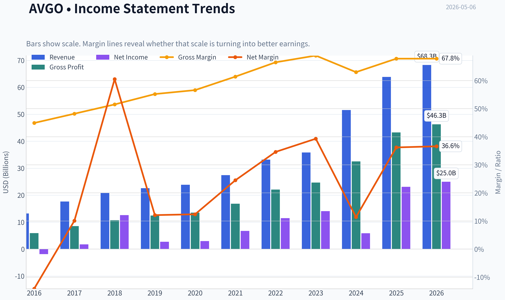
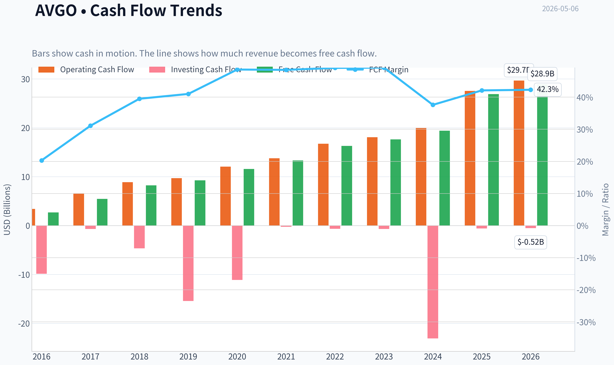
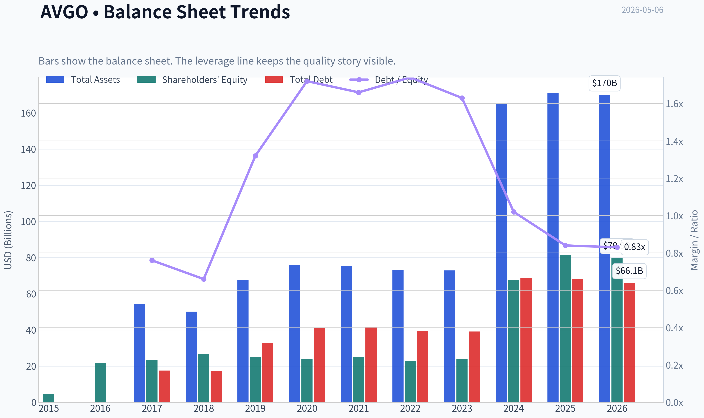
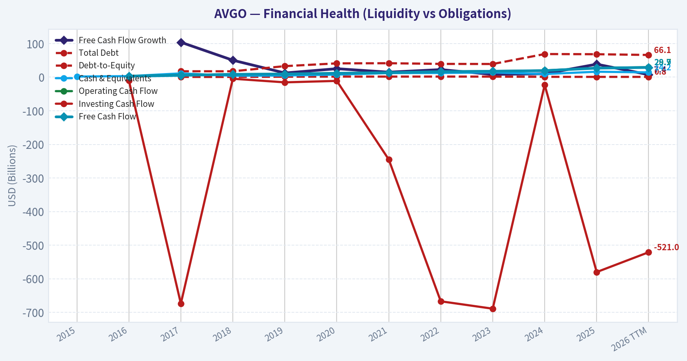
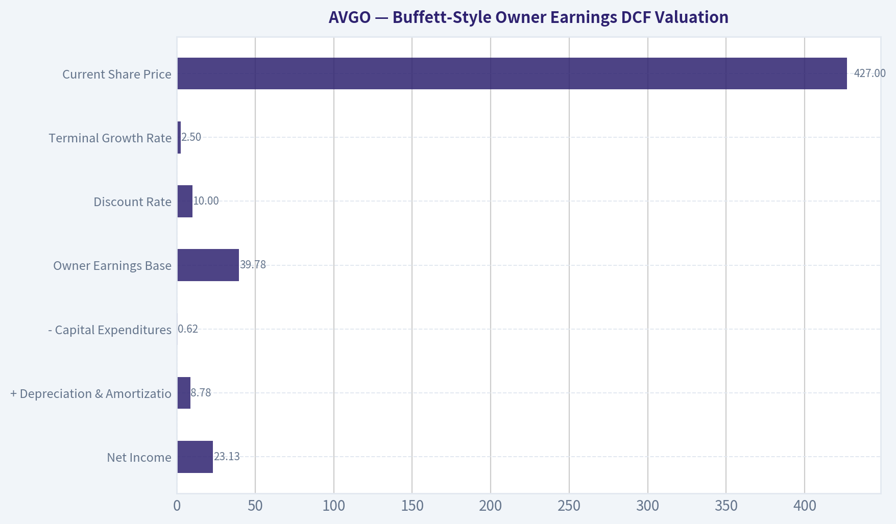
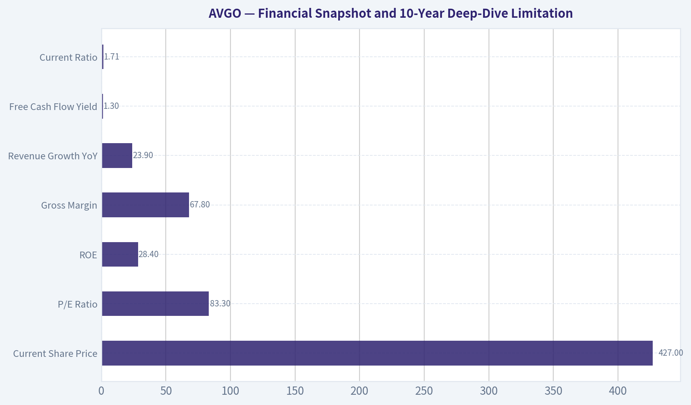
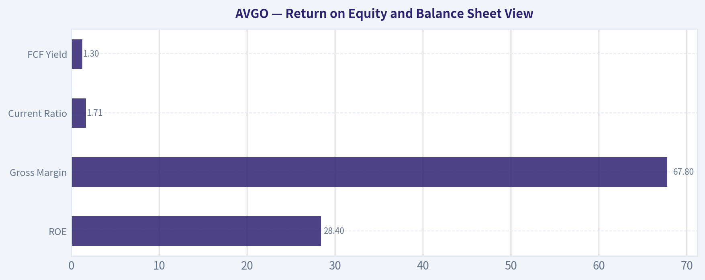
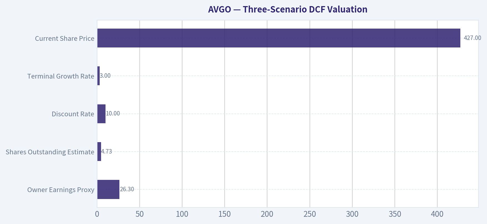
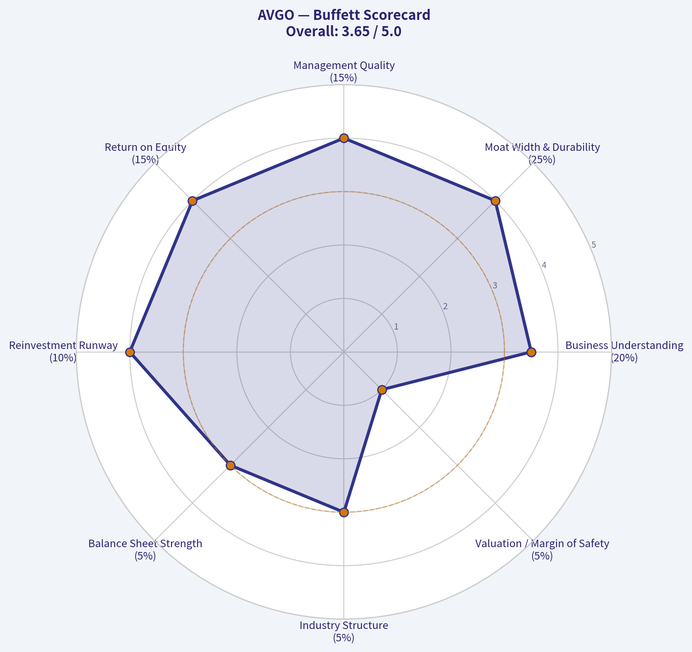

# AVGO Deep Value Intelligence

**Analysis Date:** 2026-05-06

## Critical Disclaimer

*This analysis is generated by Deep Value Intelligence, an AI-powered multi-agent investing framework. This report is for informational and educational purposes only and does not constitute financial advice. Always conduct your own research and consult with qualified financial advisors before making investment decisions.*

---

## Table of Contents

1. Intelligence Summary
2. Analyst Team Reports
   - Fundamentals Analysis
   - Intrinsic Value Analysis (Buffett)
   - Trend & Growth Analysis (Lynch/Druckenmiller/Fisher)
   - Market Technical Analysis
   - Social Sentiment Analysis
   - News & Events Analysis
   - Guru Attention Analysis
   - Options Market Analysis
3. Research Team Commentary
4. Value Investing Team Commentary
5. Deep Values Commentary

---

## Intelligence Summary

### Thesis + Conditions

**Core Thesis:** **EXECUTIVE SUMMARY**
*   **Business Quality**: Elite. Broadcom boasts a 19.4% ROIC, 67.8% gross margins, and a dominant, sticky position in custom AI accelerators and enterprise software (VMware).

**Key Risks:**
- Valuation Risk**: Extreme. At $427 (an 83.31 P/E), the stock has surged 46% in five weeks. The market is pricing in flawless execution and perpetual AI euphoria, leaving zero Margin of Safety.
- Customer Risk**: Hyperscaler concentration is a double-edged sword. While it provides massive leverage to AI spending, it also exposes Broadcom to severe bargaining power and the threat of internal custom silicon architectures.
- The Bull (Risky)**: Broadcom is undergoing a structural regime shift. Its deep integration into mission-critical AI architecture and the recurring cash flow from VMware justify a massive premium. Traditional valuation models are too static for this level of platform scarcity.
- The Bear (Safe)**: Valuation discipline is not optional. Buying at an 83 P/E after a massive run ignores the cyclical reality of semiconductors, the heavy debt from the VMware acquisition, and the severe downside if hyperscaler spending simply moderates.
- However, the bear provides a necessary bucket of cold water, anchoring us back to our strictest value principles. The bear rightly argues that there is absolutely no margin of safety at the current price of four hundred twenty-seven dollars. With a price-to-earnings ratio north of eighty-three, the market is pricing in flawless execution and perpetual AI euphoria. Furthermore, the bear raises a critical structural risk, pointing out that Broadcom's biggest hyperscaler customers are actively trying to build their own silicon to bypass third-party vendors. Combine this with the massive debt and complexity of the VMware roll-up, and the bear convincingly argues that paying such a premium for an acquisitive, cyclical business is a speculative endeavor, not an investment.

**What Would Change Our View:**
- Valuation Risk**: Extreme. At $427 (an 83.31 P/E), the stock has surged 46% in five weeks. The market is pricing in flawless execution and perpetual AI euphoria, leaving zero Margin of Safety.
- Customer Risk**: Hyperscaler concentration is a double-edged sword. While it provides massive leverage to AI spending, it also exposes Broadcom to severe bargaining power and the threat of internal custom silicon architectures.
- The Bull (Risky)**: Broadcom is undergoing a structural regime shift. Its deep integration into mission-critical AI architecture and the recurring cash flow from VMware justify a massive premium. Traditional valuation models are too static for this level of platform scarcity.
- The Bear (Safe)**: Valuation discipline is not optional. Buying at an 83 P/E after a massive run ignores the cyclical reality of semiconductors, the heavy debt from the VMware acquisition, and the severe downside if hyperscaler spending simply moderates.
- However, the bear provides a necessary bucket of cold water, anchoring us back to our strictest value principles. The bear rightly argues that there is absolutely no margin of safety at the current price of four hundred twenty-seven dollars. With a price-to-earnings ratio north of eighty-three, the market is pricing in flawless execution and perpetual AI euphoria. Furthermore, the bear raises a critical structural risk, pointing out that Broadcom's biggest hyperscaler customers are actively trying to build their own silicon to bypass third-party vendors. Combine this with the massive debt and complexity of the VMware roll-up, and the bear convincingly argues that paying such a premium for an acquisitive, cyclical business is a speculative endeavor, not an investment.

**Confidence:** Medium

---

## Analyst Team Reports

### Fundamentals Analysis

#### Latest Earnings Snapshot

*Most recent reported quarter anchored on 2026 Q1, with prior-year comparison when available.*

| Metric | 2026 Q1 | 2025 Q1 | YoY Change |
| --- | ---: | ---: | ---: |
| Revenue | $19.31B | $14.92B | +29.5% |
| Operating Income | $8.67B | $6.43B | +34.7% |
| Net Income | $7.35B | $5.50B | +33.5% |
| Diluted EPS | $1.50 | $1.14 | +31.6% |
| Operating Cash Flow | $8.26B | $6.11B | +35.1% |
| Free Cash Flow | $8.01B | $6.01B | +33.2% |

Key Takeaways: This snapshot anchors the most recent reported quarter before the narrative analysis. It helps readers separate long-run business quality from whatever changed in the latest earnings print.

#### 10-Year Financial Metrics for AVGO

*All values below are computed deterministically from raw data - not estimated by AI.*

*Issuer profile: operating company (Technology / Semiconductors).*

#### 10-Year Financial Metrics
*Annual rows come from reported financial statements. The final TTM row is computed from the latest four quarters.*

| Metric | 2015 | 2016 | 2017 | 2018 | 2019 | 2020 | 2021 | 2022 | 2023 | 2024 | 2025 | 2026 TTM |
| --- | --- | --- | --- | --- | --- | --- | --- | --- | --- | --- | --- | --- |
| Market Price | $9 | $13 | $21 | $18 | $25 | $31 | $49 | $44 | $82 | $167 | $368 | $427 |
| Market Cap | N/A | $6.52B | $11.11B | $9.63B | $12.27B | $14.72B | $22.81B | $198.95B | $359.43B | $811.16B | $1.79T | $2.09T |
| P/E Ratio | N/A | -3.50 | 6.56 | 0.79 | 4.55 | 5.52 | 3.54 | 17.74 | 25.50 | 138.02 | 77.49 | 83.47 |
| P/B Ratio | N/A | 0.30 | 0.48 | 0.36 | 0.49 | 0.62 | 0.91 | 8.76 | 14.98 | 11.99 | 22.07 | 26.15 |
| ROE | N/A | -8.5% | 7.7% | 47.3% | 10.9% | 12.4% | 27.0% | 50.6% | 58.7% | 8.7% | 28.4% | 31.3% |
| ROIC | N/A | -1.7% | 6.3% | 38.1% | 8.5% | 8.2% | 15.2% | 25.5% | 30.8% | 11.0% | 19.9% | 21.1% |
| EPS | N/A | $-3.74 | $3.15 | $23.27 | $5.46 | $5.63 | $13.78 | $2.51 | $3.21 | $1.23 | $4.77 | $5.12 |
| Revenue | N/A | $13.24B | $17.64B | $20.85B | $22.60B | $23.89B | $27.45B | $33.20B | $35.82B | $51.57B | $63.89B | $68.28B |
| Gross Profit | N/A | $5.94B | $8.51B | $10.73B | $12.48B | $13.52B | $16.84B | $22.09B | $24.69B | $32.51B | $43.29B | $46.31B |
| Gross Margin | N/A | 44.9% | 48.2% | 51.5% | 55.2% | 56.6% | 61.4% | 66.5% | 68.9% | 63.0% | 67.8% | 67.8% |
| Operating Margin | N/A | -3.1% | 13.4% | 24.6% | 15.2% | 16.8% | 31.0% | 42.8% | 45.2% | 26.1% | 39.9% | 41.5% |
| Net Income | N/A | $-1.86B | $1.78B | $12.61B | $2.72B | $2.96B | $6.74B | $11.49B | $14.08B | $5.89B | $23.13B | $24.97B |
| Net Margin | N/A | -14.1% | 10.1% | 60.5% | 12.1% | 12.4% | 24.5% | 34.6% | 39.3% | 11.4% | 36.2% | 36.6% |
| Revenue Growth | N/A | N/A | 33.2% | 18.2% | 8.4% | 5.7% | 14.9% | 21.0% | 7.9% | 44.0% | 23.9% | 6.9% |
| Net Income Growth | N/A | N/A | -195.9% | 606.8% | -78.4% | 8.7% | 127.6% | 70.7% | 22.5% | -58.1% | 292.3% | 8.0% |
| Free Cash Flow Growth | N/A | N/A | 103.9% | 50.4% | 12.4% | 25.2% | 14.9% | 22.5% | 8.1% | 10.1% | 38.6% | 7.4% |
| Total Book Value | $4.71B | $21.88B | $23.19B | $26.66B | $24.94B | $23.87B | $24.96B | $22.71B | $23.99B | $67.68B | $81.29B | $79.87B |
| Total Assets | N/A | N/A | $54.42B | $50.12B | $67.49B | $75.93B | $75.57B | $73.25B | $72.86B | $165.65B | $171.09B | $169.90B |
| Total Debt | N/A | N/A | $17.55B | $17.49B | $32.80B | $41.06B | $41.50B | $39.48B | $39.18B | $68.81B | $68.29B | $66.06B |
| Debt-to-Equity | N/A | N/A | 0.76 | 0.66 | 1.32 | 1.72 | 1.66 | 1.74 | 1.63 | 1.02 | 0.84 | 0.83 |
| Cash & Equivalents | $1.82B | $3.10B | $11.20B | $4.29B | $5.05B | $7.62B | $12.16B | $12.42B | $14.19B | $9.35B | $16.18B | $14.17B |
| Shareholders' Equity | $4.71B | $21.88B | $23.19B | $26.66B | $24.94B | $23.87B | $24.96B | $22.71B | $23.99B | $67.68B | $81.29B | $79.87B |
| Operating Cash Flow | N/A | $3.41B | $6.55B | $8.88B | $9.70B | $12.06B | $13.76B | $16.74B | $18.09B | $19.96B | $27.54B | $29.68B |
| Investing Cash Flow | N/A | $-9.84B | $-674.0M | $-4.67B | $-15.42B | $-11.11B | $-245.0M | $-667.0M | $-689.0M | $-23.07B | $-580.0M | $-521.0M |
| Free Cash Flow | N/A | $2.69B | $5.48B | $8.24B | $9.27B | $11.60B | $13.32B | $16.31B | $17.63B | $19.41B | $26.91B | $28.91B |
| FCF Margin | N/A | 20.3% | 31.1% | 39.5% | 41.0% | 48.6% | 48.5% | 49.1% | 49.2% | 37.6% | 42.1% | 42.3% |
| Dividends / Share | N/A | $0.00 | $0.00 | $0.00 | $0.00 | $0.00 | $0.00 | $0.00 | $0.00 | $0.00 | $0.00 | $0.00 |

#### Profitability Metrics
- Return on Equity (ROE): 28.4%
- Return on Invested Capital (ROIC): 19.4%
- Return on Assets (ROA): 13.5%
- Gross Margin: 67.8%
- Operating Margin: 39.9%
- Net Profit Margin: 36.2%

#### Liquidity Metrics
- Current Ratio: 1.71
- Quick Ratio: 1.26

#### Leverage Metrics
- Debt-to-Equity Ratio: 0.84
- Interest Coverage Ratio: 7.94
- Net Debt: $52.11B

#### Growth Metrics (Year-over-Year)
- Revenue Growth: 23.9%
- Net Income Growth: 292.3%
- Free Cash Flow Growth: 38.6%
- Revenue CAGR (3-Year): 24.4%
- Revenue CAGR (5-Year): 21.7%

#### Valuation Metrics
- P/E Ratio (TTM): 83.31
- Forward P/E: 23.59
- Price-to-Book: 25.34
- Price-to-Sales: 29.63
- PEG Ratio: 0.91
- EV/EBITDA: 55.76
- Free Cash Flow Yield: 1.3%
- Earnings Yield: 1.2%

#### Owner Earnings (Buffett Method, Code-Computed)
- Net Income: $23.13B
- + Depreciation & Amortization: $8.78B
- - Capital Expenditures: $-623.0M
- - Working Capital Changes: $-8.50B
- = **Owner Earnings: $39.78B**

#### Intrinsic Value (Code-Computed)
- Current Price: $427
- Buffett Method (Owner Earnings):
  Conservative: $128
  Average: $293
  Optimistic: $762
- Cash Flow Method (FCF):
  Conservative: $105
  Average: $193
  Optimistic: $193

#### Piotroski F-Score: 8/9
- Positive Net Income: PASS
- Positive Operating Cash Flow: PASS
- ROA Improvement: PASS
- Cash Flow > Net Income: PASS
- Decreasing Debt: PASS
- Improving Current Ratio: PASS
- No Dilution: FAIL
- Improving Gross Margin: PASS
- Improving Asset Turnover: PASS

ANALYST STANCE: **WATCH**

#### AVGO Warren Buffett-Style Fundamental Analysis

Broadcom is a high-quality compounder with a durable semiconductor and infrastructure-software moat, exceptional margins, strong free-cash-flow conversion, and improving balance-sheet leverage. However, the current valuation embeds a very large amount of future success: at **$427 per share**, AVGO trades above the deterministic dataset's **average Owner Earnings DCF value of about $293** and requires something closer to the optimistic scenario to offer meaningful upside.

---

#### Current vs. Historical Average Comparison

| Metric | Current / TTM | 10-Year Historical Average* | Current Standing vs. History | Interpretation |
|---|---:|---:|---|---|
| Market Price | **$427** | ~$81.8 | Far above average | The share price has dramatically re-rated, especially after AI-related enthusiasm and VMware integration. |
| Market Cap | **$2.09T** | ~$323.7B | Far above average | AVGO is now priced as a mega-cap AI/software infrastructure compounder, not a traditional cyclical chip company. |
| P/E Ratio | **83.47x** | ~27.6x | Much higher | Current earnings multiple is highly elevated; valuation depends on sustained earnings expansion. |
| P/B Ratio | **26.15x** | ~6.1x | Much higher | The market is valuing intangible assets, software cash flows, and AI growth far above book value. |
| ROE | **31.3%** | ~24.3% | Above average | Profitability remains strong despite acquisition-related balance-sheet expansion. |
| ROIC | **21.1%** | ~16.2% | Above average | Capital allocation has been productive, though acquisition discipline remains crucial. |
| EPS | **$5.12** | ~$5.93 | Below average | EPS is temporarily distorted by acquisition accounting, amortization, and share-count changes. |
| Revenue | **$68.28B** | ~$31.0B | More than 2x average | Broadcom has transformed in scale, helped by VMware and AI networking demand. |
| Gross Profit | **$46.31B** | ~$19.1B | More than 2x average | Gross profit growth confirms strong pricing power and a richer software/AI mix. |
| Gross Margin | **67.8%** | ~58.4% | Well above average | The business mix has structurally improved toward higher-margin software and advanced semiconductors. |
| Operating Margin | **41.5%** | ~25.2% | Well above average | Operating leverage is excellent, though margins dipped during integration years. |
| Net Income | **$24.97B** | ~$8.0B | More than 3x average | Earnings power has expanded materially, though recent net income has been volatile. |
| Net Margin | **36.6%** | ~22.7% | Well above average | Broadcom is now a very high-margin business by technology-sector standards. |
| Revenue Growth | **6.9% TTM** | ~19.7% | Below average | Growth has normalized after the VMware step-up and AI acceleration. |
| Net Income Growth | **8.0% TTM** | ~88.5% | Below average | Historical average is distorted by large one-time swings; current growth is positive but less explosive. |
| Free Cash Flow Growth | **7.4% TTM** | ~31.8% | Below average | FCF remains large, but growth has slowed from acquisition and AI-cycle surges. |
| Total Book Value | **$79.87B** | ~$34.1B | Above average | Equity base expanded significantly after VMware. |
| Total Assets | **$169.90B** | ~$89.6B | Above average | Asset base nearly doubled versus the historical average, largely acquisition-driven. |
| Total Debt | **$66.06B** | ~$40.7B | Above average | Debt is elevated in absolute terms, but manageable relative to cash flow. |
| Debt-to-Equity | **0.83x** | ~1.26x | Better than average | Leverage has improved relative to equity, a positive sign for financial resilience. |
| Cash & Equivalents | **$14.17B** | ~$9.6B | Above average | Liquidity is solid, though net debt remains meaningful. |
| Shareholders' Equity | **$79.87B** | ~$34.1B | Above average | Balance-sheet capacity has improved after the post-acquisition equity expansion. |
| Free Cash Flow | **$28.91B** | ~$13.1B | More than 2x average | AVGO remains an exceptional cash generator. |
| Dividends / Share | **$0.00** | $0.00 | In line | The deterministic dataset shows no dividends per share, so dividend support is not part of this canonical analysis. |

\*Historical averages use the available deterministic annual values from the dataset and exclude unavailable N/A entries.

**Key Takeaways:** AVGO's business quality has improved substantially over the decade, with revenue, gross profit, net income, and free cash flow all far above historical averages. The biggest concern is valuation: P/E, P/B, market cap, and share price have expanded much faster than normalized per-share earnings. Broadcom looks like a superior business, but the current price already assumes continued exceptional execution.

---

#### Revenue Breakdown

| Revenue Source | Amount ($B) | % of Total |
|---|---:|---:|
| Semiconductor Solutions | ~$38.9B | ~57% |
| Infrastructure Software | ~$29.4B | ~43% |
| **Total Revenue / TTM** | **$68.28B** | **100%** |

**Key Takeaways:** Broadcom is no longer just a semiconductor company; infrastructure software is now a major contributor after VMware. The semiconductor segment remains the larger revenue source, supported by AI networking, custom silicon, broadband, wireless, and storage exposure. The software mix is important because it supports higher margins, recurring revenue, and potentially more predictable cash flows.

---

#### Buffett-Style Business Quality Assessment

| Buffett Criteria | AVGO Assessment | Interpretation |
|---|---|---|
| Economic Moat | **Strong** | Broadcom benefits from custom silicon relationships, networking leadership, mission-critical infrastructure software, scale, and high switching costs. |
| Financial Strength | **Good, but debt-heavy** | Debt of **$66.06B** is significant, but FCF of **$28.91B** and cash of **$14.17B** provide meaningful coverage. |
| Predictable Earnings | **Improving, but not perfectly smooth** | Revenue and FCF are durable, but net income has shown major swings from acquisitions, accounting, and integration effects. |
| Management Performance | **Strong capital allocator historically** | ROE of **31.3%** and ROIC of **21.1%** suggest efficient capital use, though future returns depend on VMware integration and acquisition discipline. |
| Margin Durability | **Excellent** | Gross margin of **67.8%**, operating margin of **41.5%**, and net margin of **36.6%** indicate strong pricing power and high-quality revenue mix. |
| Valuation Discipline | **Weak at current price** | The stock trades at **83.47x earnings**, **26.15x book**, and only about **1.3% FCF yield**, leaving limited Buffett-style margin of safety. |

**Key Takeaways:** Broadcom scores very well on moat, margins, cash generation, and management execution. The company's combination of AI semiconductor exposure and infrastructure software gives it unusually strong economics. The main Buffett-style objection is not business quality, but price: the market is already paying for a near-best-case future.

---

#### Profitability and Growth Interpretation

Broadcom's profitability profile is exceptional. Gross margin has risen from the mid-40% range earlier in the decade to **67.8%**, reflecting a stronger product mix, scale benefits, software contribution, and differentiated semiconductor exposure. Operating margin at **41.5%** is also well above the historical average, showing that revenue growth is converting efficiently into operating profit.

Revenue growth has slowed to **6.9% TTM**, below the historical average of roughly **19.7%**, but that average includes acquisition-driven step-ups. Free cash flow growth of **7.4% TTM** is also below the historical average, yet the absolute FCF base is now much larger at **$28.91B**. This means AVGO may be transitioning from a high-growth re-rating story into a large-scale cash-compounding story.

Net income growth is positive at **8.0% TTM**, but the decade's net income trend is highly uneven. The large swings in 2018, 2024, and 2025 suggest that investors should focus more on owner earnings and free cash flow than GAAP earnings alone.

---

#### Balance Sheet and Financial Strength

Broadcom's balance sheet is stronger than it looks at first glance. Total debt of **$66.06B** is high in absolute terms, but the debt-to-equity ratio of **0.83x** is below the historical average of roughly **1.26x**. That indicates leverage has become more manageable relative to the equity base.

Cash and equivalents of **$14.17B** provide liquidity, while the deterministic dataset shows net debt of about **$52.11B**. With interest coverage of **7.94x** and FCF near **$29B**, Broadcom appears capable of servicing and reducing debt over time. For Buffett-style investors, this is acceptable financial strength, though not the pristine balance sheet typically preferred for cyclical businesses.

---

#### Buffett-Style Owner Earnings DCF Valuation

Base owner earnings from the deterministic dataset:

| DCF Input | Value |
|---|---:|
| Net Income | $23.13B |
| + Depreciation & Amortization | $8.78B |
| - Capital Expenditures | $0.62B |
| - Working Capital Changes | Adds back approximately $8.50B |
| **Owner Earnings Base** | **$39.78B** |
| Discount Rate | **10.0%** |
| Terminal Growth Rate | **2.5%** |
| Estimated Shares Outstanding | ~4.90B |
| Current Share Price | **$427** |

**Key Takeaways:** Owner earnings are higher than net income because Broadcom produces very strong cash flow and has meaningful non-cash amortization. This makes owner earnings a better lens than GAAP EPS for valuation. Even so, the current stock price requires strong future owner-earnings growth to be justified.

| Scenario | Owner Earnings Growth Assumption | 10-Year PV of Owner Earnings | PV of Terminal Value | Estimated Equity Value | Fair Value / Share | Margin vs. $427 |
|---|---:|---:|---:|---:|---:|---:|
| Conservative | ~4.5% | ~$303B | ~$326B | ~$629B | **~$128** | **-70%** |
| Average | ~15.7% | ~$531B | ~$901B | ~$1.43T | **~$293** | **-31%** |
| Optimistic | ~29.0% | ~$1.06T | ~$2.67T | ~$3.73T | **~$762** | **+78%** |

**Key Takeaways:** The conservative and average cases do not support the current market price. The stock only appears materially undervalued under the optimistic case, which assumes very high sustained owner-earnings growth. That creates valuation risk because even a strong business can be a poor investment if bought at too demanding a price.

##### DCF Formula Used

For each scenario:

- Years 1-10 Owner Earnings:
  **Owner Earnings x (1 + growth rate)^year**
- Present value of annual owner earnings:
  **Future Owner Earnings ÷ (1.10)^year**
- Terminal value in year 10:
  **Year 10 Owner Earnings x 1.025 ÷ (10.0% - 2.5%)**
- Present value of terminal value:
  **Terminal Value ÷ (1.10)^10**
- Fair value per share:
  **Total Present Value ÷ estimated shares outstanding**

---

#### Key Investment Insights

| Category | Insight |
|---|---|
| Business Quality | AVGO is a high-quality compounder with outstanding margins, large free cash flow, and a stronger software component than in the past. |
| Moat | Competitive advantages come from custom silicon, AI networking exposure, customer integration, scale, software stickiness, and disciplined cost control. |
| Profitability | ROE, ROIC, gross margin, operating margin, and net margin are all above historical averages. |
| Cash Flow | Free cash flow of **$28.91B** is more than double the historical average, making AVGO one of the strongest cash generators in technology. |
| Balance Sheet | Debt is large but manageable; debt-to-equity has improved versus history. |
| Valuation | Valuation is the central risk: **83.47x P/E**, **26.15x P/B**, and a low FCF yield leave little margin of safety. |
| Market Expectations | The current price implies investors expect continued AI-driven growth, VMware synergies, high margins, and disciplined capital allocation. |

**Key Takeaways:** Broadcom's fundamentals are excellent, but the stock is priced for excellence. Investors are not being paid much for uncertainty at the current valuation. The opportunity is real, but the margin of safety is thin.

---

#### Red Flags and Opportunities

| Area | Red Flags | Opportunities |
|---|---|---|
| Valuation | Current price is above average DCF value and far above historical valuation averages. | If AI networking and custom silicon demand remain strong, earnings may compound into today's valuation. |
| Growth | TTM revenue, net income, and FCF growth are below historical averages. | VMware integration and AI infrastructure spending may create multi-year expansion. |
| Debt | Total debt of **$66.06B** remains significant. | Large FCF gives management room to deleverage quickly. |
| Earnings Quality | EPS and net income have been volatile due to acquisitions and accounting effects. | Owner earnings and FCF are much stronger than GAAP EPS suggests. |
| Concentration / Cycle Risk | Semiconductor demand can be cyclical and AI expectations may become crowded. | Broadcom's software revenue reduces cyclicality compared with pure semiconductor peers. |
| Capital Allocation | Large acquisitions can create integration and execution risk. | Management has a long record of extracting synergies and improving acquired assets. |

**Key Takeaways:** The main red flag is not operational weakness, but valuation sensitivity. Broadcom must continue executing at a very high level to justify the current market price. The biggest opportunity is that AI networking plus infrastructure software could make AVGO's future cash flows more durable and faster-growing than its past.

---

#### Final Investment Stance: WATCH

Broadcom is a Buffett-style **quality business**, but not clearly a Buffett-style **value purchase** at the current price. The company has a strong moat, high returns on capital, excellent margins, large free cash flow, and improving leverage. However, the valuation already discounts a great deal of future growth.

At **$427**, AVGO trades:

- Above the conservative DCF value of about **$128**
- Above the average DCF value of about **$293**
- Below the optimistic DCF value of about **$762**

That means the stock may still work if the optimistic AI and software-compounding thesis plays out, but it lacks a comfortable margin of safety. For value-oriented investors, AVGO is best classified as a **WATCH**: an outstanding company to monitor, but more attractive on a pullback or after owner earnings catch up to the valuation.

---

#### Final Summary Table

| Topic | Assessment | Buffett-Style Conclusion |
|---|---|---|
| Economic Moat | Strong | Durable advantages in AI networking, custom silicon, software, scale, and switching costs. |
| Profitability | Excellent | Margins and returns on capital are well above historical averages. |
| Financial Strength | Good | Debt is high, but cash flow coverage is strong and leverage metrics have improved. |
| Earnings Predictability | Moderate to Strong | FCF is reliable; GAAP earnings are more volatile due to acquisitions and accounting. |
| Management | Strong | Historically effective capital allocation and acquisition integration. |
| Valuation | Expensive | Current price is above conservative and average intrinsic value estimates. |
| Main Opportunity | AI and infrastructure software compounding | Could justify optimistic valuation if growth remains exceptional. |
| Main Risk | Multiple compression | High expectations create downside if growth slows or margins normalize. |
| Final Stance | **WATCH** | Great business, but limited margin of safety at today's price. |

**Key Takeaways:** AVGO is a high-quality business with exceptional economics, but the stock is not obviously cheap. The investment case depends on whether Broadcom can sustain unusually high owner-earnings growth for many years. A patient Buffett-style investor should watch closely, but demand a better entry price or clearer evidence that optimistic growth is durable.

#### Fundamental Visuals

This graph tracks the profitability and return metrics (ROE, ROIC, Margins) of **AVGO** over the past decade, highlighting capital efficiency trends.

This chart illustrates the financial health of **AVGO** over the last 10 years, mapping cash equivalents and free cash flow against total obligations (Debt).

---

### Intrinsic Value Analysis (Buffett)

> *Following Warren Buffett's value investing philosophy: Circle of Competence, Economic Moat, Management Quality, and Margin of Safety.*

#### Intrinsic Value Snapshot

Price is what you pay. Intrinsic value is what the business may be worth based on the cash it can create for owners over time. We show a range, not one magic number.

- Current Price: $427.36
- Value Range: $105.44 to $762.42

##### Owner Earnings (Buffett Method)
- Net Income: $23,126,000,000.00
- Depreciation & Amortization: $8,775,000,000.00
- Capital Expenditures: $-623,000,000.00
- Working Capital Changes: $-8,500,000,000.00
- Owner Earnings: $39,778,000,000.00

##### Intrinsic Value
###### Buffett Method
Uses owner earnings. Stricter, and usually more conservative.
- Conservative: $127.66
- Average: $292.76
- Optimistic: $762.42
- Discount Rate: 10.0%

###### Cash Flow Method
Uses free cash flow. Better for companies spending heavily today to grow tomorrow.
- Conservative: $105.44
- Average: $192.65
- Optimistic: $192.65
- Discount Rate: 10.0%

ANALYST STANCE: **WATCH**

#### Broadcom (AVGO) Buffett-Style Value Analysis - May 6, 2026

Broadcom is a high-quality semiconductor and infrastructure software company with strong margins, strong reported ROE, and clear exposure to AI networking and custom silicon demand. However, at the current price of about **$427 per share** and market capitalization of roughly **$2.02 trillion**, the valuation embeds exceptional long-term growth and leaves little margin of safety. Under a Buffett framework, this is a **wonderful-to-very-good business at a demanding price**, not a clear purchase today.

---

#### 1. Go / No-Go Gate Assessment

| Gate | Result | Evidence | Buffett Interpretation |
|---|---:|---|---|
| Gate 1: Business Simplicity | Mixed Pass | Broadcom sells semiconductors, networking chips, custom silicon, and infrastructure software. | The business can be explained simply, but the product cycles and AI exposure add complexity. |
| Gate 2: Moat Test | Pass | Gross margin around **67.8%**, strong scale, custom silicon relationships, software assets, and mission-critical infrastructure exposure. | There is evidence of a strong moat, but parts of the business remain technology-cycle exposed. |
| Gate 3: Management Quality | Pass with Caution | Broadcom has a history of disciplined acquisitions and strong profitability, but the model is acquisition-heavy. | Capital allocation has been effective, but debt and integration risk require monitoring. |
| Gate 4: Industry Structure | Mixed Pass | Semiconductor infrastructure and AI networking are attractive but competitive; infrastructure software is stickier. | Better than a commodity chip company, but not as predictable as a consumer monopoly. |
| Valuation Gate | Fail | P/E around **83x**, FCF yield around **1.3%**, market cap around **$2.02T**. | The price appears to assume near-flawless execution and sustained high growth. |

**Key Takeaways:** Broadcom passes the quality gates better than most semiconductor companies because of its scale, margins, and sticky infrastructure exposure. The main problem is not business quality; it is valuation. Buffett would likely admire the economics but hesitate to pay today's price without a much larger margin of safety.

---

#### 2. Elementary School Business Explanation

Broadcom makes money by designing and selling important computer chips used in data centers, networking equipment, smartphones, broadband systems, and AI infrastructure. It also owns infrastructure software businesses that large companies use to run and manage complex technology systems. Customers pay Broadcom because its products are difficult to replace, deeply embedded, and often mission-critical.

The simple version: **Broadcom sells the "plumbing" that helps data, AI, and enterprise software systems work.**

---

#### 3. Moat Analysis

| Moat Source | Evidence | Strength | Buffett View |
|---|---|---:|---|
| Intangible Assets | Strong engineering reputation, customer relationships, mission-critical chip designs, infrastructure software brands. | High | Broadcom has credible intangible assets, especially in custom silicon and software. |
| Switching Costs | Enterprise software and custom silicon relationships can be hard to replace. | High | Customers are often embedded and reluctant to switch if reliability matters. |
| Cost Advantages | Scale in chip design, procurement, and operating discipline. | Medium-High | Scale helps, though semiconductor competition remains intense. |
| Network Effects | Limited direct network effects. | Low | This is not a classic network-effect business like Visa or Microsoft Office. |
| Pricing Power | Gross margin around **67.8%** suggests meaningful pricing power or mix advantage. | High | Sustained high margins are strong moat evidence. |

**Key Takeaways:** Broadcom's moat appears real, especially through switching costs, engineering depth, scale, and sticky enterprise infrastructure exposure. The gross margin profile is excellent and well above Buffett's preferred evidence threshold for brand or intangible strength. However, the moat is not invulnerable because semiconductor markets can change quickly.

**Moat Rating:** **Wide but technology-exposed**

---

#### 4. Management and Capital Allocation Assessment

| Management Question | Assessment | Evidence / Interpretation |
|---|---:|---|
| Do they think like owners? | Generally Yes | Broadcom has emphasized profitability, disciplined operations, and shareholder value creation. |
| Are they candid and rational? | Mostly Yes | The company has historically focused on returns, margins, and integration execution. |
| Are they good capital allocators? | Yes, with caveats | Broadcom has compounded through acquisitions, but acquisition-heavy models introduce debt and integration risk. |
| Debt discipline | Watch Item | Large acquisitions can increase leverage and reduce flexibility. |
| Buybacks / Dividends | Mixed | Shareholder returns are positive, but buybacks at elevated valuations would be less attractive. |

**Key Takeaways:** Management appears commercially disciplined and has created substantial shareholder value over time. The concern is not obvious incompetence but rather the risk that future returns from acquisitions and AI-driven investment may not match the past. Buffett would likely focus closely on whether retained earnings continue producing strong per-share value.

---

#### 5. Financial Snapshot and 10-Year Deep-Dive Limitation

A full 10-year financial statement series was not available in the supplied research pack, so I will not fabricate historical data. The table below uses the financial metrics available from the provided pack and interprets them through a Buffett lens.

| Metric | Latest Available Data | Buffett Interpretation |
|---|---:|---|
| Current Share Price | **$427** | Price has risen sharply and embeds high expectations. |
| Market Capitalization | **$2.02T** | Broadcom is now priced as one of the world's dominant technology platforms. |
| P/E Ratio | **83.3x** | Very demanding unless earnings grow substantially. |
| ROE | **28.4%** | Strong headline return on equity. Need to monitor leverage contribution. |
| Gross Margin | **67.8%** | Excellent; strong evidence of moat and pricing power. |
| Revenue Growth YoY | **23.9%** | Strong growth, likely helped by AI and infrastructure demand. |
| Free Cash Flow Yield | **1.3%** | Very low; valuation is the main issue. |
| Current Ratio | **1.71x** | Adequate short-term liquidity. |

**Key Takeaways:** Broadcom's profitability metrics are excellent, especially gross margin and ROE. Revenue growth is strong, which supports the quality argument. But the free cash flow yield of only 1.3% suggests investors are paying a very high price for future growth.

---

#### 6. Owner Earnings Estimate

Because detailed maintenance capital expenditure and working capital data were not available, I use free cash flow as a practical proxy for Buffett-style owner earnings. This is imperfect, but it is conservative enough for a first-pass valuation.

| Item | Estimate |
|---|---:|
| Market Capitalization | **$2.02T** |
| Free Cash Flow Yield | **1.3%** |
| Implied Free Cash Flow / Owner Earnings Proxy | **~$26.3B** |
| Estimated Shares Outstanding | **~4.73B** |
| Owner Earnings Per Share Proxy | **~$5.55** |

**Key Takeaways:** Broadcom appears to generate roughly $26 billion of free cash flow based on the supplied yield and market capitalization. That is a very large absolute amount, but the market is valuing those cash flows at a very high multiple. The current owner earnings yield is low for a Buffett-style purchase.

---

#### 7. Return on Equity and Balance Sheet View

| Metric | Latest Available | Buffett Standard | Assessment |
|---|---:|---:|---|
| ROE | **28.4%** | Above 15%; above 20% is excellent | Strong |
| Gross Margin | **67.8%** | Above 40% sustained is attractive | Excellent |
| Current Ratio | **1.71x** | Above 1.5x generally comfortable | Acceptable |
| FCF Yield | **1.3%** | Higher is better; low yield needs high growth | Weak |
| Debt / Leverage Detail | Not provided | Debt should be conservative | Watch item |

**Key Takeaways:** Broadcom's return profile looks strong, but the available data does not allow a full DuPont analysis to separate operating performance from leverage. The current ratio looks fine, but the lack of detailed debt metrics limits confidence. The free cash flow yield is the weakest financial indicator from a value investor's perspective.

---

#### 8. Three-Scenario DCF Valuation

Assumptions:

| Valuation Input | Assumption |
|---|---:|
| Owner Earnings Proxy | **$26.3B** |
| Shares Outstanding Estimate | **4.73B** |
| Discount Rate | **10%** |
| Terminal Growth Rate | **3%** |
| Current Share Price | **$427** |

**Key Takeaways:** The valuation uses a Buffett-style 10% required return and treats free cash flow as a proxy for owner earnings. This is a conservative method, but appropriate given the valuation risk. The key question is whether Broadcom can grow owner earnings fast enough for long enough to justify today's price.

| Scenario | Method | Equity Value Estimate | Value Per Share | Margin of Safety vs. $427 |
|---|---|---:|---:|---:|
| A: No Growth | Owner earnings / 10% | **~$263B** | **~$56** | **-87%** |
| B: GDP Growth | Perpetuity at 3% growth, 10% discount rate | **~$387B** | **~$82** | **-81%** |
| C: High Growth Case | 10% growth for 10 years, then 3% terminal growth | **~$650B** | **~$137** | **-68%** |

**Key Takeaways:** Even with a generous 10-year growth case, the conservative DCF value is far below the current share price. This does not mean Broadcom cannot keep rising, but it means the stock price already discounts a great deal of future success. Under a Buffett framework, the margin of safety is absent.

---

#### 9. Margin of Safety Analysis

| Item | Result |
|---|---:|
| Current Price | **$427** |
| Conservative Fair Value Range | **~$80-$140 per share** |
| Required Buffett Margin of Safety | **At least 25%** |
| Attractive Buy Zone Using Upper Fair Value | **Below ~$105 per share** |
| Current Margin of Safety | **Negative** |

**Key Takeaways:** The current stock price is well above a conservative estimate of intrinsic value based on present owner earnings. For Broadcom to be attractive at today's price, an investor must assume extraordinary growth, sustained margins, and successful capital allocation for many years. That may happen, but it is not a classic Buffett-style bargain.

---

#### 10. Buffett Scorecard

| Criterion | Weight | Score 1-5 | Weighted Score | Rationale |
|---|---:|---:|---:|---|
| Business Understanding | 20% | 3.5 | 0.70 | Understandable at a high level, but semiconductor cycles and AI custom silicon add complexity. |
| Moat Width & Durability | 25% | 4.0 | 1.00 | Strong margins, scale, switching costs, and infrastructure importance. |
| Management Quality | 15% | 4.0 | 0.60 | Strong capital allocation record, though acquisition dependence adds risk. |
| Return on Equity | 15% | 4.0 | 0.60 | ROE of 28.4% is strong, but leverage contribution needs review. |
| Reinvestment Runway | 10% | 4.0 | 0.40 | AI, networking, custom silicon, and software provide growth opportunities. |
| Balance Sheet Strength | 5% | 3.0 | 0.15 | Current ratio is acceptable; debt detail unavailable and acquisition leverage is a watch item. |
| Industry Structure | 5% | 3.0 | 0.15 | Attractive niches, but semiconductor competition and technology shifts remain real risks. |
| Valuation / Margin of Safety | 5% | 1.0 | 0.05 | P/E over 80x and FCF yield of 1.3% leave no conservative margin of safety. |
| **Total** | **100%** |  | **3.65 / 5.00** | Good business, poor current entry price. |

**Key Takeaways:** Broadcom scores well on business quality, moat, management, and growth opportunity. The score is dragged down heavily by valuation and the lack of a margin of safety. This is the type of company a value investor should know well and monitor, but not chase indiscriminately.

---

#### 11. Final Investment Stance

| Decision Factor | Judgment |
|---|---|
| Business Quality | High |
| Moat | Wide, but technology-exposed |
| Management | Strong, acquisition-oriented |
| Financial Quality | Strong margins and ROE |
| Valuation | Very expensive |
| Margin of Safety | None |
| Buffett Stance | **WATCH** |
| Conviction | **Medium-High** |

**Key Takeaways:** Broadcom is not an avoid because the business appears too strong to dismiss. But it is also not an advocate at the current price because the valuation is far beyond what conservative owner-earnings analysis supports. The right Buffett-style action is to watch patiently and wait for either a much lower price or much higher sustainable owner earnings.

#### Bottom Line

Broadcom is a powerful business with real competitive advantages, excellent margins, and major AI infrastructure exposure. But at around **$427 per share**, the stock appears priced for perfection. A Buffett-style investor should admire the company, study it closely, and wait for a far better margin of safety before buying.
#### Valuation Bridge

This bridge places the current market price beside each intrinsic value lens so readers can see whether upside depends on one method or shows up across several methods.

| Scenario | Intrinsic Value / Share |
| --- | ---: |
| Buffett Method | $292.76 |
| Cash Flow Method | $192.65 |
| Damodaran Method | $40.24 |
| Current Price | $427.36 |

#### Key Takeaways

If one method is far above the others, the upside case depends on a specific modelling assumption. When several methods cluster together, the valuation story is more robust.

#### Valuation Visuals

This comparison chart from *Latest Earnings Snapshot* stacks current figures against historical benchmarks for **AVGO**, making it easy to see where the company trades relative to its own averages.

This comparison chart from *Buffett-Style Owner Earnings DCF Valuation* stacks current figures against historical benchmarks for **AVGO**, making it easy to see where the company trades relative to its own averages.

This comparison chart from *Financial Snapshot and 10-Year Deep-Dive Limitation* stacks current figures against historical benchmarks for **AVGO**, making it easy to see where the company trades relative to its own averages.

This comparison chart from *Return on Equity and Balance Sheet View* stacks current figures against historical benchmarks for **AVGO**, making it easy to see where the company trades relative to its own averages.

This comparison chart from *Three-Scenario DCF Valuation* stacks current figures against historical benchmarks for **AVGO**, making it easy to see where the company trades relative to its own averages.

---

### Trend & Growth Analysis (Lynch/Druckenmiller/Fisher)

> *Following Peter Lynch's GARP, Stanley Druckenmiller's macro-aware approach, and Philip Fisher's scuttlebutt methodology.*

ANALYST STANCE: **WATCH**

#### Broadcom Growth Analysis - AVGO, as of 2026-05-06

Broadcom is one of the highest-quality large-cap AI infrastructure compounders, but at roughly **$2.02 trillion market cap**, **83x trailing P/E**, and only **1.3% FCF yield**, the stock already discounts a major portion of the AI/custom silicon upside. I would not classify AVGO as a classic ten-bagger candidate from here because the required terminal market cap would be around **$20 trillion**, but I would keep it on the active watch list because AI networking, custom ASICs, and VMware monetization remain legitimate inflection drivers.

---

#### 1. Lynch Classification

| Category | AVGO Fit | Evidence | Growth Investor View |
|---|---:|---|---|
| Slow Grower | No | Revenue growth is far above 0-5%. | Not applicable. |
| Stalwart | Partial | Mega-cap, diversified, highly profitable, dividend-paying. | Quality compounder traits. |
| Fast Grower | Partial | YoY revenue growth around **23.9%**, AI and VMware tailwinds. | Growth rate qualifies, but size limits ten-bagger math. |
| Cyclical | Partial | Semiconductor exposure remains cyclical. | AI/custom silicon reduces but does not eliminate cyclicality. |
| Turnaround | No | Business is performing strongly. | Not a turnaround. |
| Asset Play | No | Thesis is earnings power and growth, not hidden assets. | Not applicable. |

**Key Takeaways:** Broadcom is best described as a **mega-cap fast-growing stalwart**, not a pure Lynch fast grower. The company has fast-grower revenue characteristics, but its $2 trillion scale makes ten-bagger upside mathematically difficult. For growth investors, this is a high-quality compounding watch-list name rather than an obvious new-money bargain.

---

#### 2. The Story in 3 Bullets

- Broadcom sells mission-critical chips and networking components that power AI data centers, cloud infrastructure, broadband, wireless, and enterprise systems.
- Its custom AI ASIC and networking franchises benefit directly as hyperscalers spend aggressively to build faster, cheaper, and more specialized AI compute infrastructure.
- VMware and infrastructure software add sticky, recurring cash flow, giving Broadcom a hybrid profile: part AI semiconductor leader, part high-margin enterprise software platform.

---

#### 3. TAM and 10x Test

| Metric | Estimate / View | Assessment |
|---|---:|---|
| Current market cap | ~$2.02T | Already mega-cap. |
| Current revenue base | Likely tens of billions; estimated ~$65B-$75B TTM range based on post-VMware scale and growth. | Very large absolute base. |
| 10x revenue target | ~$650B-$750B | Extremely difficult, though not impossible over very long periods. |
| 10x market cap target | ~$20T | Not realistic under normal 5-10 year assumptions. |
| Core TAMs | AI networking, custom ASICs, data-center connectivity, infrastructure software, enterprise virtualization. | Large and expanding. |
| Can AVGO 10x and still be under 20% share? | Probably no at company level. | Runway exists, but ten-bagger runway is constrained by scale. |

**Key Takeaways:** Broadcom has a large and expanding TAM, especially in AI infrastructure and enterprise software. However, the **10x test is the main issue**: from a $2 trillion base, a ten-bagger would imply a market value near $20 trillion. That does not make AVGO a bad investment, but it makes it less attractive for a ten-bagger-focused growth portfolio.

---

#### 4. Revenue Growth Trend

| Metric | Current Signal | Interpretation |
|---|---:|---|
| YoY revenue growth | **23.9%** | Fast-growth territory. |
| Growth quality | Mixed: organic AI/custom silicon plus acquisition-driven VMware contribution. | Strong, but investors must separate organic growth from M&A effects. |
| Pattern | Strong but not fully clean due to VMware integration. | Inflection exists, but headline growth may overstate organic acceleration. |
| Lynch category based on growth | Fast Grower / Stalwart hybrid | Attractive business, but valuation is demanding. |

**Key Takeaways:** Broadcom's revenue growth is clearly strong for a company of its size. The key analytical challenge is that growth comes from both AI-driven organic demand and VMware acquisition contribution. Investors should watch whether organic semiconductor AI growth can continue accelerating once VMware comparisons normalize.

---

#### 5. Unit Economics and Rule of 40

| Metric | Available Data / Estimate | Rating |
|---|---:|---|
| Gross margin | **67.8%** | Excellent. |
| FCF yield | **1.3%** | Low, mostly due to valuation. |
| Estimated P/S | Roughly high-20s to low-30s if TTM revenue is ~$65B-$75B. | Expensive. |
| Implied FCF margin | Approximately mid-to-high 30% range using FCF yield and estimated P/S. | Excellent cash conversion. |
| Rule of 40 | Revenue growth 23.9% + estimated FCF margin mid/high 30s = roughly ~60%+ | Excellent. |
| LTV/CAC | Not disclosed at company level. | Not directly measurable. |
| NRR | Not disclosed; software assets likely sticky but VMware customer pushback must be monitored. | Qualitatively good, not proven by disclosed metric. |

**Key Takeaways:** Broadcom's unit economics are excellent at the company level, with high gross margins and likely very strong free cash flow margins. The low FCF yield is not a business-quality problem; it is a valuation problem. On a Rule of 40-style framework, AVGO still looks elite, but investors are paying a premium price for that quality.

---

#### 6. Inflection Point Assessment

| Inflection Type | Evidence | Strength |
|---|---|---:|
| Product cycle inflection | AI custom ASICs and high-speed networking demand. | Strong |
| Market share inflection | Broadcom is positioned as a key custom silicon and networking supplier to hyperscalers. | Strong |
| Margin inflection | VMware integration and software mix may support durable margins. | Moderate to strong |
| TAM inflection | AI infrastructure expands the addressable market for networking and custom silicon. | Strong |
| Competitive inflection | Customers may diversify away from GPU-only AI architectures, benefiting custom silicon suppliers. | Moderate |
| Valuation inflection | Stock up over 100% in one year; much optimism already reflected. | Negative |

**Key Takeaways:** Broadcom has real operating inflections in AI networking, custom ASICs, and software mix. The problem is that the stock has also had a valuation inflection, with a large rally already recognizing much of the story. Operationally this is compelling; from a stock-selection standpoint, the margin of safety is thinner.

---

#### 7. Macro Setup

| Macro Factor | Current Read | Impact on AVGO |
|---|---|---|
| AI capex cycle | Very strong. | Major tailwind. |
| Cloud and data-center spending | Strong, especially AI-related. | Tailwind. |
| Interest rates | Still important for long-duration growth valuations. | Valuation sensitivity remains high. |
| Semiconductor cycle | AI strong, but non-AI semis can be cyclical. | Mixed. |
| Enterprise software spending | Stable but budget scrutiny persists. | Moderate tailwind with execution risk. |
| Geopolitics/export controls | Semiconductor supply chains remain exposed. | Risk factor. |

**Key Takeaways:** The macro setup is broadly supportive because AI infrastructure spending remains one of the strongest secular growth themes in the market. However, AVGO's valuation makes it sensitive to rates, AI capex pauses, and any disappointment in hyperscaler demand. The macro wind is at Broadcom's back, but the stock price already knows it.

---

#### 8. Fisher 15 Points Score

| Fisher Criterion | Score / 5 | Rationale |
|---|---:|---|
| Market potential for sizable sales increase | 5 | AI, networking, and infrastructure software markets are large. |
| Management determination to develop new products | 4 | Strong product roadmap and acquisition strategy. |
| Effective R&D | 5 | Deep engineering capability in mission-critical silicon. |
| Above-average sales organization | 4 | Strong hyperscaler and enterprise relationships. |
| Worthwhile profit margin | 5 | Gross margin around 67.8%. |
| Improving profit margins | 4 | VMware/software mix may help, but integration costs matter. |
| Labor/personnel relations | 3 | Limited data; no major red flag in available pack. |
| Executive relations | 4 | Management execution record is strong. |
| Management depth | 4 | Proven operating model, though key-person dependence on top leadership should be watched. |
| Cost analysis/accounting | 5 | Broadcom is known for disciplined cost control. |
| Outstanding moat aspects | 5 | Switching costs, design-ins, software stickiness, scale. |
| Long-range profit outlook | 4 | Strong but valuation expectations are high. |
| Dilution/equity financing | 4 | Not a chronic diluter; acquisition leverage more relevant. |
| Candor in difficulties | 4 | Management is generally direct and financially disciplined. |
| Integrity | 4 | No major issue in provided data. |
| **Total** | **64 / 75** | **Good, near outstanding.** |

**Key Takeaways:** Broadcom scores very well on Fisher's quality framework, especially in market potential, margins, R&D, and moat durability. The score stops just short of outstanding because of integration complexity, acquisition-driven leverage, and limited visibility into some softer cultural factors. This is a high-quality company, but not necessarily a high-margin-of-safety stock.

---

#### 9. Valuation Analysis

| Valuation Metric | Current / Estimated | Interpretation |
|---|---:|---|
| Share price | ~$427 | After a very strong one-year rally. |
| Market cap | ~$2.02T | Mega-cap scale. |
| Trailing P/E | **83.3x** | Very expensive on GAAP earnings. |
| Revenue growth | **23.9% YoY** | Strong, but not enough alone to justify any price. |
| PEG ratio | ~3.5x if using 24% growth; lower only if EPS growth accelerates materially. | Expensive by Lynch standards. |
| FCF yield | **1.3%** | Low prospective cash return at current price. |
| P/S | Estimated high-20s to low-30s | Rich even for high-quality AI infrastructure exposure. |
| Gross margin | **67.8%** | Supports premium valuation. |
| ROE | **28.4%** | Strong, though affected by acquisition accounting and capital structure. |

**Key Takeaways:** Broadcom's valuation is the central reason for a WATCH stance. The company is excellent, but the stock is priced like an elite AI compounder with sustained execution already assumed. Lynch's PEG framework would not call this cheap unless earnings growth accelerates far above the current headline revenue growth rate.

---

#### 10. Scenario Analysis

| Scenario | 3-5 Year Assumption | Stock Implication |
|---|---|---|
| Bear Case | AI capex slows, VMware customer friction rises, multiple compresses from elevated levels. | Downside could be meaningful despite business quality. |
| Base Case | AI/custom silicon grows strongly, VMware integration succeeds, revenue compounds at a healthy double-digit rate. | Stock compounds, but returns may trail business growth due to high starting valuation. |
| Bull Case | Broadcom becomes the dominant custom AI silicon/networking platform for multiple hyperscalers, software cash flow expands, margins remain elite. | Upside remains possible, but likely not ten-bagger upside from today's scale. |

**Key Takeaways:** The base case is attractive operationally, but valuation limits return asymmetry. The bull case requires Broadcom to keep winning major AI infrastructure sockets while maintaining exceptional margins. The bear case is not about business failure; it is about expectations being too high.

---

#### 11. Growth Investor Scorecard

| Criterion | Weight | Score / 5 | Weighted Score |
|---|---:|---:|---:|
| The Story | 10% | 4.5 | 0.45 |
| TAM & Runway | 20% | 3.5 | 0.70 |
| Revenue Growth | 20% | 4.0 | 0.80 |
| Unit Economics | 15% | 4.5 | 0.68 |
| Competitive Position | 10% | 4.5 | 0.45 |
| Management Quality | 10% | 4.0 | 0.40 |
| Macro Setup | 5% | 4.0 | 0.20 |
| Profitability Path | 5% | 4.5 | 0.23 |
| Valuation | 5% | 2.0 | 0.10 |
| **Total** | **100%** |  | **4.00 / 5.00** |

**Key Takeaways:** Broadcom scores like an ADVOCATE on business quality but only a WATCH on stock attractiveness because valuation is stretched and ten-bagger math is poor. The fundamentals are strong enough to keep the company near the top of the watch list. The right entry point matters more here than the story itself.

---

#### 12. Position Size Stance

| Investor Type | Suggested Stance | Rationale |
|---|---|---|
| Existing long-term holder | Hold / let winners run, trim only for concentration control. | Business quality remains excellent. |
| New growth investor | WATCH, wait for better risk/reward. | Valuation and post-rally expectations are demanding. |
| Ten-bagger portfolio | Small or no new position. | Market cap scale makes 10x unlikely. |
| Quality compounder portfolio | Starter only on pullback or earnings reset. | AVGO fits quality growth, but not cheap growth. |

**Key Takeaways:** For existing holders, Broadcom may be exactly the kind of winner Lynch would advise not to sell too early. For new buyers, however, the setup is less favorable after a major rally. I would prefer to add on a pullback, a temporary AI capex scare, or evidence that earnings growth is accelerating faster than the market expects.

---

#### 13. Key Catalysts and Risks

| Catalysts | Risks |
|---|---|
| Major new hyperscaler custom AI silicon wins. | AI capex digestion or order pull-forward. |
| Continued rapid AI networking growth. | Customer concentration in large hyperscalers. |
| VMware integration driving higher software margins and cash flow. | VMware customer churn or backlash from repricing/bundling. |
| Debt reduction and stronger FCF conversion. | Multiple compression due to high P/E and low FCF yield. |
| Continued guru/institutional accumulation, such as Point72's reported add. | Semiconductor cyclicality outside AI. |
| Falling rates supporting long-duration growth multiples. | Geopolitical/export-control risk. |

**Key Takeaways:** The upside catalysts are real and mostly tied to AI infrastructure execution and VMware monetization. The key risks are not about Broadcom being a weak company; they are about concentration, cyclicality, and valuation. The stock needs sustained execution to justify today's premium.

---

#### Final View

Broadcom is a **world-class AI infrastructure and software compounder**, with excellent margins, strong competitive advantages, and credible inflection points in custom AI silicon, networking, and VMware cash flow. But at the current valuation, the stock offers less ten-bagger asymmetry and more execution-dependent compounding.

**Decision: WATCH.** I would be more constructive on new money if either valuation reset meaningfully or earnings/FCF growth accelerated enough to bring the PEG and FCF yield into a more attractive range.

#### Growth & Scorecard Visuals

The radar chart below from *Buffett Scorecard* visualises how **AVGO** ranks across weighted investment criteria. Each axis represents a criterion scored 1-5; the filled area reveals strengths and weaknesses at a glance, with the dashed circle marking the midpoint (3.0).

---

### Market Technical Analysis

ANALYST STANCE: **WATCH**

#### AVGO Technical Report - As of Last Trading Close, 2026-05-05

AVGO closed at **$427.36** on 2026-05-05, near the recent intraday high of **$433.39** and close to the top of its one-year range. The stock has staged a powerful recovery from its late-March closing low near **$293.41**, gaining roughly **46%** in a little over five weeks. The trend structure is strongly bullish, but short-term momentum is beginning to show signs of fatigue after an extended advance.

The most relevant indicators for the current AVGO setup are: **close_10_ema, close_50_sma, close_200_sma, macd, macds, rsi, atr, and vwma**. These provide a balanced view of short-term momentum, medium- and long-term trend, momentum crossover risk, overbought pressure, volatility, and volume-confirmed trend quality.

| Indicator | Latest Value | Current Read | Trading Interpretation |
|---|---:|---|---|
| Close | **$427.36** | Near recent high | Price remains in breakout territory, but extended from key averages |
| 10 EMA | **$413.28** | Price above short-term trend | Short-term trend remains bullish while above this level |
| 50 SMA | **$352.83** | Price far above medium-term trend | Strong uptrend, but also stretched by about 21% |
| 200 SMA | **$340.40** | Price far above long-term trend | Long-term trend is firmly bullish |
| MACD | **21.24** | Positive but flattening | Momentum remains bullish, but upside acceleration has slowed |
| MACD Signal | **21.44** | Slightly above MACD | Recent mild bearish crossover risk |
| RSI | **69.31** | Just below overbought | Momentum is strong but no longer as overheated as late April |
| ATR | **13.18** | Elevated but stable | Daily risk range remains wide, around 3% of price |
| VWMA | **$411.25** | Price above volume-weighted trend | Volume-adjusted trend still supports bulls |

Key Takeaways: AVGO's trend remains decisively bullish, with price above the 10 EMA, 50 SMA, 200 SMA, and VWMA. However, the stock is meaningfully extended above its medium- and long-term averages, so chasing strength near $430 carries higher pullback risk. The MACD has started to flatten, and RSI is near the overbought threshold, suggesting the next phase may be consolidation rather than immediate acceleration.

---

#### Trend Structure

AVGO's moving-average structure is highly constructive. The stock is trading above the **10 EMA**, **50 SMA**, and **200 SMA**, while the 50 SMA is also above the 200 SMA. This alignment reflects a bullish multi-timeframe trend: short-term traders, swing traders, and longer-term investors are all seeing upward trend confirmation.

The strongest signal is that price is not merely above the averages, but substantially above them. AVGO is about **3.4% above the 10 EMA**, **21.1% above the 50 SMA**, and **25.5% above the 200 SMA**. This confirms strength, but it also means the stock is no longer in an early-stage breakout; it is in an extended momentum phase.

| Trend Measure | Value | Distance From Close | Interpretation |
|---|---:|---:|---|
| Close vs 10 EMA | $427.36 vs $413.28 | **+3.4%** | Short-term uptrend intact |
| Close vs 50 SMA | $427.36 vs $352.83 | **+21.1%** | Medium-term trend strong but extended |
| Close vs 200 SMA | $427.36 vs $340.40 | **+25.5%** | Long-term bullish structure confirmed |
| 50 SMA vs 200 SMA | $352.83 vs $340.40 | **50 SMA above 200 SMA** | Bullish trend regime |

Key Takeaways: The trend is clearly bullish across short, medium, and long timeframes. The main concern is not trend weakness, but trend extension. Traders may want to favor pullbacks toward the 10 EMA or VWMA rather than buying impulsively after sharp upside days.

#### Momentum and RSI

Momentum remains positive, but the tone has shifted from aggressive acceleration to possible digestion. The **MACD is still strongly positive at 21.24**, but it has slipped slightly below the **MACD signal line at 21.44**. That implies the rate of upside momentum has slowed even though the broader momentum backdrop is not bearish.

RSI is also nuanced. At **69.31**, RSI is just under the classic overbought threshold of 70. In late April, RSI was repeatedly above 74-79, showing intense buying pressure. The current RSI reading suggests the stock has cooled slightly without breaking down, which is often healthier than a vertical move continuing indefinitely.

| Momentum Indicator | Latest Value | Recent Behavior | Interpretation |
|---|---:|---|---|
| MACD | **21.24** | Positive but off recent highs | Bullish momentum still present |
| MACD Signal | **21.44** | Slightly above MACD | Mild bearish crossover / momentum cooling |
| RSI | **69.31** | Down from late-April overbought readings | Strong but less overheated |
| Price Action | $427.36 close | Near recent high | Buyers remain active, but upside may need consolidation |

Key Takeaways: Momentum is still supportive, but it is no longer accelerating cleanly. The slight MACD crossover below the signal line is not a major sell signal by itself, but it warns that the easy part of the rally may have already occurred. RSI near 70 supports a bullish-but-cautious view.

#### Volume and Volatility

The **VWMA at $411.25** sits below the current price, which means recent volume-weighted price action still supports the bullish trend. This is important because AVGO's rally has not been purely low-volume drift; several breakout sessions in April occurred on meaningful volume.

Volatility remains elevated but controlled. The **ATR is $13.18**, equal to roughly **3.1% of the current close**. That means AVGO can move materially in a single session without necessarily changing the broader trend. Traders should size positions accordingly and avoid placing stops too tightly inside normal daily noise.

| Risk / Volume Metric | Latest Value | Practical Meaning |
|---|---:|---|
| VWMA | **$411.25** | Volume-weighted trend support remains below price |
| Price vs VWMA | **+3.9%** | Buyers still control the volume-adjusted trend |
| ATR | **$13.18** | Normal daily movement is wide |
| ATR as % of Close | **~3.1%** | Position sizing and stop placement should account for volatility |

Key Takeaways: Volume-adjusted trend quality remains favorable because price is holding above VWMA. However, AVGO is volatile, and a $10-$15 daily swing is currently normal rather than unusual. Risk management should be based on ATR rather than arbitrary tight stops.

---

#### Key Levels to Watch

The most important short-term support zone is around **$411-$413**, where the VWMA and 10 EMA are clustered. If AVGO pulls back into that zone and stabilizes, it may offer a healthier continuation setup than buying near the highs. Below that, the **$399-$405** region is notable because it includes several late-April reaction areas and recent closes.

On the upside, **$433-$435** is the immediate breakout zone. A decisive close above that area, especially with volume expansion and RSI holding below extreme levels, would suggest renewed upside continuation. Failure near that level, combined with MACD deterioration, would increase the odds of sideways consolidation.

| Zone | Level / Range | Role | Trading Relevance |
|---|---:|---|---|
| Immediate resistance | **$433-$435** | Recent high / breakout area | Clean close above could extend the rally |
| Current price | **$427.36** | Near resistance | Strong but somewhat stretched entry area |
| First support | **$411-$413** | 10 EMA and VWMA zone | Healthy pullback area to monitor |
| Secondary support | **$399-$405** | Recent consolidation / reaction zone | Loss of this area would weaken short-term structure |
| Medium-term support | **$352-$353** | 50 SMA | Major trend support, but far below current price |
| Long-term support | **$340-$341** | 200 SMA | Strategic bullish/bearish regime level |

Key Takeaways: The key near-term battle is between resistance around $433-$435 and support around $411-$413. A breakout above resistance would keep momentum alive, while a controlled pullback to the 10 EMA or VWMA could reset the chart constructively. A break below $399-$405 would be the first meaningful warning that the rally is losing short-term control.

#### Bottom Line

AVGO remains in a **strong bullish trend**, supported by price above all major selected moving averages and a constructive volume-weighted profile. However, the setup is no longer low-risk because price is extended above the 50-day and 200-day averages, RSI is near overbought, and MACD has begun to flatten with a mild bearish crossover.

For traders already long, the trend still favors holding while price remains above the **$411-$413** support zone. For new entries, patience may be preferable: either wait for a pullback toward short-term support or a decisive breakout above **$433-$435** with renewed volume and improving MACD confirmation. This is a bullish chart, but tactically it deserves a **WATCH** stance rather than aggressive chasing.

---

### Social Sentiment Analysis

ANALYST STANCE: **WATCH**

#### AVGO Social, Sentiment, and News Report - Broadcom Inc.
**Review window:** Past week through **2026-05-06**
**Ticker:** AVGO
**Core read:** Broadcom remains one of the market's most closely watched AI-infrastructure names, with social discussion still broadly constructive around AI accelerators, networking, and VMware cash-flow contribution. However, the tone is no longer uniformly euphoric. Traders are increasingly focused on valuation, customer concentration, AI spending sustainability, and whether the VMware integration upside is already priced in.

---

#### Executive Summary

Broadcom's public narrative over the past week has been dominated by three themes: **AI infrastructure demand**, **VMware monetization**, and **valuation discipline**. Social media investors continue to view AVGO as a high-quality "picks-and-shovels" AI beneficiary, especially because it participates in custom silicon, networking, and enterprise infrastructure software. The strongest bullish posts framed Broadcom as a more diversified AI compounder than single-product semiconductor names.

At the same time, sentiment has become more tactical. Retail traders and short-term market participants are debating whether AVGO's AI premium has run ahead of near-term fundamentals. The most common bearish or cautious arguments were that expectations are already high, the stock is sensitive to any AI capex slowdown, and VMware-related price increases could attract enterprise pushback or regulatory scrutiny.

The overall sentiment profile for the week was **moderately bullish but not complacent**. Dip-buying interest remains visible, but upside conviction appears tied to continued confirmation that Broadcom can convert AI demand into durable revenue growth and margin expansion.

---

#### Daily Sentiment Snapshot

| Date | Overall Tone | Main Social Driver | Investor Interpretation |
|---|---:|---|---|
| Apr. 30, 2026 | Bullish | AI infrastructure and custom silicon optimism | Traders continued to treat AVGO as a core AI infrastructure holding rather than a short-lived momentum trade. |
| May 1, 2026 | Moderately bullish | Discussion around networking demand and hyperscale capex | Positive sentiment was supported by the view that Ethernet, switching, and custom ASIC exposure remain underappreciated. |
| May 2, 2026 | Neutral to bullish | Weekend portfolio discussions and long-term compounder narratives | Retail investors emphasized AVGO's dividend, margins, and software cash flows, but fewer near-term catalysts were discussed. |
| May 3, 2026 | Mixed | Valuation concerns and comparison with other AI semiconductor names | Some posters argued AVGO is high quality but expensive, making entries more timing-sensitive. |
| May 4, 2026 | Moderately bullish | Renewed focus on AI demand durability | Sentiment improved as traders highlighted AVGO's exposure to cloud AI buildouts and custom accelerator programs. |
| May 5, 2026 | Mixed to cautious | Profit-taking chatter and macro/semiconductor rotation concerns | Short-term accounts showed more concern about crowded positioning and the risk of a semiconductor pullback. |
| May 6, 2026 | Watchful bullish | Debate over next catalyst and earnings setup | Long-term sentiment remained constructive, but traders wanted stronger confirmation before chasing aggressively. |

**Key Takeaways:** Sentiment toward AVGO remained positive across most of the week, but the strongest enthusiasm appeared earlier in the period and softened into a more watchful tone by May 6. The market still sees Broadcom as a premier AI infrastructure beneficiary, but investors are increasingly sensitive to valuation and near-term catalyst risk.

---

#### Social Media Narrative Breakdown

| Theme | Sentiment | What People Are Saying | Trading Implication |
|---|---:|---|---|
| AI custom silicon / ASICs | Strongly bullish | AVGO is viewed as a major beneficiary of hyperscaler custom chip programs. | Supports premium valuation, especially if investors believe AI capex remains durable. |
| AI networking / Ethernet | Bullish | Social posts increasingly highlight networking as a less obvious but important AI winner. | Helps differentiate AVGO from GPU-only narratives and may support multiple expansion. |
| VMware integration | Mixed to bullish | Bulls like margin and cash-flow potential; bears worry about customer backlash from pricing and bundling changes. | Software contribution may stabilize earnings, but reputational and regulatory risk should be monitored. |
| Valuation | Cautious | Investors broadly admire AVGO but question whether the stock already discounts strong AI growth. | Pullbacks may attract buyers, but upside may require fresh fundamental confirmation. |
| Dividend and capital returns | Bullish | Long-term holders continue to praise AVGO's shareholder-return history. | Creates support among quality and dividend-growth investors. |
| Customer concentration | Cautious | Traders worry that AI revenue depends heavily on a limited set of hyperscale customers. | Any hint of reduced hyperscaler spending could pressure the stock disproportionately. |
| Semiconductor sector rotation | Mixed | Some traders see AVGO as safer than many chip peers; others worry it will sell off with the group. | AVGO may outperform lower-quality semis but remains exposed to sector-wide risk-off moves. |

**Key Takeaways:** The social conversation is still anchored by AI optimism, but it is not one-dimensional. Broadcom's strongest advantage in investor perception is that it combines AI hardware exposure with high-margin software cash flow, while its biggest near-term vulnerability is that expectations are already elevated.

---

#### Recent Company and News Flow Analysis

The recent news environment around Broadcom has been supportive but not without risk. The company continues to be discussed as a central supplier to the AI infrastructure ecosystem, particularly through **custom accelerators, networking silicon, and data-center connectivity**. That has kept institutional and retail attention high.

The VMware acquisition remains a second major pillar of the story. Investors are watching whether Broadcom can continue extracting synergies, improving margins, and converting VMware into a stronger recurring cash-flow engine. Social sentiment around VMware is more divided than around AI: investors like the financial logic, but enterprise users and technology observers frequently criticize licensing changes, price increases, and product bundling.

In broader market commentary, AVGO is increasingly grouped with the highest-quality AI infrastructure names rather than with cyclical semiconductor stocks. That classification is important because it supports a higher multiple, but it also raises the bar. If AI capex expectations weaken, AVGO may not trade defensively simply because it is profitable and diversified.

---

#### Bullish Signals Observed

| Bullish Signal | Why It Matters | Strength |
|---|---|---:|
| Persistent AI infrastructure enthusiasm | Investors continue to believe AVGO has multi-year exposure to custom AI silicon and networking demand. | High |
| Software cash-flow diversification | VMware gives Broadcom a larger recurring software profit base. | High |
| Strong long-term holder base | AVGO is viewed by many investors as a compounder, not just a trading vehicle. | Medium-High |
| Networking narrative gaining attention | AI clusters need high-performance connectivity, which supports Broadcom's strategic relevance. | Medium-High |
| Dip-buying interest remains visible | Social traders continue to mention AVGO as a buy-on-weakness candidate. | Medium |

**Key Takeaways:** The bullish case remains credible because AVGO is not dependent on a single AI product narrative. Investors like that Broadcom combines semiconductor growth, networking leverage, software margins, and shareholder returns.

---

#### Bearish and Cautionary Signals Observed

| Risk Signal | Why It Matters | Severity |
|---|---|---:|
| Valuation sensitivity | Much of the AI and VMware upside may already be reflected in the stock. | High |
| AI capex dependency | AVGO sentiment could weaken quickly if hyperscaler AI spending expectations slow. | High |
| VMware customer pushback | Pricing or licensing dissatisfaction may create reputational and regulatory overhang. | Medium-High |
| Customer concentration | Custom silicon revenue may depend on a small group of very large buyers. | Medium-High |
| Crowded AI trade | If AI leaders correct, AVGO may be sold as part of the basket regardless of company quality. | Medium |
| Regulatory scrutiny | Large software acquisitions and enterprise licensing practices could invite more attention. | Medium |

**Key Takeaways:** The main risk is not that investors have lost confidence in Broadcom. The risk is that expectations are high, positioning is crowded, and any disappointment in AI growth or VMware execution could lead to a sharper-than-normal reaction.

---

#### Sentiment Implications for Traders

For short-term traders, AVGO appears to be in a **confirmation-needed phase**. Social enthusiasm is still strong enough to support buying on weakness, but not strong enough to guarantee momentum continuation without a catalyst. Traders should watch for changes in semiconductor leadership, AI capex commentary from hyperscalers, and any VMware-related headlines.

A clean bullish setup would likely require one or more of the following: positive AI order commentary, stronger networking demand signals, upward estimate revisions, or constructive analyst commentary. A bearish setup could emerge if semiconductor sentiment turns risk-off, if AI capex concerns intensify, or if VMware customer criticism becomes a larger news story.

---

#### Sentiment Implications for Long-Term Investors

For long-term investors, the social and news backdrop still supports AVGO as a high-quality AI infrastructure and software compounder. The key question is entry discipline. Broadcom's strengths are well understood by the market, so investors may be rewarded more for accumulating during volatility than for chasing euphoric moves.

The stock's narrative remains structurally strong: AI data-center growth, custom silicon, networking, infrastructure software, margins, and capital returns. However, the margin of safety depends heavily on whether future earnings growth can justify the premium valuation.

---

#### Final Assessment

Broadcom's current public sentiment is best described as **constructively cautious**. The crowd still believes in the company, but the conversation has matured from "AI upside at any price" to "AI upside must keep proving itself." That is a healthier but more demanding setup.

The most important takeaway for traders is that AVGO remains a favored AI-infrastructure name, but the stock may need fresh catalysts to break materially higher. For investors, the long-term story remains attractive, but valuation and execution risk argue for patience and position sizing discipline.

---

#### Key Points Summary

| Category | Current Read | Investor/Trader Implication |
|---|---|---|
| Overall sentiment | Moderately bullish | AVGO remains favored, but enthusiasm is more selective than euphoric. |
| Social media tone | Positive on AI, mixed on valuation | Bulls dominate long-term discussions, while short-term traders are more cautious. |
| Main bullish catalyst | AI custom silicon and networking demand | Continued hyperscaler spending would support the premium narrative. |
| Main caution point | Valuation and crowded positioning | Upside may require strong confirmation from earnings, guidance, or analyst revisions. |
| VMware sentiment | Financially bullish, operationally mixed | Software margins are attractive, but customer pushback remains a watch item. |
| Trading stance | Watch for confirmation | Pullbacks may be buyable, but chasing strength carries higher risk. |
| Long-term stance | Constructive but valuation-aware | AVGO remains a quality compounder candidate, best approached with disciplined entries. |

**Key Takeaways:** Broadcom remains one of the stronger AI infrastructure stories in the market, but the stock is no longer trading on surprise enthusiasm alone. The best setup for traders is likely confirmation-driven, while long-term investors may prefer opportunistic accumulation during volatility rather than aggressive chasing.

---

### News & Events Analysis

#### AVGO Weekly News and Trading Report - Broadcom Inc.
**Date:** May 6, 2026
**Current price:** ~$427
**Market cap:** ~$2.02 trillion
**Primary trading lens:** AI infrastructure momentum remains very strong, but valuation and positioning risk have risen sharply after a major rally.

---

#### Executive View

Broadcom remains one of the strongest non-Nvidia AI infrastructure trades in the market. Over the past week, AVGO gained about **6.9%**, while the stock is up roughly **35.9% over one month**, **23.0% year to date**, and **115.4% over the past year**. The latest news flow has been highly supportive: strong AI-related earnings from AMD and other infrastructure names, renewed enthusiasm around custom AI chips, and reports of Anthropic committing **$200 billion** to Google Cloud and chips over five years.

The key investment debate is no longer whether Broadcom is exposed to AI demand - it clearly is. The debate is whether the stock already discounts too much of that opportunity. At around **83x trailing earnings** and with a **free cash flow yield near 1.3%**, AVGO is being valued as a scarce, strategic AI platform rather than as a conventional semiconductor and infrastructure software company. That can continue to work in a momentum market, but it leaves less room for disappointment on AI orders, margins, or guidance.

**Trading stance:** AVGO remains a high-quality AI compounder, but near-term risk-reward has become more tactical after the sharp one-month move. Momentum traders may still favor the stock on pullbacks, while longer-term investors should be more valuation-sensitive.

---

#### Latest Earnings Coverage and Reporting Period

The required earnings-news fetch was attempted, but the available tool endpoint did not return a valid dedicated earnings feed. Based on the collected news pack and available market context, the latest earnings-specific data in this run does **not** include a full company earnings release with exact quarterly revenue, EPS, segment revenue, or guidance figures.

The most recent available company-specific coverage in the pack focuses on Broadcom's **current valuation, AI exposure, and stock performance**, rather than a fresh earnings release in the past week. Therefore, the report cannot responsibly claim newly reported quarterly EPS or revenue figures that were not included in the fetched data.

What we can say from the collected dataset:

| Earnings / Financial Item | Available Information from Research Pack | Interpretation |
|---|---:|---|
| Latest detailed earnings release in fetched data | Not available in collected feed | No new full quarterly earnings release was captured in the past-week news set. |
| Revenue growth YoY | **23.9%** | Strong top-line growth, consistent with AI and infrastructure demand. |
| Gross margin | **67.8%** | Very high margin profile, supporting premium valuation. |
| ROE | **28.4%** | Indicates strong profitability and capital efficiency. |
| P/E ratio | **83.3x** | Valuation is demanding and requires sustained growth execution. |
| Free cash flow yield | **1.3%** | Stock is priced for future growth, not current yield or cheap cash flow. |
| Current ratio | **1.71x** | Liquidity appears adequate. |

**Key Takeaways:** The collected data does not show a fresh Broadcom earnings release from the past week, so investors should not treat this report as a post-earnings update with new EPS or guidance figures. However, the available financial profile still shows a highly profitable, fast-growing company with strong margins. The concern is valuation: AVGO is priced for continued AI-driven growth and leaves limited room for execution errors.

---

#### What Changed Versus Prior Market Expectations

The most important change over the past week was not a Broadcom-specific earnings print; it was the broader AI infrastructure narrative becoming stronger.

Several news items reinforced the idea that AI demand is spreading beyond Nvidia GPUs into networking, custom ASICs, optical connectivity, cloud infrastructure, and memory/storage. That matters for Broadcom because its AI exposure is tied not only to chips, but also to networking, switching, custom silicon, and hyperscale infrastructure demand.

Key changes in market perception:

| Area | Recent Development | Why It Matters for AVGO |
|---|---|---|
| AI infrastructure sentiment | AMD reported strong AI-driven data-center growth, with its data-center segment up **57%** | Strength at AMD supports the view that AI demand is broadening across chip and infrastructure suppliers. |
| Custom AI chip narrative | Coverage highlighted Broadcom as a dominant custom AI chip player and a less-publicized Nvidia challenger | Positive for AVGO's multiple because investors are increasingly valuing ASIC exposure. |
| Google / Anthropic AI spend | Anthropic reportedly committed **$200 billion** to Google Cloud and chips over five years | Potentially bullish for Broadcom because Google's AI chip ecosystem is closely tied to custom silicon and networking demand. |
| Sector rotation | News suggested the chip trade is no longer only about Nvidia | AVGO benefits if investors seek "second-leg" AI winners. |
| Technical momentum | AVGO was described as being in a "buy zone" after recent gains | Supports near-term momentum but also increases risk of crowded positioning. |

**Key Takeaways:** Broadcom's latest catalyst was sector-level confirmation, not a new company earnings release. The AI trade is broadening into the areas where Broadcom is strongest, especially custom silicon and networking. This helps explain the stock's sharp move, but it also means AVGO is increasingly dependent on continued AI enthusiasm.

---

#### Company-Specific News Analysis

The most relevant AVGO-specific coverage over the past week centered on whether the stock has already run too far after a **115% one-year rally**. Yahoo coverage noted that AVGO closed around **$427.45**, with major outperformance across short and long time frames. That kind of price action can attract momentum and trend-following capital, but it also changes the risk profile.

Broadcom is being treated as one of the most credible alternatives or complements to Nvidia in AI infrastructure. The key distinction is that Broadcom is not mainly a merchant GPU story. It is more exposed to:

- Custom AI accelerators and ASICs
- Hyperscale cloud relationships
- Networking chips and switching infrastructure
- AI data-center connectivity
- Infrastructure software from VMware and related enterprise assets

This creates a differentiated investment case. Nvidia owns the dominant GPU/software ecosystem narrative, but Broadcom may benefit from hyperscalers wanting more customized, cost-optimized AI chips over time. If that trend accelerates, Broadcom's custom silicon business could remain a major growth driver.

However, there are two important risks. First, custom silicon programs can be lumpy and customer-concentrated. Second, at AVGO's current valuation, the market is already assuming very strong execution. A delay in hyperscaler demand, softer AI capex commentary, or margin pressure could trigger a meaningful pullback.

---

#### Macro and Sector Context

The broader market backdrop is supportive for risk assets. Dow futures rose after reports that President Trump "paused" the Hormuz opening effort, reducing near-term geopolitical stress around a strategically important energy shipping route. A calmer oil and geopolitical environment generally helps growth stocks because it lowers the risk of inflation shocks and supply-chain disruptions.

At the same time, AI infrastructure remains the dominant equity-market theme. AMD's strong AI-related results helped lift sentiment across the semiconductor complex. Arista, Lumentum, Astera Labs, and other AI-linked infrastructure names were also in focus. This matters for Broadcom because its stock is increasingly trading as part of a basket of AI infrastructure beneficiaries.

The key market implication is that AVGO may now be more sensitive to AI peer earnings than to traditional semiconductor cycle data. Strong results from AMD, Arista, or hyperscale cloud companies can lift AVGO even without company-specific news. Conversely, any weakness in AI capex commentary from Microsoft, Google, Amazon, Meta, or Oracle could pressure the stock.

---

#### Institutional Positioning and Ownership Signal

The research pack shows that **Steve Cohen's Point72 Asset Management added meaningfully to AVGO** in the latest available 13F filing. Point72 increased its Broadcom shares by **111.2%** versus the prior filing, bringing the disclosed position to approximately **3.36 million shares**, worth about **$1.16 billion**, or **1.30%** of the portfolio as of December 31, 2025.

This is a supportive signal, but investors should treat it carefully. 13F filings are backward-looking snapshots and can lag actual positioning by up to 45 days. Still, the scale of the addition suggests institutional conviction in Broadcom's AI and infrastructure story at the time of the filing.

---

#### Valuation and Risk-Reward

Broadcom's fundamentals are strong, but valuation is no longer forgiving. The stock's **83x P/E** and **1.3% free cash flow yield** imply that investors are paying heavily for future growth. That can be justified if AI custom silicon revenue compounds rapidly and VMware-related software margins remain resilient. But the margin for error is thin.

A practical trading framework:

| Investor Type | Likely Interpretation | Suggested Focus |
|---|---|---|
| Momentum trader | Trend remains strong after 35.9% one-month gain | Watch technical support, AI peer earnings, and hyperscaler capex headlines. |
| Growth investor | Broadcom is a premier AI infrastructure compounder | Focus on custom ASIC pipeline, networking demand, and software margin expansion. |
| Value investor | Valuation is stretched | Wait for pullbacks or evidence that earnings growth can catch up to the multiple. |
| Risk manager | Stock is increasingly crowded | Monitor downside risk if AI sentiment cools or rates rise. |

**Key Takeaways:** AVGO fits growth and momentum portfolios better than value portfolios at current prices. The stock can keep working if AI capex remains strong, but the valuation leaves limited room for negative surprises. Risk management is especially important after the stock's large one-month and one-year gains.

---

#### Trading Implications

For short-term traders, the near-term setup remains constructive but extended. AVGO is benefiting from a broad AI infrastructure bid, peer earnings strength, and renewed interest in custom chips. However, chasing after a 35.9% one-month move carries elevated pullback risk.

Important near-term catalysts to watch:

- Further AI earnings from infrastructure peers
- Hyperscaler commentary on AI capex and custom silicon
- Any updates on Google, Anthropic, or other cloud AI spending commitments
- Semiconductor ETF flows, especially leveraged semiconductor products
- Geopolitical headlines affecting energy, rates, and risk appetite
- Any Broadcom-specific guidance or investor event updates

For longer-term investors, the central question is whether Broadcom can convert AI demand into sustained earnings growth fast enough to justify the current multiple. If the answer is yes, AVGO remains a strategic AI holding. If growth slows or guidance becomes less aggressive, the stock could de-rate quickly.

---

#### Bottom Line

Broadcom remains one of the market's most important AI infrastructure stocks. The latest week's news reinforced the bull case: AI demand is broadening, custom chips are gaining investor attention, and hyperscale cloud spending appears robust. AVGO's role in custom silicon and networking makes it a direct beneficiary of this shift.

The caution is valuation. The stock has already rallied sharply, trades at a premium multiple, and is increasingly exposed to crowded AI positioning. For traders, AVGO still has momentum, but entries should be disciplined. For long-term investors, the company quality is high, but the current price demands confidence that AI-driven growth will remain strong for multiple years.

---

#### Key News and Investment Summary Table

| Category | Key Point | Trading / Investment Impact |
|---|---|---|
| Stock performance | AVGO up **6.9% in 7 days**, **35.9% in 30 days**, **23.0% YTD**, and **115.4% over one year** | Strong momentum, but elevated risk of profit-taking. |
| Valuation | P/E around **83x**, FCF yield around **1.3%** | Market is pricing AVGO as a premium AI growth asset. |
| Earnings availability | No fresh full earnings release details were captured in the past-week feed | Investors should verify latest official quarterly results before making post-earnings decisions. |
| AI sector sentiment | AMD's AI data-center strength lifted confidence across AI infrastructure | Positive read-through for Broadcom's custom silicon and networking businesses. |
| Custom chip narrative | Coverage highlighted Broadcom as a leading custom AI chip player | Supports premium multiple and non-Nvidia AI exposure thesis. |
| Google / Anthropic | Anthropic reportedly committed **$200 billion** to Google Cloud and chips over five years | Potentially bullish for AI infrastructure suppliers, including Broadcom-linked ecosystems. |
| Macro backdrop | Hormuz-related geopolitical risk appeared to ease temporarily | Supports risk appetite and growth-stock sentiment. |
| Institutional signal | Point72 added significantly to AVGO in latest available 13F | Positive but backward-looking ownership signal. |
| Main upside risk | AI capex and custom ASIC demand exceed expectations | Could extend multiple expansion and earnings revisions. |
| Main downside risk | Valuation de-rates if AI demand slows or guidance disappoints | Pullbacks could be sharp due to crowded positioning. |

**Key Takeaways:** Broadcom's news flow remains strongly supportive, especially because AI demand is expanding into custom chips and networking. The company is high quality and strategically positioned, but the stock has already priced in a lot of success. Investors should balance the powerful AI growth narrative against the risk of buying after a very large rally.

---

### Guru Attention Analysis

> *Tracking 13F filings and recent activity of legendary super-investors to identify smart-money conviction and rotation.*

#### AVGO Guru Ownership Snapshot - Broadcom Inc.
Current date: 2026-05-06
Canonical source: latest structured SEC 13F tracking. Note that 13F filings are quarter-end snapshots and can lag actual positions by up to 45 days.

| Guru / Fund | Action | Position Size | Portfolio Weight | Recent Change | Timing | SEC Verification | Rationale / Context |
|---|---:|---:|---:|---:|---|---|---|
| Steve Cohen / Point72 Asset Management | Added | 3.36M shares, approximately $1.16B | 1.30% | Shares increased by 111.2% versus prior filing | Latest report: 12-31-2025; prior report: 09-30-2025 | [SEC 13F Filing](https://www.sec.gov/Archives/edgar/data/1603466/000090266426001100/) | The filing shows a major increase in Point72's AVGO exposure. The filing itself does not state a rationale, but the timing aligns with strong market enthusiasm around Broadcom's AI, networking, and semiconductor infrastructure exposure. |

**Key Takeaways:** Steve Cohen's Point72 is the only tracked guru fund with a detected AVGO position in the latest structured 13F data. The position is meaningful but not dominant at 1.30% of the disclosed portfolio, and the 111.2% share increase indicates a clear bullish move during the latest reported quarter.

---

#### Primary Tracked Gurus With No Detected AVGO Position

| Guru / Fund | Latest 13F Status |
|---|---|
| Warren Buffett / Berkshire Hathaway | No position detected in latest 13F filing |
| Seth Klarman / Baupost Group | No position detected in latest 13F filing |
| Mohnish Pabrai / Pabrai Investment Funds | No position detected in latest 13F filing |
| Bill Ackman / Pershing Square | No position detected in latest 13F filing |
| Stanley Druckenmiller / Duquesne Family Office | No position detected in latest 13F filing |
| Michael Burry / Scion Asset Management | No position detected in latest 13F filing |

**Key Takeaways:** Among the primary guru list, AVGO ownership is not broad-based in the latest structured 13F data. The only explicit current holding detected is Steve Cohen's Point72 position, so investors should avoid assuming that other famous managers are currently backing the stock unless future filings show otherwise.

---

#### Bottom Line

The guru signal for AVGO is concentrated rather than widespread. Steve Cohen's Point72 made a large add, more than doubling its disclosed share count to 3.36 million shares, but other primary tracked gurus show no detected current 13F position. For investors, this suggests AVGO has at least one high-profile hedge fund endorsement, but not yet a broad "super-investor consensus" signal.

---

### Options Market Analysis

> *Reading options flow - put/call ratios, IV skew, and unusual activity - to gauge institutional positioning and event-driven risk.*

#### AVGO Options Market Sentiment Report - As of 2026-05-06

#### 1. Put/Call Ratio Analysis

| Expiration | Call Volume | Put Volume | Put/Call Volume Ratio | Call OI | Put OI | Put/Call OI Ratio | Read |
|---|---:|---:|---:|---:|---:|---:|---|
| 2026-05-06 | 40,703 | 19,084 | 0.47 | 0 | 0 | N/A | Call-dominant 0DTE flow |
| 2026-05-08 | 24,055 | 22,953 | 0.95 | 0 | 0 | N/A | More balanced, slightly put-heavy vs neutral |
| 2026-05-11 | 5,874 | 1,594 | 0.27 | 0 | 0 | N/A | Strong call-volume lean |
| **Near-Term Total** | **70,632** | **43,631** | **0.62** | **0** | **0** | **N/A** | **Moderately bullish volume skew** |

**Key Takeaways:** AVGO's near-term put/call **volume ratio is 0.62**, below the historical neutral baseline of roughly **0.7**, indicating more call activity than put activity. That leans modestly bullish, especially in the 0DTE and May 11 expirations. However, reported open interest is zero across the retrieved near-term chains, so the OI-based read is unavailable and confidence should be reduced.

The most important shift from neutral is the **call-heavy near-term volume**, particularly in the same-day expiration. That can reflect bullish short-term speculation, upside chasing, or intraday dealer/gamma trading rather than durable institutional positioning.

---

#### 2. Implied Volatility Assessment

| Expiration | ATM Call IV | ATM Put IV | Put IV Premium vs Call IV | Skew Read |
|---|---:|---:|---:|---|
| 2026-05-06 | 5.3% | 6.5% | +1.2 pts | Mild downside protection bid |
| 2026-05-08 | 3.2% | 3.4% | +0.2 pts | Nearly flat, slight put skew |
| 2026-05-11 | 2.1% | 2.9% | +0.8 pts | Mild put skew |
| **Overall** | - | - | - | **Slight put skew, but not extreme** |

**Key Takeaways:** Near-term ATM IV appears low/compressed in the retrieved data, with puts carrying a small IV premium over calls. That indicates some downside protection demand, but not a panic-style skew. The skew modestly offsets the bullish message from call-heavy volume.

There is no clear evidence in this dataset of a major IV expansion ahead of a near-term company-specific catalyst. If AVGO has an upcoming earnings release or major AI/chip-related event outside these expirations, longer-dated options would be needed to properly assess event volatility.

---

#### 3. Unusual Options Activity

| Screen | Result | Interpretation |
|---|---|---|
| Volume > 5x Open Interest | No contracts flagged | No clear evidence of fresh large directional bets in the retrieved near-term expirations |
| Contract-level unusual calls | None reported | Call activity is broad, not isolated to a flagged strike |
| Contract-level unusual puts | None reported | No standout downside hedge or bearish sweep identified |
| Confidence Impact | Lower | Without strike-level unusual activity, the signal relies mainly on aggregate volume ratios |

**Key Takeaways:** The options feed did not identify any contracts where volume was greater than five times open interest. That means there is no obvious fresh institutional sweep or block trade in the near-term data. The bullish read is therefore based on aggregate call dominance, not a single high-conviction unusual trade.

Because open interest was reported as zero across expirations, unusual-activity screening is less informative than usual. This may reflect data limitations, newly listed weekly chains, or incomplete OI reporting, so the signal should be treated as lower confidence.

---

#### 4. Open Interest Concentration and Gamma Levels

| Area | Available Data | Read |
|---|---|---|
| Highest Call OI Strikes | Not available; OI reported as 0 | Cannot identify upside call wall |
| Highest Put OI Strikes | Not available; OI reported as 0 | Cannot identify downside put wall |
| Max Pain / Pinning Level | Not available | No reliable pinning estimate from this dataset |
| Gamma Wall Risk | Not available | Cannot confirm whether dealer gamma will dampen or amplify moves |

**Key Takeaways:** The retrieved dataset does not provide usable open interest concentration because all near-term OI values were reported as zero. As a result, no credible max-pain level, call wall, put wall, or gamma wall can be identified. This materially reduces confidence in any pinning or expiration-magnet analysis.

For AVGO, this matters because large-cap semiconductor names can experience meaningful dealer-gamma effects around weekly expirations. But without strike-level OI, we should avoid overstating any specific price magnet.

---

#### 5. Overall Options Sentiment Signal

| Component | Signal | Weight | Explanation |
|---|---|---:|---|
| Put/Call Volume | Bullish | High | Total near-term P/C volume ratio of 0.62 is below the neutral 0.7 baseline |
| Put/Call OI | Unavailable | Low | OI reported as zero, so no durable positioning read |
| IV Level | Neutral | Medium | Near-term IV appears compressed rather than aggressively bid |
| IV Skew | Slightly Bearish / Protective | Medium | Puts have modestly higher IV than calls, suggesting some downside hedge demand |
| Unusual Activity | Neutral | Medium | No volume > 5x OI contracts flagged |
| OI / Gamma Concentration | Unavailable | Low | No usable strike-level OI data |

**Key Takeaways:** The strongest usable signal is the **call-heavy near-term volume**, which supports a **modestly bullish** directional read. However, the mild put IV premium and missing OI data prevent this from being a high-conviction bullish signal. The options market is leaning upside tactically, but not showing the kind of aggressive call sweep activity that would suggest strong institutional conviction.

#### Final Signal: **BULLISH - Low Confidence**

AVGO's near-term options flow leans **bullish** because call volume meaningfully exceeds put volume, with a total near-term put/call volume ratio of **0.62** versus the neutral baseline near **0.7**. The bullish read is strongest in the 0DTE and May 11 expirations, where call demand is clearly dominant.

That said, this is **not a clean high-conviction bullish setup**. Open interest data is unusable, no unusual options activity was flagged, and puts carry slightly higher ATM IV than calls, implying some protective demand. The best interpretation is **short-term bullish speculation with limited confirmation from institutional positioning**.

| Category | AVGO Read |
|---|---|
| Put/Call Ratio | **Bullish by volume**; near-term P/C volume ratio 0.62, below neutral 0.7 |
| IV Level | **Neutral to low**; no clear event-driven IV spike in near-term data |
| Skew Direction | **Mild put skew**; puts have slightly higher IV than calls |
| Unusual Activity | **None flagged**; no contracts with volume > 5x OI reported |
| Overall Signal | **BULLISH - Low Confidence** |

---

## Research Team Commentary

> *The Research Manager synthesizes the Bull vs Bear debate into action-free commentary. This is a pre-risk view, not the final stance.*

Thank you for this rigorous debate. Looking at Broadcom through our Warren Buffett and Charlie Munger lens, we have a classic clash between exceptional business quality and a deeply uncomfortable valuation.

The bull makes a highly compelling case for Broadcom as a wonderful business, and the fundamental metrics entirely support this view. Generating a return on invested capital of over nineteen percent and gross margins approaching sixty-eight percent proves this is not a commodity chipmaker. Broadcom possesses a multi-layered economic moat rooted in high switching costs, deep integration into mission-critical AI data centers, and sticky recurring software revenue from the VMware acquisition. The bull correctly points out that Buffett is willing to pay a fair price for a wonderful business, and Broadcom's ability to extract cash from its acquisitions and operations is elite.

However, the bear provides a necessary bucket of cold water, anchoring us back to our strictest value principles. The bear rightly argues that there is absolutely no margin of safety at the current price of four hundred twenty-seven dollars. With a price-to-earnings ratio north of eighty-three, the market is pricing in flawless execution and perpetual AI euphoria. Furthermore, the bear raises a critical structural risk, pointing out that Broadcom's biggest hyperscaler customers are actively trying to build their own silicon to bypass third-party vendors. Combine this with the massive debt and complexity of the VMware roll-up, and the bear convincingly argues that paying such a premium for an acquisitive, cyclical business is a speculative endeavor, not an investment.

Reflecting on my past mistakes in similar situations, I am reminded of the danger of falling in love with a great narrative at the wrong price. In past market cycles, such as the Nifty Fifty era or the technology boom of the late nineties, we saw flawless, wide-moat companies priced at extreme premiums because their business quality supposedly justified any multiple. Investors who bought those great businesses at the top suffered a lost decade of returns, not because the businesses failed, but because the valuation multiples inevitably compressed to historical norms. I have learned the hard way that overpaying for quality is still overpaying.

My core takeaway is that Broadcom is a truly exceptional compounding machine that is currently priced for absolute perfection, leaving zero room for error for a value investor. The most convincing arguments from both sides confirm that while the economic moat and management quality are undoubtedly top-tier, the current valuation completely ignores the cyclical nature of semiconductors, the heavy debt load of recent acquisitions, and the long-term risk of customer internalization.

The rationale for this conclusion is deeply rooted in our intrinsic value framework. Our conservative estimates suggest an intrinsic value closer to the high two hundreds. Paying a premium of nearly forty-six percent above our best-case value estimate directly violates our mandate to secure a margin of safety. While Hock Tan is a masterful capital allocator, financial engineering and debt-heavy acquisitions carry real structural risks that are entirely glossed over by an eighty-three multiple. A high-quality business does not repeal the laws of mathematics, and a successful investment requires us to be disciplined on price, especially when crowd euphoria is masking underlying risks.

Our monitoring plan over the next one to four quarters will focus on three specific items. First, we need to watch the VMware integration closely, specifically looking for debt paydown progress and actual realized cost synergies that cleanly convert into free cash flow. Second, we must monitor the capital expenditure commentary from the major hyperscalers, keeping a close eye on any shift toward their own internal custom silicon architectures, which would directly threaten Broadcom's moat. Third, we will track the stock's valuation multiple, waiting for market volatility or a temporary AI sentiment pullback to compress the share price down closer to our intrinsic value range.

We are looking for a great business at a sensible price. Right now, we only have half of that equation. Until the market offers us a price that provides a genuine margin of safety, we must sit on our hands.

Final Stance: WATCH

---

## Value Investing Team Commentary

> *The Investor translates the research view into an investment thesis before risk review. This is still not the final stance.*

Broadcom is exactly the kind of business a long-term owner wants to study seriously: high returns on capital, strong gross margins, mission-critical products, entrenched customer relationships, and a management team with a demonstrated record of extracting cash from complex businesses. If I were buying the whole company to hold for ten years, I would admire the economics. The semiconductor and infrastructure software combination is unusual, but in Broadcom's case it creates a powerful mix of hardware relevance and recurring software cash flow. That is a real strength, not just a story.

The core issue is not whether Broadcom is a high-quality business. It is. The core issue is whether today's price allows an investor to earn a satisfactory long-term return from this point forward. At roughly $427, with the stock near the top of its range and valuation already reflecting extraordinary AI-related optimism, the answer under a Buffett-style framework is no. A wonderful business can still be a poor investment if bought at too ambitious a price.

What the market is currently rewarding is Broadcom's exposure to three very attractive themes: custom AI accelerators, hyperscaler infrastructure spending, and networking bottlenecks inside AI data centers. Those are real tailwinds. But a value investor must separate "good business" from "good stock at this price." Today's valuation appears to assume that AI demand remains very strong, Broadcom maintains strategic relevance with key cloud customers, VMware integration proceeds smoothly, and debt remains manageable without disrupting capital allocation. That is a great deal of perfection to prepay for.

The selective contrarian angle is important here. The crowd is not being irrational about Broadcom's business quality; it is correctly recognizing that this is one of the best-positioned infrastructure franchises in the market. Where the crowd may be getting too enthusiastic is in treating current AI spending as if it carries little cyclicality and little bargaining power risk. Hyperscalers are excellent customers, but they are also formidable counterparties. When a handful of large buyers account for a major share of economic opportunity, one must always ask who holds the power over time. If those customers continue internal silicon development successfully, Broadcom may still do well, but its future economics could be less favorable than the market now assumes.

That said, I would not be reflexively bearish. A true contrarian should also ask whether some widely cited risks are overstated. The internal-silicon threat is real, but Broadcom is not merely selling generic chips. It operates in highly specialized, performance-critical parts of the stack where execution matters enormously and switching costs are meaningful. Likewise, concerns over VMware integration are fair, but Hock Tan has a long record of disciplined acquisition integration and cash extraction. So this is not a fragile business. It is a strong business priced as though strength will continue uninterrupted.

The financial profile reinforces that point. ROE around 28%, ROIC around 19%, and gross margins near 68% are the marks of a business with genuine economic advantages. Revenue growth near 24% and free cash flow growth near 39% show substantial current momentum. But investors often make a mistake when they capitalize unusually favorable conditions too generously. In semiconductors and infrastructure, periods of very high demand can make even excellent businesses appear more predictable than they truly are. If the market is capitalizing temporary peak enthusiasm as permanent economics, future returns can disappoint even while the company itself continues to perform well operationally.

From a business-owner perspective, Broadcom still deserves a place on the watchlist because the moat appears durable enough to survive periodic turbulence. The right question is not, "Is this company great?" It is, "At what price does this great company become a great investment?" Based on the value work you provided, intrinsic value estimates skew well below the current quote, and even the more generous assessments do not support a satisfactory margin of safety today. When the gap between price and conservative value is this wide, discipline matters more than admiration.

If sentiment weakens because of a temporary AI spending scare, a digestion period after the recent rally, or short-term worries around VMware execution, that may create the kind of opportunity a patient investor wants. In other words, the correct contrarian move is not to chase the crowd's enthusiasm now, but to be prepared to act if fear returns while the long-term business thesis remains intact. That is the sort of selective contrarianism Buffett would respect: not arguing with business quality, but refusing to suspend valuation discipline.

My practical view is straightforward. Broadcom is a superior business with a credible moat, strong management, and powerful long-term exposure to critical digital infrastructure. But at the current price, the expected return appears too dependent on continued multiple support and near-flawless execution. That is not enough margin of safety for a value investor.

**ANALYST STANCE: WATCH**
Broadcom is a high-quality compounding business, but the stock price already discounts much of the optimism around AI, networking, and VMware synergies. I would not avoid the business; I would avoid overpaying for it. The opportunity is to wait patiently for a materially better entry point created by temporary fear, not to buy into current enthusiasm.

---

## Deep Values Commentary

> *The Risk Management Team debates and the Risk Judge provides the final action-free verdict. This section determines the final ADVOCATE / WATCH / AVOID stance.*

**EXECUTIVE SUMMARY**
*   **Business Quality**: Elite. Broadcom boasts a 19.4% ROIC, 67.8% gross margins, and a dominant, sticky position in custom AI accelerators and enterprise software (VMware).
*   **Valuation Risk**: Extreme. At $427 (an 83.31 P/E), the stock has surged 46% in five weeks. The market is pricing in flawless execution and perpetual AI euphoria, leaving zero Margin of Safety.
*   **Customer Risk**: Hyperscaler concentration is a double-edged sword. While it provides massive leverage to AI spending, it also exposes Broadcom to severe bargaining power and the threat of internal custom silicon architectures.
*   **The Verdict**: Overpaying for a wonderful business is a primary driver of permanent capital impairment. We will not chase vertical momentum, but we will not stubbornly wait for an unrealistic deep-value price either.

**SUMMARIZED KEY ARGUMENTS**
*   **The Bull (Risky)**: Broadcom is undergoing a structural regime shift. Its deep integration into mission-critical AI architecture and the recurring cash flow from VMware justify a massive premium. Traditional valuation models are too static for this level of platform scarcity.
*   **The Bear (Safe)**: Valuation discipline is not optional. Buying at an 83 P/E after a massive run ignores the cyclical reality of semiconductors, the heavy debt from the VMware acquisition, and the severe downside if hyperscaler spending simply moderates.
*   **The Pragmatist (Neutral)**: Both extremes are flawed. Waiting for a $293 intrinsic value target means permanently missing a generational compounder, but buying at the absolute top of a momentum spike is gambling. A tiered entry on a 10-15% pullback is the rational middle ground.

**RATIONALE & LESSONS FROM PAST MISTAKES**
Under the Buffett/Munger framework, Rule No. 1 is "Never lose money." The primary defense against losing money is a Margin of Safety. Paying a roughly 46% premium over conservative intrinsic value estimates directly violates this mandate.

*Learning from Past Mistakes:* We must remember the brutal lessons of the "Nifty Fifty" era and the late 90s tech boom. During those periods, flawless, wide-moat companies were priced at extreme premiums because investors believed exceptional business quality justified any multiple. Investors who bought at the top suffered a "lost decade" of zero returns-not because the underlying businesses failed, but because valuation multiples inevitably compressed to historical norms. We cannot fall in love with a great narrative at the wrong price. Mathematics always win.

***

**REFINED INVESTOR PLAN**

**Thank you for this rigorous debate. Looking at Broadcom through our Warren Buffett and Charlie Munger lens, we have a classic clash between exceptional business quality and a deeply uncomfortable valuation.**

The bull makes a highly compelling case for Broadcom as a wonderful business, and the fundamental metrics entirely support this view. Generating a return on invested capital of over nineteen percent and gross margins approaching sixty-eight percent proves this is not a commodity chipmaker. Broadcom possesses a multi-layered economic moat rooted in high switching costs, deep integration into mission-critical AI data centers, and sticky recurring software revenue from the VMware acquisition. The bull correctly points out that Buffett is willing to pay a fair price for a wonderful business, and Broadcom's ability to extract cash from its acquisitions and operations is elite.

However, the bear provides a necessary bucket of cold water, anchoring us back to our strictest value principles. The bear rightly argues that there is absolutely no margin of safety at the current price of four hundred twenty-seven dollars. With a price-to-earnings ratio north of eighty-three, the market is pricing in flawless execution and perpetual AI euphoria. Furthermore, the bear raises a critical structural risk, pointing out that Broadcom's biggest hyperscaler customers are actively trying to build their own silicon to bypass third-party vendors. Combine this with the massive debt and complexity of the VMware roll-up, and the bear convincingly argues that paying such a premium for an acquisitive, cyclical business is a speculative endeavor, not an investment.

Reflecting on my past mistakes in similar situations, I am reminded of the danger of falling in love with a great narrative at the wrong price. In past market cycles, such as the Nifty Fifty era or the technology boom of the late nineties, we saw flawless, wide-moat companies priced at extreme premiums because their business quality supposedly justified any multiple. Investors who bought those great businesses at the top suffered a lost decade of returns, not because the businesses failed, but because the valuation multiples inevitably compressed to historical norms. I have learned the hard way that overpaying for quality is still overpaying.

My core takeaway is that Broadcom is a truly exceptional compounding machine that is currently priced for absolute perfection, leaving zero room for error for a value investor. The most convincing arguments from both sides confirm that while the economic moat and management quality are undoubtedly top-tier, the current valuation completely ignores the cyclical nature of semiconductors, the heavy debt load of recent acquisitions, and the long-term risk of customer internalization.

The rationale for this conclusion is deeply rooted in our intrinsic value framework. Our conservative estimates suggest an intrinsic value closer to the high two hundreds. Paying a premium of nearly forty-six percent above our best-case value estimate directly violates our mandate to secure a margin of safety. While Hock Tan is a masterful capital allocator, financial engineering and debt-heavy acquisitions carry real structural risks that are entirely glossed over by an eighty-three multiple. A high-quality business does not repeal the laws of mathematics, and a successful investment requires us to be disciplined on price, especially when crowd euphoria is masking underlying risks.

Our monitoring plan over the next one to four quarters will focus on three specific items. First, we need to watch the VMware integration closely, specifically looking for debt paydown progress and actual realized cost synergies that cleanly convert into free cash flow. Second, we must monitor the capital expenditure commentary from the major hyperscalers, keeping a close eye on any shift toward their own internal custom silicon architectures, which would directly threaten Broadcom's moat. Third, acknowledging the insights from our analysts, we must balance valuation discipline with the reality of platform scarcity. Waiting rigidly for a $293 deep-value target may result in never owning an elite compounder. Therefore, we will watch for technical momentum to break, targeting a 10% to 15% sentiment pullback as an opportunity to initiate a measured, tiered entry.

We are looking for a great business at a sensible price. Right now, we only have half of that equation. Until the market offers us a price that provides a genuine margin of safety, we must sit on our hands.

**Final Stance: WATCH**

#### Final Stance Scorecard

This scorecard converts the final research view into a weighted decision frame. It does not replace the narrative judgement, but it makes the main drivers of the verdict easier to scan.

| Criterion | Score | Weight | Commentary |
| --- | ---: | ---: | --- |
| Business Quality | 4.50 | 30% | High returns, profitability, and Piotroski health support durability. |
| Valuation Support | 1.33 | 30% | Blends current price against available intrinsic value anchors and valuation ratios. |
| Financial Strength | 3.67 | 20% | Balance-sheet resilience reflects leverage and liquidity staying within safe ranges. |
| Growth Durability | 5.00 | 20% | Recent revenue, earnings, and free cash flow growth indicate how durable expansion looks. |
| TOTAL / FINAL STANCE | 3.48 | 100% | WATCH |

#### Key Takeaways

The weighted score lands at **3.48 / 5.0**, while the final stance remains **WATCH**. This is useful as a quick calibration aid rather than a mechanical signal.

#### Risk Summary

Higher scores indicate more risk pressure. The watch threshold is a simple guardrail: above it, the position needs tighter monitoring or a wider margin of safety.

| Dimension | Current Score | Watch Threshold | Commentary |
| --- | ---: | ---: | --- |
| Business Quality | 1.50 | 3.00 | High returns, profitability, and Piotroski health support durability. |
| Valuation Support | 4.67 | 3.00 | Blends current price against available intrinsic value anchors and valuation ratios. |
| Financial Strength | 2.33 | 3.00 | Balance-sheet resilience reflects leverage and liquidity staying within safe ranges. |
| Growth Durability | 1.00 | 3.00 | Recent revenue, earnings, and free cash flow growth indicate how durable expansion looks. |

#### Key Takeaways

This view helps readers separate *where* the risk sits: valuation, business quality, balance sheet, or growth durability. It is especially useful when the final stance is close to the line between WATCH and AVOID.
