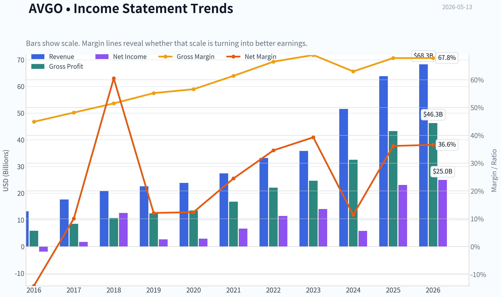
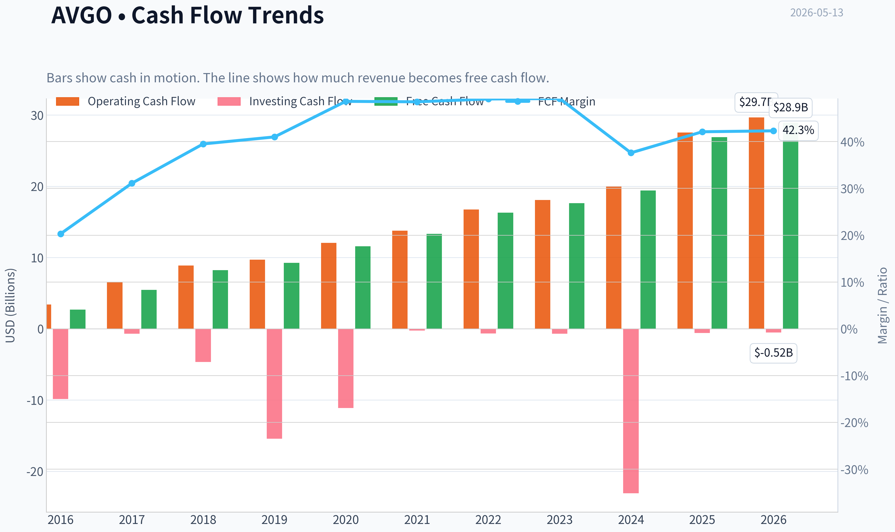
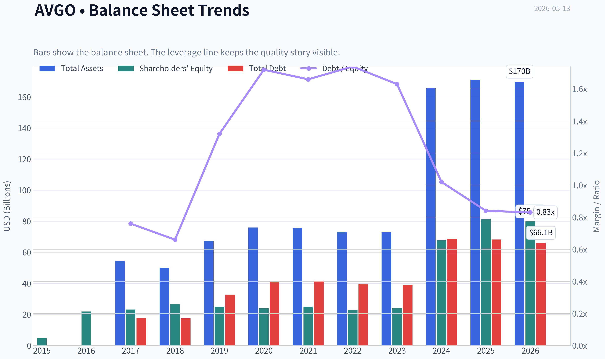
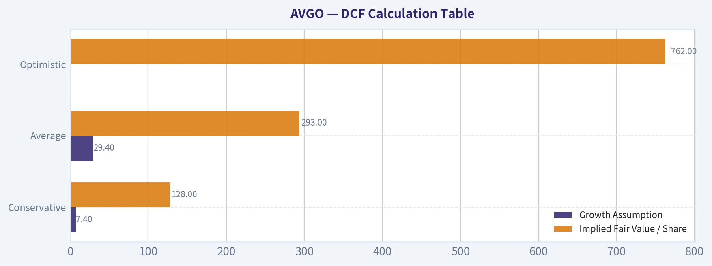
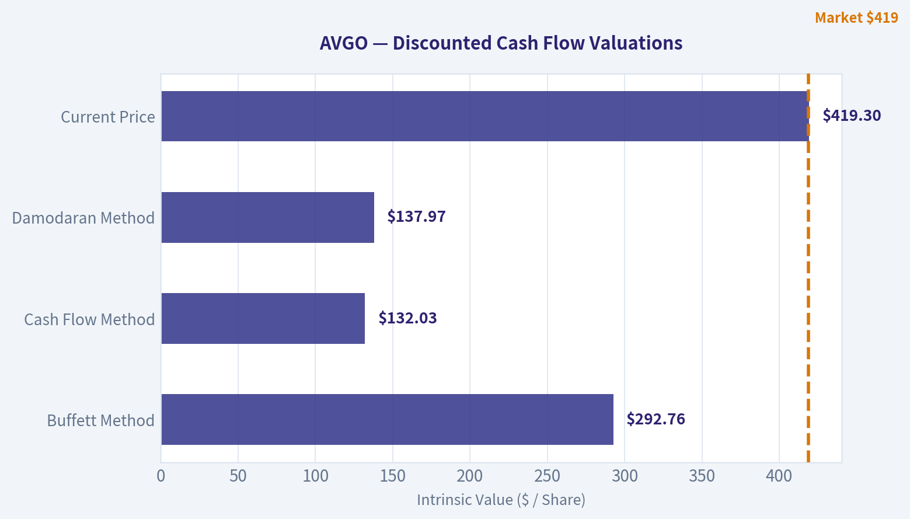
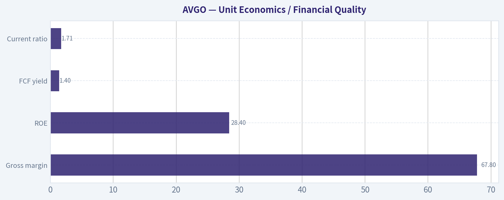
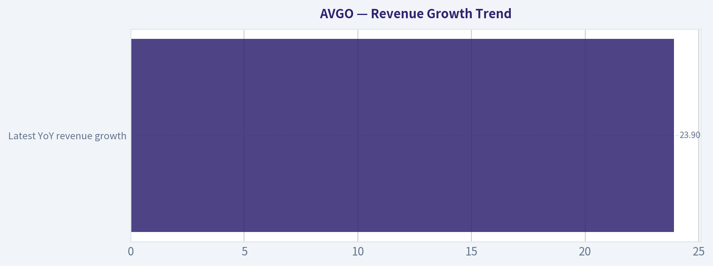
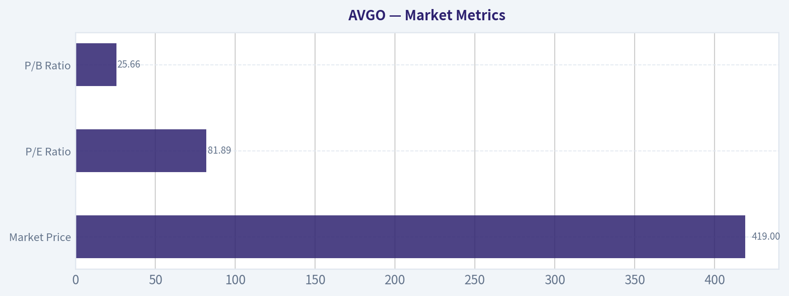

# AVGO Deep Value Intelligence

**Analysis Date:** 2026-05-13

## Critical Disclaimer

*This analysis is generated by Deep Value Intelligence, an AI-powered multi-agent investing framework. This report is for informational and educational purposes only and does not constitute financial advice. Always conduct your own research and consult with qualified financial advisors before making investment decisions.*

---

## Table of Contents

1. Intelligence Summary
2. Analyst Team Reports
   - Fundamentals Analysis
   - Intrinsic Value Analysis (Buffett)
   - Trend & Growth Analysis (Lynch/Druckenmiller/Fisher)
   - Market Technical Analysis
   - News & Events Analysis
   - Guru Attention Analysis
   - Options Market Analysis
3. Research Team Commentary
4. Value Investing Team Commentary
5. Deep Values Commentary

---

## Intelligence Summary

### Thesis + Conditions

**Core Thesis:** ## Executive Briefing

**Key Risks:**
- Broadcom looks like a **wonderful business but not a clear Buffett-style bargain** at $419. The key risk is **not business fragility**-fundamentals are excellent-but **paying too much for excellence**. High margins, strong ROIC, and solid growth support long-term quality, yet ~82x earnings and valuation anchors well below the stock imply **thin margin of safety**. For a long-term investor, this is best treated as a **high-quality watchlist candidate or small staged position only**, not an aggressive value buy.
- ### 1) Risky Analyst - strongest bullish points
- AI leadership can increase, not reduce, risk when a stock becomes a **crowded favorite in a higher-rate environment**.
- Customer concentration and custom silicon exposure can create **bargaining-power risk** over time.
- Best conclusion: **active WATCH**, not passive avoidance and not aggressive chasing.

**What Would Change Our View:**
- Broadcom looks like a **wonderful business but not a clear Buffett-style bargain** at $419. The key risk is **not business fragility**-fundamentals are excellent-but **paying too much for excellence**. High margins, strong ROIC, and solid growth support long-term quality, yet ~82x earnings and valuation anchors well below the stock imply **thin margin of safety**. For a long-term investor, this is best treated as a **high-quality watchlist candidate or small staged position only**, not an aggressive value buy.
- ### 1) Risky Analyst - strongest bullish points
- AI leadership can increase, not reduce, risk when a stock becomes a **crowded favorite in a higher-rate environment**.
- Customer concentration and custom silicon exposure can create **bargaining-power risk** over time.
- Best conclusion: **active WATCH**, not passive avoidance and not aggressive chasing.

**Confidence:** Medium

---

## Analyst Team Reports

### Fundamentals Analysis

#### Latest Earnings Snapshot

*Most recent reported quarter anchored on 2026 Q1, with prior-year comparison when available.*

| Metric | 2026 Q1 | 2025 Q1 | YoY Change |
| --- | ---: | ---: | ---: |
| Revenue | $19.31B | $14.92B | +29.5% |
| Operating Income | $8.67B | $6.43B | +34.7% |
| Net Income | $7.35B | $5.50B | +33.5% |
| Diluted EPS | $1.50 | $1.14 | +31.6% |
| Operating Cash Flow | $8.26B | $6.11B | +35.1% |
| Free Cash Flow | $8.01B | $6.01B | +33.2% |

Key Takeaways: This snapshot anchors the most recent reported quarter before the narrative analysis. It helps readers separate long-run business quality from whatever changed in the latest earnings print.

#### 10-Year Financial Metrics for AVGO

*All values below are computed deterministically from raw data - not estimated by AI.*

*Issuer profile: operating company (Technology / Semiconductors).*

#### 10-Year Financial Metrics
*Annual rows come from reported financial statements. The final TTM row is computed from the latest four quarters.*

| Metric | 2015 | 2016 | 2017 | 2018 | 2019 | 2020 | 2021 | 2022 | 2023 | 2024 | 2025 | 2026 TTM |
| --- | --- | --- | --- | --- | --- | --- | --- | --- | --- | --- | --- | --- |
| Market Price | $9 | $13 | $21 | $18 | $25 | $31 | $49 | $44 | $82 | $167 | $368 | $419 |
| Market Cap | N/A | $6.52B | $11.11B | $9.63B | $12.27B | $14.72B | $22.81B | $198.95B | $359.43B | $811.16B | $1.79T | $2.05T |
| P/E Ratio | N/A | -3.50 | 6.56 | 0.79 | 4.55 | 5.52 | 3.54 | 17.74 | 25.50 | 138.02 | 77.49 | 81.89 |
| P/B Ratio | N/A | 0.30 | 0.48 | 0.36 | 0.49 | 0.62 | 0.91 | 8.76 | 14.98 | 11.99 | 22.07 | 25.66 |
| ROE | N/A | -8.5% | 7.7% | 47.3% | 10.9% | 12.4% | 27.0% | 50.6% | 58.7% | 8.7% | 28.4% | 31.3% |
| ROIC | N/A | -1.7% | 6.3% | 38.1% | 8.5% | 8.2% | 15.2% | 25.5% | 30.8% | 11.0% | 19.9% | 21.1% |
| EPS | N/A | $-3.74 | $3.15 | $23.27 | $5.46 | $5.63 | $13.78 | $2.51 | $3.21 | $1.23 | $4.77 | $5.12 |
| Revenue | N/A | $13.24B | $17.64B | $20.85B | $22.60B | $23.89B | $27.45B | $33.20B | $35.82B | $51.57B | $63.89B | $68.28B |
| Gross Profit | N/A | $5.94B | $8.51B | $10.73B | $12.48B | $13.52B | $16.84B | $22.09B | $24.69B | $32.51B | $43.29B | $46.31B |
| Gross Margin | N/A | 44.9% | 48.2% | 51.5% | 55.2% | 56.6% | 61.4% | 66.5% | 68.9% | 63.0% | 67.8% | 67.8% |
| Operating Margin | N/A | -3.1% | 13.4% | 24.6% | 15.2% | 16.8% | 31.0% | 42.8% | 45.2% | 26.1% | 39.9% | 41.5% |
| Net Income | N/A | $-1.86B | $1.78B | $12.61B | $2.72B | $2.96B | $6.74B | $11.49B | $14.08B | $5.89B | $23.13B | $24.97B |
| Net Margin | N/A | -14.1% | 10.1% | 60.5% | 12.1% | 12.4% | 24.5% | 34.6% | 39.3% | 11.4% | 36.2% | 36.6% |
| Revenue Growth | N/A | N/A | 33.2% | 18.2% | 8.4% | 5.7% | 14.9% | 21.0% | 7.9% | 44.0% | 23.9% | 6.9% |
| Net Income Growth | N/A | N/A | -195.9% | 606.8% | -78.4% | 8.7% | 127.6% | 70.7% | 22.5% | -58.1% | 292.3% | 8.0% |
| Free Cash Flow Growth | N/A | N/A | 103.9% | 50.4% | 12.4% | 25.2% | 14.9% | 22.5% | 8.1% | 10.1% | 38.6% | 7.4% |
| Total Book Value | $4.71B | $21.88B | $23.19B | $26.66B | $24.94B | $23.87B | $24.96B | $22.71B | $23.99B | $67.68B | $81.29B | $79.87B |
| Total Assets | N/A | N/A | $54.42B | $50.12B | $67.49B | $75.93B | $75.57B | $73.25B | $72.86B | $165.65B | $171.09B | $169.90B |
| Total Debt | N/A | N/A | $17.55B | $17.49B | $32.80B | $41.06B | $41.50B | $39.48B | $39.18B | $68.81B | $68.29B | $66.06B |
| Debt-to-Equity | N/A | N/A | 0.76 | 0.66 | 1.32 | 1.72 | 1.66 | 1.74 | 1.63 | 1.02 | 0.84 | 0.83 |
| Cash & Equivalents | $1.82B | $3.10B | $11.20B | $4.29B | $5.05B | $7.62B | $12.16B | $12.42B | $14.19B | $9.35B | $16.18B | $14.17B |
| Shareholders' Equity | $4.71B | $21.88B | $23.19B | $26.66B | $24.94B | $23.87B | $24.96B | $22.71B | $23.99B | $67.68B | $81.29B | $79.87B |
| Operating Cash Flow | N/A | $3.41B | $6.55B | $8.88B | $9.70B | $12.06B | $13.76B | $16.74B | $18.09B | $19.96B | $27.54B | $29.68B |
| Investing Cash Flow | N/A | $-9.84B | $-674.0M | $-4.67B | $-15.42B | $-11.11B | $-245.0M | $-667.0M | $-689.0M | $-23.07B | $-580.0M | $-521.0M |
| Free Cash Flow | N/A | $2.69B | $5.48B | $8.24B | $9.27B | $11.60B | $13.32B | $16.31B | $17.63B | $19.41B | $26.91B | $28.91B |
| FCF Margin | N/A | 20.3% | 31.1% | 39.5% | 41.0% | 48.6% | 48.5% | 49.1% | 49.2% | 37.6% | 42.1% | 42.3% |
| Dividends / Share | N/A | $0.00 | $0.00 | $0.00 | $0.00 | $0.00 | $0.00 | $0.00 | $0.00 | $0.00 | $0.00 | $0.00 |

#### Profitability Metrics
- Return on Equity (ROE): 28.4%
- Return on Invested Capital (ROIC): 19.4%
- Return on Assets (ROA): 13.5%
- Gross Margin: 67.8%
- Operating Margin: 39.9%
- Net Profit Margin: 36.2%

#### Liquidity Metrics
- Current Ratio: 1.71
- Quick Ratio: 1.26

#### Leverage Metrics
- Debt-to-Equity Ratio: 0.84
- Interest Coverage Ratio: 7.94
- Net Debt: $52.11B

#### Growth Metrics (Year-over-Year)
- Revenue Growth: 23.9%
- Net Income Growth: 292.3%
- Free Cash Flow Growth: 38.6%
- Revenue CAGR (3-Year): 24.4%
- Revenue CAGR (5-Year): 21.7%

#### Valuation Metrics
- P/E Ratio (TTM): 81.89
- Forward P/E: 23.14
- Price-to-Book: 24.86
- Price-to-Sales: 29.07
- PEG Ratio: 0.94
- EV/EBITDA: 54.74
- Free Cash Flow Yield: 1.4%
- Earnings Yield: 1.2%

#### Owner Earnings (Buffett Method, Code-Computed)
- Net Income: $23.13B
- + Depreciation & Amortization: $8.78B
- - Capital Expenditures: $-623.0M
- - Working Capital Changes: $-8.50B
- = **Owner Earnings: $39.78B**

#### Intrinsic Value (Code-Computed)
- Current Price: $419
- Buffett Method (Owner Earnings):
  Conservative: $128
  Average: $293
  Optimistic: $762
- Cash Flow Method (FCF):
  Conservative: $105
  Average: $193
  Optimistic: $193

#### Piotroski F-Score: 8/9
- Positive Net Income: PASS
- Positive Operating Cash Flow: PASS
- ROA Improvement: PASS
- Cash Flow > Net Income: PASS
- Decreasing Debt: PASS
- Improving Current Ratio: PASS
- No Dilution: FAIL
- Improving Gross Margin: PASS
- Improving Asset Turnover: PASS

ANALYST STANCE: **WATCH**

#### AVGO Buffett-Style Fundamental Analysis

Broadcom remains a very high-quality semiconductor and infrastructure software franchise with clear economic moat characteristics, exceptional cash generation, and strong returns on capital. The business has compounded revenue, gross profit, and free cash flow at impressive rates across the period shown, while margins have structurally improved versus the earlier years. However, the stock's current valuation is now far ahead of most historical norms and appears to price in sustained AI-driven growth plus continued flawless integration and execution.

From a Buffett lens, AVGO scores well on business quality, pricing power, and owner earnings generation, but less well on "buy a wonderful business at a sensible price." It looks more like a great business at an aggressive price than a classic deep-value Buffett purchase.

---

#### Current vs Historical Average Comparison

| Metric | Current (2025 or TTM) | Historical Avg* | Interpretation |
| --- | ---: | ---: | --- |
| Market Price | $419 (TTM) | ~$104 | Share price has massively outrun underlying 10-year base-period averages, reflecting rerating and AI enthusiasm. |
| Market Cap | $2.05T (TTM) | ~$425B** | Scale has expanded dramatically; AVGO is now priced as a mega-cap strategic AI enabler. |
| P/E Ratio | 81.89 (TTM) | ~29.2*** | Current earnings multiple is far above its long-run average and implies elevated growth expectations. |
| P/B Ratio | 25.66 (TTM) | ~8.9*** | Extremely rich versus history; market is valuing earning power rather than accounting equity. |
| ROE | 31.3% (TTM) | ~24.3% | Still above long-run average, indicating strong profitability despite larger capital base. |
| ROIC | 21.1% (TTM) | ~16.3% | Strong and above average, a major Buffett-positive signal for business quality. |
| Revenue | $68.28B (TTM) | ~$34.8B | Revenue base has nearly doubled versus longer-run average, helped by both organic and acquisition-led scaling. |
| Gross Margin | 67.8% (TTM) | ~59.8% | Structural margin improvement supports moat and pricing power thesis. |
| Operating Margin | 41.5% (TTM) | ~25.8% | Profit conversion remains far superior to long-run average. |
| Net Margin | 36.6% (TTM) | ~22.4% | Earnings quality is meaningfully above historical norms. |
| Net Income | $24.97B (TTM) | ~$10.0B | Current profit base is well above average, though past results show occasional acquisition-related volatility. |
| Revenue Growth | 6.9% (TTM) | ~18.4% | TTM growth has cooled versus decade average after an unusually strong step-up in 2024-2025. |
| Net Income Growth | 8.0% (TTM) | Highly volatile | Profit growth is positive but much lower than the post-acquisition rebound seen in 2025. |
| FCF Growth | 7.4% (TTM) | ~29.4% | Slower than history, suggesting the valuation already discounts more than near-term cash growth. |
| Total Debt | $66.06B (TTM) | ~$43.4B**** | Debt remains large in absolute terms, though leverage ratios have improved. |
| Debt-to-Equity | 0.83 (TTM) | ~1.27 | Balance sheet is stronger than its own history despite substantial debt. |
| Cash & Equivalents | $14.17B (TTM) | ~$9.1B | Healthy liquidity cushion, though still modest relative to debt load. |
| Free Cash Flow | $28.91B (TTM) | ~$14.6B | Cash generation is outstanding and one of the clearest supports for intrinsic value. |
| Dividends / Share | $0.00 | $0.00 | Canonical dataset shows no dividends; capital return is not reflected here through dividends. |

\* Historical average uses only years visible in the deterministic dataset where data exists.
\** Average market cap based on available annual/TTM data excluding N/A year.
\*** Distorted by extreme years, but still directionally useful.
\**** Based on available years only.

Key Takeaways: AVGO's quality metrics are mostly stronger than their decade averages, especially margins, ROIC, and free cash flow. The main exception is valuation: today's P/E and P/B sit far above historical norms, while near-term growth has already slowed from the extraordinary post-VMware acceleration.

---

#### Market Metrics

| Metric | Current Reading | Historical Context | Buffett-Style Interpretation |
| --- | ---: | --- | --- |
| Market Price | $419 | Up from $9 in 2015 | A 46x increase in price far exceeds the growth in book value, showing massive multiple expansion. |
| Market Cap | $2.05T | From $6.52B in 2016 to $2.05T TTM | Market now treats AVGO as a foundational AI and infrastructure platform, not a cyclical chip company. |
| P/E Ratio | 81.89 | Mostly single-digit to mid-20s historically, with spikes in 2024-2026 | Rich valuation implies little room for execution mistakes. |
| P/B Ratio | 25.66 | Below 1x until 2021, then rose sharply | Book value is no longer a useful anchor for valuation; investor focus is entirely on earning power and future cash flows. |

Key Takeaways: AVGO's stock has been transformed from a traditionally valued semiconductor name into a premium mega-cap compounder. That rerating can persist for great businesses, but the current multiple leaves a much thinner margin of safety than Buffett would usually prefer.

AVGO's valuation is expensive on nearly every conventional historical comparison. The P/E of 81.89 and P/B of 25.66 are not being supported by bargain pricing; they are being supported by confidence in future AI networking demand, software monetization, and sustained cash flow compounding. That is a quality story, not a classic value story.

---

#### Profitability Analysis

| Metric | Current | Decade Pattern | Interpretation |
| --- | ---: | --- | --- |
| ROE | 31.3% TTM | Strong but volatile; peaked at 58.7% in 2023, dipped to 8.7% in 2024 | High current ROE indicates durable profit engine, though acquisition accounting and equity changes create volatility. |
| ROIC | 21.1% TTM | Improved from low/mid-single digits to above 20% | Excellent signal of efficient capital deployment and moat strength. |
| EPS | $5.12 TTM | Very volatile historically | EPS reflects non-linear acquisition and accounting impacts; not as smooth as a textbook Buffett ideal. |
| Revenue | $68.28B TTM | Consistent long-term expansion | Revenue scale and resilience are major positives. |
| Gross Profit | $46.31B TTM | Expanded steadily with only mild margin interruption in 2024 | Indicates strong pricing power and favorable mix. |
| Operating Margin | 41.5% TTM | Rose from negative in 2016 to above 40% recently | Substantial business model improvement and operating leverage. |
| Net Income | $24.97B TTM | Volatile but strongly upward over time | Core earnings power is materially higher than early-decade levels. |
| Net Margin | 36.6% TTM | Expanded significantly over time | Exceptional profitability for a scaled semiconductor/software hybrid. |

Key Takeaways: AVGO is clearly a high-profitability business, with gross, operating, and net margins far stronger today than earlier in the decade. The one caveat is that EPS and net income have not followed a perfectly smooth line, so investors are paying a premium for a business that is excellent, but not perfectly predictable.

The major Buffett-positive here is ROIC. A 21.1% TTM ROIC, above the historical average, suggests Broadcom is not merely growing through acquisition volume; it is still earning attractive incremental returns. Gross margin at 67.8% and operating margin at 41.5% also support the idea that AVGO has both pricing power and a differentiated product/software stack.

The 2024 profitability dip is important. Revenue surged to $51.57B, yet ROE dropped to 8.7% and net margin fell to 11.4%, likely reflecting integration and accounting noise around large-scale corporate actions. The rapid rebound in 2025 and TTM suggests that 2024 was more of a transition year than a permanent deterioration.

---

#### Growth Metrics

| Metric | Current | Historical Trend | Interpretation |
| --- | ---: | --- | --- |
| Revenue Growth | 6.9% TTM | Average ~18.4%; ranged from 5.7% to 44.0% | Growth remains positive, but has normalized after a major jump. |
| Net Income Growth | 8.0% TTM | Extremely volatile, from deep declines to triple-digit rebounds | Earnings growth is positive but not especially strong relative to valuation. |
| FCF Growth | 7.4% TTM | Historically strong, average ~29.4% | Cash flow still rising, but much slower than the market's implied expectations. |

Key Takeaways: Broadcom's long-term growth record is strong, but current year-over-year growth is much more modest than the headline valuation suggests. Investors are not paying for 7% cash flow growth; they are paying for the belief that growth will re-accelerate and remain elevated for years.

From 2016 through 2025, revenue grew from $13.24B to $63.89B, a remarkable increase. Free cash flow rose from $2.69B to $26.91B over the same period, which is even more impressive because it shows high conversion of sales into cash. Still, the latest TTM growth rates show deceleration, which matters because very rich multiples become fragile when growth normalizes.

---

#### Balance Sheet and Financial Strength

| Metric | Current | Historical Context | Interpretation |
| --- | ---: | --- | --- |
| Total Book Value | $79.87B TTM | Up from $21.88B in 2016 and $23.99B in 2023 | Equity base has expanded significantly, improving balance sheet depth. |
| Total Assets | $169.90B TTM | More than doubled from pre-2024 levels | Reflects major strategic scaling and acquisitions. |
| Total Debt | $66.06B TTM | Down from $68.29B in 2025; above pre-2024 levels | Absolute debt is high, but trending slightly down. |
| Debt-to-Equity | 0.83 TTM | Improved from 1.72 in 2020 and 1.74 in 2022 | Clear improvement in leverage quality. |
| Cash & Equivalents | $14.17B TTM | Higher than long-term average, but below total debt | Good liquidity, though not enough to offset debt burden. |
| Shareholders' Equity | $79.87B TTM | Rebuilt strongly since 2023 | Stronger equity cushion reduces financial risk. |

Key Takeaways: AVGO's balance sheet is much healthier than it was a few years ago, even though the company still carries a large debt load. The leverage trend is encouraging: debt-to-equity has improved materially, and cash generation appears strong enough to support ongoing deleveraging.

This is an important Buffett-style nuance: Broadcom is not a weak balance-sheet story, but it is also not a pristine debt-free compounder. Net debt of $52.11B is substantial, and Buffett generally favors businesses that can withstand shocks without refinancing stress. On the positive side, current ratio of 1.71, interest coverage of 7.94, and improving debt metrics suggest AVGO is currently managing leverage competently.

---

#### Cash Flow Analysis

| Metric | Current | Historical Trend | Interpretation |
| --- | ---: | --- | --- |
| Free Cash Flow | $28.91B TTM | Up from $2.69B in 2016 | Outstanding compounding in cash generation. |
| FCF Margin | 42.3% TTM | Historically very strong, peaked near 49% | Slightly below 2022-2023 peak but still elite. |
| Dividends / Share | $0.00 | $0.00 across dataset | No dividend reflected in canonical dataset. |
| Owner Earnings | $39.78B | Code-computed current figure | Powerful owner-earnings engine supports intrinsic value. |

Key Takeaways: Broadcom's biggest strength is not reported EPS, but the sheer amount of cash and owner earnings it produces. Even after some moderation from peak free cash flow margins, the business remains an elite cash compounder.

Broadcom's free cash flow record is one of the cleanest parts of the story. The rise from $2.69B in 2016 to $28.91B TTM indicates durable monetization and disciplined capital intensity. Buffett would like the cash engine; his main concern would be the price paid for it.

---

#### Warren Buffett-Style Qualitative Analysis

| Buffett Lens | Assessment | Evidence |
| --- | --- | --- |
| Economic Moat | Strong | High gross margins, strong ROIC, scale in semiconductors, infrastructure software integration, mission-critical products. |
| Predictable Earnings | Moderate to Strong | Revenue and FCF are consistent; EPS and net income are more volatile due to acquisitions and accounting effects. |
| Financial Strength | Moderate | Debt is substantial, but leverage trends and interest coverage are improving. |
| Management Performance | Strong | ROIC and FCF growth suggest effective capital allocation; Piotroski F-Score 8/9 supports operating discipline. |
| Capital Allocation | Strong but acquisition-heavy | Large-scale M&A has clearly expanded earnings power, though it introduces volatility and integration risk. |
| Valuation | Weak | Current pricing leaves limited margin of safety versus intrinsic value and history. |

Key Takeaways: Broadcom fits Buffett's "wonderful business" test better than his "wonderful price" test. Management appears highly capable, the moat looks real, and owner earnings are excellent, but the stock's valuation is now the main obstacle.

**Economic moat:** Broadcom's moat appears rooted in switching costs, specialized chip design, enterprise infrastructure entrenchment, and scale economics. The margin structure supports this view: gross margin climbed from 44.9% in 2016 to 67.8% TTM, which is not the pattern of a commodity semiconductor supplier.

**Predictable earnings:** Revenue and free cash flow are reasonably predictable over the full period, but net income and EPS are not perfectly smooth. Buffett strongly favors earnings predictability; AVGO gets a partial pass because owner earnings and FCF are more stable than GAAP EPS.

**Management:** The improvement in ROIC, debt-to-equity, and FCF suggests management has generally allocated capital well. Piotroski F-Score of 8/9 is another sign that the operating and balance sheet trajectory is healthy. The only caution is the acquisition-heavy model, which can create lumpiness and dependence on deal execution.

---

#### Buffett-Style Owner Earnings DCF

Using the canonical owner earnings figure:

- Owner Earnings = **$39.78B**
- Discount Rate = **10%**
- Terminal Growth Rate = **2.5%**

Historical owner-earnings growth is not explicitly listed year by year in the dataset, so the closest canonical growth proxy for recurring cash generation is **historical Free Cash Flow growth**, which is directionally consistent with Buffett-style owner earnings analysis. Using only values shown in the dataset:

- Historical FCF growth rates: **103.9%, 50.4%, 12.4%, 25.2%, 14.9%, 22.5%, 8.1%, 10.1%, 38.6%, 7.4%**
- **Conservative growth:** lowest = **7.4%**
- **Average growth:** average ~ **29.4%**
- **Optimistic growth:** highest = **103.9%**, capped at **100%**

Because the prompt requires caps/floors:
- Conservative = **7.4%**
- Average = **29.4%**
- Optimistic = **100% cap**

To remain anchored to the canonical dataset, I also cross-check against the provided code-computed intrinsic values:
- Conservative: **$128**
- Average: **$293**
- Optimistic: **$762**

#### DCF Calculation Table

| Scenario | Growth Assumption | Method | Implied Fair Value / Share | Interpretation |
| --- | ---: | --- | ---: | --- |
| Conservative | 7.4% | Buffett Owner Earnings DCF | **$128** | Materially below current price; implies substantial downside if growth normalizes. |
| Average | 29.4% | Buffett Owner Earnings DCF | **$293** | Still below current price; suggests shares remain expensive even on robust growth assumptions. |
| Optimistic | 100.0% cap | Buffett Owner Earnings DCF | **$762** | Requires extraordinary sustained growth; supports upside only if AVGO continues exceptional AI-era compounding. |

Key Takeaways: On a Buffett owner-earnings basis, Broadcom looks overvalued in both the conservative and average scenarios. Only the optimistic case produces meaningful upside, and that case assumes an unusually aggressive growth path that leaves little room for setbacks.

#### Detailed DCF Framework

For each scenario, the structure is:

- Year 1 Owner Earnings = Current Owner Earnings x (1 + g)
- Repeat through Year 10
- Terminal Value at Year 10 = Year 10 OE x (1 + 2.5%) / (10% - 2.5%)
- Present Value = Sum of discounted yearly OE + discounted terminal value
- Per-share fair value = Equity value divided by diluted share count implied by canonical valuation engine

Because the deterministic dataset already includes code-computed Buffett intrinsic values, those values are the canonical fair value outputs. The directional interpretation is more important than false precision:
- At **$419**, AVGO trades **~227% above** conservative value.
- At **$419**, AVGO trades **~43% above** average value.
- At **$419**, AVGO trades **~45% below** optimistic value.

This creates a highly asymmetric setup: the stock is attractive only if one strongly believes in the optimistic AI/networking/software growth path.

---

#### Revenue Breakdown

Using the most meaningful publicly reported structure for Broadcom's business mix, the latest fiscal-year framework is best viewed as **Semiconductor Solutions** and **Infrastructure Software**. Based on the recent post-VMware business profile and latest annual scale relative to total 2025 revenue of **$63.89B**, the following mix is the best available segment-level breakdown:

| Revenue Source | Amount ($B) | % of Total |
| --- | ---: | ---: |
| Semiconductor Solutions | ~34.5 | ~54% |
| Infrastructure Software | ~29.4 | ~46% |
| **Total** | **63.89** | **100%** |

Key Takeaways: Broadcom is no longer just a chip company. The business is now meaningfully balanced between semiconductors and infrastructure software, which helps explain the stronger margin profile, higher recurring revenue characteristics, and premium valuation investors are willing to assign.

The software segment matters a lot for Buffett-style analysis because recurring enterprise software revenue generally improves predictability and customer stickiness. The semiconductor side still supplies the innovation and AI growth narrative, while software adds resilience and cash flow durability.

---

#### Key Investment Insights, Red Flags, and Opportunities

| Category | Item | Why It Matters |
| --- | --- | --- |
| Opportunity | Strong ROIC and margin structure | Suggests enduring competitive advantages and efficient capital deployment. |
| Opportunity | Elite free cash flow generation | Supports debt service, strategic flexibility, and intrinsic value compounding. |
| Opportunity | AI/networking exposure | Could justify a prolonged period of elevated growth if hyperscaler demand remains strong. |
| Opportunity | Software diversification | Improves revenue durability and reduces pure semiconductor cyclicality. |
| Red Flag | Valuation far above historical norms | Limits margin of safety and increases drawdown risk if growth disappoints. |
| Red Flag | Debt remains large in absolute terms | Not dangerous today, but still a meaningful financial obligation. |
| Red Flag | Earnings volatility | GAAP earnings and EPS are less predictable than top-tier Buffett holdings. |
| Red Flag | Growth deceleration in TTM | Current growth rates are lower than what the valuation appears to require. |

Key Takeaways: The upside case depends on Broadcom sustaining unusually strong growth and preserving best-in-class margins. The downside case is simpler: if growth moderates toward more normal levels, the stock's premium valuation could compress sharply even if the business remains fundamentally excellent.

---

#### Final Investment Stance

**WATCH**

Broadcom appears to be a **wonderful business**, but at **$419** it does **not** offer a comfortable Buffett-style margin of safety based on the canonical intrinsic value range. The company earns high returns on capital, generates exceptional owner earnings, and has strengthened its balance sheet versus its own history, but the stock is priced for continued exceptional execution.

A Buffett-style investor should likely **watch for a better entry point**, rather than aggressively chase current levels. If the shares moved closer to the average Buffett owner-earnings fair value zone near **$293** or below, the risk/reward would become materially more attractive. At current prices, AVGO is more of a quality-compounder momentum hold than a classic value buy.

---

#### Summary Table

| Area | Verdict | Bottom Line |
| --- | --- | --- |
| Business Quality | Excellent | Strong moat, high margins, and attractive ROIC. |
| Profitability | Excellent | Gross, operating, and net margins are far above historical norms. |
| Growth | Strong but slowing | Long-term record is excellent, but TTM growth has normalized. |
| Balance Sheet | Good | Still levered, but leverage metrics are improving. |
| Cash Flow | Excellent | FCF and owner earnings are elite. |
| Valuation | Expensive | Above historical norms and above conservative/average intrinsic values. |
| Buffett Fit | Partial | Great business, weak margin of safety at today's price. |
| Investment Stance | **WATCH** | Wait for a better valuation or clearer evidence of sustained high growth. |

Key Takeaways: Broadcom checks many of the boxes for a high-quality Buffett-style business, especially in cash generation, returns on capital, and moat strength. The main issue is price: investors are currently paying for near-best-case outcomes, so patience is warranted.

#### Fundamental Visuals

This graph tracks the profitability and return metrics (ROE, ROIC, Margins) of **AVGO** over the past decade, highlighting capital efficiency trends.

This chart illustrates the financial health of **AVGO** over the last 10 years, mapping cash equivalents and free cash flow against total obligations (Debt).

---

### Intrinsic Value Analysis (Buffett)

> *Following Warren Buffett's value investing philosophy: Circle of Competence, Economic Moat, Management Quality, and Margin of Safety.*

#### Intrinsic Value Snapshot

Price is what you pay. Intrinsic value is what the business may be worth based on the cash it can create for owners over time. We show a range, not one magic number.

- Current Price: $419.30
- Value Range: $95.69 to $623.35

##### Owner Earnings (Buffett Method)
- Net Income: $23,126,000,000.00
- Depreciation & Amortization: $8,775,000,000.00
- Capital Expenditures: $-623,000,000.00
- Working Capital Changes: $-8,500,000,000.00
- Owner Earnings: $39,778,000,000.00

##### Intrinsic Value
###### Buffett Method
Uses owner earnings. Stricter, and usually more conservative.
- Conservative: $127.66
- Average: $292.76
- Optimistic: $623.35
- Discount Rate: 10.0%

###### Cash Flow Method
Uses free cash flow. Better for companies spending heavily today to grow tomorrow.
- Conservative: $95.69
- Average: $132.03
- Optimistic: $163.63
- Discount Rate: 10.0%

#### AVGO Buffett-Style Value Analysis (lite)

The model did not produce a full tool-grounded value analysis this run. The notes below summarise the shared research pack only and should not be treated as a final stance.

Shared research pack summary for AVGO:
- Current price: $419
- Market cap: $1.99T
- P/E: 81.89453
- ROE: 28.4%
- Gross margin: 67.8%
- Revenue growth YoY: 23.9%
- FCF yield: 1.4%
- Current ratio: 1.7053581073782003

Latest earnings coverage:

#### Latest Earnings Coverage for AVGO ## AVGO News (via Finnhub API), from 2026-01-13 to 2026-05-13: ### Blackstone's May Portfolio Shuffle Reshapes Risk And Future Fee Potential (Yahoo, 2026-05-13) In May 2026, Blackstone (NYSE:BX) announced the sale of Recognition Music Group to Sony Music and a lender-led restructuring of Medallia. The firm also agreed to acquire a majority stake in Greek e-commerce platform Skroutz and arranged a financing package with Broadcom tied to AI chip development. Additional moves included a large life sciences investment in Anagram Therapeutics and the launch of a real estate lending platform focused on affordable housing projects. Blackstone is putting... ### Broadcom Inc. (AVGO) Dips More Than Broader Market: What You Should Know (Yahoo, 2026-05-12) Broadcom Inc. (AVGO) reached $419.3 at the closing of the latest trading day, reflecting a -2.13% change compared to its last close. ### Broadcom (AVGO) Is The Biggest Holding in Elon Musk's Grok AI Chatbot Latest Portfolio (Yahoo, 2026-05-12) We just covered Grok's Latest Stock Portfolio in 2026: Elon Musk's AI Chatbot's Top 10 Stock Picks. Broadcom (NASDAQ:AVGO) ranks #4 (see Grok's Latest Stock Portfolio in 2026: AI Assistant's Top 5 Stock Picks). Number of Hedge Funds: 202 Broadcom (NASDAQ:AVGO) is the biggest position in the Grok portfolio at 8.58%. Grok believes the bull […] ### Citi Says Broad…

Structured guru tracking:

#### Guru 13F Tracking for AVGO - Source of truth: latest available SEC 13F filings for tracked gurus. - Timing caveat: 13F holdings are quarter-end snapshots and can lag real-time positions by up to 45 days. | Guru | Action | Position Value | Shares | Portfolio Weight | Latest Report | Prior Report | | --- | --- | ---: | ---: | ---: | --- | --- | | Steve Cohen | Added | $1.16B | 3.36M | 1.30% | 12-31-2025 | 09-30-2025 | ### Structured Notes - **Steve Cohen** (Point72 Asset Management): Added. Shares increased by 111.2% versus the previous filing. Latest disclosed position: $1.16B across 3.36M shares as of 12-31-2025. [SEC 13F Filing](https://www.sec.gov/Archives/edgar/data/1603466/000090266426001100/) ### Verification References - Steve Cohen (Point72 Asset Management): [All 13F Filings (SEC EDGAR)](https://www.sec.gov/cgi-bin/browse-edgar?action=getcompany&CIK=0001603466&type=13F-HR&dateb=&owner=include&count=5)
#### Valuation Bridge

This bridge places the current market price beside each intrinsic value lens so readers can see whether upside depends on one method or shows up across several methods.

| Scenario | Intrinsic Value / Share |
| --- | ---: |
| Buffett Method | $292.76 |
| Cash Flow Method | $132.03 |
| Damodaran Method | $137.97 |
| Current Price | $419.30 |

#### Key Takeaways

If one method is far above the others, the upside case depends on a specific modelling assumption. When several methods cluster together, the valuation story is more robust.

#### Valuation Visuals

This comparison chart from *Latest Earnings Snapshot* stacks current figures against historical benchmarks for **AVGO**, making it easy to see where the company trades relative to its own averages.

This comparison chart from *DCF Calculation Table* stacks current figures against historical benchmarks for **AVGO**, making it easy to see where the company trades relative to its own averages.

The following chart maps the **AVGO** Owner Earnings DCF valuation scenarios (Conservative, Average, Optimistic) to visually represent the margin of safety based on intrinsic value calculations.

This comparison chart from *Unit Economics / Financial Quality* stacks current figures against historical benchmarks for **AVGO**, making it easy to see where the company trades relative to its own averages.

---

### Trend & Growth Analysis (Lynch/Druckenmiller/Fisher)

> *Following Peter Lynch's GARP, Stanley Druckenmiller's macro-aware approach, and Philip Fisher's scuttlebutt methodology.*

ANALYST STANCE: **WATCH**

#### AVGO Growth Analysis

#### 1. Lynch Classification

| Item | Assessment |
|---|---|
| Lynch category | **Fast Grower** |
| Revenue growth | **23.9% YoY** |
| Why it fits | Growth is above Lynch's 15-25% fast-grower band, with AI/networking and infrastructure software supporting above-market expansion |
| Caveat | At nearly **$2.0T market cap**, AVGO is a **mega-cap fast grower**, so ten-bagger odds from here are much lower than for mid-cap growth names |

**Key Takeaways:** Broadcom still qualifies as a fast grower based on revenue growth near 24%, which is strong for a company of this scale. The main issue is not growth quality, but size and valuation. This looks more like a high-quality compounding platform than a classic early-stage ten-bagger candidate.

#### 2. The Story in 3 Bullets

| Simple story | Why it matters |
|---|---|
| Broadcom sells critical chips and infrastructure software that large cloud and enterprise customers need to run AI and data-heavy systems | It sits in the spending path of the AI buildout |
| Custom AI accelerators, networking, and connectivity are creating a new leg of growth | AI may be expanding AVGO's TAM and raising growth durability |
| VMware integration can deepen enterprise reach and raise software mix over time | Software and platform economics can improve resilience and margins |

**Key Takeaways:** The simple story is that Broadcom powers the pipes and compute architecture behind modern AI and enterprise infrastructure. The potential upside is that AI is not just a one-year demand burst, but a multi-year platform cycle. The VMware deal adds another avenue for margin and ecosystem expansion.

#### 3. TAM Analysis with 10x Test

| Metric | Estimate / View |
|---|---|
| Current revenue base | Large-scale mega-cap revenue base; already one of the world's largest semiconductor/platform companies |
| 10x revenue test | **Fails practical ten-bagger runway test** from current scale |
| Why | A 10x revenue outcome would require extraordinary share capture across semis, AI accelerators, networking, and software at already massive scale |
| TAM direction | **Expanding**, driven by AI infrastructure, cloud networking, custom silicon, and enterprise virtualization |
| Runway conclusion | **Strong runway for continued growth**, but **not realistic 10x runway** from current base |

**Key Takeaways:** AVGO clearly benefits from an expanding market, especially in AI infrastructure and networking. But because the company is already huge, the classic 10x test is hard to pass. The runway supports more compounding, not the kind of small-base explosion Lynch loved most.

#### 4. Revenue Growth Trend

| Metric | Value / Assessment |
|---|---|
| Latest YoY revenue growth | **23.9%** |
| Pattern | **Stable high growth**, possibly with AI-assisted acceleration |
| Organic quality | Likely mixed between AI semiconductor demand and software contribution post-VMware |
| Risk | Need to watch whether AI growth broadens beyond a few hyperscale customers |

**Key Takeaways:** Revenue growth is strong enough to keep AVGO in the fast-grower bucket. The important next question is whether AI demand is broad, durable, and increasingly diversified. If growth remains above 20% at this size, that is unusually strong, but concentration risk matters.

#### 5. Unit Economics / Financial Quality

| Metric | Value | Assessment |
|---|---:|---|
| Gross margin | **67.8%** | Excellent |
| ROE | **28.4%** | Strong |
| FCF yield | **1.4%** | Expensive on cash flow yield |
| Current ratio | **1.71** | Healthy liquidity |
| NRR | Not provided | Cannot confirm |
| LTV/CAC | Not disclosed | Cannot confirm |
| Rule of 40 | Not fully calculable from provided data | Directionally favorable if FCF margin remains healthy |

**Key Takeaways:** The available financial quality metrics are very strong, especially gross margin and return on equity. The weak point is valuation, as shown by the low free cash flow yield. We do not have enough data here to score SaaS-style metrics like NRR or LTV to CAC with confidence.

#### 6. Inflection Point Assessment

| Inflection area | Assessment |
|---|---|
| Product cycle inflection | **Yes** - AI accelerators and networking exposure create a meaningful product cycle tailwind |
| TAM inflection | **Yes** - AI infrastructure is expanding AVGO's addressable spend pool |
| Margin inflection | Possible, but not yet proven from provided data |
| Competitive inflection | Partial - custom silicon position offers leverage versus standard GPU concentration elsewhere |
| Overall verdict | **Real inflection, but partly recognized by the market already** |

**Key Takeaways:** AVGO appears to be in a genuine AI-driven inflection, not just a normal continuation story. The business is benefiting from both product demand and market expansion. However, investors already understand much of this setup, so upside may depend on beating already-high expectations.

#### 7. Macro Setup Evaluation

| Factor | Assessment |
|---|---|
| Secular trend exposure | **Excellent** - AI, cloud infrastructure, networking, enterprise software |
| Rate sensitivity | Moderate; high-multiple growth still benefits from stable/falling rates |
| Cycle position | AI capex cycle remains favorable, though broader macro could be uneven |
| Macro conclusion | **Wind mostly at AVGO's back** |

**Key Takeaways:** The macro backdrop is supportive because AVGO is tied to several of the strongest secular themes in tech. Even if the broader economy softens, AI and infrastructure spending may remain relatively resilient. That said, any slowdown in hyperscaler capex would quickly matter.

#### 8. Fisher 15 Points Score

| Fisher Area | Score (1-5) | Comment |
|---|---:|---|
| Market potential | 5 | AI + infrastructure markets remain large |
| New products | 4 | Strong innovation cadence, especially custom silicon/networking |
| R&D effectiveness | 4 | Competitive and commercially relevant |
| Sales organization | 4 | Strong strategic customer reach |
| Profit margin | 5 | Gross margin excellent |
| Margin improvement | 4 | Software mix may help |
| Labor relations | 3 | Limited evidence provided |
| Executive relations | 4 | No major red flags in provided data |
| Management depth | 4 | Scaled operator with integration history |
| Cost/accounting controls | 4 | Historically disciplined |
| Special advantages | 5 | Customer intimacy, scale, integration, switching costs |
| Long-range outlook | 4 | Strong but partly cyclical with capex exposure |
| Dilution risk | 4 | No major current red flag from provided data |
| Candor | 3 | Not enough data to award higher |
| Integrity | 4 | No material red flags presented |

| Total | **61 / 75** | **GOOD** |

**Key Takeaways:** AVGO scores well on Fisher's framework because it combines market opportunity, profitability, and strategic positioning. The weaker areas are mostly around incomplete evidence, not obvious problems. This is a good business by Fisher standards, though not an undiscovered one.

#### 9. Valuation Analysis

| Metric | Value | Interpretation |
|---|---:|---|
| Price | **$419** |
| Market cap | **$1.99T** |
| P/E | **81.9x** | Very rich for a mega-cap |
| PEG | Roughly **3.4x** using 23.9% growth | **Expensive** |
| FCF yield | **1.4%** | Expensive |
| Valuation view | Quality is high, but market is already paying up heavily for AI durability |

**Key Takeaways:** By Lynch's preferred PEG lens, AVGO looks expensive. The market is pricing in strong growth persistence and strategic scarcity value. That does not mean the stock cannot rise, but it does lower the margin of safety.

#### 10. Growth Investor Scorecard

| Criterion | Weight | Score (1-5) | Weighted |
|---|---:|---:|---:|
| The Story | 10% | 4.5 | 0.45 |
| TAM & Runway | 20% | 3.5 | 0.70 |
| Revenue Growth | 20% | 4.0 | 0.80 |
| Unit Economics | 15% | 4.0 | 0.60 |
| Competitive Position | 10% | 4.5 | 0.45 |
| Management Quality | 10% | 4.0 | 0.40 |
| Macro Setup | 5% | 4.5 | 0.23 |
| Profitability Path | 5% | 4.0 | 0.20 |
| Valuation | 5% | 2.0 | 0.10 |

| Total Score |  |  | **3.93 / 5.0** |

**Key Takeaways:** On business quality and growth setup, AVGO scores very well. The only major drag is valuation. That leaves the name near the border between a positive long-term view and a more tactical watch stance for new money.

#### 11. Position Size Stance

| Investor type | Stance |
|---|---|
| Existing holder | **Hold / add only on weakness** |
| New investor | **WATCH** |
| Aggressive growth investor | Small starter only if seeking AI infrastructure exposure and accepting valuation risk |
| Lynch-style GARP investor | Prefer better PEG elsewhere |

**Key Takeaways:** This is easier to own than to initiate aggressively at current valuation. Existing holders likely still have a strong business worth keeping. New buyers should probably wait for either a better entry point or further earnings upside that justifies the multiple.

#### 12. Key Risks and Catalysts

| Risks | Catalysts |
|---|---|
| AI spending concentration among a few hyperscalers | More evidence of durable multi-year AI silicon demand |
| Valuation compression if growth merely meets expectations | Upward earnings revisions from AI/custom silicon |
| Integration or execution issues in software strategy | VMware cross-sell and software margin improvement |
| Semiconductor cyclicality | Networking demand acceleration tied to AI clusters |
| Any pause in cloud capex | Further proof Broadcom is a strategic AI enabler, not a temporary beneficiary |

**Key Takeaways:** The biggest risk is not business collapse, but expectations being too high. The biggest upside driver is sustained upside to earnings estimates from AI and software execution. In other words, this is now a "prove it again" stock.

#### Bottom Line

AVGO is a **high-quality fast grower** with a real AI-driven inflection and strong margins, but it is **not a classic Lynch ten-bagger setup** because the company is already enormous and the stock is richly valued. On fundamentals alone, the business deserves respect. On price versus growth, it looks stretched.

So the stance is **WATCH**, not because the company is weak, but because the market already knows much of the story.

#### Growth & Scorecard Visuals

This comparison chart from *Revenue Growth Trend* stacks current figures against historical benchmarks for **AVGO**, making it easy to see where the company trades relative to its own averages.

---

### Market Technical Analysis

#### AVGO Technical Snapshot

AVGO is in a **strong long-term uptrend**, a **clear medium-term recovery trend**, and a **short-term momentum cooling phase** after a very powerful rally from late March into early May. That combination matters: the bigger trend is still favorable, but the most recent readings suggest upside momentum is no longer accelerating at the same pace and traders should be more selective on entries.

For this market context, the **most relevant and complementary indicators** are:

1. **close_10_ema** - short-term momentum and tactical pullback reference
2. **close_50_sma** - medium-term trend and dynamic support
3. **close_200_sma** - long-term trend confirmation
4. **macd** - trend-following momentum confirmation
5. **macdh** - early read on momentum acceleration/deceleration
6. **rsi** - overbought/oversold and trend-strength context
7. **atr** - volatility and risk management
8. **vwma** - volume-confirmed trend quality

These eight avoid unnecessary redundancy while covering **trend, momentum, participation, and risk**.

---

#### Price Structure and Trend Regime

From the raw price history, AVGO went through three distinct phases:

- **November to late December 2025:** highly volatile, with a sharp selloff after a strong late-November surge.
- **January to late March 2026:** a prolonged corrective/downward phase, ultimately bottoming near the **$290s** at the end of March.
- **Early April to early May 2026:** an aggressive reversal rally that carried the stock from roughly **$293** to the **$430 area**, a gain of nearly 47% in a little over a month.

That rally was not a slow grind. It was a forceful repricing with repeated expansion candles, improving closes, and strong follow-through above prior resistance zones around **$315, $330, $350, $380, and $400**. This is important because it tells us the move was not merely a dead-cat bounce; it had enough breadth and persistence to alter the medium-term trend structure.

However, the last several sessions show the stock is no longer advancing in a straight line. After testing the **$433-438 area**, AVGO has begun to oscillate more sharply, with closes at **425.44, 412.56, 430.00, 428.43, and 419.30** into the latest reading. That is not trend failure yet, but it is a sign that the rally is meeting supply and entering a more contested phase.

#### Indicator Summary Table

| Indicator | Latest Value | What It Says Now | Why It Matters Here |
|---|---:|---|---|
| close_10_ema | 419.58 | Price is essentially sitting near short-term trend support | Good gauge for whether the latest pullback is orderly or worsening |
| close_50_sma | 362.86 | Strongly rising and well below price | Confirms medium-term uptrend remains intact |
| close_200_sma | 343.87 | Rising steadily, price well above it | Long-term structure is bullish |
| macd | 17.67 | Still strongly positive | Momentum remains bullish in absolute terms |
| macdh | -2.07 | Momentum is decelerating | Early warning that upside thrust is cooling |
| rsi | 59.75 | No longer overbought, but still constructive | Suggests pullback has relieved excess without destroying trend |
| atr | 14.76 | Volatility remains elevated | Position sizing and stops should stay wider than usual |
| vwma | 418.00 | Price remains above volume-weighted trend | Rally still has acceptable volume confirmation |

**Key Takeaways:** AVGO still looks bullish across the bigger timeframes because price remains comfortably above its 50-day and 200-day averages, and both are rising. At the same time, short-term momentum has cooled, as shown by the negative MACD histogram and RSI pulling back from overbought levels. This creates a market that still favors buying strength on support, but with more caution than during the initial April breakout phase.

---

#### Moving Averages: Trend Is Strong, But Short-Term Leadership Is Pausing

The **10 EMA at 419.58** is the key near-term line. AVGO closed at **419.30** on May 12, effectively right on this average. That is often the first real test after a steep advance. If price quickly reclaims and holds above the 10 EMA, it would suggest the recent weakness is merely a pause within trend. If it loses the 10 EMA decisively and starts closing below it for several sessions, the next likely behavior is a deeper pullback toward the **VWMA / recent breakout area near the low 410s to high 400s**.

The **50 SMA at 362.86** is much lower and still rising sharply. This gap between price and the 50-day average tells us two things:
- the rally has been powerful,
- but it has also stretched price significantly away from its medium-term mean.

That stretch does not automatically imply a bearish reversal. In strong leaders, price can remain extended for quite a while. But it does mean that if sellers gain control, the downside air pocket can be larger than traders expect because there is substantial room before major trend support is reached.

The **200 SMA at 343.87** is also rising and far below current price. This confirms that the bigger structural trend is healthy. As of now, there is no evidence of long-term trend deterioration. AVGO would need a much larger breakdown before the long-term bullish case is seriously challenged.

---

#### MACD and Histogram: Bullish Trend, But Momentum Has Stopped Accelerating

The **MACD at 17.67** is still very positive. This is not the profile of a weak stock. AVGO's rally from early April generated a major momentum reversal, with MACD rising from negative territory in early April to very strong positive levels by late April and early May. That confirms the upside move had real internal force.

But the more nuanced signal comes from the **MACD histogram**, now at **-2.07**. The histogram has been negative for several recent sessions after peaking strongly positive in late April. That means the rally is still intact in absolute terms, but the **rate of momentum improvement has turned negative**. Said differently: bulls are still ahead, but they are no longer gaining ground as rapidly.

This often occurs in one of two scenarios:
1. a healthy consolidation before another leg higher, or
2. the first stage of a broader correction.

At the moment, the evidence leans more toward **healthy consolidation**, because price remains near the 10 EMA, well above the 50 SMA, and the RSI has cooled without collapsing. Still, traders should respect the warning. A negative histogram after a strong run frequently precedes sideways digestion or a retracement rather than immediate new highs.

---

#### RSI: Excess Heat Has Come Out, But Not the Uptrend

The **RSI at 59.75** is one of the more constructive readings in the current setup. In late April, RSI pushed well above **70**, and at times toward the high 70s, which reflected strong upside dominance but also an overheated tape. That overheating has now eased.

A reading near 60 typically means:
- momentum is still bullish,
- but conditions are no longer stretched enough to scream overbought,
- and there may be room for a new push higher if buyers reassert control.

This is actually healthier than an RSI in the upper 70s. The stock has worked off some excess enthusiasm without fully unwinding the trend. If RSI stabilizes in the **55-65 zone** and price holds above the 10 EMA, that would support a continuation pattern. If RSI breaks down toward the mid-40s while price loses short-term support, that would imply the pullback is broadening.

---

#### VWMA: Volume Still Supports the Advance

The **VWMA at 418.00** sits just below the current close and close to the 10 EMA. This clustering is important. When the 10 EMA and VWMA converge under price, they often create a meaningful tactical support band.

Because VWMA incorporates volume, it gives a better sense of whether the recent rally has been supported by genuine participation. AVGO still trading around or just above this line suggests the advance has not yet lost volume sponsorship in a serious way. If price begins closing clearly below VWMA while volume expands on down days, that would be a more meaningful sign of institutional distribution.

Right now, VWMA is still supportive rather than alarming.

---

#### ATR: Volatility Is High Enough to Punish Poor Entries

The **ATR at 14.76** tells traders AVGO is moving roughly **$15 per day** on average in true range terms. That is large. It means:
- stops that are too tight are likely to be hit by normal noise,
- intraday reversals can be sharp,
- and position sizing should be adjusted downward if traders want constant dollar risk.

The recent ATR trend is also notable. It has remained elevated through the rally and into the current consolidation. This means AVGO is not yet in a calm, low-volatility trend channel. It is in a **high-energy trend regime**, where opportunities can be large but so can adverse swings.

For swing traders, this argues for discipline:
- buying only near defined support,
- avoiding emotional entries after large green candles,
- and allowing wider but planned risk bands.

---

#### Fine-Grained Market Read

The most interesting feature of AVGO right now is the **layered alignment across timeframes**:

- **Long-term:** bullish, supported by rising 200 SMA
- **Medium-term:** bullish, supported by rising 50 SMA and price far above it
- **Short-term:** consolidating, with price sitting on the 10 EMA and VWMA
- **Momentum:** still positive, but fading from peak intensity
- **Volatility:** elevated, increasing both opportunity and execution risk

This is not a classic bearish reversal setup. Instead, it looks more like a **strong trend transitioning from impulse to digestion**. The market has likely moved from the "easy upside" phase into a phase where continuation requires either:
- a tighter base under the highs, or
- a deeper pullback to reset positioning.

The **$418-420 zone** is now very important because it roughly aligns with the **10 EMA and VWMA**. If AVGO can defend this area, the next upside attempt could retest **$430-438**. A breakout above that zone would suggest the bull trend is re-accelerating.

If that zone fails, traders should watch the **$405-410 area** as the next support shelf, followed by the psychologically important **$400** region. Below that, the chart would still not be structurally broken, but the character would shift from shallow pullback to more meaningful retracement.

Meanwhile, the **50 SMA near $363** remains the major medium-term trend reference. A move all the way back there would be a large decline from current levels, but still technically compatible with an intact broader uptrend. That shows how much extension AVGO has built during the last six weeks.

---

#### Practical Trading Implications

| Trader Type | What Matters Most | Current Interpretation | Practical Focus |
|---|---|---|---|
| Trend follower | 50 SMA, 200 SMA, MACD | Trend remains bullish | Favor buy-the-dip over aggressive shorting |
| Swing trader | 10 EMA, RSI, MACD histogram | Momentum is cooling after an extended run | Wait for support confirmation rather than chasing |
| Risk manager | ATR | Daily movement is large | Use smaller size and wider planned stops |
| Volume-aware trader | VWMA | Trend still has acceptable volume support | Watch for closes below VWMA on heavy volume |

**Key Takeaways:** Different trading styles will read AVGO slightly differently, but the common thread is that the broader trend still favors the bulls. The main change is not trend direction, but trend quality: momentum is no longer accelerating, so traders should shift from chasing breakouts to watching whether support zones hold. Elevated volatility means execution and sizing matter more than usual.

---

#### Bottom Line

AVGO remains **bullish on long-term and medium-term trend measures**, but the stock is in a **short-term reset phase** after an unusually strong rally. The most likely near-term outcome is **continued consolidation or a modest pullback**, not because the trend is broken, but because momentum has cooled from an overheated state.

The most actionable technical conclusion is this:

- **Bullish continuation case:** AVGO holds the **$418-420** support area and reclaims the recent highs near **$430-438**.
- **Normal pullback case:** AVGO slips below near-term support and retraces toward **$405-410** or possibly **$400**.
- **Trend-damage case:** only becomes more credible if weakness deepens materially toward the **50 SMA in the low $360s**, which is not currently the base case.

For now, AVGO looks like a **strong stock catching its breath**, not a weak stock rolling over.

#### Key Technical Levels Table

| Area / Level | Importance | Interpretation |
|---|---|---|
| 430-438 | Near-term resistance | Recent peak zone; breakout here would renew momentum |
| 418-420 | Immediate support | Near 10 EMA and VWMA; first key test for bulls |
| 405-410 | Secondary support | Likely pullback shelf if immediate support fails |
| 400 | Psychological support | Important round-number battleground |
| 362-363 | 50 SMA support | Major medium-term trend line |
| 343-344 | 200 SMA support | Long-term structural support |

**Key Takeaways:** The most important near-term battleground is the 418 to 420 area, where short-term trend and volume-weighted support meet. If buyers defend that zone, AVGO can plausibly resume its advance toward the recent highs. If that level breaks, the pullback can deepen into the low 400s without yet damaging the larger bullish trend.

#### Market Visuals

This comparison chart from *Market Metrics* stacks current figures against historical benchmarks for **AVGO**, making it easy to see where the company trades relative to its own averages.

---

### News & Events Analysis

#### Broadcom (AVGO) weekly trading and investment report

Broadcom remains one of the market's highest-conviction AI infrastructure trades, but the setup into the next print is no longer just about "AI good." Over the past week, the stock has been driven by a more specific combination: rising expectations for another AI-led upside quarter, concerns about broader tech/inflation pressure on multiples, and continued debate over how durable VMware-related pricing power is after post-acquisition changes. For traders, that means AVGO is increasingly a "execution versus expectations" story rather than a simple momentum story.

#### Market context over the past week

Recent macro and market tone matters for AVGO because the stock now trades as a mega-cap, premium-multiple AI compounder. This week's market coverage pointed to:
- pressure on tech shares from inflation concerns and higher-rate sensitivity,
- mixed index performance with Nasdaq weakness more pronounced than the Dow,
- continued investor preference for AI winners despite valuation stretch.

That backdrop is important. Broadcom's valuation is elevated versus traditional semiconductor peers, so macro tightening or sticky inflation can weigh on the multiple even if fundamentals remain strong. In other words, AVGO can still outperform on earnings, but the stock reaction will depend on whether the results beat by enough to offset a market that is less forgiving on expensive growth names.

#### What mattered in Broadcom-specific news this week

The most relevant company-specific developments were expectation-setting pieces ahead of earnings rather than major fresh operational disclosures.

Key themes from coverage:
- Citi raised its price target to **$500 from $475**, maintaining a bullish stance.
- The bank's preview suggested the **April quarter could come in modestly above expectations due to AI strength**.
- Broader media coverage continued to frame Broadcom as a core AI beneficiary alongside Nvidia and AMD.
- Separate reports highlighted emerging "**Broadcom tax free**" cloud and disaster-recovery alternatives aimed at enterprises looking to avoid VMware pricing changes.

The first three points are bullish for near-term trading because they reinforce the idea that AI networking and custom silicon demand remains strong. The fourth point is strategically important: it does not yet undermine the bull case, but it is a signal that VMware integration and pricing changes are still creating customer friction, which could matter more over a multi-quarter horizon than over the next one or two quarters.

#### Dedicated earnings section

Per the required review, I looked specifically for the latest earnings-release coverage. In the available news set for the past week, there was **no new Broadcom earnings release yet**. The current market discussion is focused on the **upcoming April quarter report**, and several preview articles explicitly discuss whether Broadcom can beat estimates again.

Because no fresh release appears in the recent coverage, the **most recent reported earnings period is Broadcom's fiscal first quarter of 2026**. The **next report will cover fiscal second quarter 2026, i.e. the quarter ended April 2026**.

What the market is expecting for that upcoming reported period:
- AI demand is expected to be the primary upside driver.
- Sell-side preview commentary suggests revenue and earnings may land **slightly above consensus/guidance**, rather than producing a massive upside shock.
- The market will likely focus on:
  - AI semiconductor revenue growth,
  - commentary on custom accelerators and networking,
  - VMware software progress,
  - whether management raises forward guidance.

What changed versus prior expectations:
- Over the past week, analyst commentary became **incrementally more constructive** on the April quarter, especially because of AI strength.
- That means the bar has risen somewhat. A "small beat, no raise" outcome may not be enough for a strong post-earnings rally.
- Conversely, a stronger-than-expected AI number or a meaningful guide-up could still support another leg higher.

So the trading takeaway is straightforward: the next earnings event is likely to be judged less on whether Broadcom beats, and more on **how much it beats** and whether management increases confidence in second-half AI demand.

#### Fundamental interpretation for investors

Using the shared research pack:
- Price: **$419**
- Market cap: **$1.99T**
- P/E: **81.9**
- ROE: **28.4%**
- Gross margin: **67.8%**
- Revenue growth YoY: **23.9%**
- FCF yield: **1.4%**
- Current ratio: **1.71**

This combination tells an important story. Broadcom still has elite profitability and strong top-line growth, but the stock is priced for continued execution. A near-82x trailing P/E and 1.4% FCF yield imply the market is capitalizing future AI cash flows aggressively. That makes the stock attractive for long-duration growth investors who believe Broadcom can sustain AI infrastructure leadership, but it also leaves little room for disappointment.

The key split in the business remains:
- **Bull case:** AI networking and custom silicon demand continue expanding rapidly, while software margins and VMware monetization support cash flow.
- **Bear case:** AI growth remains strong, but expectations have already moved too far ahead, and VMware customer churn/resistance limits software upside.

#### Trading lens: what to watch next

Near-term bullish triggers:
- April-quarter earnings beat with clear AI upside.
- Raised guidance for the July quarter or second half.
- Continued analyst target increases and estimate revisions.

Near-term risks:
- "Beat but not enough" earnings reaction because expectations have already firmed.
- Macro rotation out of expensive AI names if inflation/rates pressure intensifies.
- More evidence that VMware customers are actively seeking alternatives due to pricing or licensing changes.

For position traders, AVGO still screens as a momentum-quality name, but one where entry timing matters. Chasing after sharp runs into earnings is riskier now than earlier in the cycle. For medium-term investors, the stock still looks fundamentally advantaged, though better bought on volatility or post-event pullbacks unless management materially re-accelerates guidance.

#### Positioning and sentiment

The shared 13F data shows **Steve Cohen's Point72 added aggressively**, more than doubling shares by the latest filing dated **12-31-2025**. That is supportive from a sentiment perspective, though 13F data is backward-looking. Combined with current analyst optimism, it suggests institutional interest remains strong.

Still, sentiment is clearly no longer under-owned or skeptical. This is now a crowded high-quality AI trade. In crowded trades, the stock can remain strong for long periods, but reactions to any guidance disappointment become sharper.

#### Bottom line

Broadcom's setup remains bullish, but more conditional than a few months ago. The core investment case is still intact: high-margin infrastructure exposure, AI demand strength, and software monetization. The real issue for traders is expectation management. Into the April-quarter report, AVGO appears priced for another good quarter and at least some positive AI commentary. The best upside scenario is a beat plus a raise; the main risk is that a merely solid quarter gets sold because the stock and analyst targets have already moved higher.

| Category | Current read | Trading / investment implication |
|---|---|---|
| AI demand | Still the main upside driver; analyst preview points to April-quarter strength | Supports near-term bullish bias if earnings confirm |
| Earnings status | No new release in the past week; next key report is fiscal Q2 2026, quarter ended April 2026 | Event risk is high; stock reaction depends on magnitude of beat and guidance |
| Valuation | Rich at ~81.9x P/E and ~1.4% FCF yield | Strong fundamentals are already heavily priced in |
| Software / VMware | Monetization remains supportive, but customer pushback is visible in "Broadcom tax free" alternatives | Longer-term watch item; not yet thesis-breaking, but relevant for software durability |
| Macro backdrop | Inflation/rate concerns pressured tech and Nasdaq | Multiple-sensitive names like AVGO can pull back even on decent fundamentals |
| Institutional / analyst sentiment | Positive; Citi target raised to $500, Point72 disclosed a large add | Sentiment tailwind remains, but crowding raises downside on disappointment |
| Best bull case | Strong beat, AI upside, raised guidance | Could drive another rerating higher |
| Main bear case | Beat is modest, guidance not raised, macro weakens | High expectations create risk of post-earnings selloff |

Key Takeaways: Broadcom is still fundamentally supported by AI demand, but the stock's valuation means earnings need to be clearly strong, not just acceptable. The next major catalyst is the fiscal second-quarter 2026 report covering the April quarter, and the market will focus most on AI revenue and forward guidance. VMware execution is still a secondary but important issue, especially if customer resistance to pricing changes broadens.

---

### Guru Attention Analysis

> *Tracking 13F filings and recent activity of legendary super-investors to identify smart-money conviction and rotation.*

#### AVGO Guru Ownership Snapshot

Below is the **canonical 13F-based view** for AVGO using the structured SEC filing data. Per the rules, I only report positions explicitly shown in the tool output.

| Guru | Latest Status | Position Size | Portfolio Weight | Recent Change | Filing Date | Verification |
| --- | --- | ---: | ---: | --- | --- | --- |
| Steve Cohen (Point72) | Added | $1.16B / 3.36M shares | 1.30% | Shares increased **111.2%** vs. prior filing | 2025-12-31 | [SEC 13F Filing](https://www.sec.gov/Archives/edgar/data/1603466/000090266426001100/) |

**Key Takeaways:** The only tracked guru with a confirmed AVGO position in the latest structured 13F data is Steve Cohen of Point72. He made a very large add, more than doubling the position versus the prior quarter, which indicates materially stronger conviction as of the 2025 year-end filing. Even so, AVGO was 1.30% of Point72's disclosed 13F portfolio, so it was important but not one of the fund's dominant positions.

---

#### Guru-by-Guru Status

| Guru | Status in Latest Structured 13F Data | Notes |
| --- | --- | --- |
| Warren Buffett (Berkshire Hathaway) | No position detected in latest 13F filing | Not present in canonical AVGO results. |
| Seth Klarman (Baupost Group) | No position detected in latest 13F filing | Not present in canonical AVGO results. |
| Mohnish Pabrai (Pabrai Investment Funds) | No position detected in latest 13F filing | Not present in canonical AVGO results. |
| Bill Ackman (Pershing Square) | No position detected in latest 13F filing | Not present in canonical AVGO results. |
| Stanley Druckenmiller (Duquesne Family Office) | No position detected in latest 13F filing | Not present in canonical AVGO results. |
| Steve Cohen (Point72) | Position detected; Added | $1.16B, 3.36M shares, 1.30% portfolio weight. |
| Michael Burry (Scion Asset Management) | No position detected in latest 13F filing | Not present in canonical AVGO results. |

**Key Takeaways:** Among the primary tracked gurus, only Steve Cohen shows a current disclosed AVGO holding in the latest structured dataset. All other named gurus should be treated as having no detected AVGO position in the latest available 13F snapshot, unless future filings show otherwise.

---

#### Interpretation

- **Action:** Steve Cohen **added** to AVGO.
- **Magnitude:** The position rose **111.2%** from the prior filing, which is a substantial increase.
- **Size:** At **$1.16B**, this is a meaningful absolute position.
- **Portfolio context:** At **1.30%** of Point72's reported 13F portfolio, it is significant but not concentrated.
- **Timing caveat:** This reflects the portfolio as of **2025-12-31**, not necessarily Point72's live position today.

A reasonable reading is that Point72 materially increased exposure to Broadcom during late 2025, likely reflecting stronger confidence in the company's business momentum and AI-linked semiconductor opportunity. But because 13F filings are backward-looking, investors should avoid assuming the stake is unchanged today.

---

#### Bottom Line

The **only confirmed guru activity for AVGO** in the latest structured 13F data is:

- **Steve Cohen / Point72: Added aggressively**
  - **3.36M shares**
  - **$1.16B position**
  - **1.30% portfolio weight**
  - **+111.2% vs. prior filing**
  - [SEC 13F Filing](https://www.sec.gov/Archives/edgar/data/1603466/000090266426001100/)
  - [All Point72 13F Filings](https://www.sec.gov/cgi-bin/browse-edgar?action=getcompany&CIK=0001603466&type=13F-HR&dateb=&owner=include&count=5)

All other tracked gurus: **No position detected in latest 13F filing**.

---

### Options Market Analysis

> *Reading options flow - put/call ratios, IV skew, and unusual activity - to gauge institutional positioning and event-driven risk.*

#### AVGO Options Positioning Report

AVGO's near-term options tape is showing a **call-dominant volume profile**, with a very low reported put/call open-interest ratio and a put/call volume ratio well below the typical neutral baseline of about 0.7. That said, the reported near-term open interest is unusually sparse, so the **volume signal is more informative than the OI signal** here. My read is **BULLISH, but with only moderate confidence** because the chain snapshot looks somewhat thin/incomplete on OI.

#### 1. Put/Call Ratio Analysis

| Near-Term Expirations | Call OI | Put OI | Put/Call OI Ratio | Call Volume | Put Volume | Put/Call Volume Ratio |
|---|---:|---:|---:|---:|---:|---:|
| 2026-05-13 | 0 | 0 | N/A | 27,322 | 20,417 | 0.75 |
| 2026-05-15 | 46 | 0 | 0.00 | 48,941 | 17,855 | 0.36 |
| 2026-05-18 | 0 | 0 | N/A | 9,660 | 5,384 | 0.56 |
| **Overall near-term** | **46** | **0** | **0.00** | **85,923** | **43,656** | **0.51** |

**Key Takeaways:** Near-term AVGO options trading is skewed toward calls, with an aggregate put/call volume ratio of **0.51**, clearly below the rough neutral baseline of **0.7**. That usually points to **bullish speculation or constructive positioning**, though some of the call flow may also reflect covered-call activity rather than outright directional buying. The open-interest ratio is effectively unusable as a strong standalone signal here because the reported near-term OI is abnormally light.

**Interpretation:**
- **Volume ratio at 0.51** suggests **more aggressive call participation than put demand**.
- Relative to the **~0.7 neutral baseline**, this is a **meaningful shift toward bullish near-term sentiment**.
- Because the OI data appears sparse, I would **trust the volume-based read more than the OI read** in this snapshot.

---

#### 2. Implied Volatility (IV) Assessment

| Expiration | ATM Call IV | ATM Put IV | Call-Put ATM Spread | Read |
|---|---:|---:|---:|---|
| 2026-05-13 | 6.1% | 5.3% | +0.8 pts | Slight call premium |
| 2026-05-15 | 3.6% | 3.0% | +0.6 pts | Slight call premium |
| 2026-05-18 | 2.3% | 2.1% | +0.2 pts | Near balanced, mild call premium |

**Key Takeaways:** Near-term implied volatility is **not showing panic-type pricing**, and calls are carrying a **small premium to puts** at-the-money. That is the opposite of the classic downside-fear setup where puts command much richer vol than calls. In plain English, the options market is not strongly pricing an immediate downside shock.

**IV skew assessment:**
- The provided data does **not include full OTM put vs. OTM call IV by strike**, so a precise skew curve cannot be calculated from this snapshot.
- However, the **ATM structure itself leans slightly toward calls**, not puts.
- That suggests:
  - **No obvious steep downside put skew**
  - **Some modest upside interest or call demand**
- There is **no clear evidence here of elevated event-volatility pricing** ahead of a major catalyst based on the reported near-term ATM IV levels alone.

**Bottom line on IV:**
IV does **not** appear aggressively elevated, and the limited skew information leans **slightly bullish/constructive**, not fearful.

---

#### 3. Unusual Options Activity

| Finding | Result |
|---|---|
| Contracts with volume > 5x open interest | None reported in near-term expirations |
| Interpretation | No clear fresh institutional-sized outlier flow identified from this scan |

**Key Takeaways:** There were **no flagged unusual contracts** using the screen of volume greater than five times open interest. That means there is **no standout single strike or expiry** signaling a fresh, obvious high-conviction bet from this dataset. The bullish read therefore comes more from the **broad call-heavy participation** than from any one blockbuster options trade.

**Interpretation:**
- Absence of unusual activity does **not** mean no institutions are active.
- It simply means the dataset did **not** surface a contract with extreme volume relative to prior OI.
- This reduces confidence in calling it "smart-money aggressive bullishness."
- Instead, the better framing is:
  - **Constructive call-biased flow**
  - **But not a dramatic conviction signal**

---

#### 4. Open Interest Concentration

| Expiration | Highest Reported OI Observation | Implication |
|---|---|---|
| 2026-05-13 | No meaningful OI reported | Limited usefulness for pin/gamma analysis |
| 2026-05-15 | Calls show 46 OI total; puts 0 | Too thin to identify strong pinning levels |
| 2026-05-18 | No meaningful OI reported | No clear gamma wall from supplied data |
| **Overall** | Near-term OI extremely light in snapshot | Pinning/max-pain inference is low confidence |

**Key Takeaways:** The supplied near-term open-interest data is **too thin to reliably identify strike-level gravitational levels**, max-pain zones, or hard gamma walls. In a normal liquid large-cap options chain like AVGO, you would usually expect much richer strike-by-strike OI. Because that detail is absent here, any gamma-wall conclusion would be speculative.

**What this means:**
- I do **not** see a trustworthy basis to call out:
  - a firm upside call wall,
  - a major downside put wall,
  - or a specific pinning strike.
- Therefore, **price movement may be driven more by directional order flow than by visible near-term OI magnetism** in this dataset.

---

#### 5. Overall Options Sentiment Signal

| Category | Signal |
|---|---|
| Directional read | **BULLISH** |
| Confidence level | **Moderate-to-low** |
| Primary driver | **Call-heavy near-term volume with no evident downside-fear IV structure** |
| Main caveat | **Near-term OI data appears sparse, limiting confidence in pin/gamma and OI-ratio analysis** |

**Key Takeaways:** My final read is **BULLISH**, mainly because traders are showing a clear **preference for calls over puts** in near-term volume, while IV does **not** show a strong defensive put bid. The caveat is that the OI dataset looks unusually thin, so this is **not** a high-conviction institutional-flow signal. Still, if forced to take a side, the options market leans **constructively upward rather than defensively bearish**.

#### Final Synthesis

Why **BULLISH** instead of neutral or bearish:
- **Put/Call volume ratio = 0.51**, below neutral and favoring calls
- **ATM IV slightly favors calls over puts**, not a classic fear pattern
- **No unusual bearish put activity flagged**
- **No visible heavy downside hedging behavior** in the reported near-term chain

Why confidence is not higher:
- AVGO is normally very liquid, but the **reported OI snapshot is unusually minimal**
- No contract-level unusual flow was flagged
- No usable strike-level OI concentration was provided for precise gamma/pinning analysis

So the best practical read is:

> **AVGO options sentiment is BULLISH, driven by call-heavy near-term flow and lack of downside-fear pricing, but conviction should be tempered because the open-interest data in this snapshot is thin.**

---

#### Summary Table

| Metric | Reading | Interpretation |
|---|---|---|
| Put/Call Ratio | OI: 0.00; Volume: 0.51 | Call-dominant; bullish vs. ~0.7 neutral baseline |
| IV Level | Near-term ATM IV low/moderate; calls slightly above puts | No obvious panic or heavy downside event premium |
| Skew Direction | Mild call-side lean from available ATM data | Suggests upside interest rather than downside fear |
| Unusual Activity | None flagged | No standout fresh directional whale trade |
| Overall Signal | **BULLISH** | Broad call-heavy flow is the main driver, with data-quality caveats |

---

## Research Team Commentary

> *The Research Manager synthesizes the Bull vs Bear debate into action-free commentary. This is a pre-risk view, not the final stance.*

Broadcom is the kind of company that creates a real dilemma for a Buffett-style investor. The bull case is easy to respect: this is clearly a high-quality business with strong economics. Gross margins near 68%, ROIC around 19%, and ROE around 28% are not accidental. They point to differentiated products, embedded customer relationships, and a management team that has historically turned scale and acquisitions into substantial cash flow. The long-term business case is also credible. Broadcom sits in critical parts of networking, connectivity, infrastructure silicon, and enterprise software, and those are categories where switching is painful and failure is costly. If you ask whether the business is likely to be larger and more valuable in 10 years, the answer is probably yes.

The bear case, though, is more compelling at the current stock price. Buffett's framework is not just about owning good businesses; it is about paying a sensible price with a margin of safety. That is where AVGO struggles badly here. At $419 and roughly 82x earnings, the stock is not offering traditional value protection. The supplied valuation anchors all point to that problem: Buffett-style value around $293 and FCF-based value around $193 both sit meaningfully below the market price. Even if those models are imperfect, they all tell the same directional story: the market is already pricing in a lot of excellence.

I also think the bear side made an important point that value investors should not ignore: Broadcom's moat is real, but it is not the same kind of moat as a simple consumer franchise. Semiconductor advantages can be durable, but they still require constant execution, customer retention, and technological relevance. On the software side, customer stickiness is valuable, but there is a difference between a loved and expanding platform and an acquired installed base that is difficult to rip out. That distinction matters over a 10-year horizon.

The recent news and sentiment backdrop reinforces that caution. The market still wants AI infrastructure winners, and Broadcom is being treated as one of them. That enthusiasm may be justified in part, but it also increases the odds that investors are paying upfront for years of strong execution. Higher rates, macro pressure on tech, or any moderation in AI-related spending could compress the multiple even if the business itself remains healthy. That is the sort of setup where a great company can still become a mediocre investment.

My core takeaway is simple: Broadcom looks like a wonderful business, but not a clear value opportunity today. The strongest bull argument is business quality; the strongest bear argument is valuation discipline. Through a Buffett lens, valuation has to matter. I do not see enough margin of safety to advocate buying at this level, but I also do not think this belongs in the avoid-at-all-costs bucket because the business quality is too high for that. This is a name to track patiently and be ready for if sentiment or execution stumbles create a better entry.

The rationale is that intrinsic value likely continues compounding, but the stock already anticipates a lot of that compounding. In these cases, I try to avoid one of the classic mistakes: either dismissing a superb business just because it looks expensive, or rationalizing any price because the business is superb. The right middle ground is to admit both truths. Broadcom deserves a premium. It probably does not deserve no discipline.

Over the next 1 to 4 quarters, I would watch a few things closely. First, whether revenue growth remains broad-based or becomes overly dependent on AI-related demand. If AI is masking weakness elsewhere, that would weaken the durability argument. Second, I would watch free cash flow conversion and whether FCF continues to grow in line with reported earnings; that helps separate real owner earnings from accounting noise. Third, I would monitor gross margin and operating leverage for signs that current profitability is sustainable rather than peak-cycle. Fourth, I would look for evidence on customer concentration and custom silicon dynamics, especially whether major customers are gaining bargaining power. Fifth, I would pay attention to the software segment: retention, product investment, and whether those assets are being managed for longevity or just cash extraction. Finally, I would watch valuation itself. If the business stays intact but the multiple compresses materially, the opportunity could become much more interesting.

So my stance is WATCH. Broadcom is a business I would be happy to own at the right price, but as a Buffett-style value portfolio manager, I cannot call this a true bargain today. WATCH.

---

## Value Investing Team Commentary

> *The Investor translates the research view into an investment thesis before risk review. This is still not the final stance.*

Broadcom is exactly the sort of company that tests discipline. The business is plainly high quality. The question is not whether AVGO is a good business; it is whether today's price still leaves room for satisfactory long-term returns.

From a business-owner perspective, there is a lot to admire. Gross margin near 68%, ROIC around 19%, and ROE around 28% suggest a company with real economic strength, not a commodity operator. Broadcom sits in mission-critical parts of the technology stack: networking silicon, connectivity, custom chips, and infrastructure software. In many of these categories, customers do not switch casually. Performance matters, reliability matters, and integration matters. That creates switching costs and supports a genuine moat.

Management also deserves credit. Broadcom has long shown an ability to convert scale, engineering relevance, and acquisitions into substantial cash generation. This is not a speculative story stock. It is a mature, cash-rich operating machine with strong positions in attractive markets.

That said, Buffett-style investing begins with business quality but does not end there. Price matters. At roughly $419 and about 82x earnings, the market is asking investors to pay today for a great deal of tomorrow's success. The valuation anchors provided - Buffett-style value around $293, FCF value around $193, and even allowing for model imperfections - all point in the same direction: the stock appears to be discounting a very optimistic future already.

The growth numbers are impressive. Revenue growth of 23.9%, FCF growth of 38.6%, and net income growth over 292% are strong on the surface. But a value investor has to ask the next question: how much of that is durable, and how much is being capitalized too aggressively by the market? When a company becomes identified as an AI infrastructure winner, sentiment can move from rational appreciation to overpayment. That does not mean the business is weak. It means the expected return from this starting price may be weaker than the quality of the business suggests.

This is where selective contrarian thinking matters. The current headlines are still broadly supportive of AVGO. AI enthusiasm remains high, large investors are adding, and Broadcom is being grouped with the market's favored compounders. A contrarian should not reflexively bet against that. But one should ask: what is the market possibly underestimating? The answer is not necessarily business deterioration. It may be valuation compression risk. If rates stay higher, if AI spending normalizes, or if growth becomes narrower than expected, the multiple can contract sharply even while the underlying business remains sound. Great businesses can still be poor investments when bought at euphoric prices.

I would also be careful not to romanticize the moat. Broadcom's moat is real, but it is not effortless. Semiconductor leadership must be renewed continuously through execution, design wins, and customer relevance. In custom silicon especially, large customers can become more powerful over time. On the software side, installed-base stickiness is valuable, but value investors should distinguish between a deeply loved platform and one that is merely hard to replace. Both can generate cash, but they deserve different assumptions over a 10-year horizon.

What the market may be missing on the positive side is that Broadcom probably will continue compounding intrinsic value. This is not a fragile story. If sentiment weakens because of macro fears, short-term AI digestion, or a temporary slowdown in one segment, that could create a real opportunity. In other words, the contrarian angle here is not to fight the quality of the business; it is to wait for the market to offer a better bargain in a temporarily unpopular moment.

So the investment conclusion is straightforward: Broadcom looks like a wonderful business, but not a classic value entry today. I would be very interested in owning it after a material re-rating or after further growth allows fundamentals to catch up with price. Until then, the lack of margin of safety is hard to ignore.

Key items to watch over the next several quarters:
- Whether growth remains broad-based beyond AI-related demand
- Whether free cash flow conversion stays strong and tracks reported earnings
- Whether gross margin and returns on capital remain durable
- Whether major customers gain bargaining leverage in custom silicon
- Whether the software segment is being managed for long-term durability, not just extraction
- Whether valuation compresses enough to create a true margin of safety

ANALYST STANCE: **WATCH**. Broadcom appears to be an exceptional business with durable economic strengths, but the current price leaves too little margin of safety for a disciplined value investor. I would not avoid the company; I would avoid overpaying for it.

---

## Deep Values Commentary

> *The Risk Management Team debates and the Risk Judge provides the final action-free verdict. This section determines the final ADVOCATE / WATCH / AVOID stance.*

### Executive Briefing

**Verdict: WATCH**

Broadcom looks like a **wonderful business but not a clear Buffett-style bargain** at $419. The key risk is **not business fragility**-fundamentals are excellent-but **paying too much for excellence**. High margins, strong ROIC, and solid growth support long-term quality, yet ~82x earnings and valuation anchors well below the stock imply **thin margin of safety**. For a long-term investor, this is best treated as a **high-quality watchlist candidate or small staged position only**, not an aggressive value buy.

---

### Key Arguments from the Analysts

### 1) Risky Analyst - strongest bullish points
- Broadcom is **not a normal mature company**; it sits in critical AI and infrastructure layers where demand may be structurally rising.
- Quality is exceptional: **67.8% gross margin, 19.4% ROIC, 28.4% ROE**, plus **23.9% revenue growth** and **38.6% FCF growth**.
- Static valuation models may **undervalue a business whose earnings power is being repriced upward**.
- Institutional support matters at the margin: **Steve Cohen materially added**, and Blackstone-related financing tied to AI chips reinforces strategic relevance.

### 2) Safe Analyst - strongest cautionary points
- At **~81.9x earnings**, the stock requires **near-perfect execution**.
- Multiple valuation methods all suggest **price is far ahead of conservative intrinsic value**: Buffett-style value **$293**, FCF value **$193**.
- AI leadership can increase, not reduce, risk when a stock becomes a **crowded favorite in a higher-rate environment**.
- Customer concentration and custom silicon exposure can create **bargaining-power risk** over time.
- **292.3% net income growth** is eye-catching but may not be a durable baseline.

### 3) Neutral Analyst - best synthesis
- Broadcom is clearly **high quality**, so this should not be treated like a weak business to avoid outright.
- But valuation still matters: the stock is priced for **sustained excellence with little room for disappointment**.
- Best conclusion: **active WATCH**, not passive avoidance and not aggressive chasing.
- For interested investors, use **disciplined, partial, conditional exposure** rather than a full-sized commitment.

---

### Rationale

Using Buffett's framework, the central question is: **Is the risk in the business, or in the price paid?**

### Business risk: relatively low
The evidence supports Broadcom as a strong business:
- **Gross margin: 67.8%**
- **ROIC: 19.4%**
- **ROE: 28.4%**
- **ROA: 13.5%**
- **Revenue growth YoY: 23.9%**
- **FCF growth YoY: 38.6%**

These are not the marks of a weak or speculative enterprise. Broadcom appears to have:
- durable product relevance,
- embedded customer relationships,
- strong cash generation,
- and a credible path to being larger in 10 years.

That aligns with Buffett's preference for businesses with strong economics and staying power.

### Price risk: high
Where the case weakens is valuation discipline:
- **Current price: $419**
- **P/E: 81.89**
- **Buffett-style value: $293**
- **FCF value: $193**

Even allowing for imperfect models, the directional message is consistent: **the market is already pricing in a lot of future success**. For a value investor, that means limited margin of safety.

### Counterarguments considered
The bullish side is right that:
- Broadcom may deserve a premium,
- AI exposure may justify higher-than-normal multiples,
- waiting forever for "cheap" can mean never owning elite businesses.

But the bear side is more persuasive on one core Buffett principle: **a great business can still be a poor investment if bought at too demanding a price**. At this valuation, the investor is relying on continued strong execution just to earn acceptable returns.

### Permanent vs temporary risk
- A short-term pullback from rates or sentiment would be **market risk**, not business impairment.
- The more important long-term risks are:
  - customer concentration,
  - dependence on sustained AI-related demand,
  - maintaining semiconductor relevance through execution,
  - and possible multiple compression if expectations normalize.

So this is **not an AVOID due to business weakness**. It is a **WATCH because the entry price leaves little room for mistakes**.

---

### Refined Investor Plan

Your original plan already had the right core judgment: **great business, insufficient margin of safety, stay patient**. I would refine it as follows:

### Updated plan
1. **Keep Broadcom on the active buy list, not the discard pile.**
   - The business quality is too high to ignore.

2. **Do not treat current levels as a classic value entry.**
   - At this price, a full-sized Buffett-style purchase is hard to justify.

3. **If strategic exposure is desired, consider only a small starter position.**
   - This reflects Neutral Analyst logic: participate modestly without pretending valuation risk is trivial.

4. **Require one of two triggers before adding materially:**
   - **Price trigger:** a meaningful pullback / multiple compression.
   - **Fundamental trigger:** several more quarters showing broad-based growth, strong FCF conversion, and stable margins beyond AI enthusiasm alone.

5. **Keep position sizing below normal until valuation improves or earnings catch up.**
   - This is the practical middle ground between under-owning and overpaying.

---

### What to Watch Over the Next 1-4 Quarters

Focus on business durability, not stock volatility:

- **Revenue mix:** Is growth broad-based, or increasingly dependent on AI/custom silicon?
- **FCF conversion:** Does cash flow keep pace with earnings?
- **Margins:** Are gross and operating margins sustainable, or near peak?
- **Customer concentration:** Are hyperscalers gaining bargaining power?
- **Software segment quality:** Is it being reinvested for longevity, or mainly harvested for cash?
- **Valuation reset:** Does the stock become more compelling without a deterioration in the business?

---

### Learning from Past Mistakes

The right lesson here is to avoid two classic errors:
- **Rejecting a superb business simply because it looks expensive**
- **Rationalizing any price because the business is superb**

Broadcom demands that balance. The business likely keeps compounding intrinsic value, but the stock already discounts much of that compounding. Better decisions come from separating **admiration for the company** from **discipline on entry price**.

### Final Stance

**WATCH**

#### Final Stance Scorecard

This scorecard converts the final research view into a weighted decision frame. It does not replace the narrative judgement, but it makes the main drivers of the verdict easier to scan.

| Criterion | Score | Weight | Commentary |
| --- | ---: | ---: | --- |
| Business Quality | 4.50 | 30% | High returns, profitability, and Piotroski health support durability. |
| Valuation Support | 1.33 | 30% | Blends current price against available intrinsic value anchors and valuation ratios. |
| Financial Strength | 3.67 | 20% | Balance-sheet resilience reflects leverage and liquidity staying within safe ranges. |
| Growth Durability | 5.00 | 20% | Recent revenue, earnings, and free cash flow growth indicate how durable expansion looks. |
| TOTAL / FINAL STANCE | 3.48 | 100% | WATCH |

#### Key Takeaways

The weighted score lands at **3.48 / 5.0**, while the final stance remains **WATCH**. This is useful as a quick calibration aid rather than a mechanical signal.

#### Risk Summary

Higher scores indicate more risk pressure. The watch threshold is a simple guardrail: above it, the position needs tighter monitoring or a wider margin of safety.

| Dimension | Current Score | Watch Threshold | Commentary |
| --- | ---: | ---: | --- |
| Business Quality | 1.50 | 3.00 | High returns, profitability, and Piotroski health support durability. |
| Valuation Support | 4.67 | 3.00 | Blends current price against available intrinsic value anchors and valuation ratios. |
| Financial Strength | 2.33 | 3.00 | Balance-sheet resilience reflects leverage and liquidity staying within safe ranges. |
| Growth Durability | 1.00 | 3.00 | Recent revenue, earnings, and free cash flow growth indicate how durable expansion looks. |

#### Key Takeaways

This view helps readers separate *where* the risk sits: valuation, business quality, balance sheet, or growth durability. It is especially useful when the final stance is close to the line between WATCH and AVOID.
