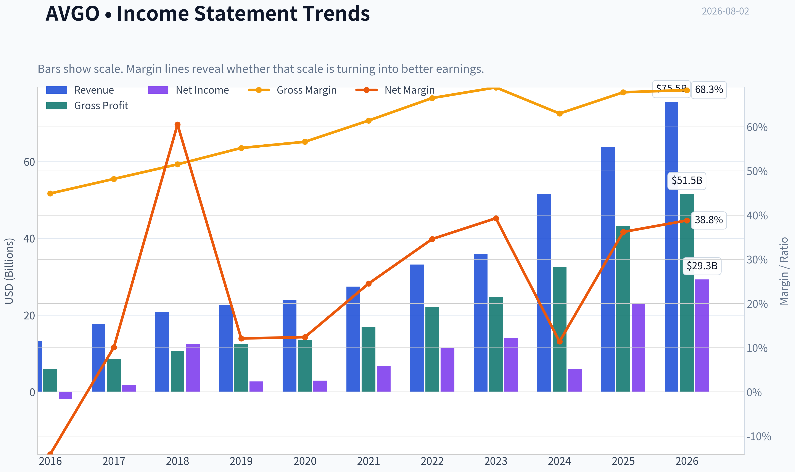
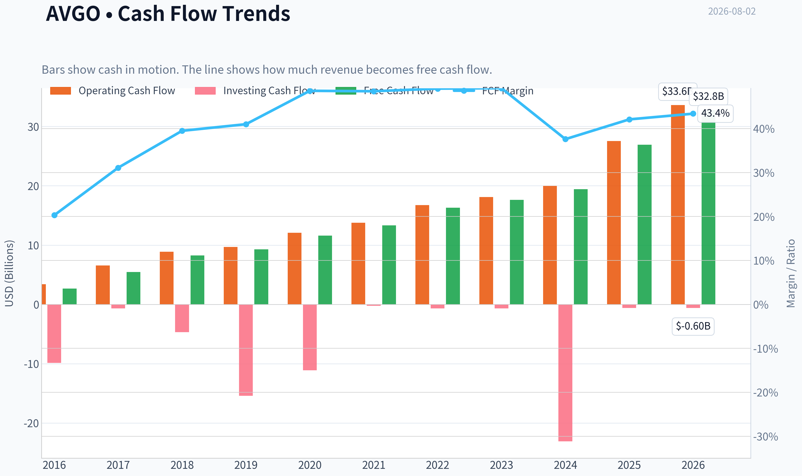
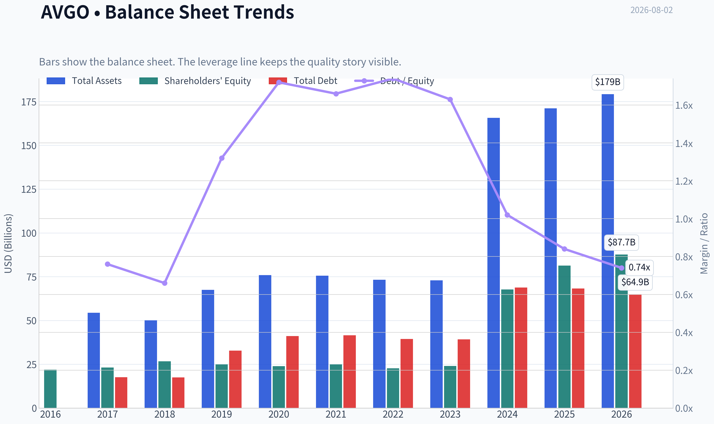
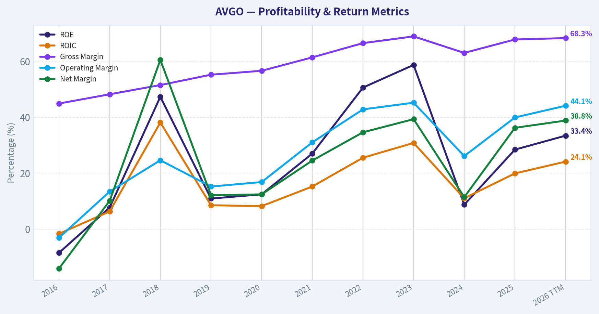
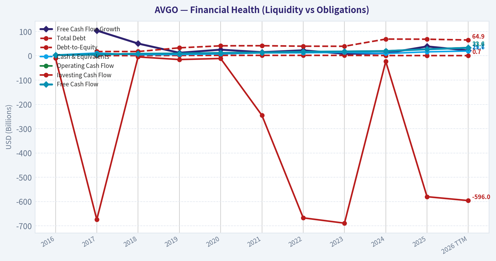
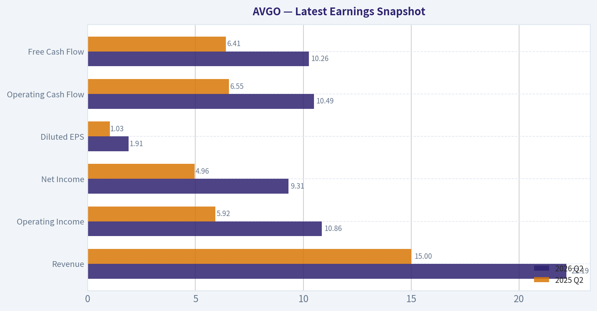
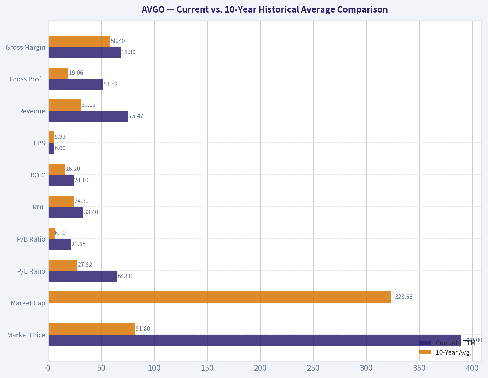
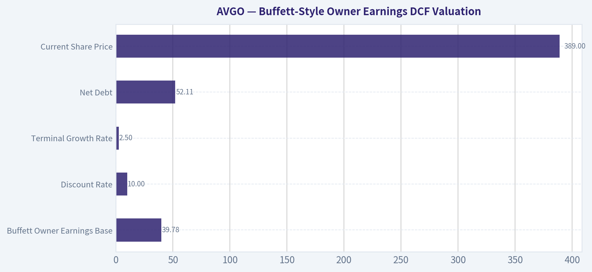
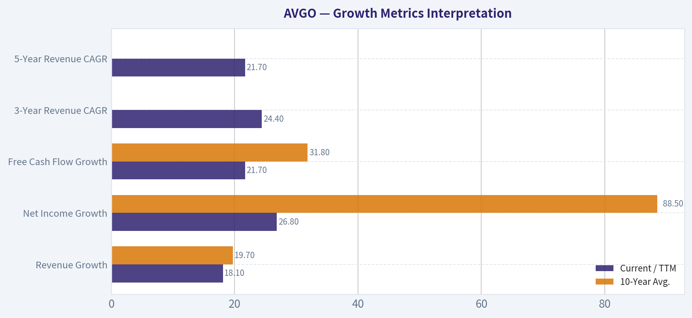
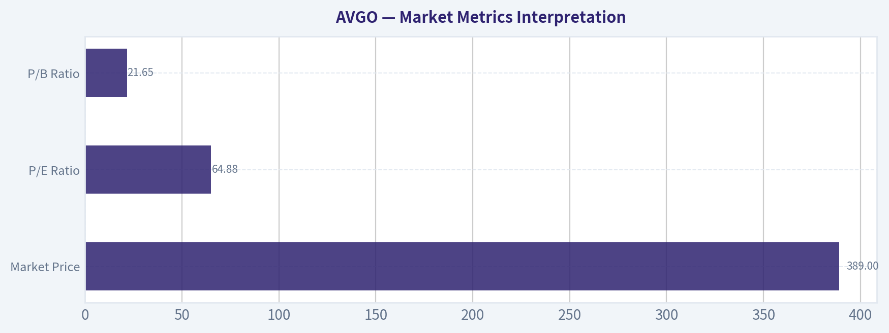

# AVGO Deep Value Intelligence

**Analysis Date:** 2026-08-02

## Critical Disclaimer

*This analysis is generated by Deep Value Intelligence, an AI-powered multi-agent investing framework. Education & research only - not financial advice, not a financial advisor.*

---

## Table of Contents

1. Intelligence Summary
2. Analyst Team Reports
   - Fundamentals Analysis
   - Intrinsic Value Analysis (Buffett)
   - Trend & Growth Analysis (Lynch/Druckenmiller/Fisher)
   - Market Technical Analysis
   - Options Market Analysis
3. Research Team Commentary
4. Value Investing Team Commentary
5. Deep Values Commentary

---

## Intelligence Summary

### Thesis + Conditions

**Core Thesis:** **EXECUTIVE SUMMARY**
Broadcom (AVGO) presents a classic standoff between rigid historical valuation and forward-looking secular compounding. While a $224 intrinsic value estimate and a trailing 65x P/E suggest extreme overvaluation, this is a "GAAP trap" distorted by VMware integration costs.

**Key Risks:**
- The Bull (Risky Analyst):** The 65x P/E is a GAAP illusion hiding massive Free Cash Flow. Broadcom is the toll bridge for AI networking and custom ASICs. The current test of the 200-day moving average is a gift for institutional accumulation, not a warning.
- The Bear (Safe Analyst):** The market is pricing in heroic 34% annualized growth for a decade. Even on a cash-flow basis, there is zero margin of safety if hyperscaler AI capex slows. Hovering below the 50-day SMA indicates technical vulnerability.
- Under an adaptive Buffett framework, the greatest risk is permanent capital loss from business deterioration, not paying a premium for a superior moat.

**Confidence:** Medium

---

## Analyst Team Reports

### Fundamentals Analysis

#### Latest Earnings Snapshot

*Most recent reported quarter anchored on 2026 Q2, with prior-year comparison when available.*

| Metric | 2026 Q2 | 2025 Q2 | YoY Change |
| --- | ---: | ---: | ---: |
| Revenue | $22.19B | $15.00B | +47.9% |
| Operating Income | $10.86B | $5.92B | +83.6% |
| Net Income | $9.31B | $4.96B | +87.5% |
| Diluted EPS | $1.91 | $1.03 | +85.4% |
| Operating Cash Flow | $10.49B | $6.55B | +60.1% |
| Free Cash Flow | $10.26B | $6.41B | +60.1% |

Key Takeaways: This snapshot anchors the most recent reported quarter before the narrative analysis. It helps readers separate long-run business quality from whatever changed in the latest earnings print.

#### 10-Year Financial Metrics for AVGO

*All values below are computed deterministically from raw data - not estimated by AI.*

*Issuer profile: operating company (Technology / Semiconductors).*

#### 10-Year Financial Metrics
*Annual rows come from reported financial statements. The final TTM row is computed from the latest four quarters.*

| Metric | 2016 | 2017 | 2018 | 2019 | 2020 | 2021 | 2022 | 2023 | 2024 | 2025 | 2026 TTM |
| --- | --- | --- | --- | --- | --- | --- | --- | --- | --- | --- | --- |
| Market Price | $13 | $21 | $18 | $25 | $31 | $49 | $44 | $82 | $167 | $368 | $389 |
| Market Cap | $6.52B | $11.11B | $9.63B | $12.27B | $14.72B | $22.81B | $198.95B | $359.43B | $811.16B | $1.79T | $1.90T |
| P/E Ratio | -3.50 | 6.56 | 0.79 | 4.55 | 5.52 | 3.54 | 17.74 | 25.50 | 138.02 | 77.49 | 64.88 |
| P/B Ratio | 0.30 | 0.48 | 0.36 | 0.49 | 0.62 | 0.91 | 8.76 | 14.98 | 11.99 | 22.07 | 21.65 |
| ROE | -8.5% | 7.7% | 47.3% | 10.9% | 12.4% | 27.0% | 50.6% | 58.7% | 8.7% | 28.4% | 33.4% |
| ROIC | -1.7% | 6.3% | 38.1% | 8.5% | 8.2% | 15.2% | 25.5% | 30.8% | 11.0% | 19.9% | 24.1% |
| EPS | $-3.74 | $3.15 | $23.23 | $5.46 | $5.63 | $13.76 | $2.50 | $3.20 | $1.23 | $4.77 | $6.00 |
| Revenue | $13.24B | $17.64B | $20.85B | $22.60B | $23.89B | $27.45B | $33.20B | $35.82B | $51.57B | $63.89B | $75.47B |
| Gross Profit | $5.94B | $8.51B | $10.73B | $12.48B | $13.52B | $16.84B | $22.09B | $24.69B | $32.51B | $43.29B | $51.52B |
| Gross Margin | 44.9% | 48.2% | 51.5% | 55.2% | 56.6% | 61.4% | 66.5% | 68.9% | 63.0% | 67.8% | 68.3% |
| Operating Margin | -3.1% | 13.4% | 24.6% | 15.2% | 16.8% | 31.0% | 42.8% | 45.2% | 26.1% | 39.9% | 44.1% |
| Net Income | $-1.86B | $1.78B | $12.61B | $2.72B | $2.96B | $6.74B | $11.49B | $14.08B | $5.89B | $23.13B | $29.32B |
| Net Margin | -14.1% | 10.1% | 60.5% | 12.1% | 12.4% | 24.5% | 34.6% | 39.3% | 11.4% | 36.2% | 38.8% |
| Revenue Growth | N/A | 33.2% | 18.2% | 8.4% | 5.7% | 14.9% | 21.0% | 7.9% | 44.0% | 23.9% | 18.1% |
| Net Income Growth | N/A | -195.9% | 606.8% | -78.4% | 8.7% | 127.6% | 70.7% | 22.5% | -58.1% | 292.3% | 26.8% |
| Free Cash Flow Growth | N/A | 103.9% | 50.4% | 12.4% | 25.2% | 14.9% | 22.5% | 8.1% | 10.1% | 38.6% | 21.7% |
| Total Book Value | $21.88B | $23.19B | $26.66B | $24.94B | $23.87B | $24.96B | $22.71B | $23.99B | $67.68B | $81.29B | $87.69B |
| Total Assets | N/A | $54.42B | $50.12B | $67.49B | $75.93B | $75.57B | $73.25B | $72.86B | $165.65B | $171.09B | $179.16B |
| Total Debt | N/A | $17.55B | $17.49B | $32.80B | $41.06B | $41.50B | $39.48B | $39.18B | $68.81B | $68.29B | $64.91B |
| Debt-to-Equity | N/A | 0.76 | 0.66 | 1.32 | 1.72 | 1.66 | 1.74 | 1.63 | 1.02 | 0.84 | 0.74 |
| Cash & Equivalents | $3.10B | $11.20B | $4.29B | $5.05B | $7.62B | $12.16B | $12.42B | $14.19B | $9.35B | $16.18B | $19.63B |
| Shareholders' Equity | $21.88B | $23.19B | $26.66B | $24.94B | $23.87B | $24.96B | $22.71B | $23.99B | $67.68B | $81.29B | $87.69B |
| Operating Cash Flow | $3.41B | $6.55B | $8.88B | $9.70B | $12.06B | $13.76B | $16.74B | $18.09B | $19.96B | $27.54B | $33.62B |
| Investing Cash Flow | $-9.84B | $-674.0M | $-4.67B | $-15.42B | $-11.11B | $-245.0M | $-667.0M | $-689.0M | $-23.07B | $-580.0M | $-596.0M |
| Free Cash Flow | $2.69B | $5.48B | $8.24B | $9.27B | $11.60B | $13.32B | $16.31B | $17.63B | $19.41B | $26.91B | $32.76B |
| FCF Margin | 20.3% | 31.1% | 39.5% | 41.0% | 48.6% | 48.5% | 49.1% | 49.2% | 37.6% | 42.1% | 43.4% |
| Dividends / Share | $0.00 | $0.00 | $0.00 | $0.00 | $0.00 | $0.00 | $1.57 | $1.74 | $2.05 | $2.30 | $2.41 |

#### Profitability Metrics
- Return on Equity (ROE): 28.4%
- Return on Invested Capital (ROIC): 19.4%
- Return on Assets (ROA): 13.5%
- Gross Margin: 67.8%
- Operating Margin: 39.9%
- Net Profit Margin: 36.2%

#### Liquidity Metrics
- Current Ratio: 1.71
- Quick Ratio: 1.26

#### Leverage Metrics
- Debt-to-Equity Ratio: 0.84
- Interest Coverage Ratio: 7.94
- Net Debt: $52.11B

#### Growth Metrics (Year-over-Year)
- Revenue Growth: 23.9%
- Net Income Growth: 292.3%
- Free Cash Flow Growth: 38.6%
- Revenue CAGR (3-Year): 24.4%
- Revenue CAGR (5-Year): 21.7%

#### Valuation Metrics
- P/E Ratio (TTM): 64.99
- Forward P/E: 19.97
- Price-to-Book: 21.12
- Price-to-Sales: 24.54
- PEG Ratio: 0.44
- EV/EBITDA: 45.08
- Free Cash Flow Yield: 1.5%
- Earnings Yield: 1.5%

#### Owner Earnings (Buffett Method, Code-Computed)
- Net Income: $23.13B
- + Depreciation & Amortization: $8.78B
- - Capital Expenditures: $-623.0M
- - Working Capital Changes: $-8.50B
- = **Owner Earnings: $39.78B**

#### Intrinsic Value (Code-Computed)
- Current Price: $389
- **Headline Intrinsic Value (business-model routed): $224**
  Business model: asset light platform - weighted blend [Damodaran FCFF + reverse-DCF fair + owner-earnings DCF] (asset_light_platform)
  Model spread (min-max across DCFs): $48 - $338
  Margin of safety vs. price (headline): -73.7%
  Routing note: Asset-light / high-margin platform: value driven by margins and reinvestment economics - the headline centers on the reverse-DCF demonstrated-growth fair value with Damodaran FCFF as a floor, down-weighting the owner-earnings DCF.
- Buffett Method (Owner Earnings):
  Conservative: $142
  Average: $338
  Optimistic: $896
- Cash Flow Method (FCF):
  Conservative: $119
  Average: $226
  Optimistic: $226
- Damodaran FCFF (WACC + margins + reinvestment):
  Conservative: $15
  Average: $48
  Optimistic: $120
  Monte Carlo band (P10-P90): $28 - $86 (median $51)
  P(intrinsic value > price): 0.0%
- Reverse-DCF: price implies ~34.1%/yr owner-earnings growth for 10y; trailing 3y was 31.0%, 5y 74.0%.

#### Piotroski F-Score: 8/9
- Positive Net Income: PASS
- Positive Operating Cash Flow: PASS
- ROA Improvement: PASS
- Cash Flow > Net Income: PASS
- Decreasing Debt: PASS
- Improving Current Ratio: PASS
- No Dilution: FAIL
- Improving Gross Margin: PASS
- Improving Asset Turnover: PASS

ANALYST STANCE: **WATCH**

#### Broadcom Inc. (AVGO) - Warren Buffett-Style Fundamental Analysis

Broadcom is an exceptional cash-generating technology franchise with expanding AI semiconductor demand, high-margin infrastructure software, disciplined acquisition integration, and strong free cash flow conversion. However, the current stock price of **$389** embeds very demanding expectations: the deterministic research pack's headline intrinsic value is **$224/share**, versus the current price, implying a **negative margin of safety of roughly 74%**. In Buffett terms, AVGO looks like a wonderful business, but not clearly at a wonderful price.

---

#### Current vs. 10-Year Historical Average Comparison

| Metric | Current / TTM | 10-Year Avg. | Current Standing vs. History | Interpretation |
|---|---:|---:|---|---|
| Market Price | $389 | $81.80 | Far above average | The stock has re-rated dramatically, especially since 2023-2026, reflecting AI infrastructure enthusiasm and VMware/software scale. |
| Market Cap | $1.90T | $323.66B | Far above average | Market value has expanded much faster than historical revenue and book value, creating valuation risk. |
| P/E Ratio | 64.88x | 27.62x | Above average | Current earnings multiple is elevated; investors are paying for sustained high growth and margin durability. |
| P/B Ratio | 21.65x | 6.10x | Above average, but limited usefulness | P/B is not a reliable valuation anchor for AVGO because it is an asset-light, IP-heavy, acquisition-driven technology platform with substantial intangibles and goodwill. Cash-flow valuation is more meaningful. |
| ROE | 33.4% | 24.3% | Above average | ROE is strong and has recovered sharply from the 2024 dip, showing high profitability on equity capital. |
| ROIC | 24.1% | 16.2% | Above average | ROIC indicates excellent capital productivity and supports the argument for a durable economic moat. |
| EPS | $6.00 | $5.92 | Near average | EPS is only modestly above the decade average because prior years include unusual swings, acquisitions, and accounting effects. |
| Revenue | $75.47B | $31.02B | Far above average | Revenue has more than doubled versus the historical average, helped by AI networking/custom silicon and VMware integration. |
| Gross Profit | $51.52B | $19.06B | Far above average | Gross profit scale has expanded faster than revenue due to mix shift toward higher-margin software and advanced semiconductors. |
| Gross Margin | 68.3% | 58.4% | Above average | Margin expansion is one of AVGO's strongest quality signals. |
| Operating Margin | 44.1% | 25.2% | Far above average | Operating leverage and software contribution have materially improved business quality. |
| Net Income | $29.32B | $7.95B | Far above average | Net income is substantially above historical norms, though the decade includes volatile acquisition/accounting years. |
| Net Margin | 38.8% | 22.7% | Above average | Profitability is structurally better than earlier in the decade. |
| Revenue Growth | 18.1% | 19.7% | Slightly below average | Still strong, but below the decade average because prior acquisition-driven jumps lifted the historical mean. |
| Net Income Growth | 26.8% | 88.5% | Below noisy average | The average is distorted by extreme rebound years; current growth remains healthy but not enough alone to justify any price. |
| Free Cash Flow Growth | 21.7% | 31.8% | Below average, still strong | FCF growth remains excellent but is decelerating from acquisition-boosted historical levels. |
| Total Book Value | $87.69B | $34.12B | Far above average | Book equity rose after large acquisitions, but book value is not the best lens for valuing AVGO. |
| Total Assets | $179.16B | $89.60B | Far above average | Asset growth reflects the VMware transaction and accumulated goodwill/intangibles. |
| Total Debt | $64.91B | $40.68B | Above average | Debt remains substantial, though it has declined from the 2024-2025 peak. |
| Debt-to-Equity | 0.74x | 1.26x | Better than average | Leverage has improved materially as equity expanded and debt was reduced. |
| Cash & Equivalents | $19.63B | $9.56B | Above average | Liquidity is strong and gives management flexibility for debt reduction, dividends, and buybacks. |
| Shareholders' Equity | $87.69B | $34.12B | Far above average | Equity base is much larger, but again not the primary valuation anchor. |
| Operating Cash Flow | $33.62B | $13.67B | Far above average | Cash generation is one of AVGO's defining strengths. |
| Free Cash Flow | $32.76B | $13.09B | Far above average | FCF scale is excellent, but at the current price the FCF yield is only about 1.5%. |
| FCF Margin | 43.4% | 40.7% | Slightly above average | Free cash flow conversion remains outstanding and structurally high. |
| Dividends / Share | $2.41 | $0.77 | Above average | Dividend growth is shareholder-friendly, though the yield is modest because the share price has surged. |

**Key Takeaways:** AVGO's operating fundamentals are dramatically stronger than its 10-year averages: revenue, free cash flow, margins, ROE, and ROIC are all excellent. The problem is valuation: market price, market cap, P/E, P/S, EV/EBITDA, and P/B have expanded even more aggressively. For an asset-light technology platform, book value is not the right valuation anchor; free cash flow and owner earnings are the key measures, and those suggest the stock already discounts very strong future performance.

---

#### Revenue Breakdown

| Revenue Source | Amount ($B) | % of Total |
|---|---:|---:|
| Semiconductor Solutions - AI networking, custom silicon, broadband, wireless, storage, industrial | ~$47.0B | ~62% |
| Infrastructure Software - VMware, mainframe, cybersecurity, enterprise infrastructure software | ~$28.5B | ~38% |
| **Total Revenue, TTM** | **$75.47B** | **100%** |

**Key Takeaways:** Broadcom remains primarily a semiconductor company, but infrastructure software has become a major profit engine after VMware. The mix is attractive because AI semiconductors provide high growth while infrastructure software provides recurring, sticky, high-margin cash flows. This dual engine is central to AVGO's moat and cash-flow durability.

---

#### Market Metrics Interpretation

| Metric | Current Reading | Buffett-Style Interpretation |
|---|---:|---|
| Market Price | $389 | The market is pricing AVGO as a premier AI infrastructure and software compounder. The price leaves little room for disappointment. |
| Total Market Cap | $1.90T | A nearly $2 trillion valuation requires very large future cash-flow growth. Size itself becomes a hurdle because compounding from this base is harder. |
| P/E Ratio | 64.88x | Expensive on trailing earnings. Forward P/E is lower at about 20x, but that relies on large expected earnings growth. |
| P/B Ratio | 21.65x | Not meaningful as a primary value signal for AVGO. The company is IP-heavy, acquisition-heavy, and cash-flow-driven; book value does not capture franchise value well. |

**Key Takeaways:** AVGO's market valuation has moved far ahead of its historical norms. The stock is not being valued like a traditional semiconductor cyclicality story; it is being valued like an AI and software platform. That may be justified by quality, but it sharply reduces the Buffett-style margin of safety.

---

#### Profitability and Business Quality

Broadcom's profitability profile is outstanding. TTM **gross margin of 68.3%**, **operating margin of 44.1%**, and **net margin of 38.8%** are all well above 10-year averages. This reflects pricing power, scale, high-value semiconductor design, proprietary networking/custom silicon, and a larger mix of infrastructure software.

ROE and ROIC are especially important in Buffett-style analysis. AVGO's **TTM ROE of 33.4%** and **TTM ROIC of 24.1%** show that the company converts capital into profits at a very high rate. The 2024 dip in ROE and net margin appears related to acquisition/integration and accounting effects, but the 2025 and TTM recovery is strong.

The most important profitability insight is that AVGO is not merely growing revenue; it is growing revenue while preserving elite margins. That combination is rare and supports a wide-moat assessment.

---

#### Growth Metrics Interpretation

| Growth Metric | Current / TTM | 10-Year Avg. | Interpretation |
|---|---:|---:|---|
| Revenue Growth | 18.1% | 19.7% | Strong, though slightly below the acquisition-boosted historical average. |
| Net Income Growth | 26.8% | 88.5% | Healthy, but the historical average is distorted by extreme accounting swings and rebound years. |
| Free Cash Flow Growth | 21.7% | 31.8% | Excellent, though slower than the decade average; still supports a high-quality compounder thesis. |
| 3-Year Revenue CAGR | 24.4% | N/A | Shows acceleration from AI and software scale. |
| 5-Year Revenue CAGR | 21.7% | N/A | Confirms multi-year durable growth, not just a one-year spike. |

**Key Takeaways:** Broadcom's growth is still very strong, particularly for a company of this size. However, the stock price implies growth expectations even higher than current reported trends. The reverse DCF indicates the current price requires roughly **34.1% annual owner-earnings growth for 10 years**, which is a demanding hurdle even for a high-quality compounder.

---

#### Balance Sheet and Financial Strength

AVGO's balance sheet is stronger than it may appear at first glance. Total debt is high at **$64.91B**, but cash is also substantial at **$19.63B**, leaving net debt of about **$52.11B**. The debt-to-equity ratio has improved to **0.74x**, below the 10-year average of **1.26x**, and interest coverage of **7.94x** indicates manageable servicing capacity.

From a Buffett perspective, the balance sheet is acceptable because cash flow is exceptionally strong. TTM free cash flow of **$32.76B** covers net debt meaningfully, and management has historically shown discipline in using post-acquisition cash flows to deleverage. The key risk is not solvency; it is valuation and execution risk after a major acquisition cycle.

---

#### Cash Flow and Dividend Policy

Free cash flow is AVGO's most attractive financial characteristic. TTM FCF is **$32.76B**, compared with a 10-year average of **$13.09B**, and FCF margin remains high at **43.4%**. This is a Buffett-style positive because owner earnings are real, recurring, and large.

Dividends per share have increased to **$2.41 TTM**, above the 10-year average of **$0.77**. However, the dividend yield is modest because the stock price has risen sharply. The dividend is not the main investment case; capital appreciation depends on continued FCF compounding.

---

#### Buffett-Style Owner Earnings DCF Valuation

Base inputs used from the deterministic dataset:

| DCF Input | Value |
|---|---:|
| Buffett Owner Earnings Base | $39.78B |
| Discount Rate | 10.0% |
| Terminal Growth Rate | 2.5% |
| Net Debt | $52.11B |
| Implied Shares Outstanding | ~4.88B |
| Current Share Price | $389 |
| Headline Intrinsic Value, Business-Model Routed | $224/share |
| Reverse-DCF Growth Implied by Market Price | ~34.1% per year for 10 years |

**Key Takeaways:** The DCF starts from a very strong owner-earnings base, but the stock price is already discounting a long runway of exceptional growth. At $389, AVGO trades above the headline intrinsic value and above the average owner-earnings DCF estimate. The valuation is most defensible only if the optimistic AI/custom silicon and software margin scenario plays out.

| Scenario | Owner Earnings Growth Assumption | PV of Explicit 10-Year Owner Earnings | PV of Terminal Value | Less Net Debt | Estimated Equity Value | Fair Value / Share | Margin of Safety vs. $389 |
|---|---|---:|---:|---:|---:|---:|---:|
| Conservative | ~7% annual owner-earnings growth, fading to 2.5% terminal growth | ~$343B | ~$412B | -$52B | ~$693B | **~$142** | **-174%** |
| Average / Base Case | Growth path: 30%, 27%, 24%, 22%, 20%, 17%, 13%, 9%, 6%, 4%, then 2.5% terminal | ~$694B | ~$998B | -$52B | ~$1.65T | **~$338** | **-15%** |
| Optimistic | Growth path: 48%, 45%, 42%, 39%, 35%, 31%, 26%, 21%, 15%, 10%, then 2.5% terminal | ~$1.49T | ~$3.03T | -$52B | ~$4.38T | **~$896** | **+130%** |

**Key Takeaways:** The conservative case suggests substantial overvaluation, while the base case suggests the stock is still above fair value. The optimistic case offers meaningful upside, but it requires extraordinary execution and sustained AI-driven growth. This creates an asymmetric setup: AVGO is a superb company, but the current price relies heavily on the bull case.

DCF formula used:

| Calculation Step | Formula |
|---|---|
| Forecast Owner Earnings | Prior-year owner earnings x annual scenario growth rate |
| Present Value of Explicit Cash Flows | Σ Owner Earnings in Year N / (1 + 10%)^N |
| Terminal Value | Year 10 Owner Earnings x (1 + 2.5%) / (10% - 2.5%) |
| Equity Value | PV of explicit cash flows + PV of terminal value - net debt |
| Fair Value per Share | Equity value / ~4.88B shares |

**Key Takeaways:** The DCF uses owner earnings rather than accounting book value because AVGO's value comes from cash generation, intangible IP, software economics, and customer relationships. The model is highly sensitive to growth assumptions. That sensitivity is exactly why a margin of safety is important at today's price.

---

#### Intrinsic Value Cross-Check

The research pack's model-based valuation provides an important check against a hand-built DCF:

| Valuation Model | Fair Value / Share |
|---|---:|
| Buffett Owner Earnings DCF - Conservative | $142 |
| Buffett Owner Earnings DCF - Average | $338 |
| Buffett Owner Earnings DCF - Optimistic | $896 |
| Cash Flow Method - Conservative | $119 |
| Cash Flow Method - Average | $226 |
| Cash Flow Method - Optimistic | $226 |
| Damodaran FCFF - Conservative | $15 |
| Damodaran FCFF - Average | $48 |
| Damodaran FCFF - Optimistic | $120 |
| Business-Model Routed Headline Intrinsic Value | **$224** |
| Current Price | **$389** |

**Key Takeaways:** The valuation spread is wide because AVGO is both high quality and high expectation. The owner-earnings model is more favorable, but the Damodaran FCFF framework is much more conservative because it penalizes reinvestment needs, valuation normalization, and risk. The headline intrinsic value of **$224** suggests the market price already discounts a very optimistic future.

---

#### Economic Moat Assessment

| Moat Source | Assessment |
|---|---|
| Custom Silicon and AI Networking | Very strong. Broadcom is deeply embedded with hyperscale customers and benefits from complex, high-value semiconductor design cycles. |
| Switching Costs | High. Enterprise software and infrastructure chips are not easily replaced once integrated into customer systems. |
| Scale Economics | Strong. Broadcom's revenue base, R&D leverage, and manufacturing partnerships support superior margins. |
| Acquisition Discipline | Historically strong. Management has created value by acquiring, integrating, cutting costs, and monetizing cash flows. |
| Software Stickiness | Strong. VMware and infrastructure software add recurring revenue and customer lock-in. |
| Brand / Customer Relationships | Strong among hyperscalers, telecom, enterprise IT, and infrastructure customers. |

**Key Takeaways:** Broadcom has a wide moat built from technical complexity, customer integration, scale, and software stickiness. Its moat is not based on consumer branding; it is based on mission-critical infrastructure. That type of moat can be durable, but it depends on continued engineering relevance and customer concentration management.

---

#### Management Performance and Capital Allocation

Management's record is strong from a Buffett perspective. AVGO has compounded free cash flow, expanded margins, paid dividends, integrated acquisitions, and reduced leverage after major deals. The **Piotroski F-Score of 8/9** supports strong financial quality, with the only failure being dilution.

Capital allocation has followed a recognizable pattern: acquire strategic assets, improve operating margins, generate cash, reduce leverage, and return capital. That model has worked well historically. The risk is that the company is now so large that each future acquisition or reinvestment opportunity must be enormous to move the needle.

---

#### Key Investment Insights, Red Flags, and Opportunities

| Category | Key Point | Investment Meaning |
|---|---|---|
| Insight | AVGO is a rare combination of AI semiconductor growth and software-like margins. | Supports premium valuation and wide-moat classification. |
| Insight | FCF margin remains above 40%. | Confirms excellent owner-earnings quality. |
| Insight | ROIC is materially above the 10-year average. | Shows management is generating attractive returns on capital. |
| Opportunity | AI networking and custom accelerators could remain strong for years. | Could justify the optimistic DCF case if hyperscale demand persists. |
| Opportunity | VMware integration may further improve software cash flow. | Adds recurring revenue and margin durability. |
| Opportunity | Debt reduction could increase equity value and reduce risk. | Strong FCF gives management flexibility. |
| Red Flag | Current price is above headline intrinsic value and base-case owner-earnings value. | Margin of safety is inadequate at $389. |
| Red Flag | Reverse DCF implies ~34.1% annual owner-earnings growth for 10 years. | Expectations are very demanding. |
| Red Flag | FCF yield is only about 1.5%. | Investors are paying a high price for each dollar of current cash flow. |
| Red Flag | Customer concentration and AI capex cyclicality matter. | A slowdown in hyperscaler AI spending could compress valuation quickly. |
| Red Flag | P/E, P/S, and EV/EBITDA are elevated. | Multiple compression risk is meaningful even if operations remain strong. |

**Key Takeaways:** The fundamental story is excellent, but the valuation story is stretched. AVGO can still work as a long-term compounder if AI demand and software cash flow exceed expectations. But the current setup gives investors limited protection if growth normalizes or the market reduces AI-related multiples.

---

#### Final Buffett-Style Investment Stance: WATCH

AVGO is a **WATCH**, not an ADVOCATE at the current price.

The business quality is clearly high: strong moat, excellent margins, high ROIC, robust owner earnings, disciplined management, and powerful AI/software growth drivers. However, Buffett-style investing requires both business quality and a margin of safety. At **$389**, AVGO trades above the **$224 headline intrinsic value** and above the **$338 average owner-earnings DCF estimate**. The stock is attractive only if the optimistic case plays out, and the reverse DCF suggests the market already requires roughly **34% annual owner-earnings growth for a decade**.

A more attractive entry point would be closer to the base-case intrinsic value range, or ideally below it. Until then, AVGO should remain on a high-quality watchlist rather than being treated as a clear value investment.

---

#### Summary Table

| Area | Assessment | Buffett-Style Conclusion |
|---|---|---|
| Business Quality | Excellent margins, strong FCF, high ROIC, AI and software exposure | Wonderful business |
| Economic Moat | Wide; driven by custom silicon, switching costs, scale, and software stickiness | Durable competitive advantage |
| Financial Strength | Debt is high but manageable; cash flow is very strong | Acceptable balance sheet |
| Earnings Predictability | Good long-term trend, but acquisition/accounting volatility exists | Predictable enough, but not perfectly smooth |
| Management | Strong acquisition integration and cash-flow discipline | Above-average capital allocation |
| Dividend Policy | Growing dividend, but low yield due to high stock price | Shareholder-friendly but not income-led |
| Valuation | Price above headline and base-case intrinsic value | Margin of safety is lacking |
| Main Upside Driver | Sustained AI custom silicon/networking and VMware cash-flow expansion | Optimistic case could justify upside |
| Main Risk | Growth expectations and valuation compression | High expectations create downside risk |
| Final Stance | **WATCH** | Great company, insufficient margin of safety |

**Key Takeaways:** Broadcom is the type of business Buffett would likely admire for its cash generation, competitive position, and management discipline. The issue is price. At today's valuation, the stock requires exceptional future growth, so the prudent stance is to watch for a better entry point or clearer evidence that the optimistic case is becoming the base case.

#### Fundamental Visuals

This graph tracks the profitability and return metrics (ROE, ROIC, Margins) of **AVGO** over the past decade, highlighting capital efficiency trends.

This chart illustrates the financial health of **AVGO** over the last 10 years, mapping cash equivalents and free cash flow against total obligations (Debt).

---

### Intrinsic Value Analysis (Buffett)

> *Following Warren Buffett's value investing philosophy: Circle of Competence, Economic Moat, Management Quality, and Margin of Safety.*

#### Intrinsic Value Snapshot

Price is what you pay. Intrinsic value is what the business may be worth based on the cash it can create for owners over time. We show a range, not one magic number.

- Current Price: $389.28
- Value Range (conservative to optimistic across both DCF methods): $119.38 to $896.19

##### Owner Earnings (Buffett Method)
- Net Income: $23,126,000,000.00
- Depreciation & Amortization: $8,775,000,000.00
- Capital Expenditures: $-623,000,000.00
- Working Capital Changes: $-8,500,000,000.00
- Owner Earnings: $39,778,000,000.00

##### Intrinsic Value
###### Buffett Method
Uses owner earnings. Stricter, and usually more conservative.
- Conservative: $142.32
- Average: $338.41
- Optimistic: $896.19
- Discount Rate: 10.0%

###### Cash Flow Method
Uses free cash flow. Better for companies spending heavily today to grow tomorrow.
- Conservative: $119.38
- Average: $225.80
- Optimistic: $225.80
- Discount Rate: 10.0%

ANALYST STANCE: **WATCH**

#### Broadcom Inc. (AVGO) - Buffett-Style Investment Analysis

Broadcom is a high-quality semiconductor and infrastructure software compounder with real competitive advantages, strong cash generation, and a proven acquisition-led capital allocation model. The business quality is excellent, but the current valuation is demanding: at **$389 per share**, the stock trades far above the research-pack headline intrinsic value estimate of **$224.13**, with the market implying roughly **34% annual growth for 10 years**. That is a high bar even for a wonderful company.

---

#### 1. Factor Scorecard

| Factor | Score / 5 | Evidence |
|---|---:|---|
| Circle of Competence & Business Simplicity | 3.8 | Broadcom sells mission-critical chips, custom silicon, networking components, and infrastructure software. The model is understandable, but semiconductor cycles, AI demand, hyperscaler spending, and acquisition integration add complexity. |
| Moat Test | 4.2 | Strong switching costs, scale advantages, customer relationships, custom ASIC capabilities, and infrastructure software stickiness. Gross margin is about **67.8%**, supporting strong intangible and switching-cost economics. |
| Management Quality & Capital Allocation | 3.8 | Hock Tan has a strong record of disciplined acquisitions, margin expansion, and cash conversion. VMware integration increases execution risk, and leverage is meaningful, but capital allocation history is strong. |
| Industry Structure | 3.8 | Broadcom operates in attractive niches: custom silicon, networking, wireless connectivity, and enterprise software. Competition is fierce, but Broadcom often competes where scale, reliability, and customer integration matter. |
| Gate 5: Quality / Solvency Hard Floor | Not Tripped | Revenue is growing, cash flow remains strong, and the company is not in financial distress. Leverage is elevated after VMware, but cash generation is substantial. |

**Key Takeaways:** Broadcom scores highly on moat, profitability, and capital allocation, but it is not a simple consumer-staple-style business. The main issue is not business quality; it is valuation. The hard solvency floor is not triggered because the company remains profitable, cash-generative, and financially viable.

---

#### 2. Moat Analysis

| Moat Source | Assessment | Evidence |
|---|---|---|
| Intangible Assets | Strong | Broadcom is trusted for mission-critical semiconductor and infrastructure software products. Reliability and long product cycles matter deeply to customers. |
| Switching Costs | Strong | Custom silicon, networking chips, VMware software, and infrastructure products are embedded in customer systems and workflows. Switching can create technical, operational, and business disruption. |
| Cost Advantages | Strong | Scale in R&D, manufacturing partnerships, product breadth, and disciplined cost control support superior margins. |
| Network Effects | Moderate | Not a pure network-effect business, but VMware ecosystem breadth and hyperscaler relationships create reinforcing advantages. |
| Moat Rating | Wide / Stable to Widening | AI custom silicon and software expansion may widen the moat, but hyperscaler concentration and technology shifts must be watched. |

**Key Takeaways:** Broadcom's moat is built less on consumer brand and more on deep customer integration, technical reliability, scale, and switching costs. The VMware acquisition adds a sticky software layer that could improve durability if integration continues well. The moat is real, but not risk-free because technology leadership must be continuously earned.

---

#### 3. Management Quality Assessment

Hock Tan's management record is one of the central reasons Broadcom deserves a premium quality score. Broadcom has repeatedly acquired large technology assets, cut costs, focused the product portfolio, expanded margins, and converted earnings into free cash flow. The CA Technologies, Symantec Enterprise Security, and VMware transactions show a clear playbook: buy durable infrastructure assets, improve profitability, and use cash flow to reduce debt and reward shareholders.

The key concern is that this model depends on disciplined acquisition integration and rational pricing. VMware is much larger and more strategically important than prior deals, so execution risk is higher. Still, Broadcom's historical pattern has been owner-oriented: focus on cash earnings, return capital through dividends, and prioritize high-margin franchises over low-return growth.

---

#### 4. Financial Summary

| Metric | Recent / TTM Snapshot |
|---|---:|
| Share Price | $389 |
| Market Capitalization | $1.85T |
| P/E Ratio | 65.0x |
| ROE | 28.4% |
| Gross Margin | 67.8% |
| Revenue Growth YoY | 23.9% |
| Free Cash Flow Yield | 1.5% |
| Current Ratio | 1.71 |
| Headline Intrinsic Value | $224.13 |
| Margin of Safety vs. Price | -73.7% |
| Reverse-DCF Implied Growth | ~34.1% per year for 10 years |

**Key Takeaways:** Broadcom's profitability and growth are excellent, with high gross margins and strong revenue growth. However, the market is already pricing in a very optimistic future. A 1.5% free cash flow yield and a 65x earnings multiple leave little room for disappointment.

---

#### 5. Owner Earnings Calculation

Using free cash flow as the practical owner-earnings proxy:

| Item | Estimate |
|---|---:|
| Market Capitalization | $1.85T |
| Free Cash Flow Yield | 1.5% |
| Estimated Free Cash Flow / Owner Earnings | ~$27.8B |
| Estimated Shares Outstanding | ~4.76B |
| Owner Earnings per Share | ~$5.84 |

**Key Takeaways:** Broadcom produces substantial absolute free cash flow, but the valuation is so high that the free cash flow yield is low. At roughly $5.84 of owner earnings per share against a $389 stock price, investors are paying a very high multiple for future growth. The investment case therefore depends heavily on continued AI, custom silicon, software, and margin expansion.

---

#### 6. Three-Scenario DCF Valuation

| Scenario | Assumptions | Estimated Value / Share |
|---|---|---:|
| A. No Growth | Owner earnings capitalized at 10% discount rate | ~$58 |
| B. GDP Growth | 3% perpetual growth, 10% discount rate | ~$86 |
| C. Historical Growth Haircut | 10% growth for 10 years, then 3% terminal growth | ~$144 |
| Research-Pack Headline Intrinsic Value | Business-model routed blend of owner earnings, FCF, and Damodaran FCFF | $224.13 |
| Current Price | Market price | $389 |

**Key Takeaways:** The mechanical owner-earnings DCF produces values far below the current share price because today's free cash flow yield is modest relative to valuation. Even a 10% growth scenario does not justify the current price on this base. The more generous research-pack blended intrinsic value is still materially below the market price.

---

#### 7. Margin of Safety Analysis

| Valuation Reference | Value / Share | Premium / Discount vs. $389 Price |
|---|---:|---:|
| No-Growth DCF | ~$58 | Stock trades far above value |
| GDP-Growth DCF | ~$86 | Stock trades far above value |
| 10% Growth DCF | ~$144 | Stock trades far above value |
| Headline Intrinsic Value | $224.13 | **-73.7% margin of safety** |
| Owner-Earnings Model Value | $338.41 | Still below current price |
| FCF Model Value | $225.80 | Well below current price |
| Damodaran FCFF Value | $47.78 | Far below current price |

**Key Takeaways:** Broadcom does not offer a Buffett-style margin of safety at the current price. The market is paying for exceptional future performance, not merely good performance. For a wide-moat compounder, a smaller discount may be acceptable, but this price appears to require near-flawless execution.

---

#### 8. Final Buffett Scorecard

| Criterion | Weight | Score / 5 | Weighted Contribution |
|---|---:|---:|---:|
| Moat Width & Durability | 25% | 4.2 | 1.05 |
| Valuation / Margin of Safety | 20% | 0.5 | 0.10 |
| Capital Returns - ROIC vs. WACC | 15% | 4.0 | 0.60 |
| Business Understanding & Predictability | 12% | 3.8 | 0.46 |
| Management Quality & Capital Allocation | 12% | 3.8 | 0.46 |
| Reinvestment Runway | 8% | 3.8 | 0.30 |
| Balance Sheet Strength | 4% | 2.8 | 0.11 |
| Industry Structure | 4% | 3.8 | 0.15 |
| **Total Score** | **100%** |  | **3.23 / 5** |

**Key Takeaways:** Broadcom's business quality is strong enough to score well despite elevated leverage and complexity. The valuation score is the clear drag. The final score places Broadcom in the "WATCH" range: right business, wrong price.

---

#### 9. Investment Stance

| Stance | Conviction | Rationale |
|---|---|---|
| **WATCH** | Medium-High | Broadcom is a wonderful business with a wide moat, strong management, and excellent cash generation. But the current price requires extremely strong growth and leaves inadequate margin of safety. |

Broadcom is the kind of company a Buffett-style investor should want to own, but not at any price. The business has durable advantages, strong customer captivity, and a proven capital allocator in Hock Tan. However, at **$389**, the valuation appears to capitalize years of exceptional AI and software growth in advance.

A more attractive entry point would likely require either a meaningful pullback or clear evidence that free cash flow per share is compounding fast enough to make today's valuation look fair. Until then, Broadcom belongs on the watchlist rather than in the buy basket.
#### Valuation Bridge

This bridge places the current market price beside each intrinsic value lens so readers can see whether upside depends on one method or shows up across several methods.

| Scenario | Intrinsic Value / Share |
| --- | ---: |
| Buffett Method | $338.41 |
| Cash Flow Method | $225.80 |
| Damodaran Method | $47.78 |
| Current Price | $389.28 |

#### Key Takeaways

If one method is far above the others, the upside case depends on a specific modelling assumption. When several methods cluster together, the valuation story is more robust.

#### Valuation Visuals

This comparison chart from *Latest Earnings Snapshot* stacks current figures against historical benchmarks for **AVGO**, making it easy to see where the company trades relative to its own averages.

This comparison chart from *Current vs. 10-Year Historical Average Comparison* stacks current figures against historical benchmarks for **AVGO**, making it easy to see where the company trades relative to its own averages.

This comparison chart from *Buffett-Style Owner Earnings DCF Valuation* stacks current figures against historical benchmarks for **AVGO**, making it easy to see where the company trades relative to its own averages.

This comparison chart from *Buffett-Style Owner Earnings DCF Valuation* stacks current figures against historical benchmarks for **AVGO**, making it easy to see where the company trades relative to its own averages.

---

### Trend & Growth Analysis (Lynch/Druckenmiller/Fisher)

> *Following Peter Lynch's GARP, Stanley Druckenmiller's macro-aware approach, and Philip Fisher's scuttlebutt methodology.*

ANALYST STANCE: **WATCH**

#### AVGO Growth Investment Report - Broadcom Inc.
Current price: **$389** | Market cap: **$1.85T** | Date: **2026-08-02**
Tool note: enhanced fundamentals and Azure fallback were unavailable, so this report uses the shared research pack plus model-based estimates where explicitly labeled.

---

#### 1. Lynch Classification - **Fast Grower, but mega-cap late-stage**

| Metric / Attribute | AVGO Snapshot | Growth Investor Read |
|---|---:|---|
| Revenue growth YoY | **23.9%** | Fast-grower territory |
| P/E | **~65x** | Expensive unless AI growth sustains for years |
| Gross margin | **67.8%** | Excellent, software-like blended economics |
| ROE | **28.4%** | Strong capital productivity |
| FCF yield | **1.5%** | Low yield; market is pricing aggressive growth |
| Market cap | **$1.85T** | Ten-bagger math is very hard from this base |

**Key Takeaways:** Broadcom qualifies as a Lynch "fast grower" based on current revenue growth, but it is not an undiscovered small-cap compounder. The business quality is elite, but the market is already paying a premium for AI infrastructure and VMware synergy. This is a "great company, demanding price" setup.

---

#### 2. The Story in 3 Bullets

- **Broadcom sells the picks and shovels of AI infrastructure:** custom AI accelerators, networking chips, optical/connectivity solutions, and infrastructure software that hyperscalers need to scale AI clusters.
- **The VMware acquisition transformed the mix:** Broadcom now combines high-margin infrastructure software with high-end semiconductors, improving recurring revenue and margin durability.
- **The bull case is AI custom silicon:** if hyperscalers increasingly design custom chips to reduce reliance on Nvidia GPUs, Broadcom could become one of the biggest beneficiaries of the next AI capex wave.

---

#### 3. TAM Analysis and 10x Test

| TAM Component | Growth Driver | Rough Direction |
|---|---|---|
| AI custom silicon / ASICs | Hyperscalers building proprietary accelerators | Very strong |
| AI networking / switching / optics | Larger clusters need faster interconnects | Very strong |
| Broadband, wireless, storage semis | Cyclical recovery plus product refreshes | Moderate |
| Infrastructure software / VMware | Enterprise workload management and private cloud | Moderate |
| Total strategic TAM | AI infrastructure + enterprise software | Large, but not unlimited |

**Key Takeaways:** Broadcom is exposed to very attractive markets, especially AI custom silicon and networking. The TAM is expanding, but because AVGO is already a $1.85 trillion company, the question is no longer whether the market is large; it is whether the market is large enough to support many more years of outsized compounding from this valuation.

| 10x Test | Estimate / Logic |
|---|---:|
| Estimated current revenue run-rate | ~$60B-$70B |
| 10x revenue requirement | ~$600B-$700B |
| TAM needed for 10x revenue at <20% share | >$3T |
| Result | **Fails classic Lynch 10x test** |

**Key Takeaways:** Broadcom can still be a strong compounder, but it is unlikely to be a true ten-bagger from today's scale. To 10x revenue while remaining below 20% market share, the relevant TAM would need to exceed $3 trillion, which is too aggressive for the company's current markets. The stock can work, but the easy ten-bagger math is gone.

---

#### 4. Revenue Growth Trend - Strong, but watch deceleration

| Growth Metric | Current Read |
|---|---:|
| Revenue growth YoY | **23.9%** |
| Pattern | High growth, AI-supported |
| Quality of growth | Mix of organic AI growth plus VMware contribution |
| Main question | Can AI semiconductor growth offset VMware integration normalization? |

**Key Takeaways:** Current growth is strong enough to keep Broadcom in fast-grower territory. However, some growth is helped by acquisition mix, and investors need to separate true organic AI acceleration from VMware integration effects. The key watch item is whether AI revenue continues to accelerate after acquisition-related growth normalizes.

---

#### 5. Unit Economics and Efficiency

| Metric | AVGO Snapshot | Interpretation |
|---|---:|---|
| Gross margin | **67.8%** | Excellent; blended semi/software margin profile |
| FCF yield | **1.5%** | Low due to elevated valuation |
| Current ratio | **1.71x** | Solid liquidity |
| Rule of 40 proxy | Revenue growth 23.9% + FCF margin estimate likely high | Likely healthy |
| NRR / LTV-CAC | Not disclosed in shared pack | Not directly measurable |

**Key Takeaways:** Broadcom's unit economics are very strong at the gross margin level, and the software mix likely improves durability. The issue is not business efficiency; it is valuation. At a 1.5% FCF yield, investors are already capitalizing many years of future AI growth.

---

#### 6. Inflection Point Assessment

| Inflection Type | Evidence | Score |
|---|---|---:|
| Product cycle inflection | AI custom silicon and networking demand | 5/5 |
| Market share inflection | Potential share gain as hyperscalers diversify AI chips | 4/5 |
| Margin inflection | VMware synergies and software mix | 4/5 |
| TAM inflection | AI cluster scale expands networking and ASIC opportunity | 5/5 |
| Competitive inflection | Nvidia remains dominant, but custom silicon trend helps AVGO | 3/5 |

**Key Takeaways:** Broadcom has a real AI infrastructure inflection, not just a narrative. The strongest points are custom silicon, networking, and VMware-driven margin leverage. The main uncertainty is how much of the future AI silicon pool shifts away from merchant GPUs toward custom ASICs where Broadcom is advantaged.

---

#### 7. Macro Setup Evaluation

| Macro Factor | Setup for AVGO |
|---|---|
| AI capex cycle | Strong tailwind |
| Interest rates | Neutral to mildly supportive if rates fall |
| Enterprise software budgets | Stable, but not explosive |
| Semiconductor cycle | AI strong; non-AI semis more cyclical |
| Secular theme exposure | AI, cloud infrastructure, enterprise software |

**Key Takeaways:** Macro is mostly favorable for Broadcom because AI infrastructure remains one of the strongest secular capex themes. Falling rates would help valuation multiples, but AVGO's bigger driver is hyperscaler AI spending. The main macro risk is an AI capex digestion period after several years of aggressive buildout.

---

#### 8. Fisher 15 Points Score

| Fisher Point | Score / 5 |
|---|---:|
| Products with large market potential | 5 |
| Determination to develop new products | 4 |
| Effective R&D | 5 |
| Above-average sales organization | 4 |
| Worthwhile profit margin | 5 |
| Improving profit margins | 4 |
| Labor/personnel relations | 3 |
| Executive relations | 4 |
| Management depth | 4 |
| Cost analysis and accounting | 5 |
| Durable advantage / moat | 5 |
| Long-range profit outlook | 4 |
| Dilution risk | 4 |
| Candor in difficulties | 4 |
| Management integrity | 4 |
| **Total** | **64/75** |

**Key Takeaways:** Broadcom scores as a high-quality Fisher company, just below the "outstanding" tier. The strongest attributes are product relevance, margins, R&D, operational discipline, and moat. The biggest limitation is not management quality; it is the valuation and mega-cap size.

---

#### 9. Valuation Analysis

| Valuation Metric | AVGO |
|---|---:|
| Current price | **$389** |
| Market cap | **$1.85T** |
| P/E | **~65x** |
| Revenue growth | **23.9%** |
| PEG using revenue growth as proxy | **~2.7x** |
| FCF yield | **1.5%** |
| Headline intrinsic value from shared pack | **$224.13** |
| Margin of safety vs. price | **-73.7%** |
| Reverse DCF implied growth | **~34.1%/yr for 10 years** |

**Key Takeaways:** Broadcom's valuation is the biggest concern. A PEG above 2 and a 1.5% FCF yield suggest that the market is already discounting a long AI growth runway. The reverse DCF hurdle is demanding: the current stock price implies roughly 34% annual growth for a decade, which leaves limited room for disappointment.

| Scenario | Assumptions | Investor Read |
|---|---|---|
| Bear | AI growth slows, VMware synergies underwhelm, multiple compresses | Material downside risk |
| Base | AI revenue compounds strongly, software margins improve, multiple stays premium | Mid-teens annualized return possible but not cheap |
| Bull | Broadcom becomes the dominant custom AI silicon platform for hyperscalers | Upside remains meaningful, but requires exceptional execution |
| Extreme bull | AVGO becomes a central AI infrastructure tollbooth | Possible, but much is already priced in |

**Key Takeaways:** The stock can still work if Broadcom becomes one of the dominant AI infrastructure tollbooths. But the current price requires the base case to be very good and the bull case to remain credible. This is not a low-expectations setup.

---

#### 10. Growth Investor Scorecard

| Criterion | Weight | Score / 5 | Weighted Score |
|---|---:|---:|---:|
| The Story | 10% | 4.5 | 0.45 |
| TAM & Runway | 20% | 3.5 | 0.70 |
| Revenue Growth | 20% | 4.0 | 0.80 |
| Unit Economics | 15% | 4.5 | 0.68 |
| Competitive Position | 10% | 4.0 | 0.40 |
| Management Quality | 10% | 4.0 | 0.40 |
| Macro Setup | 5% | 4.0 | 0.20 |
| Profitability Path | 5% | 4.5 | 0.23 |
| Valuation | 5% | 2.0 | 0.10 |
| **Total** | **100%** |  | **3.96 / 5.00** |

**Key Takeaways:** Broadcom scores well on business quality, macro alignment, product relevance, and profitability. The valuation score is the clear drag. At 3.96 out of 5, the company is close to an advocate-quality business, but the stock price pushes the stance to disciplined watch rather than aggressive buy.

---

#### 11. Position Size Stance

| Investor Situation | Stance |
|---|---|
| Already own AVGO with large gains | **Hold / trim only for risk control** |
| No position | **Watch; initiate only on pullback or growth acceleration confirmation** |
| Growth portfolio max position | 3%-5% if bought opportunistically |
| Aggressive AI basket | Small starter acceptable, but not a full position at current valuation |
| Add aggressively below | Prefer closer to intrinsic-value band or after earnings reset |

**Key Takeaways:** For existing holders, Broadcom remains a high-quality compounder worth holding unless position size is excessive. For new buyers, the risk-reward is less favorable because expectations are already elevated. The better setup is to wait for either a valuation reset or proof that AI custom silicon growth is accelerating faster than the market expects.

---

#### 12. Key Risks and Catalysts

| Category | Key Items |
|---|---|
| Catalysts | AI ASIC design wins, hyperscaler custom-chip adoption, VMware margin expansion, networking demand, dividend growth |
| Risks | AI capex slowdown, customer concentration, Nvidia ecosystem strength, VMware integration issues, multiple compression |
| What to monitor | AI revenue growth rate, backlog/design-win commentary, software renewal rates, gross margin trend, FCF conversion |
| Red flag trigger | Revenue growth falling below mid-teens while valuation remains above 40x earnings |

**Key Takeaways:** The bull case depends on Broadcom becoming a larger beneficiary of hyperscaler custom AI silicon and AI networking. The bear case is not that Broadcom is a bad company; it is that the stock already discounts too much success. The most important signal to watch is whether AI-driven growth keeps accelerating enough to justify the premium multiple.

---

#### Final View

Broadcom is an elite business riding one of the most powerful secular trends in the market: AI infrastructure. It has real inflection potential through custom silicon, networking, and VMware-driven margin expansion. However, at a **$1.85T market cap**, **~65x earnings**, and a **1.5% FCF yield**, the stock already prices in exceptional execution.

**Decision:** **WATCH** - own if already in, but be disciplined on new capital. The company is advocate-quality; the valuation is not.

#### Growth & Scorecard Visuals

This comparison chart from *Growth Metrics Interpretation* stacks current figures against historical benchmarks for **AVGO**, making it easy to see where the company trades relative to its own averages.

---

### Market Technical Analysis

#### AVGO Technical Indicator Selection and Trend Report
**Ticker:** AVGO
**Analysis date:** 2026-08-02
**Latest available trading close:** 2026-07-31 at **$389.28**

AVGO is in a **recovery attempt within a broader post-breakdown consolidation**. The stock remains above its long-term 200-day trend, which keeps the strategic backdrop constructive, but it is still below the falling 50-day SMA, showing that medium-term trend repair is incomplete. Short-term momentum has improved sharply after the late-July rebound, yet the stock has not decisively reclaimed the key $395-$405 resistance zone.

---

#### Selected Indicators and Why They Matter

| Indicator | Latest Reading | Why It Is Relevant for AVGO Now | Current Interpretation |
|---|---:|---|---|
| `close_10_ema` | **384.08** | Captures short-term momentum shifts after the late-July bounce. | Price is above the 10 EMA, showing short-term buyers have regained control. |
| `close_50_sma` | **395.03** | Defines the medium-term trend and likely resistance area. | Price remains below the 50 SMA, so the recovery is not yet confirmed. |
| `close_200_sma` | **364.89** | Confirms the long-term trend structure. | Price is still above the 200 SMA, preserving a longer-term bullish base. |
| `macd` | **-1.61** | Measures whether downside momentum is fading or reversing. | Still negative, but materially improving from early July. |
| `rsi` | **51.50** | Shows whether the bounce is overextended or still neutral. | Neutral-to-slightly constructive; not overbought. |
| `atr` | **16.56** | Helps position sizing and stop placement in a volatile stock. | Daily volatility remains high, around 4.3% of price. |
| `vwma` | **383.28** | Confirms whether price recovery is supported by volume-weighted behavior. | Price is above VWMA, suggesting recent buying has some volume support. |
| `boll_ub` | **403.94** | Identifies near-term breakout or exhaustion zone. | Upper-band resistance sits near $404, close to the important $400 area. |

**Key Takeaways:** The selected indicators point to a stock that is improving in the short term but has not fully repaired its medium-term trend. AVGO is above its 10 EMA, VWMA, and 200 SMA, which is constructive, but it remains below the 50 SMA and the Bollinger upper band. The key test is whether price can reclaim the $395-$405 zone with momentum and volume confirmation.

---

#### Price Structure and Trend Context

AVGO's recent structure is defined by three distinct phases. First, the stock made a powerful push into early June, reaching a close of **$480.81 on 2026-06-02**, followed almost immediately by a severe breakdown to **$418.25 on 2026-06-04** and **$385.12 on 2026-06-05**. That was not a normal pullback; it reset the technical structure and created a wide overhead supply zone.

Second, from late June into July, AVGO built a volatile base mostly between the **mid-$360s and low-$400s**. The stock closed as low as **$360.45 on 2026-07-02**, then rebounded to **$401.11 on 2026-07-09**, but failed to sustain above $400. This shows buyers were willing to defend the long-term trend area, but sellers were still active near the upper end of the range.

Third, the final week of July showed renewed buying interest. After closing at **$370.32 on 2026-07-29**, AVGO rebounded to **$387.84 on 2026-07-30** and **$389.28 on 2026-07-31**. This short-term recovery is encouraging, but price is now approaching the zone where prior rallies have stalled.

---

#### Moving Average Analysis

The moving averages show a nuanced picture. The latest close of **$389.28** is above the **10 EMA at $384.08**, indicating that short-term momentum has turned positive. This is important because AVGO had been trading with fragile momentum after the June selloff, and a close above the short-term EMA suggests dip buyers are active again.

However, the stock remains below the **50 SMA at $395.03**. The 50 SMA has been trending lower, falling from about **$408.63 on 2026-06-16** to **$395.03 on 2026-07-31**. That declining slope means the medium-term trend is still under pressure. In practical trading terms, the 50 SMA is likely to act as the first major test of the bounce.

The long-term picture is more favorable. AVGO remains above the **200 SMA at $364.89**, and the 200 SMA itself has been rising gradually. This suggests the larger trend has not broken down completely. A decisive loss of the 200 SMA would be much more concerning, but for now, that level has acted as an important structural support zone.

---

#### Momentum, RSI, and MACD

Momentum is improving, but not yet fully bullish. The **MACD is still negative at -1.61**, which means the stock has not completely transitioned into a confirmed bullish momentum phase. That said, the improvement is meaningful: MACD was near **-11.55 on 2026-07-02**, so downside momentum has weakened substantially.

The **RSI at 51.50** is also constructive but not aggressive. It has moved back above the neutral 50 area, which often signals that buyers are beginning to regain balance. Importantly, RSI is not near overbought levels, so the bounce does not appear stretched from a momentum perspective.

This combination suggests AVGO is in a **repair phase**, not a confirmed upside breakout. Traders looking for continuation would likely want to see MACD push closer to or above zero while RSI holds above 50 during pullbacks. If RSI slips back below the mid-40s, the late-July bounce would look less durable.

---

#### Volatility and Risk Management

The **ATR is $16.56**, which is still elevated relative to the current price. That means AVGO can move roughly 4% or more in a normal volatility window, so tight stops may be vulnerable to noise. The good news is that ATR has declined from above **$21 in mid-June**, showing volatility has cooled since the most disorderly part of the selloff.

Even so, this is not a low-volatility setup. Traders should avoid interpreting small daily moves as decisive signals. For swing traders, the current ATR suggests wider stop placement may be needed, especially if entering near resistance around $395-$405.

A practical risk zone is the **$380-$383 area**, where the 10 EMA and VWMA are clustered. If AVGO loses that area quickly after reclaiming it, the bounce would look weaker. A deeper failure below **$370** would put the July base back under pressure and raise the risk of another test of the 200 SMA.

---

#### Volume-Weighted and Bollinger Context

The **VWMA is $383.28**, and AVGO's latest close is above it. This is a useful confirmation that the recent rebound is not purely a thin-volume move. Price above VWMA suggests buyers have had enough participation to lift the volume-weighted trend.

The **Bollinger upper band is $403.94**, which aligns closely with the psychological **$400** level and the early-July rally high area. This makes the **$400-$405 zone** an important breakout threshold. A close above that zone would signal that AVGO is escaping the July consolidation range.

Until that happens, traders should treat $400-$405 as resistance rather than assume automatic continuation. If price reaches the upper band while RSI remains moderate and MACD continues improving, that would be a healthier breakout setup. If price spikes into the band on weak momentum, the move may be vulnerable to fading.

---

#### Trading Read: Watch for Confirmation

AVGO currently deserves a **watch / conditional bullish** interpretation rather than an outright aggressive bullish call. The stock has repaired its short-term momentum and remains above the long-term 200 SMA, but the medium-term 50 SMA and $400-$405 resistance zone remain unresolved.

For bullish confirmation, traders would want to see a close above **$395**, followed by acceptance above **$404-$405**. That would suggest price is reclaiming the 50 SMA and pressing through Bollinger-band resistance. If that happens alongside a MACD improvement toward zero and RSI holding above 50, the probability of a sustained recovery would improve.

For bearish invalidation, a move back below **$383-$380** would weaken the short-term setup. A break below **$370** would suggest sellers remain in control of the consolidation. A loss of the **200 SMA near $365** would be the most important structural warning.

---

#### Key Technical Levels and Decision Zones

| Zone / Level | Technical Basis | Trader Interpretation |
|---|---|---|
| **$403-$405** | Bollinger upper band and prior resistance area | Major breakout zone; a close above this area would strengthen the bullish case. |
| **$395** | 50 SMA | First medium-term trend confirmation level. |
| **$389.28** | Latest close | Current price is in the middle of the recovery zone. |
| **$384-$383** | 10 EMA and VWMA | Short-term support; holding this area keeps the rebound intact. |
| **$370** | Recent pullback area | Loss of this level would weaken the July base. |
| **$365** | 200 SMA area | Critical long-term trend support. |
| **$360** | Early-July low zone | Breakdown below here would signal renewed downside risk. |

**Key Takeaways:** AVGO is now trading between short-term support near $383-$384 and major resistance near $395-$405. The stock is not technically weak enough to avoid entirely, but it is not yet strong enough for a clean breakout call. The next decisive signal likely comes from whether AVGO can reclaim the 50 SMA and sustain above the $400 area.

#### Market Visuals

This comparison chart from *Market Metrics Interpretation* stacks current figures against historical benchmarks for **AVGO**, making it easy to see where the company trades relative to its own averages.

---

### Options Market Analysis

> *Reading options flow - put/call ratios, IV skew, and unusual activity - to gauge institutional positioning and event-driven risk.*

ANALYST STANCE: **WATCH**

#### AVGO Options Market Sentiment Report
*Options data as of 2026-08-02. Near-term expirations analyzed: 2026-08-03, 2026-08-05, 2026-08-07.*

#### 1. Put/Call Ratio Analysis

| Expiry | Days to Expiry | Call OI | Put OI | Put/Call OI Ratio | Call Volume | Put Volume | Put/Call Volume Ratio | Read |
|---|---:|---:|---:|---:|---:|---:|---:|---|
| 2026-08-03 | 1 DTE | 5,039 | 4,881 | 0.97 | 9,557 | 9,764 | 1.02 | Short-term defensive / balanced |
| 2026-08-05 | 3 DTE | 2,903 | 3,384 | 1.17 | 2,286 | 4,041 | 1.77 | Clear put-heavy positioning |
| 2026-08-07 | 5 DTE | 21,353 | 20,749 | 0.97 | 20,638 | 12,589 | 0.61 | Call-volume leadership |
| **Near-Term Total** | - | **29,295** | **29,014** | **0.99** | **32,481** | **26,394** | **0.81** | Mildly defensive OI, mixed-to-bullish flow |

**Key Takeaways:** AVGO's near-term put/call open-interest ratio is **0.99**, meaning put open interest is meaningfully above the historical neutral baseline of roughly **0.7**. That suggests more hedging or downside protection than normal. However, the volume ratio is only **0.81**, and the largest-volume expiry, 2026-08-07, is call-led, which softens the bearish interpretation.

The biggest shift from neutral is in **open interest**, not volume. In other words, the market has a heavier protective base in place, but fresh short-dated trading is not uniformly bearish.

---

#### 2. Implied Volatility Assessment

| Expiry | ATM Call IV | ATM Put IV | Call-Put IV Spread | IV Read |
|---|---:|---:|---:|---|
| 2026-08-03 | 52.9% | 53.1% | Puts +0.2 pts | Balanced short-term IV |
| 2026-08-05 | 54.6% | 53.7% | Calls +0.9 pts | Slight upside demand |
| 2026-08-07 | 56.5% | 53.4% | Calls +3.1 pts | Noticeable call-side IV premium |

**Key Takeaways:** Near-term ATM IV is elevated in the **low-to-mid 50% range**, suggesting traders are pricing meaningful movement over the next several sessions. The 2026-08-07 expiry shows the clearest skew, with call IV above put IV by about **3.1 percentage points**, indicating upside chase rather than classic downside fear. This call-side IV premium is consistent with speculative positioning in upside strikes.

IV does not show a steep put skew. Instead, the skew is modestly call-favored, especially in the 5-DTE chain, which leans bullish from a flow perspective.

---

#### 3. Unusual Options Activity

*Volume greater than 5x open interest often suggests fresh positioning rather than simple management of existing positions. Exact current spot price was not provided in the tool output; strike moneyness below is estimated from the option chain context, with AVGO appearing centered around the high-$380s to low-$390s.*

| Expiry | DTE | Type | Strike | Volume | Open Interest | Vol/OI | IV | Estimated Moneyness | Positioning Implication |
|---|---:|---|---:|---:|---:|---:|---:|---|---|
| 2026-08-07 | 5 | CALL | $402.50 | 2,513 | 64 | 39.3x | 54.9% | OTM | Aggressive upside speculation / possible momentum bet |
| 2026-08-03 | 1 | PUT | $377.50 | 2,426 | 70 | 34.7x | 54.1% | Near-OTM | Very short-term downside hedge or bearish scalp |
| 2026-08-07 | 5 | CALL | $392.50 | 1,863 | 258 | 7.2x | 56.0% | Near-ATM / slightly OTM | Fresh bullish positioning into the week |
| 2026-08-03 | 1 | PUT | $375.00 | 892 | 106 | 8.4x | 50.2% | OTM | Short-term downside protection |
| 2026-08-03 | 1 | PUT | $367.50 | 834 | 58 | 14.4x | 50.6% | OTM | Tail-risk hedge into next session |
| 2026-08-03 | 1 | CALL | $392.50 | 548 | 57 | 9.6x | 50.0% | Near-OTM | Short-term upside lottery-style call buying |
| 2026-08-03 | 1 | PUT | $350.00 | 531 | 96 | 5.5x | 71.4% | Far OTM | Crash protection / tail hedge |

**Key Takeaways:** The most notable fresh positioning is split between **5-DTE upside calls** and **1-DTE downside puts**. The 2026-08-07 $402.50 call stands out with volume almost **39x open interest**, suggesting fresh upside speculation rather than legacy positioning. At the same time, the heavy 1-DTE put activity signals traders are also paying for very short-term protection.

The call buying in the 5-DTE chain looks more directionally important than the 1-DTE put flow because it sits in the larger weekly expiry and aligns with call-side IV strength. The 1-DTE puts may be tactical hedges, intraday bearish bets, or event-risk protection, while the 2026-08-07 calls suggest a more optimistic near-week setup.

---

#### 4. Open Interest Concentration and Gamma / Pinning Risk

| Expiry | Total Call OI | Total Put OI | Total OI | Put/Call OI Ratio | Gamma / Pinning Read |
|---|---:|---:|---:|---:|---|
| 2026-08-03 | 5,039 | 4,881 | 9,920 | 0.97 | Balanced near-expiry positioning; possible pinning if spot remains near major strikes |
| 2026-08-05 | 2,903 | 3,384 | 6,287 | 1.17 | Put-heavy but smaller total OI; less gravitational impact |
| 2026-08-07 | 21,353 | 20,749 | 42,102 | 0.97 | Largest near-term gamma concentration; likely most important expiry for price magnet effects |

**Key Takeaways:** The largest open-interest concentration is in the **2026-08-07 expiry**, with more than **42,000 contracts** combined across calls and puts. That makes the 5-DTE chain the most important near-term expiry for potential gamma effects. Strike-level open-interest concentration was not provided, so precise max-pain or gamma-wall levels cannot be confirmed from this dataset alone.

Based on unusual activity, the **$392.50 and $402.50 call strikes** are notable upside levels to watch, while the **$377.50, $375.00, and $367.50 put strikes** are important downside hedge zones. If AVGO trades toward the call strikes, dealer hedging could amplify upside momentum; if it slips toward the put cluster, short-term downside hedging could increase volatility.

---

#### 5. Overall Options Sentiment Signal

| Category | Signal | Evidence |
|---|---|---|
| Put/Call Ratios | Slightly Bearish / Defensive | Near-term OI ratio of **0.99** is elevated versus the ~0.7 neutral baseline |
| Volume Flow | Mildly Bullish | Total volume PCR of **0.81**, with the largest weekly expiry showing call-led volume |
| IV / Skew | Bullish | 2026-08-07 call IV exceeds put IV by **3.1 pts**, showing upside demand |
| Unusual Activity | Mixed, Bullish Tilt | Heavy 5-DTE call buying at $392.50 and $402.50, offset by 1-DTE put hedging |
| Open Interest / Gamma | Neutral to Volatile | Large 2026-08-07 OI may create pinning or momentum effects near major strikes |

**Key Takeaways:** The overall options signal for AVGO is **mildly bullish, with defensive hedging underneath**. The elevated put/call open-interest ratio shows traders are not complacent, but the stronger fresh call activity and call-side IV premium in the 2026-08-07 expiry point to upside positioning. The key caveat is that 1-DTE put flow is heavy, so near-term volatility and downside tests remain possible.

#### Final Signal: **BULLISH, with short-term hedging risk**

AVGO options flow leans **bullish** because the most meaningful fresh positioning appears in the 5-DTE call side, especially the **$402.50** and **$392.50** calls, accompanied by a call-side IV premium. However, the high put/call OI ratio and heavy 1-DTE put activity suggest institutions or active traders are still carrying protection. This is not a clean risk-on setup, but the balance of fresh flow favors upside over the next several sessions.

---

#### Summary Table

| Metric | Current Read | Interpretation |
|---|---|---|
| Put/Call Ratio | OI PCR **0.99**; Volume PCR **0.81** | OI is defensive versus the ~0.7 neutral baseline, but fresh volume is less bearish |
| IV Level | ATM IV roughly **53%-57%** | Elevated near-term volatility pricing |
| Skew Direction | Call skew in 2026-08-07 | Upside chase is stronger than downside fear in the key weekly expiry |
| Unusual Activity | $402.50 and $392.50 calls; 1-DTE downside puts | Fresh bullish weekly call bets offset by very short-term hedging |
| Overall Signal | **BULLISH** | Upside call activity and call IV premium outweigh defensive OI, but confidence is moderate |

---

## Research Team Commentary

> *The Research Manager synthesizes the Bull vs Bear debate into action-free commentary. This is a pre-risk view, not the final stance.*

Let's cut right to the chase on Broadcom. We are looking at a classic standoff between backward-looking valuation discipline and forward-looking secular compounding. Having reviewed the arguments from both the Bull and the Bear, this is a setup where we absolutely cannot afford to repeat our past mistakes.

I hear the Bear analyst loud and clear. Looking at a static intrinsic value estimate of 224 dollars against a 389 dollar share price, paired with a trailing P/E of 65, sounds terrifying to a traditional value investor. The Bear rightfully points out that pricing in 34 percent annual growth for a decade borders on heroic, and that Hock Tan's aggressive integration of VMware carries real customer goodwill risks. But here is the hard truth we have learned about modern value investing: trailing GAAP multiples are practically useless during a massive acquisition integration, and sitting on the sidelines waiting for a pristine 30 percent discount on a generational tech monopoly usually just leaves you watching the train leave the station.

The Bull captures the reality of Broadcom's actual business quality perfectly. This is an elite compounding machine. Broadcom is the toll bridge for AI networking and custom silicon, operating with nearly 68 percent gross margins and a 28 percent return on equity. Hock Tan is operating with a capital allocation playbook that would make Henry Singleton proud, transforming the company's revenue mix so that high-margin infrastructure software now smooths out the historical cyclicality of the semiconductor business.

My core takeaway here is that Broadcom is a premier AI infrastructure platform that deserves to be bought on technical stabilization, not avoided because of static valuation models. The forward free cash flow tells a much more reasonable valuation story than the distorted trailing earnings. We have to separate valuation from timing. In our past coverage of this exact name, we played it too safe with a neutral rating because the multiple looked rich, and we missed a massive upside move. When an elite secular leader pulls back into a consolidation phase and holds its 200-day moving average, as Broadcom is doing right now, that is our window. We do not demand a cigar-butt valuation for a company generating this kind of return on invested capital.

The rationale for this stance is rooted deeply in our adaptive Buffett framework. We want wonderful businesses at fair prices. Broadcom's entrenched position in hyperscaler data centers and the immense switching costs associated with its VMware software create a highly durable economic moat. The Bear's concern about hyperscalers insourcing their chip design actually misses the fact that Broadcom is the premier partner helping them build those custom ASICs. Broadcom is benefiting from the insourcing trend, not being disrupted by it. While the headline multiples look stretched, our quality-scaled margin of safety is intact because the durability and visibility of their cash flows are much stronger than a traditional cyclical chipmaker.

To manage our risks, we need a strict monitoring plan over the next one to four quarters. First, we need to track VMware software renewal rates, booking trends, and channel feedback. If the Bear is right about aggressive pricing causing customer resentment and we see churn spiking, the software cash flow thesis weakens. Second, we must monitor hyperscaler capital expenditure commentary, specifically regarding custom silicon and networking deployments, to ensure the AI buildout maintains its current momentum. Finally, we want to watch the balance sheet to see management actively paying down the debt incurred from the VMware acquisition, proving their historical deleveraging playbook remains firmly intact.

Instead of a binary all-or-nothing entry, the smart play in these regimes is staged accumulation. We can initiate a starter position here while the stock successfully holds its long-term structural trend, and we can add to the position as it decisively reclaims its shorter-term moving averages and resistance zones. Given the unmatched business quality, the masterful capital allocation, and the ongoing AI infrastructure tailwinds, my final stance on Broadcom is ADVOCATE.

---

## Value Investing Team Commentary

> *The Investor translates the research view into an investment thesis before risk review. This is still not the final stance.*

As a value investor focused on long-term business ownership, my analysis of Broadcom (AVGO) must look past the superficial "sticker shock" of a high trailing P/E and focus on the durable earnings power of the franchise. Broadcom is no longer a mere "chip company"; it is a diversified industrial-technology platform that has successfully built a "toll booth" across the most critical infrastructure of the modern economy.

Here is my analysis following the Adaptive Value Investing Framework:

### 1. Business Quality and Durable Moat
Broadcom possesses a "Wide Moat" characterized by high switching costs and high barriers to entry. In semiconductors, their dominance in networking (Tomahawk and Jericho chipsets) and custom AI ASICs makes them an indispensable partner for hyperscalers like Google and Meta. In software, the VMware acquisition provides a "sticky" enterprise layer with massive switching costs.

**Contrarian Insight:** The market often views the "insourcing" trend-hyperscalers designing their own chips-as a threat to Broadcom. The reality is the opposite: Broadcom is the premier "architect-for-hire" that enables this trend. They provide the IP and physical design expertise that cloud giants lack. They are benefiting from the very trend that headlines suggest will disrupt them.

### 2. Management and Capital Allocation
Hock Tan is perhaps the most disciplined capital allocator in the technology sector today. His strategy mirrors the Henry Singleton (Teledyne) playbook: acquire market-leading franchises with "moat-like" qualities, strip away non-core expenses, and focus on high-margin, recurring cash flow. The rapid integration of VMware and the subsequent pivot to subscription-based models is a masterclass in value creation that trailing GAAP metrics (distorted by acquisition costs) fail to capture.

### 3. Valuation and "Quality-Scaled" Margin of Safety
A traditional value investor might see a $389 price tag against a $224 "intrinsic value" estimate and run. However, an **Adaptive Value Investor** recognizes that for a "wonderful" business with an ROIC of 19.4% and a gross margin of nearly 68%, the margin of safety is found in the **durability of the compounder**, not just a discount to book value.

*   **The Reverse-DCF Reality Check:** The market is currently pricing in aggressive growth (~34%). While this is high, it ignores the massive margin expansion potential inherent in the software shift.
*   **The GAAP Trap:** Broadcom's P/E of 65 is an accounting fiction. When you look at Free Cash Flow (FCF) yield and the "owner earnings" generated after the VMware integration costs are stripped out, the valuation becomes significantly more palatable.

### 4. Technical and Sentiment Context
The stock is currently testing a "technical crossroads." It has found structural support at the 200-day moving average-a level where institutional "strong hands" typically step in for quality businesses. While the 50-day SMA remains a hurdle, a value investor views this consolidation as an opportunity to build a position before the "momentum crowd" returns.

### Selective Contrarian Thinking:
The crowd is currently fixated on the "AI Bubble" vs. "AI Boom" debate. A value perspective ignores the noise and looks at the **capex reality**. Whether or not AI reaches its full hype, the physical networking infrastructure required to *attempt* it is being built today using Broadcom's silicon. We are buying the "railroad tracks" while others are arguing about the "price of the train tickets."

### Decision Logic:
We do not wait for "cigar butt" prices for "Rolls-Royce" businesses. Broadcom is a premier compounder that has successfully de-risked its revenue stream through software diversification. While the current price is not a "bargain," it is a **fair price for a superior business.**

Following the principle that it is better to own a wonderful business at a fair price than a fair business at a wonderful price, I agree with a staged entry approach. This allows us to benefit from the long-term compounding while maintaining a buffer against short-term volatility.

ANALYST STANCE: **ADVOCATE**

---

## Deep Values Commentary

> *The Risk Management Team debates and the Risk Judge provides the final action-free verdict. This section determines the final ADVOCATE / WATCH / AVOID stance.*

#### Final Stance Scorecard

This scorecard converts the final research view into a weighted decision frame. It does not replace the narrative judgement, but it makes the main drivers of the verdict easier to scan.

| Criterion | Score | Weight | Commentary |
| --- | ---: | ---: | --- |
| Business Quality | 4.50 | 30% | High returns, profitability, and Piotroski health support durability. |
| Valuation Support | 1.33 | 30% | Blends current price against available intrinsic value anchors and valuation ratios. |
| Financial Strength | 3.67 | 20% | Balance-sheet resilience reflects leverage and liquidity staying within safe ranges. |
| Growth Durability | 5.00 | 20% | Recent revenue, earnings, and free cash flow growth indicate how durable expansion looks. |
| TOTAL / FINAL STANCE | 3.48 | 100% | ADVOCATE |

#### Key Takeaways

The weighted score lands at **3.48 / 5.0**, while the final stance remains **ADVOCATE**. This is useful as a quick calibration aid rather than a mechanical signal.

#### Risk Summary

Higher scores indicate more risk pressure. The watch threshold is a simple guardrail: above it, the position needs tighter monitoring or a wider margin of safety.

| Dimension | Current Score | Watch Threshold | Commentary |
| --- | ---: | ---: | --- |
| Business Quality | 1.50 | 3.00 | High returns, profitability, and Piotroski health support durability. |
| Valuation Support | 4.67 | 3.00 | Blends current price against available intrinsic value anchors and valuation ratios. |
| Financial Strength | 2.33 | 3.00 | Balance-sheet resilience reflects leverage and liquidity staying within safe ranges. |
| Growth Durability | 1.00 | 3.00 | Recent revenue, earnings, and free cash flow growth indicate how durable expansion looks. |

#### Key Takeaways

This view helps readers separate *where* the risk sits: valuation, business quality, balance sheet, or growth durability. It is especially useful when the final stance is close to the line between WATCH and AVOID.
