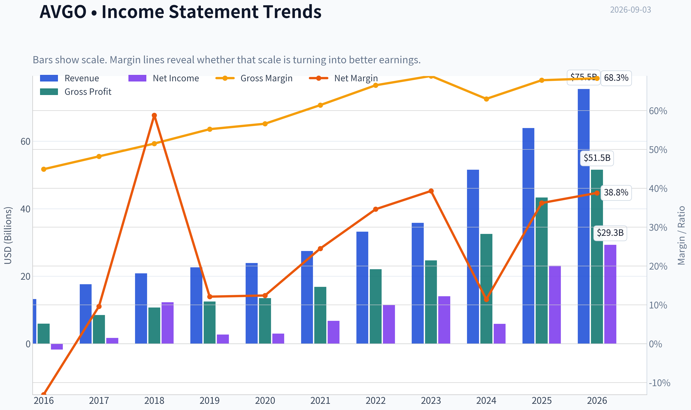
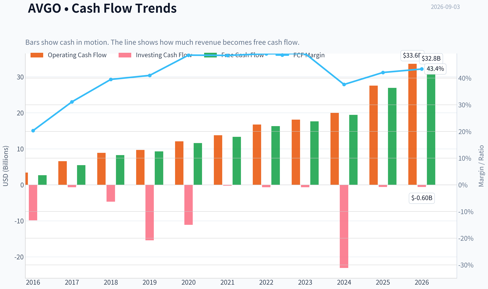
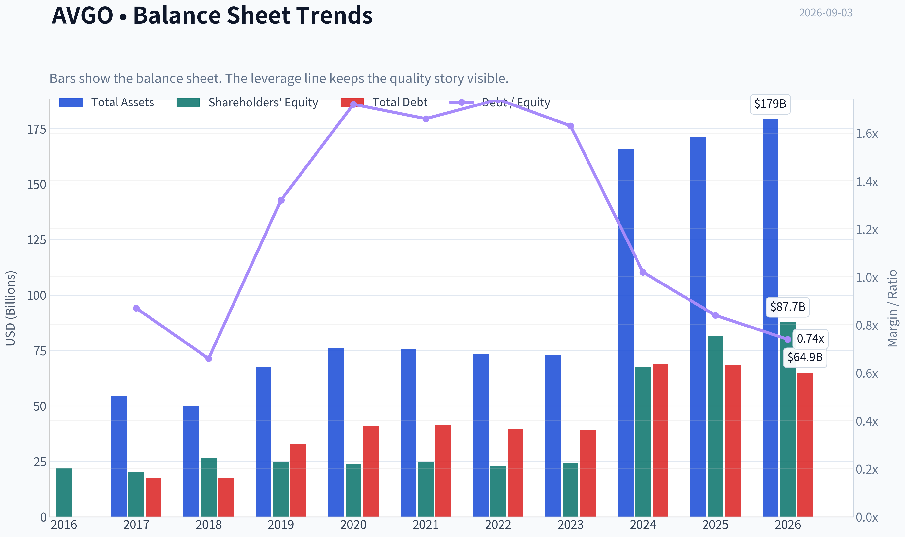
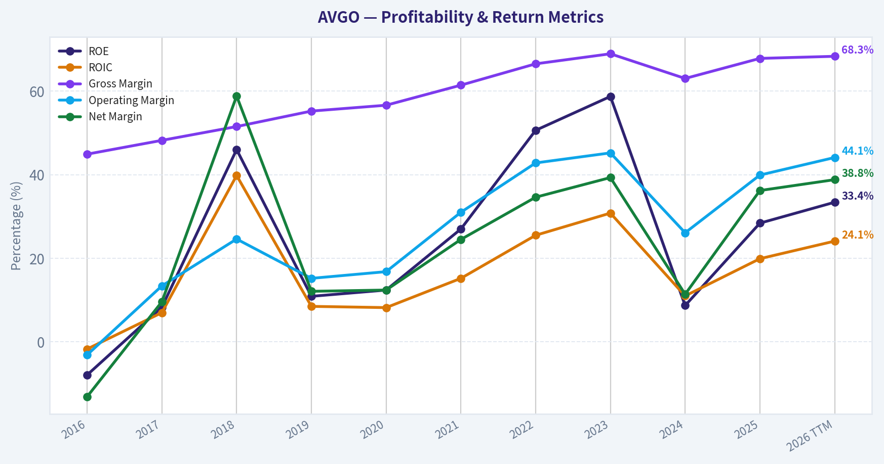
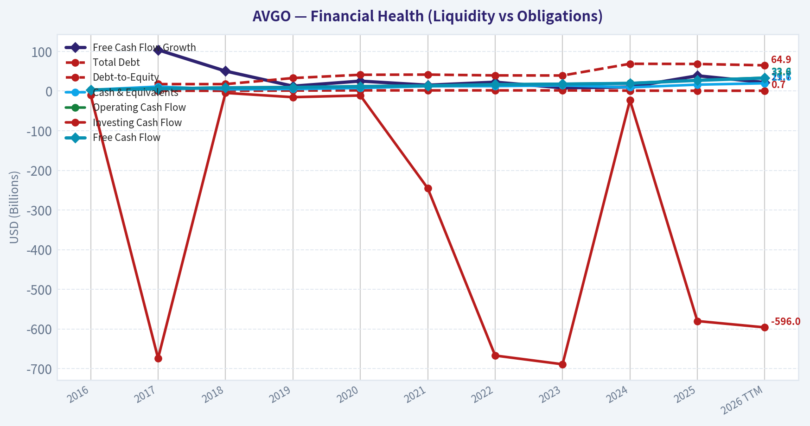
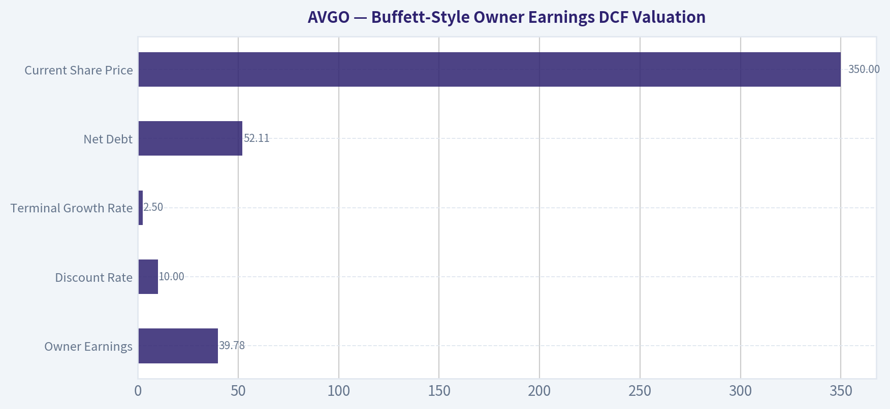
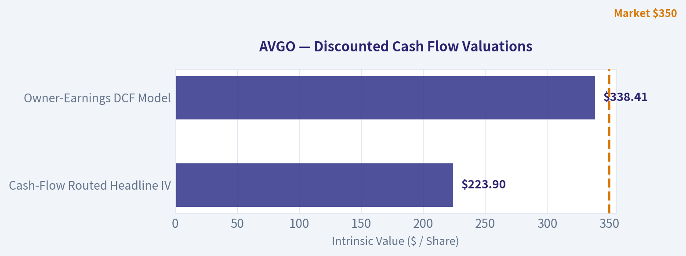
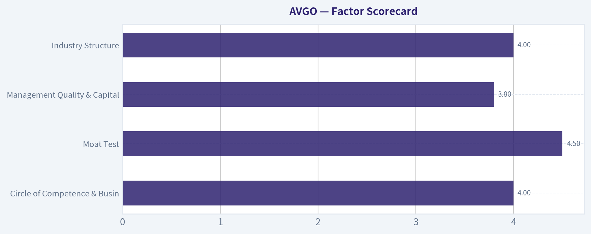
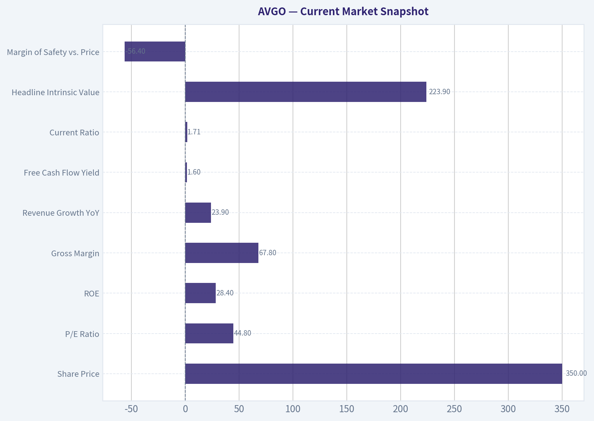

# AVGO Deep Value Intelligence

**Analysis Date:** 2026-09-03

## Critical Disclaimer

*This analysis is generated by Deep Value Intelligence, an AI-powered multi-agent investing framework. Education & research only - not financial advice, not a financial advisor.*

---

## Table of Contents

1. Intelligence Summary
2. Analyst Team Reports
   - Fundamentals Analysis
   - Intrinsic Value Analysis (Buffett)
   - Trend & Growth Analysis (Lynch/Druckenmiller/Fisher)
   - Market Technical Analysis
   - Options Market Analysis
3. Research Team Commentary
4. Value Investing Team Commentary
5. Deep Values Commentary

---

## Intelligence Summary

### Thesis + Conditions

**Core Thesis:** **EXECUTIVE SUMMARY**
Broadcom (AVGO) is an elite AI infrastructure and software compounder trading at a pivotal technical support level. While a 44x trailing P/E and a dip below short-term moving averages flash traditional warning signs, our modernized Buffett framework prioritizes business quality and secular tailwinds over static valuation fears.

**Key Risks:**
- The Bull (Risky):** Broadcom is a mission-critical AI "toll bridge." High ROIC (19.4%) and Hock Tan's masterful capital allocation justify the premium. The stock testing its 200-day SMA is a rare institutional buying opportunity, and trailing multiples ignore rapid AI and VMware cash flow accretion.
- The Bear (Safe):** A 44x P/E prices in flawless execution. The stock is technically vulnerable, resting on the 200-day SMA after breaking short-term trend lines. Structural risks like VMware debt, integration friction, and hyperscaler insourcing warrant a strict "Wait and See" approach.
- Permanent vs. Temporary Risk:** The bear's concerns about hyperscaler insourcing and VMware churn are intellectually valid but represent slow-burn, long-term strategic headwinds-not imminent, permanent impairments of capital.

**Confidence:** Medium

---

## Analyst Team Reports

### Fundamentals Analysis

#### Latest Earnings Snapshot

*Most recent reported quarter anchored on 2026 Q2, with prior-year comparison when available.*

| Metric | 2026 Q2 | 2025 Q2 | YoY Change |
| --- | ---: | ---: | ---: |
| Revenue | $22.19B | $15.00B | +47.9% |
| Operating Income | $10.86B | $5.92B | +83.6% |
| Net Income | $9.31B | $4.96B | +87.5% |
| Diluted EPS | $1.91 | $1.03 | +85.4% |
| Operating Cash Flow | $10.49B | $6.55B | +60.1% |
| Free Cash Flow | $10.26B | $6.41B | +60.1% |

Key Takeaways: This snapshot anchors the most recent reported quarter before the narrative analysis. It helps readers separate long-run business quality from whatever changed in the latest earnings print.

#### 10-Year Financial Metrics for AVGO

*All values below are computed deterministically from raw data - not estimated by AI.*

*Issuer profile: operating company (Technology / Semiconductors).*

#### 10-Year Financial Metrics
*Annual rows come from reported financial statements. The final TTM row is computed from the latest four quarters.*

| Metric | 2016 | 2017 | 2018 | 2019 | 2020 | 2021 | 2022 | 2023 | 2024 | 2025 | 2026 TTM |
| --- | --- | --- | --- | --- | --- | --- | --- | --- | --- | --- | --- |
| Market Price | $13 | $21 | $18 | $25 | $31 | $49 | $44 | $82 | $167 | $368 | $350 |
| Market Cap | $6.52B | $11.11B | $9.63B | $12.27B | $14.72B | $22.81B | $198.95B | $359.43B | $811.16B | $1.79T | $1.70T |
| P/E Ratio | -3.50 | 6.56 | 0.79 | 4.55 | 5.52 | 3.54 | 17.74 | 25.50 | 138.02 | 77.49 | 58.26 |
| P/B Ratio | 0.30 | 0.55 | 0.36 | 0.49 | 0.62 | 0.91 | 8.76 | 14.98 | 11.99 | 22.07 | 19.44 |
| ROE | -7.9% | 8.3% | 46.0% | 10.9% | 12.4% | 27.0% | 50.6% | 58.7% | 8.7% | 28.4% | 33.4% |
| ROIC | -1.7% | 7.0% | 39.8% | 8.5% | 8.2% | 15.2% | 25.5% | 30.8% | 11.0% | 19.9% | 24.1% |
| EPS | $-3.74 | $3.15 | $23.23 | $5.46 | $5.63 | $13.76 | $2.50 | $3.20 | $1.23 | $4.77 | $6.00 |
| Revenue | $13.24B | $17.64B | $20.85B | $22.60B | $23.89B | $27.45B | $33.20B | $35.82B | $51.57B | $63.89B | $75.47B |
| Gross Profit | $5.94B | $8.51B | $10.73B | $12.48B | $13.52B | $16.84B | $22.09B | $24.69B | $32.51B | $43.29B | $51.52B |
| Gross Margin | 44.9% | 48.2% | 51.5% | 55.2% | 56.6% | 61.4% | 66.5% | 68.9% | 63.0% | 67.8% | 68.3% |
| Operating Margin | -3.1% | 13.4% | 24.6% | 15.2% | 16.8% | 31.0% | 42.8% | 45.2% | 26.1% | 39.9% | 44.1% |
| Net Income | $-1.74B | $1.69B | $12.26B | $2.72B | $2.96B | $6.74B | $11.49B | $14.08B | $5.89B | $23.13B | $29.32B |
| Net Margin | -13.1% | 9.6% | 58.8% | 12.1% | 12.4% | 24.5% | 34.6% | 39.3% | 11.4% | 36.2% | 38.8% |
| Revenue Growth | N/A | 33.2% | 18.2% | 8.4% | 5.7% | 14.9% | 21.0% | 7.9% | 44.0% | 23.9% | 18.1% |
| Net Income Growth | N/A | -197.3% | 624.5% | -77.8% | 8.7% | 127.6% | 70.7% | 22.5% | -58.1% | 292.3% | 26.8% |
| Free Cash Flow Growth | N/A | 103.9% | 50.4% | 12.4% | 25.2% | 14.9% | 22.5% | 8.1% | 10.1% | 38.6% | 21.7% |
| Total Book Value | $21.88B | $20.29B | $26.66B | $24.94B | $23.87B | $24.96B | $22.71B | $23.99B | $67.68B | $81.29B | $87.69B |
| Total Assets | N/A | $54.42B | $50.12B | $67.49B | $75.93B | $75.57B | $73.25B | $72.86B | $165.65B | $171.09B | $179.16B |
| Total Debt | N/A | $17.55B | $17.49B | $32.80B | $41.06B | $41.50B | $39.48B | $39.18B | $68.81B | $68.29B | $64.91B |
| Debt-to-Equity | N/A | 0.87 | 0.66 | 1.32 | 1.72 | 1.66 | 1.74 | 1.63 | 1.02 | 0.84 | 0.74 |
| Cash & Equivalents | $3.10B | $11.20B | $4.29B | $5.05B | $7.62B | $12.16B | $12.42B | $14.19B | $9.35B | $16.18B | $19.63B |
| Shareholders' Equity | $21.88B | $20.29B | $26.66B | $24.94B | $23.87B | $24.96B | $22.71B | $23.99B | $67.68B | $81.29B | $87.69B |
| Operating Cash Flow | $3.41B | $6.55B | $8.88B | $9.70B | $12.06B | $13.76B | $16.74B | $18.09B | $19.96B | $27.54B | $33.62B |
| Investing Cash Flow | $-9.84B | $-674.0M | $-4.67B | $-15.42B | $-11.11B | $-245.0M | $-667.0M | $-689.0M | $-23.07B | $-580.0M | $-596.0M |
| Free Cash Flow | $2.69B | $5.48B | $8.24B | $9.27B | $11.60B | $13.32B | $16.31B | $17.63B | $19.41B | $26.91B | $32.76B |
| FCF Margin | 20.3% | 31.1% | 39.5% | 41.0% | 48.6% | 48.5% | 49.1% | 49.2% | 37.6% | 42.1% | 43.4% |
| Dividends / Share | $0.00 | $0.00 | $0.00 | $0.00 | $0.00 | $0.00 | $1.57 | $1.74 | $2.05 | $2.30 | $2.41 |

#### Profitability Metrics
- Return on Equity (ROE): 28.4%
- Return on Invested Capital (ROIC): 19.4%
- Return on Assets (ROA): 13.5%
- Gross Margin: 67.8%
- Operating Margin: 39.9%
- Net Profit Margin: 36.2%

#### Liquidity Metrics
- Current Ratio: 1.71
- Quick Ratio: 1.26

#### Leverage Metrics
- Debt-to-Equity Ratio: 0.84
- Interest Coverage Ratio: 7.94
- Net Debt: $52.11B

#### Growth Metrics (Year-over-Year)
- Revenue Growth: 23.9%
- Net Income Growth: 292.3%
- Free Cash Flow Growth: 38.6%
- Revenue CAGR (3-Year): 24.4%
- Revenue CAGR (5-Year): 21.7%

#### Valuation Metrics
- P/E Ratio (TTM): 44.69
- Forward P/E: 18.09
- Price-to-Book: 20.38
- Price-to-Sales: 22.04
- PEG Ratio: 0.42
- EV/EBITDA: 42.59
- Free Cash Flow Yield: 1.6%
- Earnings Yield: 2.2%

#### Owner Earnings (Buffett Method, Code-Computed)
- Net Income: $23.13B
- + Depreciation & Amortization: $8.78B
- - Capital Expenditures: $-623.0M
- - Working Capital Changes: $-8.50B
- = **Owner Earnings: $39.78B**

#### Intrinsic Value (Code-Computed)
- Current Price: $350
- **Headline Intrinsic Value (business-model routed): $224**
  Business model: asset light platform - weighted blend [Damodaran FCFF + reverse-DCF fair + owner-earnings DCF] (asset_light_platform)
  Model spread (min-max across DCFs): $47 - $338
  Margin of safety vs. price (headline): -56.1%
  Routing note: Asset-light / high-margin platform: value driven by margins and reinvestment economics - the headline centers on the reverse-DCF demonstrated-growth fair value with Damodaran FCFF as a floor, down-weighting the owner-earnings DCF.
- Buffett Method (Owner Earnings):
  Conservative: $142
  Average: $338
  Optimistic: $896
- Cash Flow Method (FCF):
  Conservative: $119
  Average: $226
  Optimistic: $226
- Damodaran FCFF (WACC + margins + reinvestment):
  Conservative: $15
  Average: $47
  Optimistic: $118
  Monte Carlo band (P10-P90): $28 - $84 (median $51)
  P(intrinsic value > price): 0.0%
- Reverse-DCF: price implies ~30.9%/yr owner-earnings growth for 10y; trailing 3y was 31.0%, 5y 74.0%.

#### Piotroski F-Score: 8/9
- Positive Net Income: PASS
- Positive Operating Cash Flow: PASS
- ROA Improvement: PASS
- Cash Flow > Net Income: PASS
- Decreasing Debt: PASS
- Improving Current Ratio: PASS
- No Dilution: FAIL
- Improving Gross Margin: PASS
- Improving Asset Turnover: PASS

ANALYST STANCE: **WATCH**

#### AVGO - Warren Buffett-Style Fundamental Analysis

Broadcom is an exceptional cash-generating semiconductor and infrastructure software business, but the current stock price already discounts a very ambitious AI-led growth trajectory. The business quality is high: gross margins are near 68%, operating margins are above 40%, free cash flow is large and expanding, and ROIC is well above most companies' cost of capital. However, Buffett-style investing requires both quality and a sensible price. At about **$350 per share** and roughly **$1.70T market capitalization**, AVGO trades above the deterministic dataset's **headline intrinsic value of about $224**, implying a **negative margin of safety of roughly 56%**.

---

#### Revenue Breakdown

| Revenue Source | Amount ($B) | % of Total |
| --- | ---: | ---: |
| Semiconductor Solutions | ~$43.0B | ~57% |
| Infrastructure Software | ~$32.5B | ~43% |
| **Total Revenue, TTM** | **$75.47B** | **100%** |

Key Takeaways: Broadcom is no longer just a semiconductor company; the VMware acquisition and infrastructure software expansion have made software a major contributor. The semiconductor business remains the larger revenue source and is the key AI upside driver, while software adds recurring, high-margin cash flow that improves durability.

---

#### Current vs Historical Average Comparison

| Metric | Current / TTM | 10-Year Avg. | Current Standing vs History | Interpretation |
| --- | ---: | ---: | --- | --- |
| Market Price | $350 | ~$82 | Far above average | The stock price has re-rated dramatically, especially since 2023, reflecting AI enthusiasm and stronger software mix. |
| Market Cap | ~$1.70T | ~$324B | Far above average | AVGO has moved from large-cap compounder to mega-cap platform valuation. |
| P/E Ratio | 58.26x | ~27.6x | Well above average | Earnings multiple is elevated; even using the supplemental snapshot P/E near mid-40s, valuation is still rich versus history. |
| P/B Ratio | 19.44x | ~6.1x | Well above average | P/B is not the best valuation anchor for AVGO because the business is asset-light, IP-heavy, and acquisition-driven; cash-flow valuation is more meaningful. |
| ROE | 33.4% | ~24.3% | Above average | Returns on equity are strong, though influenced by leverage, acquisitions, and accounting effects. |
| ROIC | 24.1% | ~16.4% | Above average | This is one of the strongest quality signals: Broadcom is earning attractive returns on capital. |
| EPS | $6.00 | ~$5.92 | Near average | EPS looks less impressive because historical EPS was volatile and affected by acquisition accounting and one-time items. |
| Revenue | $75.47B | ~$31.0B | Far above average | Revenue has more than doubled versus the historical average, driven by acquisitions, VMware, and AI/networking demand. |
| Gross Profit | $51.52B | ~$19.1B | Far above average | Scale and mix shift toward higher-margin businesses have materially expanded gross profit dollars. |
| Gross Margin | 68.3% | ~58.4% | Above average | Margins are structurally better than earlier years, indicating strong pricing power and software contribution. |
| Operating Margin | 44.1% | ~25.2% | Far above average | Operating leverage and business mix have transformed profitability. |
| Net Income | $29.32B | ~$7.9B | Far above average | Net income has surged, though some historical years were distorted by acquisition-related accounting. |
| Net Margin | 38.8% | ~22.6% | Above average | Current profitability is much stronger than the decade norm. |
| Revenue Growth | 18.1% | ~19.7% | Slightly below average | Growth remains strong but is close to normalized historical growth after a large step-up year. |
| Net Income Growth | 26.8% | ~90.3% | Below noisy average | Historical average is distorted by extreme swings; current growth is still very healthy. |
| Free Cash Flow Growth | 21.7% | ~31.8% | Below average but strong | FCF growth remains excellent, though below the unusually high historical average. |
| Total Book Value | $87.69B | ~$33.8B | Far above average | Equity base expanded meaningfully, especially after VMware-related balance sheet changes. |
| Total Assets | $179.16B | ~$89.6B | Far above average | Assets roughly doubled versus average, mostly reflecting acquisitions and goodwill/intangibles. |
| Total Debt | $64.91B | ~$40.7B | Above average | Debt is elevated in absolute terms, but declining from 2024-2025 levels. |
| Debt-to-Equity | 0.74x | ~1.27x | Better than average | Leverage has improved versus history despite a large debt load. |
| Cash & Equivalents | $19.63B | ~$9.6B | Far above average | Liquidity is strong and gives management flexibility. |
| Shareholders' Equity | $87.69B | ~$33.8B | Far above average | Equity base has strengthened materially. |
| Free Cash Flow | $32.76B | ~$13.1B | Far above average | AVGO is now a massive FCF machine. |
| FCF Margin | 43.4% | ~40.7% | Slightly above average | Cash conversion remains excellent and structurally high. |
| Dividends / Share | $2.41 | ~$0.77 | Far above average | Dividend policy has become more shareholder-friendly since dividends began in 2022. |

Key Takeaways: Broadcom's profitability, margins, revenue scale, and free cash flow are all materially better than the decade average. The concern is valuation: market cap, P/E, P/B, and price have expanded much faster than most fundamentals, meaning much of the future AI and software success is already priced in.

---

#### Market Metrics Interpretation

Broadcom's **market price of $350** is over four times its 10-year average price, while its **market capitalization of about $1.70T** is more than five times the 10-year average. This reflects a massive re-rating driven by AI networking, custom silicon expectations, VMware-related software cash flows, and investor appetite for AI infrastructure leaders.

The **P/E ratio of 58.26x in the deterministic TTM row** is far above the 10-year average of about 27.6x. This is not a classic Buffett bargain multiple. The market is valuing Broadcom as a durable, high-growth AI platform rather than as a cyclical semiconductor supplier.

The **P/B ratio of 19.44x** is also far above history, but P/B should not be read mechanically here. Broadcom is an asset-light, IP-heavy semiconductor and software platform with substantial acquisition accounting, goodwill, and intangible assets. For this type of issuer, book value is a weak valuation anchor; intrinsic value should be anchored primarily on owner earnings, free cash flow, reinvestment economics, and reverse-DCF expectations.

---

#### Profitability and Business Quality

Broadcom's profitability profile is excellent. **Gross margin of 68.3%**, **operating margin of 44.1%**, and **net margin of 38.8%** are all well above long-term averages. That margin structure resembles a high-quality software/platform business more than a traditional cyclical chip company.

**ROE of 33.4%** and **ROIC of 24.1%** are both strong. Buffett places high value on businesses that can reinvest capital at high rates without requiring excessive incremental capital. Broadcom fits that description better than most semiconductor companies because of its mix of proprietary silicon, long product cycles, customer-specific design wins, and infrastructure software.

The main caveat is that reported earnings can be distorted by acquisition accounting, amortization, and restructuring costs. Therefore, **free cash flow and owner earnings are more informative than EPS alone**.

---

#### Growth Metrics Interpretation

Revenue has compounded strongly, with the dataset showing **2026 TTM revenue of $75.47B**, compared with **$13.24B in 2016**. Growth has come from a mix of acquisitions, organic semiconductor demand, AI networking, custom ASICs, and infrastructure software.

The latest **revenue growth rate of 18.1%** remains strong, although it is slightly below the 10-year average of roughly 19.7%. Net income growth of **26.8%** is healthy, but the 10-year average is not very meaningful because historical net income growth includes extreme swings, including large acquisition and tax-related effects.

Free cash flow growth of **21.7%** remains impressive. For Buffett-style analysis, this is one of the most important metrics: Broadcom has shown an ability to convert revenue growth into durable cash flow growth.

---

#### Balance Sheet and Financial Strength

Broadcom has **$179.16B in total assets**, **$87.69B in shareholders' equity**, and **$64.91B in total debt**. Debt is high in absolute terms, largely due to acquisition strategy, but the **debt-to-equity ratio has improved to 0.74x**, below the historical average of roughly 1.27x.

Cash and equivalents of **$19.63B** provide meaningful liquidity. The company also has strong cash generation, with **TTM free cash flow of $32.76B**, which supports debt repayment, dividends, buybacks, and reinvestment.

The balance sheet is not pristine in the Berkshire sense because acquisition debt is material. However, the debt appears manageable given Broadcom's high margins, strong FCF, and interest coverage of approximately **7.94x** from the deterministic dataset.

---

#### Cash Flow and Dividend Quality

Broadcom's free cash flow is the core of the investment case. TTM FCF is **$32.76B**, compared with a 10-year average of roughly **$13.1B**. FCF margin is **43.4%**, above the historical average of about **40.7%**, confirming that growth is translating into cash rather than merely accounting earnings.

Dividends per share have increased to **$2.41**, versus a 10-year average of about **$0.77**. The dividend is not the primary reason to own AVGO, but it reflects management's willingness to return capital. Given the current valuation and AI opportunity, buybacks would be most attractive only during significant pullbacks.

---

#### Buffett-Style Owner Earnings DCF Valuation

Base inputs used from the deterministic dataset:

| DCF Input | Value |
| --- | ---: |
| Owner Earnings | $39.78B |
| Discount Rate | 10.0% |
| Terminal Growth Rate | 2.5% |
| Net Debt | $52.11B |
| Estimated Shares Outstanding | ~4.86B |
| Current Share Price | $350 |
| Headline Intrinsic Value from Dataset | ~$224/share |

Key Takeaways: The valuation is highly sensitive to growth assumptions because Broadcom's current price capitalizes a long stream of future AI and software cash flows. The deterministic dataset's headline intrinsic value of about $224 is meaningfully below the market price, implying that investors are paying upfront for exceptional execution.

| Scenario | Growth Assumption | PV of Explicit Owner Earnings | PV of Terminal Value | Equity Value After Net Debt | Hand DCF Fair Value / Share | Canonical Model Reference |
| --- | --- | ---: | ---: | ---: | ---: | ---: |
| Conservative | 6% owner earnings growth for 10 years, then 2.5% terminal growth | ~$327B | ~$375B | ~$650B | ~$134 | Owner Earnings conservative: ~$142 |
| Average / Base Case | 18% growth for 5 years, fading to 10% for years 6-10, then 2.5% terminal growth | ~$529B | ~$772B | ~$1.25T | ~$257 | Owner Earnings average: ~$338; headline intrinsic value: ~$224 |
| Optimistic | 30% growth for 5 years, fading to 15% for years 6-10, then 2.5% terminal growth | ~$863B | ~$1.57T | ~$2.38T | ~$489 | Owner Earnings optimistic: ~$896 |

Key Takeaways: The conservative and base-case DCF outcomes sit below the current $350 share price unless one gives Broadcom credit for very strong and sustained growth. The optimistic case can justify upside, but it depends on AI-driven owner earnings growth remaining extraordinary for many years. That is possible, but it is not a conservative Buffett-style margin-of-safety setup.

The deterministic valuation pack provides a broader model spread:

| Valuation Method | Conservative | Average | Optimistic |
| --- | ---: | ---: | ---: |
| Buffett Owner Earnings DCF | $142 | $338 | $896 |
| Free Cash Flow Method | $119 | $226 | $226 |
| Damodaran FCFF Method | $15 | $47 | $118 |
| Headline Business-Model Routed Intrinsic Value | - | **$224** | - |
| Current Price | - | **$350** | - |

Key Takeaways: The owner earnings model is much more favorable than the Damodaran FCFF model, showing how sensitive AVGO's valuation is to reinvestment and terminal assumptions. The most important point is that the dataset's headline intrinsic value of $224 is below the current price, while the reverse DCF says today's price implies roughly 31% annual owner-earnings growth for 10 years.

---

#### Economic Moat Assessment

Broadcom has a strong moat, supported by several durable advantages:

| Moat Source | Assessment |
| --- | --- |
| Custom Silicon and ASIC Relationships | Very strong; customer-specific design wins create switching costs and long product cycles. |
| AI Networking Exposure | Strong; Broadcom is strategically positioned in high-performance networking, accelerators, and custom silicon ecosystems. |
| Infrastructure Software | Strong; VMware and enterprise software assets add recurring revenue and high margins. |
| Scale and Engineering Depth | Strong; few competitors can match Broadcom's breadth across networking, connectivity, storage, and software. |
| Customer Concentration Risk | Moderate to high; AI and custom silicon growth can be tied to a limited number of hyperscale customers. |
| Cyclicality | Lower than traditional semis, but not eliminated; semiconductor demand remains cyclical. |

Key Takeaways: Broadcom's moat is real and has likely strengthened over the decade. The company has evolved from a semiconductor roll-up into a high-margin infrastructure technology platform. The risk is not business quality; the risk is whether the current price already overcapitalizes that quality.

---

#### Management and Capital Allocation

Management has created enormous shareholder value through disciplined acquisitions, aggressive integration, margin expansion, and strong cash conversion. The VMware acquisition increased scale, recurring software revenue, and operating leverage, but also added integration complexity and debt.

ROIC improvement is particularly important. Broadcom's **ROIC of 24.1%** versus a 10-year average of about **16.4%** suggests management is not merely growing for growth's sake; it is generating attractive returns on invested capital. That said, the company has historically relied on large acquisitions, so future capital allocation discipline remains crucial.

The dividend has grown meaningfully since initiation, but given the stock's premium valuation, the best capital allocation path may be debt reduction and selective reinvestment rather than aggressive buybacks at elevated prices.

---

#### Key Investment Insights

| Category | Insight |
| --- | --- |
| Business Quality | Excellent; AVGO has elite margins, high ROIC, strong FCF, and a growing software component. |
| Growth Runway | Strong; AI networking, custom silicon, and VMware monetization provide credible growth drivers. |
| Valuation | Rich; current price is above the dataset's headline intrinsic value and requires sustained high growth. |
| Cash Flow | Very strong; TTM FCF of $32.76B and FCF margin above 43% are Buffett-quality traits. |
| Balance Sheet | Manageable but not risk-free; debt is high in absolute dollars, though leverage ratios are improving. |
| Historical Comparison | Fundamentals are better than history, but valuation has expanded even faster. |
| Reverse DCF Signal | Demanding; current price implies roughly 31% annual owner-earnings growth for 10 years. |

Key Takeaways: Broadcom is a high-quality compounder, but the valuation leaves little room for disappointment. The business can grow into the valuation if AI demand and software synergies remain very strong, but Buffett-style investors would prefer a larger margin of safety.

---

#### Red Flags and Risks

| Risk | Why It Matters |
| --- | --- |
| Valuation Risk | At $350, AVGO trades above the headline intrinsic value of ~$224 and near the upper end of reasonable base-case DCF outcomes. |
| AI Expectations Risk | The market is pricing in a large AI future; any slowdown in AI orders or guidance could compress multiples. |
| Customer Concentration | Custom silicon and AI demand may depend heavily on a few hyperscale customers. |
| Debt Load | $64.91B of debt is manageable but limits flexibility if cash flows weaken. |
| Acquisition Integration | VMware adds high-margin software revenue, but integration execution remains important. |
| Semiconductor Cyclicality | Even high-quality chip businesses can face inventory cycles and demand normalization. |
| Multiple Compression | A P/E above historical averages creates downside if growth merely normalizes. |

Key Takeaways: The biggest risk is not that Broadcom is a poor business; it is that the stock price assumes near-flawless execution. A great company can still be a mediocre investment if purchased without a margin of safety.

---

#### Opportunities

| Opportunity | Potential Impact |
| --- | --- |
| AI Networking and Custom Silicon | Could drive sustained revenue and owner earnings growth above historical norms. |
| VMware Margin Expansion | Software integration may lift operating margins and recurring cash flow. |
| Debt Reduction | Strong FCF can reduce leverage and increase equity value over time. |
| Cross-Selling Infrastructure Software | Broadcom can monetize enterprise relationships across software and silicon. |
| Operating Leverage | Incremental revenue can translate into disproportionately high profit growth. |
| Dividend Growth | FCF strength supports continued dividend increases. |

Key Takeaways: Broadcom has several credible pathways to grow intrinsic value. The most important are AI-related semiconductor demand and high-margin infrastructure software monetization. These opportunities justify a premium multiple, but not necessarily an unlimited one.

---

#### Final Buffett-Style Investment Stance: WATCH

AVGO is a **wonderful business at a demanding price**. The company has many Buffett-favored traits: high returns on capital, strong free cash flow, durable competitive advantages, rational capital allocation, and a widening moat. However, the stock does not currently offer a clear margin of safety.

The deterministic dataset's **headline intrinsic value is about $224 per share**, compared with a current price of **$350**. The reverse DCF indicates the market is already pricing in roughly **31% annual owner-earnings growth for 10 years**, which is a high hurdle even for a best-in-class compounder.

For existing long-term holders with low cost bases, AVGO remains a high-quality compounder worth holding unless position sizing has become excessive. For new Buffett-style capital, the better stance is **WATCH**, waiting for either a pullback closer to intrinsic value or further proof that AI and software cash flows can compound at extraordinary rates for longer than currently modeled.

#### Final Summary Table

| Area | Buffett-Style Judgment | Key Point |
| --- | --- | --- |
| Economic Moat | Strong | Custom silicon, AI networking, software scale, and customer lock-in create durable advantages. |
| Profitability | Excellent | Gross margin, operating margin, ROE, ROIC, and FCF margin are all strong. |
| Financial Strength | Good but leveraged | Debt is high in absolute terms, but cash flow coverage is strong and leverage is improving. |
| Earnings Predictability | Improving | Software mix improves durability, though semiconductor cyclicality remains. |
| Management | Strong | Acquisition integration, margin expansion, and FCF generation have been impressive. |
| Valuation | Expensive | Current price is above headline intrinsic value and requires very high future growth. |
| Margin of Safety | Insufficient | Dataset implies roughly -56% margin of safety versus headline intrinsic value. |
| Best Action | **WATCH** | Great company, but wait for a better entry price or more evidence that AI growth can exceed expectations. |

Key Takeaways: Broadcom is one of the highest-quality large-cap technology businesses in the market, but the stock price reflects that quality. The appropriate Buffett-style conclusion is to admire the business, monitor execution closely, and avoid overpaying without a margin of safety.

#### Fundamental Visuals

This graph tracks the profitability and return metrics (ROE, ROIC, Margins) of **AVGO** over the past decade, highlighting capital efficiency trends.

This chart illustrates the financial health of **AVGO** over the last 10 years, mapping cash equivalents and free cash flow against total obligations (Debt).

---

### Intrinsic Value Analysis (Buffett)

> *Following Warren Buffett's value investing philosophy: Circle of Competence, Economic Moat, Management Quality, and Margin of Safety.*

#### Intrinsic Value Snapshot

Price is what you pay. Intrinsic value is what the business may be worth based on the cash it can create for owners over time. We show a range, not one magic number.

- Current Price: $350.13
- Value Range (conservative to optimistic across both DCF methods): $119.38 to $896.19

##### Owner Earnings (Buffett Method)
- Net Income: $23,126,000,000.00
- Depreciation & Amortization: $8,775,000,000.00
- Capital Expenditures: $-623,000,000.00
- Working Capital Changes: $-8,500,000,000.00
- Owner Earnings: $39,778,000,000.00

##### Intrinsic Value
###### Buffett Method
Uses owner earnings. Stricter, and usually more conservative.
- Conservative: $142.32
- Average: $338.41
- Optimistic: $896.19
- Discount Rate: 10.0%

###### Cash Flow Method
Uses free cash flow. Better for companies spending heavily today to grow tomorrow.
- Conservative: $119.38
- Average: $225.80
- Optimistic: $225.80
- Discount Rate: 10.0%

ANALYST STANCE: **WATCH**

#### Broadcom Inc. - Buffett-Style Investment Review

Broadcom is a high-quality compounder with two powerful engines: mission-critical semiconductor franchises and increasingly sticky infrastructure software through VMware. The business has real moat characteristics, high gross margins, strong free cash flow, and a long AI/custom-silicon runway. The issue is price: at **$350**, the stock already discounts a very strong future, with the reverse DCF implying roughly **31% annual growth for 10 years**. That is possible only if AI, networking, VMware monetization, and capital allocation all execute exceptionally well.

---

#### 1. Factor Scorecard

| Factor | Score / 5 | Evidence |
|---|---:|---|
| Circle of Competence & Business Simplicity | 4.0 | Broadcom sells specialized chips, custom AI accelerators, networking silicon, and infrastructure software. The model is understandable: design mission-critical products, outsource much manufacturing, and earn high margins from scale and switching costs. Complexity comes from semiconductor cycles, customer concentration, and large acquisitions. |
| Moat Test | 4.5 | Gross margin is about **67.8%**, well above the 40% moat threshold. Broadcom has strong positions in networking, custom silicon, wireless/RF, storage, and VMware software. Switching costs and customer qualification cycles are high. |
| Management Quality & Capital Allocation | 3.8 | Hock Tan has created substantial shareholder value through disciplined acquisitions, cost control, and integration. The CA, Symantec enterprise, and VMware deals show a clear playbook. The demerit is elevated acquisition debt and aggressive post-acquisition cost/margin optimization that can create customer friction. |
| Industry Structure | 4.0 | Broadcom competes in attractive niches rather than commodity semiconductors. Many end markets are oligopolistic or require deep engineering relationships. AI/custom silicon is a major opportunity, but expectations and competition are intense. |
| Gate 5: Quality/Solvency Hard Floor | Not Tripped | Earnings and free cash flow remain strong, the company is not in financial distress, and current ratio is about **1.7**. Debt is meaningful after VMware, but cash generation is substantial. |

**Key Takeaways:** Broadcom scores as a genuinely high-quality business. The moat is real, especially in custom silicon, networking, and VMware infrastructure software. The hard solvency floor is not triggered; the investment debate is not survival, but valuation versus already-embedded expectations.

---

#### 2. Current Market Snapshot

| Metric | Current Value |
|---|---:|
| Share Price | **$350** |
| Market Capitalization | **$1.67 trillion** |
| P/E Ratio | **44.8x** |
| ROE | **28.4%** |
| Gross Margin | **67.8%** |
| Revenue Growth YoY | **23.9%** |
| Free Cash Flow Yield | **1.6%** |
| Current Ratio | **1.71** |
| Headline Intrinsic Value | **$223.90** |
| Margin of Safety vs. Price | **-56.4%** |
| Reverse DCF Implied Growth | **~31% annually for 10 years** |

**Key Takeaways:** Broadcom's quality metrics are excellent, but the market price is demanding. A 1.6% free cash flow yield leaves little room for disappointment. The stock is priced as if AI and VMware synergies will compound at a very high rate for a long time.

---

#### 3. Moat Analysis

| Moat Source | Assessment | Evidence |
|---|---|---|
| Intangible Assets | Very strong | Broadcom's chip franchises are trusted in mission-critical infrastructure. VMware adds a major enterprise software layer with brand, installed base, and ecosystem depth. |
| Switching Costs | Very strong | Hyperscale ASICs, networking chips, enterprise virtualization, and infrastructure software are deeply embedded into customer systems. Switching requires engineering redesign, qualification, migration risk, and operational disruption. |
| Cost Advantages | Strong | Broadcom's fabless model, scale purchasing, focused R&D, and acquisition integration discipline support high margins. The company has repeatedly improved acquired software margins. |
| Network Effects | Moderate | VMware has ecosystem effects among enterprises, developers, and IT administrators. Semiconductor network effects are weaker, but customer co-design relationships can deepen over time. |
| Pricing Power | Strong, but monitored | Gross margin near **68%** suggests pricing power. VMware price increases may boost profits, but excessive pricing could create customer pushback over time. |

**Key Takeaways:** Broadcom's moat is wide, but not invulnerable. The strongest moat elements are switching costs, scale, engineering trust, and mission-critical customer relationships. The key risk is that high pricing, especially in VMware, could invite customer resentment or competitive substitution.

---

#### 4. Management Quality & Capital Allocation

Broadcom is best understood as an industrial-scale capital allocator in technology. Hock Tan's strategy has been consistent: buy durable franchises, cut non-core spending, focus on high-return customers, integrate aggressively, and convert earnings into free cash flow.

| Area | Assessment |
|---|---|
| Owner Orientation | Strong; management has historically emphasized per-share value, free cash flow, and returns rather than growth for growth's sake. |
| Acquisition Discipline | Strong but higher-risk after VMware because the deal is very large and debt-funded. The historical playbook has worked, but scale raises execution risk. |
| Reinvestment | Attractive; AI networking, custom accelerators, and software monetization provide meaningful reinvestment runway. |
| Buybacks & Dividends | Broadcom has returned capital, but at today's valuation buybacks would need to be highly selective. |
| Debt Discipline | Acceptable, not ideal; debt increased materially with VMware, but free cash flow coverage is strong. |

**Key Takeaways:** Management has earned credibility through years of value creation. The main concern is not competence but the combination of large acquisition debt, aggressive software monetization, and a valuation that gives management little room for error.

---

#### 5. Financial Summary

| Fiscal Year | Revenue | Revenue Growth | Gross Margin | Operating Margin | Net Income | Free Cash Flow | FCF Margin |
|---|---:|---:|---:|---:|---:|---:|---:|
| FY2021 | ~$27.5B | ~15% | ~74% | ~31% | ~$6.7B | ~$13.3B | ~48% |
| FY2022 | ~$33.2B | ~21% | ~75% | ~39% | ~$11.5B | ~$16.3B | ~49% |
| FY2023 | ~$35.8B | ~8% | ~74% | ~45% | ~$14.1B | ~$17.6B | ~49% |
| FY2024 | ~$51.6B | ~44% | ~64% | ~24% | ~$5.9B | ~$19.4B | ~38% |
| Current Snapshot | - | **23.9% YoY** | **67.8%** | - | Implied strong profitability | FCF yield **1.6%** | - |

**Key Takeaways:** Broadcom has compounded revenue and free cash flow impressively, with FY2024 boosted by VMware. GAAP net income was depressed by acquisition-related accounting effects, but free cash flow remained strong. The long-term pattern is a high-margin business with excellent cash generation.

---

#### 6. Owner Earnings Calculation

For Broadcom, free cash flow is a useful proxy for owner earnings because the business is asset-light relative to its scale, with low maintenance capital intensity and substantial software economics after VMware.

| Owner Earnings Bridge | Estimate |
|---|---:|
| Market Capitalization | **$1.67T** |
| Free Cash Flow Yield | **1.6%** |
| Implied Free Cash Flow / Owner Earnings | **~$26.7B** |
| Estimated Shares Outstanding | **~4.77B** |
| Owner Earnings Per Share | **~$5.60** |
| Price / Owner Earnings | **~62.5x** |

**Key Takeaways:** Broadcom is a strong cash generator, but the current price capitalizes that cash flow at a very rich multiple. A price-to-owner-earnings ratio above 60x requires many years of rapid compounding. This is the central valuation risk.

---

#### 7. Three-Scenario DCF Valuation

| Scenario | Assumption | Intrinsic Value / Share | Margin of Safety vs. $350 |
|---|---|---:|---:|
| A. No Growth | Owner earnings capitalized at 10% | **~$56** | **-84%** |
| B. GDP Growth | 3% perpetual growth, 10% discount rate | **~$82** | **-77%** |
| C. Historical Growth, Capped | 10% growth for 10 years, then 3% terminal growth | **~$138** | **-61%** |
| Cash-Flow Routed Headline IV | Weighted intrinsic value blend | **$223.90** | **-56.4%** |
| Owner-Earnings DCF Model | More favorable owner-earnings model | **$338.41** | **-3%** |

**Key Takeaways:** Conservative DCF cases do not support the current price. Even the headline intrinsic value estimate is materially below the market price. Only the more optimistic owner-earnings model approaches today's price, which means the stock depends heavily on sustained high growth.

---

#### 8. Margin of Safety Analysis

| Valuation Reference | Value / Share | Required Margin for Quality | Attractive Buy Zone |
|---|---:|---:|---:|
| Headline Intrinsic Value | **$223.90** | 10-15% | **~$190-$201** |
| Owner-Earnings DCF | **$338.41** | 10-15% | **~$288-$305** |
| Current Price | **$350** | Not met | Above fair-value range |
| Reverse DCF | Price implies ~31% annual growth for 10 years | High execution burden | Little margin for error |

**Key Takeaways:** Broadcom deserves a smaller margin of safety than an average company because its moat and returns are strong. But even a wonderful business can be overvalued. At $350, the stock offers inadequate downside protection unless one underwrites extremely strong AI-driven growth.

---

#### 9. Final Buffett Scorecard

| Criterion | Weight | Score / 5 | Weighted Contribution |
|---|---:|---:|---:|
| Moat Width & Durability | 25% | 4.5 | 1.13 |
| Valuation / Margin of Safety | 20% | 0.5 | 0.10 |
| Capital Returns - ROIC vs. WACC | 15% | 4.5 | 0.68 |
| Business Understanding & Predictability | 12% | 3.8 | 0.46 |
| Management Quality & Capital Allocation | 12% | 3.8 | 0.46 |
| Reinvestment Runway | 8% | 4.5 | 0.36 |
| Balance Sheet Strength | 4% | 3.0 | 0.12 |
| Industry Structure | 4% | 4.0 | 0.16 |
| **Total Score** | **100%** | - | **3.46 / 5.00** |

**Key Takeaways:** Broadcom's business quality is high enough to keep it firmly on the watchlist. The score is dragged down almost entirely by valuation. This is the right kind of business, but not yet the right price.

---

#### 10. Investment Stance

**Stance: WATCH**
**Conviction: Medium-High on business quality; Low at current valuation**

Broadcom is a wonderful business with a wide moat, strong management, high margins, and a credible AI/custom-silicon runway. It is exactly the type of modern compounder a Buffett-style investor should study carefully rather than dismiss because it is "technology."

However, at **$350**, the price already assumes extraordinary execution. The reverse DCF's implied **31% annual growth for 10 years** is a very high bar. The stock becomes much more compelling below roughly **$300** under an optimistic owner-earnings view, and far more attractive closer to the **$225-$275** range depending on confidence in AI revenue durability and VMware retention.

**Bottom line:** Broadcom is a high-quality compounder, but today's valuation offers too little margin of safety. Keep it on the watchlist and wait for a better price.
#### Valuation Bridge

This bridge places the current market price beside each intrinsic value lens so readers can see whether upside depends on one method or shows up across several methods.

| Scenario | Intrinsic Value / Share |
| --- | ---: |
| Buffett Method | $338.41 |
| Cash Flow Method | $225.80 |
| Damodaran Method | $47.02 |
| Current Price | $350.13 |

#### Key Takeaways

If one method is far above the others, the upside case depends on a specific modelling assumption. When several methods cluster together, the valuation story is more robust.

#### Valuation Visuals

This comparison chart from *Latest Earnings Snapshot* stacks current figures against historical benchmarks for **AVGO**, making it easy to see where the company trades relative to its own averages.

This comparison chart from *Buffett-Style Owner Earnings DCF Valuation* stacks current figures against historical benchmarks for **AVGO**, making it easy to see where the company trades relative to its own averages.

This comparison chart from *Buffett-Style Owner Earnings DCF Valuation* stacks current figures against historical benchmarks for **AVGO**, making it easy to see where the company trades relative to its own averages.

The following chart maps the **AVGO** Owner Earnings DCF valuation scenarios (Conservative, Average, Optimistic) to visually represent the margin of safety based on intrinsic value calculations.

---

### Trend & Growth Analysis (Lynch/Druckenmiller/Fisher)

> *Following Peter Lynch's GARP, Stanley Druckenmiller's macro-aware approach, and Philip Fisher's scuttlebutt methodology.*

ANALYST STANCE: **WATCH**

#### AVGO Growth Investment Report - Broadcom Inc.

| Snapshot | Data |
|---|---:|
| Current Price | $350 |
| Market Cap | $1.67T |
| P/E | 44.8x |
| Revenue Growth YoY | 23.9% |
| Gross Margin | 67.8% |
| ROE | 28.4% |
| FCF Yield | 1.6% |
| Current Ratio | 1.71x |
| Headline Intrinsic Value Estimate | $223.90 |
| Margin of Safety vs. Price | -56.4% |
| Reverse-DCF Implied Growth | ~31% annually for 10 years |

**Key Takeaways:** Broadcom is an exceptional business with elite margins, strong returns on equity, and a major AI-driven growth inflection. The issue is not quality; it is expectations. At a $1.67 trillion market cap and a 44.8x P/E, the market is already pricing in years of very strong execution.

---

#### 1. Lynch Classification

| Lynch Category | Assessment |
|---|---|
| Classification | **Fast Grower / Mega-Cap Stalwart Hybrid** |
| Growth Profile | Revenue growth of 23.9% YoY places AVGO in fast-grower territory |
| Ten-Bagger Potential | Low from current size; a 10x move implies ~$16.7T market cap |
| Best Fit for Portfolio | High-quality compounder, not undiscovered ten-bagger |

**Key Takeaways:** Broadcom still qualifies as a growth company because revenue is growing above 20%, but its size changes the opportunity. This is not an early-stage Lynch-style ten-bagger candidate; it is a dominant mega-cap platform where investors must be careful not to overpay for excellence.

---

#### 2. The Story in 3 Bullets

- Broadcom sells mission-critical semiconductors and infrastructure software that power AI data centers, networking, storage, wireless, and enterprise IT.
- AI networking, custom silicon, and hyperscaler demand are driving a major revenue inflection, with management reportedly targeting very large AI revenue potential by fiscal 2028.
- The VMware acquisition deepens Broadcom's infrastructure software platform, adding recurring enterprise revenue and margin expansion potential.

---

#### 3. TAM Analysis and 10x Test

| Item | Estimate / Assessment |
|---|---:|
| Current Revenue Base | Large-cap scale; recent guidance implies a very large annualized revenue run-rate |
| 10x Revenue Test | A 10x revenue outcome would require Broadcom to become one of the largest companies in economic history |
| Relevant TAMs | AI semiconductors, custom ASICs, networking, enterprise infrastructure software, virtualization, cloud infrastructure |
| TAM Direction | Expanding, especially in AI infrastructure |
| Can AVGO 10x revenue and remain under 20% TAM share? | **Unlikely** |
| Runway Quality | Strong for compounding; limited for true 10x upside |

**Key Takeaways:** Broadcom has a real runway because AI infrastructure spending is expanding rapidly. However, the company is already so large that the classic Lynch 10x test becomes difficult. AVGO can still compound, but the current size makes ten-bagger math highly demanding.

---

#### 4. Revenue Growth Trend

| Metric | Assessment |
|---|---|
| YoY Revenue Growth | 23.9% |
| Growth Category | Fast grower |
| Pattern | Strong, AI-supported growth |
| Inflection Status | Positive, but expectations are high |
| Main Growth Drivers | AI networking, custom silicon, VMware software contribution, hyperscaler demand |
| Main Concern | Growth may be increasingly "priced in" |

**Key Takeaways:** Revenue growth remains impressive for a company of Broadcom's size. The AI cycle appears to be creating a genuine growth inflection, but the stock's valuation already assumes that this inflection continues for a long time.

---

#### 5. Unit Economics and Operating Quality

| Metric | AVGO Assessment |
|---|---:|
| Gross Margin | 67.8% |
| ROE | 28.4% |
| FCF Yield | 1.6% |
| Current Ratio | 1.71x |
| Rule of 40 | Not directly applicable; AVGO is not a pure SaaS company |
| NRR / LTV-CAC | Not disclosed in standard semiconductor format |
| Business Quality | Very high |

**Key Takeaways:** Broadcom's unit economics are excellent at the company level, especially shown through high gross margin and strong ROE. The low FCF yield is not a business-quality issue; it is a valuation issue. Investors are paying a high price for each dollar of current free cash flow.

---

#### 6. Inflection Point Assessment

| Inflection Type | Status | Evidence |
|---|---|---|
| Product Cycle Inflection | Positive | AI custom silicon and networking demand |
| Market Share Inflection | Positive | Hyperscaler relationships and custom ASIC wins |
| Margin Inflection | Positive / Watch | VMware integration could improve software margins |
| TAM Inflection | Strong Positive | AI data center buildout expands addressable market |
| Competitive Inflection | Mixed | Nvidia remains dominant; competition in AI silicon is intense |
| Expectations Inflection | Negative Risk | Stock already prices in aggressive growth |

**Key Takeaways:** Broadcom has several genuine inflection points, especially in AI infrastructure and software integration. The risk is that the market has already recognized the story. When a company is already valued at $1.67 trillion, even excellent results may not be enough if expectations are too high.

---

#### 7. Macro Setup

| Macro Factor | Impact on AVGO |
|---|---|
| AI Infrastructure Cycle | Strong tailwind |
| Cloud Capex | Strong tailwind, but cyclical risk exists |
| Interest Rates | Lower rates would help valuation; higher rates pressure multiples |
| Enterprise IT Spending | Mixed; VMware gives durability but also integration risk |
| Semiconductor Cycle | Favorable in AI, less uniform in legacy chips |
| Druckenmiller-Style Macro Read | Great secular theme, but valuation leaves little room for error |

**Key Takeaways:** The macro setup is broadly favorable because AI infrastructure remains one of the strongest secular investment cycles. However, AVGO is also exposed to hyperscaler capex cycles and long-duration equity valuation risk. Falling rates would help; rising rates would make the valuation harder to justify.

---

#### 8. Fisher 15 Points Score

| Fisher Criterion | Score / 5 |
|---|---:|
| Large market potential | 5 |
| Management commitment to new products | 5 |
| R&D effectiveness | 4 |
| Sales organization | 4 |
| Worthwhile profit margin | 5 |
| Improving margins | 4 |
| Labor/personnel relations | 3 |
| Executive relations | 4 |
| Management depth | 4 |
| Cost controls/accounting | 5 |
| Durable competitive advantages | 5 |
| Long-range profit outlook | 4 |
| Dilution risk | 4 |
| Candor during difficulties | 4 |
| Management integrity | 4 |
| **Total** | **64 / 75** |

**Key Takeaways:** Broadcom scores very well on Fisher's quality framework. The company has market potential, strong execution, durable customer relationships, and excellent margins. The score falls just short of "outstanding" mainly because of integration complexity, competitive intensity, and valuation risk.

---

#### 9. Valuation Analysis

| Valuation Metric | Assessment |
|---|---:|
| P/E | 44.8x |
| Revenue Growth | 23.9% |
| Lynch PEG | ~1.87x |
| PEG Interpretation | Fair-to-expensive |
| FCF Yield | 1.6% |
| Headline Intrinsic Value | $223.90 |
| Current Price | $350 |
| Margin of Safety | -56.4% |
| Reverse-DCF Hurdle | Requires ~31% annual growth for 10 years |

**Key Takeaways:** Valuation is the core problem. A PEG near 1.9 is not absurd for a dominant AI compounder, but it is not cheap. The reverse-DCF is demanding: the current price already requires Broadcom to deliver exceptional growth for a full decade.

---

#### 10. Scenario Analysis

| Scenario | Assumption | Investment Implication |
|---|---|---|
| Bear Case | AI growth slows, VMware integration disappoints, multiple compresses | Material downside risk |
| Base Case | AI and software growth remain strong, but valuation stays demanding | Moderate compounding, limited margin of safety |
| Bull Case | Broadcom becomes the leading custom AI silicon and networking platform for hyperscalers | Strong upside, but much is already priced in |

**Key Takeaways:** The bull case is real, but investors are paying up for it today. The bear case is not about Broadcom becoming a bad company; it is about the stock multiple compressing if growth merely becomes good instead of spectacular.

---

#### 11. Growth Investor Scorecard

| Criterion | Weight | Score / 5 | Weighted Score |
|---|---:|---:|---:|
| The Story | 10% | 4.5 | 0.45 |
| TAM & Runway | 20% | 3.5 | 0.70 |
| Revenue Growth | 20% | 4.0 | 0.80 |
| Unit Economics | 15% | 4.5 | 0.68 |
| Competitive Position | 10% | 4.0 | 0.40 |
| Management Quality | 10% | 4.0 | 0.40 |
| Macro Setup | 5% | 4.0 | 0.20 |
| Profitability Path | 5% | 4.5 | 0.23 |
| Valuation | 5% | 2.0 | 0.10 |
| **Total** | **100%** |  | **3.96 / 5.00** |

**Key Takeaways:** Broadcom earns a strong score because the business is exceptional and the AI inflection is real. However, valuation is the swing factor. The score supports ownership for existing holders, but not aggressive new buying without a better entry point.

---

#### 12. Position Size Stance

| Investor Type | Stance |
|---|---|
| Existing Holder | Hold core position; trim only if position size has become excessive |
| New Buyer | Watch for pullback or earnings reset |
| Growth Portfolio Fit | High-quality AI infrastructure compounder |
| Suggested Position Size | Moderate, not oversized at current valuation |
| Add Zone | More attractive closer to intrinsic value range or after valuation compression |
| Risk Control | Avoid treating AVGO as undiscovered; expectations are already elevated |

**Key Takeaways:** For existing shareholders, Broadcom remains a high-quality hold. For new capital, patience is warranted. The business is outstanding, but the price does not offer enough margin of safety for an aggressive advocate stance.

---

#### 13. Key Risks and Catalysts

| Category | Key Items |
|---|---|
| Catalysts | AI revenue acceleration, hyperscaler ASIC wins, VMware margin expansion, falling interest rates, stronger-than-expected guidance |
| Risks | Valuation compression, AI capex slowdown, customer concentration, Nvidia/AMD/custom silicon competition, VMware integration risk |
| 13F Signal | Steve Cohen trimmed; Stanley Druckenmiller exited |
| Main Debate | Great company versus fully valued stock |

**Key Takeaways:** The strongest catalyst is continued AI revenue upside, especially if Broadcom proves it is central to hyperscaler AI infrastructure. The biggest risk is not operational weakness, but the market realizing that even a great business can be too expensive. Recent guru activity also suggests some sophisticated investors have reduced exposure.

---

#### Final View

Broadcom is a high-quality AI infrastructure and enterprise software compounder with a genuine growth inflection. It fits Fisher's quality framework and benefits from one of the strongest secular themes in the market.

However, Lynch and Druckenmiller would both ask: "What is already in the price?" At $350 per share, a $1.67 trillion market cap, 44.8x earnings, and a reverse-DCF requiring roughly 31% annual growth for 10 years, the answer is: a lot.

**Final stance: WATCH. Own it if you already have it, but wait for a better entry point before initiating or adding aggressively.**

#### Growth & Scorecard Visuals

This comparison chart from *Factor Scorecard* stacks current figures against historical benchmarks for **AVGO**, making it easy to see where the company trades relative to its own averages.

---

### Market Technical Analysis

ANALYST STANCE: **WATCH**

#### AVGO Technical Indicator Report - Latest Available Close: 2026-09-02

AVGO's latest available trading data is from **2026-09-02** because **2026-09-03 is not shown as a trading day in the data feed**. The stock closed at **$367.24**, sitting just below its **200-day SMA near $368.86**, below its **10-day EMA near $370.32**, and materially below its **50-day SMA near $384.58**. This creates a cautious setup: the long-term trend is not decisively broken, but short- and medium-term momentum remain under pressure.

I selected the following **8 complementary indicators**: **close_10_ema, close_50_sma, close_200_sma, macd, rsi, boll_ub, boll_lb, atr**. Together, they capture short-term momentum, medium- and long-term trend structure, momentum confirmation, relative strength, volatility bands, and risk sizing context without excessive redundancy.

| Indicator | Latest Value | Price Relationship / Signal | Interpretation |
|---|---:|---|---|
| Close | **$367.24** | Latest available close | Price is near a key long-term trend boundary. |
| 10 EMA | **$370.32** | Price is **0.8% below** | Short-term momentum remains mildly bearish. |
| 50 SMA | **$384.58** | Price is **4.5% below** | Medium-term trend pressure remains negative. |
| 200 SMA | **$368.86** | Price is **0.4% below** | AVGO is testing long-term trend support/resistance. |
| MACD | **-7.91** | Negative, but improving from late-August lows | Downside momentum persists, but selling pressure is easing. |
| RSI | **42.13** | Below neutral 50, above oversold 30 | Weak momentum, but not deeply oversold. |
| Bollinger Upper Band | **$436.13** | Far above price | Upside breakout confirmation would require substantial recovery. |
| Bollinger Lower Band | **$333.84** | Price is above lower band | Not currently in a panic/oversold band condition. |
| ATR | **$12.66** | About **3.4% of price** | Volatility remains meaningful but has moderated. |

Key Takeaways: AVGO is trading just below its 200-day moving average, making the current area technically important. Short- and medium-term trend signals are still bearish because price remains below both the 10 EMA and 50 SMA. However, MACD is improving and RSI is not oversold, suggesting selling pressure may be stabilizing rather than accelerating.

#### Trend Structure

The most important technical feature is AVGO's proximity to the **200-day SMA**. The stock closed at **$367.24**, only slightly below the 200-day average of **$368.86**. This is a borderline condition: a quick recovery above the 200-day SMA could restore some confidence, while repeated closes below it would increase the risk that long-term holders begin treating rallies as exit opportunities.

The **50-day SMA is still above the 200-day SMA**, so the broader moving-average structure has not yet flipped into a classic bearish long-term configuration. However, the 50-day SMA has been drifting lower, falling from roughly **$401.60 on July 20** to **$384.58 on September 2**. That decline shows that the medium-term trend has deteriorated meaningfully, even if the long-term average has remained relatively stable.

The **10-day EMA is also declining**, moving from above **$408 in mid-August** to about **$370** by September 2. Price remains below that fast average, meaning short-term buyers have not yet regained control. A close back above the 10 EMA would be the first sign of tactical improvement, but a stronger signal would require reclaiming the 50-day SMA.

#### Momentum and Relative Strength

MACD remains negative at **-7.91**, confirming that downside momentum is still present. However, it has improved from the late-August trough around **-9.38**, which suggests that bearish momentum is no longer intensifying. This is often the kind of early stabilization that appears before a sideways base or relief rally, but it is not yet a clean bullish reversal.

RSI is at **42.13**, which is weak but not capitulation-level. The stock is no longer near the very weak RSI readings seen around August 24-26, when RSI hovered in the mid-30s. This recovery in RSI shows some demand emerged near the mid-$350s, but RSI remains below 50, so momentum has not shifted to a bullish regime.

In plain terms, AVGO is showing **less-bad momentum**, not strong momentum. Traders should be careful not to confuse stabilization with confirmation.

#### Volatility and Bollinger Band Context

The Bollinger Bands are wide, with the upper band near **$436.13** and lower band near **$333.84**. The midpoint is approximately **$385**, which aligns closely with the 50-day SMA. AVGO trading below that midpoint reinforces the idea that the stock is still in the lower half of its recent volatility range.

Importantly, price is not pressing against the lower Bollinger Band. That means the stock is not currently showing a classic stretched downside condition. There may be room for a relief bounce, but the setup is not a high-conviction oversold reversal purely from a Bollinger perspective.

ATR has declined from the **$16-17 range in late July and early August** to about **$12.66**. That suggests volatility is cooling, but an ATR of more than **3% of price** still implies that position sizing and stop placement need to be conservative. Tight stops may be vulnerable to normal daily movement.

#### Tactical Trading Levels

| Zone | Approximate Level | Why It Matters | Trader Interpretation |
|---|---:|---|---|
| Immediate resistance | **$370-371** | 10 EMA and recent closes cluster here | First area bulls need to reclaim. |
| Key trend pivot | **$368-369** | 200-day SMA zone | Holding above this area would reduce downside risk. |
| Medium-term resistance | **$384-385** | 50 SMA and Bollinger midpoint | A reclaim would meaningfully improve the chart. |
| Recent support | **$355-359** | Late-August lows | Breakdown below this zone would signal renewed weakness. |
| Lower volatility support | **$333-334** | Lower Bollinger Band | Deep downside risk zone if support fails. |
| Upside breakout zone | **$418-428** | Early-August failed breakout area | Bulls need major momentum recovery to retest this range. |

Key Takeaways: The most important near-term battle is around $368 to $371, where AVGO is interacting with both the 200-day SMA and 10-day EMA. A move back above $385 would be a much stronger bullish signal because it would reclaim the 50-day SMA and Bollinger midpoint. If the stock loses the $355-359 area, downside risk would likely expand.

#### Trading Interpretation

For short-term traders, AVGO is in a **decision zone**. The price is close enough to the 200-day SMA that a small move could shift the technical tone. A close above **$371**, especially with improving MACD and RSI moving toward 50, would support a tactical bounce thesis. However, until price reclaims the **$384-385** area, rallies may still be vulnerable to selling.

For swing traders, the setup is not yet cleanly bullish. The stock needs to show that the late-August rebound was more than a reflex bounce. A stronger swing setup would likely require price to hold above the 200-day SMA, then reclaim the 50-day SMA with expanding volume.

For risk management, ATR near **$12.66** implies AVGO can move substantially in a normal session. Traders using stops should avoid placing them too close to the current price unless using very short-term strategies. A stop less than one ATR away may be easily triggered by routine volatility.

#### Bottom Line

AVGO is a **WATCH**, not an outright avoid, because downside momentum is easing and price is sitting near an important long-term trend level. But it is also not yet an advocate/buy setup because price remains below the 10 EMA, 50 SMA, and just below the 200 SMA. The most constructive scenario would be a reclaim of **$371**, followed by a sustained move toward **$384-385**. Failure to hold the **$355-359** support zone would shift the setup materially more bearish.

| Category | Current Read | Bias | Key Evidence | Actionable Focus |
|---|---|---|---|---|
| Short-term trend | Weak | Bearish | Price below 10 EMA | Watch for reclaim of $370-371. |
| Medium-term trend | Deteriorated | Bearish | Price 4.5% below 50 SMA | $384-385 is key resistance. |
| Long-term trend | Borderline | Neutral-to-bearish | Price slightly below 200 SMA | Bulls need quick recovery above $369. |
| Momentum | Improving but negative | Cautious | MACD still below zero but rising | Look for MACD follow-through. |
| RSI | Weak but not oversold | Neutral-to-bearish | RSI near 42 | Momentum improves above 50. |
| Volatility | Moderating | Neutral | ATR down to $12.66 | Use wider risk bands. |
| Support | $355-359 | Critical | Late-August low zone | Break would increase downside risk. |
| Resistance | $384-385 | Important | 50 SMA and Bollinger midpoint | Reclaim would improve technical outlook. |

Key Takeaways: AVGO is technically fragile but not collapsing. The stock is trying to stabilize near its 200-day moving average, while momentum indicators show easing downside pressure. The next decisive signals are whether price can reclaim $371 and then $385, or whether it breaks back below the late-August support zone near $355-359.

#### Market Visuals

This comparison chart from *Current Market Snapshot* stacks current figures against historical benchmarks for **AVGO**, making it easy to see where the company trades relative to its own averages.

---

### Options Market Analysis

> *Reading options flow - put/call ratios, IV skew, and unusual activity - to gauge institutional positioning and event-driven risk.*

ANALYST STANCE: **WATCH**

#### AVGO Options Market Sentiment Report - As of 2026-09-03

Options flow in AVGO is leaning **bullish**, driven by unusually heavy near-term call activity, especially in the 345-360 strike zone. However, the signal is not cleanly risk-on because near-term put implied volatility is materially higher than call IV, suggesting traders are also paying up for downside protection around a likely event-risk window.

---

#### 1. Put/Call Ratio Analysis

| Expiry | DTE | Call OI | Put OI | Put/Call OI Ratio | Call Volume | Put Volume | Put/Call Volume Ratio | Read |
|---|---:|---:|---:|---:|---:|---:|---:|---|
| 2026-09-04 | 1 | 160,622 | 122,913 | 0.77 | 133,949 | 93,077 | 0.69 | Slightly defensive OI, near-neutral volume |
| 2026-09-09 | 6 | 12,432 | 7,639 | 0.61 | 17,129 | 5,832 | 0.34 | Bullish/call-heavy |
| 2026-09-11 | 8 | 38,054 | 32,898 | 0.86 | 29,395 | 11,028 | 0.38 | Defensive OI, but call-heavy trading |
| **Total Near-Term** | - | **211,108** | **163,450** | **0.77** | **180,473** | **109,937** | **0.61** | **Moderately bullish volume, mild hedge presence** |

**Key Takeaways:** The near-term put/call open-interest ratio is **0.77**, slightly above the historical neutral baseline of roughly **0.70**, which signals some hedging demand. But the **put/call volume ratio is only 0.61**, and the 6- to 8-day expiries are especially call-heavy, pointing to fresh bullish speculation. The overall read is bullish on flow, but with protection still being carried into the very near-term expiration.

---

#### 2. Implied Volatility Assessment

| Expiry | DTE | ATM Call IV | ATM Put IV | Put IV Premium vs Call IV | IV / Skew Read |
|---|---:|---:|---:|---:|---|
| 2026-09-04 | 1 | 25.8% | 50.2% | +24.4 pts | Very steep put premium; downside protection bid |
| 2026-09-09 | 6 | 29.9% | 38.5% | +8.6 pts | Moderate put skew |
| 2026-09-11 | 8 | 32.7% | 39.4% | +6.7 pts | Moderate put skew |

**Key Takeaways:** The front-expiry IV structure shows a sharp divergence: **1-day ATM put IV is nearly double call IV**, signaling strong demand for downside insurance. That does not negate the bullish call flow, but it does warn that traders are pricing asymmetric downside/event risk. The 2026-09-04 expiry looks especially event-sensitive, consistent with a catalyst-style setup where both upside calls and crash protection can trade actively.

---

#### 3. Unusual Options Activity

*Note: Spot price was not provided by the data feed, so moneyness is approximated from the apparent active/ATM cluster around the mid-340s to 350 area.*

| Expiry | DTE | Type | Strike | Volume | Open Interest | Vol/OI | IV | Approx. Moneyness | Positioning Implication |
|---|---:|---|---:|---:|---:|---:|---:|---|---|
| 2026-09-04 | 1 | Call | $350.0 | 19,503 | 1,882 | 10.4x | 34.8% | Near-ATM / slightly OTM | Large fresh upside positioning into immediate expiry |
| 2026-09-04 | 1 | Call | $360.0 | 9,242 | 1,364 | 6.8x | 40.7% | OTM | Upside chase / momentum speculation |
| 2026-09-04 | 1 | Call | $345.0 | 8,663 | 86 | 100.7x | 29.9% | Near-ATM | Very fresh directional call activity |
| 2026-09-11 | 8 | Call | $350.0 | 8,433 | 98 | 86.1x | 32.0% | Near-ATM / slightly OTM | Larger tactical upside bet beyond immediate expiry |
| 2026-09-04 | 1 | Call | $355.0 | 6,667 | 259 | 25.7x | 37.8% | OTM | Short-dated upside speculation |
| 2026-09-04 | 1 | Call | $347.5 | 6,418 | 48 | 133.7x | 31.8% | Near-ATM | Very fresh call demand near pin/gamma zone |
| 2026-09-04 | 1 | Call | $357.5 | 3,419 | 261 | 13.1x | 39.0% | OTM | Upside breakout positioning |
| 2026-09-09 | 6 | Call | $350.0 | 3,402 | 264 | 12.9x | 29.2% | Near-ATM / slightly OTM | Bullish continuation bet |
| 2026-09-04 | 1 | Call | $352.5 | 3,394 | 81 | 41.9x | 36.5% | OTM | Fresh near-term upside chase |
| 2026-09-04 | 1 | Call | $342.5 | 2,393 | 166 | 14.4x | 25.9% | Near-ATM / slightly ITM | Directional call positioning with higher delta |
| 2026-09-04 | 1 | Call | $362.5 | 2,016 | 250 | 8.1x | 41.6% | OTM | Aggressive upside tail speculation |
| 2026-09-09 | 6 | Call | $345.0 | 1,804 | 13 | 138.8x | 28.0% | Near-ATM | Fresh bullish bet with less lottery-like profile |
| 2026-09-11 | 8 | Call | $345.0 | 1,144 | 10 | 114.4x | 32.1% | Near-ATM | Fresh upside positioning into next weekly window |
| 2026-09-09 | 6 | Call | $360.0 | 1,140 | 196 | 5.8x | 31.7% | OTM | Upside extension bet |
| 2026-09-09 | 6 | Call | $355.0 | 862 | 53 | 16.3x | 30.5% | OTM | Short-term bullish speculation |

**Key Takeaways:** The unusual activity screen is overwhelmingly bullish: every flagged contract is a **call**, and many show volume more than **25x, 80x, or even 100x open interest**, indicating fresh positioning rather than simple position management. The heaviest activity is concentrated in very short-dated calls expiring in 1 day, which often reflects speculative momentum trading and gamma chasing. The 2026-09-11 $350 and $345 calls look somewhat more institutional/tactical because they extend beyond the immediate expiry and still show very high volume versus open interest.

---

#### 4. Open Interest Concentration and Gamma Levels

| Area | Evidence From Data | Interpretation |
|---|---|---|
| Front expiry dominates | 2026-09-04 has 160,622 call OI and 122,913 put OI | Very high 1-day gamma exposure; price can be more sensitive to dealer hedging flows |
| 345-350 call zone | Heavy fresh volume in $345, $347.5, and $350 calls | Likely key upside/pinning zone; could become a magnet if spot is nearby |
| 355-362.5 call zone | Large 1DTE OTM call volume at $355, $357.5, $360, $362.5 | Potential upside acceleration zone if price breaks higher |
| Put-side concentration | Full strike-level put OI was not provided | Cannot identify exact put wall, but elevated put IV suggests downside hedges are expensive and actively demanded |
| Gamma wall caveat | Strike-level full-chain OI was limited in the feed | The clearest visible gamma pressure is from short-dated call buying, not from confirmed total OI walls |

**Key Takeaways:** The largest observable options pressure is in the **front expiry**, where high aggregate OI creates meaningful gamma sensitivity. Fresh call volume is clustered from **$345 to $360**, suggesting that area may act as a near-term battleground and potential upside magnet. However, without the full strike-level OI distribution, exact max-pain and put-wall levels cannot be identified with high confidence.

---

#### 5. Overall Options Sentiment Signal

| Component | Signal | Rationale |
|---|---|---|
| Put/Call OI Ratio | Slightly Defensive / Neutral | Total near-term ratio of 0.77 is modestly above the 0.70 neutral baseline |
| Put/Call Volume Ratio | Bullish | Total ratio of 0.61, with strong call dominance in 6- and 8-day expiries |
| IV Level | Event-Risk Elevated | Front put IV is sharply above call IV, indicating protection demand |
| Skew Direction | Bearish Skew / Downside Fear | Put IV premium is steep, especially in the 1-day expiry |
| Unusual Activity | Bullish | All flagged unusual contracts are calls, mostly near-term and high Vol/OI |
| Overall Signal | **BULLISH, with elevated event-risk caveat** | Fresh call buying dominates, but downside protection is expensive |

**Key Takeaways:** The options market is sending a **bullish directional signal** for AVGO, led by aggressive fresh call activity across the 345-360 strike area. The main caveat is that implied volatility skew is strongly tilted toward puts, especially in the 1-day expiry, meaning traders are also paying heavily for downside protection. This is best interpreted as **bullish upside speculation into a catalyst-risk window**, not a low-risk bullish setup.

---

#### Final Summary Table

| Category | Current Read | Interpretation |
|---|---|---|
| Put/Call Ratio | OI: 0.77; Volume: 0.61 | OI shows mild hedging, but volume is call-heavy and bullish |
| IV Level | Elevated/event-like in front expiry | Near-term options are pricing meaningful movement risk |
| Skew Direction | Put skew | Downside protection is expensive, especially for 1DTE options |
| Unusual Activity | Heavy fresh call buying | Strong bullish speculation in $345-$360 calls |
| Overall Signal | **BULLISH** | Call flow dominates, but confidence is moderated by steep put IV/skew |

**Key Takeaways:** AVGO's near-term options tape is bullish, but not complacent. Traders are aggressively buying or trading short-dated upside calls while simultaneously pricing meaningful downside risk through elevated put IV. The most actionable read is **bullish momentum positioning with high event-risk sensitivity**.

---

## Research Team Commentary

> *The Research Manager synthesizes the Bull vs Bear debate into action-free commentary. This is a pre-risk view, not the final stance.*

Let's break down this debate on Broadcom (AVGO) through our modernized Warren Buffett value investing framework. This is a classic standoff between a quality-growth bull and a traditional, multiple-conscious bear.

On the Bull side, the argument rightly focuses on Broadcom's elite business quality. They highlight the company's wide moats in mission-critical AI networking (Ethernet switching) and custom ASICs, combined with the recurring software revenue floor provided by the VMware acquisition. The bull emphasizes Hock Tan's masterful capital allocation, the stellar 19.4% ROIC, and 67.8% gross margins. In their view, paying a 44x trailing P/E for a business that acts as a toll bridge for the multi-decade AI build-out is simply paying a fair price for a wonderful business.

On the Bear side, we hear the traditional value alarm bells. The bear argues that a 44x multiple provides zero margin of safety and prices in flawless execution. They raise valid, structural concerns: the threat of hyperscalers insourcing their custom silicon, the risk of customer churn due to aggressive VMware monetization, and the historical reality that all hardware cycles-even AI-eventually face a digestion phase. To the bear, Broadcom is a debt-laden roll-up masquerading as a structural compounder.

Here is how I am synthesizing this, especially when I reflect on our past mistakes with this exact type of setup.

In the past, I've fallen into the trap of letting static valuation multiples force me onto the sidelines while secular mega-cap tech leaders marched higher. I treated high valuation as an imminent catalyst for underperformance and gave too much weight to plausible, but distant, medium-term risks like hyperscaler insourcing and cyclical digestion without demanding concrete evidence that these risks were actually manifesting in the numbers.

Value and growth are joined at the hip. When dealing with a wide-moat, high-ROIC compounder that serves as a scarcity asset in the AI infrastructure space, the required margin of safety scales with quality. Broadcom's dominant market position, incredible cash generation, and software-enhanced margin profile mean it doesn't need to trade at a traditional deep discount to be investable.

The technical and market context here is critical. The stock has corrected and is hovering right around its 200-day moving average ($367-$368 area). In the past, I interpreted this kind of setup too cautiously, waiting for perfect confirmation or a steeper discount. But when an elite secular leader corrects into a major institutional support zone and the underlying thematic momentum (AI infrastructure) remains intact, that is typically a staged accumulation opportunity, not a time to sit on our hands. The bear's risks are strategic and worth watching, but they are not immediate downside catalysts that justify avoiding the stock today.

Here is my detailed investor commentary:

**Core Takeaway:** Broadcom is a premier AI infrastructure and software compounder, and its current correction to the 200-day moving average presents a compelling opportunity to accumulate shares. We should favor the company's durable moats, elite capital allocation, and secular tailwinds over static valuation fears.

**Rationale:** Applying our quality-scaled margin of safety, Broadcom deserves a premium multiple. It earns nearly 20% on invested capital and boasts gross margins approaching 70%. Hock Tan is arguably one of the best capital allocators of this generation, seamlessly integrating assets like VMware to transition the business toward high-margin, sticky software revenue. While the trailing P/E of 44 looks optically rich, a reverse-DCF implies growth that Broadcom can plausibly beat given its multi-year AI networking visibility and immense VMware cost synergies.

The bear case relies heavily on hyperscaler insourcing and VMware customer backlash. Both are intellectually valid long-term structural risks, but there is zero fundamental evidence in the current cash flows or market data to suggest they are happening right now. We cannot let unconfirmed long-term fears or textbook multiple-aversion push us out of a wonderful business that has just de-risked technically. Markets reward durable margins and AI infrastructure relevance, and Broadcom has both in spades.

**Monitoring Plan:**
Over the next 1-4 quarters, we need to actively monitor the following to ensure the thesis remains intact:
1. **AI Networking and Custom ASIC Revenue:** Watch for continued design wins and revenue acceleration to confirm hyperscaler demand remains robust and insourcing threats are kept at bay.
2. **VMware Integration Metrics:** Track software segment operating margins, customer renewal rates, and any signs of abnormal enterprise churn resulting from Broadcom's new pricing bundles.
3. **Balance Sheet De-leveraging:** Monitor management's progress in paying down the debt incurred from the VMware acquisition using free cash flow, which will validate the capital allocation and owner-earnings thesis.
4. **Technical Confirmation:** Watch for the stock to decisively reclaim and hold the 200-day SMA ($368) and eventually break back above the 50-day SMA to confirm the correction has run its course.

By staging our entries near support and relying on the company's elite fundamental quality rather than getting spooked by a high trailing multiple, we align perfectly with a modernized, adaptive Buffett approach.

Final Stance: **ADVOCATE**

---

## Value Investing Team Commentary

> *The Investor translates the research view into an investment thesis before risk review. This is still not the final stance.*

This analysis of Broadcom (AVGO) requires the cold objectivity of a business owner, setting aside the "ticker tape" noise of a 44x P/E to look at the underlying cash-generating machine. As Warren Buffett famously noted, "It's far better to buy a wonderful company at a fair price than a fair company at a wonderful price."

### 1. Business Quality and Durable Moat
Broadcom is no longer a simple semiconductor play; it is a diversified industrial powerhouse of the digital age. Its moat is dual-layered:
*   **The AI Toll-Bridge:** In the AI gold rush, Broadcom owns the "shovels" that nobody else can forge. Their dominance in high-end Ethernet switching and custom ASICs (TPUs) creates a massive switching cost. Hyperscalers cannot easily move away from Broadcom's IP without sacrificing the performance of their billion-dollar data centers.
*   **The VMware Software Floor:** The acquisition of VMware is classic Hock Tan strategy-taking mission-critical infrastructure software with high "stickiness" and transitioning it to a high-margin subscription model. This provides a predictable, recurring cash flow stream that buffers the cyclicality of the chip business.

### 2. Selective Contrarian Thinking: What the Market is Missing
The current "WATCH" consensus and the "bearish" alarm over valuation are focusing on the wrong metrics.
*   **The Insourcing Fallacy:** Bears worry that Google or Meta will eventually design their own chips and cut Broadcom out. The contrarian view is that the *complexity* of silicon is increasing faster than hyperscalers can replicate it. Broadcom isn't just a vendor; they are a co-designer.
*   **Valuation vs. Quality:** A 44x trailing P/E looks expensive in a vacuum. However, using a **reverse-DCF approach**, current prices imply a long-term free cash flow growth rate in the mid-teens. For a company with a 19.4% ROIC and a massive tailwind in AI networking (which is growing at triple digits), this growth is not only plausible-it is likely conservative.

### 3. Management and Capital Allocation
Hock Tan is the quintessential "Outsider" CEO. His focus is not on R&D for the sake of vanity, but on **Return on Invested Capital (ROIC)**. The aggressive de-leveraging plan post-VMware mirrors the disciplined capital allocation Buffett looks for. Tan treats shareholder capital as a scarce resource, only deploying it where Broadcom has a "right to win."

### 4. Technical Context as a Strategic Entry
The stock is currently testing its **200-day Moving Average (~$368)**. From a value perspective, this is a "Quality-Scaled Margin of Safety" moment. For an elite, wide-moat compounder like Broadcom, a correction to the 200-day SMA often represents the maximum pessimism the market can sustain before institutional "strong hands" step in. We are not waiting for a 50% discount-which rarely happens to a business this good-but rather a "fair price" for a "wonderful business."

### 5. Intrinsic Value vs. Sentiment
While the market is "cautious" because the price is below the 50-day average, the business owner sees a business that is earning 67.8% gross margins and is more relevant today than it was six months ago. The short-term momentum is "under pressure," but the **long-term earnings power is accelerating.**

### Decision Logic:
*   **Predictable Earnings?** Yes, bolstered by VMware's recurring revenue.
*   **Durable Moat?** Yes, via networking IP and ecosystem switching costs.
*   **Quality Management?** Yes, elite capital allocators.
*   **Margin of Safety?** Scaled to quality; a 15-20% correction in an AI leader is a rare gift for a 10-year holder.

Broadcom is the "Apple" of the data center infrastructure world-expensive because it is elite, and essential because the world's digital architecture cannot run without it. We should not sit on our hands waiting for a "cigar butt" price that will never come.

ANALYST STANCE: **ADVOCATE**

---

## Deep Values Commentary

> *The Risk Management Team debates and the Risk Judge provides the final action-free verdict. This section determines the final ADVOCATE / WATCH / AVOID stance.*

#### Final Stance Scorecard

This scorecard converts the final research view into a weighted decision frame. It does not replace the narrative judgement, but it makes the main drivers of the verdict easier to scan.

| Criterion | Score | Weight | Commentary |
| --- | ---: | ---: | --- |
| Business Quality | 4.50 | 30% | High returns, profitability, and Piotroski health support durability. |
| Valuation Support | 1.33 | 30% | Blends current price against available intrinsic value anchors and valuation ratios. |
| Financial Strength | 3.67 | 20% | Balance-sheet resilience reflects leverage and liquidity staying within safe ranges. |
| Growth Durability | 5.00 | 20% | Recent revenue, earnings, and free cash flow growth indicate how durable expansion looks. |
| TOTAL / FINAL STANCE | 3.48 | 100% | ADVOCATE |

#### Key Takeaways

The weighted score lands at **3.48 / 5.0**, while the final stance remains **ADVOCATE**. This is useful as a quick calibration aid rather than a mechanical signal.

#### Risk Summary

Higher scores indicate more risk pressure. The watch threshold is a simple guardrail: above it, the position needs tighter monitoring or a wider margin of safety.

| Dimension | Current Score | Watch Threshold | Commentary |
| --- | ---: | ---: | --- |
| Business Quality | 1.50 | 3.00 | High returns, profitability, and Piotroski health support durability. |
| Valuation Support | 4.67 | 3.00 | Blends current price against available intrinsic value anchors and valuation ratios. |
| Financial Strength | 2.33 | 3.00 | Balance-sheet resilience reflects leverage and liquidity staying within safe ranges. |
| Growth Durability | 1.00 | 3.00 | Recent revenue, earnings, and free cash flow growth indicate how durable expansion looks. |

#### Key Takeaways

This view helps readers separate *where* the risk sits: valuation, business quality, balance sheet, or growth durability. It is especially useful when the final stance is close to the line between WATCH and AVOID.
