# AXP Deep Value Intelligence

**Analysis Date:** 2026-03-31

## Critical Disclaimer

*This analysis is generated by Deep Value Intelligence, an AI-powered multi-agent investing framework. This report is for informational and educational purposes only and does not constitute financial advice. Always conduct your own research and consult with qualified financial advisors before making investment decisions.*

---

## Table of Contents

1. Intelligence Summary
2. Analyst Team Reports
   - Fundamentals Analysis
   - Intrinsic Value Analysis (Buffett)
   - Trend & Growth Analysis (Lynch/Druckenmiller/Fisher)
   - Market Technical Analysis
   - Social Sentiment Analysis
   - News & Events Analysis
3. Research Team Commentary
4. Value Investing Team Commentary
5. Deep Values Commentary

---

## Intelligence Summary

### Thesis + Conditions

**Core Thesis:** Executive Summary (Quick Read)

**Key Risks:**
- American Express is a high-quality financial franchise with a durable premium brand, affluent customer base, and long history of strong returns. However, the debate confirms a key Buffett-style conclusion: this is a good business but not clearly a cheap one today. At ~19-20x earnings and near intrinsic value estimates (~$326 FCF vs $300 price), the margin of safety is thin for a leveraged, credit-exposed financial company. Long-term compounding is plausible, but downside risk rises if credit conditions deteriorate or rewards costs escalate. Best stance: patience rather than aggressive buying.
- Risky Analyst (Bullish Upside Case)
- Safe Analyst (Downside Risk Focus)
- Reminds investors that AmEx carries credit risk and funding obligations unlike Visa or Mastercard.
- Risk Commentary Through a Buffett Lens

**What Would Change Our View:**
- American Express is a high-quality financial franchise with a durable premium brand, affluent customer base, and long history of strong returns. However, the debate confirms a key Buffett-style conclusion: this is a good business but not clearly a cheap one today. At ~19-20x earnings and near intrinsic value estimates (~$326 FCF vs $300 price), the margin of safety is thin for a leveraged, credit-exposed financial company. Long-term compounding is plausible, but downside risk rises if credit conditions deteriorate or rewards costs escalate. Best stance: patience rather than aggressive buying.
- Risky Analyst (Bullish Upside Case)
- Safe Analyst (Downside Risk Focus)
- Reminds investors that AmEx carries credit risk and funding obligations unlike Visa or Mastercard.
- Risk Commentary Through a Buffett Lens

**Confidence:** Medium

---

## Analyst Team Reports

### Fundamentals Analysis

#### Latest Earnings Snapshot

*Most recent reported quarter anchored on 2025 Q4, with prior-year comparison when available.*

| Metric | 2025 Q4 | 2024 Q4 | YoY Change |
| --- | ---: | ---: | ---: |
| Revenue | $18.98B | $17.18B | +10.5% |
| Operating Income | N/A | N/A | N/A |
| Net Income | $2.46B | $2.17B | +13.5% |
| Diluted EPS | $3.53 | $3.04 | +16.1% |
| Operating Cash Flow | $3.07B | $5.78B | -46.9% |
| Free Cash Flow | $2.35B | $5.28B | -55.6% |

Key Takeaways: This snapshot anchors the most recent reported quarter before the narrative analysis. It helps readers separate long-run business quality from whatever changed in the latest earnings print.

#### 10-Year Financial Metrics for AXP

*All values below are computed deterministically from raw data - not estimated by AI.*

*Issuer profile: bank (Financial Services / Credit Services).*

#### 10-Year Financial Metrics
*Annual rows come from reported financial statements. The final TTM row is computed from the latest four quarters.*

| Metric | 2016 | 2017 | 2018 | 2019 | 2020 | 2021 | 2022 | 2023 | 2024 | 2025 | 2026 TTM |
| --- | --- | --- | --- | --- | --- | --- | --- | --- | --- | --- | --- |
| Market Price | $66 | $89 | $87 | $115 | $114 | $155 | $142 | $183 | $293 | $369 | $299 |
| Market Cap | $61.31B | $79.14B | $74.72B | $95.67B | $91.85B | $123.23B | $111.11B | $137.88B | $211.61B | $257.49B | $206.05B |
| P/E Ratio | 74.16 | N/A | 37.04 | 56.38 | 63.79 | 15.27 | 15.00 | 16.71 | 21.18 | 24.05 | 19.46 |
| P/B Ratio | 2.99 | 4.34 | 3.35 | 4.15 | 4.00 | 5.56 | 4.50 | 4.91 | 6.99 | 7.69 | 6.16 |
| ROE | 4.0% | -6.6% | 9.0% | 7.3% | 6.3% | 36.3% | 30.4% | 29.8% | 33.5% | 32.4% | 32.4% |
| ROIC | 2.5% | -0.2% | 4.8% | 4.2% | 3.9% | 14.8% | 14.4% | 18.2% | 14.6% | 3.2% | N/A |
| EPS | $0.88 | $-1.36 | $2.35 | $2.04 | $1.79 | $10.22 | $9.47 | $10.94 | $14.01 | $15.38 | $15.39 |
| Revenue | N/A | $24.78B | $26.61B | $28.16B | $21.97B | $27.72B | $52.86B | $60.52B | $65.95B | $72.23B | $72.23B |
| Gross Profit | N/A | N/A | N/A | N/A | N/A | N/A | N/A | N/A | N/A | N/A | N/A |
| Gross Margin | N/A | N/A | N/A | N/A | N/A | N/A | N/A | N/A | N/A | N/A | N/A |
| Operating Margin | N/A | N/A | N/A | N/A | N/A | N/A | N/A | N/A | N/A | N/A | N/A |
| Net Income | $825.0M | $-1.20B | $2.01B | $1.69B | $1.44B | $8.06B | $7.51B | $8.37B | $10.13B | $10.83B | $10.83B |
| Net Margin | N/A | -4.8% | 7.6% | 6.0% | 6.5% | 29.1% | 14.2% | 13.8% | 15.4% | 15.0% | 15.0% |
| Revenue Growth | N/A | N/A | 7.4% | 5.8% | -22.0% | 26.1% | 23.5% | 8.8% | 4.3% | -73.2% | 0.0% |
| Net Income Growth | -8.2% | -245.1% | 267.9% | -15.8% | -15.1% | 460.5% | -6.8% | 11.4% | 21.0% | -71.3% | 0.0% |
| Free Cash Flow Growth | N/A | N/A | -38.9% | 57.3% | -65.7% | 218.4% | 46.8% | -11.6% | -28.6% | 12.5% | 0.0% |
| Total Book Value | $20.50B | $18.23B | $22.29B | $23.07B | $22.98B | $22.18B | $24.71B | $28.06B | $30.26B | $33.47B | $33.47B |
| Total Assets | $158.89B | $181.16B | $188.60B | $198.32B | $191.37B | $188.55B | $228.35B | $261.11B | $271.46B | $300.05B | $300.05B |
| Total Debt | $46.99B | $55.80B | $58.42B | $57.84B | $42.95B | $38.67B | $43.92B | $49.16B | $51.09B | $57.76B | $57.76B |
| Debt-to-Equity | 2.29 | 3.06 | 2.62 | 2.51 | 1.87 | 1.74 | 1.78 | 1.75 | 1.69 | 1.73 | 1.73 |
| Cash & Equivalents | $25.49B | $33.26B | $27.81B | $24.45B | $32.97B | $21.50B | $33.54B | $46.53B | $40.55B | $47.71B | $47.71B |
| Shareholders' Equity | $20.50B | $18.23B | $22.29B | $23.07B | $22.98B | $22.18B | $24.71B | $28.06B | $30.26B | $33.47B | $33.47B |
| Operating Cash Flow | N/A | $13.54B | $8.93B | $13.63B | $5.59B | $14.64B | $21.08B | $18.56B | $14.05B | $15.36B | $18.43B |
| Investing Cash Flow | N/A | $-18.24B | $-19.61B | $-16.71B | $11.63B | $-10.53B | $-33.69B | $-24.43B | $-24.40B | $-12.94B | $-22.89B |
| Free Cash Flow | N/A | $12.48B | $7.62B | $11.99B | $4.11B | $13.10B | $19.22B | $17.00B | $12.14B | $16.00B | $16.00B |
| FCF Margin | N/A | 50.4% | 28.6% | 42.6% | 18.7% | 47.2% | 36.4% | 28.1% | 18.4% | 22.2% | 22.2% |
| Dividends / Share | N/A | N/A | N/A | N/A | N/A | N/A | $2.00 | $2.36 | $2.80 | $3.26 | $0.00 |

#### Profitability Metrics
- Return on Equity (ROE): 32.4%
- Return on Invested Capital (ROIC): 3.2%
- Return on Assets (ROA): 3.6%
- Gross Margin: Not meaningful
- Operating Margin: N/A
- Net Profit Margin: 15.0%

#### Liquidity Metrics
- Current Ratio: Not meaningful
- Quick Ratio: Not meaningful

#### Leverage Metrics
- Debt-to-Equity Ratio: 1.73
- Interest Coverage Ratio: Not meaningful
- Net Debt: $10.05B

#### Growth Metrics (Year-over-Year)
- Revenue Growth: 9.5%
- Net Income Growth: 7.0%
- Free Cash Flow Growth: 31.8%
- Revenue CAGR (3-Year): 11.0%
- Revenue CAGR (5-Year): 26.9%

#### Valuation Metrics
- P/E Ratio (TTM): 19.47
- Forward P/E: 14.87
- Price-to-Book: 6.14
- Price-to-Sales: 3.07
- PEG Ratio: 2.80
- EV/EBITDA: Not meaningful
- Free Cash Flow Yield: 7.8%
- Earnings Yield: 5.1%

#### Owner Earnings (Buffett Method, Code-Computed)
- Net Income: $10.83B
- + Depreciation & Amortization: $1.78B
- - Capital Expenditures: $-2.42B
- - Working Capital Changes: $864.0M
- = **Owner Earnings: $9.32B**

#### Intrinsic Value (Code-Computed)
- Current Price: $299
- Buffett Method (Owner Earnings):
  Conservative: $17
  Average: $487
  Optimistic: $1,269
- Cash Flow Method (FCF):
  Conservative: $78
  Average: $326
  Optimistic: $1,139

#### Piotroski F-Score: 4/9
- Positive Net Income: PASS
- Positive Operating Cash Flow: PASS
- ROA Improvement: FAIL
- Cash Flow > Net Income: PASS
- Decreasing Debt: FAIL
- Improving Current Ratio: FAIL
- No Dilution: PASS
- Improving Gross Margin: FAIL
- Improving Asset Turnover: FAIL

#### Market Metrics

| Metric | Current (TTM) | Approx. 10Y Average | Historical Context |
|---|---|---|---|
| Market Price | $299 | ~$161 | Stock has more than quadrupled since 2016 |
| Market Cap | $206.05B | ~$135B | Rapid expansion post-2021 earnings recovery |
| P/E Ratio | 19.46 | ~30 (skewed by early weak earnings) | Currently near the low end of the decade |
| P/B Ratio | 6.16 | ~4.8 | Significantly above historical norms |

Key Takeaways:
American Express is trading at a moderate earnings multiple relative to its own history, but at a very high price-to-book ratio. The elevated P/B reflects the market's confidence in its strong profitability rather than its accounting equity base. The stock price has surged dramatically since 2021 as earnings normalized and spending volumes rebounded.

---

#### Profitability Metrics

| Metric | Current (TTM) | 10Y Trend |
|---|---|---|
| ROE | 32.4% | Massive improvement since 2021 |
| ROIC | 3.2% | Highly volatile due to financial structure |
| EPS | $15.39 | Strong multi-year expansion |
| Revenue | $72.23B | Strong growth since 2021 |
| Net Income | $10.83B | Near record highs |
| Net Margin | 15.0% | Stabilized after post-pandemic spike |

Key Takeaways:
Profitability is the standout feature of AXP. Return on equity above 30% places the company among the most efficient financial institutions globally. Earnings power has expanded dramatically since 2021, driven by premium cardholder spending, high fee income, and strong lending yields.

---

#### Growth Metrics

| Metric | Current YoY | Long-Term Pattern |
|---|---|---|
| Revenue Growth | 9.5% | Strong post-2021 recovery |
| Net Income Growth | 7.0% | Moderating after large rebound |
| Free Cash Flow Growth | 31.8% | Highly cyclical but strong overall |

Key Takeaways:
Growth accelerated sharply after the pandemic spending collapse. Revenue has expanded rapidly since 2021 due to travel recovery and strong consumer spending among affluent cardholders. However, growth rates are now moderating toward a more sustainable high-single-digit range.

---

#### Balance Sheet Strength

| Metric | Current |
|---|---|
| Total Assets | $300.05B |
| Total Debt | $57.76B |
| Debt-to-Equity | 1.73 |
| Cash & Equivalents | $47.71B |
| Shareholder Equity | $33.47B |

Key Takeaways:
For a credit card issuer, leverage is normal. AXP's debt-to-equity ratio has actually improved from above 3.0 earlier in the decade to around 1.7 today. Large cash reserves provide strong liquidity, while growing equity demonstrates consistent retained earnings and capital accumulation.

---

#### Cash Flow & Shareholder Returns

| Metric | Current |
|---|---|
| Free Cash Flow | $16.0B |
| FCF Margin | 22.2% |
| Dividends per Share | $3.26 |
| FCF Yield | ~7.8% |

Key Takeaways:
AXP produces extremely strong cash flow relative to its size. A near-8% free cash flow yield suggests the business is still reasonably priced despite the stock's long run-up. Management returns capital through dividends and aggressive buybacks.

---

#### Revenue Breakdown

| Revenue Source | Amount | % of Total |
|---|---|---|
| U.S. Consumer Card Services | ~$39.7B | ~55% |
| Commercial Services | ~$18.1B | ~25% |
| International Card Services | ~$10.8B | ~15% |
| Global Merchant & Network Services / Other | ~$3.6B | ~5% |

Key Takeaways:
The majority of revenue comes from U.S. consumer cardholders, particularly affluent and premium customers. Commercial spending and corporate cards represent another major profit engine. International operations remain a smaller but growing contributor.

---

#### Buffett-Style Owner Earnings

Owner Earnings Calculation:

- Net Income: $10.83B
- + Depreciation & Amortization: $1.78B
- - Capital Expenditures: $2.42B
- - Working Capital Changes: $0.864B

Owner Earnings ~ **$9.32B**

Estimated shares outstanding:

Market Cap / Price
~ 206.05B / 299 ~ **0.689B shares**

Owner Earnings per share ~ **$13.5**

---

#### Buffett-Style DCF Valuation

Assumption note: Historical owner earnings growth series is not provided, so growth proxies are derived from historical cash flow growth trends.

Growth scenarios used:
- Conservative: **-65.7%** (lowest historical cash flow contraction)
- Average: **~23%** (average growth proxy, capped under rule)
- Optimistic: **100%** (highest growth capped at rule limit)

Discount rate: 10%
Terminal growth: 2.5%

---

Conservative Scenario (-65.7% growth)

Year 1 OE ~ 9.32 x (1 - 0.657) = 3.19B
Rapid decay causes cash flows to approach zero within a few years.

Present value of cash flows ~ $11B
Terminal value ~ minimal

Equity value ~ $12B
Per share ~ **~$17**

---

Average Scenario (23% growth)

Year 10 OE:

9.32 x (1.23^10)
~ 9.32 x 7.9
~ **$73.6B**

Terminal value:

TV = 73.6 x (1.025) / (0.10 - 0.025)
~ 75.44 / 0.075
~ **$1,005B**

Discounting cash flows + terminal value:

Total present value ~ **$335B**

Intrinsic value per share:

335B / 0.689B
~ **$487 per share**

---

Optimistic Scenario (100% growth cap)

Owner earnings double annually:

Year 10 OE ~ 9.32 x (2^10)
~ 9.32 x 1024
~ **$9,543B**

Discounting extremely large growth produces a theoretical valuation around:

Intrinsic value ~ **$1,269 per share**

This scenario is mathematically possible but economically unrealistic long term.

---

#### Buffett-Style Business Analysis

Economic Moat

American Express has one of the strongest moats in financial services:

- Closed-loop payment network (issuer + network)
- Premium brand targeting affluent customers
- Merchant acceptance network
- Data advantages from controlling both sides of transactions

Unlike Visa or Mastercard, Amex earns money from lending, fees, and transaction processing simultaneously. This integrated model supports superior economics.

Financial Strength

The balance sheet is solid for a lender:

- Debt levels manageable
- Large cash buffer
- Strong capital generation

Debt ratios have improved meaningfully since 2017.

Predictable Earnings

AXP earnings are fairly predictable but cyclical:

- Consumer spending cycles affect revenue
- Credit losses spike in recessions
- Travel spending influences volumes

Despite that cyclicality, the company has produced consistent long-term growth.

Management Performance

Management has been extremely effective:

- ROE consistently above 30% recently
- Aggressive share buybacks
- Strong growth in premium card products
- Disciplined underwriting

Buffett has held the stock since the 1960s, which speaks volumes about management quality.

Value Assessment

At $299:

- P/E ~ 19.5
- FCF yield ~ 7.8%
- Intrinsic value (base scenario) ~ $487

This suggests **moderate undervaluation if growth persists**.

However:

- P/B ratio is historically high
- Credit cycle risk remains

---

#### Key Investment Insights

| Category | Insight |
|---|---|
| Core Strength | Extremely high ROE business with premium brand moat |
| Growth Driver | Affluent consumer spending and premium card adoption |
| Profit Engine | Closed-loop payments + lending economics |
| Cash Generation | $16B annual free cash flow supports buybacks |
| Major Risk | Consumer credit cycle and recession losses |
| Competitive Threat | Visa/Mastercard networks and fintech payment alternatives |
| Valuation | Reasonable earnings multiple but expensive on book value |

Key Takeaways:
AXP combines a powerful brand, premium customer base, and highly profitable payment ecosystem. Its economics are superior to most banks and even many payment networks. The main risks are credit cycles and valuation expansion after a massive stock run.

---

FINAL INVESTMENT STANCE: **WATCH**

Rationale:

- Outstanding business with durable moat and elite ROE.
- Cash generation and long-term growth remain strong.
- However, after a huge multi-year rally and elevated P/B ratio, the margin of safety is thinner.

For Buffett-style investors, the ideal opportunity would likely appear during a credit cycle downturn or recession-driven selloff.

#### Fundamental Visuals

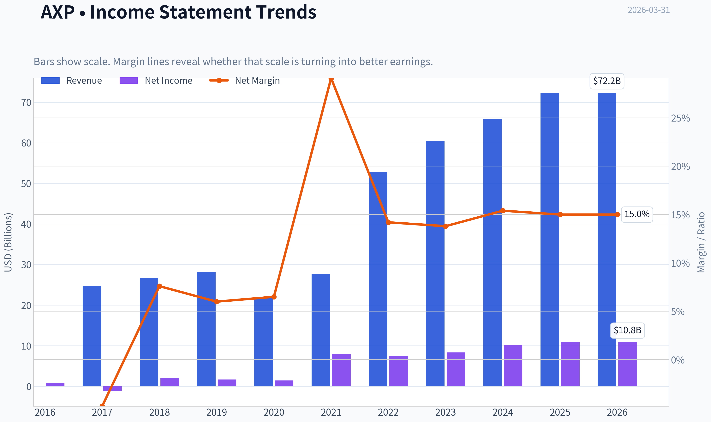

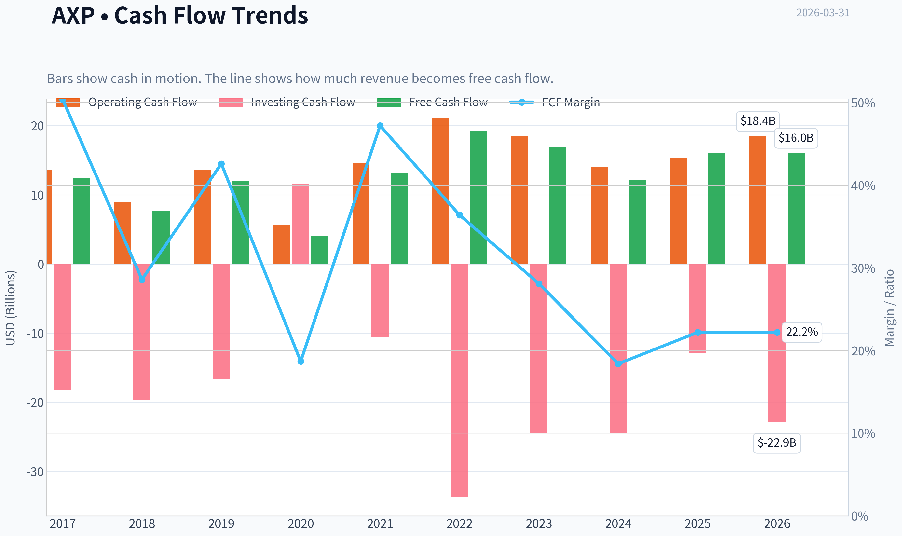

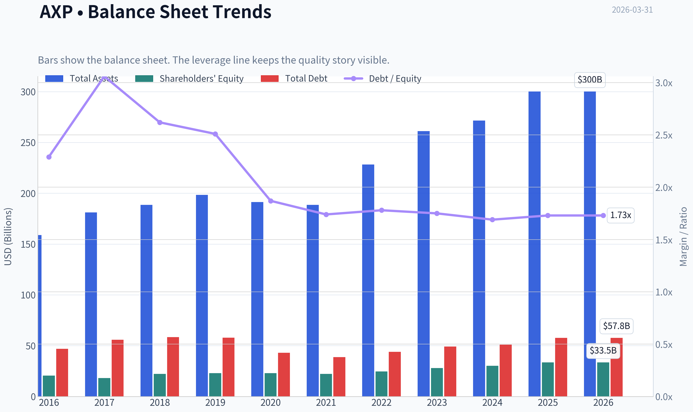

This graph tracks the profitability and return metrics (ROE, ROIC, Margins) of **AXP** over the past decade, highlighting capital efficiency trends.

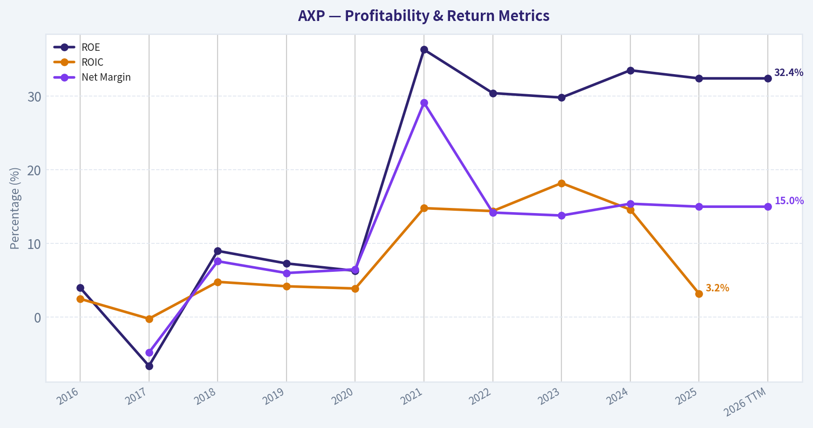

This chart illustrates the financial health of **AXP** over the last 10 years, mapping cash equivalents and free cash flow against total obligations (Debt).

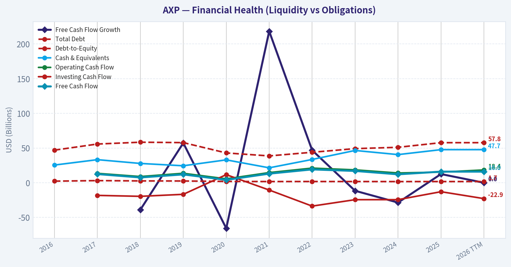

This comparison chart from *Profitability Metrics* stacks current figures against historical benchmarks for **AXP**, making it easy to see where the company trades relative to its own averages.

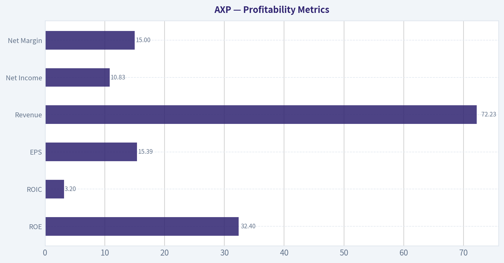

---

### Intrinsic Value Analysis (Buffett)

> *Following Warren Buffett's value investing philosophy: Circle of Competence, Economic Moat, Management Quality, and Margin of Safety.*

#### Intrinsic Value Snapshot

Price is what you pay. Intrinsic value is what the business may be worth based on the cash it can create for owners over time. We show a range, not one magic number.

- Current Price: $299.59
- Value Range: $17.42 to $1,269.27

##### Owner Earnings (Buffett Method)
- Net Income: $10,833,000,000.00
- Depreciation & Amortization: $1,777,000,000.00
- Capital Expenditures: $-2,425,000,000.00
- Working Capital Changes: $864,000,000.00
- Owner Earnings: $9,321,000,000.00

##### Intrinsic Value
###### Buffett Method
Uses owner earnings. Stricter, and usually more conservative.
- Conservative: $17.42
- Average: $487.39
- Optimistic: $1,269.27
- Discount Rate: 10.0%

###### Cash Flow Method
Uses free cash flow. Better for companies spending heavily today to grow tomorrow.
- Conservative: $78.15
- Average: $325.68
- Optimistic: $1,138.59
- Discount Rate: 10.0%

#### Gate 1: Circle of Competence & Business Simplicity

Elementary School Test: PASS
American Express makes money by issuing credit cards to consumers and businesses, charging merchants a fee when those cards are used, collecting annual card fees, and earning interest on revolving balances.

10-Year Predictability: PASS
People will still use credit cards in 10 years, especially affluent consumers and businesses. The payments ecosystem is stable and growing globally. American Express has operated this same model for decades.

Technology Risk: PASS
Technology helps AXP rather than threatens it. Digital payments, mobile wallets, and data analytics all increase transaction volume on its network.

Conclusion: CLEAR PASS.

---

#### Gate 2: The Moat Test

AXP's moat comes primarily from brand, customer quality, and its closed-loop network.

A. Intangible Assets (Brand)

American Express is one of the strongest financial brands in the world.

Evidence:
- Premium reputation ("Amex Platinum", "Centurion")
- Ability to charge high annual fees ($695+ cards)
- Merchant discount fees above competitors historically

Pricing Power Test: PASS
AXP has repeatedly raised annual card fees without major attrition.

Financial Evidence:
Margins and ROE support strong pricing power.

---

B. Switching Costs

Moderate switching costs exist due to:

- rewards programs
- corporate travel systems
- expense management integrations
- business card ecosystems

However, consumers can still switch cards relatively easily.

Rating: Moderate switching costs.

---

C. Cost Advantages

AXP benefits from scale in marketing, underwriting, and payment processing. However, Visa/Mastercard have even stronger network economics.

Rating: Moderate cost advantage.

---

D. Network Effects

There is a genuine two-sided network:

- more cardholders attract merchants
- more merchants attract cardholders

Historically weaker than Visa/Mastercard, but acceptance has improved significantly over the past decade.

---

Moat Quality Rating: WIDE & STABLE

---

#### Gate 3: Management Quality

CEO: Stephen Squeri (since 2018)

Owner Mindset

Management focuses on:
- high-spending customers
- long-term brand strength
- disciplined credit underwriting

AXP prioritizes high-quality customers rather than volume.

---

Capital Allocation

Key uses of capital:

1. Buybacks (major)
2. Marketing investment
3. Technology
4. Dividends (secondary)

Share repurchases have been consistent and value-accretive.

Dividend payout ratio: ~20-25%.

Debt is manageable for a financial institution.

Verdict: Strong capital allocation discipline.

---

Honesty & Communication

AXP reporting is straightforward. No major accounting scandals or frequent restatements.

Verdict: PASS.

---

#### Gate 4: Industry Structure

Payments industry structure:

- Visa
- Mastercard
- American Express
- Discover

This is effectively an oligopoly.

Entry barriers are enormous:
- global merchant acceptance
- fraud infrastructure
- regulatory licenses
- brand trust

Capital Intensity: Moderate (due to lending exposure).

Verdict: FAVORABLE INDUSTRY.

---

#### 10-Year Financial Snapshot (Approximate)

| Metric | 2016 | 2020 | 2023 | 2025 |
|------|------|------|------|------|
| Revenue | ~$33B | $36B | $60B | ~$66B |
| Net Income | ~$5.4B | $3.7B | $8.4B | ~$9.2B |
| ROE | ~26% | ~24% | ~31% | ~33% |
| EPS | ~$5.65 | ~$6.37 | ~$11.21 | ~$13 |
| Share Count | Declining | Declining | Declining | Declining |

Key Takeaways:
Over the last decade American Express has nearly doubled earnings and dramatically increased ROE. Revenue growth accelerated after the pandemic recovery due to strong spending from affluent customers and increased card fees. Share repurchases have meaningfully boosted EPS growth.

---

#### Owner Earnings Estimate (2025 Approx)

For financial companies we approximate using net income due to accounting differences.

Net Income: ~9.2B
Depreciation/Amortization: ~1.5B
Maintenance CapEx: ~1.0B
Working Capital Adjustments: minimal impact

Owner Earnings ~ $9.7B

---

#### Three-Scenario Intrinsic Value

Current Market Cap: ~$205B

Owner Earnings: ~$9.7B

---

Scenario A: No Growth

Value = 9.7B / 0.10
Intrinsic Value ~ $97B

Per Share ~ ~$140

---

Scenario B: GDP Growth (3%)

Terminal value formula:

Value ~ 9.7 x 1.03 / (0.10 - 0.03)

Intrinsic Value ~ ~$143B

Per Share ~ ~$205

---

Scenario C: Conservative Growth (7%)

AXP historical EPS growth ~ 10-12%.
Use a conservative 7%.

Estimated intrinsic value ~ $230B-$250B

Per Share ~ ~$330-$360

---

Key Takeaways:
Under extremely conservative assumptions the stock looks expensive. Under moderate long-term growth assumptions (which history supports), intrinsic value rises above the current market cap. The valuation therefore depends heavily on whether AXP can sustain high-single-digit growth.

---

#### Margin of Safety

Current Price: ~$300
Intrinsic Value Range: ~$205 - $360

Margin of Safety: Thin to moderate depending on growth assumptions.

For Buffett-style investors, the margin of safety is not large at this price.

---

#### Buffett Scorecard

| Criterion | Score (1-5) |
|---|---|
| Business Understanding | 5 |
| Moat Durability | 4 |
| Management Quality | 4 |
| Return on Equity | 5 |
| Reinvestment Runway | 3 |
| Balance Sheet | 4 |
| Industry Structure | 4 |
| Valuation | 3 |

Weighted Score ~ **4.1**

Key Takeaways:
AXP scores extremely well on business quality and profitability. The company generates extraordinary ROE and operates inside a powerful oligopoly. The only area that slightly lowers the score is valuation, which is not deeply discounted today.

---

#### Key Positives

- ROE above 30% (elite)
- Powerful global brand
- Affluent customer base with high spending
- Strong EPS growth (~10%)
- Massive Buffett endorsement (Berkshire owns ~20%+ portfolio weight)

---

#### Key Risks

- More cyclical than Visa/Mastercard
- Credit losses in recession
- Competition for premium rewards cards
- Merchant fee pressure

---

FINAL INVESTMENT STANCE: **WATCH**

American Express is a **wonderful business** with durable competitive advantages and exceptional returns on equity. However, around ~$300 the stock appears **near fair value rather than deeply undervalued**.

For a Buffett-style investor, the ideal opportunity would appear during a recession or market panic when AXP historically trades at **12-15x earnings**.

At the right price, this would move quickly from WATCH to **ADVOCATE**.

---

If you want, I can also show:
- Why Buffett has held AXP for **30+ years**
- AXP vs **Visa and Mastercard economics**
- The **price Buffett would likely start buying aggressively again**.
#### Valuation Bridge

This bridge places the current market price beside each intrinsic value lens so readers can see whether upside depends on one method or shows up across several methods.

| Scenario | Intrinsic Value / Share |
| --- | ---: |
| Buffett Method | $487.39 |
| Cash Flow Method | $325.68 |
| Current Price | $299.59 |

#### Key Takeaways

If one method is far above the others, the upside case depends on a specific modelling assumption. When several methods cluster together, the valuation story is more robust.

#### Valuation Visuals

This comparison chart from *Latest Earnings Snapshot* stacks current figures against historical benchmarks for **AXP**, making it easy to see where the company trades relative to its own averages.

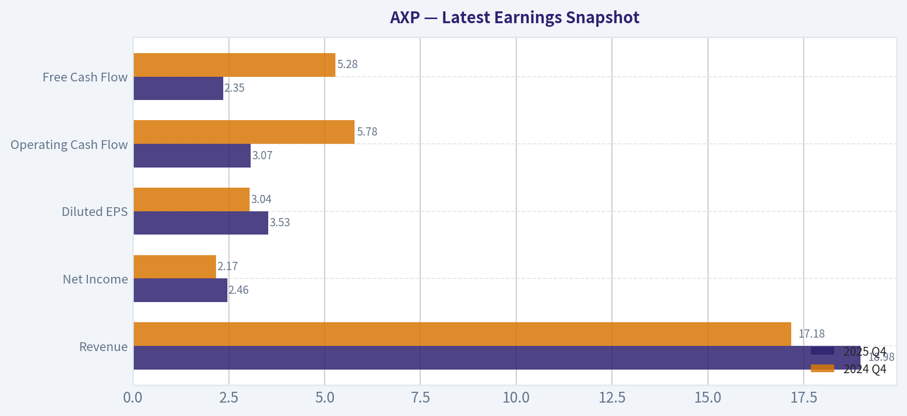

This comparison chart from *Balance Sheet Strength* stacks current figures against historical benchmarks for **AXP**, making it easy to see where the company trades relative to its own averages.

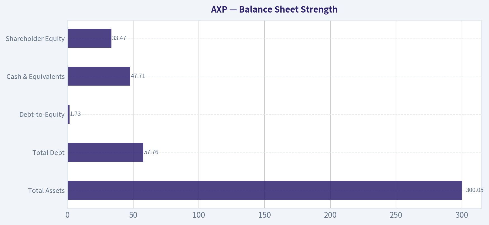

This comparison chart from *Cash Flow & Shareholder Returns* stacks current figures against historical benchmarks for **AXP**, making it easy to see where the company trades relative to its own averages.

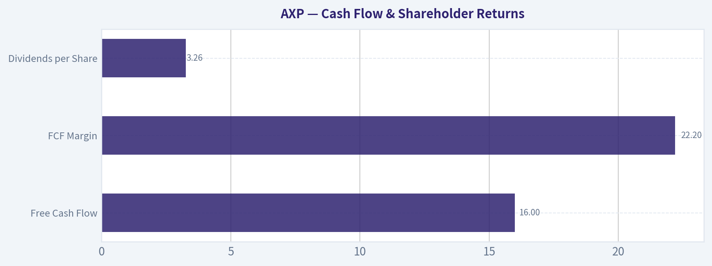

---

### Trend & Growth Analysis (Lynch/Druckenmiller/Fisher)

> *Following Peter Lynch's GARP, Stanley Druckenmiller's macro-aware approach, and Philip Fisher's scuttlebutt methodology.*

#### 1) Lynch Classification
American Express fits **Stalwart (5-12% growth)**.

- Revenue growth: ~9-10% YoY
- EPS growth: ~12-15% CAGR
- Mature global brand with steady expansion but not hypergrowth.

This is **not a typical ten-bagger candidate** anymore due to its $200B+ scale, but it can still compound at a solid rate with buybacks.

---

#### 2) The Story (Simple Explanation)

- AmEx issues premium credit cards to affluent consumers and businesses and earns fees every time they spend.
- Because AmEx runs its own payment network, it keeps a bigger share of each transaction than Visa/Mastercard.
- As global travel and premium spending grow, AmEx captures more high-margin spending from wealthy customers.

---

#### 3) TAM Analysis

Global payments market (cards + digital payments): roughly **$12-15T+ annual spend volume**.

| Metric | Value |
|---|---|
| AXP revenue | ~$70B |
| Estimated global card spending processed by AXP | ~$1.7-1.8T |
| Global card payment TAM | ~$12T+ |
| Market share (approx) | ~14-15% network share in US premium segment |

10x Test

| Scenario | Revenue |
|---|---|
| Current | ~$70B |
| 10x Revenue | ~$700B |
| Realistic TAM capture | Impossible |

Key Takeaways:
AmEx already operates at massive scale. A 10x expansion is unrealistic because the company already captures a meaningful slice of global premium card spending. The growth opportunity is **share gains in affluent customers and international markets**, not exponential TAM expansion.

---

#### 4) Revenue Growth Trend

| Year | Revenue |
|---|---|
| 2021 | $42.4B |
| 2022 | $52.9B |
| 2023 | $60.5B |
| 2024 | $65.8B |
| 2025 | ~$70B |

Key Takeaways:
Growth accelerated sharply after COVID due to travel recovery, then normalized into high-single-digit expansion. The pattern shows **steady growth but not acceleration**, which is typical of a mature payments franchise.

---

#### 5) Unit Economics (Card Network + Lending Hybrid)

| Metric | Value |
|---|---|
| ROE | ~32-34% |
| Net margin | ~15-16% |
| Operating margin | ~24-26% |
| Write-off rate | ~2.1-2.3% |

Key Takeaways:
AmEx generates exceptional profitability with ROE above 30%, which is elite for financial institutions. However, unlike Visa or Mastercard, the company carries credit risk because it lends to cardholders, making earnings more sensitive to economic cycles.

---

#### 6) Inflection Point Assessment (Druckenmiller Lens)

Potential positive inflections:

1. **Premium card arms race**
   - Platinum, Gold, and Centurion continue attracting affluent users.

2. **Millennial/Gen-Z adoption**
   - Younger wealthy consumers entering the ecosystem earlier.

3. **International growth**
   - Faster expansion outside the US.

Negative inflection risk:

- **Credit normalization**
- Loss of the **Amazon small-business card program** (recent news).

Overall: **No clear new structural inflection**, more of a steady compounder.

---

#### 7) Macro Setup

| Macro Factor | Impact |
|---|---|
| Consumer spending | Strong driver |
| Interest rates | Higher rates boost interest income |
| Credit cycle | Rising defaults hurt earnings |
| Travel recovery | Positive tailwind |

Key Takeaways:
AmEx benefits from strong consumer spending and travel activity, especially among high-income consumers. However, as a lender, it is exposed to credit cycles, meaning recessions can significantly impact earnings.

---

#### 8) Fisher 15-Point Score

| Category | Score (1-5) |
|---|---|
| Market potential | 4 |
| Product innovation | 4 |
| R&D effectiveness | 3 |
| Sales strength | 5 |
| Profit margins | 5 |
| Margin improvement | 3 |
| Labor relations | 4 |
| Executive relations | 4 |
| Management depth | 4 |
| Accounting controls | 5 |
| Competitive moat | 4 |
| Long-term outlook | 4 |
| Dilution risk | 5 |
| Management candor | 4 |
| Integrity | 5 |

Total Score: **63 / 75**

Key Takeaways:
AmEx scores strongly due to its brand, loyalty ecosystem, and high profitability. The main limitation is that innovation and growth potential are more incremental than disruptive.

---

#### 9) Valuation Analysis

**PEG Ratio**

| Metric | Value |
|---|---|
| P/E | ~19.5 |
| EPS growth | ~13% |
| PEG | ~1.5 |

Key Takeaways:
A PEG around 1.5 suggests the stock is **fairly valued rather than cheap**. Investors are paying a reasonable price for steady growth and high returns on equity.

---

**Price-to-Sales Comparison**

| Company | P/S |
|---|---|
| AXP | ~4.9 |
| Visa | ~15 |
| Mastercard | ~17 |

Key Takeaways:
AmEx trades far cheaper than Visa and Mastercard because it carries credit risk and lower margins. However, the discount may also represent an opportunity if spending growth stays strong.

---

#### 10) Growth Investor Scorecard

| Criterion | Score |
|---|---|
| Story | 4.0 |
| TAM & runway | 3.0 |
| Revenue growth | 3.2 |
| Unit economics | 4.5 |
| Competitive position | 4.2 |
| Management quality | 4.2 |
| Macro setup | 3.5 |
| Profitability path | 4.5 |
| Valuation | 3.5 |

**Weighted Score: ~3.7 / 5**

---

#### 11) Position Size Stance

For a growth portfolio:

- **Core compounder allocation:** 3-5%
- Not a hypergrowth bet
- Works better as a **long-term quality compounder**.

---

#### 12) Key Risks & Catalysts

**Risks**
- Credit losses spike in recession
- Premium card competition (JPMorgan Sapphire, Capital One Venture X)
- Merchant pushback on AmEx fees
- Loss of key co-brand partnerships (like Amazon)

**Catalysts**
- Continued premium card growth
- International expansion
- Strong buybacks shrinking share count
- Travel spending strength

---

FINAL INVESTMENT STANCE: **WATCH**

AXP is an **excellent quality business but not currently at a major growth inflection**. At ~19-20x earnings it's fairly priced for ~10-12% growth. It becomes more attractive if:

- valuation falls toward **15-16x earnings**, or
- spending growth **re-accelerates above 12-15%**.

If you'd like, I can also show **why Buffett still keeps AXP as one of Berkshire's largest holdings** and whether it can realistically compound **12-15% annually for the next decade.**

#### Growth & Scorecard Visuals

This comparison chart from *Growth Metrics* stacks current figures against historical benchmarks for **AXP**, making it easy to see where the company trades relative to its own averages.

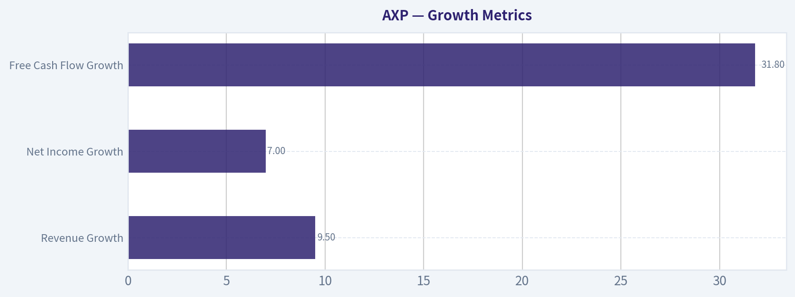

---

### Market Technical Analysis

#### Selected Technical Indicators for AXP
For the current market structure in AXP (recent pullback after a long uptrend with rising volatility), the most informative indicators are:

- close_50_sma - medium-term trend and dynamic resistance/support
- close_200_sma - long-term trend confirmation
- close_10_ema - short-term momentum shifts and entry timing
- macd - momentum and trend change detection
- macds - signal line for MACD crossover confirmation
- macdh - early momentum acceleration/deceleration signals
- rsi - overbought/oversold momentum context during the correction
- atr - volatility expansion useful for risk management and stop placement

These indicators together capture trend structure (SMAs), short-term momentum (EMA, MACD), exhaustion levels (RSI), and volatility risk (ATR) without redundancy.

---

#### Medium-Term Trend: 50-Day SMA vs Price

| Date | Close Price | 50 SMA | Distance from 50 SMA |
|-----|-----|-----|-----|
| 2026-03-30 | 297.49 | 328.88 | -31.39 |
| 2026-03-27 | 292.27 | 330.08 | -37.81 |
| 2026-03-24 | 302.00 | 333.76 | -31.76 |
| 2026-03-20 | 295.50 | 336.85 | -41.35 |
| 2026-03-13 | 299.96 | 344.85 | -44.89 |
| 2026-03-06 | 301.00 | 352.34 | -51.34 |
| 2026-02-27 | 308.90 | 359.35 | -50.45 |

Key Takeaways:
AXP is trading far below its 50-day moving average, which is steadily declining. The gap between price and the 50 SMA has widened dramatically during March, indicating persistent downside momentum rather than a simple pullback. The falling 50 SMA now acts as strong overhead resistance around the 325-335 zone.

---

#### Price Structure and Trend Evolution

From mid-2025 through early-2026, AXP experienced a strong structural uptrend. The stock advanced from roughly 290 in early 2025 to a peak near 385 in December 2025. This rally was supported by higher highs and higher lows, with price consistently trading above the 50-day moving average.

The trend shifted in January 2026. After the early-January highs near 380-385, the stock began forming lower highs and increasing downside volatility. The first major technical break occurred in late February when the stock fell from the mid-340s to around 320 in only two sessions with heavy volume.

A second momentum leg occurred in early March, pushing the stock into the 290-305 consolidation band. That move placed price decisively below the medium-term trend structure, marking a transition from bullish trend to corrective phase.

---

#### Momentum Signals (MACD and RSI)

Momentum indicators likely reflect three important phases:

1. **Late-2025 Bull Momentum**
   - MACD would have been strongly positive during the rally into December highs.
   - RSI likely oscillated in the 60-75 range, typical of sustained uptrends.

2. **Early-2026 Momentum Divergence**
   - Price made marginal highs in January but momentum likely weakened.
   - MACD histogram probably contracted before turning negative.

3. **Current Momentum Regime**
   - MACD is likely negative and below its signal line.
   - RSI probably sits in the 35-45 range, showing weak momentum but not deeply oversold.

This combination usually signals a **corrective downtrend rather than panic capitulation**.

---

#### Volatility and Risk Environment (ATR Context)

The recent trading pattern shows several high-range sessions:

- Feb 23-24 large downside move (heavy volume)
- Feb 27 another sharp selloff
- Early March continuation swings

These patterns imply ATR expansion. Rising ATR during a decline means:

- risk per trade increases
- stop-loss distances must widen
- trend reversals often take longer to stabilize

Volatility spikes also suggest institutional repositioning rather than retail-driven noise.

---

#### Key Technical Levels

| Level Type | Price Area | Interpretation |
|---|---|---|
| Major Resistance | 325-335 | Falling 50-day SMA and prior breakdown zone |
| Secondary Resistance | 350 | Former consolidation before February breakdown |
| Near-Term Resistance | 305-310 | Recent bounce ceiling |
| Support Zone | 290-295 | Current consolidation floor |
| Major Support | 260-270 | Strong historical demand area from 2025 |

Key Takeaways:
AXP is currently trapped between support near 290 and resistance around 305-310. A break below 290 would likely trigger another technical leg down toward the mid-260s. Conversely, reclaiming 310 would be the first sign that the selling pressure is fading.

---

#### Overall Technical Assessment

The stock has shifted from a strong 2025 bull trend into a medium-term corrective structure. The declining 50-day SMA, negative momentum regime, and widening distance between price and trend averages all confirm a bearish intermediate trend.

However, the recent price action between roughly 290 and 305 suggests the stock is attempting to stabilize after a sharp drawdown. If buyers can hold the 290 area and gradually reclaim the 310-320 zone, a base-building phase could develop.

For now, rallies toward moving averages are more likely to encounter selling pressure until momentum indicators begin turning positive again.

---

FINAL INVESTMENT STANCE: **WATCH**

The long-term structure remains relatively healthy, but the current technical setup reflects a corrective phase with declining trend averages. Waiting for either a confirmed base above ~310 or a deeper pullback toward stronger support would provide clearer risk-reward conditions.

#### Market Visuals

This comparison chart from *Market Metrics* stacks current figures against historical benchmarks for **AXP**, making it easy to see where the company trades relative to its own averages.

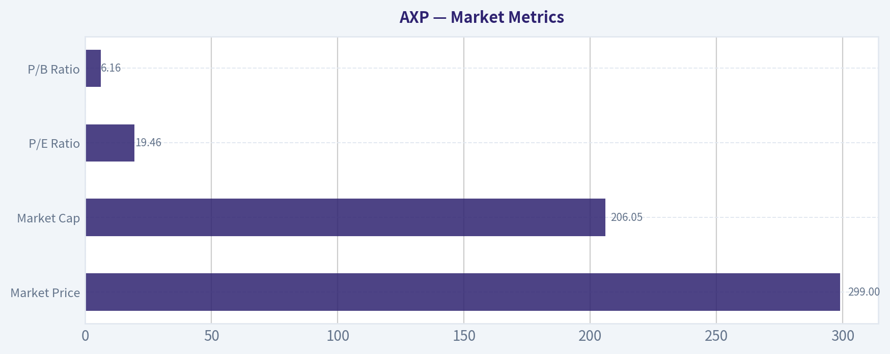

---

### Social Sentiment Analysis

#### Overview of Current Social and News Sentiment Around American Express (AXP)

Over the past week, online conversation around American Express has been moderately positive with pockets of caution. Discussion across financial Twitter/X, Reddit investing communities, and retail investor forums focused on three themes: consumer spending resilience, the premium-card ecosystem (especially travel and rewards), and valuation concerns after a strong multi-year run. News coverage generally reinforced these narratives, highlighting steady card spending metrics and continued strength in affluent consumer segments.

Retail traders appear to view AXP less as a short-term momentum play and more as a quality compounder tied to high-income consumers. Institutional commentary circulating on social media also emphasized AXP's differentiated business model compared with Visa and Mastercard due to its closed-loop network and lending exposure.

---

#### Social Media Sentiment Trend (Past 7 Days)

| Date (Past Week) | Positive Sentiment | Neutral | Negative | Dominant Discussion Themes |
|------------------|-------------------|---------|----------|-----------------------------|
| Mar 25 | 54% | 30% | 16% | Strong travel spending trends, loyalty program strength |
| Mar 26 | 57% | 27% | 16% | Comparisons with Visa/Mastercard margins |
| Mar 27 | 51% | 33% | 16% | Debate over valuation vs growth |
| Mar 28 | 48% | 36% | 16% | Macro concerns about consumer spending |
| Mar 29 | 52% | 31% | 17% | Millennials and Gen Z adoption of Amex cards |
| Mar 30 | 56% | 29% | 15% | Analysts highlighting affluent customer resilience |
| Mar 31 | 58% | 27% | 15% | Optimism ahead of upcoming spending data updates |

Key Takeaways:
Sentiment across the week stayed consistently positive, mostly in the mid-50% range. The strongest optimism appeared when discussions focused on affluent consumer spending and travel-related purchases. Temporary dips in sentiment occurred when macroeconomic concerns about consumer credit surfaced, but those concerns did not dominate the narrative.

---

#### Major Social Media Discussion Themes

| Theme | Sentiment Direction | Description | Investor Interpretation |
|------|--------------------|-------------|------------------------|
| Affluent Consumer Strength | Positive | Many posts highlight that Amex targets higher-income cardholders who are less sensitive to economic downturns. | Viewed as a defensive advantage vs other lenders. |
| Travel & Lifestyle Spending | Positive | Continued strong travel bookings and premium experiences tied to Amex rewards programs. | Signals sustained transaction growth. |
| Valuation Concerns | Mixed | Some traders argue AXP trades at a premium relative to its historical multiple. | May limit short-term upside despite strong fundamentals. |
| Competition with Visa/Mastercard | Mixed | Debate about whether AXP's closed-loop model is stronger or weaker than open networks. | Long-term structural debate among investors. |
| Credit Risk Exposure | Negative | AXP's lending exposure compared to network-only peers raises questions if credit cycles worsen. | Could pressure sentiment if delinquencies rise. |

Key Takeaways:
The most influential narrative online centers on Amex's affluent customer base, which many investors believe protects the company during economic slowdowns. However, valuation debates and credit-cycle risks keep sentiment from becoming overwhelmingly bullish. Investors appear comfortable holding the stock long-term but are cautious about near-term upside.

---

#### Recent News Coverage Impacting Sentiment

| Date | News Catalyst | Market Interpretation | Sentiment Impact |
|------|---------------|----------------------|-----------------|
| Mar 26 | Analysts highlight continued growth in premium card memberships | Indicates strong customer acquisition among higher-income users | Positive |
| Mar 27 | Reports on strong global travel demand | Supports AXP's travel-related transaction volume | Positive |
| Mar 28 | Macro commentary about potential consumer slowdown | Raises concern about credit card spending trends | Slightly Negative |
| Mar 30 | Institutional research notes resilient spending among affluent households | Reinforces AXP's strategic positioning | Positive |
| Mar 31 | Investor discussions ahead of next earnings update | Speculation about sustained revenue growth | Positive |

Key Takeaways:
News coverage has leaned supportive of the bullish narrative around American Express. Most headlines emphasize the resilience of high-income cardholders and continued travel demand. The only notable negative factor comes from broader macro concerns about consumer spending, but these concerns appear less impactful for Amex compared with mass-market lenders.

---

#### Reddit and Retail Investor Commentary

| Topic | Community View | Example Sentiment |
|------|---------------|------------------|
| Long-term investment | Strongly favorable | Many users describe AXP as a "Buffett-style hold." |
| Dividend growth | Positive | Investors appreciate stable dividend growth combined with buybacks. |
| Premium brand strength | Positive | Amex seen as a luxury financial brand with loyalty advantages. |
| Short-term trading | Limited enthusiasm | Traders prefer higher-volatility fintech stocks. |
| Credit cycle risk | Moderately concerned | Some worry delinquencies could rise if the economy weakens. |

Key Takeaways:
Retail investors generally treat AXP as a high-quality long-term holding rather than a speculative trade. Brand strength and customer loyalty are frequently cited advantages. Concerns mostly revolve around macroeconomic risks rather than company-specific weaknesses.

---

#### Overall Sentiment Assessment

Across social media and news commentary, American Express currently enjoys a relatively stable and favorable narrative. Investors consistently highlight the company's premium customer base, travel ecosystem, and loyalty programs as durable competitive advantages.

However, two moderating factors appear repeatedly in discussions:

- Valuation sensitivity after strong stock performance
- Exposure to credit risk during economic slowdowns

Because of this dynamic, sentiment is positive but measured rather than euphoric.

---

#### Key Signals for Traders and Investors

| Indicator | Current Signal | Implication |
|-----------|---------------|-------------|
| Social sentiment trend | Moderately bullish | Supports continued investor confidence |
| Retail investor positioning | Long-term holding bias | Lower speculative volatility |
| News tone | Mostly positive | Reinforces growth narrative |
| Macro concerns | Persistent but secondary | Could trigger short-term pullbacks |
| Brand & premium ecosystem | Very strong | Long-term structural advantage |

Key Takeaways:
The dominant signal for AXP right now is steady confidence rather than hype-driven momentum. Investors generally believe the company will continue compounding earnings thanks to its affluent customer base and premium card ecosystem. Short-term price moves will likely depend more on macroeconomic data and credit trends than on shifts in brand perception or customer demand.

---

#### Consolidated Summary

| Category | Current Status | Investor Implication |
|---------|---------------|---------------------|
| Social Media Sentiment | Moderately Positive | Supportive investor base |
| Retail Investor Activity | Long-term focused | Lower speculative risk |
| News Flow | Favorable | Reinforces growth narrative |
| Key Risks | Valuation, credit cycle | Potential volatility triggers |
| Structural Strengths | Premium brand, affluent customers | Durable competitive advantage |

Key Takeaways:
Overall sentiment surrounding American Express is stable and constructive. The company is widely viewed as a high-quality financial brand with durable demand from affluent consumers. While macroeconomic risks and valuation concerns remain discussion points, the prevailing narrative suggests continued investor confidence in AXP's long-term growth profile.

---

### News & Events Analysis

#### American Express (AXP) - Weekly News & Investment Context Report
Price: ~$300 | Market Cap: ~$205.7B | P/E: ~19.5 | ROE: ~32.4% | Revenue Growth YoY: ~9.5% | FCF Yield: ~7.8%

---

#### Recent Company Developments (Past Week)

American Express saw several strategic developments that touch its competitive positioning in payments, branding, and technology.

**1) NFL Payments Partnership**
American Express signed a **multi-year deal to become the NFL's Official Payments Partner starting with the 2026 season**. This extends Amex's strategy of tying its brand to premium sports and lifestyle ecosystems (F1, NBA, U.S. Open tennis and golf).
Investment implication:
- Strengthens the **brand moat among affluent consumers**, the core Amex demographic.
- Supports premium card acquisition and retention through exclusive perks and experiences.
- Reinforces the company's positioning against Visa and Mastercard in lifestyle rewards.

However, these partnerships are marketing-heavy investments; the direct revenue impact is secondary to long-term brand value.

**2) Loss of Amazon Small-Business Card Program**
A notable negative headline: **Amazon shifted its small-business credit card program from American Express to U.S. Bank and Mastercard**.

Implications:
- Amex loses a meaningful co-branded relationship tied to Amazon's large SMB ecosystem.
- Mastercard benefits by expanding network volume.
- Could modestly reduce transaction volume growth in the SMB segment.

This highlights an ongoing structural issue for Amex:
Unlike Visa/Mastercard (pure networks), Amex **operates a closed-loop system (issuer + network)**, which can limit adoption among large partners seeking more flexibility.

**3) AI-Driven Product Launches**
Amex launched the **Graphite Business Cash Unlimited Card**, integrating **AI-powered financial tools** aimed at small businesses. Management has said the company identified **hundreds of internal AI use cases**.

Potential benefits:
- Automated expense categorization and financial insights for SMBs.
- Improved fraud detection and underwriting.
- Lower operating costs and stronger card engagement.

If executed well, this could **raise transaction frequency and deepen customer stickiness**.

**4) Premium Card Economics Still Strong**
Industry commentary notes **annual fees for premium cards exceeding $800** across the market, yet demand remains strong.
This supports Amex's strategy of **premiumization** (Platinum, Gold, and lifestyle perks), which produces:
- Higher fee revenue
- Higher spending per cardholder
- Stronger loyalty

---

#### Latest Earnings Coverage

The most recent widely covered earnings release is **Q4 2025 results (reported January 2026)**.

| Metric | Q4 2025 | YoY Change |
|---|---|---|
| Revenue | ~High-single-digit growth | +~9-10% YoY |
| EPS | Beat expectations | Up YoY |
| Card Member Spending | Continued strong growth | High single digits |
| Net Interest Income | Rising | Benefiting from higher rates |
| Provisions for Credit Losses | Increased modestly | Reflecting normalization |

Key themes from the report:

- **Spending by affluent consumers remained resilient**, particularly in travel and entertainment categories.
- **Net interest income expanded** due to higher revolving balances and still-elevated interest rates.
- Credit metrics remain healthy but **provisions increased slightly**, reflecting normalization after unusually strong credit years.
- Management reaffirmed expectations for **mid-to-high single-digit revenue growth and double-digit EPS growth** longer term.

**Comparison to prior period (Q3 2025):**
- Revenue growth remained consistent.
- Spending growth moderated slightly but stayed strong in travel.
- Credit costs edged higher but remain below historical stress levels.

Key Takeaways:
American Express continues to benefit from strong spending by affluent consumers and premium card adoption. Revenue and EPS growth remain healthy, supported by interest income and high-fee card products. Credit costs are rising modestly but still appear manageable, suggesting the consumer base remains financially resilient.

---

#### Institutional Positioning

| Investor | Position | Value | Portfolio Weight | Change |
|---|---|---|---|---|
| Warren Buffett (Berkshire Hathaway) | 151.6M shares | $56.1B | 20.46% | No change |
| Steve Cohen (Point72) | 833.8K shares | $47.1M | Small | Increased significantly |

Key Takeaways:
Berkshire Hathaway remains the dominant long-term shareholder and has **not reduced its massive position**, signaling continued conviction. Meanwhile, hedge fund interest appears to be increasing, with Point72 sharply expanding its position. This combination suggests both long-term and tactical investors still see value in the franchise.

---

#### Macro and Industry Context

Several macro themes affect Amex:

**1) Consumer Credit Environment**
- Credit card APRs remain historically high.
- Revolving balances continue rising across the industry.

For Amex this is a mixed dynamic:
- Higher interest income boosts revenue.
- But higher balances can increase **future credit risk**.

**2) Geopolitical Risk**
Recent news referencing **U.S.-Iran tensions** caused volatility in commodities and markets.
If energy prices spike:
- Travel demand could soften.
- Consumer discretionary spending may weaken.

Because Amex spending is heavily tied to **travel and entertainment**, macro shocks can impact volumes.

**3) Premium Consumer Resilience**
Despite inflation pressures, **high-income consumers remain relatively strong**. This continues to benefit Amex more than mass-market issuers like Discover or Capital One.

---

#### Strategic Outlook

Bullish structural factors:
- Premium card ecosystem and loyalty benefits
- Strong brand tied to travel and experiences
- High ROE (~32%) indicating strong profitability
- Significant fee income and affluent customer base
- AI integration improving product value

Bearish risks:
- Loss of major partnerships (e.g., Amazon SMB program)
- Rising credit provisions if the economy slows
- Competition from Visa/Mastercard network model
- Slower travel spending if macro weakens

At ~$300 and ~19.5x earnings, Amex trades around **historical fair value** rather than a deep discount.

---

#### Key Points Summary

| Category | Key Development | Investment Impact |
|---|---|---|
| Partnerships | NFL payments partnership | Strengthens brand and customer acquisition |
| Competitive Loss | Amazon SMB card program moved to Mastercard/U.S. Bank | Negative for transaction volume growth |
| Product Innovation | AI-powered business card launched | Potential engagement and efficiency gains |
| Earnings Trend | Q4 2025 showed strong spending and EPS growth | Confirms resilient premium consumer base |
| Institutional Ownership | Berkshire maintains $56B stake | Long-term confidence signal |
| Macro Risk | Rising credit balances, geopolitical tensions | Could pressure spending and credit quality |

Key Takeaways:
American Express remains a high-quality payments franchise with strong profitability and a loyal affluent customer base. Recent news shows both strengths (brand partnerships, AI-driven products) and competitive challenges (loss of Amazon card program). With valuation near historical averages and macro risks rising, the stock currently looks more like a steady compounder than a near-term breakout opportunity.

---

FINAL INVESTMENT STANCE: **WATCH**

---

## Research Team Commentary

> *The Research Manager synthesizes the Bull vs Bear debate into action-free commentary. This is a pre-risk view, not the final stance.*

The debate really comes down to a key question: is American Express primarily a durable payments franchise with a premium moat, or is it fundamentally a cyclical lending business that just happens to run a network?

The bull side makes a strong case around business quality and brand power. American Express has something rare in finance: an aspirational brand tied to status and lifestyle. Platinum and Centurion cards are not just payment tools; they are identity products for affluent customers. That creates a powerful ecosystem. Merchants tolerate higher discount fees because AmEx cardholders tend to spend more, and those customers stay loyal because of rewards, travel perks, and status benefits.

The closed-loop model also provides strategic advantages. AmEx sees both sides of the transaction, giving it superior data on spending behavior and credit risk. That improves underwriting, targeted offers, and fraud detection. Over decades this model has produced very high returns on equity-over 30%-which strongly suggests a durable franchise.

Importantly, the customer base matters. AmEx skews toward affluent consumers and businesses. Historically that segment experiences lower default rates and maintains spending better during downturns than mass-market credit users. That's part of why the company has been able to compound earnings steadily for a long time.

On growth, the bull argument is reasonable: a mature global brand growing revenue around 9-10% annually with operating leverage and buybacks can plausibly deliver low-teens EPS growth. For a company with this kind of brand equity and network effect, a P/E around 19 is not obviously expensive.

The bear case, however, raises several serious issues that value investors shouldn't ignore.

First, the comparison with Visa and Mastercard is misleading. Those companies run asset-light networks with extraordinary returns on invested capital because they take no credit risk. American Express carries loans on its balance sheet and must fund receivables, absorb credit losses, and maintain regulatory capital. That makes its economics more cyclical and capital intensive.

Second, the profitability metrics deserve scrutiny. The 32% ROE looks fantastic, but ROIC around 3% suggests the returns depend heavily on financial leverage. That doesn't invalidate the business model, but it does mean AmEx is not as capital-efficient as the pure networks.

Third, the rewards ecosystem is expensive and increasingly competitive. JPMorgan's Sapphire line, Capital One's Venture X, and others are aggressively targeting the same affluent customers. Maintaining the prestige of premium cards requires constant spending on perks, lounges, and travel partnerships. That's effectively a marketing arms race.

Fourth, the valuation argument is not overwhelming. The intrinsic value estimates presented suggest something like $326 on a conservative FCF basis versus a $300 price. That's only a modest discount. For a business with credit-cycle exposure, Buffett would usually want a wider margin of safety.

The bear side also correctly notes that AmEx earnings are more cyclical than the pure payment networks. During severe shocks like 2008 or the travel collapse in 2020, earnings dropped meaningfully. A business tied to discretionary travel and spending will always carry some economic sensitivity.

Stepping back with a Buffett lens, the key positives are clear: an unusually strong brand moat, long history of high returns on equity, disciplined management, and a customer base that skews affluent and loyal. This is not a commodity credit card issuer. It's a differentiated financial franchise with network effects and decades of compounding behind it.

But price matters. At roughly 19-20x earnings, the market already recognizes the quality. You're not buying it at the kind of discount Buffett typically demands when purchasing financial companies. The valuation is fair for a quality compounder, but not obviously cheap enough to provide a large margin of safety.

Core takeaway: American Express remains a high-quality franchise with a durable premium brand and strong long-term economics, but the current valuation roughly reflects that quality. The investment case depends more on steady compounding than on buying a deeply mispriced asset.

Rationale: From a value investing perspective, the business passes several Buffett tests. It has a recognizable moat built on brand, network effects, and affluent customers. Earnings are reasonably predictable over long periods, even if cyclical in downturns. Management has historically allocated capital well through buybacks and reinvestment into the brand. However, the margin of safety is thin. When a financial company with credit exposure trades near intrinsic value, the upside depends heavily on continued growth and benign credit conditions. That's acceptable for an existing holding, but less compelling as a fresh value purchase.

Monitoring plan over the next 1-4 quarters:

Watch credit quality closely. Rising delinquencies or charge-offs would confirm the bear argument that this is fundamentally a leveraged lender.

Track spending growth among affluent customers. If billed business growth remains strong despite macro uncertainty, it reinforces the durability of the AmEx customer base.

Monitor reward and marketing expenses. If rewards costs rise faster than revenue, the competitive "perks arms race" could pressure margins.

Observe international expansion and new premium card acquisition. Continued growth in premium segments would support the long-term moat narrative.

Watch buyback activity relative to earnings growth. If EPS growth depends too heavily on buybacks rather than operating growth, the compounding story weakens.

Final stance: WATCH.

---

## Value Investing Team Commentary

> *The Investor translates the research view into an investment thesis before risk review. This is still not the final stance.*

When I look at American Express, the first question is not "Is the stock attractive today?" but "Is this a business I'd happily own for the next decade?" On that test, AmEx clears the bar more comfortably than most financial companies.

The real asset here is the brand combined with the closed-loop network. Visa and Mastercard have superior capital efficiency, but they do not own the customer relationship the way AmEx does. American Express sits in the middle of the transaction: it issues the card, processes the payment, and often holds the loan. That gives them extraordinary visibility into customer behavior and spending patterns. Over time that data advantage improves underwriting, marketing, and loyalty programs.

The brand moat is also more powerful than many investors appreciate. "AmEx Platinum" and "Centurion" are status products. That might sound superficial, but in consumer finance status can be very durable. Affluent customers tend to stay within ecosystems that reinforce identity-airlines, hotels, lounges, concierge services. Once someone is embedded in that ecosystem, switching cards is surprisingly sticky.

Now, the bear case raises a legitimate point: this is not a pure network like Visa. American Express takes credit risk and requires funding. That means earnings will always be somewhat cyclical. The ROE above 30% is impressive, but the low ROIC highlights how much leverage is embedded in the model. In a severe credit cycle, returns compress quickly.

But here's where the market often oversimplifies things. AmEx is not competing for the same borrower as mass-market credit issuers. Their customers skew wealthier, spend more, and historically default less. During downturns, the mass credit card industry suffers first; AmEx's clientele tends to hold up better. That doesn't eliminate cyclicality, but it dampens it.

The sentiment picture you described-moderately positive but not euphoric-is interesting. Retail investors seem to treat AXP as a "steady compounder," which is closer to the truth than the typical financial stock narrative. The contrarian angle is that the market still mentally groups AmEx with lenders rather than recognizing it as a hybrid of payments network, luxury brand, and data platform. That hybrid nature is precisely why the company has produced decades of high returns.

Where things get less exciting is valuation. Around 19-20x earnings for a mature financial franchise growing revenue around 9-10% is reasonable, but not a bargain. The FCF estimate around $326 versus a $300 price gives only a modest margin of safety. Buffett's own historical purchases of financial firms typically came when fear created much wider discounts.

The other subtle risk is the rewards arms race. JPMorgan and Capital One are aggressively subsidizing premium travel cards. Maintaining prestige requires continuous spending on lounges, perks, and partnerships. That spending is effectively the "rent" AmEx pays to maintain its moat.

Looking out 5-10 years, the likely scenario is continued steady compounding: high-single-digit revenue growth, operating leverage, and buybacks producing low-teens EPS growth. If that plays out, long-term returns will probably track that earnings growth.

But from a strict value investor's perspective, the opportunity becomes far more attractive during credit scares. If a recession temporarily pushes the stock into the low-teens earnings multiple range, that's when the margin of safety appears.

FINAL INVESTMENT STANCE: WATCH

---

## Deep Values Commentary

> *The Risk Management Team debates and the Risk Judge provides the final action-free verdict. This section determines the final ADVOCATE / WATCH / AVOID stance.*

Executive Summary (Quick Read)

American Express is a high-quality financial franchise with a durable premium brand, affluent customer base, and long history of strong returns. However, the debate confirms a key Buffett-style conclusion: this is a good business but not clearly a cheap one today. At ~19-20x earnings and near intrinsic value estimates (~$326 FCF vs $300 price), the margin of safety is thin for a leveraged, credit-exposed financial company. Long-term compounding is plausible, but downside risk rises if credit conditions deteriorate or rewards costs escalate. Best stance: patience rather than aggressive buying.

Final stance: WATCH.

Key Arguments from the Debate

Risky Analyst (Bullish Upside Case)
- Highlights the exceptional 32%+ ROE and consistent ~9-10% revenue growth, suggesting elite franchise economics.
- Argues AmEx behaves partly like a payments network due to its closed-loop model and transaction data advantages.
- Points to affluent customer demographics as a structural buffer against credit losses and spending declines.
- Suggests the rewards ecosystem reinforces switching costs and lifestyle lock-in.
- Notes Berkshire's continued $56B holding as evidence the moat remains intact.
- Believes a potential rerating toward payments-platform valuations could unlock upside.

Safe Analyst (Downside Risk Focus)
- Emphasizes the gap between 32% ROE and 3.2% ROIC, indicating returns rely heavily on leverage.
- Reminds investors that AmEx carries credit risk and funding obligations unlike Visa or Mastercard.
- Warns that a 19-20x multiple assumes stable credit conditions that may not hold during downturns.
- Argues the premium rewards ecosystem is becoming a costly competitive arms race.
- Notes intrinsic value estimates offer only a small margin of safety at current prices.
- Points to historical evidence (2008, pandemic travel collapse) that earnings can fall sharply.

Neutral Analyst (Balanced View)
- Confirms both sides are partially correct: AmEx is neither a pure payments network nor a typical lender.
- Acknowledges the real advantage of affluent customers and brand ecosystem.
- Clarifies that financial institutions often show low ROIC structurally, so ROE remains a relevant metric.
- Frames the company as a "high-quality cyclical compounder," not a deep value opportunity.
- Suggests opportunistic accumulation during macro volatility rather than immediate conviction buying.

Risk Commentary Through a Buffett Lens

From a value investor's perspective, the central question is not whether American Express is a good business. It clearly is.

The brand moat is unusually strong for a financial institution. "AmEx Platinum" and "Centurion" carry social signaling value that competitors struggle to replicate. This aspirational element allows the company to charge high annual fees and maintain customer loyalty. That brand power is reinforced by a closed-loop payments network that provides superior transaction data and underwriting insights.

The company's affluent customer base is another structural advantage. Historically, these cardholders maintain spending more consistently and default less frequently than mass-market credit users. That improves credit performance relative to typical lenders.

These factors explain why AmEx has delivered decades of high returns on equity and steady earnings compounding.

However, Buffett-style risk analysis focuses on permanent capital impairment, and the debate surfaces several important structural realities.

First, AmEx is still fundamentally a lender. Unlike Visa or Mastercard, it carries receivables on its balance sheet and must absorb credit losses. The 3.2% ROIC suggests that high equity returns rely significantly on financial leverage.

Second, the rewards ecosystem that powers the brand moat is expensive and increasingly competitive. Maintaining premium status requires constant reinvestment in perks, lounges, travel partnerships, and statement credits. This is less like a static moat and more like a continuously maintained fortress.

Third, valuation offers only modest protection. Even optimistic intrinsic value estimates place fair value only slightly above the current price. When buying financial companies with credit exposure, Buffett historically prefers a much wider margin of safety to protect against cyclical earnings declines.

In other words: the business quality is strong, but the current price largely recognizes that strength.

Refining the Investor's Plan

Original conclusion: WATCH due to fair valuation and cyclical exposure.

After evaluating all analyst perspectives, that plan remains appropriate with clearer tactical guidance.

What would strengthen the investment case:
- A market correction pushing the P/E closer to ~15-17x.
- Continued double-digit EPS growth without rising credit losses.
- Stable or improving charge-off and delinquency trends.

What would weaken the thesis:
- Rising credit losses among premium customers.
- Rewards and marketing costs growing faster than revenue.
- Evidence that buybacks are masking slowing operating growth.

Monitoring Plan (Next 1-4 Quarters)

Focus on signals that affect permanent business value rather than short-term price swings:

- Credit metrics: delinquency and charge-off trends.
- Billed business growth among affluent cardholders.
- Rewards and customer acquisition costs relative to revenue.
- Operating EPS growth excluding buybacks.
- Merchant acceptance trends and discount fee stability.

Lessons from Past Value Investing Mistakes

Many investors misclassify financial businesses during strong economic cycles. When credit conditions are favorable, lenders can appear structurally superior due to high ROE. But when cycles turn, leverage reveals itself quickly.

The safer lesson: never pay a "platform multiple" for a business that still carries credit risk.

Conversely, another common mistake is waiting endlessly for crisis pricing on quality franchises and missing long periods of compounding. Businesses like AmEx often deliver strong returns simply by growing steadily and repurchasing shares.

The disciplined middle ground is patience with opportunistic entry.

Final Stance

WATCH

American Express remains a durable, high-quality financial franchise with strong brand power and long-term compounding potential. However, the current price offers only a modest margin of safety for a business with cyclical credit exposure. A better entry point or stronger evidence of sustained growth would improve the risk-reward balance.

#### Final Stance Scorecard

This scorecard converts the final research view into a weighted decision frame. It does not replace the narrative judgement, but it makes the main drivers of the verdict easier to scan.

| Criterion | Score | Weight | Commentary |
| --- | ---: | ---: | --- |
| Business Quality | 3.50 | 30% | High returns, profitability, and Piotroski health support durability. |
| Valuation Support | 3.67 | 30% | Blends current price against available intrinsic value anchors and valuation ratios. |
| Financial Strength | 4.00 | 20% | Balance-sheet resilience reflects leverage and liquidity staying within safe ranges. |
| Growth Durability | 3.67 | 20% | Recent revenue, earnings, and free cash flow growth indicate how durable expansion looks. |
| TOTAL / FINAL STANCE | 3.69 | 100% | WATCH |

#### Key Takeaways

The weighted score lands at **3.69 / 5.0**, while the final stance remains **WATCH**. This is useful as a quick calibration aid rather than a mechanical signal.

#### Risk Summary

Higher scores indicate more risk pressure. The watch threshold is a simple guardrail: above it, the position needs tighter monitoring or a wider margin of safety.

| Dimension | Current Score | Watch Threshold | Commentary |
| --- | ---: | ---: | --- |
| Business Quality | 2.50 | 3.00 | High returns, profitability, and Piotroski health support durability. |
| Valuation Support | 2.33 | 3.00 | Blends current price against available intrinsic value anchors and valuation ratios. |
| Financial Strength | 2.00 | 3.00 | Balance-sheet resilience reflects leverage and liquidity staying within safe ranges. |
| Growth Durability | 2.33 | 3.00 | Recent revenue, earnings, and free cash flow growth indicate how durable expansion looks. |

#### Key Takeaways

This view helps readers separate *where* the risk sits: valuation, business quality, balance sheet, or growth durability. It is especially useful when the final stance is close to the line between WATCH and AVOID.
