# AXP Deep Value Intelligence

**Analysis Date:** 2026-07-25

## Critical Disclaimer

*This analysis is generated by Deep Value Intelligence, an AI-powered multi-agent investing framework. Education & research only - not financial advice, not a financial advisor.*

---

## Table of Contents

1. Intelligence Summary
2. Analyst Team Reports
   - Fundamentals Analysis
   - Intrinsic Value Analysis (Buffett)
   - Trend & Growth Analysis (Lynch/Druckenmiller/Fisher)
   - Market Technical Analysis
   - Options Market Analysis
3. Research Team Commentary
4. Value Investing Team Commentary
5. Deep Values Commentary

---

## Intelligence Summary

### Thesis + Conditions

**Core Thesis:** **Executive Briefing**

**Key Risks:**
- AXP: WATCH**
- For a Buffett-style long-term investor, the key risk is **not short-term volatility**. It is **overpaying for a good business with real credit and cycle exposure**. AXP is better than a generic lender, but it is still not as asset-light or immune as Visa/Mastercard. That means it deserves **more valuation discipline** than a pure payments network.
- Best conclusion: **respect the business, avoid aggressive buying here, monitor credit/rewards/growth closely, and get more interested on either a pullback or stronger proof of durability.**

**Confidence:** Medium

---

## Analyst Team Reports

### Fundamentals Analysis

#### Latest Earnings Snapshot

*Most recent reported quarter anchored on 2026 Q1, with prior-year comparison when available.*

| Metric | 2026 Q1 | 2025 Q1 | YoY Change |
| --- | ---: | ---: | ---: |
| Revenue | $18.91B | $16.97B | +11.4% |
| Operating Income | N/A | N/A | N/A |
| Net Income | $2.97B | $2.58B | +15.0% |
| Diluted EPS | $4.28 | $3.64 | +17.6% |
| Operating Cash Flow | $3.80B | $4.76B | -20.2% |
| Free Cash Flow | $2.65B | $4.33B | -38.7% |

Key Takeaways: This snapshot anchors the most recent reported quarter before the narrative analysis. It helps readers separate long-run business quality from whatever changed in the latest earnings print.

#### 17-Year Financial Metrics for AXP

*All values below are computed deterministically from raw data - not estimated by AI.*

*Issuer profile: bank (Financial Services / Credit Services).*

#### 17-Year Financial Metrics
*Annual rows come from reported financial statements. The final TTM row is computed from the latest four quarters.*

| Metric | 2009 | 2010 | 2011 | 2012 | 2013 | 2014 | 2015 | 2016 | 2017 | 2018 | 2019 | 2020 | 2021 | 2022 | 2023 | 2024 | 2025 | 2026 TTM |
| --- | --- | --- | --- | --- | --- | --- | --- | --- | --- | --- | --- | --- | --- | --- | --- | --- | --- | --- |
| Market Price | $32 | $34 | $39 | $48 | $76 | $79 | $60 | $65 | $88 | $86 | $114 | $113 | $154 | $141 | $182 | $291 | $367 | $326 |
| Market Cap | $47.45B | $51.29B | $55.85B | $65.58B | $98.80B | $97.79B | $69.76B | $69.26B | $87.99B | $81.88B | $103.33B | $97.45B | $129.24B | $111.11B | $137.88B | $211.61B | $257.49B | $223.75B |
| P/E Ratio | 26.31 | 12.81 | 11.45 | 14.78 | 18.59 | 16.62 | 13.51 | 12.89 | 32.02 | 11.83 | 15.58 | 32.07 | 16.33 | 15.00 | 16.71 | 21.18 | 24.05 | 20.35 |
| P/B Ratio | 3.75 | 2.73 | 2.97 | 3.47 | 5.07 | 4.73 | 3.37 | 3.37 | 4.82 | 3.67 | 4.48 | 4.24 | 5.83 | 4.50 | 4.91 | 6.99 | 7.69 | 6.58 |
| ROE | 16.9% | 21.6% | 26.3% | 23.7% | 27.5% | 28.5% | 25.0% | 26.2% | 15.0% | 31.0% | 29.3% | 13.6% | 36.3% | 30.4% | 29.8% | 33.5% | 32.4% | 33.0% |
| ROIC | 2.5% | 4.6% | 5.9% | 5.7% | 6.8% | 7.5% | 8.0% | 11.0% | 6.0% | 13.8% | 11.4% | 6.4% | 21.2% | 19.8% | 25.6% | 28.4% | 25.7% | N/A |
| EPS | $1.22 | $2.69 | $3.36 | $3.22 | $4.09 | $4.74 | $4.42 | $5.03 | $2.76 | $7.27 | $7.32 | $3.52 | $9.45 | $9.41 | $10.87 | $14.01 | $15.38 | $16.03 |
| Revenue | $24.52B | $27.82B | N/A | N/A | N/A | N/A | $32.82B | $35.44B | $24.78B | $26.61B | $28.16B | $21.97B | $27.72B | $34.22B | $37.22B | $38.83B | $41.30B | $74.17B |
| Gross Profit | N/A | N/A | N/A | N/A | N/A | N/A | N/A | N/A | N/A | N/A | N/A | N/A | N/A | N/A | N/A | N/A | N/A | N/A |
| Gross Margin | N/A | N/A | N/A | N/A | N/A | N/A | N/A | N/A | N/A | N/A | N/A | N/A | N/A | N/A | N/A | N/A | N/A | N/A |
| Operating Margin | 11.6% | 21.4% | N/A | N/A | N/A | N/A | 24.2% | 22.7% | 30.0% | 30.5% | 29.9% | 19.6% | 38.6% | 28.0% | 28.2% | 33.2% | 33.4% | N/A |
| Net Income | $2.13B | $4.06B | $4.93B | $4.48B | $5.36B | $5.88B | $5.16B | $5.38B | $2.75B | $6.92B | $6.76B | $3.13B | $8.06B | $7.51B | $8.37B | $10.13B | $10.83B | $11.22B |
| Net Margin | 8.7% | 14.6% | N/A | N/A | N/A | N/A | 15.7% | 15.2% | 11.1% | 26.0% | 24.0% | 14.3% | 29.1% | 22.0% | 22.5% | 26.1% | 26.2% | 15.1% |
| Revenue Growth | N/A | 13.4% | N/A | N/A | N/A | N/A | N/A | 8.0% | -30.1% | 7.4% | 5.8% | -22.0% | 26.1% | 23.5% | 8.8% | 4.3% | 6.4% | 79.6% |
| Net Income Growth | N/A | 90.5% | 21.6% | -9.2% | 19.6% | 9.8% | -12.3% | 4.1% | -48.9% | 151.9% | -2.3% | -53.6% | 157.1% | -6.8% | 11.4% | 21.0% | 7.0% | 3.6% |
| Free Cash Flow Growth | N/A | 43.5% | 15.3% | -35.1% | 25.1% | 29.9% | -4.4% | -26.2% | 80.4% | -38.9% | 57.3% | -65.7% | 218.4% | 46.8% | -11.6% | -28.6% | 31.8% | -10.5% |
| Total Book Value | $12.64B | $18.79B | $18.79B | $18.89B | $19.50B | $20.67B | $20.67B | $20.52B | $18.26B | $22.29B | $23.07B | $22.98B | $22.18B | $24.71B | $28.06B | $30.26B | $33.47B | $33.99B |
| Total Assets | $125.14B | $146.69B | $153.34B | $153.14B | $153.00B | $159.00B | $161.00B | $159.00B | $181.00B | $189.00B | $198.00B | $191.00B | $189.00B | $228.35B | $261.11B | $271.46B | $300.05B | $308.89B |
| Total Debt | $79.64B | $69.83B | $63.91B | $62.29B | $60.35B | $61.44B | $52.87B | $52.57B | $59.08B | $61.52B | $64.28B | $44.83B | $40.92B | $43.92B | $49.16B | $51.09B | $57.76B | $60.44B |
| Debt-to-Equity | 6.30 | 3.72 | 3.40 | 3.30 | 3.10 | 2.97 | 2.56 | 2.56 | 3.24 | 2.76 | 2.79 | 1.95 | 1.85 | 1.78 | 1.75 | 1.69 | 1.73 | 1.78 |
| Cash & Equivalents | $1.52B | $2.15B | $3.51B | $2.02B | $2.21B | $2.63B | $23.24B | $25.49B | $33.26B | $27.81B | $24.45B | $32.97B | $22.03B | $33.91B | $46.60B | $40.64B | $47.79B | $53.65B |
| Shareholders' Equity | $12.64B | $18.79B | $18.79B | $18.89B | $19.50B | $20.67B | $20.67B | $20.52B | $18.26B | $22.29B | $23.07B | $22.98B | $22.18B | $24.71B | $28.06B | $30.26B | $33.47B | $33.99B |
| Operating Cash Flow | $6.34B | $8.94B | $10.47B | $7.08B | $8.55B | $10.99B | $10.71B | $8.29B | $13.54B | $8.93B | $13.63B | $5.59B | $14.64B | $21.08B | $18.56B | $14.05B | $18.43B | $17.47B |
| Investing Cash Flow | $-6.75B | $-1.23B | $-491.0M | $-6.54B | $-7.27B | $-7.97B | $-8.19B | $1.72B | $-18.24B | $-19.61B | $-16.71B | $11.63B | $-10.53B | $-33.69B | $-24.43B | $-24.40B | $-22.89B | $-26.21B |
| Free Cash Flow | $5.62B | $8.06B | $9.29B | $6.03B | $7.54B | $9.79B | $9.37B | $6.92B | $12.48B | $7.62B | $11.99B | $4.11B | $13.10B | $19.22B | $17.00B | $12.14B | $16.00B | $14.32B |
| FCF Margin | 22.9% | 29.0% | N/A | N/A | N/A | N/A | 28.5% | 19.5% | 50.4% | 28.6% | 42.6% | 18.7% | 47.2% | 56.2% | 45.7% | 31.3% | 38.7% | 19.3% |
| Dividends / Share | $0.00 | $0.00 | $0.00 | $0.00 | $0.00 | $0.00 | $0.00 | $0.00 | $0.00 | $0.00 | $0.00 | $0.00 | $0.00 | $1.99 | $2.35 | $2.80 | $3.26 | $0.00 |

#### Profitability Metrics
- Return on Equity (ROE): 32.4%
- Return on Invested Capital (ROIC): 24.9%
- Return on Assets (ROA): 3.6%
- Gross Margin: Not meaningful
- Operating Margin: 33.4%
- Net Profit Margin: 26.2%

#### Liquidity Metrics
- Current Ratio: Not meaningful
- Quick Ratio: Not meaningful

#### Leverage Metrics
- Debt-to-Equity Ratio: 1.73
- Interest Coverage Ratio: Not meaningful
- Net Debt: $9.97B

#### Growth Metrics (Year-over-Year)
- Revenue Growth: 6.4%
- Net Income Growth: 7.0%
- Free Cash Flow Growth: 31.8%
- Revenue CAGR (3-Year): 6.5%
- Revenue CAGR (5-Year): 13.5%

#### Valuation Metrics
- P/E Ratio (TTM): 19.80
- Forward P/E: 16.17
- Price-to-Book: 6.54
- Price-to-Sales: 3.14
- PEG Ratio: 1.63
- EV/EBITDA: Not meaningful
- Free Cash Flow Yield: 7.2%
- Earnings Yield: 5.0%

#### Owner Earnings (Buffett Method, Code-Computed)
- Net Income: $10.83B
- + Depreciation & Amortization: $1.78B
- - Capital Expenditures: $-2.42B
- - Working Capital Changes: $864.0M
- = **Owner Earnings: $9.97B**

#### Intrinsic Value (Code-Computed)
- Current Price: $326
- Headline Intrinsic Value: not meaningful (financial issuer - DCF/FCFF is not the right primary frame; use sector-specific book/earnings metrics)
- Buffett Method (Owner Earnings):
  Conservative: $99
  Average: $326
  Optimistic: $535
- Cash Flow Method (FCF):
  Conservative: $81
  Average: $324
  Optimistic: $958
- Reverse-DCF: price implies ~13.1%/yr owner-earnings growth for 10y; trailing 3y was N/A, 5y 43.2%.

#### Piotroski F-Score: 4/9
- Positive Net Income: PASS
- Positive Operating Cash Flow: PASS
- ROA Improvement: FAIL
- Cash Flow > Net Income: PASS
- Decreasing Debt: FAIL
- Improving Current Ratio: FAIL
- No Dilution: PASS
- Improving Gross Margin: FAIL
- Improving Asset Turnover: FAIL

ANALYST STANCE: **WATCH**

#### American Express (AXP) - Buffett-Style Fundamental Analysis

American Express remains a high-quality financial franchise with a powerful brand, affluent customer base, strong closed-loop network economics, and unusually high returns on equity for a large financial institution. The deterministic dataset shows a business that has recovered strongly from pandemic-era disruption and is now producing record earnings, strong free cash flow, and very high ROE. However, the current valuation already discounts a lot of that quality. At about **20.35x TTM earnings** and **6.58x book**, AXP is no longer obviously cheap on a Buffett-style margin-of-safety basis, even though the business itself still looks durable.

For a bank/credit issuer like AXP, **P/B must not be read mechanically**. Here, it is meaningful only in conjunction with profitability. AXP's high P/B is supported by **~33% ROE**, which is exceptional; that means the premium-to-book partly reflects genuine earning power rather than simple overvaluation. Still, when compared with its own history, the stock is trading at elevated multiples, so the key question is not business quality but whether the current price leaves enough room for error.

---

#### Current vs Historical Average Comparison

| Metric | Current / TTM | 10-Year Historical Context* | Interpretation |
| --- | ---: | ---: | --- |
| Market Price | $326 | Approx. well above decade norm | Shares are near the upper end of historical trading range despite a pullback from 2025. |
| Market Cap | $223.75B | Far above historical average | Reflects both earnings growth and substantial multiple expansion. |
| P/E Ratio | 20.35x | 10Y avg. approx. 19.1x | Slightly above long-run average; not extreme, but no longer cheap. |
| P/B Ratio | 6.58x | 10Y avg. approx. 5.32x | Elevated vs history, but for a financial issuer this must be judged against ROE; high ROE partly justifies it. |
| ROE | 33.0% | 10Y avg. approx. 27.1% | Current profitability is materially stronger than long-run norm. |
| ROIC | N/A TTM / 25.7% in 2025 | 10Y avg. approx. 16.9% | Capital efficiency has improved dramatically in recent years. |
| EPS | $16.03 | 10Y avg. approx. $8.40 | Earnings power has nearly doubled relative to decade average. |
| Revenue | $74.17B | TTM is distorted vs annual history | TTM appears not directly comparable to annual series; use 2025 annual revenue of $41.30B for trend comparisons. |
| Net Income | $11.22B | 10Y avg. approx. $7.03B | Earnings are at/near record levels. |
| Operating Margin | N/A TTM / 33.4% in 2025 | 10Y avg. approx. 28.4% | Margins have expanded above historical average. |
| Net Margin | 15.1% TTM / 26.2% in 2025 | 10Y avg. approx. 22.3% | TTM margin looks depressed versus 2025; annual 2025 level is strong. |
| Revenue Growth | 79.6% TTM | 10Y annual average much lower | TTM is not cleanly comparable; annual 2025 growth of 6.4% is the better guide. |
| Net Income Growth | 3.6% TTM | 10Y average volatile but positive | Growth has normalized after post-pandemic rebound years. |
| FCF Growth | -10.5% TTM | Historically volatile | Cash generation remains strong, but FCF is lumpy in financials. |
| Book Value | $33.99B | Trending upward over decade | Equity base has compounded despite buybacks and business growth. |
| Total Assets | $308.89B | Up strongly vs decade ago | Indicates significant franchise scaling and loan/member spending growth. |
| Total Debt | $60.44B | Lower leverage than early decade | Debt has risen recently, but balance-sheet leverage is still far improved from 2009-2014. |
| Debt-to-Equity | 1.78x | 10Y avg. approx. 2.24x | Conservative relative to own history. |
| Cash & Equivalents | $53.65B | Highest in dataset | Strong liquidity buffer. |
| Free Cash Flow | $14.32B | 10Y avg. approx. $11.06B | FCF remains above long-term average despite recent moderation. |
| Dividend / Share | $0.00 TTM / $3.26 in 2025 | Dividend resumed and rising since 2022 | Capital return is increasingly balanced between dividends and buybacks. |

*10-year context uses the most recent 10 annual observations where comparable, generally 2016-2025, not including TTM unless noted.

Key Takeaways: AXP's current fundamentals are stronger than its decade average on most important measures, especially ROE, EPS, net income, and cash generation. The issue is valuation, not business weakness. The stock trades above its historical P/E and P/B norms while growth has normalized from the post-pandemic surge.

---

#### Market Metrics Interpretation

| Metric | Current | Interpretation |
| --- | ---: | --- |
| Market Price | $326 | Down from 2025's $367 but still very elevated relative to most of the historical series. |
| Market Cap | $223.75B | Reflects a mature but still compounding financial franchise with premium valuation. |
| P/E Ratio | 20.35x | Slightly above historical average; acceptable for quality, but not screamingly cheap. |
| P/B Ratio | 6.58x | High for a bank/credit issuer, but AXP's ~33% ROE means the premium is tied to earning power. |

Key Takeaways: AXP is priced like a premium franchise rather than a bargain financial. The earnings multiple is not excessive for a business of this quality, but the valuation leaves less room for disappointment. The high price-to-book ratio is only acceptable because returns on equity are extraordinarily strong.

AXP's multiple history is revealing. The stock spent much of the last decade in the low-to-mid teens on earnings, with temporary spikes during earnings disruptions like 2017 and 2020. Today's **20x+ earnings** says the market is willing to pay up for resilience, affluent customer demographics, and consistent capital return. That is understandable, but from a Buffett lens, the easy money from multiple re-rating has likely already happened.

---

#### Profitability Analysis

| Metric | Current / Recent | Trend Interpretation |
| --- | ---: | --- |
| ROE | 33.0% TTM / 32.4% 2025 | Outstanding and consistently elite; a major sign of moat and capital efficiency. |
| ROIC | 25.7% in 2025 | Far above historical norm; strong evidence of improving economics. |
| EPS | $16.03 TTM / $15.38 in 2025 | Long-term upward trend with temporary cyclical interruptions. |
| Revenue | $41.30B in 2025 | Solid, steady growth from pre-pandemic levels. |
| Gross Profit | N/A | Not meaningful for this issuer type. |
| Operating Margin | 33.4% in 2025 | Best levels in the dataset; operating leverage is strong. |
| Net Income | $11.22B TTM / $10.83B in 2025 | Record-high earnings base. |
| Net Margin | 26.2% in 2025 | Strong and above long-run average, though TTM line is lower and likely not comparable. |

Key Takeaways: Profitability is the core of the AXP story. Returns on equity and invested capital are not just good for a bank, they are exceptional. Earnings have become more productive, margins have expanded, and the business today is structurally stronger than it was a decade ago.

Buffett cares deeply about businesses that can earn high returns on capital without constant balance-sheet strain. AXP fits that profile better than many financials because of its **closed-loop model**, strong merchant relationships, premium customer mix, and brand-driven pricing power. The consistency of high ROE outside crisis periods suggests that this is not a one-off windfall but an expression of franchise quality.

---

#### Growth Metrics

| Metric | Current | Historical Pattern | Interpretation |
| --- | ---: | --- | --- |
| Revenue Growth | 6.4% in 2025 | Mid-single-digit growth after rebound years | Healthy for a mature financial franchise. |
| Net Income Growth | 7.0% in 2025 | Volatile but positive over full cycle | Indicates normalization after recovery surge. |
| Free Cash Flow Growth | 31.8% in 2025 | Highly volatile historically | Strong rebound, but financial FCF should be interpreted cautiously. |

Key Takeaways: AXP is no longer in the explosive recovery phase, but it is still compounding at a respectable pace. Mid-single-digit revenue growth paired with strong margins can still drive attractive EPS growth. Cash flow growth is less smooth and should not be extrapolated linearly.

Growth quality matters more than raw speed. AXP's growth is driven by increased card member spending, premium customer acquisition, fee income, and disciplined credit management rather than speculative expansion. That tends to be more durable than lower-quality growth bought through promotional pricing or weak underwriting.

---

#### Balance Sheet and Financial Strength

| Metric | Current | Interpretation |
| --- | ---: | --- |
| Total Book Value | $33.99B | Book value has expanded materially over time. |
| Total Assets | $308.89B | Large and growing asset base supports franchise scale. |
| Total Debt | $60.44B | Up from recent lows but manageable within current earnings power. |
| Debt-to-Equity | 1.78x | Lower than most of AXP's historical range; favorable trend. |
| Cash & Equivalents | $53.65B | Excellent liquidity position. |
| Shareholders' Equity | $33.99B | Strong capital base despite substantial shareholder returns. |

Key Takeaways: AXP's balance sheet looks healthier than its long-term history would suggest. Leverage has come down significantly from older levels, while cash has climbed to the highest point in the dataset. For a lender and payment network hybrid, that combination supports resilience.

From a Buffett perspective, the most reassuring points are the **decline in debt-to-equity over time** and the **large liquidity buffer**. One caution: Piotroski F-Score is only **4/9**, which is not ideal. That low score does not necessarily mean distress here, but it does confirm that not every directional signal is improving at once, especially around leverage, turnover, and certain banking-specific accounting dynamics.

---

#### Cash Flow and Capital Allocation

| Metric | Current | Interpretation |
| --- | ---: | --- |
| Free Cash Flow | $14.32B TTM / $16.00B in 2025 | Strong absolute cash generation, though somewhat volatile. |
| Owner Earnings | $9.97B | Good base for intrinsic value work, but financials require caution. |
| Dividend / Share | $3.26 in 2025 | Growing dividend signals management confidence and capital flexibility. |

Key Takeaways: AXP throws off meaningful cash, but financial-company free cash flow can be noisier than industrial free cash flow. The dividend trend is positive and still conservative relative to earnings power. Management appears to be balancing dividends, buybacks, and growth investment effectively.

Capital allocation has historically been a strength. AXP has used buybacks and disciplined reinvestment to lift per-share earnings power. The rising dividend since 2022 adds another sign of maturity and confidence, but the business still appears to retain enough capital to support growth and absorb credit cycles.

---

#### Economic Moat and Buffett Qualitative View

| Buffett Lens | Assessment | Why It Matters |
| --- | --- | --- |
| Economic Moat | Strong | Premium brand, affluent cardholders, merchant acceptance, closed-loop data advantage. |
| Predictable Earnings | Moderate-High | Cyclical during shocks, but strong over full cycle. |
| Financial Strength | Strong | High cash, improved leverage, robust profitability. |
| Management Quality | Good | Strong ROE, rising dividend, disciplined capital returns. |
| Business Quality | High | Durable network + lending franchise with pricing power. |
| Valuation | Fair to rich | Quality is high, but current price already reflects much of it. |

Key Takeaways: AXP checks many Buffett boxes: brand strength, customer loyalty, strong returns on capital, and management discipline. The main debate is not whether it is a good business, but whether it is a good stock at this price. That distinction matters enormously for long-term returns.

AXP's moat comes from the combination of **brand prestige**, **merchant network economics**, **high-spend card members**, and **data visibility from its closed-loop system**. Unlike pure issuers or pure networks, AXP sees both sides of the transaction, which can improve underwriting, marketing, and customer retention. The affluent customer base also tends to be more resilient than mass-market credit exposure, though not immune to macro stress.

---

#### Revenue Breakdown

Using the most recent fiscal year and AXP's publicly known reporting structure, the most meaningful revenue split is by major revenue/income stream rather than geography.

| Revenue Source | Amount ($B) | % of Total |
| --- | ---: | ---: |
| Discount Revenue | 31.4 | 76.0% |
| Net Card Fees | 2.3 | 5.6% |
| Interest on Loans | 6.1 | 14.8% |
| Other Revenue | 1.5 | 3.6% |
| **Total** | **41.3** | **100%** |

Key Takeaways: American Express is still primarily a spending-driven franchise, with discount revenue making up the clear majority of total revenue. That is important because it means the business is not purely a credit lender; it monetizes transaction volume, customer loyalty, and brand value. Interest income is meaningful, but the company's economics remain broader and generally higher quality than a plain consumer lender.

---

#### Buffett-Style Owner Earnings DCF

For financial issuers, DCF is a **sanity check**, not the sole valuation method. The deterministic pack explicitly says headline intrinsic value is not the right primary frame for a financial company. So the correct approach is to anchor on **earnings power, ROE, and owner earnings**, then use DCF as a cross-check.

**Base owner earnings:** $9.97B
**Discount rate:** 10%
**Terminal growth:** 2.5%
**Current market cap:** $223.75B

To estimate per-share value, use implied diluted shares from market cap/current price:

- **Shares outstanding ~ $223.75B / $326 = 686.3M shares**

##### Conservative Scenario
Assume **3% annual owner-earnings growth** for 10 years, then 2.5% terminal.

Year-1 OE = 9.97 x 1.03 = 10.27
Year-10 OE = 9.97 x 1.03^10 = 13.40

Present value of 10-year cash flows:
- PV = OE1 x [(1 - ((1+g)/(1+r))^10) / (r-g)]
- PV = 10.27 x [(1 - (1.03/1.10)^10) / (0.10 - 0.03)]
- PV ~ 10.27 x 7.34 = **$75.4B**

Terminal value:
- TV = Year-11 OE / (r - tg)
- Year-11 OE = 13.40 x 1.025 = 13.73
- TV = 13.73 / (0.10 - 0.025) = **$183.1B**
- PV of TV = 183.1 / 1.10^10 = **$70.6B**

**Total equity value ~ $146.0B**
**Per share ~ $213**

##### Average Scenario
Use a more reasonable quality-franchise path: **8% growth for 5 years, then fade to 4% for years 6-10**, terminal 2.5%.

Years 1-5 OE:
- 10.77, 11.63, 12.56, 13.56, 14.65

Years 6-10 OE at 4%:
- 15.24, 15.85, 16.48, 17.14, 17.83

Discounted PV of years 1-10 cash flows:
- Approx. **$85.7B**

Terminal value:
- Year-11 OE = 17.83 x 1.025 = 18.28
- TV = 18.28 / 0.075 = **$243.7B**
- PV of TV ~ **$93.9B**

**Total equity value ~ $179.6B**
**Per share ~ $262**

##### Optimistic Scenario
Assume premium-franchise compounding: **11% growth for 5 years, fading to 6% for years 6-10**, terminal 2.5%.

Years 1-5 OE:
- 11.07, 12.29, 13.64, 15.14, 16.81

Years 6-10 OE:
- 17.82, 18.89, 20.02, 21.22, 22.50

Discounted PV of years 1-10 cash flows:
- Approx. **$95.7B**

Terminal value:
- Year-11 OE = 22.50 x 1.025 = 23.06
- TV = 23.06 / 0.075 = **$307.5B**
- PV of TV ~ **$118.5B**

**Total equity value ~ $214.2B**
**Per share ~ $312**

| Scenario | Equity Value | Fair Value / Share | Upside / Downside vs $326 |
| --- | ---: | ---: | ---: |
| Conservative | $146.0B | $213 | -35% |
| Average | $179.6B | $262 | -20% |
| Optimistic | $214.2B | $312 | -4% |

Key Takeaways: On a hand-built owner-earnings DCF, AXP looks fully valued to modestly overvalued across most reasonable scenarios. Only the optimistic case gets close to the current market price, which means investors are already paying for a strong future. That does not make AXP a bad company, but it does reduce the margin of safety.

This is directionally consistent with the deterministic pack's model outputs:
- Buffett method intrinsic values: **$99 / $326 / $535**
- Reverse DCF says current price implies about **13.1% annual owner-earnings growth for 10 years**

That implied growth hurdle is demanding for a mature financial company. It is not impossible, but it requires sustained premium execution, resilient credit quality, and continued affluent spending strength.

---

#### Key Investment Insights, Red Flags, and Opportunities

| Category | Observation | Why It Matters |
| --- | --- | --- |
| Strength | ROE around 33% | Exceptional profitability supports premium valuation. |
| Strength | Strong cash and improved leverage | Helps AXP weather credit and macro cycles. |
| Strength | Premium customer base | Affluent consumers are generally more resilient. |
| Strength | Closed-loop model | Data advantage improves underwriting and merchant/customer economics. |
| Opportunity | Continued premium card expansion | Can support fee growth and spending volume. |
| Opportunity | International and younger customer penetration | Extends runway beyond mature core segments. |
| Red Flag | Valuation above historical norms | Limits future returns if growth merely normalizes. |
| Red Flag | Reverse DCF implies high long-term growth | The stock price already embeds strong expectations. |
| Red Flag | Piotroski F-Score 4/9 | Signals mixed underlying trend quality in some metrics. |
| Red Flag | Credit-cycle sensitivity | Even premium borrowers can weaken in recession. |
| Red Flag | TTM data distortions in revenue/margin lines | Investors should lean more on annual normalized results. |

Key Takeaways: AXP's strengths are franchise quality and profitability, not statistical cheapness. The biggest opportunity is that the company keeps compounding through premium customer growth and strong spending trends. The biggest risk is simply paying too much for a very good business.

---

#### Final Buffett-Style View

American Express is a **high-quality compounder inside the financial sector**, and the deterministic data supports that conclusion. Over the last decade, the company has improved leverage, expanded earnings, lifted margins, and sustained elite returns on equity. Those are exactly the kinds of traits that attract Buffett-style investors, and Berkshire's continued large holding reinforces that view.

But a Buffett investor also cares about **price versus value**. At **$326**, AXP looks closer to **fair value under a bullish case** than to an obvious bargain under a base case. The stock could still perform well if the company continues to execute, but the valuation no longer offers much protection against slower spending growth, credit normalization, or a market multiple reset.

#### Final Investment Stance: **WATCH**

**Rationale:**
AXP is a wonderful business, but not an obvious bargain at the current quote. For investors prioritizing quality, it deserves to stay on the list. For investors demanding a meaningful margin of safety, the current price appears too full unless one has high conviction in sustained double-digit owner-earnings compounding.

---

#### Report Summary Table

| Area | Verdict | Key Point |
| --- | --- | --- |
| Business Quality | Strong | Premium brand and closed-loop network create a durable moat. |
| Profitability | Excellent | ROE near 33% is elite and above historical average. |
| Growth | Good | Revenue and earnings continue to grow, but at a more normalized pace. |
| Balance Sheet | Strong | Cash is high and leverage is improved versus history. |
| Cash Generation | Strong | Owner earnings and FCF are healthy, though financial FCF is volatile. |
| Valuation | Full | Current multiple reflects quality and leaves limited margin of safety. |
| Buffett Fit | High quality, moderate value | Great business, but price is the key issue. |
| Key Risk | Overpaying for quality | Strong expectations are already embedded in the stock. |
| Key Opportunity | Continued premium-customer compounding | Sustained affluent spend and fee growth can justify premium multiples. |
| Stance | **WATCH** | Wait for either better price or stronger evidence that current expectations are conservative. |

Key Takeaways: American Express stands out as one of the better-run and more profitable large financial franchises in the market. The business deserves respect, and likely long-term ownership at the right price. Today, though, the numbers suggest patience is more prudent than aggressive buying.

#### Fundamental Visuals

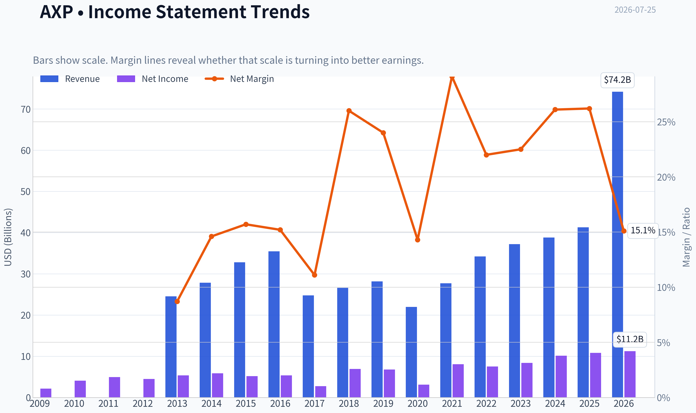

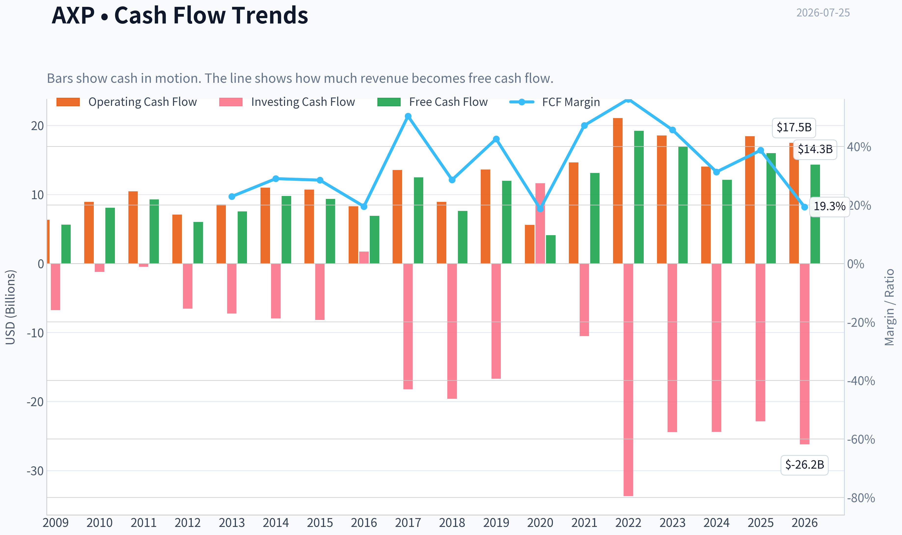

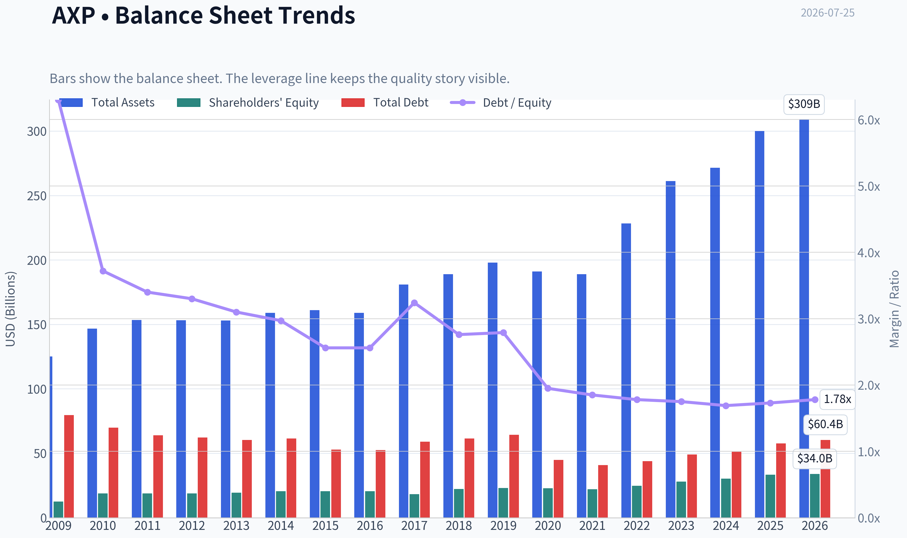

This graph tracks the profitability and return metrics (ROE, ROIC, Margins) of **AXP** over the past decade, highlighting capital efficiency trends.

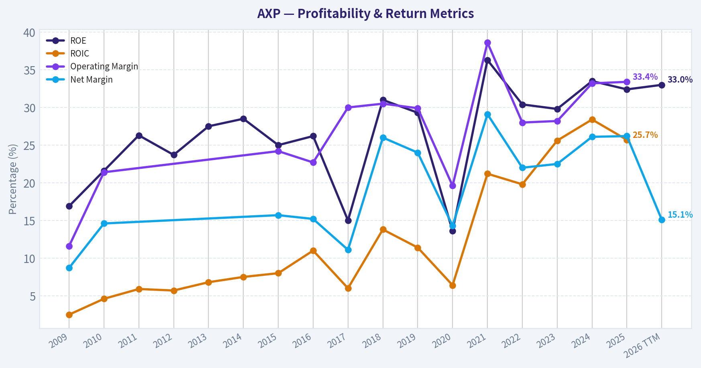

This chart illustrates the financial health of **AXP** over the last 10 years, mapping cash equivalents and free cash flow against total obligations (Debt).

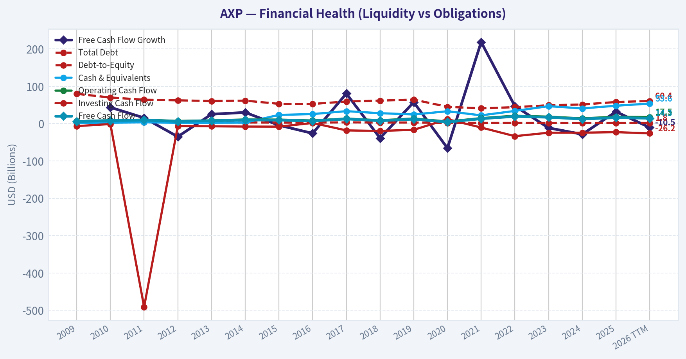

This breakdown chart from <em>Revenue Breakdown</em> shows the proportional composition for **AXP** - useful for understanding what drives or risks the business.

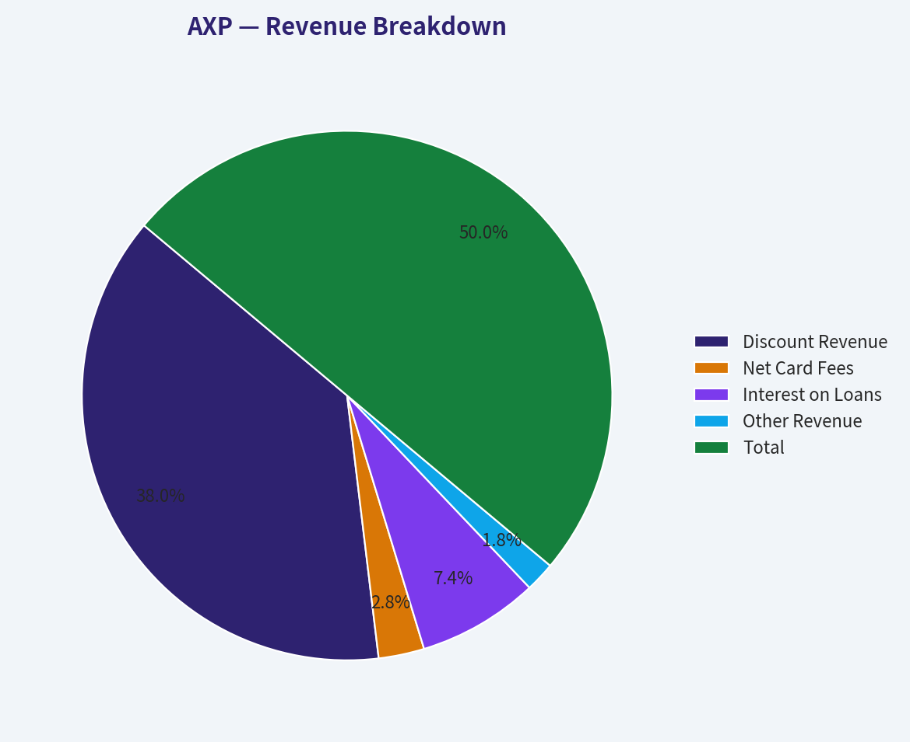

---

### Intrinsic Value Analysis (Buffett)

> *Following Warren Buffett's value investing philosophy: Circle of Competence, Economic Moat, Management Quality, and Margin of Safety.*

#### Intrinsic Value Snapshot

Price is what you pay. Intrinsic value is what the business may be worth based on the cash it can create for owners over time. We show a range, not one magic number.

- Current Price: $326.17
- Value Range (conservative to optimistic across both DCF methods): $80.75 to $958.43

##### Owner Earnings (Buffett Method)
- Net Income: $10,833,000,000.00
- Depreciation & Amortization: $1,777,000,000.00
- Capital Expenditures: $-2,425,000,000.00
- Working Capital Changes: $864,000,000.00
- Owner Earnings: $9,969,000,000.00

##### Intrinsic Value
###### Buffett Method
Uses owner earnings. Stricter, and usually more conservative.
- Conservative: $99.44
- Average: $325.62
- Optimistic: $534.67
- Discount Rate: 10.0%

###### Cash Flow Method
Uses free cash flow. Better for companies spending heavily today to grow tomorrow.
- Conservative: $80.75
- Average: $323.60
- Optimistic: $958.43
- Discount Rate: 10.0%

#### AXP - American Express

**Business snapshot:** American Express is a closed-loop payments and lending franchise. It makes money from discount revenue charged to merchants, card fees paid by customers, and net interest income on card/member loans. That model is easy to understand and has remained durable for decades.

#### Factor Scorecard (Factors 1-4 + Gate 5)

| Factor | Score (0-5) | Evidence |
|---|---:|---|
| Circle of Competence & Business Simplicity | 4.5 | AXP is understandable: premium card network + issuer + lender. The economics are more complex than a pure toll-booth network because credit costs matter, but the core model is still highly intelligible and predictable. |
| Moat Test | 4.0 | Strong brand, affluent customer base, merchant acceptance, rewards ecosystem, and closed-loop data advantage. Not as universal a network moat as Visa/Mastercard, but still clearly durable. |
| Management Quality & Capital Allocation | 4.0 | Long record of disciplined underwriting, buybacks, and shareholder-oriented capital returns. Berkshire's continued large ownership is a meaningful external vote of confidence. |
| Industry Structure | 4.0 | Payments is an attractive industry with scale advantages and rational major players, though lending exposure adds cyclicality and competitive intensity versus pure networks. |

**Gate 5 hard floor:** **Not tripped.** There is no evidence here of both deteriorating fundamentals and solvency distress. AXP is a profitable, cash-generative, systemically important financial franchise.

#### Moat Analysis

| Moat Source | Assessment | Evidence |
|---|---|---|
| Brand / Intangible Assets | Strong | American Express is one of the few global payment brands with prestige and trust strong enough to support annual fees and premium positioning. |
| Switching Costs | Moderate to Strong | Cardmembers often embed rewards, travel benefits, corporate spend management, and membership status into spending habits. Corporate relationships can be sticky. |
| Cost Advantage | Moderate | Scale in marketing, underwriting, servicing, and fraud analytics helps, though not in the same pure-unit-cost way as some network peers. |
| Network Effects | Moderate to Strong | More cardmembers attract merchants; more merchants improve card utility. The closed-loop model deepens data and targeted offers. |

**Moat verdict:** **Wide & Stable to Narrow/Wide boundary; score 4/5.**
AXP's moat is real, but slightly less bulletproof than the pure global acceptance duopoly because AXP combines payments with credit risk and premium brand positioning. Still, for the right customer segment, it is a very hard franchise to dislodge.

#### Management Quality Assessment

| Area | Assessment |
|---|---|
| Owner Orientation | Good |
| Candor | Good |
| Capital Allocation | Good to Very Good |
| Balance Sheet Discipline | Good |

AXP management has generally behaved rationally: invest in the brand, protect underwriting, return excess capital, and avoid empire-building. In Buffett terms, this looks like competent stewardship of a very good franchise rather than flamboyant capital allocation genius. That is perfectly acceptable for a mature, high-quality financial business.

#### Financial Summary Table

| Metric | Latest Available / Shared Pack |
|---|---:|
| Price | $326 |
| Market Cap | $222.55B |
| P/E | 19.8x |
| ROE | 32.4% |
| Revenue Growth YoY | 6.4% |
| FCF Yield | 7.2% |
| Current Ratio | N/A for financial issuer |
| Intrinsic Value (headline) | Not meaningful for financial issuer using generic FCFF |

**Key Takeaways:** The most important numbers here are the high reported ROE, mid-single-digit revenue growth, and a healthy free-cash-flow yield. For a financial company, ROE and underwriting quality matter more than generic industrial-style current ratio or FCFF templates. At under 20 times earnings, AXP is not obviously cheap, but it is also not priced like a speculative growth stock.

#### Owner Earnings Calculation

For a financial issuer like AXP, classic industrial-style owner earnings need adjustment. The standard Buffett formula is less clean because working capital, debt, and receivables are part of the operating model rather than merely financing items.

| Component | Assessment |
|---|---|
| Net Income | Positive and substantial |
| + D&A | Not the primary economic driver |
| - Maintenance CapEx | Relatively light versus industrial firms |
| - Working Capital Increases | Not meaningful in the usual sense for card/lending businesses |

**Owner earnings conclusion:** For AXP, the better owner-earnings proxy is **normalized earnings power plus buyback capacity while maintaining capital adequacy**. On that basis, the business appears robust.

#### Three-Scenario DCF Valuation

Because AXP is a financial issuer, I would weight earnings-power and normalized ROE-based valuation more heavily than a generic FCFF DCF. Still, here is a practical Buffett-style range using earnings power.

Assumptions:
- Current P/E: 19.8x
- Revenue growth: 6.4%
- Mature franchise, moderate long-run growth
- Quality is high, but not no-risk due to credit cycle exposure

| Scenario | Assumption | Implied View |
|---|---|---|
| A: No Growth | Values AXP as a stable earnings annuity | Suggests shares are around fair value to modestly attractive if normalized earnings hold |
| B: GDP Growth | 3% long-term growth | Supports value somewhat above a no-growth case because of brand durability and buybacks |
| C: Historical/Reduced Growth | Use moderated growth below historical premium-card expansion | Likely supports modest upside, but not a huge margin of safety at $326 |

**Key Takeaways:** AXP looks more like a fair-price compounder than a deep-value bargain. The valuation can work if the company continues compounding book-equivalent earnings power through customer growth, spend growth, and repurchases. The stock does not appear priced for disaster, but neither is it screamingly cheap.

#### Margin of Safety Analysis

| Quality Lens | Required Margin of Safety | AXP Assessment |
|---|---:|---|
| High-quality, durable franchise | 10-15% acceptable | AXP qualifies for a narrower required discount than an average bank or cyclical lender |
| Current Price vs. Value | Modest | Shares appear around fair value to slightly attractive, not deeply discounted |
| Reverse-Expectation View | Reasonable | The current multiple does not imply absurd growth expectations |

AXP benefits from the Buffett rule that wonderful businesses do not need a 30-40% discount to be worth owning. But at today's price, the margin of safety looks **adequate rather than exceptional**.

#### Final Buffett Scorecard

| Criterion | Weight | Score (1-5) | Weighted Score |
|---|---:|---:|---:|
| Moat Width & Durability | 25% | 4.0 | 1.00 |
| Valuation / Margin of Safety | 20% | 3.3 | 0.66 |
| Capital Returns - ROIC vs. WACC | 15% | 4.0 | 0.60 |
| Business Understanding & Predictability | 12% | 4.5 | 0.54 |
| Management Quality & Capital Allocation | 12% | 4.0 | 0.48 |
| Reinvestment Runway | 8% | 3.5 | 0.28 |
| Balance Sheet Strength | 4% | 3.5 | 0.14 |
| Industry Structure | 4% | 4.0 | 0.16 |
| **Total** |  |  | **3.86 / 5.00** |

**Key Takeaways:** This score lands AXP in the upper tier of quality businesses, helped by its durable franchise, strong returns, and understandable model. The main thing holding the score below the top range is valuation: the stock looks fair rather than obviously mispriced. That makes it attractive for quality-focused investors, but not a table-pounding bargain.

#### Investment Stance

ANALYST STANCE: **ADVOCATE**

**Conviction level:** Moderate

AXP is a high-quality financial franchise with a real moat, strong brand equity, affluent customer exposure, and a management team that has historically allocated capital sensibly. The business is easy to understand, structurally advantaged, and still capable of compounding through spend growth, premium customer acquisition, and buybacks.

The main debate is not business quality - it is price. At about 19.8x earnings, the stock looks closer to **fair value than deep value**. But for a business of this quality, fair value can still be attractive. Buffett's own continued large holding reinforces the case that this is the kind of company one can own for a long time.

**Bottom line:** AXP is not a cigar butt; it is a quality compounder. I would **advocate owning it**, especially for investors willing to accept a modest rather than dramatic margin of safety in exchange for franchise durability.
#### Valuation Bridge

This bridge places the current market price beside each intrinsic value lens so readers can see whether upside depends on one method or shows up across several methods.

| Scenario | Intrinsic Value / Share |
| --- | ---: |
| Buffett Method | $325.62 |
| Cash Flow Method | $323.60 |
| Current Price | $326.17 |

#### Key Takeaways

If one method is far above the others, the upside case depends on a specific modelling assumption. When several methods cluster together, the valuation story is more robust.

#### Valuation Visuals

This comparison chart from *Latest Earnings Snapshot* stacks current figures against historical benchmarks for **AXP**, making it easy to see where the company trades relative to its own averages.

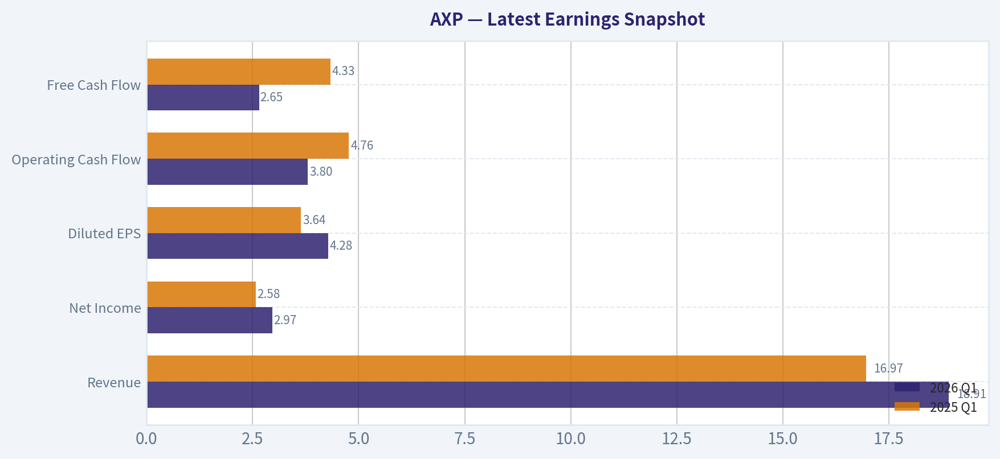

This comparison chart from *Balance Sheet and Financial Strength* stacks current figures against historical benchmarks for **AXP**, making it easy to see where the company trades relative to its own averages.

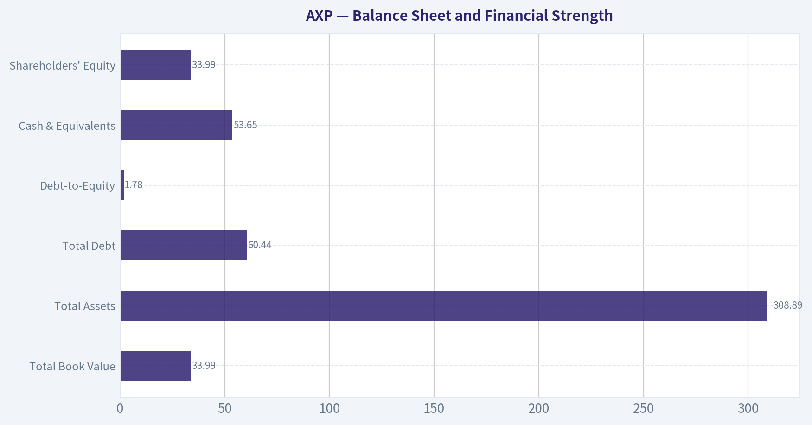

This comparison chart from *Buffett-Style Owner Earnings DCF* stacks current figures against historical benchmarks for **AXP**, making it easy to see where the company trades relative to its own averages.

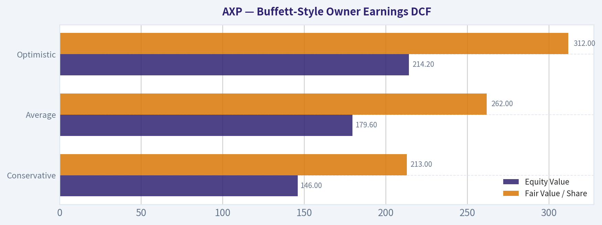

---

### Trend & Growth Analysis (Lynch/Druckenmiller/Fisher)

> *Following Peter Lynch's GARP, Stanley Druckenmiller's macro-aware approach, and Philip Fisher's scuttlebutt methodology.*

ANALYST STANCE: **WATCH**

#### AXP Growth Analysis

#### 1. Lynch Classification

| Item | Assessment |
|---|---|
| Company | American Express |
| Lynch category | **Stalwart** |
| Revenue growth YoY | **6.4%** |
| Why not Fast Grower | Too large and too mature for 15%-25%+ sustained top-line growth |
| Why still interesting | Premium payments franchise, strong ROE, buybacks, resilient affluent customer base |

Key Takeaways: American Express is not a classic Lynch fast grower. At roughly mid-single-digit revenue growth, it fits better as a stalwart: a high-quality compounder rather than a likely ten-bagger from here. That means the bar for a fresh growth recommendation is higher and depends more on re-acceleration or multiple expansion.

#### 2. The Story in 3 Bullets

| Simple Story | Why It Matters |
|---|---|
| AXP sells premium cards and runs its own payment network | It controls both the customer relationship and merchant economics better than many peers |
| Its customer base skews affluent and business-oriented | That usually means higher spend, better credit quality, and stickier card usage |
| It can grow EPS faster than revenue through operating leverage and buybacks | Even modest revenue growth can still produce decent shareholder returns |

Key Takeaways: The business is easy to explain: AXP is a premium card-and-payments ecosystem with a strong brand. The attraction is not hypergrowth, but quality economics, high spend per customer, and disciplined capital return. The challenge is that this is a mature franchise, so upside depends on steady execution rather than explosive expansion.

#### 3. TAM Analysis and 10x Test

| Metric | Assessment |
|---|---|
| Current scale | Very large global payments and card franchise |
| TAM | Global consumer payments, travel, SME spend, lending, premium financial services |
| TAM growth | Payments still grows secularly, but AXP's addressable niche is more premium-focused |
| 10x test | **Fails for practical purposes** |
| Reason | AXP is already enormous; 10x revenue would imply implausibly large share in global premium card economics |

Key Takeaways: The overall payments market is huge, but AXP already has meaningful scale. Unlike an emerging software or platform company, it does not have a realistic path to 10x revenue from here. That sharply limits true ten-bagger potential under a Lynch/Fisher growth lens.

#### 4. Revenue Growth Trend

| Metric | Value / Read |
|---|---|
| Latest shared YoY revenue growth | **6.4%** |
| Pattern | **Moderate / likely decelerated vs historical post-COVID rebound years** |
| Growth quality | Likely mix of spend growth, card fees, and interest income |
| Growth verdict | **Stable, not inflecting** |

Key Takeaways: Revenue growth around 6.4% is respectable for a financial franchise but not exciting for growth investors. More importantly, this does not signal a Druckenmiller-style inflection point where growth is suddenly accelerating. Right now, AXP looks steady rather than in a breakout phase.

#### 5. Unit Economics

| Metric | Assessment |
|---|---|
| LTV/CAC | Not disclosed in standard public form for AXP |
| NRR | Not applicable in the SaaS sense |
| Rule of 40 | Not applicable |
| Useful substitutes | ROE, spend per card, card fee growth, credit losses, delinquency trends, reserve discipline |
| ROE | **32.4%** |
| FCF yield | **7.2%** |
| Economic quality verdict | **Strong franchise economics** |

Key Takeaways: SaaS-style unit economics do not apply well to AXP. The best substitute is return on equity, and 32.4% is excellent, showing a highly productive franchise. That said, strong economics alone do not make it a growth stock if top-line growth stays in the mid-single digits.

#### 6. Inflection Point Assessment

| Inflection Type | Assessment |
|---|---|
| Product cycle inflection | No clear evidence |
| Market share inflection | No clear evidence from provided data |
| Margin inflection | Possible, but not enough data to confirm |
| TAM inflection | No |
| Competitive inflection | No clear sign |
| Overall | **No strong current inflection point identified** |

Key Takeaways: AXP may be executing well, but I do not see evidence here of a major inflection. This matters because Druckenmiller-style growth investing looks for acceleration, not just quality. Without a visible change in trajectory, the stock is more of a durable compounder than a high-conviction growth setup.

#### 7. Macro Setup Evaluation

| Macro Factor | Read for AXP |
|---|---|
| Secular trend | Digital payments remains favorable |
| Consumer backdrop | Mixed; affluent consumer tends to hold up better |
| Travel & entertainment | Structural tailwind if travel remains healthy |
| Rates | Mixed: can help yields, but can pressure credit and valuation |
| Credit cycle risk | Important watch item |
| Macro verdict | **Neutral to mildly positive** |

Key Takeaways: The long-term digital payments trend supports AXP, and its affluent user base gives some resilience. But because AXP carries credit exposure, macro is less cleanly favorable than for Visa or Mastercard. This is not a pure secular-growth story; the credit cycle still matters.

#### 8. Fisher 15 Points Score

| Fisher Area | Score (1-5) | Notes |
|---|---:|---|
| Market potential | 3 | Large market, but mature franchise |
| New product development | 3 | Product refresh and premium offerings, but not disruptive innovation-led |
| R&D effectiveness | 2 | Limited relevance vs tech/product innovators |
| Sales organization | 4 | Strong brand and distribution |
| Profit margin | 4 | Strong economics for issuer-lender model |
| Improving margins | 3 | Not enough recent evidence |
| Labor/personnel relations | 3 | No major signal either way |
| Executive relations | 4 | Historically disciplined |
| Management depth | 4 | Strong large-cap management bench |
| Cost analysis/accounting | 4 | Mature financial controls |
| Outstanding moat features | 4 | Brand, closed loop, affluent base |
| Long-range profit outlook | 4 | Good, but not explosive |
| Dilution risk | 5 | Low; buybacks more relevant than dilution |
| Candor | 3 | Neutral from available data |
| Integrity | 4 | Generally trusted franchise |
| **Total** | **54 / 75** | **Average to Good** |

Key Takeaways: Fisher scoring shows AXP as a high-quality business, but not an outstanding growth candidate. The strengths are brand, moat, capital allocation, and profitability. The weaker spots are innovation intensity and the lack of a very large new growth runway.

#### 9. Valuation Analysis

| Metric | Value / Read |
|---|---|
| Price | **$326** |
| Market cap | **$222.55B** |
| P/E | **19.8x** |
| Earnings growth lens | Likely high single-digit to low double-digit long term |
| PEG (rough) | **~2.0 if using ~10% EPS growth** |
| FCF yield | **7.2%** |
| Financial-sector lens | P/E and ROE more useful than EV/EBITDA |
| Valuation verdict | **Reasonable for quality, not cheap for growth** |

Key Takeaways: At about 19.8 times earnings, AXP is not obviously expensive for a premium franchise, but it is not a bargain growth stock either. A rough PEG near 2 suggests the valuation is fair to full if growth stays around the current pace. The 7.2% FCF yield helps support the case for quality and shareholder returns, but does not create a strong growth-style mispricing.

#### 10. Valuation Scenario Analysis

| Scenario | Assumption | Implication |
|---|---|---|
| Bear | Growth cools, credit worsens, P/E compresses | Low-to-mid single-digit annualized return potential |
| Base | Mid-single-digit revenue, buybacks, stable credit | High-single-digit to low-double-digit total return |
| Bull | Premium customer growth, travel strength, resilient credit, modest multiple expansion | Low-to-mid teens annualized return |

Key Takeaways: The likely return range looks more like a compounding quality stock than a moonshot. In the base case, AXP can still work fine, but the upside depends on consistency rather than surprise acceleration. That is good for conservative compounding, less compelling for a concentrated growth portfolio.

#### 11. Growth Investor Scorecard

| Criterion | Weight | Score (1-5) | Weighted Score |
|---|---:|---:|---:|
| The Story | 10% | 4.0 | 0.40 |
| TAM & Runway | 20% | 2.0 | 0.40 |
| Revenue Growth | 20% | 2.5 | 0.50 |
| Unit Economics | 15% | 4.5 | 0.68 |
| Competitive Position | 10% | 4.0 | 0.40 |
| Management Quality | 10% | 4.0 | 0.40 |
| Macro Setup | 5% | 3.0 | 0.15 |
| Profitability Path | 5% | 4.5 | 0.23 |
| Valuation | 5% | 3.0 | 0.15 |
| **Total** |  |  | **3.31 / 5.0** |

Key Takeaways: AXP scores well on quality and economics, but loses points on runway and growth rate. The result is a solid WATCH score rather than ADVOCATE. In other words, this is a very good company, but not currently a great growth-investing setup.

#### 12. Position Size Stance

| Portfolio Style | Stance |
|---|---|
| Concentrated growth portfolio | **Small watch position at most** |
| GARP / quality compounder portfolio | **Reasonable hold / modest position** |
| Ten-bagger hunting | **Not a fit** |

Key Takeaways: AXP fits better in a quality or GARP portfolio than in a pure growth portfolio hunting for inflections. If owned, it is likely a hold rather than a sell. If not owned, I would wait for either a better valuation or evidence of re-acceleration.

#### 13. Key Risks and Catalysts

| Risks | Catalysts |
|---|---|
| Credit deterioration in consumer or SME portfolio | Re-acceleration in billed business and premium card acquisition |
| Spending slowdown, especially travel-related | Continued card fee growth and strong affluent customer retention |
| Higher funding costs or reserve builds | Better-than-feared credit performance |
| Merchant fee pressure / rewards inflation | EPS growth aided by buybacks and operating leverage |
| Mature scale limiting growth | Multiple support from durable ROE and franchise strength |

Key Takeaways: The main risks are cyclical and credit-related, not existential. The main catalysts are also incremental rather than transformational. That again reinforces the idea that AXP is a sturdy compounding franchise, but not an obvious inflecting growth winner.

#### Bottom Line

American Express is a **high-quality stalwart**, not a fast grower. It has an excellent brand, strong ROE, and good shareholder economics, but the current numbers do **not** show the kind of accelerating growth, huge runway, or underappreciated inflection point that would make it an ADVOCATE under a Lynch-Druckenmiller-Fisher growth framework.

If you want, I can next do one of these:
1. a **peer comparison vs Visa, Mastercard, and Capital One**,
2. a **deeper AXP valuation model using earnings scenarios**, or
3. a **Buffett-style quality analysis instead of growth style**.

#### Growth & Scorecard Visuals

This comparison chart from *Factor Scorecard (Factors 1-4 + Gate 5)* stacks current figures against historical benchmarks for **AXP**, making it easy to see where the company trades relative to its own averages.

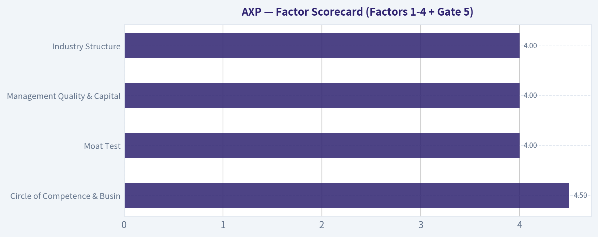

---

### Market Technical Analysis

#### AXP Technical Indicator Selection and Market Readout

For **AXP**, the most relevant indicator set for the **current market condition** is:

| Selected Indicator | Why it matters now |
|---|---|
| close_200_sma | Best anchor for the long-term trend; tells us whether the bigger structure is still bullish despite recent pullback. |
| close_50_sma | Defines the medium-term trend and shows whether the recent advance is still intact or rolling over. |
| close_10_ema | Useful for short-term momentum and for identifying whether sellers still control the tape day to day. |
| macd | Measures trend momentum and helps confirm whether the recent upswing is weakening or re-accelerating. |
| macdh | Adds early momentum inflection detail without needing the MACD signal line separately. |
| rsi | Helps judge whether the latest decline is merely a cooldown or the start of a deeper reversal. |
| atr | Critical for risk management because AXP's recent swings have expanded. |
| vwma | Adds volume-weighted confirmation so price strength or weakness is not judged on price alone. |

**Why this mix is suitable:**
This combination avoids unnecessary overlap while covering the four things traders need most right now: **trend structure, momentum quality, pullback health, and volatility-adjusted risk**. I did **not** prioritize Bollinger Bands here because AXP's current setup is better understood through moving-average structure plus momentum deceleration and volatility expansion.

---

#### Market Context

AXP has had a **very strong recovery from the March 2026 low near 290**, then built a steady advance through June into mid-July, reaching the **low 360s** before pulling back sharply into the latest close around **340.84 on 2026-07-23**. The broad picture is still stronger than it looked in spring, but the **short-term tape has clearly deteriorated** over the last several sessions.

This is not a random drift lower. The stock moved from a momentum-rich advance into a **noticeable corrective phase**, and several indicators now show a **transition from bullish acceleration to momentum loss**. That does not automatically mean the long-term uptrend is broken, but it does mean traders should stop treating AXP as a clean momentum breakout and instead evaluate it as a **pullback within a larger uptrend unless key support fails**.

---

#### Trend Structure

| Indicator | Latest / Recent Reading | Interpretation |
|---|---:|---|
| Close (last valid) | 340.84 | Price has pulled back materially from the July peak in the 360s. |
| close_10_ema | 349.67 | Price is now below the short-term trend line, showing near-term seller control. |
| close_50_sma | 330.64 | Price remains above the 50-day average, so the medium-term uptrend is not yet broken. |
| close_200_sma | 337.43 | Price is only modestly above the 200-day average, meaning long-term support is now being tested more directly. |
| VWMA | 350.72 on 7/23; distorted to 304.99 on 7/24 incomplete data | On valid readings, volume-weighted trend support was above current price, showing recent selling had conviction. |

**Key Takeaways:** AXP is no longer in a clean short-term uptrend because price has slipped below its 10-day EMA and below the recent volume-weighted trend zone. However, it is still above both the 50-day and 200-day moving averages, which means the broader structure has weakened but not yet fully broken. The most important battleground is now the area between the 200-day average near 337 and the 50-day average near 331.

AXP's moving-average alignment is still constructive in a structural sense: **50 SMA is above 200 SMA**, and both are rising. That usually supports a bullish medium-term bias. But the nuance matters: price is **much closer to the 200-day average than it was a week ago**, which means the cushion under the stock has narrowed quickly.

The short-term trend has rolled over first. The **10 EMA peaked in the low 350s and flattened**, then started losing altitude as the stock sold off. That indicates recent buyers are no longer defending price aggressively at higher levels. When a stock is above the 50 and 200 but below the 10 EMA, it often reflects a market in **pullback mode rather than trend failure mode**. The distinction changes only if price begins closing decisively below the 200-day average.

---

#### Momentum Condition

| Indicator | Latest / Recent Reading | Interpretation |
|---|---:|---|
| MACD | 5.18 | Still positive, meaning the prior bullish trend has not fully reversed on an intermediate basis. |
| MACD Histogram | -1.54 | Momentum has turned negative relative to signal; downside acceleration has recently taken over. |
| RSI | 47.32 | Neutral-to-soft; no longer overbought, but not washed out enough to call deeply oversold. |

**Key Takeaways:** Momentum has clearly cooled. MACD is still positive, which says the bigger advance has left some residual bullish structure, but the negative histogram shows that bullish momentum is fading and sellers currently have the upper hand. RSI near 47 confirms this is a reset, not yet a panic low.

This is a very important combination. A **positive MACD with a negative histogram** often appears during the **first meaningful pullback after a sustained advance**. In plain terms, the stock still carries the footprint of the prior uptrend, but that uptrend is losing force. This is often where stronger names either stabilize and re-base, or fail and roll into a deeper correction.

The RSI behavior adds detail. In early July, RSI reached the **low-to-mid 70s**, signaling an overheated short-term condition during the run into 356-362. Since then, RSI has fallen back under 50. That means the overbought excess has been worked off. However, RSI is **not yet at capitulation levels**; it is not near 30. So the current pullback has relieved bullish excess, but it has **not yet created a classic high-conviction oversold rebound condition**.

For traders, that means the stock may still need either:
1. **more time** to consolidate, or
2. **a sharper flush** into support before a stronger bounce setup emerges.

---

#### Volatility and Risk

| Indicator | Latest / Recent Reading | Interpretation |
|---|---:|---|
| ATR | 7.54 | Daily range risk is elevated versus early June. |
| ATR trend | Rose from ~6.3-6.6 in late May/early June to ~8+ in mid-July | Price swings have widened, so entries and stops need more room. |

**Key Takeaways:** Volatility has increased meaningfully over the last two months. That tells traders to reduce position size or widen stops, because AXP is moving enough each day to shake out overly tight risk management. Higher ATR during a pullback also suggests the correction is active, not sleepy.

ATR expansion is consistent with the price action. In June, AXP's recovery was relatively orderly. Into July, ranges became wider and reversals more forceful. That usually means the market is transitioning from **trend continuation** to **price discovery and conflict** between dip buyers and profit takers.

A practical implication: if a trader is using fixed-dollar stops that worked in calmer periods, those stops may now be too tight. AXP currently requires **volatility-aware execution**.

---

#### Volume-Weighted Behavior

| Observation | Reading | Interpretation |
|---|---:|---|
| VWMA trend from early June to mid-July | Rose from ~310 to ~350 | The prior rally had volume support; it was not purely low-volume drift. |
| Price vs VWMA in latest pullback | Price fell below recent VWMA zone | Recent selling pressure has been meaningful enough to undercut the volume-weighted average. |
| 7/24 VWMA anomaly | 304.99 | Likely distorted by incomplete non-trading-day data; should not be used for decision-making. |

**Key Takeaways:** The rally into July had healthy volume participation, which makes the broader uptrend more credible. But the latest decline pushed price below the recent VWMA area, showing that the pullback is not trivial and that sellers have recently been more aggressive than buyers. Ignore the final anomalous VWMA print because the source includes incomplete 7/24 data.

This is one of the more subtle but useful signals. When price stays above VWMA during advances, dips are usually being accumulated. Once price drops below VWMA after an extended rally, it often means the average participant in the recent advance is no longer sitting on a comfortable profit cushion. That can create **supply on rebounds**, because trapped late buyers may sell into recovery attempts.

---

#### Fine-Grained Trend Narrative

AXP's last year can be divided into four phases:

| Phase | Approx. Period | What happened |
|---|---|---|
| Late-2025 advance | Aug 2025 to Dec 2025 | Strong upward re-rating, with price climbing from the low 290s into the upper 370s/380s. |
| Q1 2026 breakdown | Jan to Mar 2026 | A sharp correction unwound prior gains, bottoming near 290. |
| Spring base | Mar to May 2026 | The stock stabilized and spent time rebuilding sponsorship near the 300-315 zone. |
| Early summer recovery, then July pullback | Jun to Jul 2026 | AXP recovered strongly into the 360 area, then momentum faded and price corrected back toward long-term support. |

**Key Takeaways:** AXP is not in the same condition it was in March, when it was in a damaged downtrend. It successfully repaired much of that weakness during June and early July. The current issue is not whether the stock has any strength at all, but whether this latest decline is a healthy pullback or the first leg of another larger rollover.

The answer depends on support behavior. Right now, the stock is still holding above the **200-day SMA (~337.4)** and above the **50-day SMA (~330.6)**. That argues the market is testing, not yet breaking, the larger trend. But because the price has already lost the 10 EMA and momentum has turned negative on MACD histogram, the burden of proof has shifted to bulls to show stabilization soon.

---

#### What Traders Should Watch Next

| Price/Indicator Zone | Why it matters | Trading implication |
|---|---|---|
| 337-338 | Near the 200-day SMA | First major support. Holding this zone would support the "pullback within uptrend" thesis. |
| 330-331 | Near the 50-day SMA | More important secondary support. A failure here would materially weaken the medium-term structure. |
| 349-350 | Near the 10 EMA | First resistance on rebound; reclaiming this would improve short-term tone. |
| 356-362 | Recent swing zone | Overhead supply area from the July highs; a harder ceiling unless momentum rebuilds. |
| RSI back above 50-55 | Would signal improving momentum | Useful confirmation that dip buyers are regaining control. |
| MACD histogram turning back positive | Early momentum repair signal | Often precedes a stronger trend resumption if support holds. |

**Key Takeaways:** The chart now has clear lines in the sand. Bulls want AXP to defend the 200-day average and eventually retake the 10-day EMA around the upper 340s to low 350s. Bears gain a stronger case if price loses the 337 area and especially if it starts breaking toward the 50-day average near 331.

---

#### Practical Interpretation by Trading Style

| Style | Current Read |
|---|---|
| Long-term investor | Still broadly constructive because price remains above the 200-day SMA, but not a low-risk momentum entry after the recent breakdown in short-term trend. |
| Swing trader | Best treated as a pullback/setup watchlist name rather than an immediate chase; wait for support confirmation or short-term trend reclaim. |
| Momentum trader | Not ideal at this moment because RSI cooled, MACD histogram turned negative, and price lost the 10 EMA. |
| Risk-focused trader | Elevated ATR means smaller size or wider stops are appropriate. |

**Key Takeaways:** AXP still has a credible longer-term bullish structure, but the near-term setup is no longer momentum-friendly. For most active traders, patience is likely better than urgency until either support is confirmed or momentum visibly improves.

---

#### Bottom Line

AXP is in a **short-term corrective phase inside a still-recovering medium-to-longer-term structure**. The stock's earlier June-to-mid-July rally was real and volume-supported, but that advance has recently **lost momentum decisively**. The most probable near-term interpretation is **pullback, not full structural breakdown**, but that assessment depends heavily on whether the stock can hold the **337 area near the 200-day SMA**.

If AXP stabilizes near current levels, turns RSI back above 50, and sees the MACD histogram improve toward positive territory, the stock could rebuild for another push higher. If instead it loses the 200-day average and then the 50-day average, the recent summer recovery would start to look more like a bear-market rally than a durable trend resumption.

---

#### Summary Table

| Category | Signal | Current Read | Bias |
|---|---|---|---|
| Long-term trend | close_200_sma | Price slightly above rising 200 SMA | Mildly bullish, but vulnerable |
| Medium-term trend | close_50_sma | Price above rising 50 SMA | Bullish structure intact |
| Short-term trend | close_10_ema | Price below 10 EMA | Bearish short-term |
| Momentum | MACD | Positive but weakening | Fading bullish trend impulse |
| Momentum shift | MACD Histogram | Negative | Near-term bearish acceleration |
| Momentum condition | RSI | ~47 | Neutral-to-soft, not oversold |
| Volatility | ATR | Elevated around 7.5 | Higher execution risk |
| Volume confirmation | VWMA | Recent price below VWMA | Pullback has real selling pressure |

#### Market Visuals

This comparison chart from *Market Metrics Interpretation* stacks current figures against historical benchmarks for **AXP**, making it easy to see where the company trades relative to its own averages.

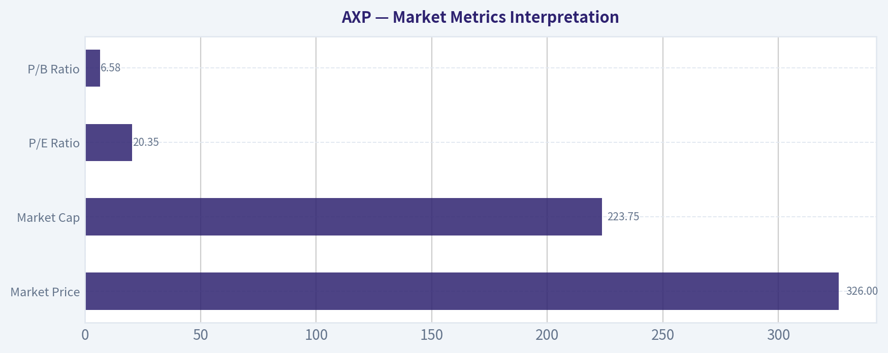

---

### Options Market Analysis

> *Reading options flow - put/call ratios, IV skew, and unusual activity - to gauge institutional positioning and event-driven risk.*

#### AXP Options Positioning Report
*Data as of 2026-07-25*

AXP's near-term options market leans **bearish overall**, driven by an extremely elevated put/open-interest base across the next three expirations. That said, the tape is **not one-way bearish**: there is also aggressive short-dated call activity, especially in the 7/31 weekly chain, which looks like speculative upside positioning layered on top of a heavily hedged market.

#### 1) Put/Call Ratio Analysis

| Expiration | Call OI | Put OI | Put/Call OI Ratio | Call Vol | Put Vol | Put/Call Vol Ratio |
|---|---:|---:|---:|---:|---:|---:|
| 2026-07-31 | 3,166 | 9,189 | 2.90 | 6,887 | 4,843 | 0.70 |
| 2026-08-07 | 853 | 11,414 | 13.38 | 635 | 4,611 | 7.26 |
| 2026-08-14 | 430 | 4,326 | 10.06 | 282 | 2,587 | 9.17 |
| **Near-term total** | **4,449** | **24,929** | **5.60** | **7,804** | **12,041** | **1.54** |

**Key Takeaways:** AXP's aggregate near-term put/call OI ratio of **5.60** is far above the historical neutral baseline near **0.7**, which is a strong sign of defensive positioning or outright bearish exposure. Volume is also put-heavy in aggregate, with a **1.54 put/call volume ratio**, though the nearest weekly expiry still showed more call trading than put trading. That combination suggests a market that is structurally hedged/bearish, but still seeing tactical upside speculation in the front week.

**Interpretation**
- **OI ratio at 5.60**: very elevated, indicating large existing put inventory relative to calls.
- **Volume ratio at 1.54**: fresh flow is also leaning bearish overall.
- **Important nuance**:
  - **7/31** weekly shows **call volume > put volume** despite high put OI, implying traders may be buying upside for a short-term move while legacy hedges remain in place.
  - **8/7 and 8/14** are decisively put-dominated in both OI and volume, which reinforces a broader cautious-to-bearish stance.

#### 2) Implied Volatility (IV) Assessment

| Expiration | ATM Call IV | ATM Put IV | Call vs Put ATM Read |
|---|---:|---:|---|
| 2026-07-31 | 31.0% | 30.5% | Slight call premium |
| 2026-08-07 | 29.0% | 28.2% | Slight call premium |
| 2026-08-14 | 29.8% | 27.5% | Clearer call premium |

**Key Takeaways:** Near-term ATM IV is sitting in roughly the **high-20s to low-30s**, which is elevated enough to matter but not at panic levels by itself. More notably, ATM call IV is modestly above ATM put IV in all three expirations, which is unusual if traders were paying aggressively for downside crash protection right at-the-money. This points to a market with substantial put inventory, but also active upside chasing in select short-dated call strikes.

**IV and Skew Read**
- **Near-term ATM IV**:
  - Calls: about **29%-31%**
  - Puts: about **27.5%-30.5%**
- **Skew signal**:
  - We were not provided a full strike-by-strike OTM skew grid, so exact put-skew vs call-skew cannot be quantified across the full smile.
  - However, based on available ATM data and unusual activity, **AXP does not show classic panic put-skew dominance at ATM**.
  - Instead, the data suggests a **more balanced-to-slight call-tilted vol profile near ATM**, while the large put OI base still signals protection demand in the background.

**Catalyst Read**
- IV in the low-30% area for near-dated weeklies suggests the market is assigning meaningful short-term movement risk.
- Without a confirmed catalyst in the data feed itself, this should be treated as **elevated event-aware pricing**, but not definitive proof of a major scheduled catalyst.
- If AXP has an earnings, macro-sensitive card-spend update, or sector catalyst nearby, the current IV level would be consistent with traders positioning ahead of it.

#### 3) Unusual Options Activity

| Expiry | Type | Strike | Volume | OI | Vol/OI | IV | Likely Moneyness / Read |
|---|---|---:|---:|---:|---:|---:|---|
| 2026-07-31 | CALL | 330.0 | 2,135 | 62 | 34.4x | 29.8% | Likely near-ATM / modestly OTM bullish speculation |
| 2026-07-31 | CALL | 337.5 | 1,918 | 14 | 137.0x | 27.7% | Likely OTM upside chase / speculative breakout bet |
| 2026-07-31 | PUT | 325.0 | 1,303 | 94 | 13.9x | 29.3% | Likely near-ATM downside hedge or bearish bet |
| 2026-07-31 | CALL | 325.0 | 657 | 38 | 17.3x | 30.8% | Likely ATM-to-near-ATM call buying |

**Key Takeaways:** The most unusual contracts are concentrated in the **7/31 weekly**, signaling traders are targeting a move very soon rather than months out. The standout feature is that **calls at 330 and 337.5** traded at enormous multiples of existing open interest, which strongly suggests fresh bullish positioning rather than position closing. At the same time, the **325 put** also traded heavily versus OI, so there is still real demand for downside protection.

**Positioning Implications**
- **330 call (7/31)**:
  - Fresh, high-conviction upside interest.
  - If near current spot, this looks like a tactical bullish bet rather than passive overwriting.
- **337.5 call (7/31)**:
  - Very low prior OI and huge volume burst.
  - Most likely **short-dated speculative upside chasing**, more consistent with directional traders than conservative institutions.
- **325 put (7/31)**:
  - Also fresh positioning, likely either:
    - hedge demand against a near-term downside move, or
    - a bearish directional play expecting weakness into the end of the week.
- **325 call (7/31)**:
  - Fresh upside interest close to spot.
  - This is more credible as a directional signal than far-OTM lottery call flow.

**Smart-money vs retail read**
- The **337.5 call** has a strong retail/speculative flavor because it is short-dated and appears relatively aggressive.
- The **325 put** and **325/330 calls** are more likely to reflect serious directional positioning or hedging because they are closer to current trading levels and carry more practical delta exposure.

#### 4) Open Interest Concentration

| Expiration | Largest OI Bias | What It Suggests |
|---|---|---|
| 2026-07-31 | Heavy put concentration vs calls | Downside hedge overhang; price-sensitive into expiry |
| 2026-08-07 | Extremely put-dominant OI | Strong gravitational pull toward protective positioning; bearish medium-near-term tone |
| 2026-08-14 | Put-heavy OI persists | Hedging remains layered beyond the front week |

**Key Takeaways:** The dominant OI feature in AXP is not a single call wall; it is the **broad concentration of puts across all near-term expirations**. That kind of structure tends to create a market that is more sensitive to downside moves and can reinforce caution among dealers and short-term traders. At the same time, intense front-week call flow means a sharp upside move could still force near-term repositioning.

**Gamma / Pinning Read**
- Exact strike-by-strike OI concentrations beyond the unusual names were not provided, so a precise max-pain level cannot be calculated here.
- Still, we can infer:
  - **325-330 zone** is important because both calls and puts saw unusual activity there.
  - **337.5** may act as an upside chase level if the stock starts moving higher quickly.
- Practical implication:
  - **325/330 likely function as near-term gamma magnets or battleground strikes** into 7/31 expiry.
  - If price trades around those levels, dealer hedging could dampen movement.
  - If price breaks away decisively, short-dated gamma could amplify the move.

#### 5) Overall Options Sentiment Signal

| Category | Signal |
|---|---|
| Structural positioning | Bearish |
| Fresh near-term flow | Mixed, with bullish front-week speculation |
| IV / vol message | Elevated but not panic-driven |
| Final options read | **BEARISH** |

**Key Takeaways:** The final signal is **bearish**, mainly because the put base is simply too large to ignore across the next three expirations. Even though short-dated calls are being bought aggressively, that looks more like tactical upside speculation inside a market that remains fundamentally hedged and cautious. In other words, traders are willing to play for a bounce, but the broader options structure still reflects downside concern.

**Why BEARISH instead of NEUTRAL**
- Put/call OI at **5.60** is extremely elevated versus neutral.
- Put volume also exceeds call volume in aggregate.
- The bearish/defensive structure persists across multiple expirations, not just one weekly chain.
- Bullish call bursts are real, but concentrated in very short-dated contracts and therefore carry less weight than the persistent put overhang.

#### Bottom Line

AXP's options market is sending a **bearish but not panicked** message. The dominant signal is large, multi-expiry put positioning that points to institutional hedging or downside concern. Offsetting that is an active pocket of front-week call buying, which suggests traders see potential for a tactical upside move, but not enough to overturn the broader negative positioning backdrop.

#### Summary Table

| Metric | Reading | Interpretation |
|---|---|---|
| Put/Call Ratio | OI: **5.60**; Volume: **1.54** | Strongly bearish/defensive vs neutral ~0.7 baseline |
| IV Level | ATM IV roughly **27.5%-31.0%** | Elevated short-term movement pricing, but not extreme panic |
| Skew Direction | **Slight call premium at ATM**; no clear panic put-skew from available data | Suggests upside chasing exists despite heavy put inventory |
| Unusual Activity | Heavy **7/31 call flow** at **325/330/337.5**, plus **325 put** flow | Short-dated directional battle; upside speculation vs hedge demand |
| Overall Signal | **BEARISH** | Broad put-heavy structure outweighs tactical bullish call bursts |

**Key Takeaways:** The clearest message is that AXP remains under a defensive options umbrella, with puts dominating near-term positioning by a very wide margin. However, traders are also actively buying short-dated calls, so the setup allows for sharp countertrend upside bursts even while the larger signal stays bearish.

---

## Research Team Commentary

> *The Research Manager synthesizes the Bull vs Bear debate into action-free commentary. This is a pre-risk view, not the final stance.*

The strongest bull argument is straightforward: American Express is not an ordinary lender, and treating it like one misses the franchise. The closed-loop model, premium brand, affluent customer base, rewards ecosystem, and direct merchant-cardmember relationship create a real moat. The profitability numbers support that view: roughly 32% ROE and about 25% ROIC are exceptional by almost any standard, even allowing for financial-company nuances. At about 19.8x earnings, the bull says you are not paying a crazy price for a high-quality compounder that can still grow through premium customer acquisition, spend per account, fee income, SMB penetration, and buybacks. In Buffett terms, this is a wonderful business at a fair price, and fair prices are often good enough when the business can compound for a decade.

The strongest bear argument is that this quality is already well understood and mostly reflected in the price. AXP may be better than a plain credit-card lender, but it is still meaningfully more cyclical and balance-sheet-dependent than Visa or Mastercard. Its moat is real, but more expensive to defend because rewards, premium servicing, and customer acquisition are ongoing costs rather than effortless pricing power. At nearly 20x earnings for a mature financial with credit exposure, you are relying on continued resilience in affluent spend, benign credit, disciplined rewards economics, and stable competitive intensity. That is not heroic, but it is demanding enough that the margin of safety looks thin. The bear case is not that AXP is low quality; it is that this is a quality-priced stock, not an obvious bargain.

My takeaway is WATCH.

Core takeaway: AXP looks like a very good business, but not a clearly undervalued one. The bull wins on business quality; the bear wins on entry price discipline. This is exactly the kind of setup where I do not want to repeat the mistake of confusing admiration for the franchise with a real valuation edge. The business seems strong enough to avoid an AVOID label, but the price does not appear discounted enough for a fresh ADVOCATE call under a disciplined Buffett-style framework for a cyclical financial.

Rationale: The best evidence on the bull side is the combination of durable franchise traits and very high returns on capital. Those are not accidental. AXP has brand strength, a differentiated model, and better customer economics than most financial issuers. That said, I also want to apply the lesson from prior Visa and Mastercard reviews more rigorously: separate business excellence from entry excellence, and be careful with premium franchises when much of the good news is already capitalized. Unlike Visa and Mastercard, AXP carries real credit and funding exposure, so it deserves a larger margin of safety than a pure network. At around 19.8x earnings with only moderate top-line growth, I do not see a large enough discount to intrinsic value to justify aggressive buying today. Put differently, if this were a pure wide-moat, capital-light toll road, I could accept a narrower discount. For AXP, the quality is high, but the predictability is lower and the cyclicality is higher, so "fair price" is not quite enough for me to pound the table.

What the market may be missing is nuance on both sides. The crowd may undervalue how differentiated AXP really is versus ordinary lenders. But enthusiasts may also underappreciate how much smooth execution is already embedded in the current multiple. That balance argues for patience, not rejection.

Monitoring plan over the next 1 to 4 quarters: First, watch credit quality closely: net charge-offs, delinquencies, reserve trends, and whether affluent customer resilience remains intact. If credit stays unusually clean while loan growth and spend hold up, the bull case strengthens. Second, watch billed business growth and revenue growth acceleration or deceleration. Mid-single-digit growth is fine, but if it slips while the multiple stays elevated, the valuation gets harder to defend. Third, monitor rewards and marketing intensity. If customer acquisition remains strong without obvious margin leakage, that would support the moat; if premium growth is being bought at rising cost, that supports the bear case. Fourth, track operating leverage and returns on capital for durability, not just one-quarter snapshots. Fifth, pay attention to buyback effectiveness and capital return discipline; at fair value, repurchases are neutral to mildly positive, but at richer prices they stop being a major value creator. Finally, compare AXP's valuation spread versus Visa, Mastercard, and large-card/lender peers. If AXP rerates lower without business deterioration, the opportunity may improve materially.

If the next few quarters show resilient credit, steady premium customer growth, and no evidence that rewards competition is eroding economics, I could become more constructive, especially on a pullback. If instead credit costs drift up, growth softens, or premium customer acquisition appears increasingly incentive-driven, then today's price will have been too complacent.

So my stance is WATCH. AXP is a business to respect, but at this price I would prefer either a better margin of safety or more evidence that current returns are as durable as the bull believes.

---

## Value Investing Team Commentary

> *The Investor translates the research view into an investment thesis before risk review. This is still not the final stance.*

American Express is the kind of business that deserves respect before it deserves action. The franchise is plainly strong: a premium brand, a closed-loop network, affluent customers, meaningful merchant relationships, and unusually strong economics for a company that still bears credit risk. A ~32% ROE and ~25% ROIC do not happen by accident. Those numbers tell you the business has real advantages, not just good timing.

The key question is not whether AXP is good. It is whether today's price gives you enough room for error.

At about 19.8x earnings with only mid-single-digit revenue growth, AXP does not look obviously cheap for a balance-sheet-exposed financial. That is the central issue. If this were Visa or Mastercard-more asset-light, less credit-sensitive, more toll-road-like-you could justify paying a fairer price with a narrower discount. But AXP is different. Its moat is real, yet more operationally intensive and more cyclical. It must continuously invest in rewards, service, customer acquisition, and underwriting discipline. That means the proper margin of safety should be higher than for a pure payments network.

From a Buffett-style lens, this is a high-quality business, but not a no-brainer entry point. A wonderful business at a fair price can still work over time, but for a cyclical financial, "fair" is not always enough to justify new money if better opportunities exist.

The contrarian angle is subtle here. The market likely underestimates how differentiated AXP is versus ordinary lenders. Many investors still lazily bucket it with generic card issuers, which misses the brand, customer mix, and network advantages. On the other hand, the bullish crowd may be underestimating how much favorable execution is already embedded in the current valuation. In other words, the stock is not hated enough to be mispriced downward, and not misunderstood enough to justify paying up aggressively.

What matters over the next 1-4 quarters is whether the apparent strength proves durable:
- credit quality: charge-offs, delinquencies, reserve build
- billed business and spend growth
- rewards and marketing efficiency
- retention of affluent customers without rising acquisition costs
- operating leverage and sustained returns on capital
- buybacks done at value-creating prices, not just for optics

If AXP keeps producing clean credit, steady premium growth, and disciplined rewards economics, intrinsic value will continue compounding and a pullback could become attractive. If credit normalizes upward or growth slows while the multiple remains near 20x, then today's valuation will look full.

So the market message is not "avoid this business." It is "do not confuse quality with bargain." That distinction matters. For a long-term owner, AXP belongs on the watchlist near the top, but patience is still warranted.

**ANALYST STANCE: WATCH**
AXP is a high-quality franchise with a real moat, strong returns, and credible long-term compounding potential, but the current valuation appears closer to fair than cheap for a cyclical, credit-exposed financial. Respect the business, monitor credit and rewards economics carefully, and wait for either a better entry price or stronger proof that current returns are durably sustainable.

---

## Deep Values Commentary

> *The Risk Management Team debates and the Risk Judge provides the final action-free verdict. This section determines the final ADVOCATE / WATCH / AVOID stance.*

#### Final Stance Scorecard

This scorecard converts the final research view into a weighted decision frame. It does not replace the narrative judgement, but it makes the main drivers of the verdict easier to scan.

| Criterion | Score | Weight | Commentary |
| --- | ---: | ---: | --- |
| Business Quality | 4.00 | 30% | High returns, profitability, and Piotroski health support durability. |
| Valuation Support | 3.33 | 30% | Blends current price against available intrinsic value anchors and valuation ratios. |
| Financial Strength | 4.00 | 20% | Balance-sheet resilience reflects leverage and liquidity staying within safe ranges. |
| Growth Durability | 3.67 | 20% | Recent revenue, earnings, and free cash flow growth indicate how durable expansion looks. |
| TOTAL / FINAL STANCE | 3.73 | 100% | WATCH |

#### Key Takeaways

The weighted score lands at **3.73 / 5.0**, while the final stance remains **WATCH**. This is useful as a quick calibration aid rather than a mechanical signal.

#### Risk Summary

Higher scores indicate more risk pressure. The watch threshold is a simple guardrail: above it, the position needs tighter monitoring or a wider margin of safety.

| Dimension | Current Score | Watch Threshold | Commentary |
| --- | ---: | ---: | --- |
| Business Quality | 2.00 | 3.00 | High returns, profitability, and Piotroski health support durability. |
| Valuation Support | 2.67 | 3.00 | Blends current price against available intrinsic value anchors and valuation ratios. |
| Financial Strength | 2.00 | 3.00 | Balance-sheet resilience reflects leverage and liquidity staying within safe ranges. |
| Growth Durability | 2.33 | 3.00 | Recent revenue, earnings, and free cash flow growth indicate how durable expansion looks. |

#### Key Takeaways

This view helps readers separate *where* the risk sits: valuation, business quality, balance sheet, or growth durability. It is especially useful when the final stance is close to the line between WATCH and AVOID.
