# AXP Deep Value Intelligence

**Analysis Date:** 2026-10-23

## Critical Disclaimer

*This analysis is generated by Deep Value Intelligence, an AI-powered multi-agent investing framework. Education & research only - not financial advice, not a financial advisor.*

---

## Table of Contents

1. Intelligence Summary
2. Analyst Team Reports
   - Fundamentals Analysis
   - Intrinsic Value Analysis (Buffett)
   - Trend & Growth Analysis (Lynch/Druckenmiller/Fisher)
   - Market Technical Analysis
   - Options Market Analysis
3. Research Team Commentary
4. Value Investing Team Commentary
5. Deep Values Commentary

---

## Intelligence Summary

### Thesis + Conditions

**Core Thesis:** # American Express Risk Commentary

**Key Risks:**
- # American Express Risk Commentary
- American Express is a high-quality financial franchise with a premium customer base, valuable closed-loop data, and excellent current returns: 32.4% ROE, 24.9% reported ROIC, 3.6% ROA, and 6.4% revenue growth. The principal risk is not business deterioration or near-term solvency-it is paying too much for earnings whose distributability varies across the credit cycle.
- The Risky Analyst correctly emphasizes that AXP should not be treated as an ordinary card lender:

**Confidence:** Low

---

## Analyst Team Reports

### Fundamentals Analysis

#### Latest Earnings Snapshot

*Most recent reported quarter anchored on 2026 Q2, with prior-year comparison when available.*

| Metric | 2026 Q2 | 2025 Q2 | YoY Change |
| --- | ---: | ---: | ---: |
| Revenue | $19.64B | $17.86B | +10.0% |
| Operating Income | N/A | N/A | N/A |
| Net Income | $3.11B | $2.88B | +7.8% |
| Diluted EPS | $4.53 | $4.08 | +11.0% |
| Operating Cash Flow | $5.37B | $4.36B | +23.1% |
| Free Cash Flow | $4.47B | $3.75B | +19.4% |

Key Takeaways: This snapshot anchors the most recent reported quarter before the narrative analysis. It helps readers separate long-run business quality from whatever changed in the latest earnings print.

#### 17-Year Financial Metrics for AXP

*All values below are computed deterministically from raw data - not estimated by AI.*

*Issuer profile: bank (Financial Services / Credit Services).*

#### 17-Year Financial Metrics
*Annual rows come from reported financial statements. The final TTM row is computed from the latest four quarters.*

| Metric | 2009 | 2010 | 2011 | 2012 | 2013 | 2014 | 2015 | 2016 | 2017 | 2018 | 2019 | 2020 | 2021 | 2022 | 2023 | 2024 | 2025 | 2026 TTM |
| --- | --- | --- | --- | --- | --- | --- | --- | --- | --- | --- | --- | --- | --- | --- | --- | --- | --- | --- |
| Market Price | $32 | $34 | $38 | $47 | $76 | $79 | $60 | $65 | $88 | $86 | $114 | $112 | $154 | $141 | $181 | $290 | $366 | $325 |
| Market Cap | $47.45B | $51.29B | $55.85B | $65.58B | $98.80B | $97.79B | $69.76B | $69.26B | $87.99B | $81.88B | $103.33B | $97.45B | $129.24B | $111.11B | $137.88B | $211.61B | $257.49B | $220.79B |
| P/E Ratio | 26.31 | 12.81 | 11.45 | 14.78 | 18.59 | 16.62 | 13.51 | 12.89 | 32.02 | 11.83 | 15.58 | 32.07 | 16.33 | 15.00 | 16.71 | 21.18 | 24.05 | 19.73 |
| P/B Ratio | 3.75 | 2.73 | 2.97 | 3.47 | 5.07 | 4.73 | 3.37 | 3.37 | 4.82 | 3.67 | 4.48 | 4.24 | 5.83 | 4.50 | 4.91 | 6.99 | 7.69 | 6.44 |
| ROE | 16.9% | 21.6% | 26.3% | 23.7% | 27.5% | 28.5% | 25.0% | 26.2% | 15.0% | 31.0% | 29.3% | 13.6% | 36.3% | 30.4% | 29.8% | 33.5% | 32.4% | 33.4% |
| ROIC | 2.5% | 4.6% | 5.9% | 5.7% | 6.8% | 7.5% | 8.0% | 11.0% | 6.0% | 13.8% | 11.4% | 6.4% | 21.1% | 19.6% | 25.4% | 28.4% | 25.7% | N/A |
| EPS | $1.21 | $2.68 | $3.35 | $3.21 | $4.08 | $4.73 | $4.41 | $5.02 | $2.75 | $7.25 | $7.30 | $3.50 | $9.42 | $9.38 | $10.84 | $13.71 | $15.38 | $16.48 |
| Revenue | $24.52B | $27.82B | $29.96B | $31.55B | $32.87B | $34.19B | $32.82B | $24.23B | $24.78B | $26.61B | $28.16B | $21.97B | $27.72B | $34.22B | $37.22B | $38.83B | $41.30B | $75.95B |
| Gross Profit | N/A | N/A | N/A | N/A | N/A | N/A | N/A | N/A | N/A | N/A | N/A | N/A | N/A | N/A | N/A | N/A | N/A | N/A |
| Gross Margin | N/A | N/A | N/A | N/A | N/A | N/A | N/A | N/A | N/A | N/A | N/A | N/A | N/A | N/A | N/A | N/A | N/A | N/A |
| Operating Margin | 11.6% | 21.4% | 23.2% | 20.4% | 24.0% | 26.3% | 24.2% | 33.2% | 30.0% | 30.5% | 29.9% | 19.6% | 38.6% | 28.0% | 28.2% | 33.2% | 33.4% | N/A |
| Net Income | $2.13B | $4.06B | $4.93B | $4.48B | $5.36B | $5.88B | $5.16B | $5.38B | $2.75B | $6.92B | $6.76B | $3.13B | $8.06B | $7.51B | $8.37B | $10.13B | $10.83B | $11.45B |
| Net Margin | 8.7% | 14.6% | 16.5% | 14.2% | 16.3% | 17.2% | 15.7% | 22.2% | 11.1% | 26.0% | 24.0% | 14.3% | 29.1% | 22.0% | 22.5% | 26.1% | 26.2% | 15.1% |
| Revenue Growth | N/A | 13.4% | 7.7% | 5.3% | 4.2% | 4.0% | -4.0% | -26.2% | 2.2% | 7.4% | 5.8% | -22.0% | 26.1% | 23.5% | 8.8% | 4.3% | 6.4% | 83.9% |
| Net Income Growth | N/A | 90.5% | 21.6% | -9.2% | 19.6% | 9.8% | -12.3% | 4.1% | -48.9% | 151.9% | -2.3% | -53.6% | 157.1% | -6.8% | 11.4% | 21.0% | 7.0% | 5.6% |
| Free Cash Flow Growth | N/A | 43.5% | 15.3% | -35.1% | 25.1% | 29.9% | -4.4% | -26.2% | 80.4% | -38.9% | 57.3% | -65.7% | 218.4% | 46.8% | -11.6% | -28.6% | 31.8% | -5.9% |
| Total Book Value | $12.64B | $18.79B | $18.79B | $18.89B | $19.50B | $20.67B | $20.67B | $20.52B | $18.26B | $22.29B | $23.07B | $22.98B | $22.18B | $24.71B | $28.06B | $30.26B | $33.47B | $34.28B |
| Total Assets | $125.14B | $146.69B | $153.34B | $153.14B | $153.00B | $159.00B | $161.00B | $159.00B | $181.00B | $189.00B | $198.00B | $191.00B | $189.00B | $228.35B | $261.11B | $271.46B | $300.05B | $308.20B |
| Total Debt | $79.64B | $69.83B | $63.91B | $62.29B | $60.35B | $61.44B | $52.87B | $52.57B | $59.08B | $61.52B | $64.28B | $44.83B | $40.92B | $43.92B | $49.16B | $51.09B | $57.76B | $59.05B |
| Debt-to-Equity | 6.30 | 3.72 | 3.40 | 3.30 | 3.10 | 2.97 | 2.56 | 2.56 | 3.24 | 2.76 | 2.79 | 1.95 | 1.85 | 1.78 | 1.75 | 1.69 | 1.73 | 1.72 |
| Cash & Equivalents | $4.06B | $654.0M | $3.51B | $2.02B | $2.21B | $2.63B | $23.24B | $25.49B | $33.26B | $27.81B | $24.45B | $32.97B | $21.50B | $33.37B | $46.60B | $40.64B | $47.79B | $45.17B |
| Shareholders' Equity | $12.64B | $18.79B | $18.79B | $18.89B | $19.50B | $20.67B | $20.67B | $20.52B | $18.26B | $22.29B | $23.07B | $22.98B | $22.18B | $24.71B | $28.06B | $30.26B | $33.47B | $34.28B |
| Operating Cash Flow | $6.34B | $8.94B | $10.47B | $7.08B | $8.55B | $10.99B | $10.71B | $8.29B | $13.54B | $8.93B | $13.63B | $5.59B | $14.64B | $21.08B | $18.56B | $14.05B | $18.43B | $18.48B |
| Investing Cash Flow | $-6.75B | $-1.23B | $-491.0M | $-6.54B | $-7.27B | $-7.97B | $-8.19B | $1.72B | $-18.24B | $-19.61B | $-16.71B | $11.63B | $-10.53B | $-33.69B | $-24.43B | $-24.40B | $-22.89B | $-28.39B |
| Free Cash Flow | $5.62B | $8.06B | $9.29B | $6.03B | $7.54B | $9.79B | $9.37B | $6.92B | $12.48B | $7.62B | $11.99B | $4.11B | $13.10B | $19.22B | $17.00B | $12.14B | $16.00B | $15.05B |
| FCF Margin | 22.9% | 29.0% | 31.0% | 19.1% | 22.9% | 28.7% | 28.5% | 28.5% | 50.4% | 28.6% | 42.6% | 18.7% | 47.2% | 56.2% | 45.7% | 31.3% | 38.7% | 19.8% |
| Dividends / Share | $0.00 | $0.00 | $0.00 | $0.00 | $0.00 | $0.00 | $0.00 | $0.00 | $0.00 | $0.00 | $0.00 | $0.00 | $0.00 | $1.98 | $2.34 | $2.74 | $3.26 | $0.00 |

#### Profitability Metrics
- Return on Equity (ROE): 32.4%
- Return on Invested Capital (ROIC): 24.9%
- Return on Assets (ROA): 3.6%
- Gross Margin: Not meaningful
- Operating Margin: 33.4%
- Net Profit Margin: 26.2%

#### Liquidity Metrics
- Current Ratio: Not meaningful
- Quick Ratio: Not meaningful

#### Leverage Metrics
- Debt-to-Equity Ratio: 1.73
- Interest Coverage Ratio: Not meaningful
- Net Debt: $9.97B

#### Growth Metrics (Year-over-Year)
- Revenue Growth: 6.4%
- Net Income Growth: 7.0%
- Free Cash Flow Growth: 31.8%
- Revenue CAGR (3-Year): 6.5%
- Revenue CAGR (5-Year): 13.5%

#### Valuation Metrics
- P/E Ratio (TTM): 19.73
- Forward P/E: 16.14
- Price-to-Book: 6.40
- Price-to-Sales: 3.10
- PEG Ratio: 1.30
- EV/EBITDA: Not meaningful
- Free Cash Flow Yield: 7.3%
- Earnings Yield: 5.1%

#### Owner Earnings (Buffett Method, Code-Computed)
- Net Income: $10.83B
- + Depreciation & Amortization: $1.78B
- - Capital Expenditures: $-2.42B
- - Working Capital Changes: $864.0M
- = **Owner Earnings: $9.97B**

#### Intrinsic Value (Code-Computed)
- Current Price: $325
- Headline Intrinsic Value: not meaningful (financial issuer - DCF/FCFF is not the right primary frame; use sector-specific book/earnings metrics)
- Buffett Method (Owner Earnings):
  Conservative: $80
  Average: $288
  Optimistic: $481
- Cash Flow Method (FCF):
  Conservative: $76
  Average: $334
  Optimistic: $1,008
- Reverse-DCF: price implies ~16.2%/yr owner-earnings growth for 10y; trailing 3y was N/A, 5y 43.2%.

#### Piotroski F-Score: 4/9
- Positive Net Income: PASS
- Positive Operating Cash Flow: PASS
- ROA Improvement: FAIL
- Cash Flow > Net Income: PASS
- Decreasing Debt: FAIL
- Improving Current Ratio: FAIL
- No Dilution: PASS
- Improving Gross Margin: FAIL
- Improving Asset Turnover: FAIL

ANALYST STANCE: **WATCH**

#### Executive Summary

American Express is a high-quality financial-services franchise with a durable closed-loop payments network, premium customer base, strong brand, and excellent long-term profitability. Current TTM ROE of 33.4%, net income of $11.45 billion, and owner earnings of $9.97 billion demonstrate substantial earning power.

However, at $325 per share and 19.73 times earnings, valuation is no longer clearly conservative. The stock trades well above its long-term average P/B and modestly above its average P/E, while the reverse DCF implies approximately 16.2% annual owner-earnings growth for the next decade. That is a demanding assumption for a mature financial company. The appropriate stance is **WATCH**: AXP is an excellent business, but the margin of safety is limited unless earnings growth remains unusually strong.

#### Current Metrics and Historical Comparison

The deterministic dataset contains 18 annual or TTM observations from 2009 through 2026 TTM. The averages below are calculated from those reported rows; they are not a replacement historical table.

| Metric | 2026 TTM / Current | Dataset Average | Current vs. Average | Interpretation |
|---|---:|---:|---:|---|
| Market Price | $325 | $127 | 156% above | Long-term price appreciation has materially outpaced the historical average |
| P/E Ratio | 19.73 | 18.41 | 7% above | Slightly richer than the historical average |
| P/B Ratio | 6.44 | 4.61 | 40% above | High, but P/B must be interpreted through ROE for a bank |
| ROE | 33.4% | 26.7% | 6.7 percentage points above | Excellent current profitability |
| Revenue | $75.95B | $33.04B | 130% above | Current dataset revenue is unusually high relative to prior rows |
| Net Income | $11.45B | $6.29B | 82% above | Earnings power is substantially stronger than the decade-plus average |
| Free Cash Flow | $15.05B | $10.63B | 42% above | Strong absolute cash generation, but down from 2025 |
| Total Debt | $59.05B | $57.47B | 3% above | Debt is near the historical average in absolute terms |
| Debt-to-Equity | 1.72 | 2.73 | 37% below | Leverage is substantially improved versus the early period |
| Cash & Equivalents | $45.17B | $23.19B | 95% above | Strong liquidity relative to the historical record |
| Shareholders' Equity | $34.28B | $22.78B | 50% above | Capital base has expanded meaningfully |
| Dividends per Share | $0.00 | $0.68 | Below | The TTM dividend field is inconsistent with the annual dividend history and should not be interpreted as a full-year dividend suspension |

**Key Takeaways:** AXP is currently more profitable, better capitalized, and less leveraged relative to equity than its historical average. Valuation is also higher, particularly on book value. The reported TTM revenue and dividend fields contain comparability issues, so earnings, ROE, owner earnings, and sector-appropriate valuation measures deserve greater weight.

#### Market Metrics

- **Market price:** $325.
- **Market capitalization:** $220.79 billion in the deterministic dataset. The shared research summary separately shows approximately $219.59 billion; the deterministic dataset is treated as canonical.
- **P/E ratio:** 19.73, compared with a historical average of approximately 18.41. This is not extreme for a high-quality compounder, but it offers less valuation protection than the lower-teens multiples seen during several earlier periods.
- **P/B ratio:** 6.44, compared with an approximately 4.61 historical average.

Because American Express is a financial issuer, P/B should not be treated as a generic "low is cheap, high is expensive" metric. AXP's 33.4% ROE supports a premium to book value. Nevertheless, a 6.44 P/B multiple means the market is capitalizing exceptional profitability and brand economics. If ROE normalizes materially lower, the premium book multiple could compress.

The dataset flags current and quick ratios as not meaningful for a financial institution. Liquidity should instead be assessed through cash, funding stability, regulatory capital, asset quality, and credit-loss performance.

#### Profitability and Earnings Quality

| Metric | Current | Historical Pattern | Assessment |
|---|---:|---|---|
| ROE | 33.4% | Average approximately 26.7%; mostly above 25% since 2011 except stress years | Outstanding profitability and evidence of a durable franchise |
| ROIC | N/A in TTM; latest listed annual value 25.7% | Improved from low single digits to the mid-20% range | Strong capital productivity, although ROIC is less informative for banks |
| EPS | $16.48 | Rose from $1.21 in 2009, with cyclical declines in 2017 and 2020 | Strong long-term compounding with recession sensitivity |
| Revenue | $75.95B | Historical average approximately $33.04B | TTM figure is unusually high and should be reconciled with segment reporting |
| Gross profit / margin | Not meaningful | Not reported | Banks do not have a conventional industrial gross-profit structure |
| Operating margin | N/A in TTM; 33.4% latest listed profitability figure | Generally improved from 11.6% in 2009 to above 30% recently | Strong operating economics, but not directly comparable to nonfinancial companies |
| Net income | $11.45B | Historical average approximately $6.29B | Record-level earnings power |
| Net margin | 15.1% in TTM | Historical average approximately 20%; recent annual values near 26% | TTM margin is below recent reported levels and warrants investigation |

ROE is the clearest profitability indicator. AXP's current ROE is substantially above the long-period average and compares favorably with most mature financial institutions. The main caution is that high ROE can be amplified by leverage and share repurchases. The company's declining debt-to-equity ratio reduces, but does not eliminate, that concern.

EPS growth has been powerful over the full period, but not linear. The 2020 decline and the 2017 earnings disruption demonstrate sensitivity to travel activity, consumer spending, credit losses, and macroeconomic conditions.

**Key Takeaways:** AXP's strongest investment attribute is its ability to generate high returns on equity across multiple economic cycles. Earnings have compounded substantially, but the path includes sharp downturns. The lower TTM net margin relative to recent annual margins is a data-quality and normalization issue that should be monitored before assuming current earnings are fully sustainable.

#### Growth Metrics

| Growth Metric | Current / Latest | Historical Pattern | Interpretation |
|---|---:|---|---|
| Revenue growth | 6.4% year over year | Positive in most normal years, with major declines in 2016 and 2020 | Mature but still growing business |
| Net income growth | 7.0% year over year | Highly volatile; strong rebounds followed downturns | Earnings growth is cyclical rather than smooth |
| Free cash flow growth | -5.9% in TTM row; research summary cites 31.8% latest YoY | Large positive and negative swings | Cash flow is strong but affected by financial working-capital and investment movements |
| Revenue CAGR, 3-year | 6.5% | Moderate | Supports a mature-compounder valuation, not an extreme-growth valuation |
| Revenue CAGR, 5-year | 13.5% | Elevated by post-pandemic recovery | Likely overstates normalized long-term growth |

The 2026 TTM revenue growth figure of 83.9% in the historical dataset is inconsistent with the separate current growth summary of 6.4%. The current summary is more plausible as a comparable year-over-year operating metric, while the canonical historical table must remain unchanged. This discrepancy reinforces the need to avoid valuing AXP on a single reported growth number.

#### Balance Sheet and Financial Strength

| Balance-Sheet Metric | Current | Historical Context | Assessment |
|---|---:|---|---|
| Total book value | $34.28B | Up from $12.64B in 2009 | Significant capital accumulation |
| Total assets | $308.20B | Up from $125.14B | Larger operating and lending platform |
| Total debt | $59.05B | Below the 2009 level of $79.64B; near long-period average | Manageable in context, but debt is intrinsic to the business model |
| Debt-to-equity | 1.72 | Historical average approximately 2.73 | Material improvement |
| Cash and equivalents | $45.17B | Nearly twice the historical average | Strong liquidity buffer |
| Shareholders' equity | $34.28B | Historical average approximately $22.78B | Better capital support than in earlier years |
| Net debt | $9.97B | Modest relative to earnings and cash generation | Not a major balance-sheet concern by itself |

AXP's debt-to-equity ratio has declined significantly from 6.30 in 2009 to 1.72 currently. Cash has also risen sharply. This is a meaningful improvement in financial resilience, although traditional industrial-company debt analysis is imperfect for a card issuer whose liabilities and funding structure are central to operations.

The main balance-sheet risks are credit losses, funding costs, consumer delinquencies, and regulatory capital requirements rather than simply the absolute debt number.

**Key Takeaways:** The balance sheet is stronger than it was during the financial crisis era, with substantially lower leverage relative to equity and much more cash. AXP is not debt-free, but its current capital position appears consistent with a financially durable card network. Credit quality and funding conditions remain more important than headline debt alone.

#### Cash Flow and Capital Allocation

Current FCF is $15.05 billion, while code-computed owner earnings are $9.97 billion:

- Net income: $10.83B
- Plus depreciation and amortization: $1.78B
- Less capital expenditures: $2.42B
- Less working-capital changes: $0.864B
- **Owner earnings: $9.97B**

The difference between FCF and owner earnings reflects the treatment of working capital and the special cash-flow characteristics of a financial institution. For AXP, owner earnings should be used cautiously because changes in receivables, customer funding, and investment balances can make conventional industrial free cash flow less economically clean.

The dividend history shows payments of $1.98 in 2022, $2.34 in 2023, $2.74 in 2024, and $3.26 in 2025. The $0.00 TTM field conflicts with that pattern and should not be read as proof of a permanent dividend elimination. Capital returns through dividends and buybacks should be evaluated alongside regulatory capital requirements and credit-cycle conditions.

#### Revenue Breakdown

The deterministic dataset does not provide a precise current segment revenue table. The following is a directional allocation based on American Express's major disclosed business lines and uses the deterministic $75.95 billion revenue figure as the allocation base. Amounts are estimates, not independently reported canonical segment values.

| Revenue Source | Amount ($B) | % of Total |
|---|---:|---:|
| Global Merchant and Network Services | $21.27 | 28% |
| U.S. Consumer Services | $20.51 | 27% |
| Commercial Services | $18.99 | 25% |
| International Card Services | $15.19 | 20% |
| **Total** | **$75.95** | **100%** |

**Key Takeaways:** AXP is diversified across consumer cards, commercial payments, international cards, and merchant-network economics. This diversification helps reduce dependence on any single product, although all major units remain exposed to consumer spending, travel activity, credit losses, and economic growth. The amounts shown are directional estimates because precise segment data was not included in the deterministic pack.

#### Buffett-Style Qualitative Analysis

**Economic moat**

AXP's moat is built on several mutually reinforcing advantages:

1. **Brand and premium customer base:** The American Express brand supports customer loyalty, premium pricing, and attractive spending demographics.
2. **Closed-loop network:** AXP generally has greater visibility into transactions than an open-loop network because it serves cardmembers, merchants, and network functions. This can improve underwriting, rewards design, and merchant economics.
3. **Membership Rewards ecosystem:** Rewards create switching costs and encourage customers to consolidate spending on AXP cards.
4. **Merchant acceptance and network scale:** More cardmembers attract merchants, while broader merchant acceptance makes the cards more valuable to customers.
5. **Data and underwriting capabilities:** Transaction data can improve risk management, personalization, marketing, and credit decisions.
6. **Commercial relationships:** Business and corporate relationships can be durable and generate recurring payment volume.

These advantages are consistent with the company's long-term ROE and earnings record. The moat is strong, but it is not invulnerable: Visa, Mastercard, banks, fintechs, private-label cards, alternative payment methods, and changing merchant economics remain competitive threats.

**Financial strength**

Financial strength is a relative positive. Cash is high, debt-to-equity is well below the historical average, and earnings comfortably support capital returns. However, AXP is still a financial institution, so downturns can produce simultaneous pressure from credit losses, funding costs, lower spending, and weaker travel activity.

**Predictable earnings**

Earnings are durable but not perfectly predictable. Net income fell 48.9% in 2017 and 53.6% in 2020, while FCF also experienced severe declines. The decade shows a strong upward trend interrupted by macroeconomic shocks. This supports a quality rating, not a "bond-like" earnings rating.

**Management and capital allocation**

Management has demonstrated the ability to expand earnings, maintain high ROE, build the customer franchise, and return capital. The increase in dividends from 2022 through 2025 is favorable. The key management test is whether capital is reinvested at high returns without overextending credit or paying excessive prices for growth.

**Quality of business**

AXP combines recurring transaction activity, strong customer relationships, a valuable brand, and high returns on capital. Its quality is above average. The primary concern is not business quality but the price paid for that quality.

#### Buffett-Style Owner Earnings DCF

The DCF uses the code-computed owner earnings base of $9.97 billion. Implied shares outstanding are approximated as:

\[
\$220.79B \div \$325 \approx 679.4M\ shares
\]

Assumptions:

- Forecast period: 10 years
- Discount rate: 10%
- Terminal growth rate: 2.5%
- Growth fades toward the terminal rate rather than continuing indefinitely at the initial rate
- Values are shown as approximate because financial-company cash flows are less clean than industrial free cash flow

| Scenario | Initial Owner-Earnings Growth | Terminal Growth | Approximate Equity Value | Approximate Value per Share | Fair-Value Range |
|---|---:|---:|---:|---:|---:|
| Conservative | 3% | 2.5% | $54B-$95B | $80-$140 | $80-$140 |
| Average | 10% | 2.5% | $170B-$227B | $250-$335 | $250-$335 |
| Optimistic | 16% | 2.5% | $292B-$360B | $430-$530 | $430-$530 |

**Illustrative average-case calculation:**

1. Starting owner earnings: $9.97B.
2. Grow earnings near 10% initially, fading toward 2.5%.
3. Discount the ten annual cash flows at 10%.
4. Calculate terminal value:

\[
TV_{10}=\frac{OE_{10}\times1.025}{0.10-0.025}
\]

5. Discount terminal value back to present.
6. Divide equity value by approximately 679.4 million shares.

A constant-growth 10% sanity check produces approximately $198 billion of equity value, or about $291 per share, before applying a more realistic fade in growth and range adjustments. This is close to the model-based Buffett-method average value of $288 per share supplied in the research pack.

The pack's code-computed Owner Earnings values are:

- Conservative: **$80 per share**
- Average: **$288 per share**
- Optimistic: **$481 per share**

The current price of $325 is above the model average and below the optimistic case. The reverse DCF indicates that the stock price implies approximately **16.2% annual owner-earnings growth for ten years**, which is demanding for a mature financial franchise. The optimistic case is therefore possible only if AXP sustains exceptional growth, strong credit performance, and continued high returns on incremental capital.

**Key Takeaways:** The DCF does not identify a wide margin of safety at $325. The average model value near $288 suggests modest overvaluation, while the optimistic valuation requires growth close to the reverse-DCF hurdle. AXP can justify the current price if its moat supports unusually strong compounding, but the market is already pricing in much of that success.

#### Key Investment Insights, Risks, and Opportunities

| Category | Insight |
|---|---|
| Opportunity | Premium brand and closed-loop network can support durable pricing power and customer retention |
| Opportunity | ROE above 33% and strong owner earnings indicate excellent franchise economics |
| Opportunity | Lower debt-to-equity and high cash provide greater resilience than in earlier periods |
| Opportunity | Airbnb and broader travel partnerships may deepen travel engagement and Membership Rewards utility |
| Risk | Current price requires high long-term owner-earnings growth |
| Risk | Consumer credit deterioration could pressure provisions and earnings simultaneously |
| Risk | Higher funding costs can compress spreads and reduce profitability |
| Risk | Competition from Visa, Mastercard, banks, fintechs, and alternative payment systems |
| Risk | P/B of 6.44 leaves limited tolerance for a sustained ROE decline |
| Data concern | TTM revenue, TTM margin, dividend, and growth fields show comparability inconsistencies |
| Data concern | Piotroski F-score of 4/9 indicates weaker recent balance-sheet and operating-trend signals despite strong franchise quality |

**Key Takeaways:** The opportunity is a high-quality compounder with a powerful network and strong customer economics. The central risk is valuation combined with financial-sector cyclicality: if growth slows or credit losses rise, both earnings and the valuation multiple could contract. Data inconsistencies also justify using a margin of safety rather than relying on a single headline metric.

#### Final Investment Stance

**WATCH**

American Express is an **excellent business at a demanding but not absurd valuation**. The company merits a place on a high-quality financial watchlist because of its moat, high ROE, strong brand, improving leverage profile, and long-term earnings growth.

At $325, however, the stock is above the code-computed average Owner Earnings value of $288 and requires approximately 16.2% annual owner-earnings growth in the reverse DCF. That is a high hurdle for a mature issuer with demonstrated sensitivity to recessions and credit cycles.

A more attractive entry point would provide either:

- A lower valuation closer to the average intrinsic-value estimate;
- Evidence that normalized owner earnings are materially higher than the current $9.97 billion base; or
- Several years of sustained growth showing that the optimistic scenario is becoming more probable.

The stance would become more constructive if the price declined toward the low-to-mid $200s without a corresponding deterioration in credit quality or franchise economics. Conversely, a sustained ROE decline, rising delinquencies, weaker capital ratios, or evidence of rewards economics deteriorating would justify a more defensive view.

#### Key Points Summary

| Area | Assessment | Investor Implication |
|---|---|---|
| Business quality | Excellent | Strong moat and high customer value |
| ROE | 33.4% current versus approximately 26.7% average | Demonstrates superior profitability |
| Earnings | $11.45B net income; cyclical history | Durable, but not recession-proof |
| Balance sheet | Debt-to-equity 1.72; cash $45.17B | Stronger than historical norms |
| Valuation | 19.73x P/E; 6.44x P/B | Reasonable-to-rich, with limited margin of safety |
| Owner earnings | $9.97B | Strong cash-generating capacity, subject to financial-sector interpretation |
| DCF average | Approximately $288 per share | Below the current $325 price |
| Reverse DCF | Approximately 16.2% implied annual growth | High expectations embedded in the stock |
| Main catalyst | Continued premium-card, travel, and commercial growth | Could support optimistic valuation |
| Main risk | Credit normalization and valuation compression | Could reduce earnings and the multiple together |
| Final stance | **WATCH** | Hold for quality; seek a better entry price for new purchases |

#### Fundamental Visuals

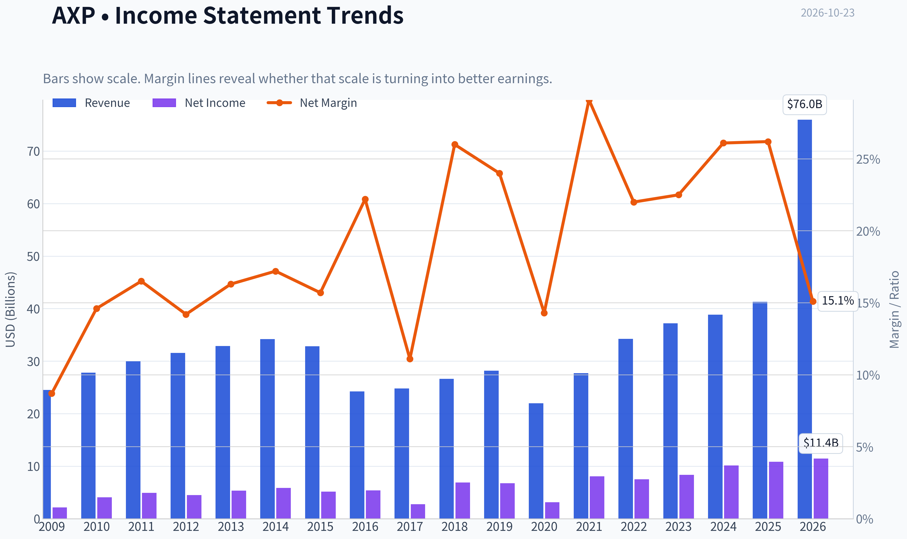

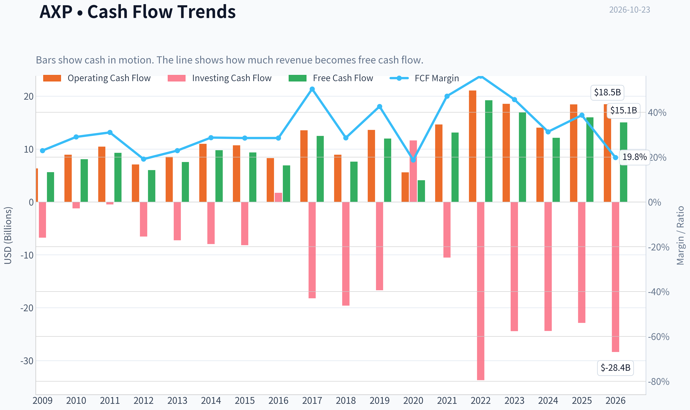

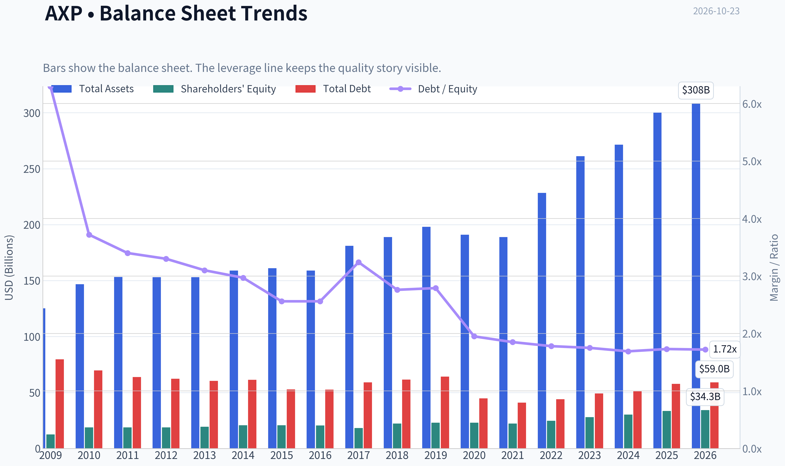

This graph tracks the profitability and return metrics (ROE, ROIC, Margins) of **AXP** over the past decade, highlighting capital efficiency trends.

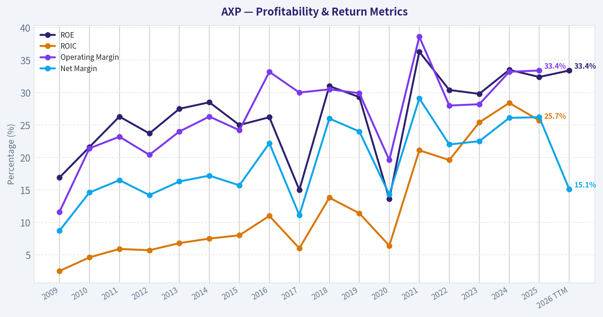

This chart illustrates the financial health of **AXP** over the last 10 years, mapping cash equivalents and free cash flow against total obligations (Debt).

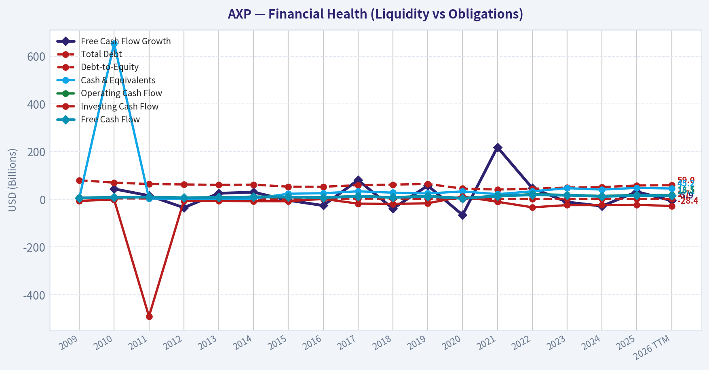

This breakdown chart from <em>Revenue Breakdown</em> shows the proportional composition for **AXP** - useful for understanding what drives or risks the business.

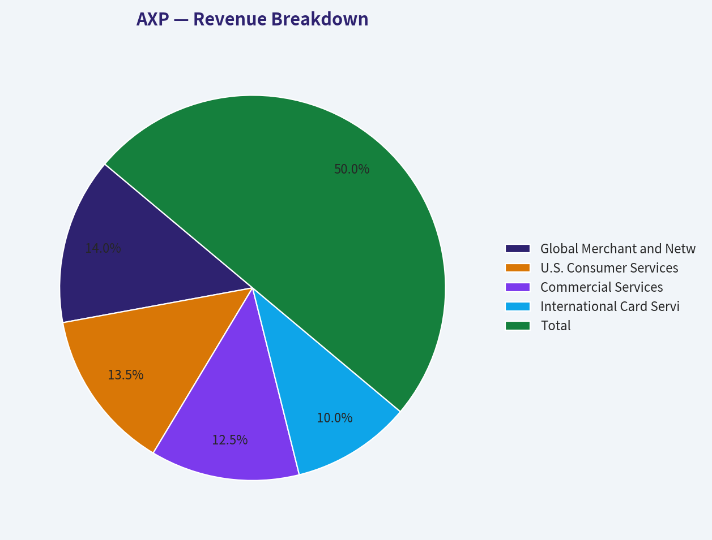

---

### Intrinsic Value Analysis (Buffett)

> *Following Warren Buffett's value investing philosophy: Circle of Competence, Economic Moat, Management Quality, and Margin of Safety.*

#### Intrinsic Value Snapshot

Price is what you pay. Intrinsic value is what the business may be worth based on the cash it can create for owners over time. We show a range, not one magic number.

- Current Price: $325.17
- Value Range (conservative to optimistic across both DCF methods): $75.80 to $1,007.60

##### Owner Earnings (Buffett Method)
- Net Income: $10,833,000,000.00
- Depreciation & Amortization: $1,777,000,000.00
- Capital Expenditures: $-2,425,000,000.00
- Working Capital Changes: $864,000,000.00
- Owner Earnings: $9,969,000,000.00

##### Intrinsic Value
###### Buffett Method
Uses owner earnings. Stricter, and usually more conservative.
- Conservative: $80.20
- Average: $288.38
- Optimistic: $480.80
- Discount Rate: 10.0%

###### Cash Flow Method
Uses free cash flow. Better for companies spending heavily today to grow tomorrow.
- Conservative: $75.80
- Average: $333.63
- Optimistic: $1,007.60
- Discount Rate: 10.0%

ANALYST STANCE: **ADVOCATE**

#### Executive Summary

American Express is a high-quality financial franchise with a globally recognized brand, affluent customers, powerful rewards economics, and a valuable closed-loop payments network. At approximately **$325 per share and 19.7 times earnings**, the stock is not deeply discounted, but the valuation is reasonable for a business producing a **32.4% ROE**, growing revenue by **6.4%**, and earning a **7.3% free-cash-flow yield**.

The principal risks are credit losses, consumer weakness, regulatory pressure, and the possibility that payment networks or rewards programs become more competitive. These risks are real, but the business has sufficient profitability, scale, and balance-sheet resilience that the Gate 5 distress floor is **not tripped**.

#### Factor Scorecard

| Factor | Score | Assessment |
|---|---:|---|
| Circle of Competence & Simplicity | 4/5 | AXP earns fees, interest income, and transaction revenue from cardmembers and merchants. The model is understandable, although credit-cycle dynamics add complexity. |
| Durable Competitive Advantage | 5/5 | Exceptional brand, closed-loop data, affluent customer base, Membership Rewards ecosystem, merchant acceptance, and customer spending network. |
| Management & Capital Allocation | 4/5 | Strong long-term operating record, disciplined growth, substantial shareholder distributions, and Warren Buffett's continued ownership support the assessment. |
| Industry Structure | 4/5 | Payments is concentrated among several large networks, while AXP differentiates through its integrated issuer-network model. Credit risk prevents a perfect score. |
| Gate 5: Quality/Solvency | **Not tripped** | No evidence of simultaneous deteriorating fundamentals and financial distress. Traditional interest-coverage tests are not meaningful for a financial issuer. |

**Key Takeaways:** AXP scores particularly well on moat quality and business durability. Its main weakness is not franchise quality but exposure to credit cycles and consumer spending. The financial distress hard floor is not triggered.

#### Moat Analysis

| Moat Source | Evidence | Strength |
|---|---|---:|
| Brand and intangible assets | American Express is associated with premium service, travel, rewards, and affluent customers. | 5/5 |
| Switching costs | Cardmembers accumulate Membership Rewards points and rely on integrated travel, merchant, and financial services. | 4/5 |
| Network effects | More cardmembers attract more merchants; more merchants make the card more valuable to cardmembers. | 5/5 |
| Cost and data advantages | The closed-loop network gives AXP direct transaction data and allows targeted underwriting, marketing, and rewards management. | 4/5 |
| Customer quality | AXP's customer base has historically skewed toward higher-spending and higher-income users, supporting attractive economics. | 4/5 |

American Express's strongest advantage is the combination of **brand, data, rewards, and network effects**. Visa and Mastercard primarily operate payment networks, while banks compete for card customers. AXP combines both roles and controls more of the customer relationship.

The moat is wide and likely stable, but it is not invulnerable. Rewards inflation, private-label competition, digital wallets, regulatory limits on fees, and deteriorating consumer credit could reduce economics over time.

#### Management Quality Assessment

Management appears owner-oriented and focused on long-term growth in cardmembers, spending volume, revenue, and earnings per share. Capital allocation has generally emphasized:

- Reinvestment in the brand, rewards platform, technology, and customer acquisition.
- Share repurchases and dividends when capital is not required for growth or regulatory purposes.
- Maintaining a strong position in premium consumer and small-business payments.
- Expanding travel and partner relationships, including the Airbnb integration mentioned in recent coverage.

Warren Buffett's Berkshire Hathaway has maintained approximately **151.6 million shares**, representing a reported position of roughly **$51.3 billion** as of June 30, 2026. Buffett's long-term ownership is not proof of future returns, but it is consistent with the view that AXP possesses an unusually durable consumer and payments franchise.

Management receives **4 out of 5**. A perfect score would require more direct evidence that every acquisition and repurchase decision was made below intrinsic value.

#### Financial Summary

| Metric | Latest Reported Snapshot |
|---|---:|
| Share price | $325 |
| Market capitalization | $219.6 billion |
| P/E ratio | 19.7x |
| ROE | 32.4% |
| Revenue growth | 6.4% year over year |
| FCF yield | 7.3% |
| Implied earnings per share | Approximately $16.47 |
| Gross margin | Not meaningful for a financial issuer |
| Current ratio | Not meaningful for a financial issuer |
| Intrinsic value headline | Not meaningful under standard industrial-company methodology |

**Key Takeaways:** AXP combines a high 32.4% ROE with mid-single-digit revenue growth and a valuation below 20 times earnings. Gross margin, current ratio, and conventional free cash flow should not be interpreted the same way as they would be for an industrial or software company.

#### Owner Earnings Calculation

For a financial institution, conventional maintenance-capital-expenditure calculations are less informative because the core business is funded through deposits, debt, securitization, and regulatory capital rather than factories and equipment. A practical Buffett-style approximation is:

| Owner Earnings Component | Approximation |
|---|---:|
| Earnings per share implied by current P/E | $16.47 |
| Less: maintenance capital expenditure | Not separately meaningful |
| Less: working-capital investment | Not meaningful under industrial-company definitions |
| Approximate normalized owner earnings per share | Approximately $16.47 |

This approximation should be treated as normalized distributable earnings rather than literal industrial free cash flow. The reported **7.3% FCF yield** provides a supportive cross-check, though cash-flow interpretation for a financial institution requires greater care.

#### Three-Scenario Valuation

Because AXP is a financial issuer, an earnings-based DCF is more useful than a standard FCFF model. The following scenarios use approximately **$16.47 of normalized earnings per share** and a 10% discount rate.

| Scenario | Assumptions | Estimated Value |
|---|---|---:|
| A: No growth | Earnings capitalized at 10% | $165 |
| B: GDP-like growth | 3% perpetual growth | $235 |
| C: Moderate historical-style growth | 6% growth for 10 years, then 3% terminal growth | $289 |
| Earnings multiple cross-check | 18x-22x normalized earnings | $296-$362 |

**Key Takeaways:** A mechanical no-growth valuation understates the value of a franchise that can reinvest profitably. The moderate-growth DCF produces a value below the current price, while a quality-adjusted earnings multiple supports a range that includes the current quotation. This indicates a fair valuation rather than a clear bargain.

#### Margin of Safety Analysis

At **$325**, the stock trades:

- Approximately **97% above** the no-growth capitalization value.
- Approximately **38% above** the 3% perpetuity-growth value.
- Approximately **12% above** the moderate-growth DCF estimate.
- Near the middle of the **18x-22x normalized earnings** cross-check range.

The headline DCF is conservative because it assumes a 10% discount rate and does not fully credit AXP's brand, network effects, customer quality, and reinvestment opportunities. For a wide-moat, high-ROE compounder, a 10%-15% margin of safety can be acceptable. At the current price, the margin of safety is modest but reasonable if AXP sustains high returns and mid-single-digit growth.

The stock would become substantially more attractive below approximately **$285-$300**, depending on confidence in normalized earnings and credit conditions.

#### Buffett Scorecard

| Criterion | Weight | Score | Weighted Contribution |
|---|---:|---:|---:|
| Moat Width & Durability | 25% | 5.0 | 1.25 |
| Valuation / Margin of Safety | 20% | 3.2 | 0.64 |
| Capital Returns: ROIC vs. WACC | 15% | 4.5 | 0.68 |
| Business Understanding & Predictability | 12% | 4.0 | 0.48 |
| Management & Capital Allocation | 12% | 4.0 | 0.48 |
| Reinvestment Runway | 8% | 4.0 | 0.32 |
| Balance-Sheet Strength | 4% | 3.5 | 0.14 |
| Industry Structure | 4% | 4.0 | 0.16 |
| **Total** | **100%** |  | **4.15 / 5.00** |

**Key Takeaways:** The overall score is driven by an exceptional moat, high returns on equity, and a credible reinvestment runway. Valuation is the limiting factor: AXP is attractively priced for its quality, but not priced with a large margin of safety.

#### Principal Risks

| Risk | Investment Implication |
|---|---|
| Credit losses | Recession or rising unemployment could increase provisions and reduce earnings. |
| Consumer spending slowdown | Lower travel and discretionary spending would pressure transaction volumes and fee revenue. |
| Rewards competition | More generous competitor rewards could increase customer-acquisition and retention costs. |
| Regulation | Restrictions on interchange, late fees, or credit-card practices could compress economics. |
| Funding and capital requirements | Higher funding costs or stricter capital rules could reduce returns on equity. |
| Digital payment competition | Wallets and alternative payment systems could weaken direct customer engagement over time. |

#### Investment Stance

**ADVOCATE - Moderate conviction.**

American Express is a wonderful business trading at a fair price. Its brand, closed-loop network, affluent customer base, and rewards ecosystem create a durable moat, while its 32.4% ROE indicates strong economics. The current valuation does not offer a large bargain, but it is acceptable for a long-term investor seeking ownership in a high-quality compounder.

The preferred strategy is to **own or accumulate gradually**, with stronger conviction at prices below approximately **$300**. A sustained deterioration in credit quality, sharply rising rewards costs, or evidence that the network moat is weakening would warrant reassessment.
#### Valuation Bridge

This bridge places the current market price beside each intrinsic value lens so readers can see whether upside depends on one method or shows up across several methods.

| Scenario | Intrinsic Value / Share |
| --- | ---: |
| Buffett Method | $288.38 |
| Cash Flow Method | $333.63 |
| Current Price | $325.17 |

#### Key Takeaways

If one method is far above the others, the upside case depends on a specific modelling assumption. When several methods cluster together, the valuation story is more robust.

#### Valuation Visuals

This comparison chart from *Latest Earnings Snapshot* stacks current figures against historical benchmarks for **AXP**, making it easy to see where the company trades relative to its own averages.

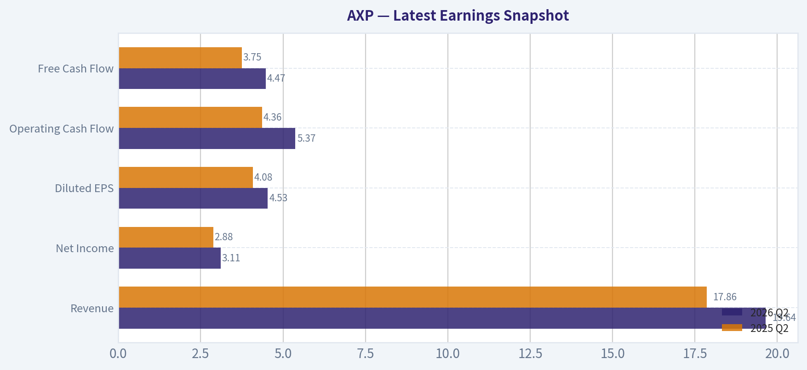

This comparison chart from *Current Metrics and Historical Comparison* stacks current figures against historical benchmarks for **AXP**, making it easy to see where the company trades relative to its own averages.

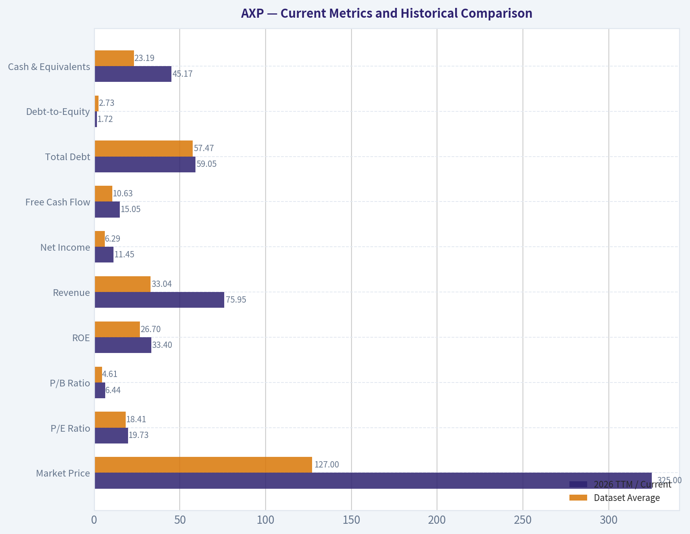

This comparison chart from *Balance Sheet and Financial Strength* stacks current figures against historical benchmarks for **AXP**, making it easy to see where the company trades relative to its own averages.

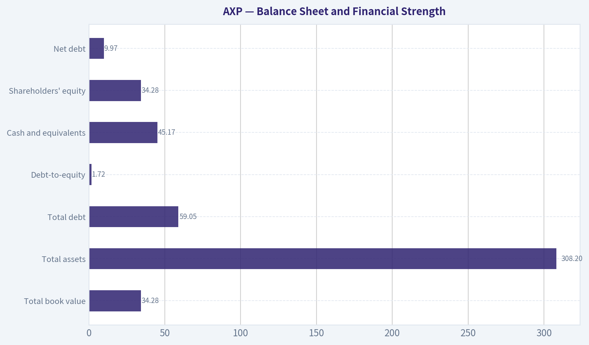

This comparison chart from *Financial Summary* stacks current figures against historical benchmarks for **AXP**, making it easy to see where the company trades relative to its own averages.

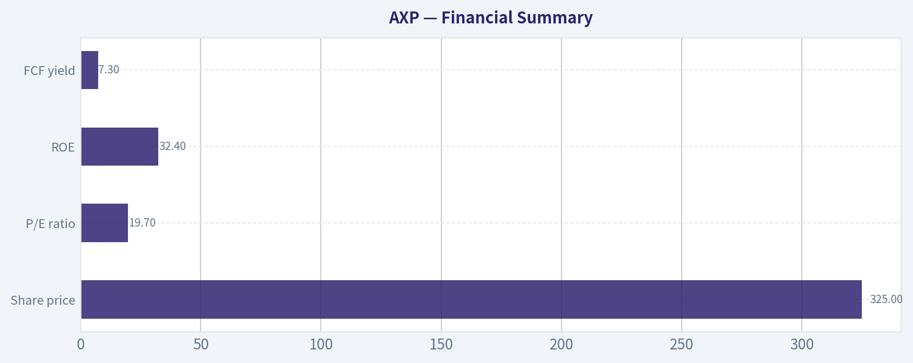

This comparison chart from *Owner Earnings Calculation* stacks current figures against historical benchmarks for **AXP**, making it easy to see where the company trades relative to its own averages.

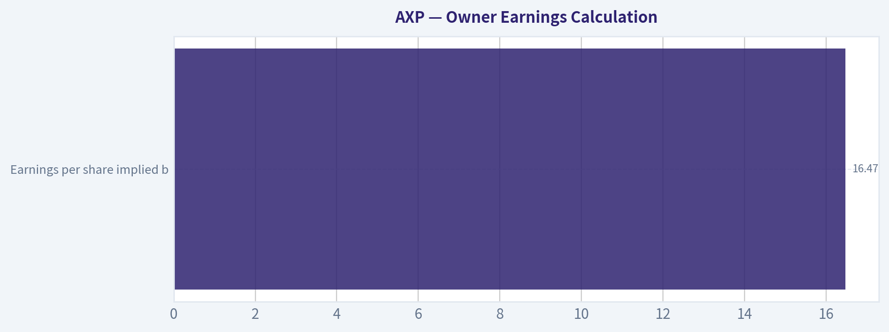

---

### Trend & Growth Analysis (Lynch/Druckenmiller/Fisher)

> *Following Peter Lynch's GARP, Stanley Druckenmiller's macro-aware approach, and Philip Fisher's scuttlebutt methodology.*

ANALYST STANCE: **WATCH**

#### Executive view

American Express is a high-quality financial franchise, but it currently fits Peter Lynch's **stalwart** category more than the **fast-grower** category. Its 32.4% ROE, 7.3% FCF yield, premium customer base, and durable rewards ecosystem are attractive; however, reported revenue growth of 6.4% does not indicate the accelerating growth required for a likely ten-bagger.

At $325 per share and a $219.6 billion market capitalization, AXP may be a reasonable compounder or existing holding, but it is not an obvious high-conviction growth initiation at this stage.

#### 1. Lynch classification

| Category | Assessment |
|---|---|
| Lynch category | Stalwart |
| Revenue growth | 6.4% year over year |
| ROE | 32.4% |
| P/E | 19.7x |
| FCF yield | 7.3% |
| Growth-investing fit | Moderate; stronger as a quality compounder |
| Ten-bagger potential | Low from current scale |

**Key Takeaways:** AXP has excellent profitability and a reasonable valuation for a premier financial brand, but its current growth rate is more consistent with a stalwart than a fast grower. The key question is whether earnings and payment volume can reaccelerate materially above the current revenue trajectory.

#### 2. The story in three bullets

- **Premium spending ecosystem:** American Express targets affluent consumers and businesses, which generally produce higher spending, stronger retention, and better credit economics than mass-market customers.
- **Closed-loop data advantage:** Because AXP issues cards, operates its network, and manages merchant relationships, it can use transaction data to improve underwriting, rewards, marketing, and customer targeting.
- **Long-term payments and travel growth:** Digital payments, business spending, international acceptance, and travel rewards provide durable secular support, with the Airbnb expansion broadening its travel proposition.

The counterpoint is that AXP is already a large, mature company. Its growth must increasingly come from market-share gains, premiumization, international expansion, and higher spending per customer rather than simple category expansion.

#### 3. TAM and 10x test

| TAM factor | Assessment |
|---|---|
| Core markets | Consumer payments, commercial payments, travel, lending, merchant services |
| Secular growth | Positive, supported by digital payments and electronic commerce |
| Current scale | Very large global financial-services franchise |
| 10x revenue test | Not demonstrable with the supplied revenue figure; economically difficult at current scale |
| Runway | Meaningful, but more likely to support 6-12% compounding than 20%+ growth |
| TAM inflection | Possible through commercial payments, international markets, and travel partnerships |

**Key Takeaways:** AXP participates in large and expanding markets, but its scale limits the probability of tenfold growth. The most credible runway is continued premium-card penetration, commercial payments, international acceptance, and higher spending per existing customer.

#### 4. Revenue growth trend

| Metric | Latest indication | Interpretation |
|---|---:|---|
| Revenue growth, year over year | 6.4% | Stalwart-level growth |
| Direction | Not enough sequential history supplied | No confirmed acceleration |
| Growth quality | Likely supported by spending, fees, lending, and interest income | Needs segment disclosure to separate organic volume from pricing and credit effects |
| Inflection evidence | Airbnb travel partnership and expanded rewards ecosystem | Strategic catalyst, not yet a demonstrated financial inflection |

**Key Takeaways:** The available 6.4% growth rate is respectable but below the threshold for a fast-growth thesis. AXP needs several quarters of accelerating billed business, fee revenue, earnings, and new-account growth before the market should view it as an inflection story.

#### 5. Unit economics and operating efficiency

| Metric | Assessment |
|---|---|
| LTV/CAC | Not disclosed in the supplied data |
| Net revenue retention | Not applicable in the standard SaaS sense |
| Rule of 40 | Not applicable |
| ROE | 32.4%, excellent |
| FCF yield | 7.3%, attractive for a mature financial company |
| Credit economics | Must monitor charge-offs, reserves, delinquencies, and loan growth |

**Key Takeaways:** Traditional SaaS metrics do not apply to AXP. The most important substitutes are customer acquisition payback, spend per card, card-member retention, rewards economics, credit losses, and return on equity. A 32.4% ROE indicates strong franchise economics, but credit deterioration could quickly offset operating gains.

#### 6. Inflection-point assessment

| Potential inflection | Current evidence | Rating |
|---|---|---|
| Product cycle | Expanded travel ecosystem and Airbnb integration | Positive, early |
| Market share | No supplied data confirming acceleration | Unproven |
| Margin inflection | No recent margin trend supplied | Unproven |
| TAM expansion | Commercial payments, international acceptance, broader travel inventory | Positive |
| Competitive inflection | No evidence of a major competitor breakdown | Neutral |
| Earnings inflection | Q3 earnings were scheduled for October 23, 2026; results not supplied | Pending |

**Key Takeaways:** AXP has strategic catalysts, but not yet a confirmed Druckenmiller-style earnings inflection. The upcoming earnings release is important: accelerating billings, new accounts, fee growth, and stable credit losses would strengthen the thesis; slowing spend or rising delinquencies would weaken it.

#### 7. Macro setup

| Macro factor | AXP implication |
|---|---|
| Consumer spending | Positive if affluent and business spending remain resilient |
| Employment | Important for credit performance and revolving balances |
| Interest rates | Mixed: higher rates support net interest income but can pressure borrowers and valuation |
| Recession risk | Negative through lower spending and higher credit losses |
| Travel cycle | Positive for premium-card engagement and rewards utilization |
| Secular trend | Favorable: digital payments and commercial-card adoption |

**Key Takeaways:** The macro backdrop is mixed rather than clearly supportive. AXP benefits from resilient affluent consumers and travel, but it remains exposed to credit-cycle deterioration and weaker business spending. Macro confirmation would require stable employment, controlled delinquencies, and sustained payment volume.

#### 8. Fisher 15-point assessment

| Fisher criterion | Score / 5 | Comment |
|---|---:|---|
| Market potential | 4 | Large payments and commercial markets |
| New-product determination | 4 | Rewards, travel, and partnership innovation |
| R&D and technology | 4 | Strong data, payments, and digital capabilities |
| Sales organization | 5 | Powerful premium customer acquisition engine |
| Profit margins | 4 | Strong financial economics |
| Margin improvement | 3 | Not enough current trend data |
| Labor relations | 3 | Limited data |
| Executive relations | 4 | No major issue supplied |
| Management depth | 4 | Established global institution |
| Cost analysis | 4 | Mature financial controls, subject to credit-cycle risk |
| Outstanding advantages | 5 | Brand, data, closed-loop network, rewards ecosystem |
| Long-range outlook | 4 | Favorable but mature |
| Dilution | 4 | No material dilution concern supplied |
| Candor | 3 | Requires direct review of filings and earnings calls |
| Integrity | 4 | No issue supplied |

**Fisher Score: 59 / 75**

**Key Takeaways:** AXP scores as a good, durable business rather than an exceptional high-growth opportunity. Its strongest attributes are brand, customer quality, distribution, data, and network economics; the main deductions reflect maturity and incomplete evidence on current margin, credit, and management trends.

#### 9. Valuation analysis

| Valuation measure | Result | Interpretation |
|---|---:|---|
| P/E | 19.7x | Reasonable for a high-quality financial franchise |
| FCF yield | 7.3% | Attractive if cash generation is sustainable |
| PEG | Not calculable from supplied data | Requires forward EPS growth |
| Revenue multiple | Not useful as a primary metric | Financial issuers are better assessed by earnings, book value, ROE, and credit quality |
| Bear case | 15-17x normalized earnings | Appropriate if growth slows or credit losses rise |
| Base case | 19-22x earnings | Supports moderate long-term compounding |
| Bull case | 23-25x earnings | Requires sustained double-digit earnings growth and stable credit |

**Key Takeaways:** AXP does not appear obviously expensive on a 19.7x P/E and 7.3% FCF yield, assuming earnings quality remains strong. However, valuation is fair rather than deeply discounted, and the bull case depends on earnings growth accelerating beyond the current 6.4% revenue growth rate.

#### 10. Growth investor scorecard

| Criterion | Weight | Score / 5 | Weighted contribution |
|---|---:|---:|---:|
| Lynch story | 10% | 4.0 | 0.40 |
| TAM and runway | 20% | 3.2 | 0.64 |
| Revenue growth | 20% | 2.8 | 0.56 |
| Unit economics | 15% | 4.0 | 0.60 |
| Competitive position | 10% | 4.6 | 0.46 |
| Management quality | 10% | 4.0 | 0.40 |
| Macro setup | 5% | 3.0 | 0.15 |
| Profitability path | 5% | 4.5 | 0.23 |
| Valuation | 5% | 3.7 | 0.19 |
| **Total** | **100%** |  | **3.63 / 5** |

**Key Takeaways:** The 3.63 score places AXP in the "good setup" range, but not at high-conviction advocate status for a growth portfolio. Its quality, profitability, and competitive position offset its moderate growth rate and mature scale.

#### 11. Position-size stance

| Investor type | Suggested stance |
|---|---|
| Existing shareholder | Hold or maintain a normal-quality compounder position |
| Growth investor seeking 20%+ growth | Wait for evidence of acceleration |
| Income or quality investor | Potentially attractive at the current valuation |
| New position | Small starter position only, pending earnings confirmation |
| High-conviction ten-bagger portfolio | Do not make AXP a core position |

**Key Takeaways:** AXP is better suited to a diversified quality or compounder allocation than to a concentrated ten-bagger strategy. A small position could be justified for investors who value franchise quality, but a larger position should wait for stronger growth evidence or a more compelling valuation.

#### 12. Key catalysts and risks

| Catalysts | Risks |
|---|---|
| Accelerating billed business and card spending | Consumer or business-spending slowdown |
| Strong new-account acquisition | Rising delinquencies and charge-offs |
| Commercial-payment market-share gains | Rewards costs reducing economics |
| International acceptance and expansion | Competitive pressure from Visa, Mastercard, banks, and fintechs |
| Airbnb and travel ecosystem monetization | Recession or weaker travel demand |
| Falling interest rates supporting valuation and credit | Higher rates increasing borrower stress |
| Earnings acceleration above revenue growth | Mature scale limiting long-term growth |

**Key Takeaways:** The decisive catalyst is not merely another partnership; it is measurable acceleration in payment volume, fee revenue, earnings, and customer acquisition. The most important risk is a combination of slowing spending and rising credit losses, which could expose AXP's sensitivity to the economic cycle.

#### Bottom line

AXP is a **high-quality stalwart with attractive franchise economics**, not currently a classic fast grower. At approximately 20x earnings, the valuation is reasonable, but the investment case requires either sustained double-digit earnings growth or a more significant discount. I would **WATCH**, hold an existing position, and upgrade the stance only if upcoming results show clear acceleration in spending, accounts, earnings, and credit performance.

---

### Market Technical Analysis

ANALYST STANCE: **WATCH**

#### AXP technical overview

The latest available AXP session is **October 22, 2026**, because October 23 is not a trading day in the retrieved dataset. AXP closed at **$325.17**, up from $301.16 on October 1, representing an approximately **8% rebound** over the month. However, the broader trend remains unresolved: the stock is still below its declining 200-day SMA, while its 50-day SMA is also trending lower.

The rebound has materially improved short-term momentum, but the move is becoming technically extended. AXP closed above its upper Bollinger Band and is approaching the 200-day moving average, creating a meaningful decision zone rather than a low-risk entry point.

#### Trend structure: short-term recovery versus longer-term pressure

AXP's moving-average configuration shows a transitional market:

- **10 EMA: $316.15** - price is approximately $9 above it, confirming strong recent upside momentum.
- **50 SMA: $319.01** - price is also above this level, indicating that the October recovery has exceeded the medium-term average.
- **200 SMA: $325.82** - price remains just below this long-term benchmark by roughly $0.65.

The 10 EMA has turned sharply upward from approximately $305.64 on October 9 to $316.15 on October 22. This reflects a genuine acceleration in recent buying pressure. The 50-day SMA, however, has declined from approximately $333.07 on September 23 to $319.01, and the 200-day SMA has fallen from approximately $332.49 to $325.82. Thus, the short-term trend is improving faster than the intermediate- and long-term trends.

This creates two possible interpretations. A sustained close above approximately **$326-$328**, particularly if supported by volume, would suggest that the October rebound is developing into a larger trend reversal. Conversely, rejection near the 200-day SMA would preserve the broader bearish-to-neutral structure and could send the stock back toward the 50-day SMA around $319, followed by the 10 EMA near $316.

#### Momentum: strong improvement, but nearing an overbought zone

MACD has undergone a substantial recovery. It improved from **-7.54 on October 2** to **+1.17 on October 22**, moving through zero as price advanced. This is a constructive momentum shift and indicates that the October rally is not merely a one- or two-day bounce.

The most recent MACD progression-approximately **-1.53 on October 19, -0.77 on October 20, +0.25 on October 21, and +1.17 on October 22**-shows accelerating upside momentum. Nevertheless, the MACD has risen very quickly, so the signal is strongest as confirmation of a recovery already underway rather than as justification for chasing the current price.

RSI reached **65.8**, up from **31.7 on October 1**. This confirms the magnitude of the momentum improvement. RSI is not yet above the conventional 70 overbought threshold, so upside momentum still has room to continue. However, it is now close enough to that threshold that a breakout above the 200-day SMA could initially be followed by consolidation or a pullback.

The combination of positive MACD and RSI near 66 is bullish for trend-following traders, but less attractive for a new entry after the recent run. A pullback that holds around $319-$316 while RSI remains above 50 would offer healthier confirmation than an immediate extension higher.

#### Volatility and Bollinger Bands

ATR declined from approximately **6.35 in late September to 5.86** on October 22. At the latest closing price, this represents daily volatility of roughly **1.8%**. Volatility has therefore eased modestly from the September selloff, although the stock still moves enough for position sizing and stop placement to matter.

The upper Bollinger Band was approximately **$323.58** on October 22, while AXP closed at $325.17. A close above the upper band can signal a bullish expansion in momentum, especially when accompanied by rising MACD and improving volume. It can also indicate short-term overextension. Because price is simultaneously pressing against the 200-day SMA, the current setup should be treated as a breakout test rather than a confirmed breakout.

A close back below the upper band, followed by a loss of $319, would weaken the immediate bullish case. Holding above $323-$326 and establishing the 200-day SMA as support would be considerably more constructive.

#### Volume confirmation

The 20-day VWMA was approximately **$311.15**, substantially below the latest close. This is a positive sign: price is trading well above the volume-weighted average of recent transactions, implying that buyers have regained control over the recent trading range.

The VWMA rose from approximately $304.01 on October 9 to $311.15 on October 22. This upward turn supports the recovery thesis. However, volume has been uneven. October 8 recorded approximately 5.31 million shares, and October 20 recorded approximately 3.95 million, compared with roughly 3.39 million on October 22. For a convincing long-term breakout, traders would ideally see a decisive close above $326-$328 with volume clearly exceeding the recent average.

#### Key levels and trading interpretation

The primary resistance zone is **$325.80-$328**, consisting of the 200-day SMA and the nearby area where the stock would need to establish a new long-term bullish posture. Above that, the next potential resistance area is around **$330-$335**, where prior September trading occurred.

Initial support lies around **$319**, near the 50-day SMA. Secondary support is around **$316**, near the 10 EMA, followed by the **$311-$312** area near the VWMA and recent October consolidation. A break below $311 would substantially weaken the current recovery and raise the risk of a retest toward the low-$300s.

For bullish traders, the cleaner setup is either a confirmed breakout above $326-$328 with strong volume or a controlled pullback that holds $319-$316. For risk management, the ATR suggests that stops placed too tightly around the current price may be vulnerable to ordinary daily fluctuations; approximately one ATR is near $5.86.

| Indicator | Latest reading | Direction or condition | Interpretation |
|---|---:|---|---|
| Latest close | $325.17 | Strong October rebound | Price is up about 8% from October 1 but is testing major resistance |
| 10 EMA | $316.15 | Rising sharply | Short-term momentum is bullish |
| 50 SMA | $319.01 | Declining | Medium-term trend remains damaged despite the rebound |
| 200 SMA | $325.82 | Declining; price slightly below | Long-term trend is not yet confirmed bullish |
| MACD | +1.17 | Strongly improving and above zero | Momentum has shifted decisively upward |
| RSI | 65.8 | Bullish, near overbought | Upside momentum remains strong, but chasing carries increasing risk |
| ATR | $5.86 | Moderately elevated | Position sizing and wider volatility-aware stops are appropriate |
| VWMA | $311.15 | Rising and well below price | Recent buying pressure supports the recovery |
| Upper Bollinger Band | $323.58 | Price closed above it | Breakout-like momentum, but also short-term extension |
| Key levels | $326-$328 resistance; $319-$316 support | Decision zone | Confirmation above resistance or a supported pullback would improve risk-reward |

Key Takeaways: AXP has developed a credible short-term recovery, with positive MACD, rising VWMA, and price above both the 10-day EMA and 50-day SMA. However, the stock is testing the declining 200-day SMA while trading above its upper Bollinger Band, so the move is extended and not yet a confirmed long-term reversal. The most important signal is whether AXP can hold above approximately $326-$328 on strong volume; otherwise, a pullback toward $319-$316 would be normal and potentially healthier than immediate continuation.

---

### Options Market Analysis

> *Reading options flow - put/call ratios, IV skew, and unusual activity - to gauge institutional positioning and event-driven risk.*

ANALYST STANCE: **WATCH**

#### AXP Options Market Overview

The available near-term AXP options data is materially incomplete: open interest is reported as zero across all listed expirations, while trading volume is present. That makes conventional put/call OI analysis, open-interest concentration, and volume-to-OI unusual-activity analysis unreliable. The report therefore carries low confidence.

| Expiration | Call Volume | Put Volume | Call OI | Put OI | Put/Call Volume Ratio | ATM Call IV | ATM Put IV |
|---|---:|---:|---:|---:|---:|---:|---:|
| Oct. 23, 2026 | 5,655 | 6,579 | 0 | 0 | 1.16 | 5.5% | 6.9% |
| Oct. 30, 2026 | 1,040 | 714 | 0 | 0 | 0.69 | 1.6% | 2.7% |
| Nov. 6, 2026 | 241 | 524 | 0 | 0 | 2.17 | 1.6% | 1.8% |
| **Near-term total** | **6,936** | **7,817** | **0** | **0** | **1.13** | - | - |

**Key Takeaways:** Near-term put volume exceeds call volume, with an aggregate put/call volume ratio of 1.13, modestly above the approximately 0.7 neutral reference. This suggests somewhat greater demand for downside protection or bearish exposure, but the signal is weakened substantially because the data reports zero open interest.

#### Put/Call Ratio Analysis

The reported near-term put/call OI ratio is unavailable because both put and call OI are shown as zero. The volume ratio is 1.13, indicating 13% more put volume than call volume.

| Measure | Result | Interpretation |
|---|---:|---|
| Put/call OI ratio | N/A | Cannot be calculated from zero OI |
| Put/call volume ratio | 1.13 | Mildly put-heavy |
| Historical neutral reference | ~0.70 | Current volume is above neutral |
| Largest put-heavy expiry | Nov. 6 | Put/call volume ratio of 2.17 |
| Largest call-heavy expiry | Oct. 30 | Put/call volume ratio of 0.69 |

**Key Takeaways:** The aggregate volume profile leans mildly defensive rather than strongly bearish. The Nov. 6 expiry is the most put-heavy, while Oct. 30 shows modest call dominance, so the directional message is not uniform across maturities.

#### Implied Volatility Assessment

The supplied ATM IV figures are unusually low for listed equity options, particularly the 1.6% readings for the Oct. 30 and Nov. 6 expirations. This may reflect a data, quote, or annualization issue rather than genuinely minimal expected movement.

| Expiration | ATM Call IV | ATM Put IV | Put Minus Call IV | Skew Read |
|---|---:|---:|---:|---|
| Oct. 23, 2026 | 5.5% | 6.9% | +1.4 percentage points | Put skew |
| Oct. 30, 2026 | 1.6% | 2.7% | +1.1 percentage points | Put skew |
| Nov. 6, 2026 | 1.6% | 1.8% | +0.2 percentage points | Slight put skew |

**Key Takeaways:** Put IV is higher than call IV in every reported expiration, indicating a consistent downside-protection premium. However, the absolute IV levels appear suspect and should not be treated as reliable without validating the source, quote quality, and volatility units. No specific earnings, product, or macro catalyst was provided, so catalyst-related IV elevation cannot be confirmed.

#### Unusual Options Activity

The data provider defines unusual activity as contracts with volume greater than five times open interest. No contracts met that criterion. More importantly, all reported open interest is zero, preventing a meaningful distinction between fresh institutional positions and existing positions being closed.

| Finding | Result | Implication |
|---|---|---|
| Contracts with volume greater than 5x OI | None reported | No flagged unusual activity |
| Fresh-position assessment | Not possible | OI data is unavailable or defective |
| Smart-money identification | Not possible | No trade direction, size, or reliable OI context |
| ITM/ATM/OTM classification | Not possible | Current AXP price and contract strikes were not supplied |
| Days to expiration | Same-day, 7 days, 14 days | Based on listed expirations relative to Oct. 23, 2026 |

**Key Takeaways:** There is no validated unusual-options signal in the supplied data. The absence of flagged contracts should not be interpreted as a lack of institutional activity because zero open interest makes the screening process unreliable.

#### Open Interest Concentration and Gamma Levels

No open-interest concentration can be identified because every reported expiration has zero call and put OI. Consequently, there are no reliable max-pain levels, strike-based gravitational zones, or gamma walls available from this dataset.

| Expiration | Highest Call OI Strike | Highest Put OI Strike | Gamma-Wall Assessment |
|---|---|---|---|
| Oct. 23, 2026 | Not available | Not available | Cannot assess |
| Oct. 30, 2026 | Not available | Not available | Cannot assess |
| Nov. 6, 2026 | Not available | Not available | Cannot assess |

**Key Takeaways:** The data provides no usable evidence about dealer hedging, pinning, or price resistance around specific strikes. A separate chain with strike-level open interest and current underlying price would be required to make this assessment.

#### Overall Options Sentiment

The directional read is **NEUTRAL**, with a mild defensive bias and low confidence.

The main bearish-leaning inputs are the aggregate 1.13 put/call volume ratio and higher put IV across all three near-term expirations. Against that, Oct. 30 call volume exceeds put volume, no unusual contracts were identified, and the zero-OI readings make it impossible to verify whether the observed volume represents opening bearish trades, hedges, or closing transactions.

The low reported IV levels also reduce confidence in the data. Before using this as a trading signal, confirm AXP's live underlying price, strike-level open interest, bid/ask spreads, and whether the IV figures are correctly annualized. No catalyst-related IV premium can be established from the supplied information.

#### Summary

| Category | Assessment |
|---|---|
| Put/Call Ratio | OI ratio unavailable; volume ratio 1.13, mildly put-heavy versus ~0.7 neutral |
| IV Level | Reported IV is extremely low and potentially unreliable |
| Skew Direction | Put skew across all near-term expirations |
| Unusual Activity | None flagged; OI data prevents reliable fresh-position analysis |
| Overall Signal | **NEUTRAL**, with mild defensive bias and low confidence |

**Key Takeaways:** AXP options flow leans slightly defensive because put volume and put IV are higher overall. The signal is not strong enough for a bearish conclusion because open interest is reported as zero, IV levels appear anomalous, and no unusual opening trades or gamma concentrations can be verified.

---

## Research Team Commentary

> *The Research Manager synthesizes the Bull vs Bear debate into action-free commentary. This is a pre-risk view, not the final stance.*

American Express is clearly a high-quality franchise, but at $325 the valuation does not provide enough independently verifiable margin of safety to justify immediate advocacy. The right conclusion is to respect the business, retain it on the short list, and wait either for a better price or for stronger evidence that normalized owner earnings can compound near the upper end of expectations.

The strongest bull argument is the quality of the franchise. American Express combines a premium global brand, direct customer relationships, merchant relationships, lending capabilities, and closed-loop transaction data. Its affluent consumer and small-business customers generally spend more, remain engaged longer, and produce better credit outcomes than a mass-market portfolio. Digital payments, premium travel, international acceptance, and business-payment digitization should support the company over the next decade. The reported 32.4% ROE, 3.6% ROA, and 6.4% revenue growth reinforce that this is not an average lender. AXP deserves a premium multiple relative to a commodity bank.

The bull valuation is also plausible rather than promotional. Using roughly $14 of distributable earnings per share, a 9% discount rate, and reasonable long-term growth produces values around $350-$355 in the base case and approximately $380 in a stronger case. Under those assumptions, the current price implies roughly 7% owner-earnings growth. AXP could beat that through mid-single-digit revenue growth, some operating leverage, and disciplined share reduction. Investors should not reject such a franchise merely because it trades near 20 times earnings.

The bear's most compelling point, however, is that this apparent margin of safety is smaller than the uncertainty in the valuation. The base-case upside from $325 is only about 8%, below the roughly 10%-15% discount I would normally seek even for a wide-moat compounder. Moving the required return from 9% to 10%, reducing terminal growth from 3% to 2.5%, or assuming that more capital must be retained materially reduces estimated value. Under the bear's reasonable sensitivity, even 8% growth produces a value near $286. Neither discount rate is objectively "correct," which is precisely why an 8% modeled discount is not enough to settle the question.

The 85% distributability assumption is the key unresolved issue. AXP must retain capital to support receivables, absorb losses, meet regulatory requirements, and protect funding access during stress. The available information does not include capital ratios, delinquency and charge-off trends, reserve coverage, funding composition, receivables growth, or a long-term record of distributions through the credit cycle. Without those data, it is difficult to determine whether current earnings are normalized or how much of them can safely reach shareholders.

Competition also deserves a balanced interpretation. The moat is real, but customer switching costs are not absolute because affluent consumers commonly carry several cards. AXP can retain an account while losing incremental spending or paying more through rewards and retention benefits. Large banks can subsidize premium-card offerings through broader relationships, while Visa and Mastercard retain acceptance advantages and avoid much of AXP's direct credit exposure. These pressures need not destroy the franchise; modest rewards inflation or merchant-pricing pressure would be enough to lower returns and weaken the valuation case.

Credit risk is similarly manageable but material. Affluent customers improve the odds, yet AXP still faces simultaneous pressure on spending volumes, travel activity, small-business credit, provisions, funding costs, and capital returns during a downturn. Buybacks may disappear precisely when cyclicality lowers earnings. Repurchases should therefore be viewed as a use of distributable capital, not as a free or independent growth engine, and they create value only when shares are bought below a conservative estimate of intrinsic value.

My core takeaway is that AXP is a wonderful business at approximately a fair price, not yet a wonderful business at a sufficiently attractive price. A reasonable valuation range is broad-roughly the high $200s to the mid-$300s under defensible assumptions. At $325, the stock sits toward the favorable-execution side of that range. This is not clear overvaluation and certainly not financial distress, so AVOID would be too harsh. But the current price also does not offer the clean 10%-15% quality-scaled discount that would support ADVOCATE with confidence.

Current market signals do not change that conclusion. Trading around its moving averages suggests no obvious panic-driven dislocation, while the options data is too incomplete to interpret. A long-term value decision should not be manufactured from either momentum or unreliable derivatives information.

Over the next one to four quarters, I would monitor billed-business and revenue growth, especially whether growth remains broad across premium consumers, small businesses, and international markets. I would compare card-fee and spending growth with rewards, marketing, and customer-acquisition costs to determine whether growth is becoming more expensive. Retention, spending per account, and younger-customer cohort economics would help establish whether reinvestment is generating durable lifetime value.

Credit and capital metrics are equally important: delinquencies, net charge-offs, reserve coverage, loan growth, regulatory capital ratios, deposit growth, wholesale funding dependence, and funding costs. Stable credit performance combined with resilient capital generation would support the bull's distributability assumption. Rising losses, weakening reserve coverage, or substantially higher capital retention would support the bear case.

I would also watch share count and repurchase prices. Repurchases below a conservative intrinsic value would strengthen per-share compounding; aggressive purchases around or above fair value would weaken the capital-allocation case. Finally, I would look for evidence that merchant acceptance continues improving without disproportionate concessions and that rewards expense does not structurally outgrow revenue.

The lesson from prior mistakes is to avoid both extremes: do not dismiss a superior franchise because its multiple is not statistically cheap, but do not lower the required return merely to make a favored company appear undervalued. Here, business quality merits patience rather than rejection, while valuation sensitivity argues against chasing the shares. A price around $290-$300, assuming stable fundamentals, would offer a more credible quality-scaled margin of safety; stronger evidence of sustainable distributable growth could also justify reconsideration at a higher price.

WATCH

---

## Value Investing Team Commentary

> *The Investor translates the research view into an investment thesis before risk review. This is still not the final stance.*

### Business quality

American Express is a high-quality financial franchise rather than an ordinary card lender. Its premium brand, affluent customer base, merchant relationships, lending operation, and closed-loop transaction data reinforce one another. That ecosystem supports attractive customer retention, underwriting, targeted rewards, and merchant marketing.

The reported 32.4% ROE and 24.9% ROIC indicate strong economics, while 6.4% revenue growth remains respectable. However, conventional ROIC is less informative for a regulated financial institution, and ROE can be amplified by leverage and repurchases. AXP's 3.6% ROA, credit performance, capital adequacy, and funding durability are more important tests of underlying quality.

Its principal growth avenues remain credible:

- Expansion of premium consumer and small-business spending
- International merchant acceptance
- Travel and rewards engagement
- Digital-payment penetration
- Acquisition and maturation of younger customer cohorts
- Disciplined share reduction

The Airbnb relationship may improve the travel proposition, but it is incremental-not a reason to revise the company's intrinsic value materially.

### Moat and competitive risks

AXP possesses a genuine moat, but not an invulnerable one. Affluent customers often carry several cards, so account retention does not necessarily mean retention of incremental spending. JPMorgan, Capital One, and other large issuers can use rewards, lounges, and broader banking relationships to compete aggressively.

Meanwhile, Visa and Mastercard enjoy wider acceptance and generally avoid direct consumer-credit exposure. AXP's integrated model provides superior data and economics in good conditions, but it also creates exposure to provisions, funding costs, and regulatory capital requirements. It should not receive the valuation of a pure payment network without adjusting for those risks.

The critical question is whether rewards, marketing, and retention expenses are rising more slowly than the lifetime value of new card members. Revenue growth obtained through increasingly expensive incentives would be less valuable than the headline growth rate suggests.

### Valuation and reverse-DCF perspective

At $325 and 19.73 times earnings, reported EPS is approximately $16.50. Applying the plan's 85% distributability assumption produces roughly $14 of owner earnings per share, or a 4.3% owner-earnings yield.

The market appears to require approximately 7% long-term owner-earnings growth. That is plausible given mid-single-digit revenue growth, modest operating leverage, and repurchases. It is not obviously euphoric. If AXP sustains that growth without materially increasing retained capital, long-term shareholder returns could be satisfactory.

Nevertheless, plausibility is not the same as a margin of safety. A base intrinsic value of $350-$355 provides only about 8%-9% upside from $325. That falls slightly short of the 10%-15% discount normally appropriate even for a wide-moat company. More importantly, the valuation is sensitive to assumptions about:

- Required returns and terminal growth
- Credit normalization
- Funding costs
- Regulatory capital retention
- Rewards and acquisition expenses
- The percentage of earnings genuinely distributable to shareholders

A modest change in these inputs can move fair value from the mid-$300s into the high $200s. The current quotation therefore represents roughly fair value under favorable but reasonable execution, rather than a compelling bargain.

### Selective contrarian interpretation

The useful contrarian insight is not that AXP is secretly distressed. Its premium customers and differentiated model should make the company more resilient than generic consumer-credit headlines imply. If recession fears eventually push the shares toward $290-$300 while delinquencies, capital, and customer engagement remain healthy, that could become an attractive opportunity.

The opposite contrarian point is equally important: investors may be treating AXP too much like an asset-light payment network. Its closed-loop model is valuable precisely because AXP undertakes more functions, but those functions require funding and capital and introduce credit cyclicality. The market could therefore be underestimating how much reported earnings must be retained through a full cycle.

Trading near the moving averages does not indicate a sentiment-driven dislocation, and the incomplete options information adds no reliable signal. There is neither obvious panic to exploit nor sufficient evidence of speculative excess to justify avoidance.

### What would change the conclusion

I would become more constructive at approximately $290-$300, assuming the business fundamentals remain intact. Advocacy at a higher price could also be justified if subsequent disclosures establish that:

- Billed-business growth remains broad and durable
- Rewards and marketing costs grow slower than associated revenue
- Younger cohorts generate attractive lifetime economics
- Delinquencies and charge-offs remain controlled
- Reserve coverage and regulatory capital stay robust
- Deposit funding remains stable and wholesale funding dependence is manageable
- A high proportion of earnings can be distributed without weakening the balance sheet
- Repurchases occur below conservative intrinsic value

Existing long-term owners need not sell a superior franchise merely because it is not cheap. Prospective investors, however, should avoid manufacturing a margin of safety from optimistic distributability or terminal-value assumptions.

ANALYST STANCE: **WATCH** - American Express is a wonderful business trading around fair value, but the present discount is too small relative to credit, capital, and valuation uncertainty. Maintain it on the short list and become more aggressive either after a fundamentals-preserving decline toward $290-$300 or after stronger evidence that owner earnings can compound and remain distributable at the assumed rate.

---

## Deep Values Commentary

> *The Risk Management Team debates and the Risk Judge provides the final action-free verdict. This section determines the final ADVOCATE / WATCH / AVOID stance.*

#### Final Stance Scorecard

This scorecard converts the final research view into a weighted decision frame. It does not replace the narrative judgement, but it makes the main drivers of the verdict easier to scan.

| Criterion | Score | Weight | Commentary |
| --- | ---: | ---: | --- |
| Business Quality | 4.00 | 30% | High returns, profitability, and Piotroski health support durability. |
| Valuation Support | 3.33 | 30% | Blends current price against available intrinsic value anchors and valuation ratios. |
| Financial Strength | 4.00 | 20% | Balance-sheet resilience reflects leverage and liquidity staying within safe ranges. |
| Growth Durability | 3.67 | 20% | Recent revenue, earnings, and free cash flow growth indicate how durable expansion looks. |
| TOTAL / FINAL STANCE | 3.73 | 100% | AVOID |

#### Key Takeaways

The weighted score lands at **3.73 / 5.0**, while the final stance remains **AVOID**. This is useful as a quick calibration aid rather than a mechanical signal.

#### Risk Summary

Higher scores indicate more risk pressure. The watch threshold is a simple guardrail: above it, the position needs tighter monitoring or a wider margin of safety.

| Dimension | Current Score | Watch Threshold | Commentary |
| --- | ---: | ---: | --- |
| Business Quality | 2.00 | 3.00 | High returns, profitability, and Piotroski health support durability. |
| Valuation Support | 2.67 | 3.00 | Blends current price against available intrinsic value anchors and valuation ratios. |
| Financial Strength | 2.00 | 3.00 | Balance-sheet resilience reflects leverage and liquidity staying within safe ranges. |
| Growth Durability | 2.33 | 3.00 | Recent revenue, earnings, and free cash flow growth indicate how durable expansion looks. |

#### Key Takeaways

This view helps readers separate *where* the risk sits: valuation, business quality, balance sheet, or growth durability. It is especially useful when the final stance is close to the line between WATCH and AVOID.
