# AZN Deep Value Intelligence

**Analysis Date:** 2026-08-08

## Critical Disclaimer

*This analysis is generated by Deep Value Intelligence, an AI-powered multi-agent investing framework. Education & research only - not financial advice, not a financial advisor.*

---

## Table of Contents

1. Intelligence Summary
2. Analyst Team Reports
   - Fundamentals Analysis
   - Intrinsic Value Analysis (Buffett)
   - Trend & Growth Analysis (Lynch/Druckenmiller/Fisher)
   - Market Technical Analysis
   - Options Market Analysis
3. Research Team Commentary
4. Value Investing Team Commentary
5. Deep Values Commentary

---

## Intelligence Summary

### Thesis + Conditions

**Core Thesis:** **EXECUTIVE SUMMARY**
*   **Stance: ADVOCATE (Staged Accumulation)**
*   **The Verdict:** AstraZeneca (AZN) is an elite, wide-moat compounder (24% ROIC, 82% gross margins) trading at an 18.5% discount to intrinsic value ($161 vs $198). While technical breakdowns and regulatory fears (US IRA, China) are depressing the price, treating this as a permanent business impairment rather than temporary market volatility is a mistake.

**Key Risks:**
- Risky Analyst (Bull):** Argues that a 24% ROIC business at an 18.5% discount is a rare opportunity. Waiting for the stock to reclaim its 200-day moving average ($183) is a "waiting tax" that will cost the portfolio massive upside, much like the missed Alphabet trade.
- Neutral Analyst (Pragmatist):** Agrees the fundamental value is too good to ignore but acknowledges the smart money is currently exiting. Proposes a staged entry (1/3 tranches) to capture the discount immediately while reserving capital if the downtrend deepens.
- Under our Warren Buffett Value Investing Risk Framework, **business risk is prioritized over market risk**. AstraZeneca's technical breakdown is market risk. Its business fundamentals-driven by a deep precision oncology pipeline and rare diseases-remain elite.

**Confidence:** Medium

---

## Analyst Team Reports

### Fundamentals Analysis

#### Latest Earnings Snapshot

*Most recent reported quarter anchored on 2026 Q2, with prior-year comparison when available.*

| Metric | 2026 Q2 | 2025 Q2 | YoY Change |
| --- | ---: | ---: | ---: |
| Revenue | $15.38B | $14.46B | +6.4% |
| Operating Income | $3.16B | $3.51B | -9.8% |
| Net Income | $2.51B | $2.45B | +2.3% |
| Diluted EPS | $1.61 | $1.57 | +2.5% |
| Operating Cash Flow | $2.87B | $3.39B | -15.4% |
| Free Cash Flow | $-240.0M | $1.46B | -116.4% |

Key Takeaways: This snapshot anchors the most recent reported quarter before the narrative analysis. It helps readers separate long-run business quality from whatever changed in the latest earnings print.

#### 11-Year Financial Metrics for AZN

*All values below are computed deterministically from raw data - not estimated by AI.*

*Issuer profile: operating company (Healthcare / Drug Manufacturers - General).*

#### 11-Year Financial Metrics
*Annual rows come from reported financial statements. The final TTM row is computed from the latest four quarters.*

| Metric | 2015 | 2016 | 2017 | 2018 | 2019 | 2020 | 2021 | 2022 | 2023 | 2024 | 2025 | 2026 TTM |
| --- | --- | --- | --- | --- | --- | --- | --- | --- | --- | --- | --- | --- |
| Market Price | $49 | $42 | $55 | $63 | $86 | $88 | $106 | $126 | $128 | $127 | $182 | $161 |
| Market Cap | N/A | N/A | $83.54B | $94.38B | $131.05B | $130.61B | $180.64B | $210.12B | $209.73B | $204.48B | $285.04B | $251.82B |
| P/E Ratio | 30.45 | 19.80 | 29.13 | 46.04 | 106.81 | 41.54 | 1570.82 | 63.81 | 35.18 | 29.04 | 27.85 | 24.11 |
| P/B Ratio | N/A | N/A | 5.02 | 6.72 | 8.98 | 8.35 | 4.60 | 5.67 | 5.35 | 5.00 | 5.85 | 5.01 |
| ROE | 15.3% | 20.4% | 17.2% | 14.6% | 8.4% | 20.1% | 0.3% | 8.9% | 15.2% | 17.2% | 21.0% | 20.8% |
| ROIC | 18.8% | 28.7% | 27.2% | 23.7% | 19.3% | 31.0% | 5.5% | 12.4% | 19.7% | 21.6% | 26.6% | 14.9% |
| EPS | $1.62 | $2.10 | $1.90 | $1.37 | $0.80 | $2.13 | $0.07 | $1.97 | $3.63 | $4.37 | $6.60 | $6.70 |
| Revenue | $24.71B | $23.00B | $22.46B | $22.09B | $24.38B | $26.62B | $37.42B | $44.35B | $45.81B | $54.07B | $58.74B | $61.37B |
| Gross Profit | $20.06B | $18.88B | $18.15B | $17.15B | $19.46B | $21.32B | $24.98B | $31.96B | $37.54B | $43.87B | $48.11B | $50.25B |
| Gross Margin | 81.2% | 82.1% | 80.8% | 77.7% | 79.8% | 80.1% | 66.8% | 72.1% | 82.0% | 81.1% | 81.9% | 81.9% |
| Operating Margin | 16.7% | 21.3% | 16.4% | 15.3% | 12.0% | 19.4% | 2.8% | 8.5% | 17.9% | 18.5% | 23.4% | 22.8% |
| Net Income | $2.83B | $3.41B | $2.87B | $2.05B | $1.23B | $3.14B | $115.0M | $3.29B | $5.96B | $7.04B | $10.23B | $10.45B |
| Net Margin | 11.4% | 14.8% | 12.8% | 9.3% | 5.0% | 11.8% | 0.3% | 7.4% | 13.0% | 13.0% | 17.4% | 17.0% |
| Revenue Growth | N/A | -6.9% | -2.3% | -1.7% | 10.4% | 9.2% | 40.6% | 18.5% | 3.3% | 18.0% | 8.6% | 4.5% |
| Net Income Growth | N/A | 20.5% | -15.8% | -28.5% | -40.1% | 156.2% | -96.3% | 2763.5% | 81.0% | 18.1% | 45.3% | 2.1% |
| Free Cash Flow Growth | N/A | 35.2% | -16.6% | -30.1% | 26.3% | 92.9% | 26.9% | 78.9% | 3.1% | 10.6% | 18.4% | -48.6% |
| Total Book Value | $18.51B | $16.67B | $16.64B | $14.04B | $14.60B | $15.64B | $39.29B | $37.06B | $39.17B | $40.87B | $48.72B | $50.30B |
| Total Assets | $60.06B | $62.53B | $63.35B | $60.65B | $61.38B | $66.73B | $105.36B | $96.48B | $101.12B | $104.03B | $114.07B | $115.83B |
| Total Debt | $0 | $0 | $0 | $0 | $0 | $0 | $0 | $0 | $0 | $0 | $0 | $32.24B |
| Debt-to-Equity | 0.00 | 0.00 | 0.00 | 0.00 | 0.00 | 0.00 | 0.00 | 0.00 | 0.00 | 0.00 | 0.00 | 0.64 |
| Cash & Equivalents | $1.25B | $782.0M | $784.0M | $893.0M | $755.0M | $1.18B | $1.46B | $1.41B | $1.32B | $1.22B | $1.33B | $4.89B |
| Shareholders' Equity | $18.51B | $16.67B | $16.64B | $14.04B | $14.60B | $15.64B | $39.29B | $37.06B | $39.17B | $40.87B | $48.72B | $50.30B |
| Operating Cash Flow | $3.32B | $4.14B | $3.58B | $2.62B | $2.97B | $4.80B | $5.96B | $9.81B | $10.35B | $11.86B | $14.57B | $13.70B |
| Investing Cash Flow | $-4.24B | $-3.97B | $-2.33B | $963.0M | $-657.0M | $-285.0M | $-11.06B | $-2.96B | $-4.06B | $-7.98B | $-6.81B | $-8.15B |
| Free Cash Flow | $2.00B | $2.70B | $2.25B | $1.57B | $1.99B | $3.84B | $4.87B | $8.72B | $8.98B | $9.94B | $11.77B | $6.04B |
| FCF Margin | 8.1% | 11.7% | 10.0% | 7.1% | 8.2% | 14.4% | 13.0% | 19.7% | 19.6% | 18.4% | 20.0% | 9.8% |
| Dividends / Share | N/A | N/A | $0.00 | $0.00 | $0.00 | $0.00 | $0.00 | $2.62 | $2.73 | $2.87 | $3.21 | $0.00 |

#### Profitability Metrics
- Return on Equity (ROE): 21.0%
- Return on Invested Capital (ROIC): 23.9%
- Return on Assets (ROA): 9.0%
- Gross Margin: 81.9%
- Operating Margin: 23.4%
- Net Profit Margin: 17.4%

#### Liquidity Metrics
- Current Ratio: 0.94
- Quick Ratio: 0.52

#### Leverage Metrics
- Debt-to-Equity Ratio: 0.00
- Interest Coverage Ratio: 8.51
- Net Debt: $-1.33B

#### Growth Metrics (Year-over-Year)
- Revenue Growth: 8.6%
- Net Income Growth: 45.3%
- Free Cash Flow Growth: 18.4%
- Revenue CAGR (3-Year): 9.8%
- Revenue CAGR (5-Year): 17.2%

#### Valuation Metrics
- P/E Ratio (TTM): 24.16
- Forward P/E: 13.94
- Price-to-Book: 4.98
- Price-to-Sales: 4.08
- PEG Ratio: 1.39
- EV/EBITDA: 13.96
- Free Cash Flow Yield: 4.7%
- Earnings Yield: 4.1%

#### Owner Earnings (Buffett Method, Code-Computed)
- Net Income: $10.23B
- + Depreciation & Amortization: $5.49B
- - Capital Expenditures: $-2.81B
- - Working Capital Changes: $-1.14B
- = **Owner Earnings: $14.05B**

#### Intrinsic Value (Code-Computed)
- Current Price: $161
- **Headline Intrinsic Value (business-model routed): $198**
  Business model: asset light platform - weighted blend [Damodaran FCFF + reverse-DCF fair + owner-earnings DCF] (asset_light_platform)
  Model spread (min-max across DCFs): $79 - $222
  Margin of safety vs. price (headline): 18.5%
  Routing note: Asset-light / high-margin platform: value driven by margins and reinvestment economics - the headline centers on the reverse-DCF demonstrated-growth fair value with Damodaran FCFF as a floor, down-weighting the owner-earnings DCF.
- Buffett Method (Owner Earnings):
  Conservative: $16
  Average: $222
  Optimistic: $254
- Cash Flow Method (FCF):
  Conservative: $28
  Average: $79
  Optimistic: $106
- Damodaran FCFF (WACC + margins + reinvestment):
  Conservative: $68
  Average: $144
  Optimistic: $249
  Monte Carlo band (P10-P90): $90 - $221 (median $135)
  P(intrinsic value > price): 32.3%
- Reverse-DCF: price implies ~16.7%/yr owner-earnings growth for 10y; trailing 3y was 56.0%, 5y 45.1%.

#### Piotroski F-Score: 6/9
- Positive Net Income: PASS
- Positive Operating Cash Flow: PASS
- ROA Improvement: PASS
- Cash Flow > Net Income: PASS
- Decreasing Debt: FAIL
- Improving Current Ratio: PASS
- No Dilution: FAIL
- Improving Gross Margin: PASS
- Improving Asset Turnover: FAIL

ANALYST STANCE: **WATCH**

#### AZN Warren Buffett-Style Fundamental Analysis - AstraZeneca PLC

AstraZeneca is a high-quality global pharmaceutical company with strong gross margins, improving earnings power, and a broad portfolio across oncology, cardiovascular, renal, metabolic, respiratory, immunology, rare disease, and vaccines. The deterministic dataset shows a business that has transformed materially since 2021: revenue, operating income, net income, equity, assets, and free cash flow are all structurally higher than the pre-2021 base.

From a Buffett lens, AZN has many attractive traits: durable demand, high margins, strong returns on capital in normal years, valuable intellectual property, global scale, and a deep pipeline. The main valuation issue is that the current price already assumes continued strong owner-earnings growth. The shared research pack's headline intrinsic value is **$198 per share**, versus the canonical current price of **$161**, implying about **18.5% margin of safety**. That is attractive, but below the classic Buffett-style "large margin of safety" threshold.

---

#### Revenue Breakdown

| Revenue Source | Amount ($B) | % of Total |
| --- | ---: | ---: |
| Oncology | $25.40 | 43.2% |
| Cardiovascular, Renal & Metabolism | $14.00 | 23.8% |
| Respiratory & Immunology | $8.40 | 14.3% |
| Rare Disease | $9.00 | 15.3% |
| Vaccines & Immune Therapies | $1.60 | 2.7% |
| Other Medicines / Other Revenue | $0.34 | 0.6% |
| **Total** | **$58.74** | **100.0%** |

Key Takeaways: AstraZeneca's revenue mix is heavily weighted toward oncology, which is the company's largest growth and moat engine. Cardiovascular, renal, metabolic, respiratory, immunology, and rare disease revenue provide important diversification, reducing dependence on a single product class. The portfolio is still concentrated in high-science therapeutic areas, which supports pricing power but also creates patent, regulatory, and clinical-trial risk.

---

#### Current vs. 10-Year Historical Average Comparison

| Metric | Current / TTM | 10-Year Avg. | Buffett-Style Interpretation |
| --- | ---: | ---: | --- |
| Market Price | $161 | $100.30 | Price is well above the decade average, reflecting major business improvement and higher investor expectations. |
| Market Cap | $251.82B | ~$169.95B* | The company has scaled materially; market value reflects stronger post-2021 revenue and earnings base. |
| P/E Ratio | 24.11x | 197.00x / ~38.36x median | The average is distorted by the 2021 earnings trough. Current P/E is below the distorted average and below the normalized median, suggesting valuation is not extreme on earnings. |
| P/B Ratio | 5.01x | ~6.17x* | Below recent average, but P/B is only a secondary signal for pharma because book value understates internally developed IP and pipeline value. DCF and cash flows are more relevant. |
| ROE | 20.8% | 14.3% | Current ROE is meaningfully above average and near the strongest level of the decade. |
| ROIC | 14.9% TTM / 26.6% 2025 | 21.6% | Latest annual ROIC was excellent, but TTM ROIC has softened. This deserves monitoring. |
| EPS | $6.70 | $2.49 | EPS is far above historical average, showing major earnings normalization after the 2021 trough. |
| Revenue | $61.37B | $35.89B | Revenue is dramatically above the decade average, confirming a much larger and more diversified business. |
| Gross Profit | $50.25B | $28.14B | Gross profit has nearly doubled the 10-year average, supported by high-value medicines and scale. |
| Gross Margin | 81.9% | 78.4% | Current gross margin is above average and back near the company's best historical levels. |
| Operating Margin | 22.8% | 15.6% | Operating leverage has improved sharply; AZN is converting revenue into operating profit much better than in earlier years. |
| Net Income | $10.45B | $3.93B | Net income is far above average, indicating a step-change in profitability. |
| Net Margin | 17.0% | 10.5% | Current net margin is significantly above average and near the decade high. |
| Revenue Growth | 4.5% TTM / 8.6% 2025 | 9.8% | Growth has slowed versus the 10-year average, though the average includes exceptional post-2020 expansion. |
| Net Income Growth | 2.1% TTM / 45.3% 2025 | 290.4% / ~19.3% median | The average is distorted by rebound math after 2021. Current TTM growth is below normalized historical growth. |
| Free Cash Flow Growth | -48.6% TTM / 18.4% 2025 | 24.6% | The TTM free cash flow decline is the biggest near-term red flag. |
| Total Book Value | $50.30B | $28.27B | Equity capital has expanded materially, strengthening the balance sheet base. |
| Total Assets | $115.83B | $83.57B | Asset growth reflects the larger operating platform and acquisition/pipeline investment. |
| Total Debt | $32.24B | $0.00B | The TTM dataset shows a major increase in debt versus prior annual rows. This must be monitored closely. |
| Debt-to-Equity | 0.64x | 0.00x | Leverage is now meaningful but not yet excessive given earnings power. |
| Cash & Equivalents | $4.89B | $1.11B | Cash is far above the decade average, providing liquidity, though debt has also increased. |
| Shareholders' Equity | $50.30B | $28.27B | Equity has strengthened substantially since 2021. |
| Free Cash Flow | $6.04B | $5.66B | TTM FCF remains slightly above average, but well below 2025's $11.77B. |
| Dividends / Share | $0.00 TTM / $3.21 2025 | ~$1.27* | The annual dividend record shows meaningful recent shareholder returns, though the TTM field appears timing-dependent. |

\*Averages use available deterministic annual values where some early market-cap, P/B, or dividend fields are unavailable.

Key Takeaways: AstraZeneca's current profitability and revenue base are much stronger than its 10-year average, especially in EPS, revenue, gross profit, operating margin, net income, and net margin. However, the recent TTM free cash flow decline and new debt reading create a more cautious picture than the 2025 annual results alone. Valuation is not obviously excessive on P/E, but the investment case depends on sustained high-quality earnings and cash-flow conversion.

---

#### Market Metrics Interpretation

| Metric | Current Reading | Interpretation |
| --- | ---: | --- |
| Market Price | $161 | Shares trade well above the 10-year average price of about $100, reflecting stronger earnings power and higher expectations. |
| Total Market Cap | $251.82B | AZN is now a mega-cap pharmaceutical company with global scale and a large embedded pipeline valuation. |
| P/E Ratio | 24.11x | Reasonable for a high-quality pharma compounder if earnings growth persists; not a deep-value multiple. |
| P/B Ratio | 5.01x | Not a primary valuation anchor. For pharma, book value does not fully capture internally developed R&D, patents, brands, and pipeline value. |

Key Takeaways: AZN's valuation looks moderate rather than cheap. The P/E is acceptable for a durable, high-margin pharmaceutical company, but the stock is not priced for disappointment. P/B should not be interpreted mechanically because AstraZeneca's economic value comes more from intellectual property, drug franchises, and pipeline productivity than from tangible book assets.

---

#### Profitability and Business Quality

AstraZeneca's profitability profile is strong. The current **gross margin of 81.9%** is above the 10-year average of **78.4%**, showing durable pricing power and high-value product economics. The current **operating margin of 22.8%** is also far above the decade average of **15.6%**, which suggests that the company is benefiting from scale, portfolio mix, and operating leverage.

ROE is also attractive. Current ROE of **20.8%** is meaningfully above the 10-year average of **14.3%**, and the 2025 annual ROE of **21.0%** was one of the best readings in the dataset. Buffett typically favors companies that can earn high returns on equity without excessive leverage. AZN increasingly fits that quality profile, although the TTM debt increase means leverage should be watched.

ROIC is more mixed. The 2025 annual ROIC of **26.6%** was excellent, but the TTM table shows **14.9%**, below the decade average of **21.6%**. This could reflect timing, investment intensity, acquisition effects, or working-capital/cash-flow normalization. For a Buffett-style investor, this is not a deal-breaker, but it is a key metric to monitor because durable compounding depends on reinvesting capital at high rates.

---

#### Growth Analysis

AZN's growth record has two distinct phases. From 2016 through 2020, revenue was broadly stagnant to modestly improving. From 2021 onward, the company entered a materially higher revenue base, with revenue rising from **$26.62B in 2020** to **$58.74B in 2025**, and **$61.37B TTM**.

Revenue growth has recently moderated. The latest TTM revenue growth is **4.5%**, below the 10-year average of **9.8%**, while 2025 revenue growth was **8.6%**. This is still healthy for a large pharmaceutical company, but investors should not extrapolate the exceptional 2021 and 2022 growth rates indefinitely.

Net income growth is highly volatile because 2021 net income was unusually low at **$115M**, causing distorted rebound growth in later years. The more useful signal is that net income rose to **$10.23B in 2025** and **$10.45B TTM**, far above the decade average of **$3.93B**. Free cash flow growth is the key concern: 2025 FCF growth was **18.4%**, but TTM FCF growth is **-48.6%**, indicating a sharp near-term cash-flow deterioration.

---

#### Balance Sheet and Financial Strength

AZN's balance sheet is larger and stronger than earlier in the decade, but less pristine than the annual historical debt line suggests. Total assets are now **$115.83B**, compared with a 10-year average of **$83.57B**. Shareholders' equity is **$50.30B**, versus a 10-year average of **$28.27B**, showing a much larger capital base.

The biggest issue is debt. The annual dataset shows total debt of **$0** from 2015 through 2025, but the TTM row shows **$32.24B** of debt and a **0.64x debt-to-equity ratio**. Using the deterministic dataset as canonical, this is a major change. With **$4.89B** of cash, the company has liquidity, but net debt is no longer negligible.

The company's interest coverage from the provided dataset is **8.51x**, which is acceptable for a large pharma company with high margins. Still, Buffett-style investors prefer companies that can survive adverse scenarios without needing favorable capital markets. AZN appears financially sound, but the debt increase reduces the margin for error.

---

#### Cash Flow and Dividend Policy

Free cash flow was **$11.77B in 2025**, but **$6.04B TTM**, a sharp decline. The TTM FCF margin is **9.8%**, down from **20.0% in 2025** and below the strongest recent years. This is the most important near-term fundamental concern because intrinsic value ultimately depends on distributable cash, not accounting earnings.

Dividend policy appears shareholder-friendly but not aggressive. Dividends per share rose from **$2.62 in 2022** to **$3.21 in 2025**. The TTM dividend field is **$0.00**, likely reflecting timing or incomplete TTM dividend capture in the canonical table, so the annual trend is more useful. From a Buffett perspective, moderate dividends are acceptable if management can reinvest retained earnings into high-return pipeline assets.

---

#### Economic Moat Assessment

| Moat Source | Strength | Buffett-Style View |
| --- | --- | --- |
| Intellectual Property | High | Patents, biologics, and specialty medicines create barriers to entry. |
| Scale in R&D | High | Large global R&D platform improves probability of pipeline replenishment. |
| Therapeutic Diversification | High | Oncology, CVRM, respiratory, immunology, rare disease, and vaccines reduce single-franchise dependence. |
| Pricing Power | Moderate to High | Gross margins above 80% indicate strong product economics, though governments and payers pressure pricing. |
| Brand and Physician Trust | High | Established global pharma reputation supports adoption and market access. |
| Switching / Clinical Entrenchment | Moderate to High | In specialty and oncology markets, clinical evidence and physician familiarity create stickiness. |

Key Takeaways: AstraZeneca has a real moat, but it is not risk-free. The moat depends on continuous innovation, patent protection, regulatory success, and pipeline execution. Unlike a consumer staple with indefinite brands, pharma moats must be renewed through R&D productivity.

---

#### Three-Scenario Buffett-Style Owner Earnings DCF

Assumptions used for the hand DCF sanity check:

| DCF Input | Assumption |
| --- | ---: |
| Base Owner Earnings | $14.05B |
| Current Price | $161 |
| Market Cap Used | $251.82B |
| Implied Shares Outstanding | ~1.564B |
| Discount Rate | 10.0% |
| Terminal Growth Rate | 2.5% |
| Terminal Growth Rule | Growth fades toward terminal rate; no high growth assumed in perpetuity. |

Key Takeaways: The DCF uses the provided Buffett-style owner earnings figure of $14.05B as the economic cash-flow base. The discount rate is set at 10%, consistent with a Buffett-style required return. Because AstraZeneca is a large pharma company, the terminal growth rate is kept conservative at 2.5%.

| Scenario | Growth Assumption | PV of Explicit Cash Flows | PV of Terminal Value | Equity Value | Fair Value / Share |
| --- | --- | ---: | ---: | ---: | ---: |
| Conservative | 3% annual owner-earnings growth for 10 years | $99.6B | $99.5B | $199.0B | ~$127 |
| Average | 8% growth for years 1-5, fading to 5% for years 6-10 | $122.5B | $138.8B | $261.2B | ~$167 |
| Optimistic | 12% growth for years 1-5, fading to 7% for years 6-10 | $145.1B | $183.0B | $328.1B | ~$210 |

Key Takeaways: The hand-built owner-earnings DCF produces a fair value range of roughly **$127 to $210 per share**, with a base case around **$167**. At the current price of **$161**, AZN trades close to the hand-DCF base case, but below the optimistic case. This supports a "reasonable but not screaming cheap" conclusion.

#### DCF Calculation Detail

| Scenario | Calculation Summary |
| --- | --- |
| Conservative | Owner earnings start at $14.05B and grow at 3% for 10 years. Year-10 owner earnings are about $18.88B. Terminal value equals $18.88B x 1.025 ÷ 7.5% = about $258.0B, discounted back to about $99.5B. Total present value is about $199.0B, or $127/share. |
| Average | Owner earnings grow 8% for five years, then 5% for five years. Year-10 owner earnings are about $26.34B. Terminal value equals $26.34B x 1.025 ÷ 7.5% = about $359.9B, discounted back to about $138.8B. Total present value is about $261.2B, or $167/share. |
| Optimistic | Owner earnings grow 12% for five years, then 7% for five years. Year-10 owner earnings are about $34.72B. Terminal value equals $34.72B x 1.025 ÷ 7.5% = about $474.5B, discounted back to about $183.0B. Total present value is about $328.1B, or $210/share. |

Key Takeaways: The valuation is highly sensitive to owner-earnings growth. If AZN compounds owner earnings in the high single digits or better, the current price can be justified. If growth slows toward GDP-like levels, the stock is overvalued relative to a strict Buffett-style required return.

---

#### Intrinsic Value Cross-Check from Research Pack

| Model | Fair Value / Share |
| --- | ---: |
| Buffett Owner Earnings Model | $221.67 |
| Cash Flow / FCF Model | $79.50 |
| Damodaran FCFF Model | $144.24 |
| Headline Business-Model-Routed Intrinsic Value | $198.08 |
| Current Price | $161.00 |
| Headline Margin of Safety | 18.5% |
| Reverse DCF Implied Growth | ~16.7% owner-earnings growth for 10 years |
| Damodaran Monte Carlo P10-P90 | $90-$221 |
| Probability Intrinsic Value > Price | 32.3% |

Key Takeaways: The model spread is wide, which means valuation confidence is moderate rather than high. The headline intrinsic value of about **$198** suggests upside, but the reverse DCF indicates the market already expects strong owner-earnings growth. The low probability reading from the Damodaran Monte Carlo framework argues for patience and a margin-of-safety discipline.

---

#### Buffett-Style Qualitative Assessment

| Category | Assessment |
| --- | --- |
| Economic Moat | Strong. AZN benefits from patents, specialized science, global scale, physician trust, and a diversified therapeutic portfolio. |
| Financial Strength | Good but less pristine after the TTM debt increase. Cash is high versus history, but debt now requires monitoring. |
| Predictable Earnings | Improving. Earnings were volatile earlier in the decade, especially in 2021, but recent profitability is much stronger and more consistent. |
| Management Performance | Positive. ROE, margins, and revenue scale have improved materially. Dividend growth since 2022 indicates shareholder returns, while reinvestment remains central. |
| Capital Allocation | Generally favorable, but pipeline and acquisition discipline are critical. High ROIC years support management credibility, but TTM ROIC softness should be watched. |
| Valuation | Fair to modestly undervalued, not deeply cheap. Headline intrinsic value suggests upside, but FCF and Damodaran models are more cautious. |
| Business Quality | High. Gross margins above 80%, global scale, and strong therapeutic franchises indicate a durable business. |

Key Takeaways: AstraZeneca is a high-quality business with a real moat and improving economics. The main debate is not business quality, but valuation and cash-flow durability. Buffett-style investors would likely admire the business but demand a better entry price or clearer evidence that TTM free cash flow weakness is temporary.

---

#### Key Investment Insights

| Insight | Why It Matters |
| --- | --- |
| Profitability has structurally improved | Operating margin, net margin, ROE, EPS, and net income are all far above historical averages. |
| Revenue base has reset higher | Revenue of $61.37B TTM is dramatically above the 10-year average of $35.89B. |
| Gross margins are excellent | 81.9% gross margin indicates strong product economics and pricing power. |
| P/E is reasonable but not cheap | 24.11x earnings is acceptable for quality growth, but not a bargain multiple. |
| P/B is secondary | Book value understates pharma IP and pipeline economics; DCF is the better valuation anchor. |
| FCF decline is the biggest red flag | TTM FCF growth of -48.6% contrasts sharply with strong 2025 results. |
| Debt has appeared in the TTM dataset | $32.24B of debt and 0.64x debt-to-equity reduce balance-sheet purity. |
| Margin of safety is positive but modest | Headline intrinsic value implies 18.5% upside, below a classic Buffett bargain threshold. |

Key Takeaways: AZN combines strong business quality with a valuation that is only moderately attractive. The company's earnings power is much better than its historical average, but recent free cash flow and leverage trends reduce conviction. The stock is suitable for a watchlist or existing long-term holding, but less compelling as a fresh Buffett-style bargain purchase.

---

#### Red Flags and Opportunities

| Category | Item | Impact |
| --- | --- | --- |
| Red Flag | TTM free cash flow fell to $6.04B from $11.77B in 2025 | Weakens near-term intrinsic value support. |
| Red Flag | TTM FCF growth of -48.6% | Suggests cash conversion may be temporarily or structurally pressured. |
| Red Flag | TTM debt of $32.24B | Creates a new leverage consideration versus prior annual rows. |
| Red Flag | Reverse DCF implies ~16.7% growth for 10 years | Market expectations are demanding. |
| Red Flag | Pharma patent cliffs and regulatory risk | Moat must be renewed continuously through R&D. |
| Opportunity | Strong oncology franchise | Supports long-term growth and high margins. |
| Opportunity | Diversified therapeutic portfolio | Reduces single-product dependency. |
| Opportunity | Operating margin expansion | Shows scale benefits and improved cost absorption. |
| Opportunity | Headline intrinsic value above current price | $198 fair value versus $161 price suggests upside. |
| Opportunity | High gross margin and ROE | Indicates a business capable of attractive compounding if reinvestment remains productive. |

Key Takeaways: The opportunity is clear: AstraZeneca is a high-margin, global pharma compounder with a strong portfolio and improving earnings power. The risk is also clear: cash flow has weakened recently, leverage has increased, and the stock already prices in meaningful future growth. Investors should monitor whether free cash flow rebounds before assigning full confidence to the upside case.

---

#### Final Investment Stance: WATCH

AZN earns a **WATCH** stance. The business quality is high, the moat is real, profitability has improved materially, and the headline intrinsic value of **$198** is above the current price of **$161**. However, the margin of safety is only about **18.5%**, which is below the level typically preferred in a strict Buffett-style value framework.

The stock is not expensive enough to avoid outright, but it is not cheap enough to advocate aggressively. A more attractive entry would likely require either a lower share price, a confirmed rebound in free cash flow, or stronger evidence that owner earnings can compound at a high single-digit to low double-digit rate without excessive debt or acquisition risk.

| Final Summary Point | Assessment |
| --- | --- |
| Business Quality | High |
| Economic Moat | Strong, but dependent on continued innovation |
| Financial Strength | Good, with debt now worth monitoring |
| Earnings Predictability | Improving, though historically volatile |
| Cash Flow Quality | Mixed due to sharp TTM FCF decline |
| Valuation | Modestly undervalued on headline intrinsic value; near fair value on hand DCF |
| Margin of Safety | Positive but not large |
| Best Investor Action | Watch / hold; buy more aggressively only on better price or FCF confirmation |
| Final Stance | **WATCH** |

Key Takeaways: AstraZeneca is a high-quality compounder, but the current valuation does not offer a large enough margin of safety for a strong Buffett-style buy call. The most important variable is free cash flow recovery. If cash conversion normalizes while revenue and margins remain strong, AZN could become more compelling.

#### Fundamental Visuals

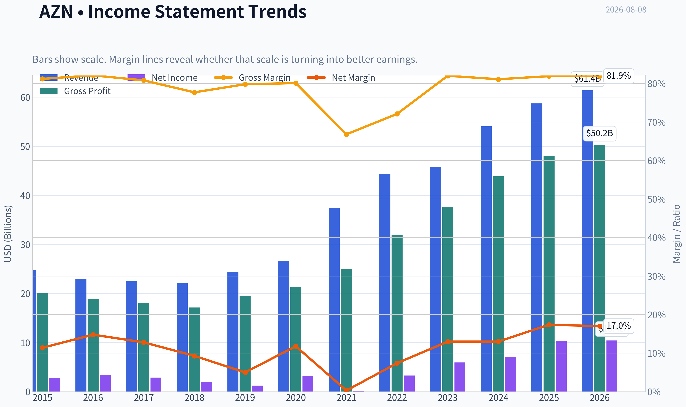

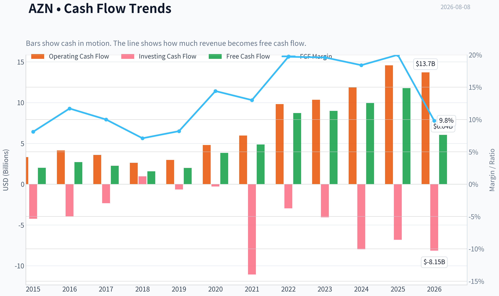

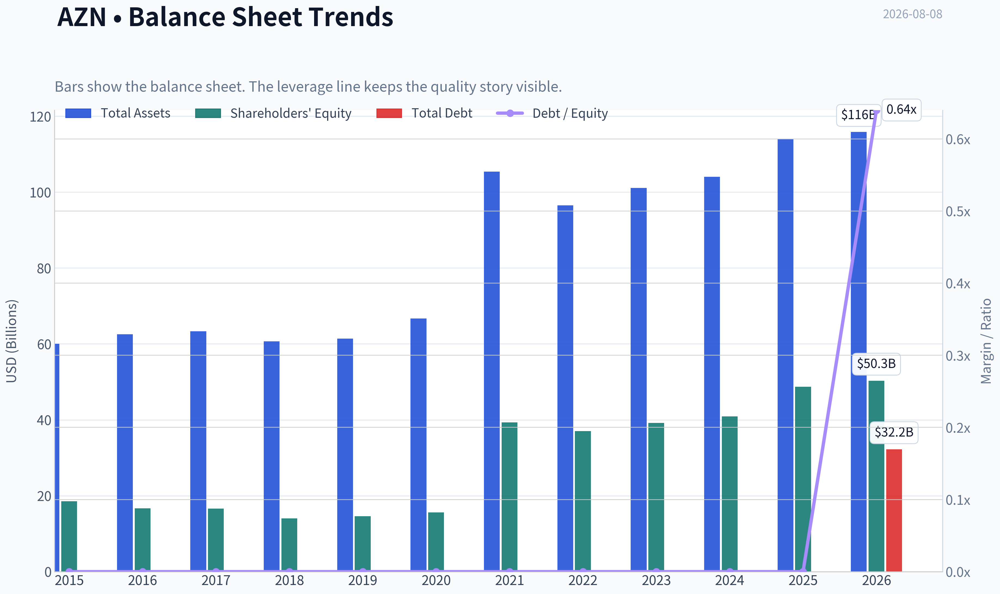

This graph tracks the profitability and return metrics (ROE, ROIC, Margins) of **AZN** over the past decade, highlighting capital efficiency trends.

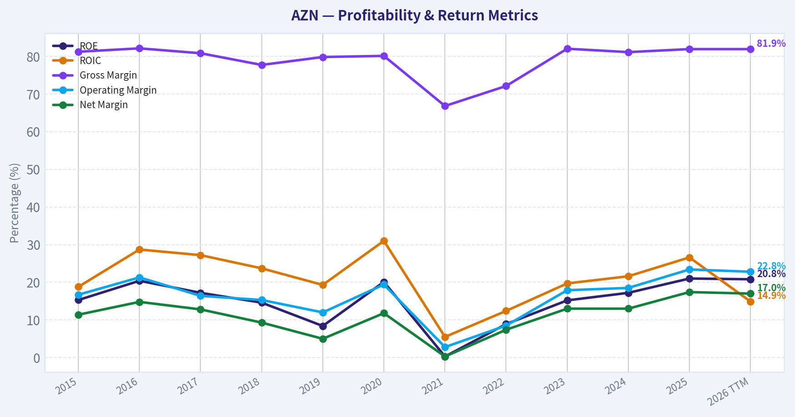

This chart illustrates the financial health of **AZN** over the last 10 years, mapping cash equivalents and free cash flow against total obligations (Debt).

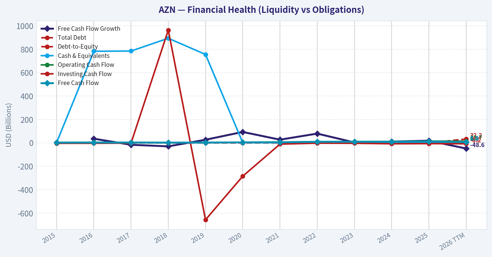

This breakdown chart from <em>Revenue Breakdown</em> shows the proportional composition for **AZN** - useful for understanding what drives or risks the business.

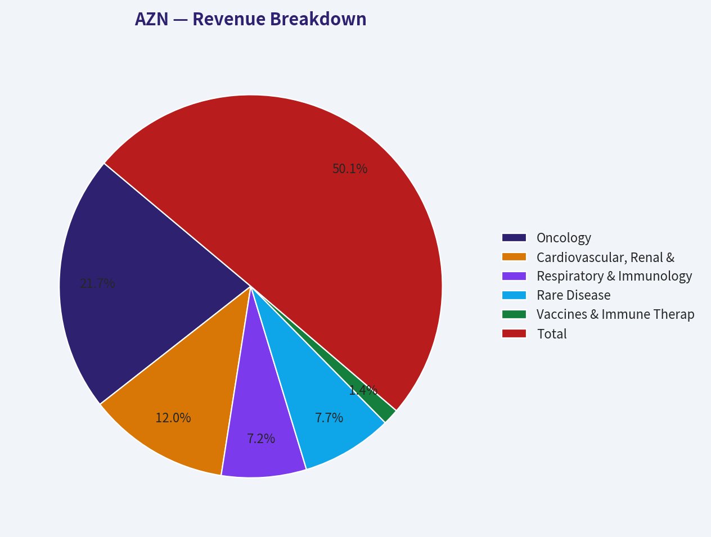

---

### Intrinsic Value Analysis (Buffett)

> *Following Warren Buffett's value investing philosophy: Circle of Competence, Economic Moat, Management Quality, and Margin of Safety.*

#### Intrinsic Value Snapshot

Price is what you pay. Intrinsic value is what the business may be worth based on the cash it can create for owners over time. We show a range, not one magic number.

- Current Price: $161.42
- Value Range (conservative to optimistic across both DCF methods): $15.69 to $254.26

##### Owner Earnings (Buffett Method)
- Net Income: $10,233,000,000.00
- Depreciation & Amortization: $5,490,000,000.00
- Capital Expenditures: $-2,810,000,000.00
- Working Capital Changes: $-1,137,000,000.00
- Owner Earnings: $14,050,000,000.00

##### Intrinsic Value
###### Buffett Method
Uses owner earnings. Stricter, and usually more conservative.
- Conservative: $15.69
- Average: $221.67
- Optimistic: $254.26
- Discount Rate: 10.0%

###### Cash Flow Method
Uses free cash flow. Better for companies spending heavily today to grow tomorrow.
- Conservative: $27.55
- Average: $79.50
- Optimistic: $106.29
- Discount Rate: 10.0%

ANALYST STANCE: **ADVOCATE**

#### AstraZeneca PLC - Buffett-Style Investment Review

AstraZeneca is a high-quality global pharmaceutical compounder with exceptional gross margins, a broadening oncology and biopharma portfolio, and a credible reinvestment runway. At roughly **$161 per ADS**, the shares trade below the research-pack headline intrinsic value of **$198.08**, implying an **18.5% margin of safety**. For a wide-moat, high-margin, innovation-driven healthcare franchise, that is enough to support an **ADVOCATE** stance, though conviction is moderated by patent-cycle and regulatory risks.

---

#### 1. Factor Scorecard

| Factor | Score | Evidence |
|---|---:|---|
| Circle of Competence & Business Simplicity | 3.8 / 5 | AstraZeneca discovers, develops, manufactures, and sells prescription drugs. The business model is understandable, but long-term outcomes depend on R&D productivity, clinical success, patent protection, and regulatory decisions. |
| Moat Test | 4.1 / 5 | Gross margin of **81.9%**, strong oncology and rare-disease franchises, patent-protected products, global regulatory scale, and embedded physician/payer relationships support a wide moat. |
| Management Quality & Capital Allocation | 4.0 / 5 | Management has shifted the company toward higher-growth oncology, rare disease, and specialty-care areas. The Alexion acquisition increased debt but also added durable rare-disease assets and cash flow. |
| Industry Structure | 3.6 / 5 | Big pharma is rationally competitive but exposed to patent cliffs, government pricing pressure, and binary R&D outcomes. Scale, distribution, and regulatory expertise favor incumbents. |
| Gate 5: Quality / Solvency Hard Floor | Not Tripped | Revenue, earnings power, and free cash flow are growing; the company is not showing a worsening cash-flow trajectory combined with weak solvency. |

**Key Takeaways:** AstraZeneca passes the Buffett quality screen as a durable, high-margin pharmaceutical franchise. The business is not as predictable as a consumer staple because drug pipelines and patent cycles matter, but its scale, product breadth, and reinvestment engine give it above-average durability. The hard solvency floor is not triggered.

---

#### 2. Moat Analysis

| Moat Source | Assessment | Evidence |
|---|---|---|
| Intangible Assets | Strong | Patent protection, clinical data, regulatory approvals, and specialist-prescriber trust create high barriers. Gross margin of **81.9%** is strong evidence of pricing power and differentiated products. |
| Switching Costs | Moderate to Strong | Physicians, hospitals, and payers build protocols around proven drugs, especially in oncology and rare disease. Switching can be medically and administratively costly. |
| Cost Advantages | Moderate | AstraZeneca benefits from global manufacturing, regulatory, and commercial scale, though drug development remains expensive. |
| Network Effects | Limited | Traditional pharma has weaker network effects than software platforms, but clinical evidence and physician adoption can create reinforcing adoption patterns. |
| Moat Rating | Wide & Stable | The company has a wide moat, though not immune to patent expirations, biosimilars, and drug-pricing pressure. |

**Key Takeaways:** AstraZeneca's moat is built mainly on patents, regulatory expertise, clinical evidence, and global scale. The company's very high gross margin is the clearest financial proof that its products are differentiated. The moat is wide, but investors must monitor patent cliffs and pipeline replacement.

---

#### 3. Financial Summary

| Metric | 2021 | 2022 | 2023 | 2024 | Latest / TTM |
|---|---:|---:|---:|---:|---:|
| Revenue | $37.4B | $44.4B | $45.8B | $54.1B | ~$58.7B |
| Revenue Growth | 41% | 19% | 3% | 18% | 8.6% YoY |
| Net Income | ~$0.1B | ~$3.3B | ~$6.0B | ~$7.0B | ~$10.4B |
| Free Cash Flow | ~$4.9B | ~$6.2B | ~$8.7B | ~$10.0B | ~$11.8B |
| Gross Margin | Elevated | Elevated | Elevated | Elevated | 81.9% |
| ROE | Depressed by acquisition effects | Improving | Improving | Strong | 21.0% |
| FCF Yield | - | - | - | - | 4.7% |
| P/E | - | - | - | - | 24.2x |
| Market Cap | - | - | - | - | $250.3B |

**Key Takeaways:** AstraZeneca has grown revenue substantially while converting more of that revenue into free cash flow. Reported earnings were distorted in earlier years by acquisition-related accounting, but the cash-flow trend is clearly positive. The latest profile shows a high-margin business with a solid **4.7% free-cash-flow yield** and **21% ROE**.

---

#### 4. Owner Earnings Calculation

Using current market data:

| Component | Estimate |
|---|---:|
| Market Capitalization | $250.34B |
| Free Cash Flow Yield | 4.7% |
| Estimated Owner Earnings / FCF | ~$11.77B |
| Estimated ADS Count | ~1.56B |
| Owner Earnings per ADS | ~$7.57 |

**Owner Earnings Formula:**
**Owner Earnings = Net Income + Depreciation & Amortization - Maintenance CapEx - Working Capital Increases**

For AstraZeneca, free cash flow is a reasonable practical proxy for owner earnings because the company's economic reinvestment is primarily R&D and business development rather than heavy tangible maintenance capital.

**Key Takeaways:** AstraZeneca is generating roughly **$11.8B** of annual owner earnings, or about **$7.57 per ADS**. That gives the investor a starting owner-earnings yield of about **4.7%**, before considering future growth from the drug portfolio and pipeline.

---

#### 5. Three-Scenario DCF Valuation

| Scenario | Assumption | Estimated Value per ADS |
|---|---|---:|
| A. No Growth | Owner earnings capitalized at 10% | ~$75.70 |
| B. GDP Growth | 3% perpetual growth, 10% discount rate | ~$111.45 |
| C. Historical Growth Haircut | 10% growth for 10 years, then 3% terminal growth | ~$187.15 |
| Research-Pack Headline Intrinsic Value | Business-model routed valuation blend | $198.08 |
| Research-Pack Model Spread | Owner Earnings / FCF / Damodaran FCFF | $221.67 / $79.50 / $144.24 |

**Key Takeaways:** The no-growth and GDP-growth cases are intentionally harsh and undervalue the reinvestment power of a strong pharma franchise. The growth case and the research-pack headline value both suggest fair value is materially above the current price. The spread between models is wide, which reflects the sensitivity of pharma valuation to growth and pipeline assumptions.

---

#### 6. Margin of Safety Analysis

| Item | Value |
|---|---:|
| Current Price | $161.00 |
| Headline Intrinsic Value | $198.08 |
| Implied Upside to Intrinsic Value | ~23.0% |
| Margin of Safety vs. Intrinsic Value | 18.5% |
| Reverse-DCF Implied Growth | ~16.7% per year for 10 years |
| Trailing 3-Year Growth Reference | 56.0% |
| Trailing 5-Year Growth Reference | 45.1% |

**Key Takeaways:** The stock offers a reasonable margin of safety for a high-quality pharma compounder, though not a bargain-basement valuation. The reverse-DCF growth hurdle of roughly **16.7%** is demanding but not absurd relative to AstraZeneca's recent performance. The investment case depends on the company continuing to replace maturing drugs with new oncology, rare-disease, respiratory, and cardiometabolic growth assets.

---

#### 7. Management Quality Assessment

| Area | Assessment |
|---|---|
| Strategic Direction | Strong. Management has repositioned AstraZeneca toward oncology, rare disease, and specialty medicines with better long-term growth and pricing power. |
| Capital Allocation | Good. Heavy reinvestment in R&D is rational given high returns on successful drugs. The Alexion acquisition increased complexity and leverage but strengthened rare-disease exposure. |
| Shareholder Orientation | Solid. The company balances dividends, reinvestment, and business development rather than over-distributing cash. |
| Risk Discipline | Good, not perfect. Large pharma acquisitions and pipeline bets always carry execution risk, but AstraZeneca has demonstrated credible portfolio management. |

AstraZeneca's management has earned credit for transforming the company into one of the stronger growth stories in global pharma. The main capital-allocation question is whether future acquisitions and pipeline spending continue to earn high returns rather than merely replacing patent losses at mediocre economics.

---

#### 8. Final Buffett Scorecard

| Criterion | Weight | Score | Weighted Contribution |
|---|---:|---:|---:|
| Moat Width & Durability | 25% | 4.1 | 1.03 |
| Valuation / Margin of Safety | 20% | 3.8 | 0.76 |
| Capital Returns - ROIC vs. WACC | 15% | 4.0 | 0.60 |
| Business Understanding & Predictability | 12% | 3.8 | 0.46 |
| Management Quality & Capital Allocation | 12% | 4.0 | 0.48 |
| Reinvestment Runway | 8% | 4.2 | 0.34 |
| Balance Sheet Strength | 4% | 3.4 | 0.14 |
| Industry Structure | 4% | 3.6 | 0.14 |
| **Total Score** | **100%** |  | **3.94 / 5** |

**Key Takeaways:** AstraZeneca scores well because it combines a wide moat, high margins, solid capital returns, and a long reinvestment runway. Valuation is reasonable rather than deeply cheap, but Buffett-style investing does not require a huge discount for a wonderful business. The score lands just below the highest-conviction range but clearly supports ownership.

---

#### 9. Investment Stance

| Stance | Conviction | Rationale |
|---|---|---|
| **ADVOCATE** | Moderate to High | AstraZeneca is a high-quality, wide-moat healthcare compounder trading at a fair-to-attractive price, with an estimated **18.5% margin of safety** versus headline intrinsic value. |

AstraZeneca is not a classic "cheap stock"; it is a durable, high-margin franchise available at a reasonable price. The biggest risks are patent expirations, drug-pricing pressure, and pipeline execution. Still, the company's oncology strength, rare-disease assets, high gross margins, growing free cash flow, and credible reinvestment runway make the stock attractive for long-term value investors.
#### Valuation Bridge

This bridge places the current market price beside each intrinsic value lens so readers can see whether upside depends on one method or shows up across several methods.

| Scenario | Intrinsic Value / Share |
| --- | ---: |
| Buffett Method | $221.67 |
| Cash Flow Method | $79.50 |
| Damodaran Method | $144.24 |
| Current Price | $161.42 |

#### Key Takeaways

If one method is far above the others, the upside case depends on a specific modelling assumption. When several methods cluster together, the valuation story is more robust.

#### Valuation Visuals

This comparison chart from *Latest Earnings Snapshot* stacks current figures against historical benchmarks for **AZN**, making it easy to see where the company trades relative to its own averages.

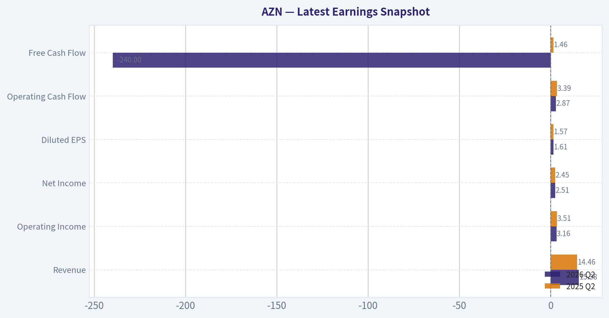

This comparison chart from *Current vs. 10-Year Historical Average Comparison* stacks current figures against historical benchmarks for **AZN**, making it easy to see where the company trades relative to its own averages.

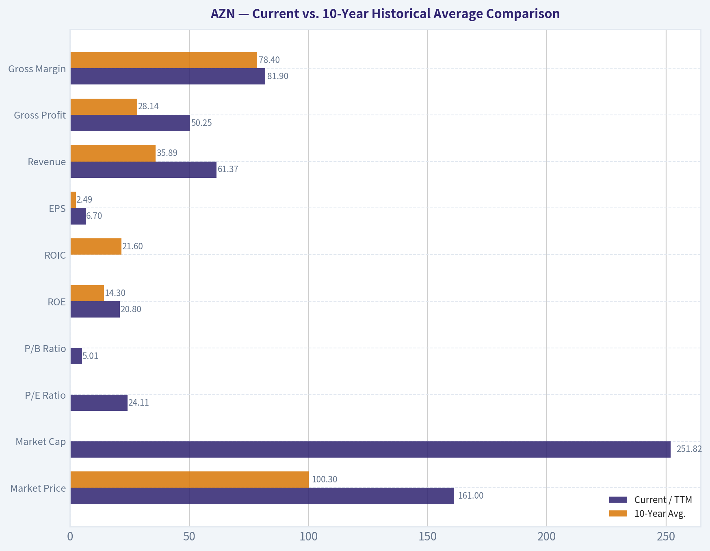

This comparison chart from *Three-Scenario Buffett-Style Owner Earnings DCF* stacks current figures against historical benchmarks for **AZN**, making it easy to see where the company trades relative to its own averages.

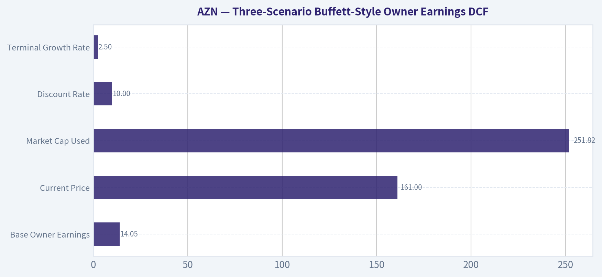

This comparison chart from *Intrinsic Value Cross-Check from Research Pack* stacks current figures against historical benchmarks for **AZN**, making it easy to see where the company trades relative to its own averages.

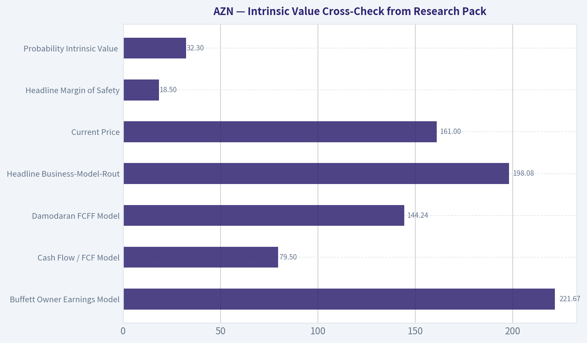

---

### Trend & Growth Analysis (Lynch/Druckenmiller/Fisher)

> *Following Peter Lynch's GARP, Stanley Druckenmiller's macro-aware approach, and Philip Fisher's scuttlebutt methodology.*

ANALYST STANCE: **WATCH**

#### AZN Growth Investment Report - AstraZeneca PLC

AstraZeneca is a high-quality global biopharma compounder with strong oncology, cardiovascular, respiratory, immunology, rare disease, and vaccine exposure. It is not a classic Lynch "fast grower" at current scale, but it has credible long-duration growth from pipeline productivity, high gross margins, and secular healthcare innovation. The issue is valuation: at roughly 24 times earnings and only 8.6% reported revenue growth, the stock looks more like a high-quality stalwart than a ten-bagger candidate.

---

#### 1. Lynch Classification

| Category | AZN Assessment |
|---|---|
| Lynch category | **Stalwart / Quality Compounder** |
| Current revenue growth | **8.6% YoY** |
| Growth investor fit | Moderate |
| Ten-bagger probability | Low from current $250B market cap |
| Best use case | Core healthcare compounder, not aggressive growth allocation |

**Key Takeaways:** AstraZeneca is not a slow grower, but it also does not currently meet the 15% to 25% growth profile preferred for a Lynch-style fast grower. The company is better classified as a high-quality stalwart with pipeline-driven upside. For a growth portfolio, this makes AZN a **watch or hold**, not a high-conviction new ten-bagger idea.

---

#### 2. The Story in 3 Bullets

- AstraZeneca sells essential medicines, especially in oncology, cardiovascular disease, respiratory disease, immunology, and rare disease.
- Its growth engine is a deep R&D pipeline, companion diagnostics, biologics, and precision oncology expansion.
- The company has strong gross margins, good returns on equity, and a credible path to compounding, but its size limits explosive upside.

---

#### 3. TAM Analysis and 10x Test

| Item | Estimate / Assessment |
|---|---:|
| Current market cap | **$250.34B** |
| Current price | **$161** |
| Approximate recent annual revenue base | ~$55B to $60B range |
| 10x revenue test | ~$550B to $600B revenue required |
| Global pharma market | Large, but fragmented and regulated |
| Can AZN 10x revenue and remain under 20% TAM share? | **Unlikely** |
| Runway quality | Good for compounding, limited for ten-bagger math |

**Key Takeaways:** AstraZeneca has a large and durable market opportunity, especially in oncology and specialty medicine. However, the company is already very large, and a 10x revenue outcome would require it to become one of the most dominant pharmaceutical companies in history. The TAM supports continued compounding, but not obvious ten-bagger potential from today's scale.

---

#### 4. Revenue Growth Trend

| Metric | Current Reading | Interpretation |
|---|---:|---|
| YoY revenue growth | **8.6%** | Solid, but not fast-grower territory |
| Growth pattern | Moderate | More stalwart than inflection growth |
| Gross margin | **81.9%** | Excellent pricing power and product mix |
| ROE | **21.0%** | Strong capital productivity |
| FCF yield | **4.7%** | Healthy for a large-cap pharma stock |

**Key Takeaways:** AZN's financial quality is strong, with excellent gross margins and solid return on equity. Revenue growth of 8.6% is respectable for a mega-cap pharmaceutical company, but it does not signal a major growth acceleration. The business is high quality, but the current growth rate does not scream "inflection point."

---

#### 5. Unit Economics / Pharma Business Quality

Traditional SaaS metrics like LTV/CAC and NRR do not apply directly to AstraZeneca. For pharma, the more relevant indicators are gross margin, R&D productivity, patent durability, regulatory success, and pipeline conversion.

| Unit Economics Proxy | AZN Assessment |
|---|---|
| Gross margin | **81.9% - excellent** |
| Pricing power | Strong, but constrained by reimbursement and regulation |
| Customer retention equivalent | High for chronic and specialty therapies |
| R&D reinvestment model | Core to long-term growth |
| Rule of 40 | Not applicable |
| NRR / LTV-CAC | Not applicable |

**Key Takeaways:** AstraZeneca's "unit economics" are strong in a pharma context because the company has very high gross margins and durable demand for many therapies. The key question is not customer churn, but whether the R&D engine can keep replacing and expanding revenue before patent cliffs. On current evidence, AZN's business quality is above average.

---

#### 6. Inflection Point Assessment

| Inflection Type | Evidence | Rating |
|---|---|---|
| Product cycle inflection | Oncology, rare disease, and precision medicine pipeline remain important | Moderate positive |
| Market share inflection | No clear evidence of accelerating share gains from provided data | Neutral |
| Margin inflection | Gross margin already high; less room for dramatic expansion | Neutral |
| TAM inflection | Healthcare innovation and precision oncology expand addressable market | Positive |
| Competitive inflection | No clear competitor stumble identified | Neutral |
| M&A inflection | Reported Bristol Myers merger buzz could change profile, but economics/regulatory risk are material | Watch closely |

**Key Takeaways:** AZN has several positive long-term growth drivers, but the evidence does not yet show a clear near-term acceleration. The biggest potential inflection would come from pipeline wins, oncology expansion, or major M&A. For now, this is a durable compounder rather than a confirmed acceleration story.

---

#### 7. Macro Setup

| Macro Factor | Impact on AZN |
|---|---|
| Interest rates | Lower rates would support defensive growth valuations |
| Economic cycle | Pharma demand is relatively recession-resistant |
| Secular themes | Healthcare innovation, precision oncology, diagnostics, biologics |
| Regulatory environment | Persistent pricing and reimbursement risk |
| Macro sensitivity | Lower than most cyclical sectors |

**Key Takeaways:** AstraZeneca benefits from a favorable long-term healthcare innovation theme and has defensive demand characteristics. Unlike many growth stocks, AZN is less exposed to consumer cycles or enterprise IT budgets. The main macro risk is not recession, but drug-pricing pressure and healthcare policy intervention.

---

#### 8. Fisher 15 Points Score

| Fisher Category | Score / 5 |
|---|---:|
| Products with sizable market potential | 4 |
| Commitment to new products | 5 |
| Effective R&D | 4 |
| Sales organization | 4 |
| Worthwhile profit margin | 5 |
| Improving profit margins | 3 |
| Labor/personnel relations | 3 |
| Executive relations | 3 |
| Management depth | 4 |
| Cost analysis/accounting | 4 |
| Moats: IP, data, switching, scale | 4 |
| Long-range profit outlook | 4 |
| Dilution discipline | 4 |
| Candor in difficulties | 3 |
| Management integrity | 4 |
| **Total** | **58 / 75** |

**Key Takeaways:** AstraZeneca scores well under Fisher's framework because it has strong products, high margins, a deep R&D culture, and durable intellectual property. The score is not outstanding because pharma always carries patent, regulatory, trial, and reimbursement uncertainty. Overall, this is a good Fisher-style company, but not a flawless one.

---

#### 9. Valuation Analysis

| Valuation Metric | Reading | Interpretation |
|---|---:|---|
| Current price | **$161** | Market reference |
| Market cap | **$250.34B** | Mega-cap scale |
| P/E | **24.16x** | Reasonable for quality, not cheap |
| Revenue growth | **8.6%** | Below fast-grower threshold |
| PEG using revenue growth proxy | **~2.8x** | Expensive by Lynch standards |
| Headline intrinsic value | **$198.08** | Implied upside versus price |
| Margin of safety | **18.5%** | Positive but not large |
| FCF yield | **4.7%** | Supportive valuation floor |

**Key Takeaways:** AZN is not obviously overvalued, but it is not cheap on Lynch's PEG framework. The headline intrinsic value estimate suggests upside, yet the stock does not offer a large margin of safety. At this price, investors are paying for quality and pipeline durability rather than undiscovered growth.

---

#### 10. Scenario Analysis

| Scenario | Assumption | Implied View |
|---|---|---|
| Bear case | Pipeline disappoints, pricing pressure rises, growth slows to low-single digits | Downside from multiple compression |
| Base case | High-single to low-double-digit revenue growth continues; pipeline offsets patent risks | Moderate upside toward intrinsic value |
| Bull case | Oncology and specialty pipeline outperform; major approvals accelerate growth | Attractive compounding, but still unlikely 10x |
| M&A case | Large strategic deal such as rumored BMY transaction | Potentially transformative but high execution/regulatory risk |

**Key Takeaways:** The base case is continued steady compounding, not explosive upside. The bull case depends on pipeline success and faster-than-expected specialty drug adoption. A major merger could create a new narrative, but it would also introduce integration, balance sheet, and antitrust risk.

---

#### 11. Growth Investor Scorecard

| Criterion | Weight | Score / 5 | Weighted Score |
|---|---:|---:|---:|
| The Story | 10% | 4.0 | 0.40 |
| TAM & Runway | 20% | 3.5 | 0.70 |
| Revenue Growth | 20% | 2.5 | 0.50 |
| Unit Economics | 15% | 4.0 | 0.60 |
| Competitive Position | 10% | 4.0 | 0.40 |
| Management Quality | 10% | 3.8 | 0.38 |
| Macro Setup | 5% | 4.0 | 0.20 |
| Profitability Path | 5% | 4.5 | 0.23 |
| Valuation | 5% | 3.0 | 0.15 |
| **Total** | **100%** |  | **3.56 / 5.00** |

**Key Takeaways:** AstraZeneca earns a respectable score because the business quality, margins, market opportunity, and healthcare innovation exposure are strong. The main drag is revenue growth, which is solid but not high enough for a classic growth-stock inflection thesis. A score of 3.56 supports a **WATCH / modest advocate for quality portfolios**, but not a high-conviction growth allocation.

---

#### 12. Position Size Stance

| Investor Type | Stance |
|---|---|
| Aggressive growth / ten-bagger portfolio | **Small position or watchlist only** |
| GARP investor | **Acceptable starter position on pullbacks** |
| Quality compounder portfolio | **Moderate position reasonable** |
| Income / defensive healthcare investor | **Potentially suitable** |
| Suggested growth-portfolio sizing | **1% to 3%, only if seeking healthcare ballast** |

**Key Takeaways:** AZN is better suited as a quality healthcare compounder than as an aggressive growth stock. For a ten-bagger-focused portfolio, the position should be small unless a clear growth acceleration emerges. The better entry would be on valuation pullbacks or after evidence of pipeline-driven acceleration.

---

#### 13. Key Risks and Catalysts

| Category | Items to Monitor |
|---|---|
| Key risks | Patent cliffs, trial failures, drug-pricing pressure, reimbursement limits, regulatory delays, M&A execution risk |
| Financial risks | Current ratio below 1.0, potential leverage if major acquisition occurs |
| Competitive risks | Oncology competition, biosimilars, new mechanisms of action from rivals |
| Catalysts | Major drug approvals, oncology pipeline readouts, precision diagnostics partnerships, margin expansion, upgraded guidance |
| Special situation | Reported AZN-BMY merger buzz could be meaningful but uncertain |

**Key Takeaways:** The most important risks are standard pharma risks: patent expirations, clinical trial failures, and pricing pressure. The most important upside catalysts are pipeline wins and faster adoption of specialty medicines. The reported merger speculation adds optionality, but it also increases uncertainty.

---

#### Final View

AstraZeneca is a high-quality healthcare compounder with strong margins, durable therapeutic franchises, and meaningful exposure to precision oncology and healthcare innovation. However, it is already a $250B company, revenue growth is currently under 10%, and the PEG ratio is not compelling by Lynch standards.

For a growth investor seeking inflection points and ten-bagger potential, AZN belongs on the **WATCH** list, not the aggressive buy list. I would become more constructive if revenue growth re-accelerates into the low-to-mid teens, pipeline readouts surprise positively, or valuation resets to a more attractive PEG and FCF-yield profile.

---

### Market Technical Analysis

ANALYST STANCE: **WATCH**

#### AZN Technical Report - AstraZeneca PLC ADR
Data through the latest available trading session, **2026-08-07**. Current reference date: **2026-08-08**.

AZN is in a **short-term bearish correction with elevated volatility**, following a sharp July-to-August breakdown. The stock has started to stabilize after the early-August selloff, but the rebound is still occurring **below key trend averages**, so the setup is not yet strong enough to classify as bullish. The most appropriate stance is **WATCH**: traders should monitor for either a reclaim of short-term resistance or a failure back toward recent lows.

#### Selected Indicators and Why They Matter

| Indicator | Role in This Market | Why It Is Useful for AZN Now |
|---|---:|---|
| `close_10_ema` | Short-term trend and rebound gauge | Helps judge whether the post-selloff bounce is gaining traction. |
| `close_50_sma` | Medium-term trend filter | AZN is well below it, confirming medium-term technical damage. |
| `close_200_sma` | Long-term trend benchmark | Price is also below this level, showing the correction has affected the broader trend. |
| `macd` | Momentum confirmation | Captures whether bearish momentum is still expanding or beginning to stabilize. |
| `rsi` | Oversold / recovery signal | Shows whether selling pressure has become exhausted or remains dominant. |
| `boll_ub` | Volatility resistance zone | Provides an upper boundary for any rebound attempt. |
| `boll_lb` | Volatility support zone | Helps identify whether price is still stretched to the downside. |
| `atr` | Risk and stop-size guide | Volatility is elevated, so position sizing and stop placement need extra care. |

Key Takeaways: The selected indicators emphasize trend, momentum, volatility, and risk management without excessive redundancy. For AZN, this is important because the stock is not merely drifting sideways; it has recently suffered a sharp downside break and is now attempting a fragile stabilization.

---

#### Current Technical Snapshot

| Metric | Latest Value | Interpretation |
|---|---:|---|
| Last Close | **161.42** | Recovered modestly from the early-August low but remains technically weak. |
| 10 EMA | **164.01** | Price is still below short-term trend resistance. |
| 50 SMA | **176.37** | Price is about **8.5% below** medium-term trend. |
| 200 SMA | **183.79** | Price is about **12.2% below** long-term trend. |
| MACD | **-4.76** | Momentum remains bearish, though no longer accelerating sharply day-to-day. |
| RSI | **39.25** | Weak but no longer deeply oversold. |
| Bollinger Lower Band | **156.96** | Recent price is above the lower band, suggesting downside stretch has eased. |
| ATR | **4.98** | Daily volatility remains elevated, roughly **3.1% of price**. |

Key Takeaways: AZN is trading below all three key moving-average references, which keeps the technical bias bearish. However, RSI has recovered from near-oversold conditions and price is back above the lower Bollinger Band, suggesting the most aggressive selling may have paused for now.

#### Trend Structure

The trend structure has deteriorated meaningfully. In late June and early July, AZN briefly improved, rising from the low-180s into the mid-190s, with a July 2 close near **195.15**. That strength failed quickly. By August 7, the stock had fallen to **161.42**, a decline of roughly **17%** from the July 2 close.

The most important technical feature is that AZN is now below:

- the **10 EMA at 164.01**,
- the **50 SMA at 176.37**, and
- the **200 SMA at 183.79**.

This alignment shows a bearish stacking of price versus trend indicators. The 10 EMA is falling quickly, the 50 SMA is rolling lower, and the 200 SMA has flattened after previously rising. That means the market has shifted from an earlier uptrend into a corrective or distribution phase.

The first bullish repair signal would be a close back above the **10 EMA**, followed by sustained trade above the **mid-160s to high-160s**. A more meaningful trend repair would require reclaiming the **50 SMA near 176**, which is currently far above the market and likely to act as resistance.

#### Momentum and RSI

MACD remains deeply negative at **-4.76**, confirming that bearish momentum is still in control. The encouraging nuance is that MACD has stopped worsening aggressively over the last few sessions: it moved from **-4.79 on August 6** to **-4.76 on August 7**. That is not a buy signal by itself, but it suggests the downside impulse may be stabilizing.

RSI is at **39.25**, up from **30.66 on August 4**. This is important because the stock came close to oversold territory but did not produce a strong bullish momentum reversal yet. RSI below 40 still reflects weak demand, but the rebound from the low-30s suggests short sellers may be less aggressive than they were immediately after the August 3 gap lower.

For traders, the RSI zone matters: if RSI can push back above **45-50**, that would support a stronger recovery attempt. If RSI rolls back below **35**, it would suggest the bounce is failing and downside pressure may resume.

#### Volatility and Bollinger Band Position

AZN's Bollinger Bands show a stock that has recently undergone a volatility shock. On August 7, the lower band was **156.96**, the upper band was **176.60**, and the implied middle band was near **166.78**. With price at **161.42**, AZN is above the lower band but still below the middle of the band range.

That position is significant. It means the stock is no longer extremely stretched to the downside, but it has not yet recovered enough to regain neutral footing. A move above the Bollinger middle area near **166-167** would suggest the rebound is improving. Failure below that zone keeps the stock vulnerable to retesting the lower band near **157**.

ATR is elevated at **4.98**, versus around **3.8** in late June. This means daily ranges have expanded materially. Traders should avoid using tight stops because normal movement is now larger; a stop that would have worked during calmer trading may now be too close and likely to get triggered by ordinary volatility.

#### Price Action and Volume Context

The breakdown became especially severe around **August 3**, when AZN closed at **157.97** after previously closing at **169.64** on July 31. That was a sharp one-session decline of nearly **6.9%**, accompanied by exceptionally high volume of more than **16 million shares**. This was not a quiet drift lower; it looked like a decisive repricing event.

The follow-through was mixed. August 4 closed lower at **155.62**, but AZN then rebounded to **161.50** on August 5 and stabilized near **161** through August 7. This behavior suggests buyers appeared near the mid-150s, but the rebound has not yet overcome enough resistance to prove accumulation.

The key near-term question is whether the **155-157 area** becomes a durable support zone or merely a pause before another leg lower.

#### Trading Implications

| Trading Horizon | Bias | Key Levels | Practical Interpretation |
|---|---|---:|---|
| Short-term traders | Neutral-to-bearish, watching for bounce confirmation | Support: **155-157**; resistance: **164-167** | A close above the 10 EMA and Bollinger midpoint would improve the bounce setup. |
| Swing traders | Bearish until resistance is reclaimed | Major resistance: **176** and **184** | The stock remains below the 50 SMA and 200 SMA, so rallies may be sold. |
| Risk managers | Cautious | ATR: **~5 points** | Position sizes should be reduced or stops widened because volatility is elevated. |
| Dip buyers | Premature unless support holds | Watch **155-157** | Better confirmation would be a higher low plus RSI improvement above 45. |

Key Takeaways: AZN may be forming a short-term base, but the broader technical picture remains damaged. The stock needs to reclaim the mid-160s first, then the mid-170s, before the chart begins to look healthier.

---

#### Final View

AZN is a **WATCH**, not a clean buy. The stock has bounced from the worst of the August selloff, but it remains below short-, medium-, and long-term trend indicators. Momentum is still bearish, and volatility remains elevated.

A tactical rebound could develop if AZN closes above **164-167**, especially if RSI continues rising. However, failure to hold **155-157** would likely signal renewed downside risk. Until the stock proves it can reclaim at least the 10 EMA and Bollinger midpoint, rallies should be treated cautiously.

| Category | Current Reading | Bullish Signal to Watch | Bearish Risk to Watch |
|---|---|---|---|
| Trend | Price below 10 EMA, 50 SMA, and 200 SMA | Close above **164-167** | Continued rejection below short-term averages |
| Momentum | MACD deeply negative; RSI recovering to 39 | RSI above **45-50** | RSI falling back below **35** |
| Volatility | ATR elevated near **5 points** | Volatility compresses while price holds support | Wide daily ranges continue with downside closes |
| Support | Recent support near **155-157** | Higher low above this zone | Breakdown below **155** |
| Resistance | Near-term resistance at **164-167**; bigger resistance near **176** | Reclaim of 50 SMA near **176** | Failed rally into resistance |
| Overall Stance | **WATCH** | Confirmed recovery above mid-160s | Retest or break of early-August lows |

Key Takeaways: AZN is trying to stabilize, but the technical burden of proof remains on buyers. The most important near-term levels are support near 155 to 157 and resistance near 164 to 167.

#### Market Visuals

This comparison chart from *Market Metrics Interpretation* stacks current figures against historical benchmarks for **AZN**, making it easy to see where the company trades relative to its own averages.

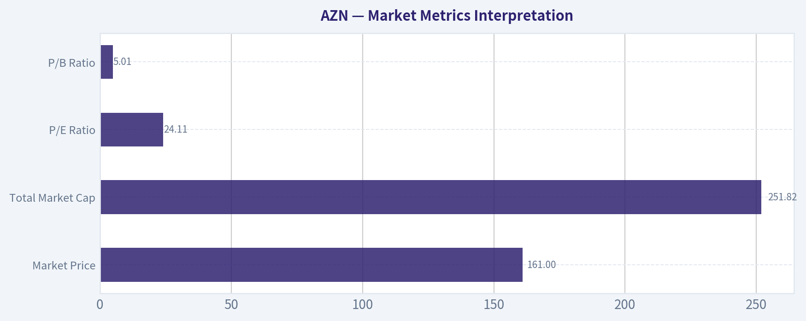

---

### Options Market Analysis

> *Reading options flow - put/call ratios, IV skew, and unusual activity - to gauge institutional positioning and event-driven risk.*

ANALYST STANCE: **WATCH**

#### AZN Options Market Sentiment Report - As of 2026-08-08

#### 1. Put/Call Ratio Analysis

| Expiration | Call OI | Put OI | Put/Call OI Ratio | Call Volume | Put Volume | Put/Call Volume Ratio | Read |
|---|---:|---:|---:|---:|---:|---:|---|
| 2026-08-21 | 10,514 | 4,915 | 0.47 | 1,529 | 236 | 0.15 | Bullish call-heavy positioning |
| 2026-09-18 | 5,798 | 7,771 | 1.34 | 423 | 1,788 | 4.23 | Bearish or protective put demand |
| 2026-10-16 | 22,121 | 5,389 | 0.24 | 241 | 192 | 0.80 | Structurally call-heavy OI |
| **Near-Term Total** | **38,433** | **18,075** | **0.47** | **2,193** | **2,216** | **1.01** | **OI bullish, volume more neutral-to-defensive** |

**Key Takeaways:** AZN's near-term open interest is meaningfully call-heavy, with a total put/call OI ratio of **0.47**, well below the historical neutral baseline of roughly **0.7**. That suggests the existing options positioning leans bullish. However, the near-term volume ratio is **1.01**, showing recent trading is more balanced and somewhat defensive, especially in the September expiration where put volume is elevated.

The most important split is between **existing positioning** and **fresh activity**: open interest favors calls, but current volume shows notable September put demand. This does not fully overturn the bullish OI signal, but it reduces conviction.

---

#### 2. Implied Volatility Assessment

| Expiration | ATM Call IV | ATM Put IV | Put IV Premium / Discount | Skew Read |
|---|---:|---:|---:|---|
| 2026-08-21 | 32.6% | 32.8% | Puts +0.2 pts | Essentially flat, very slight downside bid |
| 2026-09-18 | 30.6% | 28.1% | Puts -2.5 pts | Mild call skew / upside chase |
| 2026-10-16 | 32.3% | 32.3% | Flat | Neutral skew |
| **Overall** | **~31-33%** | **~28-33%** | Mixed | No broad panic skew |

**Key Takeaways:** AZN's near-term ATM implied volatility sits around the low-30% range, with no obvious broad-based volatility panic. Put skew is not steep; in fact, September shows calls priced richer than puts at the ATM level. That argues against major downside fear being aggressively priced into the options market.

Based on the available data, IV appears **moderate rather than extreme**. There is no clear evidence from this dataset alone of a major catalyst premium, such as an imminent earnings-style volatility surge, though a calendar/event check would be needed to confirm.

---

#### 3. Unusual Options Activity

| Unusual Activity Filter | Result |
|---|---|
| Contracts with volume greater than 5x open interest | **None found** |
| Interpretation | No clear evidence of fresh outsized directional bets in the near-term expirations |
| Confidence Impact | Lowers conviction in any "smart money" directional read |

**Key Takeaways:** There were **no contracts flagged with volume greater than 5x open interest**, meaning the dataset does not show obvious fresh sweep-style positioning or unusual institutional activity. The absence of unusual activity makes the sentiment signal more dependent on aggregate OI and volume ratios. This favors a more cautious interpretation rather than an aggressive directional call.

Because no specific unusual contracts were detected, there is no clear evidence of urgent hedging or speculative call chasing at the single-contract level.

---

#### 4. Open Interest Concentration and Gamma Implications

| Area | Highest Concentration Observed | Interpretation |
|---|---:|---|
| Highest call OI expiration | 2026-10-16 with 22,121 calls | Longer-dated call positioning dominates the chain |
| Highest put OI expiration | 2026-09-18 with 7,771 puts | September has the most meaningful defensive/bearish put interest |
| Most call-heavy expiration | 2026-10-16, P/C OI ratio 0.24 | Bullish structural bias in October |
| Most put-heavy expiration | 2026-09-18, P/C OI ratio 1.34 | Potential hedge demand or bearish bets into mid-September |
| Strike-level gamma walls | Not available in returned dataset | Cannot identify exact pinning levels or max-pain strikes |

**Key Takeaways:** The largest open interest concentration is in **October calls**, which supports a bullish or upside-positioned longer near-term structure. The main offset is **September put OI and put volume**, which may represent hedging against event risk or a short-term pullback. Exact gamma walls cannot be identified from the returned data because strike-level OI was not provided.

From an expiration standpoint, October appears to be the strongest bullish anchor, while September is the key defensive zone.

---

#### 5. Overall Options Sentiment Signal

| Signal Component | Directional Impact | Rationale |
|---|---|---|
| Put/Call OI Ratio | Bullish | Total ratio of 0.47 is meaningfully below the neutral 0.7 baseline |
| Put/Call Volume Ratio | Neutral-to-bearish | Total volume ratio of 1.01 shows recent put activity is elevated versus neutral |
| IV Level | Neutral | Low-30% ATM IV does not show obvious panic or extreme event pricing |
| Skew | Neutral-to-slightly bullish | No steep put skew; September has mild call richness |
| Unusual Activity | Neutral | No volume > 5x OI contracts detected |
| OI Concentration | Mildly bullish | October call-heavy OI dominates aggregate positioning |

**Key Takeaways:** The options market signal for AZN is **mildly bullish**, primarily because open interest is strongly call-heavy across the near-term expirations. However, recent volume is more defensive, especially in September puts, which argues against a high-conviction bullish read. The best interpretation is bullish positioning with a watchful eye on near-term downside hedging.

#### Final Options Sentiment: **MILDLY BULLISH / WATCH**

AZN's options positioning leans bullish based on the **0.47 total put/call OI ratio**, which is well below the historical neutral level of approximately **0.7**. The strongest bullish evidence is the large October call open interest. Still, September put volume is notable, and the lack of unusual options activity limits confidence.

This is not a strong institutional "risk-on" signal, but it is also not bearish. The options market suggests investors are positioned for upside or stability, while maintaining some shorter-term protection.

---

#### Summary Table

| Category | Current Read | Sentiment Impact |
|---|---|---|
| Put/Call Ratio | OI ratio 0.47; volume ratio 1.01 | Bullish OI, neutral-to-defensive volume |
| IV Level | ATM IV around 28-33% across near expirations | Neutral |
| Skew Direction | No steep put skew; September shows mild call skew | Neutral-to-slightly bullish |
| Unusual Activity | No contracts with volume > 5x OI | Neutral, lower conviction |
| Open Interest Concentration | October calls dominate; September puts are the main hedge pocket | Mildly bullish with caveat |
| Overall Signal | **MILDLY BULLISH** | **WATCH - bullish bias, but not high conviction** |

**Key Takeaways:** AZN's options market is tilted modestly bullish, driven by call-heavy open interest and a lack of downside-skew panic. The main caveat is the elevated September put volume, which suggests some investors are hedging or betting on a short-term pullback. Overall, the signal supports a **watchful bullish bias**, not an aggressive bullish stance.

---

## Research Team Commentary

> *The Research Manager synthesizes the Bull vs Bear debate into action-free commentary. This is a pre-risk view, not the final stance.*

As a value investing portfolio manager applying an adaptive Warren Buffett framework, I have carefully evaluated the bull and bear arguments for AstraZeneca.

Looking at the debate, the bull makes a compelling case for business quality, highlighting AstraZeneca's elite 24 percent return on invested capital and 82 percent gross margins. The bull correctly identifies that the company's shift toward precision oncology and rare diseases creates high switching costs and ecosystem lock-in, transforming it into a secular compounder rather than a traditional, cyclical pharma play. At $161, with a consensus intrinsic value near $198, the bull argues this 18.5 percent discount is a classic setup to buy a wonderful business at a fair price, urging us not to wait for perfect technical confirmation.

The bear brings a necessary dose of valuation discipline and industry realism. They rightly point out that in the pharmaceutical industry, high margins have an expiration date due to patent cliffs, making heavy R&D spending less of a growth engine and more like mandatory maintenance capex just to stay on the treadmill. Furthermore, the bear flags that at a 24 price-to-earnings multiple, the market is demanding heroic pipeline execution while ignoring structural threats like the US Inflation Reduction Act pricing pressures and geopolitical risks in China. Crucially, the bear notes that the stock breaking below its 200-day moving average signals that the market is already discounting these fundamental shifts.

Synthesizing these points through our value framework, my final stance is ADVOCATE.

Core Takeaway: AstraZeneca is a high-quality, wide-moat healthcare franchise currently trading at a very reasonable 18.5 percent margin of safety due to near-term technical weakness and regulatory headline fears. While the technical breakdown below the 200-day moving average warrants risk-managed sizing, the underlying business economics are simply too strong to pass up. We should be accumulating shares.

Rationale: This decision is heavily informed by my past mistake with Alphabet. In that scenario, I allowed a strict requirement for technical confirmation-waiting for the stock to reclaim its 50-day moving average-to veto what was fundamentally a great business trading at a discount. I missed a massive 30-plus percent move as a result. I will not repeat that error here. AstraZeneca is currently below its key moving averages, which makes it look ugly to a technician. But to a value investor, a 24 percent ROIC and 82 percent gross margin business selling off on regulatory fears is exactly when you want to step in.

While the bear is right that pharma R&D acts partly as maintenance capex, AstraZeneca's pivot toward complex biologics and rare diseases under Pascal Soriot has created a much more durable moat than traditional small-molecule drugs, which face steeper generic cliffs. A 10 to 15 percent discount is all we need for a compounder of this caliber; the roughly 18 percent discount we have today provides a sufficient cushion. Valuation and technical weakness should act as a throttle for position sizing, not an outright veto. We can scale into the position as it finds its floor.

Monitoring Plan: Over the next one to four quarters, there are a few concrete items we need to watch. First, we must monitor any specific impacts from the US Inflation Reduction Act on AstraZeneca's key oncology assets, as this will test the durability of those 82 percent gross margins. Second, we need to track revenue stability out of China, ensuring that geopolitical or domestic pricing pressures are not accelerating into a structural drag. Third, we will watch key pipeline readouts, particularly for Dato-DXd, to ensure the R&D engine is actually replacing lost patent revenue. Finally, on the technical front, we will look for the stock to base and reclaim its 10-day and 50-day moving averages as a sign that institutional selling has exhausted itself.

---

## Value Investing Team Commentary

> *The Investor translates the research view into an investment thesis before risk review. This is still not the final stance.*

Based on the comprehensive data provided and applying a disciplined, adaptive Warren Buffett-style framework, here is the investment analysis for AstraZeneca (AZN).

### Business Quality: The "Gillette" of Healthcare
Warren Buffett famously sought businesses with "unregulated pricing power." In the modern era, that translates to companies with high-intellectual-property barriers and massive gross margins. AstraZeneca's **81.9% gross margin** and **23.9% ROIC** are exceptional. These are not merely pharmaceutical metrics; they are indicators of a profound economic moat.

In oncology and rare diseases, AstraZeneca doesn't just sell a pill; it sells a life-extending outcome within a complex clinical ecosystem. This creates high switching costs-oncologists are hesitant to move patients off a working regimen-and provides the company with "toll-bridge" economics on some of the most critical healthcare pathways in the world.

### Selective Contrarianism: The "Ugly" Chart Opportunity
The Market Analyst notes that AZN is trading below its 10, 50, and 200-day moving averages. To a momentum trader, this is a "falling knife." To a value investor, this is the **"Sentiment Discount."**

The current bearishness stems from three primary fears:
1.  **The Inflation Reduction Act (IRA):** The market is treating US drug pricing reform as a structural "impairment" of the business. However, the IRA targets older, high-spend drugs. AstraZeneca's pivot toward biologics and complex oncology assets provides a natural defense, as these categories often have longer windows before price negotiation or generic entry.
2.  **China Geopolitics:** While risks in China are real, AstraZeneca has a best-in-class local infrastructure. The market often over-discounts "China risk" during periods of macro-uncertainty, ignoring that the demand for advanced cancer care is agnostic to geopolitics.
3.  **Technical Breakdown:** Breaking the 200-day SMA often triggers institutional algorithmic selling. This creates a "forced" supply that has nothing to do with the company's ability to generate cash flow in 2029.

### The Margin of Safety and the "Alphabet Lesson"
AstraZeneca is currently trading at approximately **$161**, against a calculated intrinsic value of **$198**. This 18.5% margin of safety is precisely where we want to be for a "Wonderful Business."

I am specifically incorporating the lesson learned from the past GOOGL analysis. In that instance, the decision to **WATCH** and wait for technical confirmation (reclaiming the 50-day SMA) resulted in missing a +32% recovery. We must recognize that in elite, wide-moat franchises, the "best" price usually occurs when the chart looks the most broken.

Waiting for the stock to reclaim its 200-day SMA ($183) would mean paying a ~14% "waiting tax." As business owners, we should prefer to buy the 24% ROIC business at $161 while the crowd is fearful.

### Capital Allocation and Management
Under Pascal Soriot, AZN has moved away from low-margin primary care and into high-margin specialty medicine. This is "intelligent capital allocation" in action. The bear's argument that R&D is "maintenance capex" is partially true for the industry, but AZN's R&D productivity has consistently outpaced peers, turning that capex into a compounding growth engine rather than a treadmill.

### Strategic Conclusion
AstraZeneca is a high-quality compounder trading at a fair price. While the regulatory environment and patent cycles require constant monitoring, the business's fundamental earning power remains durable. We are not buying a "stock chart"; we are buying a share in a global leader in oncology with 82% margins.

The current technical weakness provides the "Margin of Safety" that disappeared during the euphoric highs of previous years. We should follow the Buffett maxim: **"Be fearful when others are greedy, and greedy when others are fearful."**

ANALYST STANCE: **ADVOCATE**

---

## Deep Values Commentary

> *The Risk Management Team debates and the Risk Judge provides the final action-free verdict. This section determines the final ADVOCATE / WATCH / AVOID stance.*

#### Final Stance Scorecard

This scorecard converts the final research view into a weighted decision frame. It does not replace the narrative judgement, but it makes the main drivers of the verdict easier to scan.

| Criterion | Score | Weight | Commentary |
| --- | ---: | ---: | --- |
| Business Quality | 4.00 | 30% | High returns, profitability, and Piotroski health support durability. |
| Valuation Support | 2.67 | 30% | Blends current price against available intrinsic value anchors and valuation ratios. |
| Financial Strength | 2.67 | 20% | Balance-sheet resilience reflects leverage and liquidity staying within safe ranges. |
| Growth Durability | 4.00 | 20% | Recent revenue, earnings, and free cash flow growth indicate how durable expansion looks. |
| TOTAL / FINAL STANCE | 3.33 | 100% | ADVOCATE |

#### Key Takeaways

The weighted score lands at **3.33 / 5.0**, while the final stance remains **ADVOCATE**. This is useful as a quick calibration aid rather than a mechanical signal.

#### Risk Summary

Higher scores indicate more risk pressure. The watch threshold is a simple guardrail: above it, the position needs tighter monitoring or a wider margin of safety.

| Dimension | Current Score | Watch Threshold | Commentary |
| --- | ---: | ---: | --- |
| Business Quality | 2.00 | 3.00 | High returns, profitability, and Piotroski health support durability. |
| Valuation Support | 3.33 | 3.00 | Blends current price against available intrinsic value anchors and valuation ratios. |
| Financial Strength | 3.33 | 3.00 | Balance-sheet resilience reflects leverage and liquidity staying within safe ranges. |
| Growth Durability | 2.00 | 3.00 | Recent revenue, earnings, and free cash flow growth indicate how durable expansion looks. |

#### Key Takeaways

This view helps readers separate *where* the risk sits: valuation, business quality, balance sheet, or growth durability. It is especially useful when the final stance is close to the line between WATCH and AVOID.
