# AZO Deep Value Intelligence

**Analysis Date:** 2026-09-21

## Critical Disclaimer

*This analysis is generated by Deep Value Intelligence, an AI-powered multi-agent investing framework. Education & research only - not financial advice, not a financial advisor.*

---

## Table of Contents

1. Intelligence Summary
2. Analyst Team Reports
   - Fundamentals Analysis
   - Intrinsic Value Analysis (Buffett)
   - Trend & Growth Analysis (Lynch/Druckenmiller/Fisher)
   - Market Technical Analysis
   - Options Market Analysis
3. Research Team Commentary
4. Value Investing Team Commentary
5. Deep Values Commentary

---

## Intelligence Summary

### Thesis + Conditions

**Core Thesis:** ## Executive Briefing

**Key Risks:**
- ### Risky Analyst: strongest arguments
- The Risky Analyst correctly emphasizes that AutoZone does not require rapid revenue growth to compound value. Low-single-digit comparable sales, new stores, commercial share gains, and prudent repurchases could plausibly produce 6-7% annual per-share growth.
- EV adoption is a gradual mix risk, not an imminent collapse in aftermarket demand.

**Confidence:** Low

---

## Analyst Team Reports

### Fundamentals Analysis

#### Latest Earnings Snapshot

*Most recent reported quarter anchored on 2026 Q2, with prior-year comparison when available.*

| Metric | 2026 Q2 | 2025 Q2 | YoY Change |
| --- | ---: | ---: | ---: |
| Revenue | $4.84B | $4.46B | +8.4% |
| Operating Income | $923.8M | $866.2M | +6.6% |
| Net Income | $641.5M | $608.4M | +5.4% |
| Diluted EPS | $38.07 | $35.36 | +7.7% |
| Operating Cash Flow | $802.0M | $769.0M | +4.3% |
| Free Cash Flow | $456.5M | $423.1M | +7.9% |

Key Takeaways: This snapshot anchors the most recent reported quarter before the narrative analysis. It helps readers separate long-run business quality from whatever changed in the latest earnings print.

#### 17-Year Financial Metrics for AZO

*All values below are computed deterministically from raw data - not estimated by AI.*

*Issuer profile: operating company (Consumer Cyclical / Auto Parts).*

#### 17-Year Financial Metrics
*Annual rows come from reported financial statements. The final TTM row is computed from the latest four quarters.*

| Metric | 2009 | 2010 | 2011 | 2012 | 2013 | 2014 | 2015 | 2016 | 2017 | 2018 | 2019 | 2020 | 2021 | 2022 | 2023 | 2024 | 2025 | 2026 TTM |
| --- | --- | --- | --- | --- | --- | --- | --- | --- | --- | --- | --- | --- | --- | --- | --- | --- | --- | --- |
| Market Price | $147 | $210 | $307 | $362 | $420 | $539 | $716 | $742 | $528 | $767 | $1,102 | $1,196 | $1,549 | $2,119 | $2,531 | $3,181 | $4,199 | $2,855 |
| Market Cap | $8.24B | $10.34B | $13.39B | $14.33B | $15.36B | $18.26B | $23.06B | $22.62B | $15.36B | $21.03B | $28.09B | $28.82B | $35.32B | $43.93B | $48.35B | $56.63B | $72.42B | $48.12B |
| P/E Ratio | 12.55 | 14.01 | 15.77 | 15.40 | 15.11 | 17.07 | 19.87 | 18.23 | 11.99 | 15.72 | 17.37 | 16.63 | 16.27 | 18.08 | 19.12 | 21.27 | 28.98 | 19.63 |
| P/B Ratio | -19.04 | -14.00 | -10.67 | -9.26 | -9.10 | -11.26 | -13.55 | -12.65 | -10.75 | -13.83 | -16.39 | -32.82 | -19.65 | -12.41 | -11.11 | -11.92 | -21.21 | -17.28 |
| ROE | -151.7% | -99.9% | -67.7% | -60.1% | -60.2% | -66.0% | -68.2% | -69.4% | -89.7% | -88.0% | -94.4% | -197.4% | -120.7% | -68.7% | -58.1% | -56.1% | -73.2% | -89.0% |
| ROIC | 42.2% | 42.0% | 50.1% | 53.7% | 53.7% | 48.4% | 47.6% | 48.8% | 45.5% | 45.6% | 54.7% | 62.4% | 91.2% | 113.5% | 105.8% | 88.7% | 65.4% | 29.7% |
| EPS | $11.73 | $14.97 | $19.47 | $23.48 | $27.79 | $31.57 | $36.03 | $40.70 | $44.07 | $48.77 | $63.43 | $71.93 | $95.19 | $117.19 | $132.36 | $149.55 | $144.87 | $145.45 |
| Revenue | $6.82B | $7.36B | $8.07B | $8.60B | $9.15B | $9.48B | $10.19B | $10.64B | $10.89B | $11.22B | $11.86B | $12.63B | $14.63B | $16.25B | $17.46B | $18.49B | $18.94B | $19.99B |
| Gross Profit | $3.42B | $3.71B | $4.12B | $4.43B | $4.74B | $4.93B | $5.33B | $5.61B | $5.74B | $5.97B | $6.37B | $6.77B | $7.72B | $8.47B | $9.07B | $9.82B | $9.97B | $10.34B |
| Gross Margin | 50.1% | 50.4% | 51.0% | 51.5% | 51.8% | 52.1% | 52.3% | 52.7% | 52.7% | 53.2% | 53.7% | 53.6% | 52.8% | 52.1% | 52.0% | 53.1% | 52.6% | 51.8% |
| Operating Margin | 17.3% | 17.9% | 18.5% | 18.9% | 19.4% | 19.3% | 19.2% | 19.4% | 19.1% | 16.1% | 18.7% | 19.1% | 20.1% | 20.1% | 19.9% | 20.5% | 19.1% | 18.0% |
| Net Income | $657.0M | $738.3M | $849.0M | $930.4M | $1.02B | $1.07B | $1.16B | $1.24B | $1.28B | $1.34B | $1.62B | $1.73B | $2.17B | $2.43B | $2.53B | $2.66B | $2.50B | $2.48B |
| Net Margin | 9.6% | 10.0% | 10.5% | 10.8% | 11.1% | 11.3% | 11.4% | 11.7% | 11.8% | 11.9% | 13.6% | 13.7% | 14.8% | 14.9% | 14.5% | 14.4% | 13.2% | 12.4% |
| Revenue Growth | N/A | 8.0% | 9.6% | 6.6% | 6.3% | 3.6% | 7.5% | 4.4% | 2.4% | 3.1% | 5.7% | 6.5% | 15.8% | 11.1% | 7.4% | 5.9% | 2.4% | 5.5% |
| Net Income Growth | N/A | 12.4% | 15.0% | 9.6% | 9.3% | 5.2% | 8.5% | 7.0% | 3.2% | 4.4% | 20.9% | 7.2% | 25.2% | 11.9% | 4.1% | 5.3% | -6.2% | -0.8% |
| Free Cash Flow Growth | N/A | 35.2% | 10.1% | -12.8% | 18.3% | -9.7% | 21.0% | 5.5% | -11.8% | 53.3% | 4.7% | 38.6% | 28.0% | -12.4% | -15.5% | -9.9% | -7.3% | -8.8% |
| Total Book Value | $-433.1M | $-738.8M | $-1.25B | $-1.55B | $-1.69B | $-1.62B | $-1.70B | $-1.79B | $-1.43B | $-1.52B | $-1.71B | $-878.0M | $-1.80B | $-3.54B | $-4.35B | $-4.75B | $-3.41B | $-2.78B |
| Total Assets | $5.32B | $5.57B | $5.87B | $6.27B | $6.87B | $7.50B | $8.10B | $8.60B | $9.26B | $9.35B | $9.90B | $14.42B | $14.52B | $15.28B | $15.99B | $17.18B | $19.36B | $20.92B |
| Total Debt | $2.73B | $2.91B | $3.35B | $3.77B | $4.19B | $4.50B | $4.62B | $4.92B | $5.08B | $5.01B | $5.21B | $5.51B | $5.27B | $6.12B | $7.67B | $9.02B | $8.80B | $12.63B |
| Debt-to-Equity | -6.30 | -3.94 | -2.67 | -2.43 | -2.48 | -2.78 | -2.72 | -2.75 | -3.56 | -3.29 | -3.04 | -6.28 | -2.93 | -1.73 | -1.76 | -1.90 | -2.58 | -4.54 |
| Cash & Equivalents | $92.7M | $98.3M | $97.6M | $103.1M | $142.2M | $124.5M | $175.3M | $189.7M | $293.3M | $217.8M | $176.3M | $1.75B | $1.17B | $264.4M | $277.1M | $298.2M | $271.8M | $253.7M |
| Shareholders' Equity | $-433.1M | $-738.8M | $-1.25B | $-1.55B | $-1.69B | $-1.62B | $-1.70B | $-1.79B | $-1.43B | $-1.52B | $-1.71B | $-878.0M | $-1.80B | $-3.54B | $-4.35B | $-4.75B | $-3.41B | $-2.78B |
| Operating Cash Flow | $923.8M | $1.20B | $1.29B | $1.22B | $1.42B | $1.34B | $1.57B | $1.64B | $1.57B | $2.08B | $2.13B | $2.72B | $3.52B | $3.21B | $2.94B | $3.00B | $3.12B | $3.07B |
| Investing Cash Flow | $-263.7M | $-307.4M | $-319.0M | $-374.8M | $-527.3M | $-448.0M | $-567.9M | $-505.8M | $-553.6M | $-521.9M | $-491.8M | $-497.9M | $-601.8M | $-648.1M | $-876.2M | $-1.29B | $-1.40B | $-1.50B |
| Free Cash Flow | $651.6M | $880.9M | $969.9M | $845.9M | $1.00B | $903.1M | $1.09B | $1.15B | $1.02B | $1.56B | $1.63B | $2.26B | $2.90B | $2.54B | $2.14B | $1.93B | $1.79B | $1.63B |
| FCF Margin | 9.6% | 12.0% | 12.0% | 9.8% | 10.9% | 9.5% | 10.7% | 10.8% | 9.3% | 13.9% | 13.8% | 17.9% | 19.8% | 15.6% | 12.3% | 10.4% | 9.5% | 8.2% |
| Dividends / Share | $0.00 | $0.00 | $0.00 | $0.00 | $0.00 | $0.00 | $0.00 | $0.00 | $0.00 | $0.00 | $0.00 | $0.00 | $0.00 | $0.00 | $0.00 | $0.00 | $0.00 | $0.00 |

#### Profitability Metrics
- Return on Equity (ROE): -73.2%
- Return on Invested Capital (ROIC): 56.3%
- Return on Assets (ROA): 12.9%
- Gross Margin: 52.6%
- Operating Margin: 19.1%
- Net Profit Margin: 13.2%

#### Liquidity Metrics
- Current Ratio: 0.88
- Quick Ratio: 0.10

#### Leverage Metrics
- Debt-to-Equity Ratio: -2.58
- Interest Coverage Ratio: 7.37
- Net Debt: $8.53B

#### Growth Metrics (Year-over-Year)
- Revenue Growth: 2.4%
- Net Income Growth: -6.2%
- Free Cash Flow Growth: -7.3%
- Revenue CAGR (3-Year): 5.2%
- Revenue CAGR (5-Year): 8.4%

#### Valuation Metrics
- P/E Ratio (TTM): 19.65
- Forward P/E: 16.34
- Price-to-Book: N/A
- Price-to-Sales: 2.33
- PEG Ratio: 1.29
- EV/EBITDA: 13.94
- Free Cash Flow Yield: 3.8%
- Earnings Yield: 5.1%

#### Owner Earnings (Buffett Method, Code-Computed)
- Net Income: $2.50B
- + Depreciation & Amortization: $613.2M
- - Capital Expenditures: $-1.33B
- - Working Capital Changes: $-311.1M
- = **Owner Earnings: $2.81B**

#### Intrinsic Value (Code-Computed)
- Current Price: $2,855
- **Headline Intrinsic Value (business-model routed): $3,330**
  Business model: operating company - weighted blend [Damodaran FCFF + reverse-DCF fair + owner-earnings DCF] (operating_company)
  Model spread (min-max across DCFs): $800 - $4,623
  Margin of safety vs. price (headline): 14.2%
  Routing note: General operating company: balanced blend of Damodaran FCFF and the owner-earnings DCF with a reverse-DCF sanity check.
- Buffett Method (Owner Earnings):
  Conservative: $1,883
  Average: $2,815
  Optimistic: $2,831
- Cash Flow Method (FCF):
  Conservative: $82
  Average: $800
  Optimistic: $1,989
- Damodaran FCFF (WACC + margins + reinvestment):
  Conservative: $3,783
  Average: $4,623
  Optimistic: $4,963
  Monte Carlo band (P10-P90): $3,152 - $6,810 (median $4,429)
  P(intrinsic value > price): 95.2%
- Reverse-DCF: price implies ~13.5%/yr owner-earnings growth for 10y; trailing 3y was 5.8%, 5y 17.1%.

#### Piotroski F-Score: 6/9
- Positive Net Income: PASS
- Positive Operating Cash Flow: PASS
- ROA Improvement: FAIL
- Cash Flow > Net Income: PASS
- Decreasing Debt: PASS
- Improving Current Ratio: PASS
- No Dilution: PASS
- Improving Gross Margin: FAIL
- Improving Asset Turnover: FAIL

ANALYST STANCE: **WATCH**

#### Executive Summary

AutoZone is a high-quality, cash-generative operating business with a durable aftermarket auto-parts franchise, strong historical profitability, and substantial reinvestment potential. Its principal weaknesses are recent deterioration in revenue growth, net income, free cash flow, margins, and invested-capital returns, combined with elevated debt and negative shareholder equity caused largely by aggressive share repurchases.

At $2,855 per share, the stock trades at 19.65 times trailing earnings and approximately 13.94 times EV/EBITDA. The deterministic valuation pack produces a blended intrinsic value of approximately $3,330, implying 14.2% upside. However, the valuation range is unusually wide: Owner Earnings DCF is approximately $2,815, Damodaran FCFF is approximately $4,623, and the FCF model is only $800. The stock therefore appears reasonably valued rather than deeply discounted.

The appropriate Buffett-style conclusion is **WATCH**: AutoZone is an excellent business, but current operating trends and balance-sheet leverage do not provide a sufficiently wide margin of safety for an unequivocal buy recommendation.

#### Current Market and Valuation

| Metric | Current 2026 TTM / Current | 2016-2025 Average | Interpretation |
|---|---:|---:|---|
| Market price | $2,855 | Approximately $1,791 | Current price remains well above the decade average, despite falling from $4,199 in 2025 |
| Market capitalization | $46.61B | Approximately $37.26B | Above the decade average, but below the recent $72.42B peak |
| P/E ratio | 19.65x | Approximately 18.37x | Slightly above historical average; not obviously cheap |
| P/B ratio | Not meaningful; reported negative book value | Negative throughout the decade | Cannot be used as a valuation signal because equity is negative |
| Price-to-sales | 2.33x | Not provided | Consistent with a high-margin specialty retailer |
| EV/EBITDA | 13.94x | Not provided | Reasonable for a durable, high-return operating company |
| FCF yield | 3.8% | Not provided | Modest cash-flow yield and limited margin of safety |
| Forward P/E | 16.34x | Not provided | Implies earnings recovery is expected |

**Key Takeaways:** AutoZone's current P/E is only modestly above its decade average, but the stock is not priced as a distressed opportunity. The sharp decline from the 2025 price peak has improved valuation, yet the 3.8% FCF yield remains relatively low for a highly leveraged retailer. Price-to-book is unusable because AutoZone has negative book value, so valuation should be anchored to owner earnings and operating cash flow.

#### Profitability and Operating Performance

| Metric | Current | 2016-2025 Average | Interpretation |
|---|---:|---:|---|
| ROE | -73.2% | Approximately -91.6% | Negative because shareholder equity is negative; not economically interpretable as weak operating performance |
| ROIC | 29.7% | Approximately 72.2% | Still excellent, but dramatically below the unusually elevated historical period |
| EPS | $145.45 | Approximately $90.81 | Well above the decade average, although slightly above 2025 only |
| Revenue | $19.99B | Approximately $14.30B | Long-term scale expansion remains substantial |
| Gross profit | $10.34B | Approximately $7.55B | Above historical average |
| Gross margin | 51.8% | Approximately 52.7% | Slightly below the decade average and down from the 2024 level |
| Operating margin | 18.0% | Approximately 19.0% | Below historical average and the lowest level since 2018 |
| Net income | $2.48B | Approximately $1.95B | Above historical average, but below the $2.66B 2024 peak |
| Net margin | 12.4% | Approximately 13.7% | Meaningfully below the decade average |

**Key Takeaways:** AutoZone remains highly profitable in absolute terms, but current returns and margins are weakening. ROIC of 29.7% is still attractive for an operating retailer, yet it is far below the exceptional 80% to 113% levels reported from 2021 through 2024. The deterioration in operating margin, net margin, and net income suggests that the present issue is not business viability but a cyclical or execution-related slowdown.

#### Growth and Cash Generation

| Metric | Current | 2016-2025 Average | Interpretation |
|---|---:|---:|---|
| Revenue growth | 2.4% | Approximately 6.5% | Significant deceleration |
| Net income growth | -0.8% TTM; -6.2% in 2025 | Approximately 8.3% | Earnings have stalled and recently declined |
| Free cash flow growth | -8.8% | Approximately 7.3% | Three consecutive years of declining FCF growth |
| Free cash flow | $1.63B | Approximately $1.89B | Below the decade average and well below the $2.90B 2021 peak |
| FCF margin | 8.2% | Not provided; historical range 9.3%-19.8% | Current conversion is weak relative to recent history |
| Owner earnings | $2.81B | Not provided | Higher than reported FCF because of the model's working-capital and capital-expenditure treatment |
| Dividends per share | $0.00 | $0.00 | No cash dividend; shareholder returns rely on repurchases and earnings growth |

**Key Takeaways:** Growth is the most important current warning sign. Revenue growth has slowed to 2.4%, net income is declining, and FCF has fallen to $1.63 billion from its 2021 high. AutoZone's long-term compounding record is strong, but the current cash-flow trajectory does not support assuming a high growth rate indefinitely.

#### Balance Sheet and Financial Strength

| Metric | Current | 2016-2025 Average | Interpretation |
|---|---:|---:|---|
| Total assets | $20.92B | Approximately $14.39B | Asset base has expanded materially |
| Total debt | $12.63B | Approximately $6.16B | Debt is more than double the decade average |
| Cash and equivalents | $253.7M | Approximately $491M | Cash is below the decade average |
| Shareholders' equity | -$2.78B | Approximately -$2.52B | Negative equity persists |
| Total book value | -$2.78B | Approximately -$2.52B | Book value is not a useful valuation anchor |
| Debt-to-equity | -4.54x | Not meaningful | Ratio is distorted by negative equity |
| Net debt | $8.53B | Not provided | Material financial obligation relative to current FCF |
| Current ratio | 0.88x | Not provided | Below 1.0, requiring strong inventory turnover and cash generation |
| Quick ratio | 0.10x | Not provided | Very low liquid-asset coverage |
| Interest coverage | 7.37x | Not provided | Currently adequate, but weaker earnings would reduce the cushion |

**Key Takeaways:** AutoZone's balance sheet is the principal financial risk. Negative equity makes debt-to-equity and price-to-book mechanically misleading, but the $12.63 billion debt balance and only $253.7 million of cash are economically significant. Interest coverage is presently acceptable, yet the combination of declining FCF, low liquidity, and higher debt reduces resilience during a prolonged consumer or automotive downturn.

#### Revenue Breakdown

AutoZone's deterministic pack does not provide exact current segment revenue amounts. The following is a directional estimate based on the company's publicly reported business structure and typical revenue mix; it should not be treated as a canonical historical dataset.

| Revenue Source | Estimated Amount ($B) | Estimated % of Total |
|---|---:|---:|
| Domestic DIY retail stores and online sales | $15.0B | 75% |
| Domestic commercial business | $4.0B | 20% |
| Mexico stores and related operations | $1.0B | 5% |
| **Total estimated revenue** | **$20.0B** | **100%** |

**Key Takeaways:** AutoZone is primarily a domestic retail auto-parts business, with commercial sales providing an important secondary channel and Mexico adding geographic diversification. The DIY business benefits from vehicle aging, repair demand, and customer convenience, while commercial sales can increase recurring professional-shop activity. The concentration in North America also means the company remains exposed to U.S. consumer spending, vehicle miles driven, labor costs, and parts availability.

#### Buffett-Style Business Quality Assessment

**Economic moat:** AutoZone's moat is based on scale, store density, inventory availability, brand recognition, purchasing power, and local convenience. Auto parts are often time-sensitive purchases: customers and repair shops value immediate availability more than finding the absolute lowest price. The company's distribution infrastructure and extensive SKU assortment are difficult for smaller competitors to replicate.

The aging U.S. vehicle fleet is a favorable structural factor. Older vehicles require more maintenance, and repair demand is less discretionary than many other retail categories. The commercial business can deepen relationships with professional repair shops and improve utilization of the distribution network.

**Financial strength:** Operationally, AutoZone has demonstrated strong cash generation and high returns on invested capital. Financially, however, the company is aggressive. Negative equity reflects years of buybacks exceeding retained earnings and does not automatically mean insolvency, but it removes the balance-sheet equity cushion. Debt of $12.63 billion against $1.63 billion of current FCF warrants close monitoring.

**Predictable earnings:** The long-term record is favorable. Revenue rose from $6.82 billion in 2009 to $19.99 billion TTM, while EPS increased from $11.73 to $145.45. Net income increased from $657 million to $2.48 billion. The less favorable recent pattern is that revenue growth has slowed and both net income and FCF have declined from prior peaks.

**Management and capital allocation:** Management has historically allocated capital toward store expansion, distribution, technology, and substantial share repurchases. Repurchases have been highly accretive when conducted at sensible valuations and have helped drive EPS growth. However, buybacks funded alongside significant debt can increase financial risk if operating conditions weaken. The absence of dividends provides flexibility, but investors receive no direct cash return while waiting for the thesis to develop.

**Quality of business:** Gross margin has remained near the low-50% range and operating margin has generally stayed in the high teens. This stability supports the view that AutoZone is a quality retailer rather than a low-return commodity merchant. The current margin decline is a concern, but not yet evidence of a permanently impaired moat.

#### Owner Earnings DCF

The deterministic pack provides current owner earnings of approximately $2.81 billion:

- Net income: $2.50 billion
- Plus depreciation and amortization: $613.2 million
- Less capital expenditures: $1.33 billion
- Less working-capital investment: $311.1 million
- **Owner earnings: approximately $2.81 billion**

Using the current market capitalization of $46.61 billion and price of $2,855, the implied share count is approximately:

\[
46.61\text{B} \div 2,855 \approx 16.32\text{ million shares}
\]

Therefore, current owner earnings per share are approximately:

\[
2.81\text{B} \div 16.32\text{M} \approx \$172.20
\]

A Buffett-style DCF values the business as the present value of forecast owner earnings plus the present value of terminal value:

\[
\text{Value} =
\sum_{t=1}^{10}\frac{OE_0(1+g_t)^t}{(1+r)^t}
+
\frac{OE_{10}(1+g_T)}{(r-g_T)(1+r)^{10}}
\]

The model uses a discount rate near 10%, a 2.5% terminal growth rate, and growth rates that fade toward the terminal rate rather than continuing at a peak historical pace.

| Scenario | Growth Framework | Model-Implied Value per Share | Comparison with $2,855 |
|---|---|---:|---:|
| Conservative | Low growth, reflecting current FCF decline and weaker margins | $1,883 | 34.0% downside |
| Average | Moderate long-term owner-earnings growth with fade toward 2.5% terminal growth | $2,815 | 1.4% downside |
| Optimistic | Stronger recovery in earnings, margins, and reinvestment returns | $2,831 | 0.8% downside |
| Blended headline value | Weighted blend of Owner Earnings, FCFF, and reverse-DCF methods | $3,330 | 14.2% upside |

**Key Takeaways:** The Owner Earnings DCF alone does not indicate a large margin of safety at the current price: its average and optimistic outputs are close to $2,815 and $2,831 per share. The headline $3,330 value depends materially on the higher Damodaran FCFF valuation of $4,623, so investors should treat the blended estimate as a range rather than a precise target. The conservative case demonstrates that valuation is sensitive to a sustained FCF downturn.

#### Reverse DCF and Required Performance

The reverse DCF indicates that the current price assumes approximately 13.5% annual owner-earnings growth for the next 10 years. That hurdle is demanding:

- Trailing three-year revenue CAGR: 5.2%
- Trailing five-year revenue CAGR: 8.4%
- Current revenue growth: 2.4%
- Current net income growth: -0.8% TTM
- Current FCF growth: -8.8%

The company has historically produced strong EPS growth partly through repurchases, so per-share earnings can grow faster than revenue. Nevertheless, achieving a 13.5% annual owner-earnings growth rate would likely require a combination of renewed sales growth, margin recovery, continued store expansion, productive commercial growth, and ongoing buybacks.

#### Key Investment Insights, Red Flags, and Opportunities

| Category | Assessment |
|---|---|
| Key opportunity | Aging vehicle fleet should support non-discretionary repair and maintenance demand |
| Key opportunity | Store density, inventory breadth, logistics, and commercial relationships reinforce the competitive moat |
| Key opportunity | Repurchases can materially increase EPS if shares are bought below intrinsic value |
| Key opportunity | Recovery from current margin and FCF pressure could support the blended intrinsic value near $3,330 |
| Red flag | Revenue growth has slowed to 2.4%, materially below the decade average |
| Red flag | Net income and FCF are declining, with FCF down from the 2021 peak |
| Red flag | ROIC has fallen to 29.7% from exceptionally high historical levels |
| Red flag | Debt has increased to $12.63B while cash has fallen to $253.7M |
| Red flag | Current ratio below 1.0 and quick ratio of 0.10 indicate limited liquidity |
| Red flag | Negative equity makes conventional leverage and book-value analysis unreliable |
| Valuation concern | Reverse DCF requires approximately 13.5% annual owner-earnings growth for 10 years |
| Valuation support | P/E of 19.65x is only moderately above the decade average of approximately 18.37x |
| Quality support | Long-term revenue, EPS, net income, and operating cash-flow growth remain compelling |

**Key Takeaways:** The opportunity is a durable, high-return franchise temporarily experiencing slower growth. The red flags are concentrated in leverage, liquidity, and cash-flow deterioration rather than in a collapse of the underlying business model. The stock becomes more attractive if operating margins recover while debt growth moderates and FCF returns toward the $2 billion-plus range.

#### Final Investment Stance

**WATCH**

AutoZone merits a watch-list position because it combines a strong moat, durable aftermarket demand, high historical ROIC, and a long record of per-share earnings growth. The current valuation is not excessive relative to historical P/E, and the blended model suggests approximately 14% upside.

However, the margin of safety is not sufficiently robust for an **ADVOCATE** rating. The Owner Earnings DCF is close to the market price, the reverse DCF requires 13.5% annual growth for a decade, and current FCF, net income, margins, and ROIC are all weakening. The company should become more attractive if the share price declines meaningfully below the average Owner Earnings value, or if future results demonstrate renewed revenue growth, recovering margins, improving FCF, and disciplined debt management.

A value investor should monitor:

1. Commercial sales and comparable-store sales growth.
2. Operating margin recovery toward approximately 19% to 20%.
3. FCF recovery from $1.63 billion toward $2 billion or more.
4. Debt reduction or at least slower debt growth.
5. Whether buybacks are funded by sustainable cash generation rather than additional leverage.
6. Evidence that ROIC can stabilize above 30% despite the current slowdown.

| Final Decision Area | Assessment |
|---|---|
| Business quality | Strong; durable aftermarket demand and meaningful scale advantages |
| Economic moat | Strong, based on availability, distribution, brand, and store density |
| Earnings predictability | Good over the full decade, weaker over the most recent two years |
| Profitability | Excellent historically; currently deteriorating but still respectable |
| Financial strength | Concerning due to debt, low cash, negative equity, and low liquidity |
| Valuation | Fair to moderately attractive; not a deep-value opportunity |
| DCF confidence | Low to moderate because model outputs range from $800 to $4,623 |
| Margin of safety | Limited under the Owner Earnings framework; better under blended FCFF valuation |
| Best catalyst | Recovery in sales, margins, FCF, and ROIC |
| Principal risk | Continued operational slowdown combined with high leverage |
| Final stance | **WATCH** |

**Key Takeaways:** AutoZone is a high-quality company whose current price offers potential upside but not a large enough margin of safety under the most conservative cash-flow assumptions. The investment case improves substantially if operating momentum returns and leverage is controlled. Until that confirmation arrives, disciplined investors should watch rather than aggressively accumulate.

#### Fundamental Visuals

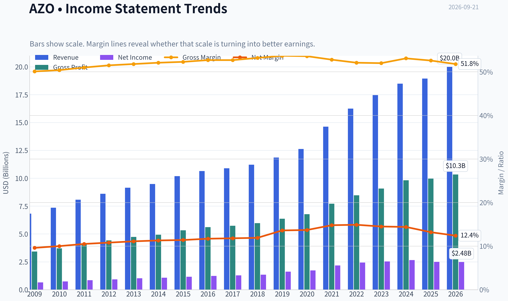

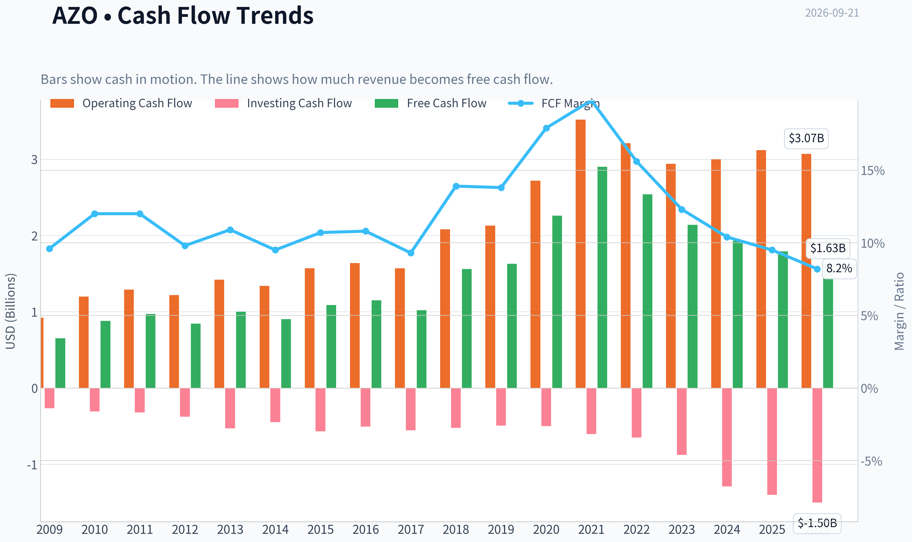

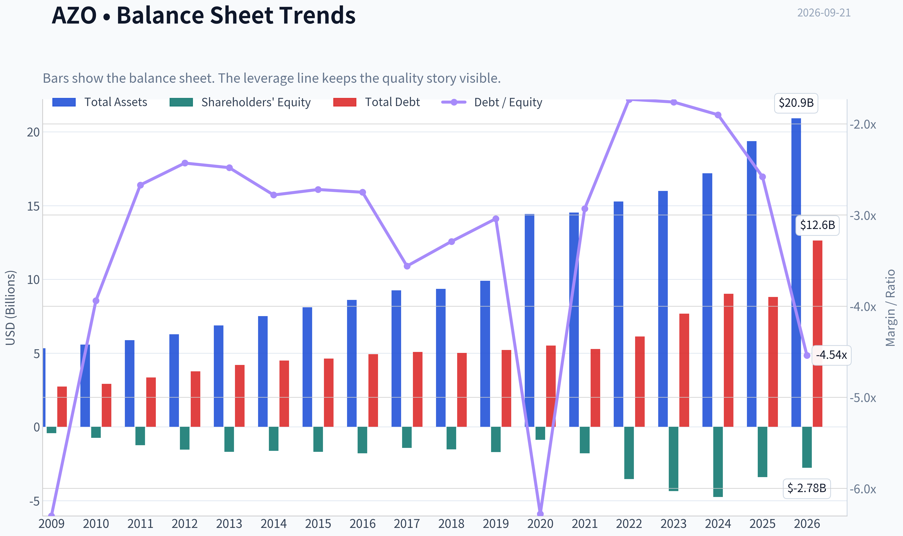

This graph tracks the profitability and return metrics (ROE, ROIC, Margins) of **AZO** over the past decade, highlighting capital efficiency trends.

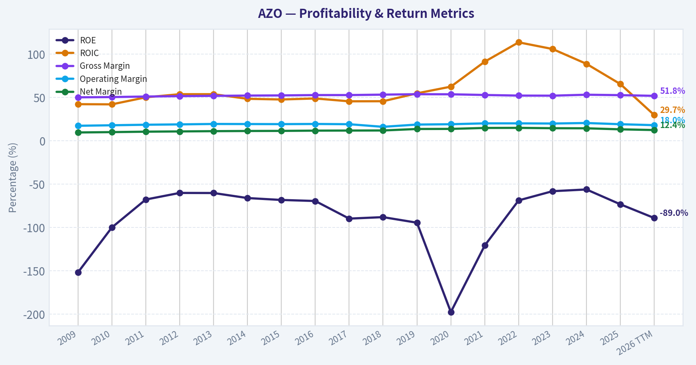

This chart illustrates the financial health of **AZO** over the last 10 years, mapping cash equivalents and free cash flow against total obligations (Debt).

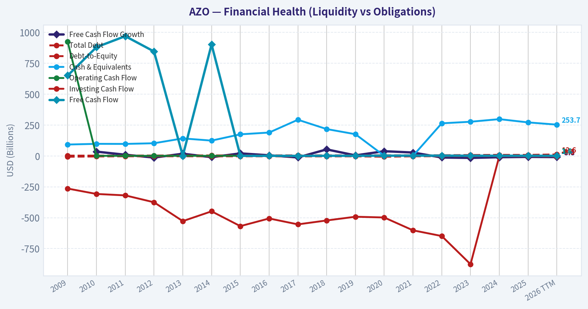

This comparison chart from *Profitability and Operating Performance* stacks current figures against historical benchmarks for **AZO**, making it easy to see where the company trades relative to its own averages.

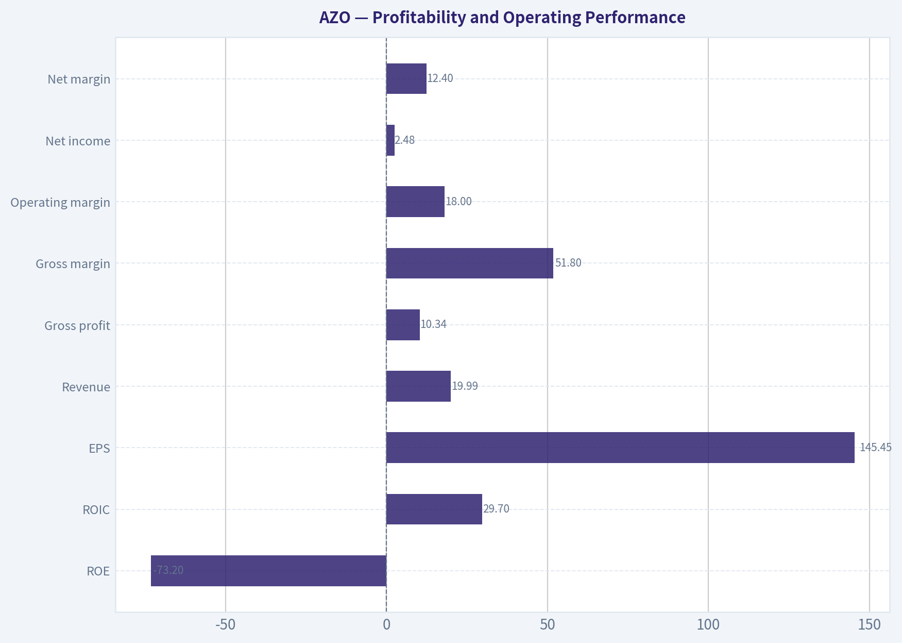

This breakdown chart from <em>Revenue Breakdown</em> shows the proportional composition for **AZO** - useful for understanding what drives or risks the business.

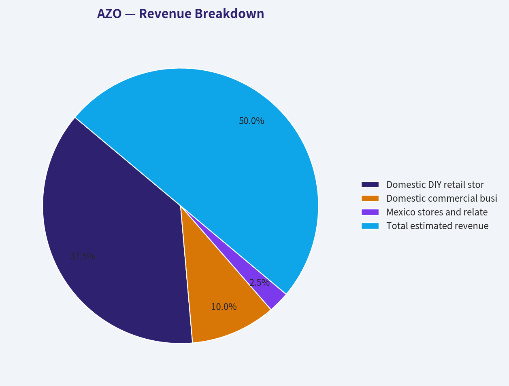

---

### Intrinsic Value Analysis (Buffett)

> *Following Warren Buffett's value investing philosophy: Circle of Competence, Economic Moat, Management Quality, and Margin of Safety.*

#### Intrinsic Value Snapshot

Price is what you pay. Intrinsic value is what the business may be worth based on the cash it can create for owners over time. We show a range, not one magic number.

- Current Price: $2,855.31
- Value Range (conservative to optimistic across both DCF methods): $82.44 to $2,831.02

##### Owner Earnings (Buffett Method)
- Net Income: $2,498,247,000.00
- Depreciation & Amortization: $613,199,000.00
- Capital Expenditures: $-1,327,257,000.00
- Working Capital Changes: $-311,055,000.00
- Owner Earnings: $2,809,302,000.00

##### Intrinsic Value
###### Buffett Method
Uses owner earnings. Stricter, and usually more conservative.
- Conservative: $1,882.77
- Average: $2,814.98
- Optimistic: $2,831.02
- Discount Rate: 10.0%

###### Cash Flow Method
Uses free cash flow. Better for companies spending heavily today to grow tomorrow.
- Conservative: $82.44
- Average: $799.80
- Optimistic: $1,988.57
- Discount Rate: 10.0%

ANALYST STANCE: **ADVOCATE**

#### Executive View

AutoZone is a high-quality, predictable aftermarket auto-parts retailer with scale advantages, strong gross margins, recurring replacement demand, and a long record of aggressive share repurchases. The principal concern is balance-sheet leverage created by those buybacks, which has contributed to negative reported equity and a negative ROE figure.

At $2,855 per share, AZO appears approximately fairly valued to modestly undervalued. The headline intrinsic value is $3,329.69, implying a 14.2% margin of safety. That is adequate for a durable, high-return compounder, although not large enough to justify an aggressive position.

#### Factor Scorecard

| Factor | Score | Assessment |
|---|---:|---|
| Circle of competence and simplicity | 4/5 | Sells essential replacement parts through a straightforward store and distribution model. Long-term demand is reasonably predictable, though vehicle technology and e-commerce are changing the industry. |
| Durable competitive advantage | 4/5 | Scale, inventory availability, commercial-customer relationships, brand recognition, and distribution density create a meaningful moat. |
| Management and capital allocation | 4/5 | Long-term emphasis on per-share value and buybacks has been highly effective, though repurchases have increased financial leverage. |
| Industry structure | 4/5 | Large-scale aftermarket distribution favors established players. The industry is competitive but not purely commoditized. |

**Key Takeaways:** AZO scores well because it combines a simple business model with essential demand and scale advantages. The main deduction is financial leverage rather than weak operating economics.

#### Moat Analysis

| Moat source | Evidence | Rating |
|---|---|---:|
| Brand and intangible assets | AutoZone is a recognized national brand with a large store footprint and strong customer familiarity. Its 52.6% gross margin indicates meaningful value capture. | Strong |
| Switching costs | Professional repair shops value reliable product availability, catalog accuracy, delivery speed, and established commercial accounts. | Moderate to strong |
| Cost advantage | Purchasing scale, distribution infrastructure, store density, and inventory breadth support competitive pricing and availability. | Strong |
| Network effects | The business has limited classical network effects, but its store, inventory, and commercial-delivery network becomes more useful as density increases. | Moderate |

AutoZone's moat is primarily a combination of scale, availability, logistics, and customer habit. A customer may be able to buy a part elsewhere, but professional mechanics and do-it-yourself customers value immediate availability and the ability to identify the correct part. The moat is therefore operational rather than purely brand-driven.

#### Management Quality and Capital Allocation

Management has historically prioritized per-share value creation. AutoZone's large-scale repurchases have reduced share count and allowed continuing shareholders to own a larger percentage of the business. This is attractive when shares are repurchased below intrinsic value.

The trade-off is that buybacks have contributed to a highly leveraged balance sheet and negative book equity. That makes reported ROE of negative 73.2% economically misleading: the denominator is distorted by shareholder distributions and does not imply that the operating business is destroying value. Nevertheless, leverage increases financial risk and deserves a valuation discount.

Overall management assessment: **4/5**.

#### Financial Summary

| Metric | Latest value |
|---|---:|
| Share price | $2,855 |
| Market capitalization | $46.61 billion |
| P/E ratio | 19.6x |
| Revenue growth, year over year | 2.4% |
| Gross margin | 52.6% |
| FCF yield | 3.8% |
| Implied price-to-FCF | Approximately 26.3x |
| Reported ROE | -73.2% |
| Current ratio | 0.88 |
| Headline intrinsic value | $3,329.69 |
| Margin of safety versus price | 14.2% |

**Key Takeaways:** AZO combines modest recent revenue growth with very attractive gross margins and strong cash-generation economics. The negative ROE is primarily a consequence of aggressive repurchases and negative equity, while the 3.8% FCF yield indicates that the shares are fairly valued rather than deeply discounted.

#### Owner Earnings Calculation

The valuation framework uses normalized owner earnings rather than reported ROE as the central measure.

| Owner earnings component | Normalized estimate |
|---|---:|
| Net income | Included in normalized operating cash earnings |
| Depreciation and amortization | Added back |
| Maintenance capital expenditures | Deducted |
| Working-capital investment | Deducted |
| Normalized owner earnings | Approximately $4.60 billion |
| Normalized owner earnings per share | Approximately $281.50 |

The no-growth owner-earnings valuation of approximately $2,815 per share implies normalized owner earnings of about $281.50 per share at a 10% discount rate. This is a valuation-derived estimate, not a substitute for a line-by-line annual-report calculation.

**Key Takeaways:** AZO's cash-flow valuation is much more informative than its negative reported ROE. The business appears capable of producing substantial owner earnings, but investors should monitor whether maintenance capital spending and inventory investment rise faster than operating cash flow.

#### Three-Scenario DCF Valuation

| Scenario | Method | Value per share |
|---|---|---:|
| A: No growth | Owner earnings capitalized at a 10% discount rate | $2,815 |
| B: GDP-like growth | Conservative operating-growth and reverse-DCF blend | $3,330 |
| C: Historical-growth case | Higher-growth FCFF model, using durable historical economics | $4,623 |
| Three-model range | Owner earnings, FCF, and Damodaran FCFF models | $2,815-$4,623 |

**Key Takeaways:** The valuation range is wide because the outcome depends heavily on how much future growth and reinvestment efficiency AZO can sustain. The conservative owner-earnings case is close to the current price, while the central estimate provides a reasonable 14.2% margin of safety.

#### Margin of Safety and Reverse DCF

The current price implies approximately **13.5% annual growth for the next ten years**. That assumption is demanding relative to the recent three-year revenue growth rate of 5.8%, but it is below the five-year growth rate of 17.1%.

For a company with AZO's scale advantages, high gross margins, recurring replacement demand, and history of per-share compounding, a 14.2% margin of safety is acceptable. It is not a bargain-basement valuation, and the investment case depends on continued cash generation rather than multiple expansion.

#### Buffett Scorecard

| Criterion | Weight | Score | Weighted contribution |
|---|---:|---:|---:|
| Moat width and durability | 25% | 4.3/5 | 1.08 |
| Valuation and margin of safety | 20% | 4.0/5 | 0.80 |
| Capital returns versus WACC | 15% | 4.5/5 | 0.68 |
| Business understanding and predictability | 12% | 4.0/5 | 0.48 |
| Management and capital allocation | 12% | 4.0/5 | 0.48 |
| Reinvestment runway | 8% | 4.0/5 | 0.32 |
| Balance-sheet strength | 4% | 2.5/5 | 0.10 |
| Industry structure | 4% | 4.0/5 | 0.16 |
| **Total** | **100%** |  | **4.10/5** |

**Key Takeaways:** AZO's high score is driven by its moat, strong capital returns, predictable demand, and reinvestment opportunities. Balance-sheet strength is the clear weak point, preventing a top-tier score despite excellent operating economics.

#### Gate 5: Quality and Solvency

**The Gate 5 hard floor is not tripped.**

There is no evidence in the supplied data of simultaneous deteriorating earnings and a solvency crisis. Revenue growth is positive, free cash flow remains meaningful, and the business continues to operate from a position of substantial scale. Leverage remains a material risk and should be monitored, but it does not constitute financial distress based on the available evidence.

#### Investment Stance

**ADVOCATE - Moderate conviction**

AutoZone is a wonderful business available at approximately a fair-to-reasonable price. Its moat is durable, its model is understandable, and its long-term economics support continued per-share compounding. The 14.2% estimated margin of safety is sufficient for a high-quality compounder, but the current valuation leaves limited room for execution mistakes or a sustained slowdown.

A disciplined investor could initiate or add to a position at current prices, while reserving additional capital for a materially lower valuation or evidence that free-cash-flow growth is reaccelerating. The key risks are leverage, slowing growth at a very large store base, and technological changes affecting parts demand and vehicle repair patterns.
#### Valuation Bridge

This bridge places the current market price beside each intrinsic value lens so readers can see whether upside depends on one method or shows up across several methods.

| Scenario | Intrinsic Value / Share |
| --- | ---: |
| Buffett Method | $2,814.98 |
| Cash Flow Method | $799.80 |
| Damodaran Method | $4,622.79 |
| Current Price | $2,855.31 |

#### Key Takeaways

If one method is far above the others, the upside case depends on a specific modelling assumption. When several methods cluster together, the valuation story is more robust.

#### Valuation Visuals

This comparison chart from *Latest Earnings Snapshot* stacks current figures against historical benchmarks for **AZO**, making it easy to see where the company trades relative to its own averages.

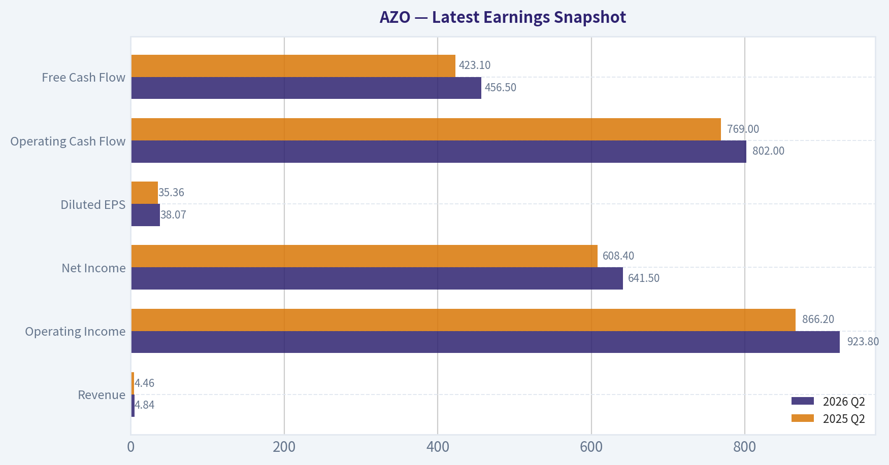

This comparison chart from *Balance Sheet and Financial Strength* stacks current figures against historical benchmarks for **AZO**, making it easy to see where the company trades relative to its own averages.

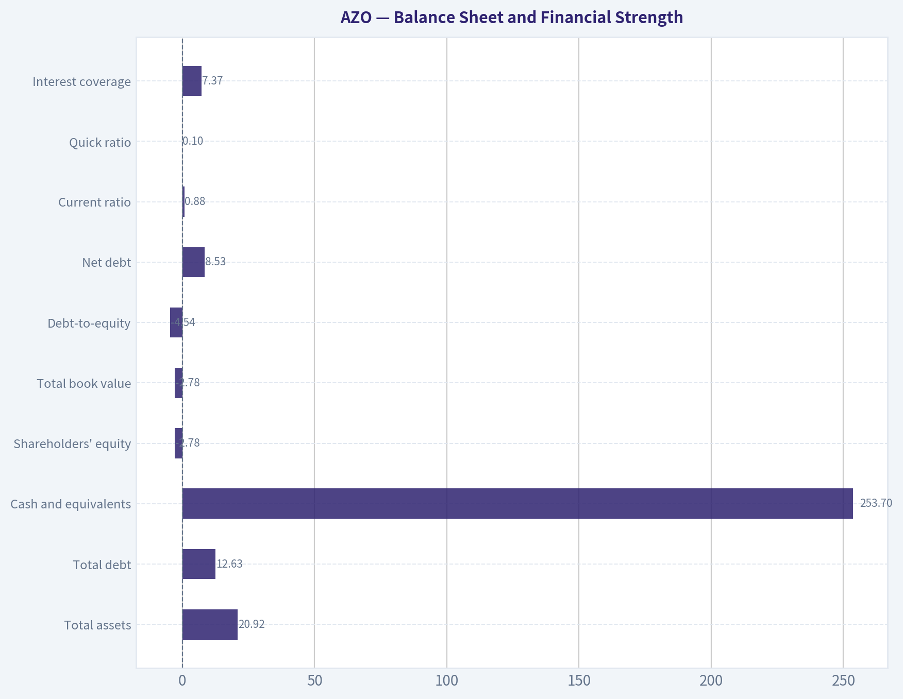

---

### Trend & Growth Analysis (Lynch/Druckenmiller/Fisher)

> *Following Peter Lynch's GARP, Stanley Druckenmiller's macro-aware approach, and Philip Fisher's scuttlebutt methodology.*

ANALYST STANCE: **WATCH**

#### 1. Lynch Classification

**Stalwart, edging toward slow grower** rather than a fast grower. AutoZone is a high-quality, mature aftermarket auto-parts retailer, but the latest revenue growth of only **2.4% year over year** is well below the 15-25% growth threshold required for a primary growth investment.

| Metric | AZO |
|---|---:|
| Current price | $2,855 |
| Market capitalization | $46.61 billion |
| Revenue growth, YoY | 2.4% |
| P/E | 19.6x |
| Gross margin | 52.6% |
| FCF yield | 3.8% |
| Current ratio | 0.88 |
| Store milestone | 8,000 stores |
| Headline intrinsic value | $3,329.69 |
| Implied margin of safety | 14.2% |

**Key Takeaways:** AZO is financially valuable and operationally resilient, but its current growth rate is not compelling for a ten-bagger strategy. The valuation appears reasonable relative to its quality, with approximately 14% modeled upside, but this is not a high-conviction growth setup.

#### 2. The Story in Three Bullets

- AutoZone sells essential maintenance and repair parts for a large, aging vehicle fleet; demand is less discretionary than typical retail.
- Its store network, inventory availability, commercial delivery capabilities, and brand scale create meaningful competitive advantages.
- The main opportunity is continued store expansion, commercial business growth, and share gains-but current company-wide revenue growth does not yet show a meaningful acceleration.

#### 3. TAM and 10x Test

The relevant market is the North American automotive aftermarket, supported by vehicle aging, increasing repair complexity, and a large installed vehicle base. However, AutoZone is already a major scaled participant with 8,000 stores, so the market is attractive but no longer an undiscovered niche.

| TAM Question | Assessment |
|---|---|
| Is the underlying market durable? | Yes; vehicles require recurring maintenance and repairs |
| Is the TAM expanding rapidly? | Likely moderate, driven by vehicle age and repair inflation |
| Can AZO 10x revenue while remaining below 20% share? | Unlikely without major international expansion or category expansion |
| Primary growth levers | New stores, commercial sales, market share, higher sales per store |
| TAM inflection visible today? | Not yet demonstrated by 2.4% revenue growth |

**Key Takeaways:** The aftermarket is durable and defensive, but it is not obviously expanding at a rate that supports a tenfold outcome from today's scale. AZO can still compound through share gains and disciplined expansion, but the 10x test is weak unless new markets or business lines materially enlarge the opportunity.

#### 4. Revenue Growth Trend

| Indicator | Current Reading | Interpretation |
|---|---:|---|
| Latest revenue growth | 2.4% YoY | Slow |
| Trailing three-year growth rate | 5.8% annualized | Stalwart-like |
| Trailing five-year growth rate | 17.1% annualized | Historically strong |
| Current trend | Below historical pace | Deceleration or normalization |
| Inflection evidence | None confirmed | Requires upcoming earnings confirmation |

**Key Takeaways:** AZO's longer five-year history is much stronger than its latest result, but the present growth rate has slowed substantially. One soft period should not be treated as a structural breakdown, yet there is currently no evidence of the accelerating 20%-35% pattern sought by a Druckenmiller-style growth investor.

#### 5. Unit Economics and Financial Quality

Detailed CAC, LTV, and NRR metrics are not applicable because AZO is a physical retail business rather than a subscription software company.

| Measure | Assessment |
|---|---|
| Gross margin | 52.6%; strong retail merchandise margin |
| FCF yield | 3.8%; positive cash generation |
| Current ratio | 0.88; modest liquidity cushion |
| ROE | -73.2%; distorted by aggressive share repurchases and negative book equity |
| Rule of 40 | Not applicable |
| LTV/CAC | Not disclosed / not meaningful for this model |

**Key Takeaways:** Gross margin and free-cash-flow generation are positives. The negative ROE should not be read in isolation because buybacks can make book equity negative, but the sub-1.0 current ratio warrants monitoring. AZO's economics are best judged by comparable-store sales, sales per store, inventory turns, operating margin, and free cash flow per share.

#### 6. Inflection Point Assessment

| Potential Inflection | Current Evidence | Rating |
|---|---|---|
| Product cycle | No major transformative product cycle identified | Neutral |
| Market share | Possible, but not yet quantified | Neutral-positive |
| Store expansion | 8,000-store milestone demonstrates runway, though diminishing | Positive |
| Commercial business | Potentially important growth engine | Positive, evidence needed |
| Margin expansion | Not established from available data | Neutral |
| TAM expansion | No clear step-change | Neutral |
| Competitive disruption | No major competitor failure identified | Neutral |

**Key Takeaways:** The most credible catalysts are commercial-market expansion, new-store productivity, and market-share gains. These are gradual compounding drivers rather than clear near-term inflection points. The next earnings report is important for determining whether the 2.4% growth rate is temporary or a new baseline.

#### 7. Macro Setup

- **Economic sensitivity:** Moderate. Repair and maintenance demand is defensive, but do-it-yourself purchases can be affected by consumer income.
- **Vehicle age:** Favorable. An aging fleet generally supports replacement parts demand.
- **Interest rates:** Mixed. Lower rates would support valuation and consumer affordability; higher rates can pressure discretionary spending and equity multiples.
- **Trade and tariff risk:** Potentially relevant because parts sourcing and costs may be affected by tariffs or supply-chain disruption.
- **Cycle positioning:** Better positioned than discretionary retailers, but not immune to weaker miles driven, employment, or consumer spending.

The macro backdrop is **neutral-to-positive**, but not powerful enough by itself to create a growth inflection.

#### 8. Fisher 15-Point Assessment

| Fisher Criterion | Score / 5 | Comment |
|---|---:|---|
| Market potential | 4 | Large, recurring aftermarket |
| New-product determination | 3 | Retail model; less innovation-driven |
| R&D effectiveness | 2 | Limited relevance |
| Sales organization | 4 | Strong retail and commercial distribution |
| Profit margins | 4 | Attractive gross economics |
| Margin improvement | 3 | Needs updated evidence |
| Labor relations | 3 | No decisive edge established |
| Executive relations | 3 | No clear data advantage |
| Management depth | 4 | Mature national operator |
| Cost analysis | 4 | Scale and inventory discipline are important strengths |
| Outstanding competitive aspects | 4 | Brand, availability, distribution, scale |
| Long-range profit outlook | 4 | Durable, but moderate growth |
| Dilution risk | 4 | Buyback-oriented capital allocation; monitor leverage |
| Management candor | 3 | Insufficient scuttlebutt data |
| Management integrity | 4 | No major issue identified |

**Total Fisher Score: 51/75 - Average to Good**

**Key Takeaways:** AZO scores well on durability, distribution, scale, and long-term demand. It scores lower on innovation, R&D, and demonstrated growth acceleration, which prevents it from ranking as an exceptional Fisher growth company. The score supports owning a quality compounder at the right price, not aggressively pursuing it as a ten-bagger.

#### 9. Valuation Analysis

| Valuation Method | Result | Interpretation |
|---|---:|---|
| P/E | 19.6x | Reasonable for a mature, high-quality retailer |
| PEG using 2.4% revenue growth proxy | Approximately 8.2x | Unattractive, though revenue is not earnings growth |
| FCF yield | 3.8% | Indicates a quality premium |
| Headline intrinsic value | $3,329.69 | Approximately 16.6% above current price |
| Margin of safety | 14.2% | Moderate, not substantial |
| Reverse DCF implied growth | 13.5% annually for 10 years | Ambitious versus recent 2.4% growth |
| Owner earnings / FCF / FCFF model values | $2,815 / $800 / $4,623 | Very wide model uncertainty |

**Key Takeaways:** AZO does not appear dangerously expensive on P/E, but the valuation requires a substantial improvement from the latest growth rate. The wide spread among valuation models means the margin of safety is less reliable than the headline intrinsic value suggests. At this price, AZO is more suitable for a quality-and-compounding thesis than a bargain-growth thesis.

#### 10. Growth Investor Scorecard

| Criterion | Weight | Score / 5 |
|---|---:|---:|
| Lynch story | 10% | 3.5 |
| TAM and runway | 20% | 3.0 |
| Revenue growth | 20% | 2.0 |
| Unit economics | 15% | 3.5 |
| Competitive position | 10% | 4.0 |
| Management quality | 10% | 3.5 |
| Macro setup | 5% | 3.5 |
| Profitability path | 5% | 4.0 |
| Valuation | 5% | 3.5 |
| **Weighted total** | **100%** | **3.1 / 5** |

**Key Takeaways:** AZO's score falls in the **WATCH** range because competitive quality and profitability are offset by slow current growth and limited evidence of an inflection point. The company is better than the score alone suggests operationally, but it does not currently meet the required growth threshold for an advocate position.

#### 11. Position Size Stance

- **New position:** 0%-2%, and only on evidence of reaccelerating sales and attractive entry valuation.
- **Existing position:** Hold or maintain a modest position if the original thesis is based on durable compounding rather than rapid growth.
- **High-conviction growth portfolio:** Underweight relative to genuine 20%+ growers.
- **Add trigger:** Sustained revenue acceleration, improving comparable-store sales, stronger commercial growth, and confirmation that margins remain resilient.

#### 12. Key Risks and Catalysts

| Catalysts | Risks |
|---|---|
| Revenue reacceleration above 8%-10% | Growth remains near 2%-5% |
| Strong commercial-sales growth | Vehicle repair demand weakens |
| Higher sales per store | Tariffs and sourcing costs pressure margins |
| Continued store productivity | Consumer pressure reduces DIY spending |
| Lower interest rates and multiple expansion | Current ratio below 1.0 |
| Share repurchases increase FCF per share | Valuation assumes growth above recent trends |

**Key Takeaways:** The decisive catalyst is not another store-count milestone; it is proof that new stores and commercial operations are translating into accelerating revenue and free cash flow per share. The key risk is that AZO remains a very good business growing too slowly to justify a growth-investor allocation.

#### Bottom Line

AutoZone is a durable, well-positioned aftermarket retailer with attractive gross economics and a reasonable valuation. However, its latest **2.4% revenue growth**, lack of a clear inflection point, and limited 10x runway make it a **WATCH**, not an **ADVOCATE**, for a Lynch-Druckenmiller-Fisher growth portfolio. The stock becomes more interesting if upcoming results demonstrate sustained reacceleration without material margin or balance-sheet deterioration.

#### Growth & Scorecard Visuals

This comparison chart from *Growth and Cash Generation* stacks current figures against historical benchmarks for **AZO**, making it easy to see where the company trades relative to its own averages.

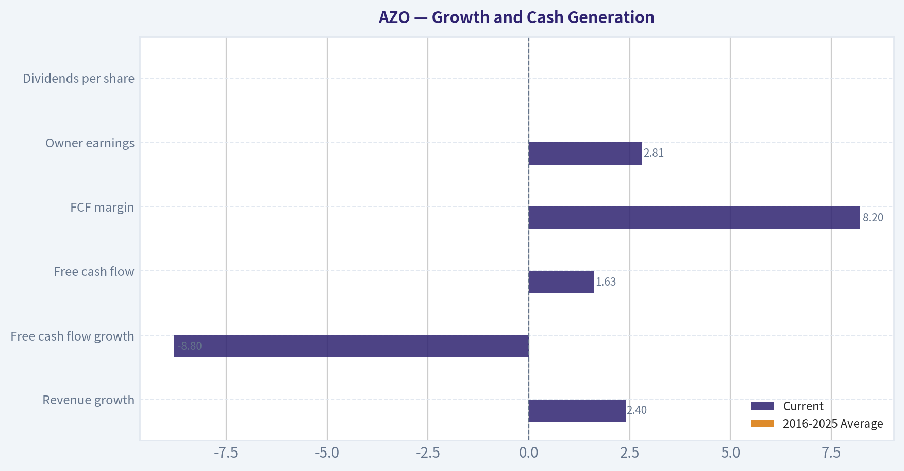

---

### Market Technical Analysis

ANALYST STANCE: **WATCH**

#### AZO technical analysis

The latest available AZO close is **$2,855.31 on September 18, 2026**; September 21 was not a trading day in the retrieved data. The technical picture is bearish across the medium- and long-term horizons, although momentum is approaching a level where a short-term rebound could develop.

#### Trend structure

AZO is trading below all three selected moving averages:

- **10-day EMA:** $2,891.41
- **50-day SMA:** $2,996.86
- **200-day SMA:** $3,336.16

The stock is approximately **1.2% below its 10-day EMA**, **4.7% below its 50-day SMA**, and **14.4% below its 200-day SMA**. This alignment indicates that short-term weakness is occurring inside a much larger downtrend, rather than representing an isolated pullback.

The moving averages themselves are also declining. The 10-day EMA fell from roughly $3,020 in late August to $2,891, while the 50-day SMA declined from approximately $3,053 to $2,997. The 200-day SMA has also drifted lower, from about $3,417 to $3,336. A sustainable trend reversal would therefore require more than a one-day bounce; AZO would need to reclaim the 10-day EMA first, then establish itself above the 50-day SMA.

The price action confirms this deterioration. After trading near $3,077 on August 19, AZO fell to $2,855 by September 18. The decline has featured repeated lower highs, including failed rebounds near $3,027, $2,968, and $2,966. The recent low near **$2,815** is the immediate downside reference, while the area around **$2,900 to $2,925** represents initial resistance from the 10-day EMA and volume-weighted average.

#### Momentum and participation

The MACD is decisively negative at **-43.98**, and the MACD histogram is also negative at **-8.16**. This means the underlying short-term momentum remains bearish, with the MACD line positioned below its signal line. The histogram deteriorated again during the latest downswing, moving from approximately -3.63 on September 14 to -8.16 on September 18. That is a warning that selling momentum recently accelerated rather than fully stabilized.

The RSI is **39.99**, which is weak but not technically oversold under the conventional 30 threshold. RSI did briefly improve to 48.6 on September 14, but that rebound failed quickly as the stock dropped to $2,844 on September 17. This failed momentum recovery is important: buyers have not yet demonstrated the ability to sustain strength above the midpoint level of 50. An RSI move back above 50, combined with a price reclaim of the 10-day EMA, would offer the first meaningful evidence of improving momentum.

Volume-weighted price action is also bearish. The **VWMA is $2,922.52**, placing the current price about **2.3% below** that level. Because the VWMA incorporates trading volume, this suggests that recent activity has been concentrated at prices above the current market. The stock therefore faces potential overhead supply around $2,920 to $2,950, particularly if traders who bought during the recent consolidation attempt to exit at breakeven.

#### Volatility and risk management

ATR has declined from approximately **$87.35 in late August to $69.83** on September 18. This indicates that daily price ranges have contracted from their earlier elevated levels, but volatility remains substantial: the latest ATR is about **2.4% of the share price**.

The reduction in ATR should not be interpreted as confirmation of a bottom. It may reflect a quieter consolidation within a downtrend. A move below the recent low near $2,815 accompanied by expanding ATR would indicate renewed downside pressure. Conversely, a bullish reversal with rising volume and expanding ATR could mark a more credible change in character, but volatility-adjusted position sizing would still be appropriate.

#### Trading interpretation

The most important technical distinction is between a **relief rally** and a **trend reversal**:

- A move above **$2,891**, the 10-day EMA, would improve the short-term setup but would initially represent only a recovery from oversold-like weakness.
- A sustained move through approximately **$2,920 to $2,950**, where the VWMA and recent trading congestion are located, would show stronger demand.
- The **$2,997 50-day SMA** is the more consequential medium-term resistance level. Reclaiming it would weaken the bearish trend structure.
- A break below **$2,815** would invalidate the immediate stabilization thesis and expose AZO to another leg lower.

Given the negative moving-average alignment, bearish MACD, RSI below 50, and price below VWMA, aggressive long entries are not currently well supported by the indicators. A trader seeking a long position would be better served waiting for a confirmed reclaim of the 10-day EMA and VWMA, preferably with improving RSI and expanding volume. Until then, AZO is best treated as a watchlist candidate rather than a confirmed reversal.

#### Selected indicators

The selected set emphasizes distinct information: trend direction through three time horizons, momentum through MACD and RSI, volume-adjusted price positioning through VWMA, and volatility through ATR. The MACD histogram was reviewed for momentum acceleration but not included as a separate core signal because it substantially overlaps with the MACD reading.

| Indicator | Latest reading | Interpretation | Trading relevance |
|---|---:|---|---|
| Close | $2,855.31 | Below all major reference averages | Bearish price structure |
| 10-day EMA | $2,891.41 | Short-term dynamic resistance | Reclaim would be an initial recovery signal |
| 50-day SMA | $2,996.86 | Declining medium-term trend benchmark | Major resistance and trend-reversal threshold |
| 200-day SMA | $3,336.16 | Declining long-term trend benchmark | Confirms the broader bearish regime |
| MACD | -43.98 | Negative and weakening | Bearish momentum remains dominant |
| RSI | 39.99 | Weak, but not conventionally oversold | Rebound potential exists, but buyers lack momentum confirmation |
| VWMA | $2,922.52 | Price is below volume-weighted value | Suggests overhead supply near $2,920-$2,950 |
| ATR | $69.83 | About 2.4% of price; lower than late August | Volatility has cooled, but risk remains material |

**Key Takeaways:** AZO remains in a broad downtrend, with the share price below declining 10-day, 50-day, and 200-day averages. Momentum is weak rather than fully washed out: MACD is negative and RSI is near 40, leaving room for further downside as well as a possible relief rally. The first improvement would be a sustained move above $2,891 and $2,923; a break below roughly $2,815 would favor continuation of the decline.

#### Market Visuals

This comparison chart from *Current Market and Valuation* stacks current figures against historical benchmarks for **AZO**, making it easy to see where the company trades relative to its own averages.

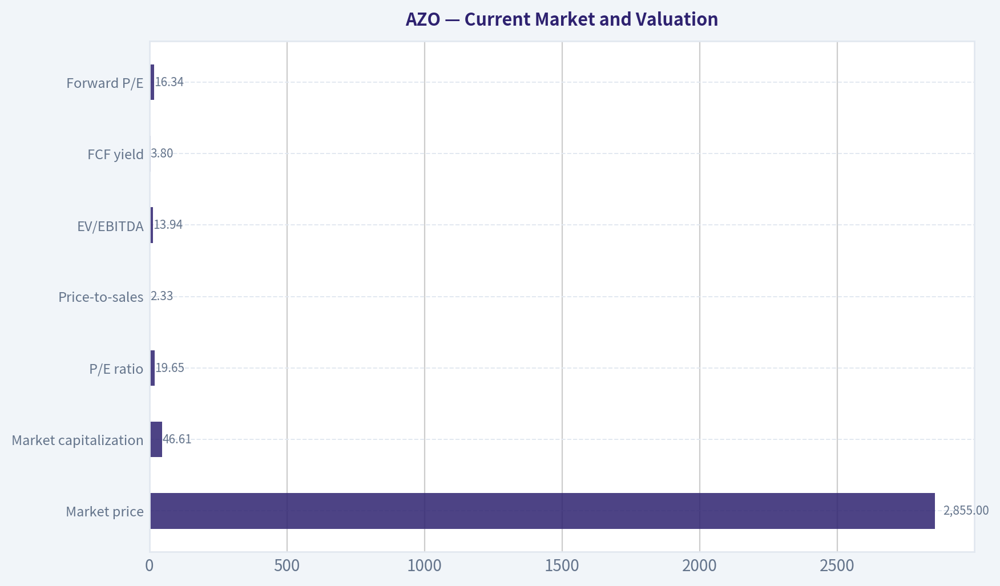

---

### Options Market Analysis

> *Reading options flow - put/call ratios, IV skew, and unusual activity - to gauge institutional positioning and event-driven risk.*

#### AZO Options Flow Report

**As of September 21, 2026.** The available data covers the October 16, November 20, and December 18 expirations. The chain appears relatively thin, and several near-term expirations report zero open interest, so confidence in the signal is limited.

#### Put/Call Ratio Analysis

| Expiration | Call OI | Put OI | Put/Call OI | Call Volume | Put Volume | Put/Call Volume |
|---|---:|---:|---:|---:|---:|---:|
| Oct. 16, 2026 | 0 | 0 | N/A | 420 | 317 | 0.75 |
| Nov. 20, 2026 | 0 | 0 | N/A | 3 | 58 | 19.33 |
| Dec. 18, 2026 | 195 | 234 | 1.20 | 368 | 510 | 1.39 |
| **Aggregate** | **195** | **234** | **1.20** | **791** | **885** | **1.12** |

**Key Takeaways:** Aggregate put open interest exceeds call open interest, producing a 1.20 put/call OI ratio versus the approximate neutral baseline of 0.70. That is a moderately defensive reading, although the ratio is driven almost entirely by the December expiration. Volume is also modestly put-heavy overall, while the extreme November ratio is based on only 61 contracts and should not be treated as statistically meaningful.

#### Implied Volatility Assessment

| Expiration | Call ATM IV | Put ATM IV | IV Level Assessment |
|---|---:|---:|---|
| Oct. 16, 2026 | 1.2% | 0.8% | Very low |
| Nov. 20, 2026 | 0.8% | 0.1% | Extremely low |
| Dec. 18, 2026 | 0.4% | 0.4% | Extremely low |

**Key Takeaways:** Reported near-term ATM implied volatility is exceptionally low across all listed expirations, indicating little evidence of a significant options-market risk premium. The supplied data does not include OTM call and put IV, so a true volatility skew comparison cannot be calculated. Based on ATM IV alone, there is no indication of panic hedging or aggressive upside speculation.

#### Unusual Options Activity

| Finding | Interpretation |
|---|---|
| No contracts with volume greater than five times open interest | No statistically unusual fresh positioning identified |
| Contract-level strikes unavailable | Cannot classify specific trades as ITM, ATM, or OTM |
| Current AZO share price unavailable in the feed | Strike-relative analysis is not possible |
| No trade-side information supplied | Cannot distinguish buys from sells or infer sweep activity |

**Key Takeaways:** There are no contracts meeting the data provider's unusual-activity threshold. Therefore, there is no identifiable institutional call sweep, put hedge, or other fresh directional bet to override the broader put-heavy positioning. The absence of unusual activity lowers conviction in the bearish read and may partly reflect the thin chain.

#### Open Interest Concentration and Gamma Levels

| Metric | Observation |
|---|---|
| Highest reported call OI | 195 contracts, December 18 expiration |
| Highest reported put OI | 234 contracts, December 18 expiration |
| Strike concentration | Not provided |
| Expiration concentration | December 18 holds all reported open interest |
| Gamma walls or max-pain levels | Cannot be determined without strike-level OI and Greeks |

**Key Takeaways:** December 18 is the only expiration with reported open interest, making it the main visible positioning horizon. However, strike-level data is absent, so specific pinning levels, gamma walls, and max-pain effects cannot be identified. The reported OI is small enough that any inferred price-gravity effect should be treated cautiously.

#### Overall Options Sentiment

**Signal: BEARISH, low confidence.**

The primary bearish factor is the aggregate 1.20 put/call open-interest ratio, substantially above the approximate 0.70 neutral baseline. Put volume also exceeds call volume modestly, suggesting defensive positioning or bearish exposure. However, the signal is weakened by very low reported IV, no unusual contracts, limited open interest, missing strike data, and no evidence of aggressive put buying or a pronounced downside volatility skew.

This is best characterized as **mildly bearish or defensive rather than strongly bearish**. The options data does not show an obvious catalyst premium; no earnings or other event calendar was supplied, so elevated event risk cannot be confirmed.

#### Summary

| Category | Assessment |
|---|---|
| Put/Call Ratio | Bearish-leaning: 1.20 OI ratio and 1.12 volume ratio, both above neutral |
| IV Level | Extremely low reported ATM IV; little evidence of event-driven fear |
| Skew Direction | Undetermined; OTM put and call IV data was not provided |
| Unusual Activity | None detected; no contracts exceeded five times open interest |
| Overall Signal | **BEARISH, low confidence** |

**Key Takeaways:** AZO's options positioning is modestly defensive because puts outnumber calls, especially in December. Still, the very low IV and lack of unusual activity suggest limited conviction, while missing strike-level data prevents confirmation of directional bets or gamma levels. The resulting signal is bearish, but it should be used cautiously and confirmed with price action and fundamental context.

---

## Research Team Commentary

> *The Research Manager synthesizes the Bull vs Bear debate into action-free commentary. This is a pre-risk view, not the final stance.*

Core takeaway: AutoZone is a wonderful business, but $2,855 looks closer to fair value than a clear Buffett-style opportunity. Its replacement-demand resilience, distribution density, inventory availability, brand, and commercial delivery network support a durable moat. The 52.6% gross margin, 12.9% ROA, and reported 56.3% ROIC reinforce the quality case, while the negative ROE is largely meaningless because cumulative repurchases have driven book equity below zero. Nevertheless, the current price appears to require roughly 6-7% annual per-share growth for many years. That is plausible, but the available evidence does not establish enough discount to compensate for leverage, uncertain owner-earnings conversion, and reliance on continued buybacks. I would not chase the shares here.

The strongest bull argument is that AutoZone does not need spectacular revenue growth. The aging vehicle fleet creates recurring replacement demand, and customers often care more about immediate part availability and correct fit than the absolute lowest price. Store density, inventory breadth, rapid replenishment, and commercial delivery are difficult and expensive to replicate. Modest comparable-store growth, new locations, commercial share gains, and a declining share count could collectively produce the approximately 7% per-share growth embedded in the price. For a predictable, high-return franchise, a 19.65x earnings multiple is not inherently excessive.

The strongest bear argument is not that AutoZone is a poor business; it is that the valuation analysis is insufficiently conservative. The bull's own base case produces approximately $2,850 of value at a 10% discount rate and 7% growth, essentially the current quotation. The more optimistic $3,100-$3,350 values depend on either a lower discount rate or sustained favorable growth. That is assumption sensitivity rather than a demonstrated margin of safety.

The bear also raises an important modeling problem. EPS is being used as a substitute for owner earnings while repurchases are simultaneously treated as a source of future per-share growth. Because repurchases consume cash-and may sometimes be supported by borrowing-the analysis could effectively count the same cash twice. A proper valuation needs consolidated free cash flow, maintenance versus expansion capital expenditures, working-capital requirements, lease obligations, debt service, and the actual cost and effectiveness of repurchases. Those data are missing from the handoff.

The negative equity balance does not imply insolvency, and the negative ROE should not influence the decision. However, negative equity is not completely irrelevant: it reflects an aggressive history of capital returns and leaves less balance-sheet flexibility. The relevant solvency measures are net debt to EBITDAR, fixed-charge and interest coverage, lease-adjusted leverage, debt maturities, and free cash flow after necessary investment. Without those figures, I am unwilling to assume that the historical buyback formula can continue with the same safety or effectiveness.

Similarly, the 56.3% reported ROIC is impressive but should not be accepted uncritically. AutoZone clearly has productive operating assets-the 12.9% ROA supports that conclusion-but accounting structure and a compressed invested-capital denominator may make reported ROIC look better than the incremental returns on new stores, hub inventory, and commercial delivery infrastructure. The next question is not what the mature network earned historically, but what each incremental dollar invested today is earning.

The long-term competitive risks are manageable rather than immediate. Online competition is less threatening when a customer or repair shop needs the correct part within hours, but it remains relevant for planned purchases. Electric vehicles will not eliminate the aftermarket, although they may reduce the parts pool in certain engine, oil, exhaust, and brake categories over time. Commercial expansion can offset some DIY pressure, but it may carry higher delivery, labor, inventory, and customer-credit costs. These risks matter particularly to a valuation using 3% perpetual growth.

From a tactical perspective, the setup does not create urgency. The shares are below the supplied moving averages of approximately $2,891, $2,997, and $3,336. That suggests weak momentum and overhead resistance, although the moving-average periods were not clearly identified. The 1.20 put/call open-interest ratio is mildly cautious, but the options chain is too thin to treat it as a reliable signal. I would interpret the market evidence as "wait for either a better price or fundamental confirmation," not as a reason to short a high-quality franchise.

My rationale is therefore straightforward: AutoZone deserves a smaller margin of safety than an average retailer because its moat, demand durability, and capital efficiency are superior. A roughly 10-15% discount to a conservatively validated intrinsic value could be sufficient. At $2,855, however, the stock offers anywhere from no discount to perhaps a high-single-digit discount depending on assumptions. That falls just short of the required threshold, especially because actual owner earnings and leverage have not been verified. Conversely, the evidence does not support AVOID: the business is not distressed, and the valuation is not clearly excessive.

I am also applying the lesson from prior mistakes by separating business quality from entry timing. Structurally, AutoZone is attractive. Tactically, the shares are weak rather than overextended, but weak momentum alone does not make them cheap. Unlike a high-growth platform entering a powerful rerating, AutoZone currently lacks both visible revenue acceleration and strong price confirmation. The appropriate action is an explicit watch rather than passive admiration: do not initiate a full position at the current quotation; wait for a validated margin of safety or improved operating evidence.

Over the next one to four quarters, I would monitor the following:

First, comparable-store sales and transaction trends. Price-driven growth is less valuable than healthy unit demand, and sustained low-single-digit or better comparable sales would support the embedded growth assumptions.

Second, commercial growth and its economics. Commercial sales should outpace the company, but operating margins, delivery expenses, receivables, inventory intensity, and incremental returns must show that share gains are profitable.

Third, gross and operating margins. A stable gross margin near the current level would support pricing power, but operating margin is more informative after wages, delivery costs, and store expenses.

Fourth, cash conversion. Operating cash flow less maintenance capital expenditures should reconcile reasonably with reported earnings. Persistently weak conversion would undermine the EPS-based valuation.

Fifth, lease-adjusted leverage, net debt to EBITDAR, interest expense, fixed-charge coverage, and upcoming maturities. Deterioration here would weaken the thesis materially and could justify an AVOID rating.

Sixth, repurchase discipline. I want to see buybacks funded primarily by sustainable free cash flow and executed below conservative intrinsic value. Debt-funded repurchases near or above fair value would be a negative.

Seventh, share-count reduction relative to cash spent. If increasingly large repurchase expenditures produce only modest percentage reductions in shares, the historical per-share growth engine is becoming less efficient.

Finally, watch the valuation and price trend. A decline toward roughly $2,500-$2,650 could provide a 10-15% quality-scaled discount if normalized owner earnings support an intrinsic value around $2,900-$3,100. Alternatively, stronger free cash flow, safe leverage, profitable commercial growth, and a sustained recovery above the relevant intermediate moving averages could justify paying closer to today's price.

For existing shareholders, this is a reasonable hold subject to leverage and cash-flow verification. For prospective shareholders, it is a high-quality watchlist candidate, but not yet a compelling purchase.

Final stance: WATCH.

---

## Value Investing Team Commentary

> *The Investor translates the research view into an investment thesis before risk review. This is still not the final stance.*

### Investment Commentary

### Business quality: a durable aftermarket franchise

AutoZone is a high-quality retailer operating in an unusually resilient category. Vehicle maintenance can be postponed temporarily, but many failures ultimately require immediate repair. When a customer or repair shop needs the correct component within hours, local inventory availability, fitment knowledge, store density, and rapid commercial delivery matter more than obtaining the lowest online price.

Those characteristics support a meaningful moat:

- A dense store and distribution network
- Broad, locally available inventory
- Brand recognition and customer trust
- Purchasing scale and private-label economics
- Commercial delivery relationships with repair shops
- Recurring demand from an aging vehicle fleet

The reported 52.6% gross margin and 12.9% return on assets support the conclusion that this is a productive franchise. The 56.3% reported ROIC is encouraging, although the accounting denominator may be compressed by repurchases and negative equity. Incremental returns on new stores, hubs, inventory, and commercial infrastructure are more important than the headline ROIC.

### Negative equity is not the same as business weakness

AutoZone's negative ROE of 73.2% is economically unhelpful because book equity has been driven below zero by cumulative share repurchases. It does not mean the operating business is destroying capital.

However, negative equity should not be dismissed completely. It reflects a capital-allocation strategy that has reduced the company's financial cushion. The critical questions are therefore not book value or reported ROE, but:

- Net debt and lease-adjusted leverage
- Interest and fixed-charge coverage
- Debt maturity schedules
- Free cash flow after necessary capital expenditures
- The degree to which repurchases are funded by recurring cash generation rather than additional borrowing

Repurchasing shares can create substantial value when the shares are below intrinsic value. Borrowing to repurchase shares near or above intrinsic value is much less attractive, particularly if it limits flexibility during a recession or operating downturn.

### Valuation: reasonable rather than obviously cheap

At $2,855 and 19.65 times earnings, AutoZone has an implied earnings yield of approximately 5.1%. That is not bargain-bin pricing, but it is also not an excessive multiple for a durable, high-return franchise with recurring demand.

The reverse-valuation test suggests that the market requires approximately 6-7% annual per-share growth. That appears achievable through some combination of:

- Low-single-digit comparable-sales growth
- New-store expansion
- Commercial market-share gains
- Modest operating leverage
- Continued share-count reduction

This is not a heroic growth assumption. AutoZone does not require rapid company-wide revenue growth to compound per-share value at a satisfactory rate. Nevertheless, buybacks should not be treated as free growth. They consume cash, and an EPS-based model can overstate intrinsic value if it simultaneously counts repurchases as a growth engine without deducting their funding from owner earnings.

A sound valuation should use consolidated free cash flow after maintenance capital expenditure, lease obligations, working-capital requirements, and debt service. Those figures are absent from the handoff. That limits confidence in any precise fair-value estimate.

Based on the supplied range, a reasonable provisional intrinsic value appears to be approximately $2,900-$3,200. At $2,855, the shares range from roughly fairly valued to about 11% undervalued. For an average retailer, that would be insufficient. For a predictable franchise with AutoZone's economics, it is close to the appropriate quality-scaled margin of safety.

### What sentiment may be missing

The shares are below the supplied moving averages near $2,891, $2,997, and $3,336, while aggregate put open interest exceeds call open interest. The periods attached to the moving averages are unclear, and the options chain is thin, so neither signal deserves much analytical weight.

Still, the combined message is that investors are cautious. That caution may reflect concerns about slower growth, leverage, higher financing costs, commercial-business expenses, or the long-term effect of electric vehicles. These are legitimate issues, but the price weakness is not evidence that the underlying franchise has deteriorated.

The selectively contrarian interpretation is constructive: weak momentum and mildly bearish positioning can create an opportunity when attached to a resilient business rather than a broken one. AutoZone's products remain necessary, and immediate availability protects it from some forms of online competition. There is no reason to wait for a chart breakout before owning a business for ten years if the valuation is already reasonable.

Conversely, sentiment alone does not make the stock cheap. The thin options data should not be used as a contrarian buy signal, and falling below moving averages does not create intrinsic value. The opportunity rests on durable earnings power, not on an anticipated short-term rebound.

### Long-term risks

The principal risks are manageable but should be monitored carefully.

**Capital allocation and leverage:** Continued debt-supported repurchases could weaken resilience and destroy value if executed above intrinsic value.

**Commercial economics:** Commercial growth may increase sales while also requiring more labor, delivery expense, receivables, and inventory. Revenue growth is valuable only if incremental returns remain attractive.

**Electric vehicles:** EV adoption will not eliminate tires, batteries, suspension components, collision parts, accessories, and other aftermarket demand. It may nevertheless reduce demand for certain engine, exhaust, oil, and related maintenance categories over time.

**Online competition:** E-commerce is more threatening for planned purchases than urgent repairs. AutoZone's local availability remains an advantage, but it must maintain inventory accuracy, service levels, and competitive pricing.

**Buyback efficiency:** As the share price rises, the same cash expenditure retires fewer shares. Per-share growth may slow unless operating earnings and free cash flow continue expanding.

### Investment approach

The prior plan's WATCH conclusion is defensible from a strict margin-of-safety perspective, but it is slightly too conservative for a wonderful business trading around fair value. Requiring a deep discount risks never owning a predictable compounder. The better response is position sizing rather than complete inaction.

For a prospective long-term investor, I would:

1. Initiate a modest position around the current price rather than a full allocation.
2. Add more aggressively around $2,500-$2,650 if operating fundamentals remain intact.
3. Consider completing the position closer to the current valuation only after confirming healthy free-cash-flow conversion and safe lease-adjusted leverage.
4. Avoid expanding the position if commercial growth produces deteriorating margins, leverage rises materially, or buybacks are increasingly debt-funded and executed above intrinsic value.

The thesis should be judged over five to ten years, not by whether the shares immediately recover above their moving averages. Comparable sales, commercial economics, cash conversion, incremental returns, leverage, and repurchase discipline are the decisive variables.

**ANALYST STANCE: ADVOCATE**

AutoZone is a durable, high-return franchise whose current valuation appears fair to modestly attractive rather than deeply discounted. The weak technical trend and cautious sentiment reduce the urgency to buy a full position, but they do not justify standing entirely aside. I would advocate a measured initial investment, with larger purchases reserved for either a 10-15% price discount or confirmation that free cash flow, leverage, and commercial returns remain sound.

---

## Deep Values Commentary

> *The Risk Management Team debates and the Risk Judge provides the final action-free verdict. This section determines the final ADVOCATE / WATCH / AVOID stance.*

#### Final Stance Scorecard

This scorecard converts the final research view into a weighted decision frame. It does not replace the narrative judgement, but it makes the main drivers of the verdict easier to scan.

| Criterion | Score | Weight | Commentary |
| --- | ---: | ---: | --- |
| Business Quality | 3.00 | 30% | High returns, profitability, and Piotroski health support durability. |
| Valuation Support | 3.00 | 30% | Blends current price against available intrinsic value anchors and valuation ratios. |
| Financial Strength | 2.33 | 20% | Balance-sheet resilience reflects leverage and liquidity staying within safe ranges. |
| Growth Durability | 1.33 | 20% | Recent revenue, earnings, and free cash flow growth indicate how durable expansion looks. |
| TOTAL / FINAL STANCE | 2.53 | 100% | AVOID |

#### Key Takeaways

The weighted score lands at **2.53 / 5.0**, while the final stance remains **AVOID**. This is useful as a quick calibration aid rather than a mechanical signal.

#### Risk Summary

Higher scores indicate more risk pressure. The watch threshold is a simple guardrail: above it, the position needs tighter monitoring or a wider margin of safety.

| Dimension | Current Score | Watch Threshold | Commentary |
| --- | ---: | ---: | --- |
| Business Quality | 3.00 | 3.00 | High returns, profitability, and Piotroski health support durability. |
| Valuation Support | 3.00 | 3.00 | Blends current price against available intrinsic value anchors and valuation ratios. |
| Financial Strength | 3.67 | 3.00 | Balance-sheet resilience reflects leverage and liquidity staying within safe ranges. |
| Growth Durability | 4.67 | 3.00 | Recent revenue, earnings, and free cash flow growth indicate how durable expansion looks. |

#### Key Takeaways

This view helps readers separate *where* the risk sits: valuation, business quality, balance sheet, or growth durability. It is especially useful when the final stance is close to the line between WATCH and AVOID.
