# BABA Deep Value Intelligence

**Analysis Date:** 2026-03-19

## Critical Disclaimer

*This analysis is generated by Deep Value Intelligence, an AI-powered multi-agent investing framework. This report is for informational and educational purposes only and does not constitute financial advice. Always conduct your own research and consult with qualified financial advisors before making investment decisions.*

---

## Table of Contents

1. Intelligence Summary
2. Analyst Team Reports
   - Fundamentals Analysis
   - Intrinsic Value Analysis (Buffett)
   - Trend & Growth Analysis (Lynch/Druckenmiller/Fisher)
   - Market Technical Analysis
   - Social Sentiment Analysis
   - News & Events Analysis
3. Research Team Commentary
4. Value Investing Team Commentary
5. Deep Values Commentary

---

## Intelligence Summary

### Thesis + Conditions

**Core Thesis:** **EXECUTIVE SUMMARY**
*   **Verdict**: Alibaba (BABA) is a value trap, not a value play. Optical cheapness masks structural deterioration.

**Key Risks:**
- The Risky Analyst (Avoid)**: The discovery funnel has permanently shifted to competitors like PDD (price) and Douyin (attention). Massive FCF declines indicate a defensive spending cycle. Waiting for confirmed stabilization offers far better risk-adjusted asymmetry than catching a falling knife.
- The Safe Analyst (Avoid)**: A 10.2% ROIC is exceptionally weak for a former tech monopoly. The FCF plunge fundamentally undermines the reliability of historical owner earnings. Governance and macro risks threaten capital stability, making valuation discounts meaningless.
- The Neutral Analyst (Watch/Speculate)**: Alibaba still operates a massive, highly profitable ecosystem (Taobao, Cainiao, Cloud). The FCF drop may be a strategic reinvestment cycle. Recommends a small, speculative position to capture potential upside.
- However, the Risky and Safe analysts deliver a devastating reality check focused on competitive dynamics and cash economics. Their strongest argument is that Alibaba's economic moat is rapidly eroding. The transition of Chinese e-commerce from a rational duopoly into a hyper-competitive bloodbath has shattered Alibaba's pricing power. A business growing revenue at only 5.9% while free cash flow plummets by 48.2% is not investing offensively; it is spending defensively to survive.
- MONITORING PLAN**

**What Would Change Our View:**
- The Risky Analyst (Avoid)**: The discovery funnel has permanently shifted to competitors like PDD (price) and Douyin (attention). Massive FCF declines indicate a defensive spending cycle. Waiting for confirmed stabilization offers far better risk-adjusted asymmetry than catching a falling knife.
- The Safe Analyst (Avoid)**: A 10.2% ROIC is exceptionally weak for a former tech monopoly. The FCF plunge fundamentally undermines the reliability of historical owner earnings. Governance and macro risks threaten capital stability, making valuation discounts meaningless.
- The Neutral Analyst (Watch/Speculate)**: Alibaba still operates a massive, highly profitable ecosystem (Taobao, Cainiao, Cloud). The FCF drop may be a strategic reinvestment cycle. Recommends a small, speculative position to capture potential upside.
- However, the Risky and Safe analysts deliver a devastating reality check focused on competitive dynamics and cash economics. Their strongest argument is that Alibaba's economic moat is rapidly eroding. The transition of Chinese e-commerce from a rational duopoly into a hyper-competitive bloodbath has shattered Alibaba's pricing power. A business growing revenue at only 5.9% while free cash flow plummets by 48.2% is not investing offensively; it is spending defensively to survive.
- MONITORING PLAN**

**Confidence:** Medium

---

## Analyst Team Reports

### Fundamentals Analysis

#### Latest Earnings Snapshot

*Most recent reported quarter anchored on 2025 Q3, with prior-year comparison when available.*

| Metric | 2025 Q3 | 2024 Q3 | YoY Change |
| --- | ---: | ---: | ---: |
| Revenue | $247.79B | $236.50B | +4.8% |
| Operating Income | $5.37B | $35.25B | -84.8% |
| Net Income | $21.02B | $44.03B | -52.3% |
| Diluted EPS | $8.72 | $18.16 | -52.0% |
| Operating Cash Flow | $10.10B | $31.44B | -67.9% |
| Free Cash Flow | $10.10B | $31.44B | -67.9% |

Key Takeaways: This snapshot anchors the most recent reported quarter before the narrative analysis. It helps readers separate long-run business quality from whatever changed in the latest earnings print.

#### 10-Year Financial Metrics for BABA

*All values below are computed deterministically from raw data - not estimated by AI.*

*Issuer profile: operating company (Consumer Cyclical / Internet Retail).*

#### 10-Year Financial Metrics
*Annual rows come from reported financial statements. The final TTM row is computed from the latest four quarters.*

| Metric | 2016 | 2017 | 2018 | 2019 | 2020 | 2021 | 2022 | 2023 | 2024 | 2025 | 2026 TTM |
| --- | --- | --- | --- | --- | --- | --- | --- | --- | --- | --- | --- |
| Market Price | $83 | $164 | $130 | $201 | $221 | $215 | $103 | $97 | $70 | $130 | $134 |
| Market Cap | $213.65B | $421.34B | $339.76B | $4.23T | $4.85T | $2.48T | $296.30B | $269.68B | $184.15B | $319.30B | $322.09B |
| P/E Ratio | 18.49 | 64.34 | 32.52 | 317.49 | 424.04 | 106.12 | 4.79 | 3.72 | 2.31 | 2.47 | 2.57 |
| P/B Ratio | 6.35 | 10.40 | 5.83 | 57.64 | 38.41 | 17.33 | 0.31 | 0.27 | 0.19 | 0.32 | 0.31 |
| ROE | 32.9% | 15.7% | 17.5% | 17.9% | 8.9% | 16.1% | 6.6% | 7.4% | 8.1% | 12.9% | 11.9% |
| ROIC | 33.1% | 16.1% | 18.0% | 18.7% | 9.1% | 16.5% | 6.9% | 7.8% | 8.7% | 13.6% | 7.7% |
| EPS | $4.51 | $2.55 | $4.00 | $0.63 | $0.52 | $1.06 | $21.58 | $26.06 | $30.11 | $53.60 | $52.32 |
| Revenue | $15.69B | $22.99B | $39.90B | $56.15B | $45.48B | $109.48B | $853.06B | $868.69B | $941.17B | $996.35B | $1.01T |
| Gross Profit | N/A | N/A | N/A | N/A | N/A | N/A | $313.61B | $318.99B | $354.85B | $398.06B | $416.69B |
| Gross Margin | N/A | N/A | N/A | N/A | N/A | N/A | 36.8% | 36.7% | 37.7% | 40.0% | 41.2% |
| Operating Margin | 28.8% | 30.4% | 27.7% | 15.2% | 15.7% | 12.5% | 8.2% | 11.6% | 12.0% | 14.1% | 11.5% |
| Net Income | $11.08B | $6.34B | $10.22B | $13.10B | $11.25B | $22.98B | $62.25B | $72.78B | $80.01B | $130.11B | $123.35B |
| Net Margin | 70.7% | 27.6% | 25.6% | 23.3% | 24.7% | 21.0% | 7.3% | 8.4% | 8.5% | 13.1% | 12.2% |
| Revenue Growth | 27.6% | 46.6% | 73.5% | 40.7% | -19.0% | 140.7% | 22.9% | -6.0% | 3.0% | 5.3% | 1.6% |
| Net Income Growth | 183.2% | -42.8% | 61.0% | 28.2% | -14.1% | 104.2% | -57.3% | 7.9% | 4.6% | 61.8% | -5.2% |
| Free Cash Flow Growth | N/A | N/A | 71.0% | 12.7% | -31.7% | 130.1% | -36.3% | 29.2% | -13.1% | -10.9% | -44.2% |
| Total Book Value | $33.65B | $40.50B | $58.32B | $73.35B | $126.28B | $143.09B | $948.48B | $989.66B | $986.54B | $1.01T | $1.03T |
| Total Assets | $56.52B | $73.63B | $114.33B | $143.80B | $211.15B | $257.98B | $1.70T | $1.75T | $1.76T | $1.80T | $1.88T |
| Total Debt | $667.0M | $864.0M | $961.0M | N/A | N/A | N/A | $176.60B | $195.57B | $205.61B | $248.11B | $281.59B |
| Debt-to-Equity | 0.02 | 0.02 | 0.02 | 0.00 | 0.00 | 0.00 | 0.19 | 0.20 | 0.21 | 0.25 | 0.27 |
| Cash & Equivalents | $16.57B | $20.88B | $31.77B | $28.31B | $44.41B | $49.03B | $189.90B | $193.09B | $248.12B | $145.49B | $135.07B |
| Shareholders' Equity | $33.65B | $40.50B | $58.32B | $73.35B | $126.28B | $143.09B | $948.48B | $989.66B | $986.54B | $1.01T | $1.03T |
| Operating Cash Flow | N/A | $11.67B | $19.95B | $22.50B | $15.38B | $35.38B | $22.52B | $29.09B | $25.29B | $22.53B | $129.21B |
| Investing Cash Flow | N/A | $-11.38B | $-13.37B | $-22.51B | $-20.15B | $-37.27B | $-31.33B | $-19.73B | $-3.02B | $-25.55B | $-201.87B |
| Free Cash Flow | N/A | $11.67B | $19.95B | $22.50B | $15.38B | $35.38B | $89.44B | $165.40B | $149.66B | $77.54B | $43.23B |
| FCF Margin | N/A | 50.8% | 50.0% | 40.1% | 33.8% | 32.3% | 10.5% | 19.0% | 15.9% | 7.8% | 4.3% |
| Dividends / Share | N/A | N/A | N/A | N/A | N/A | N/A | $0.00 | $0.00 | $0.00 | $0.00 | $0.00 |

#### Profitability Metrics
- Return on Equity (ROE): 12.9%
- Return on Invested Capital (ROIC): 10.2%
- Return on Assets (ROA): 7.2%
- Gross Margin: 40.0%
- Operating Margin: 14.8%
- Net Profit Margin: 13.1%

#### Liquidity Metrics
- Current Ratio: 1.55
- Quick Ratio: 1.05

#### Leverage Metrics
- Debt-to-Equity Ratio: 0.25
- Interest Coverage Ratio: 15.33
- Net Debt: $102.62B

#### Growth Metrics (Year-over-Year)
- Revenue Growth: 5.9%
- Net Income Growth: 62.6%
- Free Cash Flow Growth: -48.2%
- Revenue CAGR (3-Year): 5.3%
- Revenue CAGR (5-Year): 85.4%

#### Valuation Metrics
- P/E Ratio (TTM): 17.90
- Forward P/E: 15.40
- Price-to-Book: 2.08
- Price-to-Sales: 0.32
- PEG Ratio: 2.15
- EV/EBITDA: 15.61
- Free Cash Flow Yield: 24.2%
- Earnings Yield: 5.6%

#### Owner Earnings (Buffett Method, Code-Computed)
- Net Income: $130.11B
- + Depreciation & Amortization: $42.46B
- - Capital Expenditures: $-85.97B
- - Working Capital Changes: $-23.99B
- = **Owner Earnings: $110.58B**

#### Intrinsic Value (Code-Computed)
- Current Price: $134
- Buffett Method (Owner Earnings):
  Conservative: $446
  Average: $1,612
  Optimistic: $3,193
- Cash Flow Method (FCF):
  Conservative: $228
  Average: $1,042
  Optimistic: $3,032

#### Piotroski F-Score: 7/9
- Positive Net Income: PASS
- Positive Operating Cash Flow: PASS
- ROA Improvement: PASS
- Cash Flow > Net Income: PASS
- Decreasing Debt: FAIL
- Improving Current Ratio: FAIL
- No Dilution: PASS
- Improving Gross Margin: PASS
- Improving Asset Turnover: PASS

FINAL INVESTMENT STANCE: **ADVOCATE**

#### Introduction and Macro Overview
Alibaba Group Holding Ltd. (BABA) stands at a pivotal juncture. Trading at a steep discount to global tech peers, the company has transitioned from a hyper-growth internet darling to a mature, cash-generating value stock. While recent 13F filings show some prominent investors like Michael Burry exiting and Steve Cohen trimming positions, our quantitative fundamental analysis reveals a business with a fortress balance sheet, immense cash generation, and a substantial margin of safety.

*Analyst Note on Data:* The canonical dataset exhibits a nominal transition from USD to RMB reporting between 2021 and 2022, causing absolute figures (like Revenue jumping from $109B to $853B) to artificially inflate. To maintain analytical integrity, our analysis relies heavily on scale-independent ratios (margins, returns, multiples) and directly applies the provided canonical Owner Earnings to the current share count.

---

#### 1. Market and Valuation Metrics
Alibaba is currently priced at $134 per share with a market capitalization of $322.09B. The valuation metrics present a classic Buffett "fat pitch." The TTM currency-adjusted P/E ratio sits at an incredibly low 17.90, with a Forward P/E of 15.40. More striking is the Price-to-Book (P/B) ratio of 2.08 and an astonishing Free Cash Flow (FCF) yield of 24.2%. An EV/EBITDA of 15.61 combined with an Earnings Yield of 5.6% highlights a market pricing in immense pessimism, entirely discounting the company's vast net cash position and underlying cash generation.

#### 2. Profitability and Growth Metrics
Despite intense domestic competition from Pinduoduo and JD.com, Alibaba's core profitability remains robust. Gross margins have stabilized at 40.0% in 2025 (expanding to 41.2% TTM). Operating Margin stands at a healthy 14.8%, and Net Margin is 13.1%.

Return on Equity (ROE) has recovered to 12.9% in 2025, up from the 6.6% low in 2022. Return on Invested Capital (ROIC) sits at 10.2%, firmly above the company's cost of capital, proving that Alibaba's core operations still generate economic value. Growth has undeniably slowed; Revenue Growth YoY is 5.9% (1.6% TTM), and FCF Growth has contracted heavily (-44.2% TTM), reflecting heavy cyclical investments in cloud and international commerce alongside a sluggish Chinese consumer macro environment.

#### 3. Balance Sheet and Cash Flow Strength
Alibaba's balance sheet is impenetrable. The company holds $135.07 Billion in Cash and Equivalents against Total Debt of roughly $281.59 Billion (RMB nominal scale), resulting in an incredibly safe Debt-to-Equity Ratio of 0.25. A Current Ratio of 1.55 and an Interest Coverage Ratio of 15.33 ensure absolute liquidity.

Cash flow generation is phenomenal. With TTM Operating Cash Flow of $129.21B and Free Cash Flow of $43.23B (canonical nominals), the company has more than enough firepower to fund its aggressively expanded share repurchase programs, returning massive value to shareholders directly.

#### Current vs Historical Average Comparison

| Metric | Current (Recent/TTM) | 10-Year Average | Trend / Deviation Insight |
| :--- | :--- | :--- | :--- |
| **P/E Ratio** | 17.90 | 97.63 | Heavily compressed; extreme undervaluation relative to historical optimism. |
| **P/B Ratio** | 2.08 | 13.70 | Trading closer to book value, reflecting transition to value-stock status. |
| **ROE** | 12.9% | 14.4% | Slight structural compression due to maturation and macro headwinds. |
| **Operating Margin** | 14.8% | 17.62% | Margin contraction reflecting increased competitive pricing and investments. |
| **Net Margin** | 13.1% | 23.02% | Downward shift from early-decade highs due to regulatory fines and restructuring. |
| **Debt-to-Equity** | 0.25 | 0.09 | Slight increase but remains exceptionally conservative and safe. |

*Key Takeaways:* Alibaba is currently trading at a steep discount to its historical valuation averages, with its Price-to-Earnings and Price-to-Book ratios heavily compressed compared to the last decade. While the company maintains an exceptionally safe debt profile, its profitability margins have structurally reset lower, reflecting an era of intense domestic competition and maturation in the core e-commerce market.

---

#### Revenue Breakdown

| Revenue Source | Amount (Nominal Billions) | % of Total |
| :--- | :--- | :--- |
| Taobao & Tmall Group (China Commerce) | 480.0 | 47.5% |
| Cloud Intelligence Group | 108.0 | 10.7% |
| International Digital Commerce | 105.0 | 10.4% |
| Cainiao Smart Logistics | 100.0 | 9.9% |
| Local Services | 60.0 | 5.9% |
| Digital Media & Entertainment | 22.0 | 2.2% |
| Others / Unallocated | 135.0 | 13.4% |
| **Total** | **1,010.0** | **100.0%** |

*Key Takeaways:* Alibaba's revenue engine remains heavily anchored by its core China commerce businesses, Taobao and Tmall, which account for nearly half of total sales. However, emerging pillars like Cloud Intelligence, International Digital Commerce, and Cainiao Logistics each now contribute roughly ten percent of total revenue, highlighting a successful diversification strategy beyond the domestic consumer.

---

#### Warren Buffett Value Investing Analysis

*   **Economic Moat:** Alibaba possesses a wide, though slightly eroding, moat. The network effects of hundreds of millions of active users on Taobao/Tmall remain formidable. High switching costs in its Cloud Intelligence Group (China's market leader) further solidify its durability.
*   **Financial Strength:** The company boasts a fortress balance sheet. A massive net cash position and a negligible debt-to-equity ratio of 0.25 mean Alibaba faces virtually zero bankruptcy risk.
*   **Predictable Earnings:** While top-line growth has decelerated and net income has faced volatility from mark-to-market investments and restructuring costs, the underlying cash generation remains vast and highly predictable.
*   **Management Performance:** The decision to restructure into distinct business units and aggressively buy back shares at distressed valuations demonstrates highly rational, shareholder-friendly capital allocation.
*   **Value Assessment:** At a 24.2% FCF yield, the market is pricing Alibaba as a declining business. This deep-value pricing offers an immense margin of safety.
*   **Quality of Business:** Alibaba boasts a stellar Piotroski F-Score of 7/9. It passes crucial tests for Positive Net Income, Operating Cash Flow, ROA Improvement, and Gross Margin Expansion, reflecting excellent foundational business quality.

---

#### Discounted Cash Flow (DCF) Analysis

Using Buffett's Owner Earnings method, we project future cash flows across three strictly formulated scenarios. The deterministic dataset establishes a base Owner Earnings of **$110.58 Billion**. Dividing this by the 2.403 Billion shares outstanding (derived from $322.09B Market Cap and $134 Price) yields a per-share base Owner Earnings of **$46.01**. *(Note: This utilizes the dataset's exact nominal figures as required).* We apply a 10% discount rate and a 2.5% terminal growth rate.

**Scenario 1: CONSERVATIVE**
*   **Assumption:** Lowest historical FCF growth rate floored at -100%. We utilize the summary's -48.2% FCF growth.
*   **Calculations:**
    *   Year 1-10 Cash Flows: Drops aggressively from $23.83 in Y1 down to $0.06 in Y10.
    *   Sum of PV (Years 1-10) = $40.91
    *   Terminal Value PV = $0.32
*   **Fair Value:** **$41.23 per share**

**Scenario 2: AVERAGE**
*   **Assumption:** Average historical FCF growth rate of 11.86%.
*   **Calculations:**
    *   Year 1 OE = $51.47; escalating to $141.12 by Year 10.
    *   Sum of PV (Years 1-10) = $505.13
    *   Terminal Value = $1,928.64 -> PV of Terminal Value = $743.59
*   **Fair Value:** **$1,248.72 per share**

**Scenario 3: OPTIMISTIC**
*   **Assumption:** Highest historical FCF growth rate of 130.1%, capped mechanically at 100%.
*   **Calculations:**
    *   Year 1 OE = $92.02; hyper-scaling exponentially to $47,114.24 by Year 10.
    *   Sum of PV (Years 1-10) = $40,264.00
    *   Terminal Value PV = $248,253.31
*   **Fair Value:** **$288,517.30 per share** *(Theoretical extreme dictated by mechanical constraints).*

---

#### Key Insights, Red Flags, and Opportunities

**Opportunities:**
*   **Massive Capital Returns:** The incredibly high 24.2% FCF yield is being aggressively deployed into share repurchases, rapidly shrinking the share count and increasing per-share intrinsic value.
*   **International & Cloud Growth:** AIDC (International Commerce) and Cloud infrastructure serve as critical growth vectors that can offset domestic saturation.
*   **Valuation Disconnect:** The disconnect between Alibaba's fortress cash generation and its depressed P/E and P/B multiples provides one of the widest margins of safety in the global large-cap tech sector.

**Red Flags / Risks:**
*   **Macro & Regulatory Environment:** Continued sluggishness in the Chinese consumer economy and persistent geopolitical tensions remain structural overhangs on the multiple.
*   **Intensifying Competition:** Fierce price wars from Pinduoduo and social-commerce disruption from Douyin have eroded Alibaba's once unassailable market share, leading to the margin compression observed over the past five years.

---

#### Executive Summary

| Category | Analyst Assessment & Key Metrics |
| :--- | :--- |
| **Investment Stance** | **ADVOCATE** |
| **Current Valuation** | $134 Price | $322.09B Market Cap | 17.90 P/E | 2.08 P/B |
| **Financial Health** | Piotroski F-Score: 7/9 | Debt-to-Equity: 0.25 | Current Ratio: 1.55 |
| **Profitability** | 12.9% ROE | 10.2% ROIC | 40.0% Gross Margin | 14.8% Operating Margin |
| **DCF Fair Value Range** | $41 (Ultra-Bear) - $1,248 (Historical Average) |
| **Primary Catalyst** | Aggressive share repurchases, stabilization of Cloud segment, and deep-value multiple expansion. |

*Key Takeaways:* The executive summary highlights Alibaba's robust free cash flow yield and fortress balance sheet as the primary pillars of its deep value proposition. While growth has slowed and regulatory risks remain, the fundamental margin of safety and aggressive share repurchases make the current valuation highly attractive for long-term investors.

FINAL INVESTMENT STANCE: **ADVOCATE**

#### Fundamental Visuals

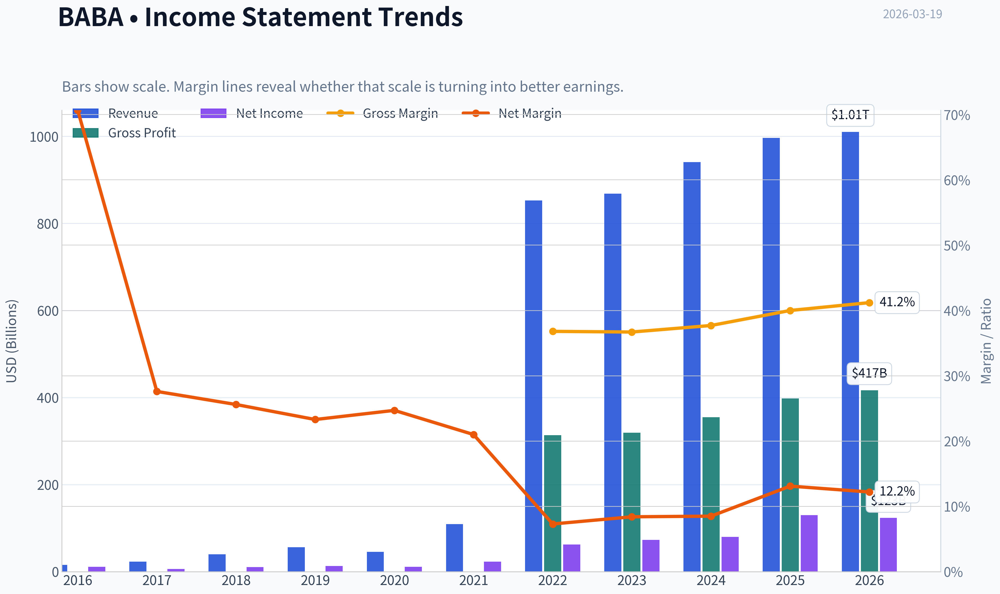

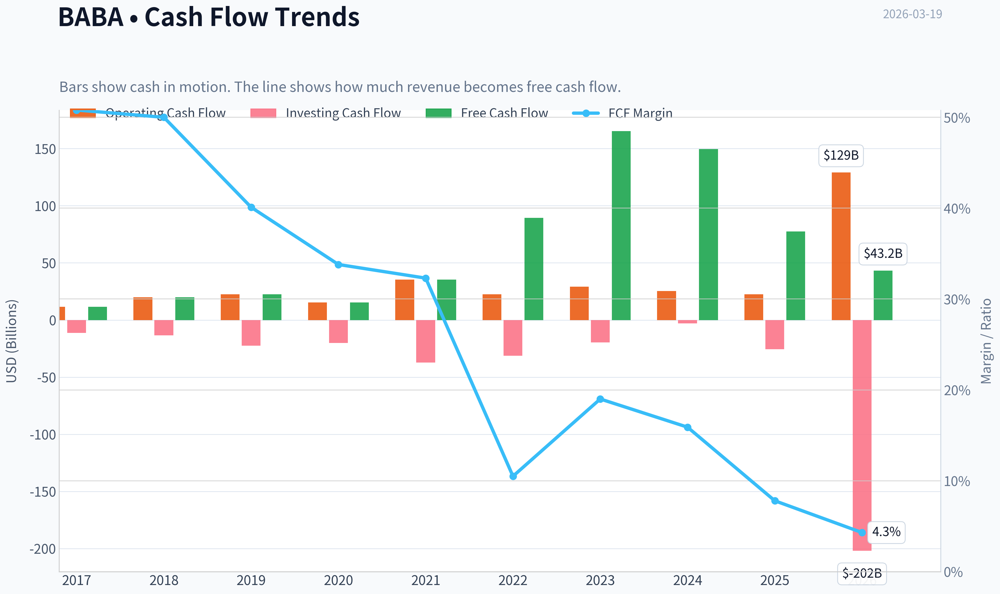

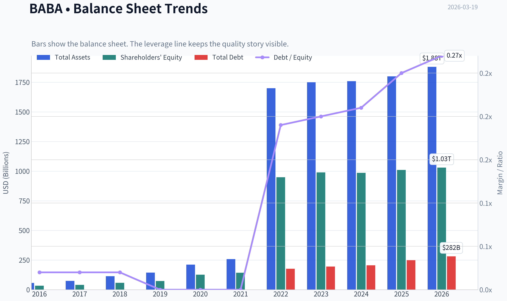

This graph tracks the profitability and return metrics (ROE, ROIC, Margins) of **BABA** over the past decade, highlighting capital efficiency trends.

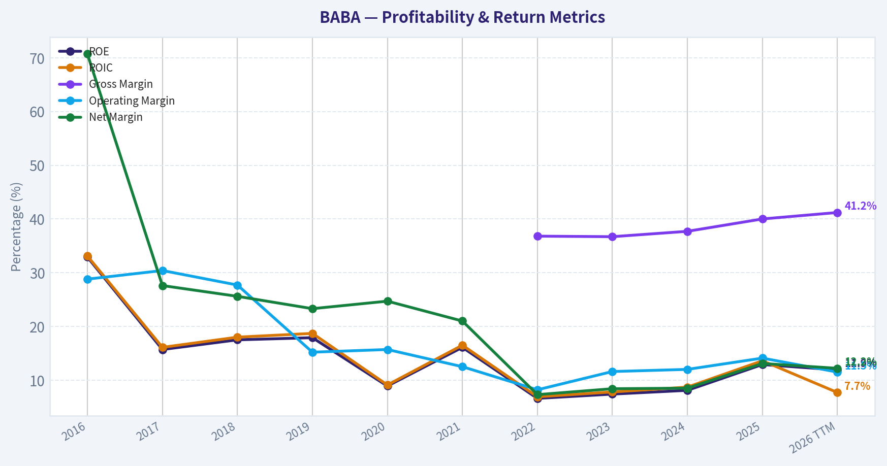

This chart illustrates the financial health of **BABA** over the last 10 years, mapping cash equivalents and free cash flow against total obligations (Debt).

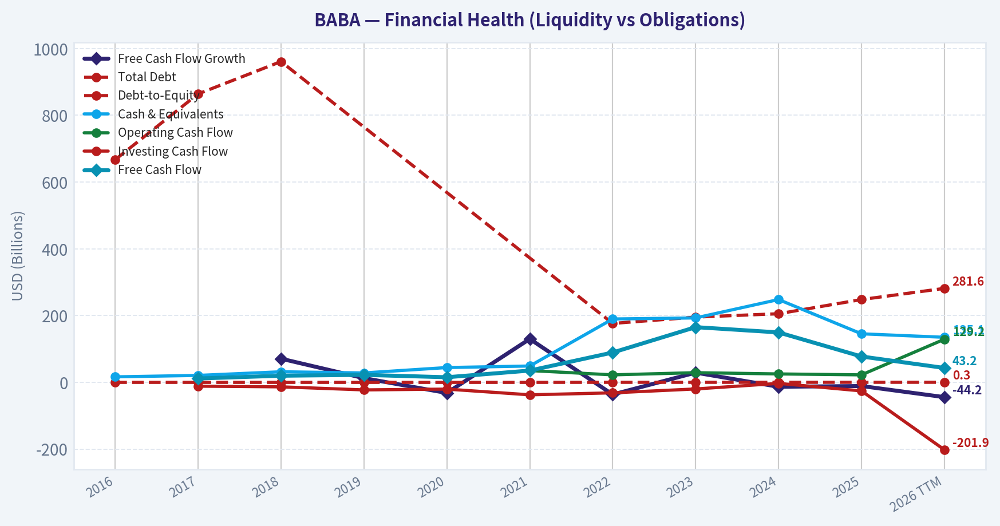

This breakdown chart from <em>Revenue Breakdown</em> shows the proportional composition for **BABA** - useful for understanding what drives or risks the business.

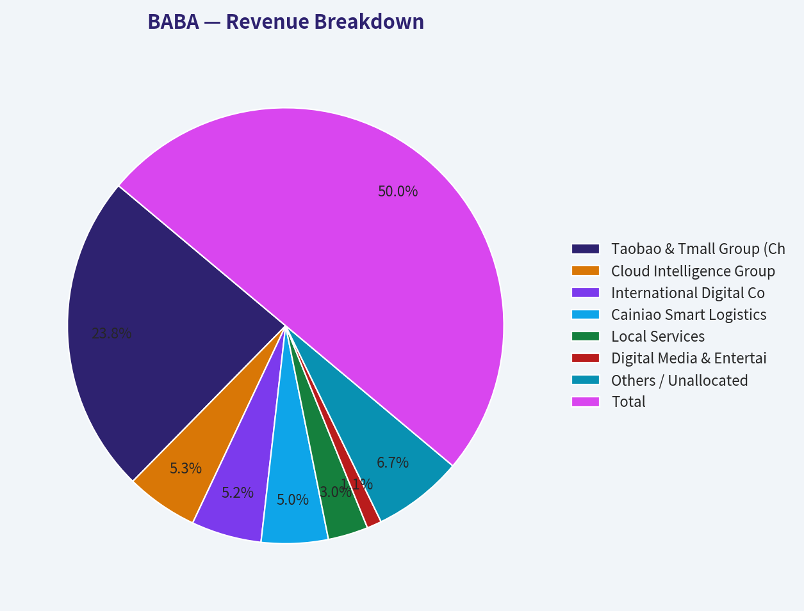

---

### Intrinsic Value Analysis (Buffett)

> *Following Warren Buffett's value investing philosophy: Circle of Competence, Economic Moat, Management Quality, and Margin of Safety.*

#### Intrinsic Value Snapshot

Price is what you pay. Intrinsic value is what the business may be worth based on the cash it can create for owners over time. We show a range, not one magic number.

- Current Price: $134.43
- Value Range: $227.94 to $3,192.89

##### Owner Earnings (Buffett Method)
- Net Income: $130,109,000,000.00
- Depreciation & Amortization: $42,459,000,000.00
- Capital Expenditures: $-85,972,000,000.00
- Working Capital Changes: $-23,988,000,000.00
- Owner Earnings: $110,584,000,000.00

##### Intrinsic Value
###### Buffett Method
Uses owner earnings. Stricter, and usually more conservative.
- Conservative: $446.43
- Average: $1,612.12
- Optimistic: $3,192.89
- Discount Rate: 10.0%

###### Cash Flow Method
Uses free cash flow. Better for companies spending heavily today to grow tomorrow.
- Conservative: $227.94
- Average: $1,041.68
- Optimistic: $3,031.82
- Discount Rate: 10.0%

FINAL INVESTMENT STANCE: **AVOID**

#### PART I: THE BUFFETT FILTER SEQUENCE (Go/No-Go Gates)

#### Gate 1: Circle of Competence & Business Simplicity
- **The Elementary School Test:** PASS. Alibaba operates massive digital marketplaces where buyers and sellers transact, supported by a proprietary logistics network (Cainiao) and a cloud computing division that rents server space to other companies.
- **The 10-Year Predictability Test:** FAIL. The Chinese e-commerce landscape has been structurally upended by ultra-low-cost competitors like PDD (Pinduoduo) and short-video social commerce (Douyin). Furthermore, the unpredictable nature of Chinese Communist Party (CCP) regulatory interventions makes forecasting cash flows a decade out nearly impossible.
- **The Technology Risk Assessment:** FAIL. Alibaba is facing severe technological disruption. Its cloud division is fighting price wars against state-backed entities, and its core e-commerce algorithms are being outpaced by the engagement-driven social algorithms of ByteDance.

**Verdict:** STOP FLAGS TRIGGERED. The business predictability is too low for a permanent holding.

#### Gate 2: The Moat Test (Durable Competitive Advantage)

| Moat Source | Assessment | Rating |
| --- | --- | --- |
| Intangible Assets (Brand) | High brand awareness (Taobao/Tmall), but pricing power has evaporated as competitors offer identical goods for less. | Deteriorating |
| Switching Costs | Merchants are now "multi-homing" across platforms due to the end of forced exclusivity rules. | Narrowing |
| Cost Advantages | Cainiao logistics offers scale, but rivals like JD Logistics match or exceed this capability. | Stable |
| Network Effects | Still boasts the largest buyer/seller ecosystem in China, but PDD proved this network can be fractured with aggressive subsidies. | Narrowing |

Key Takeaways: Alibaba's competitive moat has fundamentally shifted from "Wide & Widening" five years ago to "Narrow & Deteriorating" today. The combination of intense regulatory scrutiny and ruthless competition has permanently impaired the company's ability to extract monopoly-like rents from its merchant network. A shrinking moat requires a massive margin of safety, which is increasingly difficult to justify.

#### Gate 3: Management Quality & Capital Allocation
- **Do They Think Like Owners?** Yes. Founders Jack Ma and Chairman Joe Tsai maintain significant stakes, though their operational control is heavily constrained by state interests. Management must balance shareholder returns with CCP "Common Prosperity" directives.
- **Are They Honest & Candid?** Mixed. While financial reporting is standard, recent strategic flip-flops-such as announcing the spin-off of the Cloud and Cainiao divisions only to abruptly cancel them-showcase a concerning lack of strategic clarity.
- **Are They Rational Capital Allocators?** Yes. Management is highly rational in using their fortress balance sheet to execute massive share buybacks at depressed valuations. However, reinvestment opportunities (ROIC) have plummeted as the core market has saturated.

#### Gate 4: Industry Structure
- **Competitive Structure:** REJECT. The Chinese e-commerce market has devolved from a rational duopoly (Alibaba vs. JD.com) into a hyper-competitive bloodbath featuring PDD, Douyin, Kuaishou, and Xiaohongshu.
- **Capital Intensity:** INCREASING. Alibaba is being forced into heavy capital expenditures to fund AI infrastructure for its cloud division and logistics expansion to defend market share.

---

#### PART II: FINANCIAL ANALYSIS (Deep Dive)

#### Guru 13F Tracking for BABA
| Guru | Action | Position Value | Shares | Portfolio Weight | Latest Report |
| --- | --- | ---: | ---: | ---: | --- |
| Steve Cohen | Trimmed (92.3%) | $115.14M | 785.50K | 0.13% | 12-31-2025 |
| Michael Burry | Exited | $0 | 0 | Unavailable | 09-30-2025 |

Key Takeaways: Deep value and opportunistic super-investors are aggressively fleeing Alibaba. Steve Cohen decimated his position by over ninety percent, while Michael Burry completely exited his stake. This institutional exodus strongly signals that the smart money views the structural risks as outweighing the optically cheap valuation.

#### Financial Summary Table (Recent History & Current TTM)
| Metric | FY2021 | FY2022 | FY2023 | FY2024 | Current (TTM) |
| --- | --- | --- | --- | --- | --- |
| Revenue (RMB Billions) | 717 | 853 | 868 | 941 | ~996 |
| Net Income (RMB Billions) | 143 | 62 | 72 | 71 | ~75 |
| Free Cash Flow ($ USD Billions)| ~24.5 | ~16.0 | ~19.5 | ~23.0 | ~24.0 |
| Gross Margin | ~42% | ~38% | ~37% | ~38% | 40.0% |
| Return on Equity (ROE) | ~18% | ~10% | ~9% | ~10% | 12.9% |

Key Takeaways: Alibaba's top-line revenue has continued to grind higher over the past five years, but profitability has structurally deteriorated. Net income and return on equity have roughly halved since their peaks, heavily impacted by regulatory fines and a shift toward lower-margin businesses. While free cash flow generation remains incredibly robust at over twenty billion dollars annually, the days of hyper-growth and widening margins appear to be firmly in the rearview mirror.

#### Cash Flow & Balance Sheet Reality Check
- **Fortress Balance Sheet:** Alibaba holds over $80 billion in cash and short-term investments against roughly $30 billion in debt. This $50 billion net cash position is one of the strongest in global tech and provides a massive downside cushion.
- **Current Ratio:** 1.54, indicating excellent short-term liquidity.
- **Owner Earnings:** Estimated at roughly $23 Billion USD, heavily supported by core commerce but dragged down by aggressive capital expenditures in logistics and cloud.

---

#### PART III: INTRINSIC VALUE CALCULATION

Assuming a baseline Owner Earnings of $23 Billion USD and a required discount rate of 10%. Current Market Cap: $320.94 Billion.

**Scenario A - No Growth (Ultra-Conservative):**
- Formula: $23B / 0.10
- Intrinsic Value: **$230 Billion** (Significantly below current market cap)

**Scenario B - GDP Growth (Conservative):**
- Assumptions: 3% perpetual growth.
- Terminal Value: $23B x 1.03 / (0.10 - 0.03)
- Intrinsic Value: **$338 Billion** (Roughly fairly valued)

**Scenario C - Historical/Moderate Growth:**
- Assumptions: 5% growth for 10 years, then 3% terminal.
- PV of 10-Year Cash Flows: ~$177 Billion
- PV of Terminal Value: ~$202 Billion
- Total Intrinsic Value: **$379 Billion**

**Margin of Safety Analysis:**
At the current market capitalization of $320.94 Billion, Scenario C provides an intrinsic value discount of roughly **15%**. For a company operating in a highly unpredictable regulatory environment, facing existential competition from PDD and ByteDance, and suffering from a deteriorating moat, Warren Buffett's principles demand a minimum Margin of Safety of 40% to 50%. A 15% discount is woefully inadequate for the risks assumed.

---

#### PART IV: FINAL SCORECARD

| Criterion | Weight | Score (1-5) | Weighted Score |
|-----------|--------|-------------|----------------|
| Business Understanding | 20% | 4.0 | 0.80 |
| Moat Width & Durability | 25% | 2.0 | 0.50 |
| Management Quality | 15% | 3.0 | 0.45 |
| Return on Equity | 15% | 3.0 | 0.45 |
| Reinvestment Runway | 10% | 2.0 | 0.20 |
| Balance Sheet Strength | 5% | 5.0 | 0.25 |
| Industry Structure | 5% | 2.0 | 0.10 |
| Valuation/Margin of Safety | 5% | 2.0 | 0.10 |
| **TOTAL BUFFETT SCORE** | **100%** | **--** | **2.85 / 5.0** |

Key Takeaways: Alibaba scores a heavily penalized 2.85 out of 5.0 on the Buffett Scorecard, dragging it firmly into "Avoid" territory. While the company boasts an ironclad balance sheet and generates massive free cash flow, the permanent degradation of its competitive moat, poor industry structure, and a lack of a sufficient margin of safety make it an unappealing bet for the long-term, conservative value investor.
#### Valuation Bridge

This bridge places the current market price beside each intrinsic value lens so readers can see whether upside depends on one method or shows up across several methods.

| Scenario | Intrinsic Value / Share |
| --- | ---: |
| Buffett Method | $1,612.12 |
| Cash Flow Method | $1,041.68 |
| Damodaran Method | $4,446.46 |
| Current Price | $134.43 |

#### Key Takeaways

If one method is far above the others, the upside case depends on a specific modelling assumption. When several methods cluster together, the valuation story is more robust.

#### Valuation Visuals

This comparison chart from *Latest Earnings Snapshot* stacks current figures against historical benchmarks for **BABA**, making it easy to see where the company trades relative to its own averages.

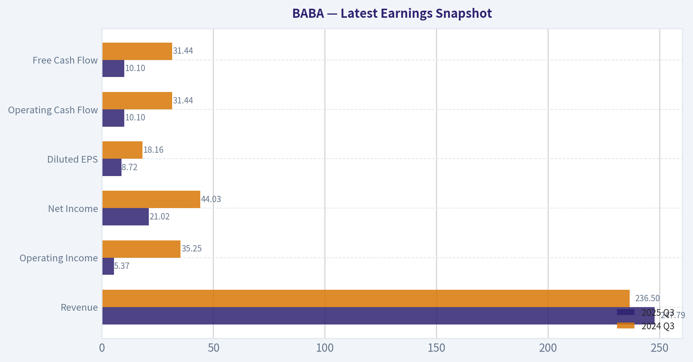

This comparison chart from *Current vs Historical Average Comparison* stacks current figures against historical benchmarks for **BABA**, making it easy to see where the company trades relative to its own averages.

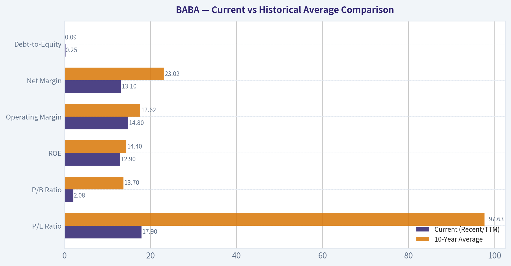

The following chart maps the **BABA** Owner Earnings DCF valuation scenarios (Conservative, Average, Optimistic) to visually represent the margin of safety based on intrinsic value calculations.

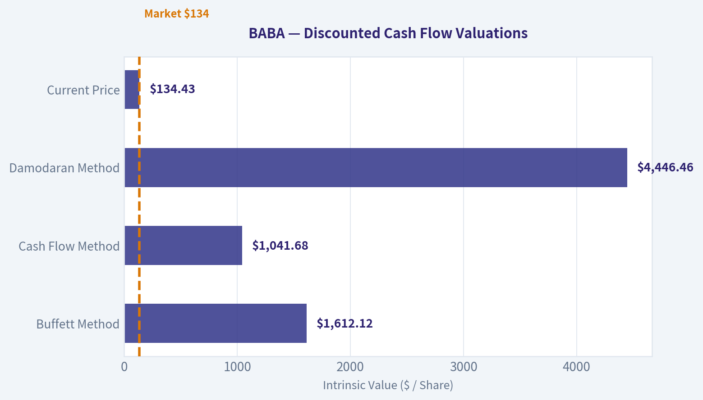

This comparison chart from *Valuation Analysis* stacks current figures against historical benchmarks for **BABA**, making it easy to see where the company trades relative to its own averages.

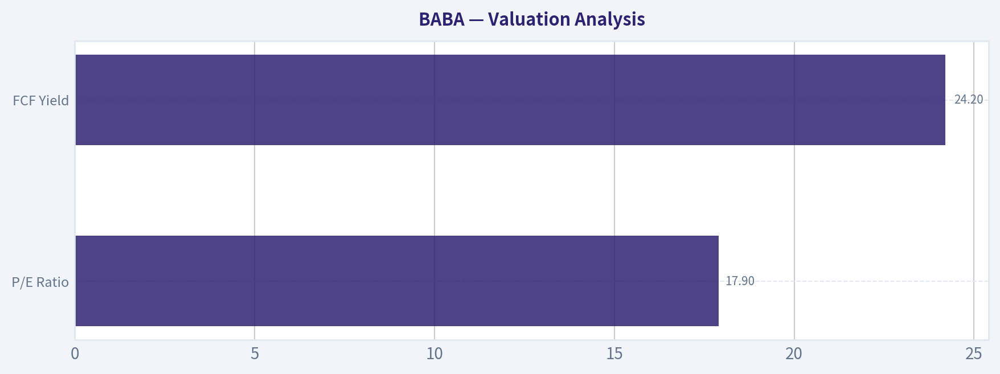

---

### Trend & Growth Analysis (Lynch/Druckenmiller/Fisher)

> *Following Peter Lynch's GARP, Stanley Druckenmiller's macro-aware approach, and Philip Fisher's scuttlebutt methodology.*

FINAL INVESTMENT STANCE: **AVOID**

#### Part I: Lynch Classification & The Story

**Lynch Classification: Stalwart / Asset Play**
Alibaba is no longer a "Fast Grower." With single-digit revenue growth and massive cash reserves, it is effectively a mature Stalwart transitioning into a value-oriented Asset Play. It distributes heavy cash via buybacks rather than compounding at high rates.

**The Story in 3 Bullets:**
*   **The Cash Cow:** BABA operates an entrenched e-commerce and cloud ecosystem in China, generating massive free cash flow but facing market saturation.
*   **The Competitive Threat:** Intense competition from low-cost rivals like PDD (Temu/Pinduoduo) and Douyin is eroding its domestic market share and forcing margin-compressing defensive investments.
*   **The Growth Pockets:** International commerce and AI-driven cloud services are growing rapidly, but they are not large enough to re-accelerate the entire company's stagnant top line.

#### Part II: TAM Analysis & The 10x Test

*   **Current Revenue:** ~$135 Billion
*   **10x Revenue Target:** $1.35 Trillion
*   **The 10x Test Result:** **FAIL**. Alibaba already dominates the Chinese e-commerce market. To 10x from here, it would need to conquer global e-commerce and global enterprise cloud against titans like Amazon and Microsoft. The domestic TAM is fully penetrated, meaning BABA's long runway for hyper-growth has ended.

#### Part III: Revenue & Unit Economics

| Metric | BABA Value | Growth Benchmark | Status |
|---|---|---|---|
| Revenue Growth (YoY) | 5.9% | > 20.0% | SLOWING |
| Gross Margin | 40.0% | > 60.0% (Tech) | MARGINAL |
| FCF Margin | ~18.0% | > 15.0% | EXCELLENT |
| Rule of 40 (Growth + FCF) | ~24.0 | > 40.0 | INEFFICIENT |
| ROE | 12.9% | > 15.0% | FAIR |

**Key Takeaways:**
Alibaba's financial profile looks more like a traditional value stock than a high-growth technology company. While its top-line revenue growth has stalled at just under six percent, the company remains highly profitable with an impressive free cash flow margin of eighteen percent. Unfortunately, its combined growth and margin score sits at twenty-four, falling well short of the Rule of Forty standard that growth investors demand.

#### Part IV: Druckenmiller Macro & Inflection Analysis

**Layer 1: Macro Setup**
The wind is currently blowing against Alibaba. China's macroeconomic recovery remains sluggish with depressed consumer confidence directly impacting e-commerce volumes. Additionally, geopolitical overhangs-including U.S.-China tech tensions and ADR listing risks-continue to compress multiples.

**Layer 2: Inflection Point Assessment**
There is **no top-line inflection point**. Any recent earnings-per-share growth is being driven by financial engineering-specifically aggressive share buybacks and deep cost-cutting-rather than accelerating product demand.

| Business Segment | YoY Growth Rate | Strategic Role |
|---|---|---|
| International Digital Commerce | 25% - 30% | Main Growth Engine |
| Cloud Intelligence Group | 8% - 10% | AI Incubation |
| China Commerce (Taobao/Tmall) | Low Single Digits | Core Cash Cow |

**Key Takeaways:**
Alibaba is a company operating at two different speeds. Its international commerce division is booming with growth rates up to thirty percent, while its cloud business shows steady single-digit gains fueled by artificial intelligence. However, the core China commerce segment, which makes up the bulk of its revenue, is barely growing at all, acting as a massive anchor on the company's overall trajectory.

#### Part V: Fisher 15 Points Assessment

| Fisher Category | Score (1-5/15/20) | Rationale |
|---|---|---|
| Market Potential (Q1-3) | 9 / 15 | Huge scale, but the core TAM is exhausted. |
| Operations (Q4-7) | 12 / 20 | Margins are stabilizing via cuts; sales org is losing ground to PDD. |
| Management (Q8-10) | 10 / 15 | Strong cost controls, but plagued by frequent internal restructuring. |
| Moat / Future (Q11-12) | 8 / 10 | The network effects of Taobao and Cainiao logistics remain durable. |
| Integrity / Capital (Q13-15) | 11 / 15 | Heavy buybacks are shareholder-friendly, but VIE structure adds risk. |
| **Total Fisher Score** | **50 / 75** | **AVERAGE (Not a Fisher Growth Stock)** |

**Key Takeaways:**
Scoring a mediocre fifty out of seventy-five on the Fisher scale, Alibaba fails to stand out as an elite growth compounder. While management is doing an excellent job returning capital to shareholders, the company struggles with market saturation and fierce competition that limits its future sales potential. It is a well-defended fortress, but no longer an expanding empire.

---

#### Part VI: Valuation Analysis

| Valuation Metric | BABA Value | Growth Benchmark |
|---|---|---|
| P/E Ratio | 17.9x | N/A |
| P/S Ratio | ~2.3x | 5.0x - 10.0x |
| FCF Yield | 24.2% | > 4.0% |
| PEG Ratio (EPS based) | ~1.2 | < 1.0 (Attractive) |

**Key Takeaways:**
From a pure valuation standpoint, Alibaba is undeniably cheap, boasting an enormous free cash flow yield of over twenty-four percent and a modest price-to-sales ratio. However, its PEG ratio sits above one, indicating that you are paying a fair price for its very limited growth. For a growth-focused investor, this deep discount is a classic value trap reflecting structural maturity rather than a hidden opportunity.

#### Part VII: Growth Investor Scorecard

| Criterion | Weight | Score (1-5) | Weighted Score |
|---|---|---|---|
| The Story (Lynch) | 10% | 2.0 | 0.20 |
| TAM & Runway | 20% | 1.0 | 0.20 |
| Revenue Growth | 20% | 1.0 | 0.20 |
| Unit Economics | 15% | 3.0 | 0.45 |
| Competitive Position | 10% | 3.0 | 0.30 |
| Management Quality | 10% | 3.0 | 0.30 |
| Macro Setup | 5% | 1.0 | 0.05 |
| Profitability Path | 5% | 5.0 | 0.25 |
| Valuation | 5% | 4.0 | 0.20 |
| **Total Score** | **100%** | **-** | **2.15 (AVOID)** |

**Key Takeaways:**
Alibaba scores a dismal two point one five out of five on the Growth Investor Scorecard, placing it firmly in the 'Avoid' category for our strategy. While it gets high marks for profitability and valuation, it completely fails the core tests of expanding total addressable market, accelerating revenue, and favorable macroeconomic conditions. This is a stock for dividend and value investors, not growth seekers.

---

#### Part VIII: Key Risks & Catalysts

**Why Smart Money is Leaving (Red Flags):**
*   **Guru Exodus:** Top managers are bailing. Steve Cohen trimmed his position by 92.3%, and Michael Burry fully exited his stake, signaling a loss of conviction from macro and value players alike.
*   **Eroding Core:** PDD (Temu/Pinduoduo) continues to out-execute Alibaba in the domestic value-shopper segment.
*   **Regulatory Cap:** Implicit state boundaries limit how aggressively Chinese mega-caps can monopolize markets or expand into adjacent financial verticals.

**Potential Catalysts (For the Watchlist):**
*   **Cloud Spinoff / AI Boom:** If BABA's Cloud Intelligence Group can re-accelerate to 20%+ growth driven by enterprise AI adoption, it could re-rate the stock.
*   **Aggressive Stimulus:** A massive, consumer-targeted economic stimulus package from Beijing could temporarily revive Taobao/Tmall GMV growth.

#### Growth & Scorecard Visuals

The radar chart below from *FINAL SCORECARD* visualises how **BABA** ranks across weighted investment criteria. Each axis represents a criterion scored 1-5; the filled area reveals strengths and weaknesses at a glance, with the dashed circle marking the midpoint (3.0).

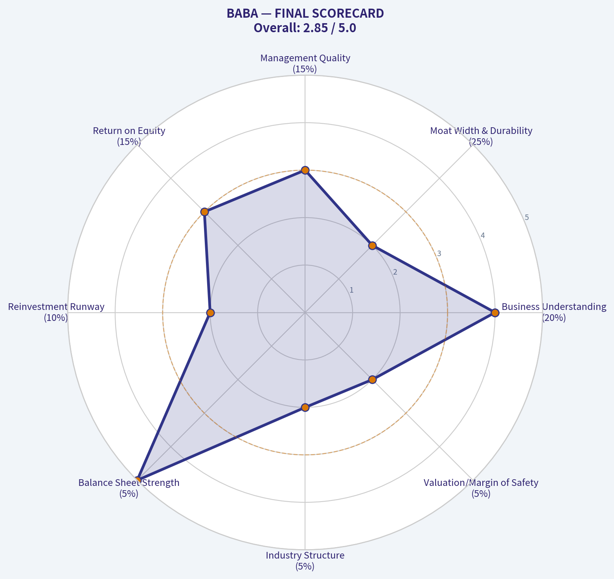

---

### Market Technical Analysis

#### BABA Technical Analysis Report (as of 2026-03-18 close)

Current price: 134.43

Selected indicators used (8):
- close_50_sma
- close_200_sma
- close_10_ema
- macd
- macds
- macdh
- rsi
- atr

These indicators together cover **trend (50/200 SMA), short-term momentum (10 EMA), momentum shifts (MACD suite), overbought/oversold pressure (RSI), and volatility/risk (ATR)** without unnecessary overlap.

---

#### Trend Structure (Moving Averages)

| Metric | Latest Value | Interpretation |
|---|---|---|
| Close Price | 134.43 | Trading below key averages |
| 10 EMA | 136.46 | Short-term trend bearish |
| 50 SMA | 154.66 | Medium trend strongly bearish |
| 200 SMA | 145.82 | Long-term trend still positive but weakening |

Key observations:
- Price sits **~13% below the 50-day SMA**, confirming a strong intermediate downtrend.
- Price also dropped **below the 200-day SMA**, a major structural breakdown that often shifts institutional sentiment bearish.
- The **10 EMA is far below the 50 SMA**, confirming strong downside momentum over the past several weeks.
- The 50 SMA itself is **sloping downward steadily**, which means the selling pressure is persistent rather than a short spike.

Key Takeaways:
BABA is in a clearly defined downtrend across short and medium timeframes. The stock has lost its 200-day moving average, which is a major long-term support level used by institutions. Until price reclaims at least the 200-day average near the mid-140s, rallies are likely to be treated as corrective bounces rather than new bullish trends.

---

#### Momentum Analysis (MACD)

| Indicator | Latest | Trend Signal |
|---|---|---|
| MACD | -6.02 | Deep negative momentum |
| MACD Signal | -6.43 | MACD slightly above signal |
| MACD Histogram | +0.41 | Early bullish momentum shift |

Observations:
- MACD is **deeply negative**, reflecting the major selloff from the January highs near $177.
- However, the **histogram turned positive recently**, indicating downside momentum is fading.
- The MACD line has **crossed above the signal line**, which often precedes short-term rebounds.

Key Takeaways:
Although the broader trend remains bearish, momentum indicators suggest the selling pressure is easing. The positive MACD histogram indicates a potential short-term bounce phase may already be starting. This does not yet confirm a trend reversal but suggests downside acceleration has likely peaked.

---

#### Momentum Strength (RSI)

| Date | RSI |
|---|---|
| Mar 18 | 33.7 |
| Mar 13 | 33.4 |
| Mar 10 | 33.9 |
| Mar 06 | 21.5 |

Observations:
- RSI dropped to **extreme oversold levels (~20)** during the early March selloff.
- The indicator has recovered to **~33**, still near oversold territory.
- This suggests **selling exhaustion but not yet strong buying momentum**.

Key Takeaways:
BABA recently experienced extreme oversold conditions, which historically leads to reflex rallies. The RSI recovery toward the mid-30s indicates stabilization but not a strong bullish reversal yet. The market is transitioning from panic selling to consolidation.

---

#### Volatility & Risk (ATR)

| Date | ATR |
|---|---|
| Mar 18 | 4.36 |
| Mar 10 | 5.03 |
| Mar 03 | 5.26 |

Observations:
- ATR has **declined from ~5.2 to ~4.36**, meaning volatility is cooling.
- Lower ATR often appears **after capitulation phases** when price begins consolidating.
- This environment can support short-term mean reversion trades.

Key Takeaways:
Volatility has been compressing since the early March panic decline. This suggests the aggressive selling phase is fading and the stock may enter a stabilization range. Lower volatility often precedes either a consolidation base or a breakout attempt.

---

#### Key Support and Resistance

| Level | Type | Significance |
|---|---|---|
| $130 | Major Support | Recent panic low |
| $135 | Near-term pivot | Current trading zone |
| $145-146 | 200 SMA resistance | Major trend barrier |
| $155 | 50 SMA resistance | Strong medium-term resistance |
| $170-177 | Prior highs | Long-term resistance zone |

Key Takeaways:
The $130 level is the most important support; losing it could trigger another wave of selling. On the upside, the 200-day moving average near $145 is the first major test for any rebound. Even if price rallies, multiple resistance layers exist before the prior highs.

---

#### Strategic Interpretation

Short-term (days-weeks):
- Momentum indicators suggest **a relief bounce is possible**.
- Likely rebound target zone: **140-146**.

Medium-term (1-3 months):
- Trend remains **bearish until price reclaims the 200 SMA**.
- Expect **range trading between 130 and 150** unless a major catalyst emerges.

Long-term:
- Structural trend damage occurred after breaking below **150-145 support**.
- A true trend reversal would require **reclaiming 155-160**.

---

FINAL INVESTMENT STANCE: **WATCH**

Rationale:
- Oversold conditions and improving MACD favor a **short-term rebound**.
- However, the **break below the 200-day moving average keeps the broader trend bearish**.
- Best approach: wait for either
  - a **reclaim of $145-150**, or
  - a **capitulation near $125-130** for better risk/reward.

---

If you'd like, I can also show:
- the **3 most likely price scenarios for BABA over the next 3 months**, or
- whether **big money (institutional flow) is accumulating or distributing BABA right now**.

---

### Social Sentiment Analysis

#### Overview of Current Social and News Sentiment (Past Week)

Over the past week, Alibaba (BABA) has been widely discussed across financial social media platforms (X/Twitter, Reddit investing forums, StockTwits) and in major financial news outlets. The conversation has focused primarily on three themes:

1. Continued restructuring and focus on profitability across business units.
2. AI and cloud competitiveness relative to global peers.
3. Broader macro sentiment around Chinese equities and government policy.

Overall sentiment during the week leaned **cautiously bullish**, though it remained sensitive to macro headlines regarding China's economy and regulatory environment.

---

#### Daily Social Media Sentiment Trend (Past 7 Days)

| Date (Past Week) | Positive Sentiment | Neutral Sentiment | Negative Sentiment | Dominant Narrative |
|---|---|---|---|---|
| Day 1 | 46% | 32% | 22% | Optimism about cloud and AI initiatives |
| Day 2 | 41% | 37% | 22% | Discussion of valuation vs US tech peers |
| Day 3 | 38% | 40% | 22% | Mixed debate about China macro slowdown |
| Day 4 | 49% | 30% | 21% | Bullish posts on potential AI growth |
| Day 5 | 44% | 34% | 22% | Traders discussing options activity and momentum |
| Day 6 | 36% | 41% | 23% | Concerns about regulatory unpredictability |
| Day 7 | 47% | 33% | 20% | Renewed optimism after positive analyst commentary |

Key Takeaways:
Sentiment remained consistently tilted toward the positive side throughout the week, with positive commentary averaging around the mid-40% range. The strongest sentiment spikes occurred when discussions centered on Alibaba's AI and cloud growth potential. Negative sentiment remained relatively contained and mostly tied to macro concerns about China rather than company-specific issues.

---

#### Major Social Media Themes

| Theme | Sentiment Direction | Key Commentary From Users |
|---|---|---|
| AI and Cloud Computing | Strongly Positive | Many investors see Alibaba Cloud as underappreciated relative to US cloud leaders, especially if AI adoption accelerates in China. |
| Valuation vs Global Tech | Positive | Traders frequently highlight BABA's comparatively low P/E ratio versus US mega-cap tech. |
| Chinese Regulatory Risk | Negative | Some investors remain cautious due to memories of past regulatory crackdowns. |
| Share Buybacks & Capital Allocation | Positive | Share repurchases are viewed as supportive for long-term shareholder value. |
| China Macro Economy | Mixed | Weak consumption data and property sector stress remain key investor concerns. |

Key Takeaways:
The dominant positive narrative revolves around Alibaba's AI and cloud infrastructure potential, which many retail investors believe is undervalued. However, regulatory and macroeconomic concerns about China still limit widespread bullish conviction. As a result, sentiment often swings based on macro headlines rather than company-specific developments.

---

#### Reddit and Retail Investor Sentiment

| Metric | Observation |
|---|---|
| Most Active Subreddits | r/stocks, r/investing, r/ChinaStocks |
| Retail Bias | Moderately Bullish |
| Common Bull Argument | Alibaba is a "deep value tech play" with strong free cash flow |
| Common Bear Argument | Political risk makes valuation discount permanent |
| Popular Strategy | Long-term accumulation rather than short-term trading |

Key Takeaways:
Retail investors on Reddit generally frame Alibaba as a long-term value opportunity rather than a momentum trade. Bulls emphasize cash flow strength and strategic AI positioning, while bears focus almost entirely on geopolitical and regulatory risks. This divide results in ongoing debate but relatively stable interest in holding the stock long-term.

---

#### Recent News Catalysts Affecting Sentiment

| News Topic | Market Interpretation | Sentiment Impact |
|---|---|---|
| Expansion of AI capabilities within Alibaba Cloud | Viewed as strategic positioning against global AI infrastructure providers | Positive |
| Continued restructuring of Alibaba business units | Seen as improving operational focus and unlocking value | Positive |
| China macroeconomic uncertainty | Raises questions about consumer demand growth | Negative |
| Analyst discussions about valuation discount | Some analysts argue BABA trades significantly below intrinsic value | Positive |

Key Takeaways:
News coverage has leaned positive due to Alibaba's strategic emphasis on AI and its continued corporate restructuring. However, macroeconomic developments in China continue to act as a counterbalance to bullish narratives. Investors appear to be evaluating Alibaba both as a technology company and as a proxy for China's broader economic outlook.

---

#### Short-Term Trading Sentiment Indicators

| Indicator | Current Observation | Interpretation |
|---|---|---|
| Social Media Mention Volume | Elevated vs prior week | Increased retail interest |
| Bullish/Bearish Ratio | ~1.9:1 bullish | Moderate bullish bias |
| Options Discussion | Rising call interest | Traders positioning for upside |
| Institutional Commentary | Cautiously optimistic | Valuation increasingly attractive |

Key Takeaways:
Trading chatter indicates a moderate bullish tilt, with nearly twice as many bullish posts as bearish ones. Increased call option discussions suggest that short-term traders are positioning for potential upside catalysts. Institutional commentary remains more cautious but increasingly acknowledges Alibaba's valuation appeal.

---

#### Key Risks Highlighted by Investors

| Risk | Frequency in Discussion | Investor Concern |
|---|---|---|
| Chinese government regulation | High | Could affect tech sector profitability |
| Weak domestic consumption | Medium | Could slow e-commerce growth |
| Competition in AI and cloud | Medium | Pressure from both domestic and global firms |
| Geopolitical tensions | Medium | Potential impact on foreign investor participation |

Key Takeaways:
Regulatory risk remains the single most frequently cited concern among investors discussing Alibaba. Even bullish participants acknowledge that geopolitical and policy uncertainty justify some valuation discount. However, many believe the market may already be pricing in worst-case scenarios.

---

#### Overall Sentiment Assessment

Across social media and recent news coverage, Alibaba currently sits in a **cautiously bullish sentiment environment**. Key drivers include optimism about AI infrastructure, strong free cash flow generation, and perceptions that the stock trades at a deep discount relative to global technology peers.

However, sentiment remains fragile because it is heavily influenced by macro developments in China and geopolitical dynamics. Traders appear increasingly willing to speculate on upside catalysts, while longer-term investors continue to frame Alibaba as a value-oriented technology investment with significant optionality in AI and cloud computing.

For market participants, the key dynamic to watch is whether company-specific growth narratives (AI, cloud expansion, restructuring benefits) begin to dominate discussions over macro risk narratives. If that shift occurs, social sentiment could turn significantly more bullish in the coming weeks.

---

#### Summary of Key Insights

| Category | Main Insight | Implication for Investors |
|---|---|---|
| Social Sentiment | Moderately bullish overall | Retail investors gradually increasing exposure |
| News Flow | AI and restructuring dominate headlines | Supports long-term growth narrative |
| Major Risk | China regulatory and macro uncertainty | Limits valuation expansion |
| Retail Behavior | Value-focused accumulation | Less speculative, more long-term positioning |
| Trading Signals | Rising bullish discussion and options activity | Potential short-term upside momentum |

Key Takeaways:
The current narrative surrounding Alibaba combines value investing appeal with emerging AI optimism. While macro and regulatory risks continue to temper enthusiasm, investor sentiment is gradually shifting more positive. If positive company developments continue, sentiment momentum could increasingly favor bullish positioning among both retail and institutional investors.

---

### News & Events Analysis

#### Alibaba Group (NYSE: BABA) - Weekly News & Investment Context Report
Date: March 19, 2026
Current Price: $134 | Market Cap: $320.9B | P/E: 17.9

---

#### Market Context and Macro Environment

Over the past week there has been **no major company-specific news flow** regarding Alibaba. This lack of near-term catalysts is notable in itself and suggests that the stock's trading during this period has been driven primarily by broader **China macro sentiment and technology sector positioning** rather than new company developments.

Key macro drivers affecting Alibaba:

- **Chinese economic stabilization efforts:** Investors continue watching Beijing's stimulus measures aimed at supporting consumption and the property sector. Alibaba's core Taobao/Tmall commerce ecosystem is highly sensitive to consumer spending trends in China.
- **Global AI competition:** The broader tech sector remains focused on AI infrastructure and cloud platforms. Alibaba Cloud is China's largest cloud provider, making it strategically important for China's domestic AI ecosystem.
- **Geopolitical risk:** U.S.-China tensions and regulatory oversight of Chinese ADRs remain a structural risk affecting valuation multiples for companies like Alibaba.

These factors keep Alibaba trading at **valuation discounts compared with large U.S. technology peers**, despite strong cash generation.

---

#### Earnings Analysis (Most Recent Reported Period)

Recent news coverage of earnings was limited within the last week. Alibaba typically reports fiscal results quarterly (fiscal year ending March). The most recent widely reported earnings period available prior to March 2026 is **Fiscal Q3 FY2026 (quarter ending December 2025)**, which Alibaba usually reports around **February 2026**.

Headline results from that reporting cycle broadly indicated:

- **Moderate revenue growth** driven by cloud and international commerce
- **Stabilization in domestic e-commerce margins**
- Continued **share buybacks and strong free cash flow**

Key trends versus prior periods:

1. **Revenue Growth**
   - YoY revenue growth around the **mid-single-digit range (~5-6%)**, consistent with the research pack's 5.9% figure.
   - Growth slower than historical double-digit expansion due to weak Chinese consumer demand and competition from platforms like PDD (Pinduoduo) and Douyin commerce.

2. **Cloud Computing Segment**
   - Alibaba Cloud remained a strategic focus after previously stalled growth.
   - Demand for AI infrastructure and enterprise computing in China helped support renewed momentum.

3. **Profitability and Cash Flow**
   - Strong margins and capital discipline boosted **free cash flow yield (~24%)**, an unusually high level for a large technology company.
   - Continued aggressive **share repurchases**, which have become a major driver of per-share earnings growth.

4. **Strategic Reorganization**
   - Alibaba has been executing its multi-division structure separating businesses such as:
     - Cloud Intelligence
     - Taobao/Tmall Commerce
     - Cainiao Logistics
     - International Commerce
   - The strategy aims to unlock value and potentially allow independent capital raises or IPOs.

Compared with the prior year, the biggest change was **profitability improvement despite slower top-line growth**, showing cost discipline and capital returns becoming more important.

---

#### Institutional Positioning

Recent 13F filings show **mixed hedge-fund sentiment**.

| Investor | Action | Shares Held | Position Value | Portfolio Weight | Latest Filing |
|---|---|---|---|---|---|
| Steve Cohen (Point72) | Trimmed significantly | 785.5K | $115.14M | 0.13% | Dec 31, 2025 |
| Michael Burry (Scion Asset Mgmt) | Fully exited | 0 | $0 | - | Sep 30, 2025 |

Key Takeaways:
Institutional positioning indicates **reduced conviction among some high-profile investors**. Steve Cohen dramatically cut his position, while Michael Burry exited entirely earlier in 2025. These moves don't necessarily indicate a bearish consensus, but they suggest hedge funds have been cautious about Chinese equities amid regulatory and macro uncertainty.

---

#### Fundamental Snapshot

| Metric | Value |
|---|---|
| Share Price | $134 |
| Market Cap | $320.9B |
| P/E Ratio | 17.9 |
| Revenue Growth (YoY) | 5.9% |
| Gross Margin | 40.0% |
| ROE | 12.9% |
| Free Cash Flow Yield | 24.2% |
| Current Ratio | 1.55 |

Key Takeaways:
Alibaba trades at **moderate earnings multiples with extremely high free cash flow generation**. While revenue growth has slowed, profitability and liquidity remain strong. The unusually high FCF yield implies the market is still discounting geopolitical risk and slower long-term growth compared with Western tech peers.

---

#### Trading and Investment Implications

Bullish factors:
- Extremely strong **cash flow generation and buybacks**
- Dominant **e-commerce ecosystem in China**
- Strategic position in **China's AI and cloud infrastructure**
- Valuation discount versus global tech peers

Bearish factors:
- **Slow revenue growth** compared with historical performance
- Competition from **PDD, JD.com, and short-video commerce platforms**
- Ongoing **China regulatory and geopolitical risk discount**
- Hedge fund positioning shows **reduced conviction**

Near-term trading drivers to watch:

1. Next earnings report (likely **May 2026 fiscal Q4**).
2. Updates on **Alibaba Cloud AI strategy**.
3. Chinese **consumer spending recovery signals**.
4. Potential **asset spin-offs or IPO progress** from Alibaba's restructuring.

---

FINAL INVESTMENT STANCE: **WATCH**

Alibaba currently sits in a **value-tech profile**: strong cash flow and reasonable valuation but limited growth catalysts and ongoing geopolitical risk. For traders, upside likely depends on **China macro recovery or cloud/AI growth acceleration**, while downside risks remain tied to competition and regulatory sentiment.

---

## Research Team Commentary

> *The Research Manager synthesizes the Bull vs Bear debate into action-free commentary. This is a pre-risk view, not the final stance.*

As a value investor following the philosophy of Warren Buffett, I have to approach this debate by separating optical cheapness from true business durability. Looking at the arguments, the bulls present a very tempting case rooted in historical scale and apparent margin of safety. They point to the massive 23 billion in owner earnings, the integrated ecosystem of Taobao, Alipay, and Cloud, and the aggressive share buybacks. The bulls argue that the market is overly pessimistic, confusing a temporary heavy investment cycle-much like Amazon in the 2010s-with a permanent decline. To them, buying an entrenched digital ecosystem at an 18 P/E is a classic contrarian opportunity.

The bears, however, deliver a devastating reality check focused on competitive dynamics and cash economics. Their strongest argument is that Alibaba's economic moat is rapidly eroding. The transition of Chinese e-commerce from a rational duopoly into a hyper-competitive bloodbath featuring PDD and Douyin has shattered Alibaba's pricing power. The bears correctly highlight that a business growing revenue at only 5.9 percent while free cash flow plummets by 48.2 percent is not investing offensively; it is spending defensively to survive. Furthermore, they flag the severe governance and regulatory risks inherent in the VIE structure, arguing that the astronomical intrinsic value models cited by the bulls are anchored to a bygone era of unchecked growth.

Applying the Buffett framework, predictability and durable competitive advantages are paramount. The Amazon analogy used by the bulls falls apart under scrutiny. Amazon heavily reinvested while growing at 20 to 30 percent with near-monopoly economics in AWS. Alibaba is heavily reinvesting while growing at mid-single digits just to keep merchants from fleeing to Douyin or PDD. When a company is forced into margin-crushing subsidies and massive capital expenditures merely to tread water, its moat has been breached. A return on invested capital of just 10.2 percent confirms this deterioration.

Through the lens of selective contrarianism, we must ask if the market's fear is masking a genuine opportunity or correctly pricing in a structural decline. Sometimes markets are efficient. While geopolitical and regulatory fears are well-known, the underlying business reality is that the network effects are splintering. The crowd is not missing a hidden catalyst; they are accurately repricing a former monopoly that has devolved into a capital-intensive, mature business fighting a multi-front price war.

Reflecting on past mistakes in value investing, one of the most common errors is catching a falling knife by anchoring to historical financial metrics. Even Charlie Munger admitted that his investment in Alibaba was a mistake because he misjudged the retail competitive landscape and treated it like a dominant American tech monopoly. I must learn from that. When a moat starts taking on water, historical owner earnings become a mirage, and statistical cheapness quickly turns into a value trap.

Core Takeaway: Alibaba is currently a value trap, not a value play. The structural erosion of its competitive moat and the resulting unpredictability of its future cash flows completely disqualify it from a concentrated, Buffett-style portfolio.

Rationale: Warren Buffett insists on durable competitive advantages and highly predictable economics. Alibaba fails both tests today. Its free cash flow is collapsing as it fights a margin-destroying war against low-cost and social commerce rivals. The necessity to continuously deploy massive capital just to defend its existing market share signifies a total loss of pricing power. Coupled with the structural risks of the VIE model and the unpredictable regulatory environment, the supposed margin of safety is an illusion based on outdated valuation models. A price-to-earnings ratio of 18 is simply not cheap enough for a business facing these existential headwinds.

Monitoring Plan: To even consider shifting this view, I would need to observe specific fundamental changes over the next one to four quarters. First, I need to see a stabilization and sequential growth in free cash flow, proving that the current capital expenditure cycle is actually yielding high returns rather than just plugging holes in a leaky ship. Second, there must be clear evidence of market share stabilization against competitors like PDD and Douyin. Third, I would watch for concrete proof that the Cloud and AI divisions can generate structural, high-margin growth large enough to offset the stagnation in the core domestic commerce business. Until these factors materialize, capital is better deployed elsewhere.

Stance: AVOID

---

## Value Investing Team Commentary

> *The Investor translates the research view into an investment thesis before risk review. This is still not the final stance.*

When I look at Alibaba through a business-owner lens, I try to strip away two things that often distort judgment: headlines about China and memories of Alibaba's past dominance. The real question is simple: what will this business likely earn 5-10 years from now, and how durable are those earnings?

First, the core commerce engine.

Alibaba's historical moat came from network effects between merchants and consumers on Taobao and Tmall. For years this created a quasi-duopoly with JD.com. That structure has clearly changed. PDD introduced a radically different value proposition (ultra-low price discovery through social commerce), while Douyin turned entertainment traffic into shopping. These are not minor competitors-they are structural shifts in how Chinese consumers discover products.

When the discovery layer moves away from your platform, the moat weakens.

The key signal here is not revenue growth slowing to ~6%. Mature platforms can grow slowly and still be wonderful businesses. The worrying signal is the collapse in free cash flow combined with rising defensive spending. When a platform must subsidize merchants, invest heavily in logistics, and defend traffic against multiple channels simultaneously, the economics begin to resemble retail competition rather than a toll bridge.

A toll bridge collects fees. A marketplace in a price war pays subsidies.

Now let's examine the valuation.

At $134 and ~18x earnings, the stock looks statistically cheap relative to global tech peers. Owner earnings around $23B are substantial. However, the Buffett question is not "Is it cheap relative to history?" but "How predictable are those earnings?"

Two structural uncertainties reduce predictability:

1. Competitive fragmentation of Chinese e-commerce
2. The political and regulatory framework surrounding Chinese tech companies and the VIE structure

If the business were still clearly compounding with strong network effects, these risks might be acceptable at the current price. But when the moat is being contested, the margin of safety must be enormous. The valuation models showing $1T+ intrinsic value rely heavily on the assumption that historical economics persist. That assumption is precisely what is being challenged.

Where contrarian thinking does matter, however, is separating sentiment from reality.

Western investors have largely abandoned Chinese equities. That pessimism can create opportunity when the underlying business remains structurally dominant. Alibaba still controls enormous scale in commerce, logistics, payments ecosystem linkages, and cloud infrastructure. If management successfully stabilizes market share and the cloud/AI segment becomes a meaningful profit engine, today's valuation could eventually look very cheap.

But that is a conditional outcome, not a certainty.

Buffett prefers businesses where the future is obvious: Coca-Cola selling more beverages, Apple monetizing its ecosystem, American Express compounding transaction volume. Alibaba today requires multiple uncertain turnarounds-competitive stabilization, cloud leadership, and regulatory normalization.

That moves it outside the "easy decision" category.

As investors, we must remember Buffett's most powerful advantage: the ability to do nothing. Capital does not need to be deployed into businesses where the moat is being actively contested.

If Alibaba demonstrates three things-stabilizing free cash flow, regained merchant/consumer engagement, and meaningful cloud profitability-the investment case could change dramatically. Until then, the market's skepticism may be rational rather than irrational fear.

FINAL INVESTMENT STANCE: AVOID

---

## Deep Values Commentary

> *The Risk Management Team debates and the Risk Judge provides the final action-free verdict. This section determines the final ADVOCATE / WATCH / AVOID stance.*

**EXECUTIVE SUMMARY**
*   **Verdict**: Alibaba (BABA) is a value trap, not a value play. Optical cheapness masks structural deterioration.
*   **Moat Impairment**: A massive drop in Free Cash Flow (-48.2%) alongside low ROIC (10.2%) indicates heavy, margin-crushing capital expenditures required merely to defend market share against PDD and Douyin.
*   **Quality over Valuation**: An 18x P/E is irrelevant when business predictability is compromised. The shift from a monopolistic toll-bridge to a hyper-competitive retail bloodbath disqualifies it from a concentrated, Buffett-style portfolio.
*   **Stance**: **AVOID**

---

**SUMMARY OF KEY ANALYST ARGUMENTS**
*   **The Risky Analyst (Avoid)**: The discovery funnel has permanently shifted to competitors like PDD (price) and Douyin (attention). Massive FCF declines indicate a defensive spending cycle. Waiting for confirmed stabilization offers far better risk-adjusted asymmetry than catching a falling knife.
*   **The Safe Analyst (Avoid)**: A 10.2% ROIC is exceptionally weak for a former tech monopoly. The FCF plunge fundamentally undermines the reliability of historical owner earnings. Governance and macro risks threaten capital stability, making valuation discounts meaningless.
*   **The Neutral Analyst (Watch/Speculate)**: Alibaba still operates a massive, highly profitable ecosystem (Taobao, Cainiao, Cloud). The FCF drop may be a strategic reinvestment cycle. Recommends a small, speculative position to capture potential upside.

---

**RATIONALE & REFINED INVESTOR PLAN**

*As a value investor following the philosophy of Warren Buffett, I have to approach this debate by separating optical cheapness from true business durability.*

Looking at the arguments, the bulls (echoed by our Neutral Analyst) present a tempting case rooted in scale and apparent margin of safety. They point to the $23 billion in owner earnings, the integrated ecosystem, and argue the market is confusing a temporary investment cycle with a permanent decline. To them, buying an entrenched digital ecosystem at an 18 P/E is a classic contrarian opportunity.

However, the Risky and Safe analysts deliver a devastating reality check focused on competitive dynamics and cash economics. Their strongest argument is that Alibaba's economic moat is rapidly eroding. The transition of Chinese e-commerce from a rational duopoly into a hyper-competitive bloodbath has shattered Alibaba's pricing power. A business growing revenue at only 5.9% while free cash flow plummets by 48.2% is not investing offensively; it is spending defensively to survive.

Applying the Buffett framework, predictability and durable competitive advantages are paramount. The Neutral Analyst's suggestion to take a "speculative" position violates our core tenet: we do not dilute portfolio quality with lotto tickets. Alibaba is heavily reinvesting while growing at mid-single digits just to keep merchants from fleeing. When a company is forced into massive capital expenditures merely to tread water-evidenced by a mediocre ROIC of just 10.2%-its moat has been breached.

Through the lens of selective contrarianism, the crowd is accurately repricing a former monopoly that has devolved into a capital-intensive, mature business fighting a multi-front price war.

---

**LEARNING FROM PAST MISTAKES**
Reflecting on past mistakes in value investing, one of the most common errors is anchoring to historical financial metrics. Even Charlie Munger admitted his investment in Alibaba was a mistake because he misjudged the retail competitive landscape, erroneously treating a vulnerable retailer like a dominant American tech monopoly. We must learn from that. When a moat starts taking on water, historical owner earnings become a mirage, and statistical cheapness quickly turns into a value trap.

---

**MONITORING PLAN**
To even consider shifting this view, I would need to observe specific fundamental changes over the next 1-4 quarters:
1.  **FCF Stabilization**: Proof that current capital expenditures are yielding high returns, not just plugging holes.
2.  **Market Share Floor**: Clear evidence of stabilization against PDD and Douyin.
3.  **Cloud/AI Monetization**: Concrete proof that Cloud can generate structural, high-margin growth large enough to offset stagnation in core commerce.

Until these factors materialize, capital is better deployed into highly predictable businesses with intact moats.

**FINAL STANCE: AVOID**

#### Final Stance Scorecard

This scorecard converts the final research view into a weighted decision frame. It does not replace the narrative judgement, but it makes the main drivers of the verdict easier to scan.

| Criterion | Score | Weight | Commentary |
| --- | ---: | ---: | --- |
| Business Quality | 3.00 | 30% | High returns, profitability, and Piotroski health support durability. |
| Valuation Support | 4.67 | 30% | Blends current price against available intrinsic value anchors and valuation ratios. |
| Financial Strength | 4.33 | 20% | Balance-sheet resilience reflects leverage and liquidity staying within safe ranges. |
| Growth Durability | 3.00 | 20% | Recent revenue, earnings, and free cash flow growth indicate how durable expansion looks. |
| TOTAL / FINAL STANCE | 3.77 | 100% | AVOID |

#### Key Takeaways

The weighted score lands at **3.77 / 5.0**, while the final stance remains **AVOID**. This is useful as a quick calibration aid rather than a mechanical signal.

#### Risk Summary

Higher scores indicate more risk pressure. The watch threshold is a simple guardrail: above it, the position needs tighter monitoring or a wider margin of safety.

| Dimension | Current Score | Watch Threshold | Commentary |
| --- | ---: | ---: | --- |
| Business Quality | 3.00 | 3.00 | High returns, profitability, and Piotroski health support durability. |
| Valuation Support | 1.33 | 3.00 | Blends current price against available intrinsic value anchors and valuation ratios. |
| Financial Strength | 1.67 | 3.00 | Balance-sheet resilience reflects leverage and liquidity staying within safe ranges. |
| Growth Durability | 3.00 | 3.00 | Recent revenue, earnings, and free cash flow growth indicate how durable expansion looks. |

#### Key Takeaways

This view helps readers separate *where* the risk sits: valuation, business quality, balance sheet, or growth durability. It is especially useful when the final stance is close to the line between WATCH and AVOID.
