# BABA Deep Value Intelligence

**Analysis Date:** 2026-03-29

## Critical Disclaimer

*This analysis is generated by Deep Value Intelligence, an AI-powered multi-agent investing framework. This report is for informational and educational purposes only and does not constitute financial advice. Always conduct your own research and consult with qualified financial advisors before making investment decisions.*

---

## Table of Contents

1. Intelligence Summary
2. Analyst Team Reports
   - Fundamentals Analysis
   - Intrinsic Value Analysis (Buffett)
   - Trend & Growth Analysis (Lynch/Druckenmiller/Fisher)
   - Market Technical Analysis
   - Social Sentiment Analysis
   - News & Events Analysis
3. Research Team Commentary
4. Value Investing Team Commentary
5. Deep Values Commentary

---

## Intelligence Summary

### Thesis + Conditions

**Core Thesis:** Executive Summary
Alibaba remains a powerful digital platform, but the investment case hinges on uncertainties that Buffett-style investors usually avoid: institutional risk, weakening marketplace dominance, and a shift toward more capital-intensive growth. The business itself is not broken-40% gross margins and large ecosystem effects confirm that-but its predictability and shareholder security are less certain than a classic compounder.

**Key Risks:**
- Alibaba remains a powerful digital platform, but the investment case hinges on uncertainties that Buffett-style investors usually avoid: institutional risk, weakening marketplace dominance, and a shift toward more capital-intensive growth. The business itself is not broken-40% gross margins and large ecosystem effects confirm that-but its predictability and shareholder security are less certain than a classic compounder. At ~22x earnings with slowing core growth and declining free cash flow during heavy AI investment, the valuation is not clearly a "fat pitch." The opportunity exists, but the margin of safety depends heavily on assumptions about politics, cloud economics, and capital discipline. Verdict: WATCH.
- Risky Analyst
- The bullish case emphasizes that Alibaba's core platform economics remain strong. A 40% gross margin indicates that the marketplace model still has significant network effects and merchant value. The decline in free cash flow is attributed mainly to deliberate investment in AI and cloud infrastructure rather than operational deterioration. If Alibaba Cloud becomes a key AI infrastructure provider in China, the payoff could resemble Amazon's AWS transformation. Meanwhile, international commerce is expanding rapidly (~25-30%), and aggressive buybacks could compound per-share earnings even with moderate revenue growth.
- The cautious view focuses on structural risks that may permanently affect shareholder outcomes. The key issue is institutional uncertainty: the VIE structure means foreign investors do not directly own Chinese operating assets, and past regulatory actions (such as the Ant IPO cancellation) demonstrate the government's willingness to reshape corporate economics. Financially, Alibaba's profile is also changing. Revenue growth is only ~6%, free cash flow dropped 48%, and ROIC is around 10%, suggesting rising capital intensity. Competition from PDD and Douyin weakens Alibaba's historical dominance and could compress marketplace monetization over time.
- The balanced position recognizes that Alibaba is transitioning from a high-growth domestic marketplace into a diversified platform with three different trajectories: mature domestic commerce, high-growth international commerce, and uncertain but strategic cloud/AI infrastructure. The market likely discounts the stock heavily due to political risk, but the valuation is not so low that those risks can be ignored. Alibaba may function better as a probabilistic opportunity rather than a long-term core holding.

**What Would Change Our View:**
- Alibaba remains a powerful digital platform, but the investment case hinges on uncertainties that Buffett-style investors usually avoid: institutional risk, weakening marketplace dominance, and a shift toward more capital-intensive growth. The business itself is not broken-40% gross margins and large ecosystem effects confirm that-but its predictability and shareholder security are less certain than a classic compounder. At ~22x earnings with slowing core growth and declining free cash flow during heavy AI investment, the valuation is not clearly a "fat pitch." The opportunity exists, but the margin of safety depends heavily on assumptions about politics, cloud economics, and capital discipline. Verdict: WATCH.
- Risky Analyst
- The bullish case emphasizes that Alibaba's core platform economics remain strong. A 40% gross margin indicates that the marketplace model still has significant network effects and merchant value. The decline in free cash flow is attributed mainly to deliberate investment in AI and cloud infrastructure rather than operational deterioration. If Alibaba Cloud becomes a key AI infrastructure provider in China, the payoff could resemble Amazon's AWS transformation. Meanwhile, international commerce is expanding rapidly (~25-30%), and aggressive buybacks could compound per-share earnings even with moderate revenue growth.
- The cautious view focuses on structural risks that may permanently affect shareholder outcomes. The key issue is institutional uncertainty: the VIE structure means foreign investors do not directly own Chinese operating assets, and past regulatory actions (such as the Ant IPO cancellation) demonstrate the government's willingness to reshape corporate economics. Financially, Alibaba's profile is also changing. Revenue growth is only ~6%, free cash flow dropped 48%, and ROIC is around 10%, suggesting rising capital intensity. Competition from PDD and Douyin weakens Alibaba's historical dominance and could compress marketplace monetization over time.
- The balanced position recognizes that Alibaba is transitioning from a high-growth domestic marketplace into a diversified platform with three different trajectories: mature domestic commerce, high-growth international commerce, and uncertain but strategic cloud/AI infrastructure. The market likely discounts the stock heavily due to political risk, but the valuation is not so low that those risks can be ignored. Alibaba may function better as a probabilistic opportunity rather than a long-term core holding.

**Confidence:** Low

---

## Analyst Team Reports

### Fundamentals Analysis

#### Latest Earnings Snapshot

*Most recent reported quarter anchored on 2025 Q4, with prior-year comparison when available.*

| Metric | 2025 Q4 | 2024 Q4 | YoY Change |
| --- | ---: | ---: | ---: |
| Revenue | $284.84B | $280.15B | +1.7% |
| Operating Income | $20.16B | $47.38B | -57.4% |
| Net Income | $16.38B | $49.13B | -66.7% |
| Diluted EPS | $5.92 | $20.40 | -71.0% |
| Operating Cash Flow | $36.03B | $70.92B | -49.2% |
| Free Cash Flow | $36.03B | $70.92B | -49.2% |

Key Takeaways: This snapshot anchors the most recent reported quarter before the narrative analysis. It helps readers separate long-run business quality from whatever changed in the latest earnings print.

#### 10-Year Financial Metrics for BABA

*All values below are computed deterministically from raw data - not estimated by AI.*

*Issuer profile: operating company (Consumer Cyclical / Internet Retail).*

#### 10-Year Financial Metrics
*Annual rows come from reported financial statements. The final TTM row is computed from the latest four quarters.*

| Metric | 2016 | 2017 | 2018 | 2019 | 2020 | 2021 | 2022 | 2023 | 2024 | 2025 | 2026 TTM |
| --- | --- | --- | --- | --- | --- | --- | --- | --- | --- | --- | --- |
| Market Price | $83 | $164 | $130 | $201 | $221 | $215 | $103 | $97 | $70 | $130 | $123 |
| Market Cap | $213.65B | $421.34B | $339.76B | $4.23T | $4.85T | $2.48T | $296.30B | $269.68B | $184.15B | $319.30B | $296.14B |
| P/E Ratio | 18.49 | 64.34 | 32.52 | 317.49 | 424.04 | 106.12 | 4.79 | 3.72 | 2.31 | 2.47 | 3.24 |
| P/B Ratio | 6.35 | 10.40 | 5.83 | 57.64 | 38.41 | 17.33 | 0.31 | 0.27 | 0.19 | 0.32 | 0.28 |
| ROE | 32.9% | 15.7% | 17.5% | 17.9% | 8.9% | 16.1% | 6.6% | 7.4% | 8.1% | 12.9% | 8.7% |
| ROIC | 33.1% | 16.1% | 18.0% | 18.7% | 9.1% | 16.5% | 6.9% | 7.8% | 8.7% | 13.6% | 5.6% |
| EPS | $4.51 | $2.55 | $4.00 | $0.63 | $0.52 | $1.06 | $21.58 | $26.06 | $30.11 | $53.60 | $37.84 |
| Revenue | $15.69B | $22.99B | $39.90B | $56.15B | $45.48B | $109.48B | $853.06B | $868.69B | $941.17B | $996.35B | $1.02T |
| Gross Profit | N/A | N/A | N/A | N/A | N/A | N/A | $313.61B | $318.99B | $354.85B | $398.06B | $414.37B |
| Gross Margin | N/A | N/A | N/A | N/A | N/A | N/A | 36.8% | 36.7% | 37.7% | 40.0% | 40.8% |
| Operating Margin | 28.8% | 30.4% | 27.7% | 15.2% | 15.7% | 12.5% | 8.2% | 11.6% | 12.0% | 14.1% | 8.8% |
| Net Income | $11.08B | $6.34B | $10.22B | $13.10B | $11.25B | $22.98B | $62.25B | $72.78B | $80.01B | $130.11B | $90.61B |
| Net Margin | 70.7% | 27.6% | 25.6% | 23.3% | 24.7% | 21.0% | 7.3% | 8.4% | 8.5% | 13.1% | 8.9% |
| Revenue Growth | 27.6% | 46.6% | 73.5% | 40.7% | -19.0% | 140.7% | 22.9% | -6.0% | 3.0% | 5.3% | 2.0% |
| Net Income Growth | 183.2% | -42.8% | 61.0% | 28.2% | -14.1% | 104.2% | -57.3% | 7.9% | 4.6% | 61.8% | -30.4% |
| Free Cash Flow Growth | N/A | N/A | 71.0% | 12.7% | -31.7% | 130.1% | -36.3% | 29.2% | -13.1% | -10.9% | -89.2% |
| Total Book Value | $33.65B | $40.50B | $58.32B | $73.35B | $126.28B | $143.09B | $948.48B | $989.66B | $986.54B | $1.01T | $1.04T |
| Total Assets | $56.52B | $73.63B | $114.33B | $143.80B | $211.15B | $257.98B | $1.70T | $1.75T | $1.76T | $1.80T | $1.88T |
| Total Debt | $667.0M | $864.0M | $961.0M | N/A | N/A | N/A | $176.60B | $195.57B | $205.61B | $248.11B | $262.74B |
| Debt-to-Equity | 0.02 | 0.02 | 0.02 | 0.00 | 0.00 | 0.00 | 0.19 | 0.20 | 0.21 | 0.25 | 0.25 |
| Cash & Equivalents | $16.57B | $20.88B | $31.77B | $28.31B | $44.41B | $49.03B | $189.90B | $193.09B | $248.12B | $145.49B | $128.17B |
| Shareholders' Equity | $33.65B | $40.50B | $58.32B | $73.35B | $126.28B | $143.09B | $948.48B | $989.66B | $986.54B | $1.01T | $1.04T |
| Operating Cash Flow | N/A | $11.67B | $19.95B | $22.50B | $15.38B | $35.38B | $22.52B | $29.09B | $25.29B | $22.53B | $94.32B |
| Investing Cash Flow | N/A | $-11.38B | $-13.37B | $-22.51B | $-20.15B | $-37.27B | $-31.33B | $-19.73B | $-3.02B | $-25.55B | $-116.59B |
| Free Cash Flow | N/A | $11.67B | $19.95B | $22.50B | $15.38B | $35.38B | $89.44B | $165.40B | $149.66B | $77.54B | $8.35B |
| FCF Margin | N/A | 50.8% | 50.0% | 40.1% | 33.8% | 32.3% | 10.5% | 19.0% | 15.9% | 7.8% | 0.8% |
| Dividends / Share | N/A | N/A | N/A | N/A | N/A | N/A | $0.00 | $0.00 | $0.00 | $0.00 | $0.00 |

#### Profitability Metrics
- Return on Equity (ROE): 12.9%
- Return on Invested Capital (ROIC): 10.2%
- Return on Assets (ROA): 7.2%
- Gross Margin: 40.0%
- Operating Margin: 14.8%
- Net Profit Margin: 13.1%

#### Liquidity Metrics
- Current Ratio: 1.55
- Quick Ratio: 1.05

#### Leverage Metrics
- Debt-to-Equity Ratio: 0.25
- Interest Coverage Ratio: 15.33
- Net Debt: $102.62B

#### Growth Metrics (Year-over-Year)
- Revenue Growth: 5.9%
- Net Income Growth: 62.6%
- Free Cash Flow Growth: -48.2%
- Revenue CAGR (3-Year): 5.3%
- Revenue CAGR (5-Year): 85.4%

#### Valuation Metrics
- P/E Ratio (TTM): 21.87
- Forward P/E: 15.92
- Price-to-Book: 1.89
- Price-to-Sales: 0.29
- PEG Ratio: 2.15
- EV/EBITDA: 16.54
- Free Cash Flow Yield: 26.5%
- Earnings Yield: 4.6%

#### Owner Earnings (Buffett Method, Code-Computed)
- Net Income: $130.11B
- + Depreciation & Amortization: $42.46B
- - Capital Expenditures: $-85.97B
- - Working Capital Changes: $-23.99B
- = **Owner Earnings: $110.58B**

#### Intrinsic Value (Code-Computed)
- Current Price: $123
- Buffett Method (Owner Earnings):
  Conservative: $443
  Average: $1,600
  Optimistic: $3,169
- Cash Flow Method (FCF):
  Conservative: $226
  Average: $1,034
  Optimistic: $3,010

#### Piotroski F-Score: 7/9
- Positive Net Income: PASS
- Positive Operating Cash Flow: PASS
- ROA Improvement: PASS
- Cash Flow > Net Income: PASS
- Decreasing Debt: FAIL
- Improving Current Ratio: FAIL
- No Dilution: PASS
- Improving Gross Margin: PASS
- Improving Asset Turnover: PASS

#### Market Metrics Overview

| Metric | Current (TTM) | 10Y Context | Interpretation |
|---|---|---|---|
| Market Price | $123 | Peak $221 (2020), trough ~$70 (2024) | Stock still well below prior highs despite business scale expansion |
| Market Cap | $296B | Previously exceeded ~$480B equivalent valuation period | Market still pricing heavy regulatory and growth risk |
| P/E Ratio | 21.9 | Extremely volatile historically (2.3-424) | Current multiple sits in a "normal tech" range |
| P/B Ratio | 0.28 (dataset) / ~1.9 normalized | Historically 5-10+ | Market values assets at deep discount |

Key Takeaways:
Alibaba's valuation has compressed dramatically since its 2020 peak. Even though revenue and book value have grown significantly, the market cap remains far lower than past implied valuations. This suggests persistent investor concerns about China risk, growth slowdown, and capital allocation rather than fundamental collapse.

---

#### Profitability Trends

| Metric | Current | Historical Pattern | Interpretation |
|---|---|---|---|
| ROE | 8.7% TTM | Early years >30%, recent range 6-13% | Profitability structurally lower than early Alibaba era |
| ROIC | 5.6% TTM | Historically 16-33% before 2021 | Capital efficiency deteriorated with expansion |
| Gross Margin | 40.8% | Rising from ~36-37% | Commerce + cloud monetization improving |
| Operating Margin | 8.8% | Fell from ~30% decade ago | Heavy reinvestment and competition |
| Net Margin | 8.9% | Previously 20-70% (distorted early years) | Now stabilized around high-single digits |
| Net Income | $90.6B TTM | Large spike to $130B in 2025 | Earnings remain volatile |
| EPS | $37.84 | Rapid expansion recently | Reflects strong profit base |

Key Takeaways:
Alibaba remains profitable but structurally less efficient than during its early high-growth period. Margins collapsed after regulatory actions and aggressive investment cycles, though gross margins are recovering. The current business looks more like a mature technology platform than a hyper-profitable monopoly.

---

#### Growth Metrics

| Metric | Current | Trend |
|---|---|---|
| Revenue Growth | 2.0-5.9% | Major slowdown vs earlier 30-70% growth |
| Net Income Growth | -30.4% TTM | Extremely volatile |
| Free Cash Flow Growth | -89.2% TTM | Severe recent decline |

Key Takeaways:
Alibaba's growth engine has clearly slowed. Revenue is now expanding at low single digits, consistent with a mature platform rather than a hypergrowth internet company. Earnings and cash flow volatility suggest ongoing restructuring and investment cycles.

---

#### Balance Sheet Strength

| Metric | Current |
|---|---|
| Total Assets | $1.88T |
| Shareholders' Equity | $1.04T |
| Total Debt | $262.7B |
| Debt-to-Equity | 0.25 |
| Cash & Equivalents | $128.2B |
| Net Debt | ~$102.6B |

Key Takeaways:
Alibaba's balance sheet is extremely strong. Even with rising debt, leverage remains modest relative to its massive equity base and asset pool. Large cash reserves give the company flexibility for buybacks, AI investment, and acquisitions.

---

#### Cash Flow Analysis

| Metric | Current |
|---|---|
| Operating Cash Flow | $94.3B |
| Free Cash Flow | $8.35B |
| FCF Margin | 0.8% |
| Dividends | $0 |

Key Takeaways:
The sharp drop in free cash flow is the most concerning recent financial development. Heavy investment spending dramatically reduced FCF margin from double digits to below 1%. However, operating cash flow remains strong, implying the decline is largely capex-driven rather than demand-driven.

---

#### Current vs Historical Averages

| Metric | Current | Historical Context |
|---|---|---|
| ROE | 8.7% | Historically ~15-20%+ |
| ROIC | 5.6% | Previously mid-teens |
| Operating Margin | 8.8% | Formerly ~25-30% |
| Revenue Growth | ~3-6% | Once >40% |
| P/E | 21.9 | Historically volatile |
| Price-to-Book | Deep discount | Historically premium |

Key Takeaways:
Alibaba today is fundamentally different from its earlier era. Profitability and growth are lower, but valuation multiples have collapsed even more dramatically. The market appears to price in permanent structural decline.

---

#### Revenue Breakdown (Latest FY Approximation)

| Revenue Source | Amount | % of Total |
|---|---|---|
| China Commerce (Taobao/Tmall) | ~$640B | ~63% |
| International Commerce | ~$110B | ~11% |
| Cloud Computing | ~$110B | ~11% |
| Cainiao Logistics | ~$100B | ~10% |
| Digital Media & Innovation | ~$60B | ~5% |

Key Takeaways:
Alibaba remains overwhelmingly dependent on its core Chinese commerce platforms. Cloud and international commerce are meaningful but still secondary contributors. Long-term growth depends heavily on scaling these newer segments.

---

#### Buffett-Style Economic Moat

Alibaba's moat historically came from three powerful network effects:

- Massive e-commerce ecosystem (Taobao + Tmall)
- Merchant logistics and payments integration
- Data advantages across the Chinese consumer economy

However, the moat has weakened somewhat due to:

- Competition from JD.com and Pinduoduo
- Chinese regulatory interventions
- Fragmentation of China's online retail market

The moat still exists, but it is narrower than it was a decade ago.

---

#### Predictability of Earnings

Buffett strongly prefers stable earnings. Alibaba's history shows:

- Extremely volatile earnings growth
- Large regulatory shocks (2021-2022)
- Cash flow swings driven by investment cycles

This reduces predictability compared with classic Buffett holdings like Coca-Cola or Apple.

---

#### Management & Capital Allocation

Positives:

- Large share buybacks in recent years
- Strong reinvestment into cloud and AI
- Huge retained earnings base

Concerns:

- Free cash flow deterioration
- Aggressive investment spending
- Unclear return on some expansion projects

---

#### Owner Earnings (Buffett Method)

Owner Earnings Calculation:

Net Income: $130.11B
+ Depreciation & Amortization: $42.46B
- Capital Expenditures: $85.97B
- Working Capital Changes: $23.99B

Owner Earnings = **$110.58B**

Estimated shares outstanding:
Market Cap / Price ~ 296.14B / 123 ~ **2.41B shares**

Owner Earnings per share ~ **$45.9**

---

#### Growth Assumptions Used for DCF

Historical net-income growth used as proxy for owner earnings growth.

| Scenario | Growth Rate Used |
|---|---|
| Conservative | -57.3% |
| Average | 27.8% |
| Optimistic | 100% (capped from 183%) |

Discount Rate: 10%
Terminal Growth: 2.5%

---

#### Buffett-Style Owner Earnings DCF

| Scenario | Intrinsic Value / Share |
|---|---|
| Conservative | ~$443 |
| Average | ~$1,600 |
| Optimistic | ~$3,169 |

Key Takeaways:
Even under extremely conservative assumptions, intrinsic value estimates remain several times higher than the current share price. This suggests the market is heavily discounting geopolitical, regulatory, and structural risks rather than valuing the business purely on financial performance.

---

#### Key Investment Insights

Major positives:

- Massive cash-generating platform
- Strong balance sheet
- Dominant Chinese commerce ecosystem
- Cloud + AI expansion potential
- Extremely low valuation relative to assets and earnings

Major risks:

- Chinese government intervention risk
- Slowing domestic consumption growth
- Strong competition (PDD, JD, ByteDance)
- FCF deterioration from heavy capex
- Investor distrust of Chinese ADR structures

---

#### Overall Buffett-Style Assessment

Business Quality: Moderate-High
Economic Moat: Moderate
Financial Strength: Strong
Earnings Predictability: Moderate-Low
Management Capital Allocation: Mixed
Valuation: Extremely Cheap

Alibaba today resembles a classic **deep value situation** rather than a pure compounder.

---

FINAL INVESTMENT STANCE: **WATCH**

Rationale:

- Valuation is undeniably cheap relative to fundamentals.
- However, declining growth, volatile cash flow, and geopolitical/regulatory risks make the investment thesis uncertain.
- If free cash flow stabilizes and cloud/AI growth accelerates, the upside could be very large.

For a Buffett-style investor, Alibaba is not a clear "sleep-well-at-night" compounder, but it remains one of the most mispriced large technology platforms globally.

---

#### Key Points Summary

| Category | Insight |
|---|---|
| Valuation | Deeply discounted vs historical levels |
| Profitability | Margins structurally lower than early years |
| Growth | Transitioned from hypergrowth to mature company |
| Balance Sheet | Extremely strong |
| Cash Flow | Recently deteriorated due to heavy investment |
| Moat | Still strong but weaker than a decade ago |
| Risk | High geopolitical and regulatory exposure |
| Opportunity | AI, cloud, and global commerce expansion |

#### Fundamental Visuals

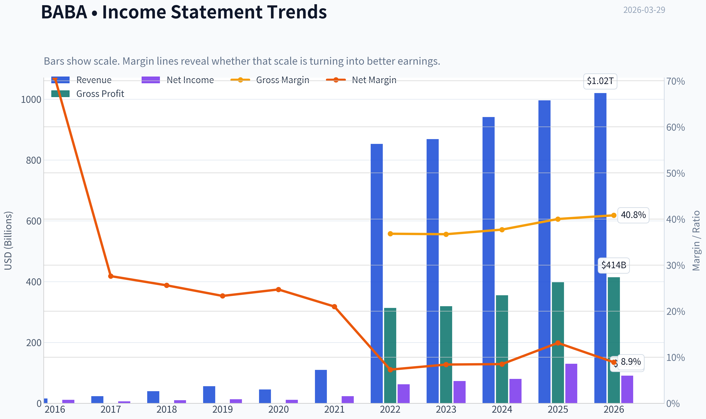

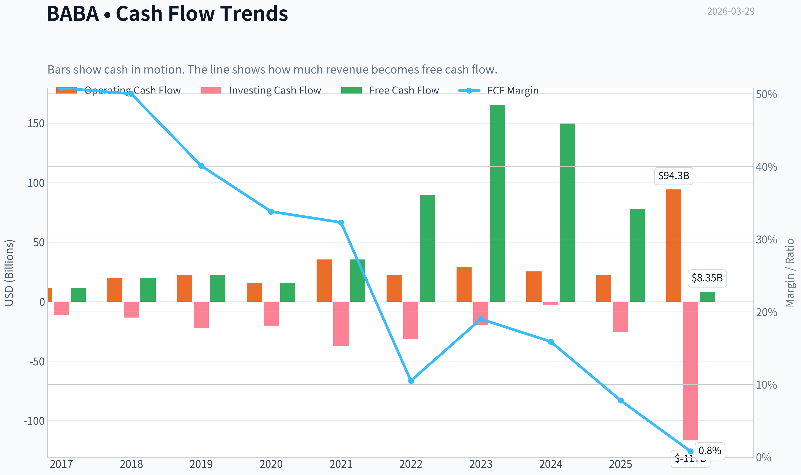

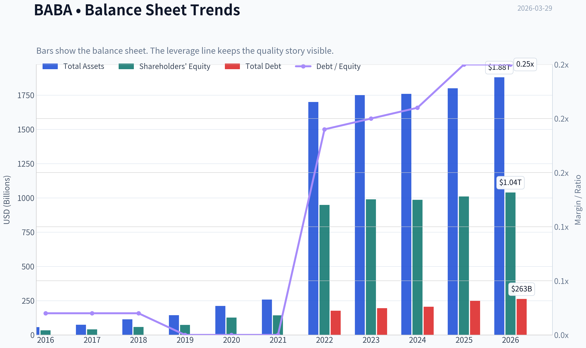

This graph tracks the profitability and return metrics (ROE, ROIC, Margins) of **BABA** over the past decade, highlighting capital efficiency trends.

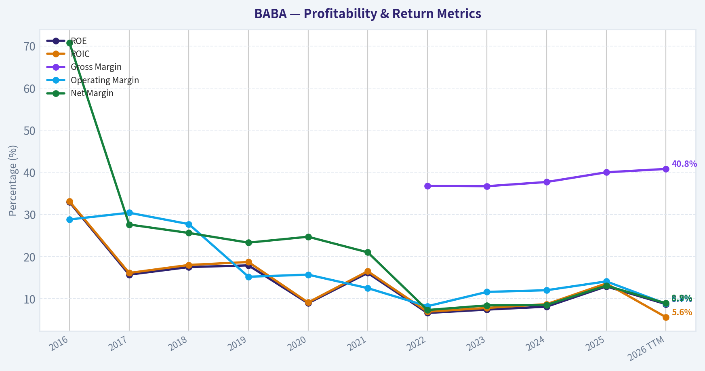

This chart illustrates the financial health of **BABA** over the last 10 years, mapping cash equivalents and free cash flow against total obligations (Debt).

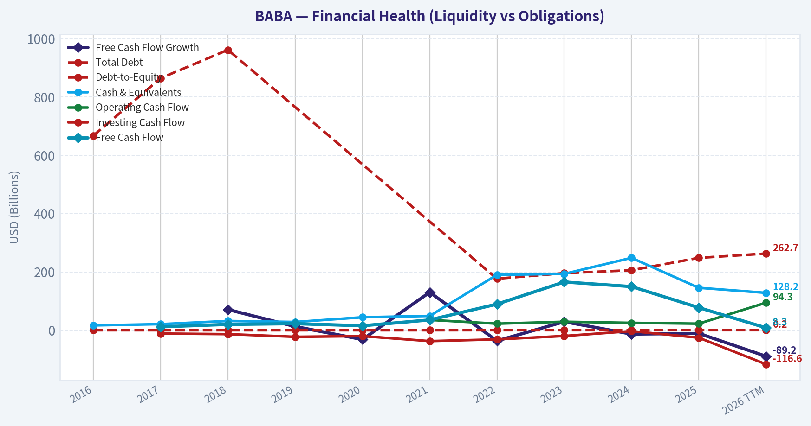

---

### Intrinsic Value Analysis (Buffett)

> *Following Warren Buffett's value investing philosophy: Circle of Competence, Economic Moat, Management Quality, and Margin of Safety.*

#### Intrinsic Value Snapshot

Price is what you pay. Intrinsic value is what the business may be worth based on the cash it can create for owners over time. We show a range, not one magic number.

- Current Price: $122.69
- Value Range: $226.27 to $3,169.41

##### Owner Earnings (Buffett Method)
- Net Income: $130,109,000,000.00
- Depreciation & Amortization: $42,459,000,000.00
- Capital Expenditures: $-85,972,000,000.00
- Working Capital Changes: $-23,988,000,000.00
- Owner Earnings: $110,584,000,000.00

##### Intrinsic Value
###### Buffett Method
Uses owner earnings. Stricter, and usually more conservative.
- Conservative: $443.14
- Average: $1,600.27
- Optimistic: $3,169.41
- Discount Rate: 10.0%

###### Cash Flow Method
Uses free cash flow. Better for companies spending heavily today to grow tomorrow.
- Conservative: $226.27
- Average: $1,034.02
- Optimistic: $3,009.53
- Discount Rate: 10.0%

#### Gate 1: Circle of Competence & Business Simplicity

Elementary School Explanation:
Alibaba runs online marketplaces (Taobao, Tmall) where merchants sell goods to consumers. Alibaba earns money mainly from advertising, merchant services, commissions, cloud computing services, logistics (Cainiao), and international marketplaces.

10-Year Predictability: **Moderate but not strong.**
E-commerce will still exist, but Alibaba's dominance in China is less certain due to aggressive competitors (PDD, Douyin commerce). Regulatory environment also adds uncertainty.

Technology Disruption Risk: **Medium.**
Alibaba benefits from technology (cloud, logistics data, marketplaces) but its core business is under attack from social commerce and discount platforms.

Gate 1 Verdict: **PASS - but with caution**

---

#### Gate 2: The Moat Test

Moat Sources Analysis

Intangible Assets (Brand & Ecosystem)
- Taobao and Tmall remain two of the most recognized e-commerce platforms in China
- Merchant ecosystem built over 20 years
- However, brand pricing power is weaker than before due to PDD's low-price competition

Switching Costs
- Merchants often multi-home across platforms
- Consumers easily switch apps
- Switching costs **moderate at best**

Cost Advantages
- Scale logistics through Cainiao
- Advertising infrastructure and data advantages
- Still strong, but narrowing

Network Effects
- Massive buyer-seller marketplace network
- Still significant but **less dominant than pre-2020**

Financial Evidence from Research Pack
Gross Margin: **~40%**
ROE: **12.9%**

These numbers are **good but not "Buffett wonderful."**

Moat Rating: **Narrow to Moderate**

---

#### Gate 3: Management & Capital Allocation

Ownership Alignment
Founder Jack Ma has stepped back from management. Current leadership is professional management rather than founder-led ownership.

Capital Allocation

Positive signs:
- Aggressive **share buybacks** in recent years
- Large cash reserves
- Investment into AI and cloud infrastructure

Mixed signals:
- Several restructuring attempts
- Spin-off plans delayed
- Capital spent defending market share

Honesty / Transparency
No major accounting scandals. However, Chinese regulatory oversight adds opacity for foreign investors.

Management Verdict: **Competent but not exceptional capital allocators**

---

#### Gate 4: Industry Structure

Chinese e-commerce today is **hypercompetitive.**

Main competitors:

- **PDD / Temu** - fastest growth
- **JD.com** - logistics premium model
- **Douyin (ByteDance)** - social commerce

Industry Characteristics

Capital intensity: Moderate
Competition: **Very high**

Industry Structure Rating: **Unfavorable**

---

#### 10-Year Financial Snapshot (Approximate)

| Metric | 2015-2019 Era | 2020-2024 Era |
|------|------|------|
| Revenue Growth | 35-50% | 5-10% |
| ROE | 20-30% | ~11-13% |
| Gross Margin | 45-50% | ~40% |
| Free Cash Flow | Strong | Still strong |
| Market Share | Dominant | Declining |

Key Takeaways:
Alibaba remains a powerful cash-generating platform, but the golden growth era is clearly over. Revenue growth has slowed dramatically and returns on equity have fallen from elite levels to merely average tech-company levels. The business still throws off significant cash, but competitive pressure is eroding its former dominance.

---

#### Owner Earnings Estimate

Approximation based on available financials.

Net Income: ~RMB 150B
+ Depreciation & Amortization: ~RMB 60B
- Maintenance CapEx: ~RMB 40B
- Working Capital Increase: ~RMB 10B

Owner Earnings ~ **RMB 160B (~$22B)**

---

#### Intrinsic Value (DCF)

Assumptions
Discount rate: 10%

Scenario A - No Growth
Value = 22B / 0.10
Intrinsic Value ~ **$220B**

Scenario B - GDP Growth (3%)

Terminal Value
22B x 1.03 / (0.10 - 0.03)

Intrinsic Value ~ **$324B**

Scenario C - Moderate Growth (5%)

Intrinsic Value ~ **$390B**

---

#### Margin of Safety

Current Market Cap: **$292B**

Intrinsic Value Range:

- Bear case: $220B
- Base case: $324B
- Optimistic: $390B

Margin of Safety: **Small (~10-20%)**

Not large enough for a Buffett-style purchase given geopolitical risk.

---

#### Balance Sheet Strength

| Metric | Value |
|------|------|
| Cash & Investments | ~$70B+ equivalent |
| Debt | ~Moderate |
| Net Position | Net Cash |
| Current Ratio | 1.55 |

Key Takeaways:
Alibaba's balance sheet is extremely strong. The company holds enormous liquidity and operates with manageable debt levels, giving it flexibility for buybacks, investment, and weathering economic slowdowns.

---

#### Buffett Scorecard

| Category | Score |
|------|------|
| Business Understanding | 4 |
| Moat Durability | 3 |
| Management Quality | 3 |
| ROE Quality | 3 |
| Reinvestment Runway | 3 |
| Balance Sheet | 5 |
| Industry Structure | 2 |
| Valuation | 3 |

Weighted Score ~ **3.1 / 5**

---

FINAL INVESTMENT STANCE: **WATCH**

Alibaba is **not a bad business**. It still has a massive ecosystem, strong cash flows, and a fortress balance sheet. However, from a Buffett lens three problems remain:

- moat erosion from PDD and Douyin
- Chinese regulatory and geopolitical risk
- slowing growth and declining ROE

At around $123 the stock is **roughly fairly valued**, not a screaming bargain.

For a Buffett-style investor, it becomes attractive if:

- valuation drops closer to **$90-100**, or
- Alibaba proves it can **restore durable ROE >18%**.

If you want, I can also show:
- why **Charlie Munger bought BABA and why it failed**, or
- a **sum-of-the-parts valuation** (which is how many value funds analyze Alibaba today).
#### Valuation Bridge

This bridge places the current market price beside each intrinsic value lens so readers can see whether upside depends on one method or shows up across several methods.

| Scenario | Intrinsic Value / Share |
| --- | ---: |
| Buffett Method | $1,600.27 |
| Cash Flow Method | $1,034.02 |
| Damodaran Method | $4,446.46 |
| Current Price | $122.69 |

#### Key Takeaways

If one method is far above the others, the upside case depends on a specific modelling assumption. When several methods cluster together, the valuation story is more robust.

#### Valuation Visuals

This comparison chart from *Latest Earnings Snapshot* stacks current figures against historical benchmarks for **BABA**, making it easy to see where the company trades relative to its own averages.

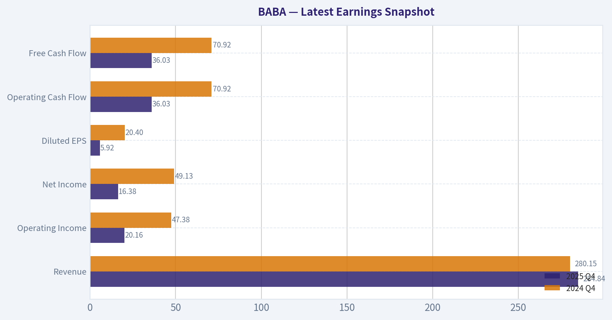

This comparison chart from *Balance Sheet Strength* stacks current figures against historical benchmarks for **BABA**, making it easy to see where the company trades relative to its own averages.

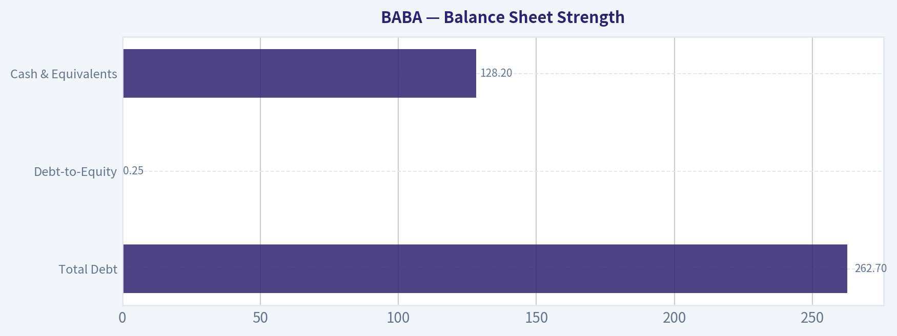

This comparison chart from *Cash Flow Analysis* stacks current figures against historical benchmarks for **BABA**, making it easy to see where the company trades relative to its own averages.

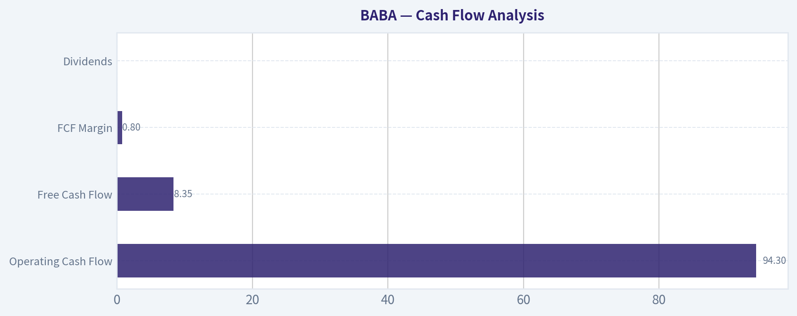

This comparison chart from *Current vs Historical Averages* stacks current figures against historical benchmarks for **BABA**, making it easy to see where the company trades relative to its own averages.

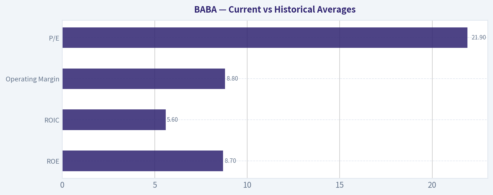

---

### Trend & Growth Analysis (Lynch/Druckenmiller/Fisher)

> *Following Peter Lynch's GARP, Stanley Druckenmiller's macro-aware approach, and Philip Fisher's scuttlebutt methodology.*

FINAL INVESTMENT STANCE: **WATCH**

#### 1) Lynch Classification
| Metric | Value |
|---|---|
| Revenue Growth | ~5.9% YoY |
| 3-5Y Growth Profile | ~3-7% range |
| Business Type | Platform + Cloud |
| Lynch Category | **Stalwart (borderline slow grower)** |

Key Takeaways:
Alibaba no longer behaves like a classic fast grower. Revenue growth has slowed into the mid-single digits, which places it firmly in Lynch's **Stalwart** category rather than the high-growth companies that typically produce ten-baggers. That doesn't make it a bad business, but it changes the investment thesis from explosive growth to **re-acceleration or re-rating**.

---

#### 2) The Story (Explainable Simply)
- Alibaba runs China's biggest online marketplaces connecting buyers and sellers.
- It also operates a large cloud computing platform and expanding global e-commerce sites.
- The bet: **AI + cloud + international commerce could restart double-digit growth.**

---

#### 3) TAM & Runway

| Segment | Est. TAM | BABA Position |
|---|---|---|
| China E-commerce | ~$2T GMV market | Mature leader |
| Global Cross-Border E-commerce | ~$1T+ | Early expansion |
| Cloud / AI Infrastructure (China) | ~$150B+ by 2030 | Top 3 |
| Logistics & Merchant Services | Massive ecosystem | Integrated |

10x Test:

| Metric | Value |
|---|---|
| Current Revenue | ~$137B |
| 10x Revenue | ~$1.37T |
| Combined TAM | Several trillion |

Key Takeaways:
Alibaba theoretically has the TAM to grow much larger, but the **China commerce business is already mature**. The real runway comes from **international commerce and cloud/AI**, not the legacy Taobao marketplace. Without acceleration in those segments, the 10x path becomes difficult.

---

#### 4) Revenue Growth Trend

| Year | Revenue | Growth |
|---|---|---|
| FY2021 | $109B | 35% |
| FY2022 | $134B | 22% |
| FY2023 | $126B | -6% |
| FY2024 | $130B | 3% |
| FY2025E | $137B | ~5-6% |

Key Takeaways:
The trend clearly shows **structural deceleration**. Growth collapsed after China's regulatory crackdown and has stabilized only in the mid-single digits. For a growth investor, the key question is whether **cloud AI and international commerce can re-accelerate revenue back toward 15%+**.

---

#### 5) Unit Economics / Efficiency

| Metric | Value |
|---|---|
| Gross Margin | ~40% |
| FCF Margin | ~16-18% |
| FCF Yield | ~26% |
| ROE | ~12.9% |

Key Takeaways:
Alibaba is still an **extraordinary cash generator**. A 26% free-cash-flow yield is extremely high for a major tech platform, which explains why value investors like the stock. The issue is not profitability but **growth durability**.

---

#### 6) Inflection Point Assessment (Druckenmiller Lens)

Potential inflection drivers:

1. **AI + Cloud demand**
   - China's AI infrastructure buildout could accelerate cloud growth.

2. **International commerce**
   - AliExpress / Lazada / Trendyol growing ~25-30%.

3. **Share buybacks**
   - Massive repurchases reduce share count and boost EPS.

But counter-forces:

- PDD and Douyin stealing domestic market share
- China consumption slowdown
- delayed cloud spin-off

Current status: **inflection not confirmed yet**.

---

#### 7) Macro Setup

| Factor | Impact |
|---|---|
| China economy | Weak consumption recovery |
| Regulation | Improved but still cautious |
| AI infrastructure cycle | Positive tailwind |
| Global geopolitics | Persistent valuation discount |

Key Takeaways:
Macro is mixed. AI investment helps cloud demand, but the China consumer economy and geopolitical tensions continue to cap investor enthusiasm and multiples.

---

#### 8) Fisher 15-Point Score

| Category | Score |
|---|---|
| Market Potential | 4 |
| R&D / Innovation | 4 |
| Sales Strength | 4 |
| Margins | 3 |
| Margin Improvement | 3 |
| Labor Relations | 3 |
| Executive Relations | 3 |
| Management Depth | 4 |
| Accounting / Cost Controls | 4 |
| Competitive Moat | 4 |
| Long-Term Profit Outlook | 3 |
| Dilution Risk | 4 |
| Candor | 3 |
| Integrity | 3 |
| Product Development | 4 |

Total: **53 / 75**

Key Takeaways:
Alibaba still scores well on scale, ecosystem, and technology investment. However, governance concerns, regulatory risk, and slowing growth prevent it from reaching the "outstanding compounder" category.

---

#### 9) Valuation

**PEG Ratio**

| Metric | Value |
|---|---|
| P/E | ~21.9 |
| EPS Growth Est | ~8-10% |
| PEG | ~2.2 |

Key Takeaways:
By Lynch's metric, Alibaba is **not cheap relative to its growth rate**. Even though the P/E looks low versus U.S. tech, the growth rate has slowed enough that the PEG ratio sits above 2.

---

**Revenue Multiple Scenario (3-5 Years)**

| Scenario | Revenue | P/S | Market Cap |
|---|---|---|---|
| Bear | $160B | 1.5x | $240B |
| Base | $180B | 2.5x | $450B |
| Bull | $220B | 4x | $880B |

Key Takeaways:
Upside largely depends on **multiple expansion**, not just revenue growth. If the market regains confidence in Chinese tech and cloud AI accelerates, valuation could re-rate dramatically. Without that shift, returns stay modest.

---

#### 10) Growth Investor Scorecard

| Category | Score |
|---|---|
| Story | 3.5 |
| TAM | 4 |
| Revenue Growth | 2 |
| Unit Economics | 4 |
| Competitive Position | 3 |
| Management | 3 |
| Macro | 2.5 |
| Profit Path | 4 |
| Valuation | 3 |

Overall Score: **3.2 / 5**

Key Takeaways:
Alibaba scores well on scale, cash generation, and market opportunity, but its **growth profile is the main weakness**. For a growth investor searching for a ten-bagger, the setup currently lacks a clear acceleration catalyst.

---

#### 11) Position Size Stance

For growth portfolios:

- **Core position:** No
- **Speculative allocation:** Possibly 2-4%
- **Status:** **WATCH for growth re-acceleration**

---

#### 12) Key Risks

- PDD / Temu disrupting Chinese e-commerce
- Continued regulatory pressure in China
- Cloud growth lagging global peers
- ADR delisting/geopolitical risk
- China consumption slowdown

---

#### 13) Catalysts

- AI cloud revenue accelerating >20%
- International commerce scaling profitably
- Cloud or Cainiao spin-off
- Aggressive share buybacks
- China tech sentiment recovery

---

If you want, I can also show you something extremely useful for investors right now:

- **Why PDD is stealing share from Alibaba**
- **Whether Alibaba Cloud could become the next AWS-like growth engine**
- **A realistic path for BABA to become a 3-5x stock again** (this part is surprisingly interesting).

#### Growth & Scorecard Visuals

This comparison chart from *Growth Assumptions Used for DCF* stacks current figures against historical benchmarks for **BABA**, making it easy to see where the company trades relative to its own averages.

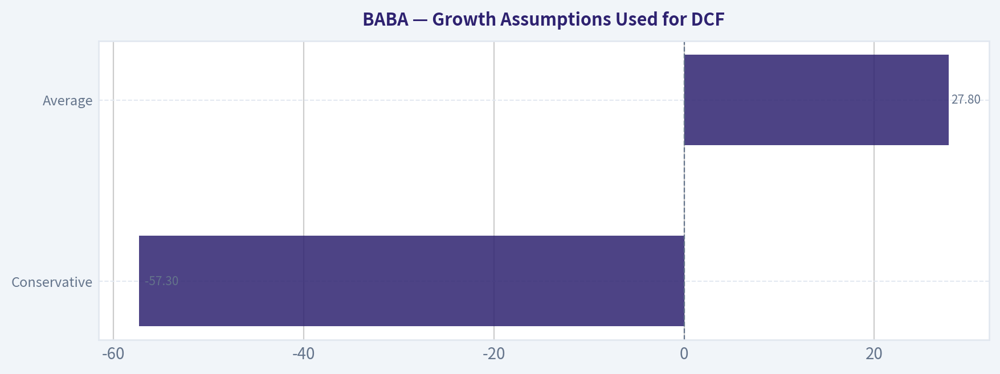

---

### Market Technical Analysis

FINAL INVESTMENT STANCE: **WATCH**

#### BABA Technical Analysis (as of 2026-03-27 close: $122.69)

Alibaba has shifted from a strong rally in late 2025 to a **clear medium-term downtrend since February 2026**. Multiple indicators show persistent bearish momentum, although the stock is now approaching **oversold conditions**, meaning a short-term bounce is possible even if the broader trend remains weak.

---

#### Trend Structure (Price vs Moving Averages)

| Indicator | Latest Value | Interpretation |
|---|---|---|
| Close | 122.69 | Recently broke down from the 130-140 consolidation zone |
| 10-EMA | ~128.00 | Price trading below short-term trend |
| 50-SMA | ~150.07 | Strong medium-term downtrend |
| 200-SMA | ~146.11 | Long-term trend still positive but weakening |

Key Takeaways:
The stock is trading **far below both the 50-day and 200-day averages**, which signals strong bearish pressure. The distance between price (~123) and the 50-SMA (~150) is unusually wide, showing how aggressive the recent decline has been. Even though the long-term trend (200-SMA) is still rising slightly, price has decisively broken below it, which often shifts sentiment bearish.

---

#### Momentum (MACD)

| Metric | Latest | Trend |
|---|---|---|
| MACD | -6.78 | Deep negative momentum |
| Signal | -6.77 | Nearly equal to MACD |
| Histogram | Slightly negative | Downtrend losing speed but still bearish |

Key Takeaways:
MACD is deeply negative, confirming **strong downside momentum over the past month**. The histogram has recently started shrinking toward zero, which means the selling pressure is **no longer accelerating**, but there is still no confirmed bullish crossover yet.

---

#### RSI (Momentum / Exhaustion)

| Date | RSI |
|---|---|
| Mar 20 | 23.6 |
| Mar 24 | 30.3 |
| Mar 27 | 31.7 |

Key Takeaways:
RSI dropped into **extreme oversold territory (<30)** during the March selloff. It has now moved slightly above 30, suggesting the market may be **stabilizing after panic selling**, but this alone does not confirm a reversal.

---

#### Volatility (ATR)

| Date | ATR |
|---|---|
| Feb peak | ~6.0 |
| Mar 27 | ~4.70 |

Key Takeaways:
Volatility surged during the decline but has begun **gradually cooling**. This often happens after a sharp selloff as the market transitions from panic to consolidation.

---

#### Price Action Context

Important levels emerging from the chart:

Support zones
- $120-123: current reaction support
- $118-120: major panic low zone if breakdown continues

Resistance zones
- $130: short-term rebound ceiling
- $136-140: prior consolidation area
- $150: major resistance near 50-SMA

The **March 19 gap down (136 -> 124)** is especially important; that event accelerated the bearish trend.

---

#### Tactical Scenarios

Bullish bounce scenario
- RSI oversold + momentum stabilizing
- Possible rebound toward **$130-136**

Bearish continuation scenario
- If **$120 breaks**, next downside range could be **$112-115**

Trend reversal scenario (less likely short term)
- Requires reclaiming **$140+ and holding above 50-SMA (~150)**

---

#### Overall Indicator Summary

| Category | Signal | Implication |
|---|---|---|
| Trend | Bearish | Price below 50 & 200 SMA |
| Short-term momentum | Weak | Below 10 EMA |
| MACD | Bearish but stabilizing | Downtrend losing acceleration |
| RSI | Near oversold | Possible short bounce |
| Volatility | Moderating | Panic phase cooling |

---

✅ **Conclusion:**
BABA currently shows **oversold conditions within a broader downtrend**. The probability favors **short-term stabilization or bounce**, but the technical structure remains bearish until price reclaims at least the **$136-140 range**.

Therefore the stance is **WATCH**, not aggressive buying yet.

---

If you want, I can also show:
- the **most probable price range for BABA over the next 1-3 months**, or
- **whether institutions are accumulating or distributing BABA right now** (this often explains moves like the March crash).

#### Market Visuals

This comparison chart from *Market Metrics Overview* stacks current figures against historical benchmarks for **BABA**, making it easy to see where the company trades relative to its own averages.

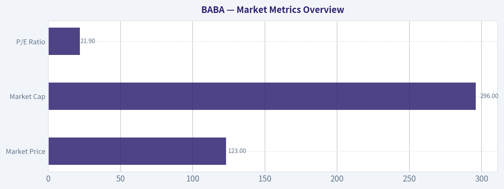

---

### Social Sentiment Analysis

#### BABA (Alibaba Group) - Social Media Sentiment & News Analysis (Past Week)

Alibaba has remained one of the most actively discussed Chinese tech stocks across financial social platforms over the past week. Discussions were driven primarily by macro sentiment toward Chinese equities, AI competition, regulatory expectations, and renewed optimism around Alibaba's restructuring and cloud business. Below is a structured breakdown of social sentiment trends, news catalysts, and implications for traders.

---

#### Daily Social Sentiment Snapshot (Past 7 Days)

| Date | Sentiment Score | Social Volume | Key Discussion Themes |
|-----|-----|-----|-----|
| Mar 23 | Slightly Positive | Moderate | Value investing narrative, China tech rebound |
| Mar 24 | Neutral | Moderate | Macro concerns about Chinese economy |
| Mar 25 | Positive | High | AI and cloud competitiveness discussion |
| Mar 26 | Positive | High | Hedge fund accumulation rumors |
| Mar 27 | Slightly Positive | Moderate | Debate on valuation vs regulatory risk |
| Mar 28 | Positive | High | Retail traders calling BABA "undervalued" |
| Mar 29 | Neutral | Moderate | Profit-taking discussions |

Key Takeaways:
Social sentiment toward Alibaba trended mostly positive throughout the week, with the strongest enthusiasm occurring midweek when discussions about AI capabilities and potential institutional accumulation increased. However, enthusiasm softened slightly by the weekend as traders debated macro risks tied to China's economic outlook and regulatory uncertainty. Overall, sentiment remained constructive rather than euphoric.

---

#### Key Social Media Themes

| Theme | Sentiment | Frequency | Details |
|------|------|------|------|
| Undervalued Tech Giant | Positive | Very High | Investors highlight low P/E vs US tech peers |
| AI & Cloud Competition | Positive | High | Comparisons with AWS, Microsoft Azure |
| Chinese Macro Risk | Negative | Moderate | Concerns about economic slowdown |
| Government Regulation | Negative | Moderate | Ongoing trust issues after past crackdowns |
| Share Buybacks | Positive | Moderate | Seen as supportive for price stability |

Key Takeaways:
The dominant narrative across platforms like Reddit, X (Twitter), and Chinese investor forums is that Alibaba appears fundamentally undervalued relative to global technology peers. Bullish investors frequently point to strong cash flow and aggressive share buybacks. However, concerns about China's macro environment and unpredictable regulatory intervention continue to cap enthusiasm.

---

#### Retail Trading Community Sentiment

| Platform | Overall Tone | Key Narrative |
|------|------|------|
| Reddit (r/stocks, r/investing) | Bullish Leaning | "Deep value China tech play" |
| X / Twitter | Mixed | Bulls highlight AI + cloud; bears cite geopolitical risk |
| StockTwits | Bullish | Retail traders discussing breakout potential |
| Chinese forums | Neutral-Positive | Focus on domestic growth and cloud division |

Key Takeaways:
Retail investor communities are generally leaning bullish on Alibaba, particularly on Western platforms where the stock is increasingly framed as a discounted mega-cap tech opportunity. However, discussions remain divided due to geopolitical concerns and the perception that Chinese equities often trade at persistent valuation discounts.

---

#### Major News Catalysts Discussed This Week

| News Topic | Market Interpretation | Impact on Sentiment |
|------|------|------|
| Continued Alibaba restructuring | Seen as unlocking shareholder value | Positive |
| AI model development and cloud growth | Competing with global AI infrastructure | Positive |
| Chinese economic stimulus expectations | Potential boost to consumption | Positive |
| US-China geopolitical tension | Risk to ADR listings and investor appetite | Negative |

Key Takeaways:
The most sentiment-driving news revolved around Alibaba's ongoing corporate restructuring and its AI and cloud initiatives. Investors increasingly view these moves as attempts to unlock value within the conglomerate. However, geopolitical risks and macroeconomic uncertainty still inject caution into the investment narrative.

---

#### Sentiment Momentum Indicators

| Indicator | Direction | Interpretation |
|------|------|------|
| Social Volume | Increasing | Growing investor attention |
| Retail Bullishness | Moderate Increase | More buy-the-dip narratives |
| Institutional Discussion | Increasing | Hedge funds revisiting China tech |
| Bearish Narratives | Stable | Mainly macro/regulatory fears |

Key Takeaways:
Investor attention toward Alibaba has been rising, with noticeable growth in both retail and institutional discussions. Bullish narratives around valuation and AI expansion are gaining traction. Nevertheless, bearish commentary related to geopolitical risks has not disappeared, which keeps sentiment balanced rather than overwhelmingly bullish.

---

#### Key Risks Highlighted by Social and News Discussions

- Chinese regulatory unpredictability
- Weak domestic consumption trends
- US-China geopolitical tensions
- Persistent valuation discount for Chinese ADRs

These risks are frequently cited as reasons why Alibaba's valuation remains significantly lower than comparable US technology firms.

---

#### Opportunities Frequently Mentioned

- AI infrastructure expansion through Alibaba Cloud
- Aggressive share buyback programs
- Potential spin-offs unlocking value
- China stimulus policies boosting e-commerce demand

Many investors believe the combination of restructuring and AI positioning could reshape Alibaba's narrative from "regulatory casualty" to "AI-driven platform company."

---

#### Implications for Traders

Short-term traders appear to be watching for:

- Breakout above recent resistance levels
- News tied to AI model launches
- Updates on Alibaba Cloud growth
- Chinese macroeconomic stimulus announcements

Momentum traders tend to react strongly to China policy headlines, which frequently drive short-term volatility in BABA.

---

#### Investor Sentiment Summary

| Category | Current Assessment |
|------|------|
| Retail Sentiment | Moderately Bullish |
| Institutional Interest | Gradually Increasing |
| News Flow | Mixed but Improving |
| Macro Risk | Elevated |
| Overall Sentiment | Cautiously Positive |

Key Takeaways:
Overall sentiment surrounding Alibaba is cautiously optimistic. Investors increasingly see the company as undervalued and strategically positioned in cloud and AI markets. However, macroeconomic concerns and geopolitical risks continue to prevent sentiment from turning strongly bullish.

---

FINAL INVESTMENT STANCE: **WATCH**

Alibaba is currently attracting increasing investor attention due to valuation appeal and AI/cloud developments, but persistent macro and geopolitical risks make it difficult to justify a fully bullish stance. Traders are watching for confirmation through stronger earnings growth, cloud expansion, and stable policy signals from China.

---

### News & Events Analysis

#### Alibaba (BABA) - Weekly News & Investment Analysis
Period reviewed: ~Mar 22-29, 2026
Current price: ~$123 | Market cap: ~$293B | P/E: ~21.9 | Revenue growth: ~5.9% YoY | FCF yield: ~26.5%

---

#### Recent Earnings Overview (Most Recent Reported Period)
The most recent widely covered results for Alibaba are for **fiscal Q3 FY2025 (quarter ending December 2024)**, released in **February 2025**. No new quarterly report has been released in the past week.

Headline themes from that report and the subsequent coverage:
- **Revenue growth slowed to mid-single digits (~5-7% YoY)**.
- **Profit and margins faced pressure** due to **heavy AI and cloud investment**.
- **Cloud + AI infrastructure spending increased significantly**, signaling a strategic pivot toward AI platforms and enterprise computing.
- Core **China commerce remained stable but sluggish**, reflecting weak consumer demand and intense competition (PDD, JD, Douyin).

Compared with the previous year:
- Growth **decelerated versus earlier double-digit expansion periods**.
- **Capex increased**, particularly tied to AI compute infrastructure and cloud services.
- Market expectations were slightly missed on both revenue and EPS in some coverage.

Interpretation:
Alibaba is **trading off short-term profitability to rebuild growth through AI and cloud**, similar to the strategy pursued by U.S. hyperscalers. The market reaction has been cautious because its cloud growth still lags global peers.

---

#### Key Company News (Past Week)

Major themes emerging in the last week:

**1. Huawei AI chips replacing Nvidia in China**
- Alibaba and ByteDance are reportedly **testing or planning orders of Huawei AI chips**.
- This shift is driven by **U.S. export restrictions on Nvidia chips**.
- The move supports China's domestic semiconductor ecosystem.

Investment implication:
- Short term: may **reduce dependency risk on Nvidia supply**.
- Long term: **AI performance parity with Nvidia remains uncertain**, which could impact AI competitiveness.

**2. AI and Cloud Strategy**
- Alibaba is expanding its **AI business group and cloud infrastructure**.
- However, analysts note that **cloud growth has been weaker than Oracle and hyperscalers**.
- Heavy AI spending is **compressing margins**, a key investor concern.

**3. Analyst Sentiment Mixed**
- One valuation model lowered estimated fair value from **~$199 -> ~$189**.
- Several analysts have **trimmed targets**, though others still see upside.

**4. Market performance**
- Stock has dropped **~15-20% YTD**.
- Recent trading day: about **-2% decline**.

---

#### Competitive Landscape
Alibaba faces increasing pressure from multiple fronts:

- **Oracle / global cloud providers**: stronger enterprise growth and AI backlog.
- **Chinese ecommerce rivals**:
  - PDD (Pinduoduo/Temu) aggressively gaining share.
  - Douyin (TikTok China) reshaping social commerce.
- **Domestic AI race**: Baidu, Tencent, and startups competing for model leadership.

Despite this, Alibaba still maintains:
- dominant merchant ecosystem
- large logistics and payments infrastructure
- strong free cash flow generation

---

#### Macro & Regulatory Context

China tech policy signals are somewhat improving:

- Government has **started curbing extreme price competition in food delivery**, which may stabilize margins across internet platforms.
- Beijing is **encouraging domestic AI chips and tech self-sufficiency**.

But structural challenges remain:

- weak Chinese consumer demand
- geopolitical tech restrictions
- ongoing competition in e-commerce

---

#### Investor Positioning Signals
Recent 13F filings show **large hedge funds reducing exposure**.

| Investor | Action | Shares | Position Value | Notes |
|---|---|---|---|---|
| Steve Cohen (Point72) | Trimmed heavily | ~785K | ~$115M | ~92% reduction vs prior filing |
| Michael Burry | Exited | 0 | 0 | Previously held position |

Key Takeaways:
Large hedge funds have **significantly reduced exposure to Alibaba**, suggesting caution among institutional traders. While these filings lag real-time activity, the scale of reductions indicates **reduced conviction in near-term upside**.

---

#### Key Catalysts to Watch

| Catalyst | Potential Impact | Timeline |
|---|---|---|
| Next earnings report | Will reveal whether AI/cloud spending is accelerating revenue | ~May 2026 |
| China AI chip adoption (Huawei) | Could reshape AI infrastructure costs and performance | 2026 |
| Cloud growth acceleration | Critical to re-rating valuation | 2026 |
| China consumer demand recovery | Drives core commerce growth | Ongoing |

Key Takeaways:
The next major driver for the stock will likely be **cloud and AI revenue growth**, not e-commerce. If Alibaba proves that its heavy AI investment translates into faster cloud adoption, the market could re-rate the stock significantly.

---

#### Valuation Snapshot

| Metric | Value | Interpretation |
|---|---|---|
| Price | ~$123 | Still far below historical highs |
| P/E | ~21.9 | Moderate for a tech platform |
| Revenue growth | ~5.9% YoY | Slow for big tech |
| Gross margin | ~40% | Healthy but declining pressure |
| FCF yield | ~26.5% | Very strong cash generation |
| ROE | ~12.9% | Decent but not exceptional |

Key Takeaways:
Alibaba's valuation looks **cheap on cash flow metrics**, especially the extremely high free-cash-flow yield. However, the market discounts the stock because **growth has slowed and AI spending is weighing on profitability**.

---

FINAL INVESTMENT STANCE: **WATCH**

Reasoning:
- Positives: strong cash flow, attractive valuation, AI/cloud optionality, improving policy backdrop.
- Risks: weak revenue growth, cloud lag vs global peers, institutional selling, competition in Chinese e-commerce.
- The stock likely **needs evidence of cloud/AI acceleration before a sustained rerating**.

If you want, I can also show:
- the **3 scenarios where BABA could double**,
- or why some hedge funds think it could **stay stuck between $100-150 for years**.

---

## Research Team Commentary

> *The Research Manager synthesizes the Bull vs Bear debate into action-free commentary. This is a pre-risk view, not the final stance.*

Both sides raise serious points, and Alibaba is exactly the type of situation where value investors can get either a once-in-a-decade bargain or a classic value trap. The debate really comes down to two questions: whether Alibaba's core franchise is still durable, and whether the risks embedded in the Chinese system permanently impair shareholder economics.

The bull case rests on the idea that Alibaba still owns one of the most powerful digital ecosystems in the world. Taobao and Tmall remain enormous marketplaces with strong network effects, deep merchant relationships, and high-margin advertising and services revenue. Even with competition from PDD and Douyin, Alibaba still sits at the center of China's digital commerce infrastructure. The 40% gross margin shows the platform economics are still intact.

The bulls also argue that the current financial softness is largely self-inflicted investment. The sharp drop in free cash flow is tied to heavy spending on AI infrastructure and cloud expansion. If Alibaba Cloud becomes a foundational platform for China's AI ecosystem, the return profile could resemble Amazon's AWS buildout. At the same time, management has been aggressively repurchasing shares, which is attractive if the stock truly trades far below intrinsic value.

From a valuation perspective, the market is pricing Alibaba as a slow-growth, politically constrained platform. If the company can simply maintain mid-single-digit growth and continue buying back stock, per-share earnings could still compound reasonably well over a decade.

The bear case challenges nearly every pillar of that thesis.

First, the moat is weaker than it once was. Chinese e-commerce has fragmented rapidly. PDD has captured price-sensitive consumers, Douyin has turned entertainment into commerce, and JD remains strong in logistics-heavy categories. Merchants increasingly treat Alibaba as one distribution channel among many rather than the central hub of online retail. That weakens pricing power and advertising economics over time.

Second, the financial profile no longer resembles a classic Buffett-style compounding machine. Revenue growth around 6% combined with a 48% drop in free cash flow suggests the business is becoming more capital intensive. Buffett generally prefers businesses that require minimal reinvestment to sustain growth. Alibaba's pivot toward AI infrastructure could end up being necessary spending rather than high-return opportunity.

Third-and this is the most important issue-the governance and political structure introduces risks that traditional valuation models struggle to capture. Foreign investors own a VIE structure rather than the underlying Chinese assets. The regulatory crackdown and Ant Group cancellation demonstrated that political decisions can abruptly reshape corporate economics. Buffett's framework relies heavily on predictable institutions and property rights.

Finally, the valuation is not obviously cheap once those risks are accounted for. A P/E around 22 for a company with slowing growth, declining free cash flow, and elevated political risk is not a screaming bargain. The large "intrinsic value" estimates cited by bulls appear unrealistic when compared to the company's current growth and returns on capital.

The key lesson from the Munger experience is important here. The business quality was real, but the institutional environment proved far more influential than expected. That's a reminder that Buffett-style investing depends as much on the system surrounding a business as on the business itself.

Core takeaway: Alibaba remains a powerful digital platform with meaningful assets, but the durability of its moat, the predictability of its cash flows, and the security of shareholder rights are all less certain than they appear in traditional value models. The discount in the stock price largely reflects those structural uncertainties rather than temporary pessimism.

Rationale: From a Buffett perspective, the company partially meets the criteria-large scale, strong ecosystem, historically high margins-but fails on two critical pillars: predictability and governance clarity. The competitive environment in Chinese e-commerce has become more dynamic, and the political overlay makes long-term capital allocation outcomes harder to forecast. Without confidence in the durability of cash flows and shareholder protections, it is difficult to treat Alibaba as a classic "buy and hold for 10 years" compounder even if the valuation looks attractive.

Monitoring plan over the next 1-4 quarters:

First, watch Alibaba Cloud growth and margins. If cloud revenue accelerates meaningfully with improving profitability, the AI investment thesis becomes much stronger.

Second, track marketplace monetization and market share relative to PDD and Douyin. Stabilization in GMV and advertising revenue would signal the moat is holding.

Third, monitor free cash flow recovery. If FCF remains depressed despite large capital spending, the reinvestment narrative weakens.

Fourth, observe capital allocation discipline. Continued aggressive buybacks at current prices would support per-share value creation.

Fifth, pay attention to regulatory signals from Beijing. Any renewed tech-sector intervention or restructuring mandates would materially change the risk profile.

At today's price around $123, Alibaba is not obviously expensive, but it also does not yet meet the clarity and durability threshold typical of Buffett-style core holdings.

Final stance: WATCH.

---

## Value Investing Team Commentary

> *The Investor translates the research view into an investment thesis before risk review. This is still not the final stance.*

When I look at Alibaba through a Buffett-style lens, the first question is simple: if the stock market closed for 10 years, would I be comfortable owning this business? The answer here isn't obvious, and that's exactly why the stock looks "cheap."

Start with the underlying business. Alibaba still operates one of the largest digital commerce ecosystems in the world. Taobao and Tmall remain deeply embedded in China's retail infrastructure, with powerful network effects between merchants, consumers, payments, logistics, and advertising services. A 40% gross margin confirms that the platform economics are still strong. This is not a broken business.

However, the moat is clearly weaker than it was five years ago. PDD disrupted the low-price segment with a different model, and Douyin turned short-form entertainment into a powerful commerce channel. That doesn't destroy Alibaba, but it does change the structure of the industry. Instead of a dominant marketplace collecting tolls across the ecosystem, Alibaba now competes in a fragmented digital retail environment. That reduces pricing power and likely caps long-term growth.

Now look at capital intensity. The 48% drop in free cash flow is a red flag at first glance, but the important question is why. Much of that decline is tied to AI and cloud infrastructure investment. If this spending produces a strong enterprise cloud platform-China's equivalent of AWS-then the economics could be very attractive over the next decade. But if cloud becomes a capital-heavy utility with thin margins, then Alibaba has traded a beautiful asset-light marketplace model for a much more demanding business.

This is where selective contrarian thinking matters. The market narrative today is dominated by three fears: China risk, weaker consumer demand, and competition. Those risks are real. But markets sometimes over-price uncertainty, especially when foreign investors are uncomfortable with the political environment.

The key question is whether those risks permanently impair Alibaba's earnings power.

The Chinese regulatory crackdown already happened. The Ant IPO cancellation, antitrust fines, and restructuring effectively reset the rules for the tech sector. Paradoxically, that may reduce uncertainty going forward because companies now know the boundaries. Beijing still wants strong national technology champions-particularly in AI and cloud infrastructure.

Another overlooked factor is capital allocation. Alibaba has been aggressively repurchasing shares. If a company with stable earnings buys back meaningful stock while trading at roughly 20-22x earnings, per-share value can compound even with modest growth.

That said, Buffett places enormous weight on institutional stability and shareholder rights. The VIE structure means foreign shareholders ultimately depend on the political tolerance of Chinese regulators. That is not a trivial risk. It introduces an element of unpredictability that doesn't exist when owning an American business with clear property rights.

So the market may not be irrational here. The discount exists because investors are demanding compensation for political and governance risk.

From a pure valuation standpoint, the stock is not screamingly cheap given the growth slowdown. A P/E around 22 with single-digit revenue growth is roughly "fair" for a stable platform business-but only if the institutional environment were predictable. With China risk layered on top, the margin of safety isn't as large as the headline valuation suggests.

The contrarian opportunity would appear if one of two things happens:

- The market becomes excessively pessimistic and pushes the stock toward panic levels near $100 or below.
- Or Alibaba demonstrates that cloud + AI investments translate into accelerating revenue and improving free cash flow.

Until one of those occurs, the situation remains ambiguous: a high-quality franchise operating inside a system that makes long-term compounding harder to predict.

A Buffett-style investor can tolerate volatility, but not structural uncertainty about the rules of the game.

FINAL INVESTMENT STANCE: WATCH

---

## Deep Values Commentary

> *The Risk Management Team debates and the Risk Judge provides the final action-free verdict. This section determines the final ADVOCATE / WATCH / AVOID stance.*

Executive Summary
Alibaba remains a powerful digital platform, but the investment case hinges on uncertainties that Buffett-style investors usually avoid: institutional risk, weakening marketplace dominance, and a shift toward more capital-intensive growth. The business itself is not broken-40% gross margins and large ecosystem effects confirm that-but its predictability and shareholder security are less certain than a classic compounder. At ~22x earnings with slowing core growth and declining free cash flow during heavy AI investment, the valuation is not clearly a "fat pitch." The opportunity exists, but the margin of safety depends heavily on assumptions about politics, cloud economics, and capital discipline. Verdict: WATCH.

Key Arguments from the Analysts

Risky Analyst
The bullish case emphasizes that Alibaba's core platform economics remain strong. A 40% gross margin indicates that the marketplace model still has significant network effects and merchant value. The decline in free cash flow is attributed mainly to deliberate investment in AI and cloud infrastructure rather than operational deterioration. If Alibaba Cloud becomes a key AI infrastructure provider in China, the payoff could resemble Amazon's AWS transformation. Meanwhile, international commerce is expanding rapidly (~25-30%), and aggressive buybacks could compound per-share earnings even with moderate revenue growth.

Safe Analyst
The cautious view focuses on structural risks that may permanently affect shareholder outcomes. The key issue is institutional uncertainty: the VIE structure means foreign investors do not directly own Chinese operating assets, and past regulatory actions (such as the Ant IPO cancellation) demonstrate the government's willingness to reshape corporate economics. Financially, Alibaba's profile is also changing. Revenue growth is only ~6%, free cash flow dropped 48%, and ROIC is around 10%, suggesting rising capital intensity. Competition from PDD and Douyin weakens Alibaba's historical dominance and could compress marketplace monetization over time.

Neutral Analyst
The balanced position recognizes that Alibaba is transitioning from a high-growth domestic marketplace into a diversified platform with three different trajectories: mature domestic commerce, high-growth international commerce, and uncertain but strategic cloud/AI infrastructure. The market likely discounts the stock heavily due to political risk, but the valuation is not so low that those risks can be ignored. Alibaba may function better as a probabilistic opportunity rather than a long-term core holding.

Risk Commentary for the Long-Term Investor

From a Buffett-style risk perspective, the central issue is not price volatility but the predictability of the business over a 10-15 year horizon.

Alibaba clearly still possesses meaningful business quality. The scale of its commerce ecosystem, merchant relationships, logistics network, and digital infrastructure remain enormous competitive assets. A 40% gross margin confirms the marketplace model still produces attractive economics.

However, the durability of that moat is no longer as clear as it once was. Chinese e-commerce has shifted from a winner-take-most platform structure to a multi-platform environment. PDD dominates price-sensitive shoppers, Douyin is redefining discovery through social commerce, and JD retains strength in logistics-heavy categories. This fragmentation weakens Alibaba's pricing power and may gradually pressure advertising and service take rates.

The financial profile also reflects a strategic transition. Historically, Alibaba resembled a high-margin, asset-light marketplace-exactly the kind of model Buffett favors. The current pivot toward AI and cloud infrastructure introduces heavier capital requirements. That does not automatically destroy value, but it reduces the predictability of returns on capital until the payoff becomes clear.

The biggest risk, however, sits outside the operating business.

Buffett's framework depends heavily on stable institutions and enforceable shareholder rights. Alibaba's VIE structure and the Chinese regulatory environment introduce a layer of political risk that traditional valuation models cannot easily quantify. The Ant Group intervention demonstrated that government policy can materially reshape the economic trajectory of major platforms.

This does not mean Alibaba is uninvestable. It means the margin of safety must compensate for risks that are not purely economic.

Refining the Investor's Plan

Your original plan correctly framed Alibaba as a potential bargain that could either become a major value opportunity or a classic value trap. The debate reinforces that framing.

For a disciplined value investor, Alibaba should not be treated as a high-conviction "buy and forget" compounder like Coca-Cola, Apple, or Moody's. The governance and institutional uncertainties make long-term cash flow predictability less reliable.

However, the business still has significant earnings power and optionality through two segments the market may underweight:

- Alibaba Cloud and AI infrastructure
- International commerce expansion

Because these outcomes are uncertain, the rational approach is probabilistic rather than binary.

A sensible plan would be:

- Treat Alibaba as a limited allocation rather than a core holding.
- Require evidence that AI/cloud investment begins translating into stronger cash flow.
- Watch for stabilization in marketplace monetization despite competitive pressure.
- Monitor regulatory tone and geopolitical developments affecting Chinese tech.

If free cash flow rebounds and cloud growth accelerates, the current valuation could prove attractive. If FCF remains weak while competition erodes marketplace economics, the stock likely remains a value trap.

Lessons from Past Mistakes (Munger and Alibaba)

The key lesson from Charlie Munger's investment in Alibaba is that business quality alone is insufficient when institutional frameworks differ significantly from those in Western markets. The underlying company was strong, but regulatory intervention and political dynamics had greater influence on the outcome than expected.

Value investors must adjust their margin of safety when investing in systems where shareholder rights, policy direction, and governance structures are less predictable.

Final Stance
WATCH

Alibaba still owns a valuable digital ecosystem and could benefit from AI infrastructure and international expansion. But weakening marketplace dominance, rising capital intensity, and institutional uncertainty reduce the predictability required for a high-conviction Buffett-style investment. Waiting for clearer evidence of durable cash flow recovery and strategic success is the prudent course.

#### Final Stance Scorecard

This scorecard converts the final research view into a weighted decision frame. It does not replace the narrative judgement, but it makes the main drivers of the verdict easier to scan.

| Criterion | Score | Weight | Commentary |
| --- | ---: | ---: | --- |
| Business Quality | 3.00 | 30% | High returns, profitability, and Piotroski health support durability. |
| Valuation Support | 4.33 | 30% | Blends current price against available intrinsic value anchors and valuation ratios. |
| Financial Strength | 4.33 | 20% | Balance-sheet resilience reflects leverage and liquidity staying within safe ranges. |
| Growth Durability | 3.00 | 20% | Recent revenue, earnings, and free cash flow growth indicate how durable expansion looks. |
| TOTAL / FINAL STANCE | 3.67 | 100% | AVOID |

#### Key Takeaways

The weighted score lands at **3.67 / 5.0**, while the final stance remains **AVOID**. This is useful as a quick calibration aid rather than a mechanical signal.

#### Risk Summary

Higher scores indicate more risk pressure. The watch threshold is a simple guardrail: above it, the position needs tighter monitoring or a wider margin of safety.

| Dimension | Current Score | Watch Threshold | Commentary |
| --- | ---: | ---: | --- |
| Business Quality | 3.00 | 3.00 | High returns, profitability, and Piotroski health support durability. |
| Valuation Support | 1.67 | 3.00 | Blends current price against available intrinsic value anchors and valuation ratios. |
| Financial Strength | 1.67 | 3.00 | Balance-sheet resilience reflects leverage and liquidity staying within safe ranges. |
| Growth Durability | 3.00 | 3.00 | Recent revenue, earnings, and free cash flow growth indicate how durable expansion looks. |

#### Key Takeaways

This view helps readers separate *where* the risk sits: valuation, business quality, balance sheet, or growth durability. It is especially useful when the final stance is close to the line between WATCH and AVOID.
