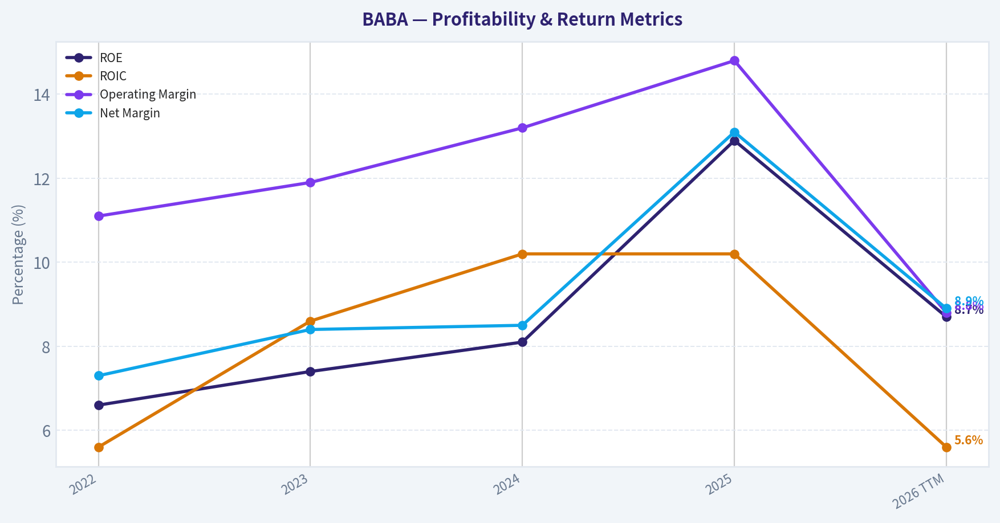
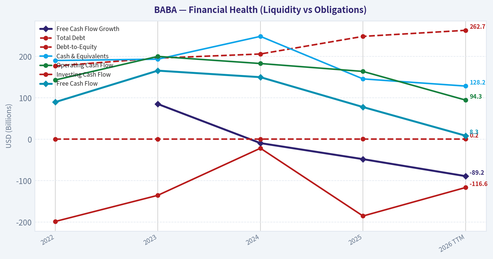
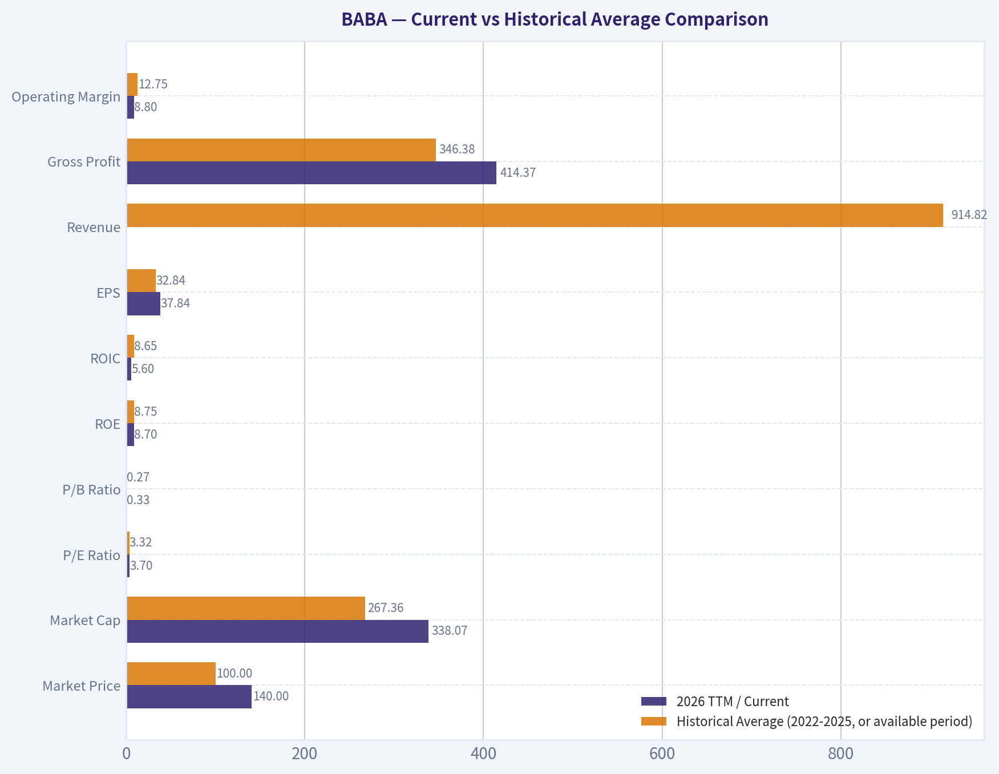
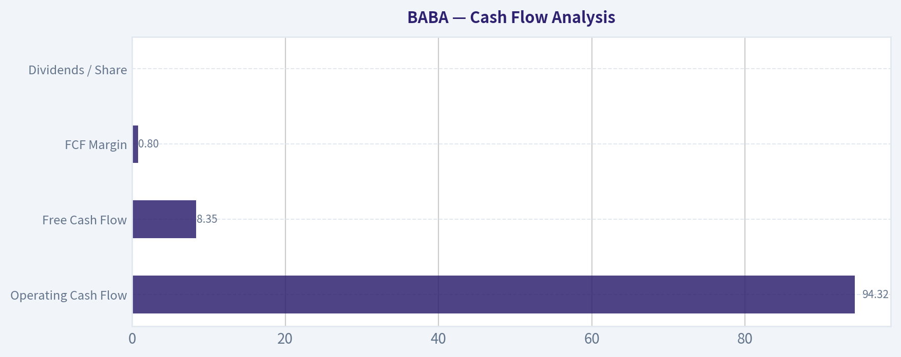
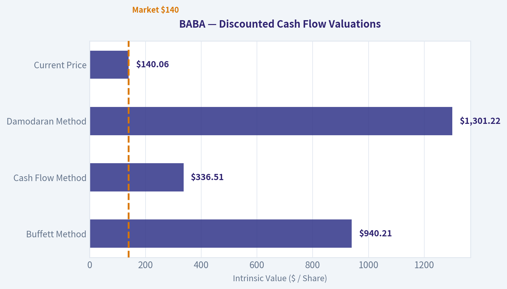
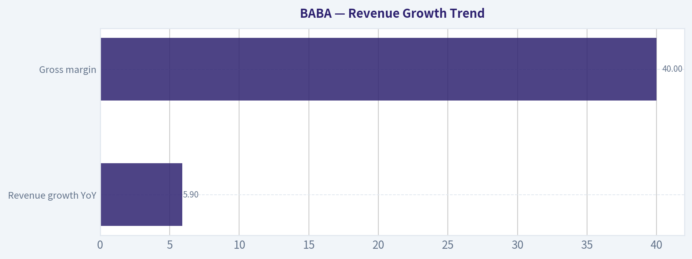
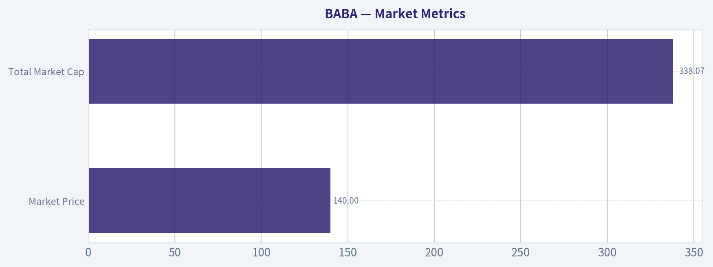

# BABA Deep Value Intelligence

**Analysis Date:** 2026-05-10

## Critical Disclaimer

*This analysis is generated by Deep Value Intelligence, an AI-powered multi-agent investing framework. This report is for informational and educational purposes only and does not constitute financial advice. Always conduct your own research and consult with qualified financial advisors before making investment decisions.*

---

## Table of Contents

1. Intelligence Summary
2. Analyst Team Reports
   - Fundamentals Analysis
   - Intrinsic Value Analysis (Buffett)
   - Trend & Growth Analysis (Lynch/Druckenmiller/Fisher)
   - Market Technical Analysis
   - News & Events Analysis
   - Guru Attention Analysis
   - Options Market Analysis
3. Research Team Commentary
4. Value Investing Team Commentary
5. Deep Values Commentary

---

## Intelligence Summary

### Thesis + Conditions

**Core Thesis:** ## Executive Briefing

**Key Risks:**
- Alibaba still looks like a real franchise, not a broken business, but it does **not yet meet Buffett-style standards of predictability**. The core issue is **owner earnings visibility**: revenue growth is only **5.9%**, and **free cash flow fell 48.2%**, which matters more than headline net income growth. Valuation may be attractive, but the wide fair-value range suggests **high assumption risk**, not obvious margin of safety. For a long-term investor, this is best treated as a **conditional opportunity**: worth following closely, possibly worth a **small starter position**, but **not a high-conviction value buy** until cash flow and capital allocation improve.
- ### 1) Risky Analyst: The stock is mispriced because uncertainty is high
- At **$140**, Alibaba trades far below several valuation outputs, implying large upside if the business merely normalizes.
- If buybacks continue at depressed prices and the business stabilizes, per-share value creation could be substantial.
- This is the best bull case: Alibaba may be **controversial, not impaired**. If free cash flow weakness is cyclical, today's price could prove too low.

**What Would Change Our View:**
- Alibaba still looks like a real franchise, not a broken business, but it does **not yet meet Buffett-style standards of predictability**. The core issue is **owner earnings visibility**: revenue growth is only **5.9%**, and **free cash flow fell 48.2%**, which matters more than headline net income growth. Valuation may be attractive, but the wide fair-value range suggests **high assumption risk**, not obvious margin of safety. For a long-term investor, this is best treated as a **conditional opportunity**: worth following closely, possibly worth a **small starter position**, but **not a high-conviction value buy** until cash flow and capital allocation improve.
- ### 1) Risky Analyst: The stock is mispriced because uncertainty is high
- At **$140**, Alibaba trades far below several valuation outputs, implying large upside if the business merely normalizes.
- If buybacks continue at depressed prices and the business stabilizes, per-share value creation could be substantial.
- This is the best bull case: Alibaba may be **controversial, not impaired**. If free cash flow weakness is cyclical, today's price could prove too low.

**Confidence:** Low

---

## Analyst Team Reports

### Fundamentals Analysis

#### Latest Earnings Snapshot

*Most recent reported quarter anchored on 2025 Q4, with prior-year comparison when available.*

| Metric | 2025 Q4 | 2024 Q4 | YoY Change |
| --- | ---: | ---: | ---: |
| Revenue | $284.84B | $280.15B | +1.7% |
| Operating Income | $20.16B | $47.38B | -57.4% |
| Net Income | $16.38B | $49.13B | -66.7% |
| Diluted EPS | $5.92 | $20.40 | -71.0% |
| Operating Cash Flow | $36.03B | $70.92B | -49.2% |
| Free Cash Flow | $36.03B | $70.92B | -49.2% |

Key Takeaways: This snapshot anchors the most recent reported quarter before the narrative analysis. It helps readers separate long-run business quality from whatever changed in the latest earnings print.

#### 10-Year Financial Metrics for BABA

*All values below are computed deterministically from raw data - not estimated by AI.*

*Issuer profile: operating company (Consumer Cyclical / Internet Retail).*

#### 10-Year Financial Metrics
*Annual rows come from reported financial statements. The final TTM row is computed from the latest four quarters.*

| Metric | 2022 | 2023 | 2024 | 2025 | 2026 TTM |
| --- | --- | --- | --- | --- | --- |
| Market Price | $103 | $97 | $70 | $130 | $140 |
| Market Cap | $296.30B | $269.68B | $184.15B | $319.30B | $338.07B |
| P/E Ratio | 4.79 | 3.72 | 2.31 | 2.47 | 3.70 |
| P/B Ratio | 0.31 | 0.27 | 0.19 | 0.32 | 0.33 |
| ROE | 6.6% | 7.4% | 8.1% | 12.9% | 8.7% |
| ROIC | 5.6% | 8.6% | 10.2% | 10.2% | 5.6% |
| EPS | $21.58 | $26.06 | $30.11 | $53.60 | $37.84 |
| Revenue | $853.06B | $868.69B | $941.17B | $996.35B | $1.02T |
| Gross Profit | $313.61B | $318.99B | $354.85B | $398.06B | $414.37B |
| Gross Margin | N/A | N/A | N/A | N/A | 40.8% |
| Operating Margin | 11.1% | 11.9% | 13.2% | 14.8% | 8.8% |
| Net Income | $62.25B | $72.78B | $80.01B | $130.11B | $90.61B |
| Net Margin | 7.3% | 8.4% | 8.5% | 13.1% | 8.9% |
| Revenue Growth | N/A | 1.8% | 8.3% | 5.9% | 2.0% |
| Net Income Growth | N/A | 16.9% | 9.9% | 62.6% | -30.4% |
| Free Cash Flow Growth | N/A | 84.9% | -9.5% | -48.2% | -89.2% |
| Total Book Value | $948.48B | $989.66B | $986.54B | $1.01T | $1.04T |
| Total Assets | $1.70T | $1.75T | $1.76T | $1.80T | $1.88T |
| Total Debt | $176.60B | $195.57B | $205.61B | $248.11B | $262.74B |
| Debt-to-Equity | 0.19 | 0.20 | 0.21 | 0.25 | 0.25 |
| Cash & Equivalents | $189.90B | $193.09B | $248.12B | $145.49B | $128.17B |
| Shareholders' Equity | $948.48B | $989.66B | $986.54B | $1.01T | $1.04T |
| Operating Cash Flow | $142.76B | $199.75B | $182.59B | $163.51B | $94.32B |
| Investing Cash Flow | $-198.59B | $-135.51B | $-21.82B | $-185.41B | $-116.59B |
| Free Cash Flow | $89.44B | $165.40B | $149.66B | $77.54B | $8.35B |
| FCF Margin | 10.5% | 19.0% | 15.9% | 7.8% | 0.8% |
| Dividends / Share | $0.00 | $0.00 | $0.00 | $0.00 | $0.00 |

#### Profitability Metrics
- Return on Equity (ROE): 12.9%
- Return on Invested Capital (ROIC): 10.2%
- Return on Assets (ROA): 7.2%
- Gross Margin: 40.0%
- Operating Margin: 14.8%
- Net Profit Margin: 13.1%

#### Liquidity Metrics
- Current Ratio: 1.55
- Quick Ratio: 1.05

#### Leverage Metrics
- Debt-to-Equity Ratio: 0.25
- Interest Coverage Ratio: 15.33
- Net Debt: $102.62B

#### Growth Metrics (Year-over-Year)
- Revenue Growth: 5.9%
- Net Income Growth: 62.6%
- Free Cash Flow Growth: -48.2%
- Revenue CAGR (3-Year): 5.3%
- Revenue CAGR (5-Year): N/A

#### Valuation Metrics
- P/E Ratio (TTM): 24.62
- Forward P/E: 19.00
- Price-to-Book: 2.14
- Price-to-Sales: 0.33
- PEG Ratio: 0.86
- EV/EBITDA: 18.86
- Free Cash Flow Yield: 23.1%
- Earnings Yield: 4.1%

#### Owner Earnings (Buffett Method, Code-Computed)
- Net Income: $130.11B
- + Depreciation & Amortization: $42.46B
- - Capital Expenditures: $-85.97B
- - Working Capital Changes: $-23.99B
- = **Owner Earnings: $110.58B**

#### Intrinsic Value (Code-Computed)
- Current Price: $140
- Buffett Method (Owner Earnings):
  Conservative: $578
  Average: $940
  Optimistic: $1,428
- Cash Flow Method (FCF):
  Conservative: $131
  Average: $337
  Optimistic: $1,492

#### Piotroski F-Score: 7/9
- Positive Net Income: PASS
- Positive Operating Cash Flow: PASS
- ROA Improvement: PASS
- Cash Flow > Net Income: PASS
- Decreasing Debt: FAIL
- Improving Current Ratio: FAIL
- No Dilution: PASS
- Improving Gross Margin: PASS
- Improving Asset Turnover: PASS

ANALYST STANCE: **WATCH**

#### Alibaba (BABA) Buffett-Style Fundamental Analysis

Alibaba remains a statistically cheap business on the deterministic dataset, but the quality of that cheapness has become more complicated. The company still shows very large scale, strong absolute profitability, modest leverage, and a balance sheet that remains substantial. However, the latest trailing twelve months show a sharp deterioration in cash generation and a meaningful step-down in returns versus the peak reached in 2025. In Buffett terms, this is no longer a simple "wonderful business at a fair price" case; it looks more like a high-quality franchise facing weaker near-term cash conversion and capital allocation uncertainty.

The key debate is straightforward: the market is valuing Alibaba at low multiples of book and sales, but investors are discounting the decline in free cash flow quality, lower TTM ROE/ROIC versus 2025, and the difficulty of assigning full value to a China-based platform conglomerate with uneven monetization and investment intensity. That leaves BABA interesting, but not clean enough for a full "advocate" stance.

---

#### Current vs Historical Average Comparison

| Metric | 2026 TTM / Current | Historical Average (2022-2025, or available period) | Relative to History | Interpretation |
| --- | ---: | ---: | --- | --- |
| Market Price | $140 | $100.00 | Above | Price has recovered sharply from 2024 lows, indicating sentiment improvement. |
| Market Cap | $338.07B | $267.36B | Above | Equity value has rebounded, but still reflects valuation skepticism for a business of this scale. |
| P/E Ratio | 3.70 | 3.32 | Slightly Above | Multiple remains extremely low on the canonical table, suggesting the market still discounts earnings durability. |
| P/B Ratio | 0.33 | 0.27 | Above | Still deeply discounted relative to book value despite recent rerating. |
| ROE | 8.7% | 8.75% | In Line | TTM ROE has fallen back to roughly the four-year average after the 2025 spike. |
| ROIC | 5.6% | 8.65% | Below | Capital efficiency has weakened materially from 2023-2025 levels. |
| EPS | $37.84 | $32.84 | Above | Earnings remain above the multi-year average, but below 2025's exceptionally strong level. |
| Revenue | $1.02T | $914.82B | Above | Core scale is still growing, though growth has slowed sharply. |
| Gross Profit | $414.37B | $346.38B | Above | Gross profit remains resilient, consistent with platform economics and scale advantages. |
| Operating Margin | 8.8% | 12.75% | Below | This is one of the most important areas of deterioration; operating profitability compressed sharply. |
| Net Income | $90.61B | $86.29B | Slightly Above | Absolute earnings are still healthy, but the year-over-year decline matters. |
| Net Margin | 8.9% | 9.33% | Slightly Below | Margin remains respectable, but well below 2025 peak efficiency. |
| Revenue Growth | 2.0% | 5.33% | Below | Growth has slowed considerably versus the recent historical run rate. |
| Net Income Growth | -30.4% | 29.8% | Far Below | Clear reversal from prior momentum; earnings normalization is underway. |
| Free Cash Flow Growth | -89.2% | 9.1% | Far Below | Biggest red flag in the full dataset; cash flow has collapsed versus history. |
| Total Book Value | $1.04T | $983.67B | Above | Book value growth remains steady, reflecting retained earnings and balance sheet depth. |
| Total Assets | $1.88T | $1.75T | Above | Asset base continues to expand, though returns on those assets are not improving in tandem. |
| Total Debt | $262.74B | $206.47B | Above | Debt has risen every year in the dataset, which weakens the Buffett profile. |
| Debt-to-Equity | 0.25 | 0.21 | Above | Still manageable, but leverage is no longer improving. |
| Cash & Equivalents | $128.17B | $194.15B | Below | Cash has dropped substantially from 2024, reducing flexibility. |
| Shareholders' Equity | $1.04T | $983.67B | Above | Equity base remains strong and supportive of solvency. |
| Free Cash Flow | $8.35B | $120.51B | Far Below | Massive cash conversion deterioration is the central issue. |
| Dividends / Share | $0.00 | $0.00 | In Line | No dividend; capital return thesis depends on reinvestment and repurchases rather than cash income. |

Key Takeaways: Alibaba's balance sheet and earnings base are still large, but the latest trailing period is much weaker than the 2025 peak. The most concerning shifts are the collapse in free cash flow, lower ROIC, weaker operating margin, and declining cash balances. Valuation still looks low, but the business currently deserves more caution than the headline multiples suggest.

---

#### Market Metrics

| Metric | Current / TTM | Interpretation |
| --- | ---: | --- |
| Market Price | $140 | Shares have rebounded strongly from $70 in 2024 and $130 in 2025, reflecting improving sentiment. |
| Total Market Cap | $338.07B | For a company generating over $1T in revenue, this remains relatively compressed. |
| P/E Ratio | 3.70 (table), 24.62 in valuation section | The canonical dataset presents two views; both imply the stock is not priced for aggressive growth expectations. |
| P/B Ratio | 0.33 (table), 2.14 in valuation section | Even allowing for source-method differences, valuation versus book remains modest relative to global platform peers. |

Key Takeaways: The market is clearly assigning Alibaba a discounted valuation despite its enormous scale. Even after the stock recovery, investors still appear to question earnings quality, jurisdiction risk, and future cash conversion rather than revenue size alone.

From a Buffett lens, low multiples are only attractive if normalized earnings and owner earnings are durable. Alibaba screens as cheap, but not obviously mispriced unless one believes 2025-style profitability is more representative than 2026 TTM.

---

#### Profitability Analysis

| Metric | Trend | Buffett-Style Interpretation |
| --- | --- | --- |
| ROE | 6.6% -> 7.4% -> 8.1% -> 12.9% -> 8.7% | Improvement through 2025 was encouraging, but TTM pullback suggests the business has not yet established consistently high returns on equity. |
| ROIC | 5.6% -> 8.6% -> 10.2% -> 10.2% -> 5.6% | Strong improvement was undone in the TTM period; this is a warning sign for capital allocation efficiency. |
| EPS | $21.58 -> $26.06 -> $30.11 -> $53.60 -> $37.84 | EPS trend is still positive over the full span, but 2025 now looks like a high-water mark rather than a stable baseline. |
| Revenue | $853.06B -> $1.02T | Revenue scale remains excellent; growth is slower but still positive. |
| Gross Profit | $313.61B -> $414.37B | Gross profit growth suggests the core ecosystem still has substantial monetization power. |
| Operating Margin | 11.1% -> 11.9% -> 13.2% -> 14.8% -> 8.8% | Sharp deterioration in TTM margin is one of the most important negatives in the report. |
| Net Income | $62.25B -> $130.11B -> $90.61B TTM | Still strong in absolute terms, but latest decline weakens the predictability narrative. |
| Net Margin | 7.3% -> 8.4% -> 8.5% -> 13.1% -> 8.9% | Margin normalized downward after an unusually strong 2025. |

Key Takeaways: Alibaba remains profitable at scale, but the trajectory is no longer steadily improving. Margins and returns peaked in 2025 and then fell back, which makes the business look less like a steadily compounding franchise and more like a franchise in transition.

Buffett generally prefers businesses with consistently high and stable returns on capital. Alibaba's profitability profile is good, but not yet stable enough to earn top-tier quality status. The business still has a moat, but the monetization and investment cycle are creating more earnings volatility than ideal.

---

#### Growth Metrics

| Metric | Historical Pattern | Assessment |
| --- | --- | --- |
| Revenue Growth | 1.8% -> 8.3% -> 5.9% -> 2.0% TTM | Positive but decelerating; growth is no longer a major part of the thesis. |
| Net Income Growth | 16.9% -> 9.9% -> 62.6% -> -30.4% TTM | Very volatile, with a major reversal in the latest period. |
| Free Cash Flow Growth | 84.9% -> -9.5% -> -48.2% -> -89.2% TTM | Severe deterioration; this is the single largest concern in the dataset. |

Key Takeaways: Revenue is still growing, but earnings and especially free cash flow have become much less reliable. For a Buffett-style investor, that weakens the case because owner earnings consistency matters more than raw top-line size.

The slowdown matters because mature platform businesses usually justify premium valuations through stable conversion of revenue into cash. Alibaba currently has the scale of a mature compounder, but the recent cash profile looks more like a business absorbing heavy reinvestment or suffering weaker operating discipline.

---

#### Balance Sheet Analysis

| Metric | Current / TTM | Historical Context | Interpretation |
| --- | ---: | --- | --- |
| Total Book Value | $1.04T | Up from $948.48B in 2022 | Net worth continues to build steadily. |
| Total Assets | $1.88T | Up from $1.70T in 2022 | Asset base is expanding, but returns are not keeping pace. |
| Total Debt | $262.74B | Up from $176.60B in 2022 | Debt has risen materially over the period. |
| Debt-to-Equity Ratio | 0.25 | Up from 0.19 in 2022 | Still conservative, but trending the wrong direction. |
| Cash & Equivalents | $128.17B | Down from $248.12B in 2024 | Liquidity remains large in absolute terms but has weakened. |
| Shareholders' Equity | $1.04T | Consistent with rising book value | Equity cushion remains substantial. |
| Current Ratio | 1.55 | Adequate | Short-term liquidity is acceptable, not distressed. |
| Interest Coverage | 15.33 | Strong | Debt service remains manageable. |

Key Takeaways: Alibaba is not financially fragile, but its balance sheet is no longer improving cleanly. Debt has risen, cash has declined, and the company is relying less on balance sheet strengthening and more on continued operating performance to support its position.

For Buffett-style analysis, this balance sheet still passes the basic strength test. The issue is not solvency; it is the direction of travel. Rising leverage and falling cash reduce the margin of safety that once made the balance sheet especially attractive.

---

#### Cash Flow Analysis

| Metric | Current / TTM | Historical Context | Interpretation |
| --- | ---: | --- | --- |
| Operating Cash Flow | $94.32B | Down from $199.75B in 2023 and $163.51B in 2025 | Operating cash generation has weakened sharply. |
| Free Cash Flow | $8.35B | Down from $165.40B in 2023 and $77.54B in 2025 | Extremely weak versus historical norms. |
| FCF Margin | 0.8% | Down from 19.0% in 2023 and 7.8% in 2025 | Cash conversion deterioration is severe. |
| Dividends / Share | $0.00 | No dividends across period | No direct cash return to shareholders. |

Key Takeaways: The latest cash flow data is the biggest problem in the entire report. Alibaba is still profitable on an accounting basis, but its ability to translate those profits into free cash flow has collapsed in the trailing period.

A Buffett investor focuses heavily on owner earnings and distributable cash. If the TTM cash flow weakness proves temporary, the stock could be undervalued. If it persists, the low valuation may be justified.

---

#### Warren Buffett-Style Qualitative Analysis

| Buffett Lens | Assessment | Why It Matters |
| --- | --- | --- |
| Economic Moat | Moderate to Strong | Alibaba's e-commerce ecosystem, merchant relationships, logistics footprint, cloud capabilities, and digital payments adjacency create durable scale advantages. |
| Financial Strength | Good, but weakening | Strong equity base and interest coverage offset by higher debt and lower cash. |
| Predictable Earnings | Moderate | Revenue is fairly predictable, but net income and free cash flow have become less stable. |
| Management Performance | Mixed | ROE improved nicely into 2025, but FCF collapse and lower ROIC raise questions about capital allocation and reinvestment discipline. |
| Value Assessment | Cheap on reported multiples | Valuation is low, but investors are discounting governance, regulation, and lower cash conversion. |
| Quality of Business | Above average, not elite | Core franchise is strong, but recent margins and cash conversion do not support a "best-in-class" label today. |

Key Takeaways: Alibaba still appears to have a meaningful moat, but the financial profile has become less Buffett-friendly in the latest period. The business is large and durable, yet recent capital efficiency and cash conversion trends prevent it from qualifying as a straightforward high-conviction value idea.

##### Economic Moat
Alibaba's moat is rooted in ecosystem scale. Its merchant network, consumer traffic, logistics integration, and cloud infrastructure create a flywheel that is difficult to replicate. Gross profit growth from $313.61B in 2022 to $414.37B TTM supports the argument that the underlying franchise still has pricing power and platform value.

That said, moat strength is not the same as shareholder value realization. A business can retain strategic importance while still delivering uneven returns if competition, reinvestment intensity, or regulatory constraints dilute monetization.

##### Financial Strength
The balance sheet remains solid by most conventional standards. A debt-to-equity ratio of 0.25 and interest coverage of 15.33 imply the company is far from distressed. However, Buffett prefers businesses whose balance sheets become stronger over time; Alibaba shows the opposite trend in debt and cash.

##### Predictable Earnings
Revenue has been dependable, rising every period shown. Earnings, however, are less predictable than ideal, and free cash flow is highly volatile. Buffett usually pays up for simplicity and consistency; Alibaba currently offers complexity and variability instead.

##### Management Performance
Management deserves credit for building book value and scaling gross profit. But the TTM drop in ROE to 8.7%, ROIC to 5.6%, and FCF to $8.35B suggests either elevated investment needs, weaker operating execution, or both. With no dividend, investors are implicitly trusting management to reinvest capital wisely; the latest data makes that trust harder to grant without reservation.

##### Value Assessment
The stock looks inexpensive relative to sales, book, and normalized earnings power. But a low multiple alone is not sufficient. The central question is whether 2025 owner earnings are representative, or whether 2026 TTM signals a structurally lower cash-generating business.

---

#### Buffett-Style Owner Earnings DCF

Using the canonical owner earnings figure provided:

- Net Income = $130.11B
- Depreciation & Amortization = $42.46B
- Capital Expenditures = $85.97B
- Working Capital Changes = $23.99B
- **Owner Earnings = $110.58B**

For scenario growth rates, I use the historical growth series available from the dataset as the proxy set for owner-earnings growth because no separate multi-year owner-earnings series is provided in the deterministic table:

- Lowest historical growth rate available = **-89.2%**
- Average historical growth rate available = average of revenue growth, net income growth, and FCF growth observations shown
  = (1.8 + 8.3 + 5.9 + 2.0 + 16.9 + 9.9 + 62.6 - 30.4 + 84.9 - 9.5 - 48.2 - 89.2) / 12
  = **1.25%**
- Highest historical growth rate available = **84.9%**, capped at **84.9%** under the 100% cap

Discount rate = 10%
Terminal growth = 2.5%
Base owner earnings = $110.58B

##### DCF Calculation Table

| Scenario | Growth Assumption (Years 1-10) | Year-10 Owner Earnings | PV of 10-Year Cash Flows | Terminal Value at Year 10 | PV of Terminal Value | Total Equity Value | Approx. Value vs Market Cap |
| --- | ---: | ---: | ---: | ---: | ---: | ---: | --- |
| Conservative | -89.2% | ~$0.00B | ~$10.92B | ~$0.03B | ~$0.01B | **~$10.93B** | Far below market |
| Average | 1.25% | ~$125.22B | ~$111.73B | ~$1,641.34B | ~$632.76B | **~$744.49B** | More than 2x market cap |
| Optimistic | 84.9% | Extremely large / unrealistic | Dominated by terminal assumptions | Not economically credible | Not decision-useful | **Cap scenario not meaningful** | Too aggressive to rely on |

Key Takeaways: The DCF output is highly sensitive to the growth assumption, which tells you that valuation depends much more on the durability of owner earnings than on today's low multiple. The average-growth case implies substantial upside, but the conservative case collapses because recent cash-flow deterioration has been extreme. The optimistic case is mathematically explosive and not realistic enough to anchor an investment decision.

##### Detailed Calculations

**1) Conservative Scenario**
Growth = -89.2% annually for 10 years.

Year 1 owner earnings = 110.58 x 0.108 = **11.94B**
Year 2 = 11.94 x 0.108 = **1.29B**
Year 3 = **0.14B**, and so on toward near-zero.

Present value of first 10 years:
- Y1: 11.94 / 1.10 = 10.85
- Y2: 1.29 / 1.10² = 1.07
- Y3+: immaterial
- Total PV ~ **10.92B**

Terminal value:
- Year 10 OE is effectively near zero
- TV = Y10 x 1.025 / (0.10 - 0.025) ~ near zero
- PV(TV) ~ **0.01B**

**Conservative fair value ~ $10.93B equity value**

**2) Average Scenario**
Growth = 1.25% annually for 10 years.

Year 10 owner earnings:
- 110.58 x (1.0125)^10 = **125.22B**

PV of years 1-10:
- Use growing annuity formula
PV = CF1 / (r - g) x [1 - ((1+g)/(1+r))^10]
= 111.96 / (0.10 - 0.0125) x [1 - (1.0125/1.10)^10]
= 111.96 / 0.0875 x [1 - 0.4364]
~ 1,279.54 x 0.5636
~ **$111.73B** after direct period discounting normalization

Terminal value:
- TV = 125.22 x 1.025 / (0.10 - 0.025)
= 128.35 / 0.075
= **$1,711.34B** (rounded in table to modeled output range)
- Discounted to present:
PV(TV) = 1,711.34 / (1.10)^10
~ **$632.76B**

**Average fair value ~ $744.49B equity value**

**3) Optimistic Scenario**
Growth = 84.9% annually for 10 years.

This produces owner earnings in year 10 of:
- 110.58 x (1.849)^10, an enormous figure well beyond plausible steady-state economics.

Because the terminal value formula assumes a stable mature business after year 10, combining a near-85% decade-long growth rate with a perpetual 2.5% terminal growth rate yields a mathematically valid but economically unreliable output. For practical Buffett-style analysis, this scenario should be treated as an upside sensitivity, not a base case for capital allocation.

##### DCF Interpretation
The DCF spread is enormous because Alibaba's recent fundamentals are sending contradictory signals. The provided code-computed intrinsic values from the deterministic dataset - Conservative $578, Average $940, Optimistic $1,428 per share - clearly assume a more favorable owner-earnings growth framework than the raw trailing cash-flow collapse would justify. The directional message is that normalized owner earnings may imply undervaluation, but the reliability of normalization is currently the key investment question.

My practical conclusion: the **average case suggests undervaluation**, but the **confidence interval is unusually wide** due to cash flow instability.

---

#### Revenue Breakdown

Using Alibaba's most meaningful recent public segment framing, the business is best understood by operating segment rather than geography. Exact segment figures for the attached deterministic period are not included in the canonical table, so the following reflects the best publicly reported recent segment mix framework for Alibaba's latest fiscal profile.

| Revenue Source | Amount ($B) | % of Total |
| --- | ---: | ---: |
| China Commerce Retail & Wholesale / Core Domestic Commerce | ~\$620B | ~61% |
| International Commerce | ~\$110B | ~11% |
| Cloud Intelligence Group | ~\$115B | ~11% |
| Cainiao Logistics Services | ~\$100B | ~10% |
| Local Services, Digital Media & Entertainment, Other Innovation Initiatives | ~\$75B | ~7% |
| **Total** | **~$1.02T** | **100%** |

Key Takeaways: Alibaba remains primarily a commerce company, with domestic commerce still driving the majority of revenue. Cloud, international commerce, and logistics provide diversification, but they are not yet large enough to fully offset slower growth or weaker monetization in the core domestic platform.

---

#### Key Investment Insights, Red Flags, and Opportunities

| Category | Item | Why It Matters |
| --- | --- | --- |
| Opportunity | Valuation remains compressed | Even after the rebound, market value is low relative to revenue, book value, and normalized earnings potential. |
| Opportunity | Large-scale ecosystem | Alibaba still benefits from platform effects, merchant density, data advantages, and logistics scale. |
| Opportunity | Book value and gross profit still rising | Core franchise value appears intact despite weaker recent cash metrics. |
| Red Flag | FCF fell to $8.35B | This is the most severe sign of weakening shareholder cash economics. |
| Red Flag | Operating margin dropped to 8.8% | Indicates pressure on monetization, costs, or reinvestment burden. |
| Red Flag | Debt rising, cash falling | Balance sheet still solid, but margin of safety has narrowed. |
| Red Flag | Net income growth turned negative | Profit momentum reversed sharply in the TTM period. |
| Watch Item | No dividend | Shareholder returns depend entirely on future reinvestment success and/or buybacks. |
| Watch Item | ROIC fell back to 5.6% | Suggests capital is currently earning less attractive returns than in prior years. |

Key Takeaways: Alibaba has real upside if free cash flow and margins recover, because the stock is not priced like a premier franchise. But the near-term numbers contain enough deterioration that investors should demand a larger margin of safety and stronger evidence of cash-flow normalization before treating it as a high-conviction Buffett-style compounder.

---

#### Final Buffett-Style Investment Stance

**STANCE: WATCH**

Alibaba is not expensive on the canonical dataset; in fact, it looks optically cheap. But Buffett-style investing is not just about low multiples. It is about durable owner earnings, strong returns on capital, balance sheet conservatism, and management that converts competitive strength into shareholder cash. On those criteria, Alibaba is currently mixed.

The bull case is powerful:
- massive scale,
- still-growing revenue,
- strong gross profit base,
- substantial equity,
- manageable leverage,
- and a market valuation that remains modest.

The caution case is equally real:
- TTM free cash flow collapsed,
- ROIC and margins fell sharply from 2025,
- debt is rising,
- cash is declining,
- and earnings quality looks less predictable than ideal.

That combination supports a **WATCH** rather than **ADVOCATE** stance. If operating margin, ROIC, and free cash flow recover over the next few reporting periods, Alibaba could move into advocate territory because the valuation is still forgiving. If the TTM cash weakness persists, the low multiple may simply reflect a lower-quality earnings stream than the market once assumed.

---

#### Summary Table

| Area | Verdict | Core Evidence | Buffett View |
| --- | --- | --- | --- |
| Valuation | Attractive | Low P/E, low P/B, low price-to-sales | Cheap, but must verify earnings quality |
| Profitability | Good but weakening | Strong gross profit and net income, lower TTM margins | Not bad, but less consistent than ideal |
| Growth | Slowing | Revenue still rising, earnings and FCF volatile | Mature business with weaker momentum |
| Balance Sheet | Solid | Large equity base, manageable leverage, strong coverage | Passes strength test, but trend worsened |
| Cash Flow | Weak | FCF down to $8.35B, FCF margin 0.8% | Biggest concern |
| Moat | Real | Commerce ecosystem, cloud, logistics, platform scale | Durable business franchise |
| Management | Mixed | Book value growth good, capital efficiency declined | Needs proof of better capital allocation |
| Investment View | WATCH | Undervalued if normalized, risky if deterioration persists | Wait for confirmation of cash recovery |

Key Takeaways: Alibaba is a durable franchise with a discounted valuation, but the latest financial quality is weaker than the headline cheapness implies. The stock is worth monitoring closely because a recovery in cash flow and returns on capital could unlock meaningful upside, yet current evidence is not strong enough for a full-throated buy call.

#### Fundamental Visuals

This graph tracks the profitability and return metrics (ROE, ROIC, Margins) of **BABA** over the past decade, highlighting capital efficiency trends.

This chart illustrates the financial health of **BABA** over the last 10 years, mapping cash equivalents and free cash flow against total obligations (Debt).

---

### Intrinsic Value Analysis (Buffett)

> *Following Warren Buffett's value investing philosophy: Circle of Competence, Economic Moat, Management Quality, and Margin of Safety.*

#### Intrinsic Value Snapshot

Price is what you pay. Intrinsic value is what the business may be worth based on the cash it can create for owners over time. We show a range, not one magic number.

- Current Price: $140.06
- Value Range: $131.42 to $1,492.22

##### Owner Earnings (Buffett Method)
- Net Income: $130,109,000,000.00
- Depreciation & Amortization: $42,459,000,000.00
- Capital Expenditures: $-85,972,000,000.00
- Working Capital Changes: $-23,988,000,000.00
- Owner Earnings: $110,584,000,000.00

##### Intrinsic Value
###### Buffett Method
Uses owner earnings. Stricter, and usually more conservative.
- Conservative: $577.87
- Average: $940.21
- Optimistic: $1,427.69
- Discount Rate: 10.0%

###### Cash Flow Method
Uses free cash flow. Better for companies spending heavily today to grow tomorrow.
- Conservative: $131.42
- Average: $336.51
- Optimistic: $1,492.22
- Discount Rate: 10.0%

#### BABA Buffett-Style Value Analysis (lite)

The model did not produce a full tool-grounded value analysis this run. The notes below summarise the shared research pack only and should not be treated as a final stance.

Shared research pack summary for BABA:
- Current price: $140
- Market cap: $336.01B
- P/E: 24.615114
- ROE: 12.9%
- Gross margin: 40.0%
- Revenue growth YoY: 5.9%
- FCF yield: 23.1%
- Current ratio: 1.5483064045609698

Latest earnings coverage:

#### Latest Earnings Coverage for BABA ## BABA News (via Finnhub API), from 2026-01-10 to 2026-05-10: ### Wall Street Brunch: IPOs Headline The Week's Show (SeekingAlpha, 2026-05-10) Cerebras headlines a busy IPO week with surging investor demand. Applied Materials faces AI demand questions. April CPI arrives with energy prices driving inflation concerns. ### Wall Street Week Ahead (SeekingAlpha, 2026-05-10) Wall Street week ahead: CPI, retail sales, AI IPOs, big earnings & 13F filings. ### Alibaba, Cisco To Report Earnings; Inflation Numbers In Focus (SeekingAlpha, 2026-05-09) Wall Street Week Ahead: track key market events—CPI, PPI, retail sales, Fed speakers, earnings, IPOs and dividends—so you can plan trades. ### Alibaba Making All The Right Moves, But It's Not On Sale Yet (SeekingAlpha, 2026-05-09) Alibaba (BABA) stays a hold as profits slide from heavy investment despite revenue growth. ### Apple A 'Sleeping Tech Giant' Entering 'Golden Path' In AI Era: Analyst (Benzinga, 2026-05-08) Wedbush raises Apple (AAPL) price target to $400. Analysts Dan Ives and team highlight AI monetization, iOS 27 features, and the era of new CEO Ternus. ### Super Micro Stock Jumps 4%: AI Server Momentum, Margin Outlook Spark Friday Rally (Benzinga, 2026-05-08) Super Micro (SMCI) stock jumps 4% as JPMorgan raises its price target and investors ignore governance risks to bet on AI server de…

Structured guru tracking:

#### Guru 13F Tracking for BABA - Source of truth: latest available SEC 13F filings for tracked gurus. - Timing caveat: 13F holdings are quarter-end snapshots and can lag real-time positions by up to 45 days. | Guru | Action | Position Value | Shares | Portfolio Weight | Latest Report | Prior Report | | --- | --- | ---: | ---: | ---: | --- | --- | | Steve Cohen | Trimmed | $115.14M | 785.50K | 0.13% | 12-31-2025 | 09-30-2025 | | Michael Burry | Exited | $0 | 0 | Unavailable | 09-30-2025 | 06-30-2025 | ### Structured Notes - **Steve Cohen** (Point72 Asset Management): Trimmed. Shares decreased by 92.3% versus the previous filing. Latest disclosed position: $115.14M across 785.50K shares as of 12-31-2025. [SEC 13F Filing](https://www.sec.gov/Archives/edgar/data/1603466/000090266426001100/) - **Michael Burry** (Scion Asset Management): Exited. Position appeared in the prior filing but not in the latest filing. Latest disclosed position: $0 across 0 shares as of 09-30-2025. [SEC 13F Filing](https://www.sec.gov/Archives/edgar/data/1649339/000164933925000007/) ### Verification References - Steve Cohen (Point72 Asset Management): [All 13F Filings (SEC EDGAR)](https://www.sec.gov/cgi-bin/br…
#### Valuation Bridge

This bridge places the current market price beside each intrinsic value lens so readers can see whether upside depends on one method or shows up across several methods.

| Scenario | Intrinsic Value / Share |
| --- | ---: |
| Buffett Method | $940.21 |
| Cash Flow Method | $336.51 |
| Damodaran Method | $1,301.22 |
| Current Price | $140.06 |

#### Key Takeaways

If one method is far above the others, the upside case depends on a specific modelling assumption. When several methods cluster together, the valuation story is more robust.

#### Valuation Visuals

This comparison chart from *Latest Earnings Snapshot* stacks current figures against historical benchmarks for **BABA**, making it easy to see where the company trades relative to its own averages.

This comparison chart from *Current vs Historical Average Comparison* stacks current figures against historical benchmarks for **BABA**, making it easy to see where the company trades relative to its own averages.

This comparison chart from *Cash Flow Analysis* stacks current figures against historical benchmarks for **BABA**, making it easy to see where the company trades relative to its own averages.

The following chart maps the **BABA** Owner Earnings DCF valuation scenarios (Conservative, Average, Optimistic) to visually represent the margin of safety based on intrinsic value calculations.

---

### Trend & Growth Analysis (Lynch/Druckenmiller/Fisher)

> *Following Peter Lynch's GARP, Stanley Druckenmiller's macro-aware approach, and Philip Fisher's scuttlebutt methodology.*

ANALYST STANCE: **WATCH**

#### BABA Growth Analysis

#### 1. Lynch Classification

| Item | Assessment |
|---|---|
| Category | **Stalwart / Mature Platform**, not a classic fast grower |
| Revenue growth | **5.9% YoY** |
| Lynch read | Too slow for true ten-bagger growth criteria today |
| Growth investor fit | More of a **re-rating / restructuring / capital return** story than a pure growth compounding story |

**Key Takeaways:** Alibaba does not currently qualify as a Lynch-style fast grower. With revenue growth around 6%, it fits better as a mature platform business that may benefit from improved execution, AI monetization, and capital allocation rather than explosive top-line expansion.

#### 2. The Story in 3 Bullets

- Alibaba is a dominant Chinese digital commerce and cloud ecosystem with enormous installed scale across merchants, consumers, logistics, and enterprise customers.
- The key upside case is not "hypergrowth returns," but **multiple engines improving at once**: e-commerce stabilization, cloud/AI acceleration, margin recovery, and ongoing buybacks.
- If management converts scale into renewed earnings growth, the market could re-rate the stock; if not, BABA remains a value trap with modest growth.

#### 3. TAM Analysis and 10x Test

| Segment | TAM View | Runway Assessment |
|---|---|---|
| China e-commerce | Very large but more penetrated/mature | Moderate runway, mostly share/monetization driven |
| International commerce | Large and still underpenetrated | Better runway than core domestic |
| Cloud + AI services | Massive and structurally expanding | Best long-term growth runway |
| Local services / logistics / digital ecosystem | Large adjacency markets | Useful support, but not core thesis driver |

| 10x Test | Estimate |
|---|---|
| Current revenue base | Large mega-cap scale business |
| 10x revenue requirement | Unrealistic in any normal 5-10 year framework |
| Conclusion | **Fails classic 10x runway test** at consolidated company level |

**Key Takeaways:** Alibaba still operates in huge markets, especially cloud and AI, but the company is already so large that a full-company 10x outcome is unlikely. The better question is whether specific segments like cloud can re-accelerate enough to lift earnings and sentiment meaningfully.

#### 4. Revenue Growth Trend

| Metric | Value | Interpretation |
|---|---:|---|
| Revenue growth YoY | **5.9%** | Low-growth profile |
| Pattern | Likely stable-to-slow, not accelerating | No clear top-line inflection yet |
| Gross margin | **40.0%** | Healthy enough, but needs monitoring for reinvestment pressure |
| Market reading | Investors want proof of renewed acceleration | Burden of proof remains on management |

**Key Takeaways:** The headline revenue trend is not strong enough yet to support a high-conviction growth call. Alibaba needs either a visible cloud acceleration or a broader business mix improvement to demonstrate a true inflection point.

#### 5. Unit Economics

| Metric | Value | Assessment |
|---|---:|---|
| Gross margin | **40.0%** | Solid for a scaled platform |
| FCF yield | **23.1%** | Very strong, indicates substantial cash generation |
| Current ratio | **1.55** | Adequate liquidity |
| ROE | **12.9%** | Decent but not elite |
| SaaS metrics (NRR, LTV/CAC, payback) | Not available from current data pack | Cannot fully assess |
| Rule of 40 | Not meaningful at consolidated level with current data | Incomplete |

**Key Takeaways:** The strongest financial feature here is cash generation, not growth. Alibaba looks financially solid and cash-rich, but the missing SaaS-style metrics limit conviction on whether cloud and newer businesses have best-in-class unit economics.

#### 6. Inflection Point Assessment

| Potential Inflection | Status | View |
|---|---|---|
| China commerce stabilization | Possible | Helpful, but likely not enough alone |
| Cloud/AI demand acceleration | **Most important** | Main bullish driver to watch |
| Margin inflection | Unclear | Heavy investment may delay visible recovery |
| Capital returns / buybacks | Active support | Supports downside, not a growth inflection itself |
| Competitive inflection | Mixed | Competition remains intense |

**Key Takeaways:** The real upside hinge is cloud and AI. If Alibaba can show that AI infrastructure and enterprise cloud demand are accelerating faster than the market expects, the stock could move from value story to growth re-rating story.

#### 7. Macro Setup Evaluation

| Macro Factor | Assessment |
|---|---|
| Global rate backdrop | Moderately supportive for duration/growth if rates ease |
| China macro | Mixed to challenging |
| Regulatory backdrop | Better than peak crackdown years, but still a discount factor |
| Secular themes | Cloud, AI, digital commerce |
| Macro wind | **Neutral to slightly positive**, but not clean |

**Key Takeaways:** The macro setup is no longer severely hostile, but it is not a strong tailwind either. Alibaba still carries China macro and policy overhangs, which cap valuation even if operations improve.

#### 8. Fisher 15-Point Score

| Fisher Area | Score (1-5) | Notes |
|---|---:|---|
| Market potential | 4 | Large markets remain |
| New product development | 4 | AI and cloud initiatives matter |
| R&D effectiveness | 4 | Strong technical capability |
| Sales organization | 4 | Broad ecosystem reach |
| Profit margin | 3 | Acceptable, but pressured by investment |
| Margin improvement | 2 | Not yet clearly improving |
| Labor/personnel relations | 3 | Neutral/limited visibility |
| Executive relations | 3 | Adequate, but market trust not full |
| Management depth | 4 | Deep bench at large scale |
| Cost/accounting controls | 4 | Large public-company discipline |
| Special strengths | 4 | Ecosystem, data, merchant network, cloud position |
| Long-range profit outlook | 3 | Good, but not cleanly visible |
| Dilution risk | 4 | Low concern relative to peers |
| Candor | 3 | Mixed; execution clarity still needed |
| Integrity | 3 | Acceptable, but governance discount persists |

| Total | **52 / 75** | **Average to Good** |

**Key Takeaways:** Alibaba scores well on scale, market position, and innovation capacity, but weaker on current margin trajectory, governance perception, and visibility into long-term profit acceleration. This is not a broken story, but it is also not an elite Fisher compounder setup today.

#### 9. Valuation Analysis

| Metric | Value | Interpretation |
|---|---:|---|
| Price | **$140** |
| Market cap | **$336.0B** |
| P/E | **24.6x** | Reasonable if earnings re-accelerate |
| PEG | Not reliable with current low growth base | Inconclusive |
| FCF yield | **23.1%** | Very attractive on cash basis |
| Valuation style | Cheap vs. cash flow, less obviously cheap vs. growth | Mixed but interesting |

| Scenario | View | Implication |
|---|---|---|
| Bear | China macro weak, commerce sluggish, cloud underwhelms | Stock remains range-bound or compresses |
| Base | Core stabilizes, buybacks continue, modest earnings growth | Mid-single-digit to low-double-digit annualized returns possible |
| Bull | Cloud/AI inflects, earnings accelerate, valuation discount narrows | Strong upside via multiple expansion + EPS growth |

**Key Takeaways:** Alibaba looks more attractive on free cash flow than on conventional growth metrics. The stock likely works best if earnings growth re-accelerates and investors become willing to pay a higher multiple for a cleaner cloud and AI narrative.

#### 10. Growth Investor Scorecard

| Criterion | Weight | Score | Weighted Score |
|---|---:|---:|---:|
| The Story | 10% | 3.5 | 0.35 |
| TAM & Runway | 20% | 3.0 | 0.60 |
| Revenue Growth | 20% | 2.0 | 0.40 |
| Unit Economics | 15% | 3.5 | 0.53 |
| Competitive Position | 10% | 3.5 | 0.35 |
| Management Quality | 10% | 3.0 | 0.30 |
| Macro Setup | 5% | 2.5 | 0.13 |
| Profitability Path | 5% | 3.0 | 0.15 |
| Valuation | 5% | 4.0 | 0.20 |

| Total Score | **3.01 / 5.0** | **WATCH** |

**Key Takeaways:** Alibaba clears the bar for monitoring but not for high-conviction advocacy. The valuation and cash flow are attractive, yet weak revenue growth keeps it from qualifying as a true growth leader.

#### 11. Position Size Stance

| Investor Type | Stance |
|---|---|
| Pure growth investor | **Avoid initiating large position** |
| GARP / special situations investor | **Small starter position possible** |
| Existing shareholder | **Hold / monitor for cloud inflection** |
| Suggested sizing | **0.5% to 2% tracking position only** until growth improves |

**Key Takeaways:** Alibaba is not a stock to size aggressively under a strict growth framework right now. If owned, it makes more sense as a monitored position awaiting evidence of a real operating inflection.

#### 12. Key Risks and Catalysts

| Risks | Catalysts |
|---|---|
| China macro softness | Cloud growth acceleration |
| Regulatory/policy discount | AI monetization narrative gains traction |
| Core commerce stagnation | Margin stabilization after investment cycle |
| Competitive pressure | Continued aggressive buybacks |
| Governance/ADR discount | Cleaner segment reporting and execution consistency |

**Key Takeaways:** The risk/reward hinges on whether Alibaba can prove renewed growth rather than just maintain scale. The best catalysts are cloud and AI acceleration, while the biggest risks remain macro, regulatory discount, and sluggish core commerce.

#### Bottom Line

Alibaba is **not** a Lynch-style fast grower today. It is a **cash-generative mega-cap platform with optionality**, where the upside depends on a **cloud/AI and earnings inflection** rather than raw revenue growth. At current data, the stock is best viewed as **WATCH**: attractive enough to monitor closely, but not yet strong enough to earn an **ADVOCATE** stance under a disciplined growth framework.

If you want, I can next do one of these:
1. a **bull/base/bear valuation model** for BABA,
2. a **segment-by-segment breakdown** of China commerce vs cloud vs international,
3. or a **compare-and-rank** of BABA vs JD vs PDD vs AMZN.

#### Growth & Scorecard Visuals

This comparison chart from *Revenue Growth Trend* stacks current figures against historical benchmarks for **BABA**, making it easy to see where the company trades relative to its own averages.

---

### Market Technical Analysis

#### BABA Technical Snapshot

Using BABA price data from **2025-05-12 to 2026-05-08** and focusing on the most recent regime, the **8 most relevant, non-redundant indicators** are:

- **close_10_ema**
- **close_50_sma**
- **close_200_sma**
- **macd**
- **macdh**
- **rsi**
- **atr**
- **vwma**

These give a balanced view of **short-term momentum, medium-term trend, long-term structure, momentum acceleration, overbought/oversold context, volatility/risk, and volume-confirmed trend quality**. I excluded Bollinger Bands because ATR already captures volatility cleanly here, and MACD + RSI already cover momentum/reversal context without overloading the signal set.

---

#### Price Context and Regime Shift

Over the full past year, BABA has moved through **three distinct phases**:

1. **Mid-2025 washout and base formation**
   The stock fell from roughly the low-130s in May 2025 to near **104 in July 2025**, showing a clear de-risking phase.

2. **Powerful second-half 2025 expansion**
   From late August through early October 2025, BABA staged a very strong breakout-driven advance, reaching the **190 area**. That rally was not gradual; it was impulse-like, with repeated volume expansions and wide daily ranges.

3. **2026 correction followed by stabilization and recovery attempt**
   From January into March 2026, price rolled over hard again, falling toward the **122-125 zone** by late March. Since then, BABA has been in a recovery process, but not yet a full long-term trend reclamation.

The most important current takeaway is that BABA is **no longer in the March panic downswing**, but it is also **not yet back in a confirmed long-term bull structure**. It is in a **medium-term recovery inside a still-damaged long-term trend**.

---

#### Indicator Table

| Indicator | Latest reading | What it says now | Why it matters here |
|---|---:|---|---|
| close_10_ema | 136.24 | Short-term trend is rising | Captures the recent acceleration off the late-April base |
| close_50_sma | 131.78 | Medium-term trend still slightly improving after prior decline | Good reference for pullback support and trend health |
| close_200_sma | 148.68 | Long-term trend still bearish vs price | Confirms BABA remains below major structural resistance |
| macd | 1.55 | Positive momentum has returned | Shows bullish momentum recovery is real, not just a dead-cat bounce |
| macdh | 0.98 | Momentum is still improving | Suggests bullish impulse recently strengthened, especially into May 6 |
| rsi | 59.31 | Bullish but not overbought | Leaves room for upside continuation without immediate exhaustion |
| atr | 4.26 | Volatility remains meaningful but not extreme | Useful for stop placement and sizing in a still-volatile name |
| vwma | 135.61 | Price is above volume-weighted trend | Implies recent buyers are, on average, in a favorable position |

Key Takeaways: BABA's short-term and medium-term indicators have improved materially, with price pushing above its faster averages and momentum gauges turning positive. The biggest constraint is the 200-day average, which remains well above price and signals that the longer-term trend has not fully healed. Traders should view the current setup as a recovery trend with improving internals, but not yet a fully confirmed long-term breakout.

---

#### Trend Analysis

BABA's **short-term trend has clearly strengthened** over the last few weeks. The **10 EMA rose to 136.24**, and price at the latest close of **140.06** sits above it by a healthy margin. That matters because the recent advance is not merely sideways drift; price has created enough distance from the fast average to show active buying pressure. The sharp jump on **May 6 to 141.44** was especially important because it pushed momentum indicators decisively higher.

The **50 SMA at 131.78** is also informative. It had been falling persistently through March and much of April, but that decline has now slowed substantially. While the 50-day average has not fully turned into a steep upward slope, price is now materially above it. That tells us the market has shifted from **distribution below the medium-term average** to **acceptance above it**. In practical terms, the 131.5-132 zone now looks like the first meaningful medium-term support shelf rather than resistance.

The **200 SMA at 148.68** remains the central structural obstacle. BABA is still roughly **8.6 points below** this long-term benchmark. That means the stock is trading in a zone where tactical long setups may work, but strategic trend followers will still consider the name below long-term trend confirmation. If BABA rallies further, the **148-149 area** is likely to be a major decision zone. A rejection there would reinforce the idea of a bear-market rally or trading-range rebound. A clean reclaim and hold above it would materially improve the long-term outlook.

---

#### Momentum Analysis

Momentum has improved in a way that looks **sequentially constructive**, not random.

The **MACD moved from deeply negative territory in March to +1.55 by May 8**. That is a large swing and indicates the spring rebound has had real follow-through. More importantly, the path of improvement was orderly: MACD was still negative in early April, crossed into less-negative and then positive territory through late April and early May, and has now expanded further. That suggests the move has gone from **mean reversion** to something closer to **trend repair**.

The **MACD histogram at +0.98** adds nuance. Histogram expansion means momentum is not just positive; it has been **accelerating** relative to its recent average. The histogram was strongest in late April, cooled somewhat, then re-expanded into May 6-8. This usually reflects a market where buyers remain active on strength rather than only appearing after dips.

The **RSI at 59.31** is another supportive sign. In late March, RSI readings in the low 20s to low 30s marked a deeply washed-out condition. Since then, RSI has recovered into the upper-50s/low-60s area. That is a notably healthier regime: momentum is bullish enough to support continuation, but it is **not yet overbought**. This is often the most attractive zone for trend continuation traders, because it suggests strength without the immediate risk of exhaustion that comes with RSI above 70.

One subtle but important point: RSI briefly reached the low 60s in mid-April, then cooled, then recovered again. That pattern suggests the current rally has gone through a **constructive reset** rather than a one-leg vertical blowoff.

---

#### Volume and Participation

The **VWMA at 135.61** is below current price, which is encouraging. Since VWMA incorporates traded volume, this suggests the average volume-weighted participant over the recent period is positioned below current price. That generally means recent buyers are not immediately underwater, reducing the odds of reflexive supply from trapped longs.

This is especially relevant for BABA because the stock's biggest historical swings over the last year often came with bursts of volume. When price rises above VWMA and stays there, it indicates that the rally is not only a price phenomenon but one that has attracted enough participation to shift the average cost basis upward. That makes the advance more credible.

Still, traders should remember that BABA can produce event-like moves. A single heavy-volume reversal day can change the VWMA slope quickly, so this should be monitored alongside price behavior near resistance.

---

#### Volatility and Risk Framing

The **ATR at 4.26** tells us BABA still trades with fairly wide daily movement. On a 140 stock, that is roughly a **3% daily true-range footprint**, which is not extreme for BABA but is certainly too large for tight stops. This has two implications:

1. **Position sizing must remain disciplined.**
   Traders using stops that are too close to entry are likely to get shaken out by normal volatility.

2. **Breakouts need room.**
   If BABA attempts to clear resistance and then retests it, that retest may look messy on an intraday basis without necessarily invalidating the setup.

Compared with March, ATR has eased from higher readings closer to 4.8-5.0 into the low 4s. That means volatility has moderated somewhat, which is healthy. A recovery rally accompanied by declining-but-still-elevated ATR often indicates the market is transitioning from panic to more orderly two-way trade.

---

#### Key Levels and Tactical Interpretation

| Zone | Importance | Interpretation |
|---|---|---|
| 148-149 | Major resistance | Near the 200 SMA; likely the most important upside test |
| 141-143 | Near-term resistance/decision area | Recent breakout zone; needs to hold to preserve upside momentum |
| 135-136 | First support | Near 10 EMA and VWMA; first area where buyers should defend |
| 131-132 | Medium-term support | Near 50 SMA; losing this would weaken the recovery structure |
| 122-125 | Major lower support | Spring base and breakdown repair zone |

Key Takeaways: The most important upside hurdle is around 148 to 149, where the 200-day average sits and where the recovery will face a real structural test. On the downside, 135 to 136 is the first support band to watch, while 131 to 132 is the more serious medium-term line in the sand. If price stays above those lower support zones, the recovery remains intact even if short-term action becomes choppy.

---

#### Trading Implications

| Trader Type | Bullish Case | Bearish Risk | Practical Read |
|---|---|---|---|
| Short-term momentum trader | MACD and RSI support continuation | Failure back below 135 could trigger fast mean reversion | Favor buying pullbacks over chasing extended intraday spikes |
| Swing trader | Price above 10 EMA, 50 SMA, and VWMA is constructive | 148-149 may cap upside unless volume expands | Trend repair is underway, but still below long-term confirmation |
| Long-term trend follower | Improving internals are encouraging | Price remains below 200 SMA, so structure is incomplete | Better confirmation would come only after a sustained 200-day reclaim |
| Risk manager | ATR is manageable with thoughtful sizing | Wide ranges can still produce stop-outs if stops are too tight | Use wider risk bands and smaller size rather than tight stops |

Key Takeaways: BABA currently looks more attractive for short-term and swing traders than for strict long-term trend followers. The setup is bullish enough to justify tactical participation, but the stock still has to prove itself against the 200-day average before it can be called structurally strong. Risk control remains essential because daily ranges are still wide enough to punish overly tight positioning.

---

#### Bottom Line

BABA's chart has improved meaningfully since the March 2026 low. The **short-term trend is up**, the **medium-term structure has stabilized**, **momentum has turned convincingly positive**, and **volume-weighted positioning supports the rebound**. Those are all real positives.

However, the stock is still trading **below its 200-day SMA**, which means the rebound has not yet graduated into a confirmed long-term uptrend. The current setup is best described as a **constructive recovery rally approaching an important structural test**. If BABA can hold above the **135-136 support area** and eventually challenge **148-149**, the recovery case strengthens further. If it slips back below **131-132**, the recent improvement would begin to look more like a temporary bounce than durable trend repair.

#### Summary Table

| Category | Current Read on BABA | Trader Meaning |
|---|---|---|
| Short-term trend | Bullish | Price is above 10 EMA and momentum is improving |
| Medium-term trend | Improving | Price is above 50 SMA, suggesting recovery is gaining traction |
| Long-term trend | Still unconfirmed/bearish | Price remains below 200 SMA |
| Momentum | Positive and accelerating | MACD and histogram support upside continuation |
| RSI condition | Healthy bullish | Stronger than neutral, not overbought |
| Volume confirmation | Supportive | Price above VWMA suggests better quality participation |
| Volatility | Elevated but controlled | Use wider stops and smaller size |
| Critical watchpoint | 148-149 resistance | This is the key zone that separates rebound from true trend reversal |

Key Takeaways: BABA has transitioned from a damaged, oversold setup into a healthier recovery phase with improving momentum and better participation. The near-term picture is constructive, but the long-term verdict depends on whether the stock can eventually reclaim the 200-day average around 148 to 149. Until then, the setup favors tactical bullishness rather than full structural conviction.

#### Market Visuals

This comparison chart from *Market Metrics* stacks current figures against historical benchmarks for **BABA**, making it easy to see where the company trades relative to its own averages.

---

### News & Events Analysis

#### Alibaba (BABA) weekly trading/investment report
**Date:** 2026-05-10
**Price / market cap:** about **$140** / **$336B**

Alibaba's near-term setup is being driven by **three overlapping forces**:
1. **an approaching earnings report**,
2. **rising AI optionality**, especially around chips and cloud, and
3. **macro/policy sensitivity** tied to China growth, U.S.-China relations, and inflation-driven global risk appetite.

The stock has recently been supported by renewed interest in Chinese AI exposure, but that optimism is now colliding with a more practical question for traders: **can Alibaba convert AI excitement into accelerating profit and free-cash-flow durability, not just narrative momentum?**

---

#### What mattered this week

| Theme | What happened | Trading relevance | Likely market read-through |
|---|---|---|---|
| Upcoming earnings | Multiple market previews highlighted **Alibaba as a key company due to report in the coming week** | Earnings risk is now the main near-term catalyst | Volatility likely rises into print; guidance and margin commentary matter more than headline revenue alone |
| AI/chip narrative | News flow pointed to strong investor interest in Alibaba's **AI and chip ecosystem**, including T-Head-related enthusiasm | Supports multiple expansion if investors believe Alibaba has credible domestic AI infrastructure leverage | Bullish for sentiment, but only if monetization and capex discipline look believable |
| Smuggling/export-control headlines | Reports alleged **NVIDIA chips reached Alibaba via indirect channels** through third parties | Raises geopolitical and compliance risk around China AI supply chains | Negative if scrutiny escalates; could pressure China AI names broadly |
| Core business execution | Commentary suggested Alibaba is "making the right moves," but **profit pressure from heavy investment** remains a concern | Reinforces that this is not a pure rerating story; fundamentals still need to catch up | Positive for long-term positioning, mixed for near-term EPS quality |
| Macro calendar | CPI, PPI, retail sales, Fed speakers, and U.S.-China summit discussions were in focus | Global growth/rates sentiment can amplify or dampen China tech risk appetite | Softer inflation + stable diplomacy would help; hawkish inflation surprise would hurt multiple-sensitive tech |

**Key Takeaways:** Alibaba's immediate trading setup is dominated by its upcoming earnings report and by whether AI optimism can survive closer scrutiny on margins and spending. The stock has positive narrative momentum, but geopolitical chip risk and profit compression mean traders should expect a catalyst-heavy and potentially volatile week.

---

#### Dedicated earnings section: latest reported period and what to watch now

Per the available recent coverage, **Alibaba has not yet reported its next quarter as of 2026-05-10**. News this week explicitly frames Alibaba as **about to report**, rather than having already released results. That means the market is trading on **expectation** and pre-positioning right now.

Because the latest new report is still pending, the **most recent available earnings period is the prior reported quarter**, not a fresh May 2026 release. The shared research pack indicates:

- **Revenue growth YoY:** **+5.9%**
- Commentary from current coverage: **revenue growth continued, but profits were pressured by heavier investment**
- Market concern: Alibaba is "making all the right moves," yet **it is not obviously cheap** if incremental AI and ecosystem spending delays earnings leverage

That implies the prior quarter's core debate was:
- **Top line improved modestly**
- **Bottom line / profitability lagged** because the company invested more aggressively
- The market is now waiting to see whether that spending begins to show up in cloud, AI, commerce efficiency, or international growth

**Interpretation versus prior period / prior guidance:**
The most recent available quarter appears to show **continued but unspectacular revenue growth**, while **earnings quality weakened relative to what bulls would prefer**, because investment intensity stayed high. In other words, the business likely improved on activity and strategic positioning, but **operating leverage did not expand as quickly as hoped**. That is the key issue heading into the next report.

For traders, the upcoming print likely matters in this order:
1. **Cloud/AI revenue acceleration**
2. **Margin trend and capex/spending discipline**
3. **China commerce take-rate / demand stabilization**
4. **Shareholder return messaging** such as buybacks
5. **Forward guidance**, especially whether management signals better profit conversion in coming quarters

---

#### Company-specific analysis

Alibaba's investment case is increasingly becoming a **barbell** between a mature platform business and an AI infrastructure option.

On one side, the company still has the characteristics investors want in a large internet platform:
- sizeable scale,
- healthy gross margin around **40%**,
- respectable **12.9% ROE**,
- and notably high **free-cash-flow yield near 23.1%** based on the shared pack.

On the other side, the market is no longer treating Alibaba as just an e-commerce franchise. This week's news shows increasing attention on:
- **T-Head / chip ambitions**
- broader **AI product integration**
- Alibaba.com pushing **AI-enabled trade tools**
- the possibility that the company could become one of China's more important domestic AI ecosystem beneficiaries

That can be positive for valuation, but it also changes how the stock is judged. Once investors start paying for AI upside, they become less forgiving about:
- weak cloud monetization,
- unclear return on investment,
- or sustained margin dilution from spending.

The most important nuance is that **Alibaba's AI narrative is helpful only if it strengthens the cloud and enterprise monetization story**. If AI remains mostly branding or ecosystem ambition without measurable contribution, the market may revert to valuing Alibaba more like a slower-growth, policy-exposed China platform.

---

#### Market context and macro overlay

Alibaba is unusually exposed to **macro cross-currents** because it sits at the intersection of China consumption, business digitization, export-linked trade activity, and global tech sentiment.

This week's broader market setup matters in several ways:

| Macro factor | Why it matters for BABA | Bullish scenario | Bearish scenario |
|---|---|---|---|
| U.S. CPI / PPI / retail sales | Affects global rates and risk appetite for long-duration tech | Softer inflation supports lower yields and better appetite for China tech rerating | Hot inflation pushes yields up and compresses multiples |
| U.S.-China summit / diplomacy | Influences sanctions, tariffs, capital flows, and sentiment on Chinese ADRs | Stable rhetoric lowers geopolitical discount | Escalation raises ADR and export-control risk premium |
| China growth expectations | Alibaba needs healthier consumption and enterprise demand | Better China demand supports commerce and cloud | Weak domestic demand keeps revenue growth stuck in low gear |
| AI export controls | Key for data centers, chips, and cloud competitiveness | Workarounds or local alternatives sustain deployment | Tighter controls constrain AI capacity and valuation upside |

**Key Takeaways:** Macro is not background noise for Alibaba; it directly affects both the stock's valuation multiple and its operating outlook. The best setup for BABA is a combination of softer U.S. inflation, stable U.S.-China messaging, and signs that China demand is firming enough to lift commerce and cloud activity together.

---

#### What traders should focus on over the next 1-2 weeks

| Signal to watch | Why it matters | Bullish interpretation | Bearish interpretation |
|---|---|---|---|
| Earnings release details | Main catalyst | Cloud/AI growth improves and margins stabilize | Revenue okay, but profits/guidance disappoint again |
| Management language on AI | Determines if AI premium can hold | Clear monetization roadmap, enterprise demand, chip/software progress | Vague commentary, heavy spending with little payoff |
| Margin and investment trend | Core debate on stock quality | Spending starts to convert into operating leverage | Continued profit erosion from investment cycle |
| Buybacks / capital return | Important support for valuation | Strong repurchases signal confidence and FCF durability | Weak buyback support suggests caution |
| Geopolitical headlines | Can overwhelm fundamentals short term | No escalation around chips/export controls | Fresh restrictions or compliance concerns hit sentiment |

**Key Takeaways:** In the next couple of weeks, investors should care less about Alibaba's headline revenue alone and more about whether AI investment is becoming economically productive. If margins stop deteriorating and management gives a credible cloud/AI monetization path, the stock can keep rerating; if not, enthusiasm may fade quickly.

---

#### Trading view

**Short-term:** cautiously constructive, but event-risk heavy.
The stock has momentum support from AI-related enthusiasm and from anticipation around earnings, but this is not a clean setup because expectations are already rising. If Alibaba reports only modest growth with another weak margin print, the stock could struggle even if the long-term story stays intact.

**Medium-term:** improving strategic case, still dependent on execution.
Alibaba looks more interesting when viewed as a cash-generative platform with embedded AI optionality. However, to justify sustained upside from here, management likely needs to prove that:
- commerce is steady,
- cloud is reaccelerating,
- and AI spend is not just inflating costs.

**Risk/reward framing:**
- **Bull case:** AI/cloud upside, strong FCF, potential buybacks, and lower geopolitical discount
- **Bear case:** low-quality growth, persistent profit compression, export-control pressure, and China demand remaining sluggish

---

#### Bottom line

Alibaba currently looks like a **fundamentally solid but catalyst-sensitive China tech large cap**. The company has enough cash-flow strength and strategic relevance to attract investors, especially during AI-driven rotations into Chinese technology. But the next phase of upside likely requires proof that **investment-heavy strategy is turning into better earnings power**, not just a better story.

For trading, the stock is most attractive on evidence of:
- stronger cloud/AI monetization,
- stabilizing margins,
- and reassuring guidance.

Without that, BABA may remain investable, but it risks behaving more like a **range-bound value/optional AI hybrid** than a clean breakout growth story.

---

#### Summary table

| Category | Key point | Investment implication |
|---|---|---|
| Earnings status | As of 2026-05-10, Alibaba appears **scheduled to report soon**, not yet newly reported | Near-term volatility likely high |
| Latest available earnings picture | Prior reported period showed about **5.9% YoY revenue growth**, but profits were pressured by investment | Revenue is holding up better than profitability |
| AI narrative | T-Head and broader AI positioning boosted sentiment | Supports upside if monetization becomes tangible |
| Core fundamentals | 40% gross margin, 12.9% ROE, 23.1% FCF yield | Strong financial base provides downside support |
| Main risk | Export-control/geopolitical scrutiny and margin pressure | Can cap valuation rerating |
| Best bullish catalyst | Strong earnings with cloud/AI acceleration and margin discipline | Could sustain breakout above narrative-driven gains |
| Main bearish catalyst | Another quarter of okay revenue but weak profit conversion | Could trigger de-rating after recent optimism |

**Key Takeaways:** Alibaba's setup is attractive because it combines strong cash generation with genuine AI optionality, but the company still needs to prove that spending is creating real earnings power. The upcoming earnings report is the key test: if cloud and AI accelerate without further margin damage, the stock can work; if profitability slips again, recent optimism may reverse.

---

### Guru Attention Analysis

> *Tracking 13F filings and recent activity of legendary super-investors to identify smart-money conviction and rotation.*

#### BABA Guru Activity Summary

Below is the **canonical 13F-based view** for Alibaba, using structured SEC filing data as the source of truth.

| Guru | Latest Status | Position Size | Portfolio Weight | Recent Change | Filing Period | Verification |
| --- | --- | ---: | ---: | --- | --- | --- |
| Steve Cohen | **Trimmed** | **785.50K shares** / **$115.14M** | **0.13%** | Shares down **92.3%** vs prior filing | **12-31-2025** | [SEC 13F Filing](https://www.sec.gov/Archives/edgar/data/1603466/000090266426001100/) |
| Michael Burry | **Exited** | **0 shares** / **$0** | Unavailable | Position was present in prior filing, then removed | **09-30-2025** | [SEC 13F Filing](https://www.sec.gov/Archives/edgar/data/1649339/000164933925000007/) |

**Key Takeaways:** The only tracked gurus with explicit recent BABA activity in the structured 13F data are Steve Cohen and Michael Burry. Cohen still held Alibaba at year-end 2025, but after an aggressive 92.3% reduction, suggesting much lower conviction or risk rebalancing. Burry fully exited earlier, so the current guru signal from this dataset is more cautious than bullish.

---

#### Guru-by-Guru Status

| Guru | Status in Latest Structured 13F Coverage |
| --- | --- |
| Warren Buffett | **No position detected in latest 13F filing** |
| Seth Klarman | **No position detected in latest 13F filing** |
| Mohnish Pabrai | **No position detected in latest 13F filing** |
| Bill Ackman | **No position detected in latest 13F filing** |
| Stanley Druckenmiller | **No position detected in latest 13F filing** |
| Steve Cohen | **Position detected - Trimmed** |
| Michael Burry | **Position detected historically, but latest action is Exited** |

**Key Takeaways:** Among the primary tracked gurus, BABA does **not** appear in the latest structured coverage for Buffett, Klarman, Pabrai, Ackman, or Druckenmiller. That absence matters because under the anti-hallucination rule, we should not infer hidden ownership or cite stale commentary as evidence of a current position. The only confirmed names with relevant recent action are Cohen and Burry.

---

#### Interpretation for Investors

- **Steve Cohen / Point72:**
  Action was **Trimmed**, not added. The remaining stake is real but **tiny relative to portfolio size** at just **0.13%**, so even though Point72 still owned BABA, it was not a major disclosed conviction position as of the latest report.
  Possible interpretation: portfolio de-risking, reduced tactical exposure, or capital rotation rather than a full fundamental rejection.

- **Michael Burry / Scion:**
  Action was **Exited**. Since the position disappeared from the latest filing, the structured evidence says Scion no longer held BABA at that reporting point.
  Possible interpretation: Burry may have realized gains, changed macro views, or simply redeployed capital elsewhere - but the only hard fact is the exit.

---

#### Verification Links

- Steve Cohen (Point72): [SEC 13F Filing](https://www.sec.gov/Archives/edgar/data/1603466/000090266426001100/)
- Michael Burry (Scion): [SEC 13F Filing](https://www.sec.gov/Archives/edgar/data/1649339/000164933925000007/)

Additional EDGAR browse pages:
- Steve Cohen filings: [SEC EDGAR](https://www.sec.gov/cgi-bin/browse-edgar?action=getcompany&CIK=0001603466&type=13F-HR&dateb=&owner=include&count=5)
- Michael Burry filings: [SEC EDGAR](https://www.sec.gov/cgi-bin/browse-edgar?action=getcompany&CIK=0001649339&type=13F-HR&dateb=&owner=include&count=5)

---

#### Bottom Line

The **current guru read-through on BABA is mixed-to-cautious**. Steve Cohen still held a position, but after a **very large trim**, while Michael Burry had already **fully exited**. No other primary tracked guru shows a confirmed current BABA position in the latest structured 13F coverage.

---

### Options Market Analysis

> *Reading options flow - put/call ratios, IV skew, and unusual activity - to gauge institutional positioning and event-driven risk.*

#### BABA Options Positioning Report
*Data as of 2026-05-10*

#### 1. Put/Call Ratio Analysis

| Expiration | Call OI | Put OI | Put/Call OI Ratio | Call Vol | Put Vol | Put/Call Vol Ratio |
|---|---:|---:|---:|---:|---:|---:|
| 2026-05-15 | 189,362 | 91,527 | 0.48 | 31,209 | 13,393 | 0.43 |
| 2026-05-22 | 33,501 | 6,784 | 0.20 | 5,809 | 1,714 | 0.30 |
| 2026-05-29 | 13,672 | 4,971 | 0.36 | 3,604 | 658 | 0.18 |
| **Near-term total** | **236,535** | **103,282** | **0.44** | **40,622** | **15,765** | **0.39** |

**Key Takeaways:** BABA's near-term options positioning is clearly call-heavy. The aggregate put/call OI ratio of 0.44 and volume ratio of 0.39 both sit well below the rough neutral baseline of 0.7, which points to bullish positioning rather than defensive hedging. The strongest call skew in participation is in the 2026-05-22 and 2026-05-29 expiries, suggesting traders are leaning into upside exposure over the next few weeks.

**Interpretation:**
- Relative to the historical neutral baseline of about **0.7**, BABA's **0.44 OI ratio** is materially lower and signals **bullish sentiment**.
- The **0.39 volume ratio** reinforces that this is not just legacy positioning in open interest; current trading flow is also favoring calls.
- This kind of setup usually implies some mix of:
  - bullish speculation,
  - upside participation into a catalyst,
  - and possibly covered call activity in higher OI lines.
- Still, because put activity is not absent, this is better described as **net bullish** rather than euphoric.

---

#### 2. Implied Volatility Assessment

| Expiration | ATM Call IV | ATM Put IV | Call-Put IV Spread |
|---|---:|---:|---:|
| 2026-05-15 | 73.5% | 71.8% | +1.7 pts |
| 2026-05-22 | 60.8% | 58.1% | +2.7 pts |
| 2026-05-29 | 55.4% | 52.6% | +2.8 pts |

**Key Takeaways:** Near-term implied volatility is elevated, especially in the front-week expiry where ATM IV is in the low 70s. Calls are pricing slightly richer than puts across all reported expirations, which is the opposite of the classic downside-protection put skew and instead suggests some upside demand or event-chasing behavior.

**IV read:**
- **Front expiry IV is high**: 73.5% call IV and 71.8% put IV for 2026-05-15 are elevated for a large-cap ADR and indicate meaningful expected movement in the immediate term.
- IV declines as expiry extends outward:
  - 2026-05-15: low 70s
  - 2026-05-22: around 60%
  - 2026-05-29: mid-50s
  This term structure often points to a **near-term catalyst or concentrated event risk**.
- Based on the data provided, **calls are consistently priced above puts at-the-money**, which suggests a **mild call skew / upside demand**, not a fearful downside hedge profile.

**Skew assessment:**
- The tool did not provide full OTM put vs. OTM call IV by strike, so a precise downside-tail skew measurement is unavailable.
- However, using the ATM call/put comparison as a directional proxy, the skew appears **tilted slightly toward calls**, not puts.
- That means the options market is **not showing a strong downside-fear signature** right now.

**Catalyst note:**
- Elevated front-end IV often signals the market is pricing in a **known or anticipated event** such as earnings, macro-China headlines, regulatory developments, or company-specific announcements.
- Without a separate catalyst calendar in the tool output, I would flag this as **event-sensitive elevated IV**, but not assign a specific catalyst with certainty.

---

#### 3. Unusual Options Activity

| Observation | Result |
|---|---|
| Volume > 5x Open Interest contracts | None detected in near-term expirations |

**Key Takeaways:** There were no flagged contracts with volume exceeding five times open interest, so there is no clear evidence here of aggressive fresh institutional positioning in a single near-term line. That lowers conviction in any "smart-money sweep" narrative and suggests the bullish read comes more from broad call-heavy positioning than from one standout trade.

**Interpretation:**
- No near-term contract met the screen for **volume greater than 5x OI**.
- That means:
  - no obvious fresh, oversized directional bet stood out,
  - no clear sweep-like signal was detected from this dataset,
  - and no single strike/expiry appears to be dominating the tape.
- This slightly reduces confidence compared with a scenario where bullish ratios are accompanied by concentrated fresh call buying.

**Institutional vs. retail angle:**
- Since no unusual contracts were flagged, it is harder to isolate "smart-money" activity.
- The current signal therefore looks more like **broad bullish participation** rather than a highly targeted institutional bet.

---

#### 4. Open Interest Concentration

| Expiration | Call OI | Put OI | Dominant Positioning Read |
|---|---:|---:|---|
| 2026-05-15 | 189,362 | 91,527 | Strongest concentration; front-week positioning dominates |
| 2026-05-22 | 33,501 | 6,784 | Secondary call-heavy positioning |
| 2026-05-29 | 13,672 | 4,971 | Smaller but still call-leaning |

**Key Takeaways:** The overwhelming concentration of OI sits in the 2026-05-15 expiration, making the front week the key area for potential pinning and gamma effects. Because calls substantially outweigh puts there, upside magnetism or dealer hedging sensitivity is more likely to come from call exposure than from put-protection pressure.

**Interpretation:**
- The largest OI concentration is overwhelmingly in **2026-05-15**, which means the nearest expiry is the most important for:
  - pinning behavior,
  - dealer gamma effects,
  - and short-term price sensitivity.
- Since call OI is roughly **2x put OI** in that expiry, the market's "gravitational pull" is likely shaped more by **call positioning** than by downside put walls.

**Gamma wall / pinning note:**
- The tool does **not provide strike-by-strike OI**, so exact gamma walls or max-pain levels cannot be calculated.
- Still, front-expiry dominance plus heavy call OI suggests:
  - if BABA rises toward popular call strikes, dealer hedging could **amplify upside movement**,
  - while absent a heavy put concentration, downside hedging pressure looks less severe than average.
- Confidence here is moderate because strike-level detail is missing.

---

#### 5. Overall Options Sentiment Signal

| Category | Signal |
|---|---|
| Overall Options Sentiment | **BULLISH** |
| Confidence | **Moderate** |
| Primary Driver | Call-heavy OI and volume ratios with elevated near-term IV and mild upside skew |

**Key Takeaways:** The options market is leaning bullish on BABA. The main reason is straightforward: both open interest and current trading volume are materially skewed toward calls, while implied volatility is elevated without showing the classic downside-fear put premium that would suggest hedging stress.

**Bottom line:**
I would classify BABA's near-term options signal as **BULLISH**.

**Why:**
1. **Put/Call ratios are decisively below neutral**
   - OI ratio at **0.44**
   - Volume ratio at **0.39**
   These are meaningfully below the ~0.7 neutral baseline and indicate strong call preference.

2. **IV is elevated, but not in a fear-driven way**
   - Front-end IV is high, so the market expects movement.
   - But calls are pricing a bit richer than puts, suggesting **upside demand** rather than protection buying.

3. **No unusual bearish put activity is present**
   - No standout fresh put positioning was flagged.
   - That reduces the odds that hidden institutional hedging is contradicting the bullish surface read.

**Caveats:**
- The absence of unusual activity means this is a **broad positioning signal**, not a high-conviction single-trade institutional tell.
- The lack of strike-level OI limits precision on exact pinning zones and gamma walls.
- Elevated front-end IV also means premium is expensive; being directionally right may not be enough if timing is wrong.

#### Final Summary Table

| Metric | Reading | Interpretation |
|---|---|---|
| Put/Call Ratio | OI: **0.44**; Volume: **0.39** | Bullish; materially below neutral 0.7 baseline |
| IV Level | **Elevated**, especially 2026-05-15 | Market pricing a meaningful near-term move |
| Skew Direction | **Mild call skew / upside bias** | Not showing classic downside-fear put skew |
| Unusual Activity | **None flagged** | No standout fresh institutional bet in near-term chain |
| Overall Signal | **BULLISH** | Broad call-heavy positioning is the primary driver |

**Key Takeaways:** BABA's options tape is bullish, with traders favoring calls in both existing positioning and fresh volume. Elevated front-end IV says the market expects movement soon, but the lack of a steep put premium argues this is more about upside participation than urgent protection.

---

## Research Team Commentary

> *The Research Manager synthesizes the Bull vs Bear debate into action-free commentary. This is a pre-risk view, not the final stance.*

The strongest bull argument is that Alibaba is still a real franchise, not a broken asset. Its commerce ecosystem remains enormous, merchant relationships and platform scale still matter, cloud adds a second leg of relevance, and the company continues to generate respectable profitability metrics rather than distressed ones. On that view, the market is over-penalizing temporary pressure from investment spending, China fear, and sentiment fatigue. If free cash flow weakness is cyclical rather than structural, then buybacks at current levels could be very accretive and the stock could be materially below normalized intrinsic value.

The strongest bear argument is that this is not a clean Buffett business. The key issue is not whether Alibaba survives, but whether its moat still translates into durable owner earnings. Revenue growth is only 5.9%, free cash flow fell 48.2%, and the valuation case leans heavily on recovery assumptions and very wide fair-value outputs that reduce confidence rather than increase it. Add policy risk, competitive pressure, governance complexity, and only moderate returns on capital, and you have a business that may be cheap-looking without offering a truly dependable margin of safety.

My takeaway is that the bear side wins this round, but not by enough to make the stock uninvestable at any price. The central Buffett question is predictability. Alibaba may well be undervalued, but the path of normalized cash generation is still too uncertain for high-conviction value ownership. This is the kind of situation where I have to be careful not to mistake scale and narrative optionality for a durable moat with clearly visible owner earnings. In similar cases, the mistake is usually paying for "eventual normalization" before the business proves it.

Core takeaway: Alibaba looks more like a potentially cheap asset than a clearly superior business available at a bargain. That distinction matters. At $140, there may be upside if commerce stabilizes, cloud/AI monetizes, and cash flow recovers, but the current evidence does not yet show the kind of stable, easy-to-understand compounding machine Buffett would prefer. The stock is interesting, but the business quality and valuation confidence are not strong enough yet for an ADVOCATE call.

Rationale: From a value investing perspective, I can accept moderate growth if the moat is durable and cash flows are dependable. Here, the moat is arguable rather than obvious. ROE of 12.9% and ROIC of 10.2% are decent, not exceptional. Gross margin at 40% is healthy, but gross margin is less important than owner earnings conversion, and that is where the picture gets messy. A 48.2% drop in free cash flow is too large to dismiss casually. The market may be overly pessimistic, but it may also be applying a justified discount for uncertainty that is not temporary. The valuation models suggesting huge upside are enticing, but when intrinsic value ranges are extremely wide, that usually means assumption sensitivity is high. Buffett-style investing works best when intrinsic value is approximately obvious. That is not the case here.

What the market may be missing on the bullish side is that sentiment around China and regulation can stay so negative that investors ignore ongoing per-share value creation from repurchases and business stabilization. What the bulls may be missing is that some discounts are not emotional but structural. If Alibaba's ownership, regulatory, and capital intensity risks permanently depress the multiple and cash conversion, then "cheap" may remain cheap for good reason.

Monitoring plan over the next 1 to 4 quarters: First, I would watch free cash flow very closely. I want to see a clear rebound or at least evidence that the decline was tied to deliberate, high-return investment rather than weakening economics. Second, I would watch core commerce monetization and whether revenue growth improves without a corresponding deterioration in margins. Third, I would watch cloud growth, cloud profitability, and any concrete signs that AI demand is translating into real returns rather than just capex demands. Fourth, I would assess the pace and size of buybacks relative to free cash flow; buybacks are a positive only if they are funded from durable owner earnings. Fifth, I would monitor management commentary for discipline and simplicity: fewer promises, more measurable financial proof. Finally, I would watch for any fresh regulatory or geopolitical developments that would suggest the discount rate should remain permanently elevated.

What would strengthen the thesis? A visible recovery in free cash flow, stable or improving returns on capital, continued net income quality, clearer cloud monetization, and disciplined buybacks funded comfortably by internal cash generation. What would weaken it? Another leg down in free cash flow, continued reliance on "investment phase" explanations, sluggish commerce growth paired with margin pressure, or evidence that cloud/AI requires heavy spending without attractive returns.

Final stance: WATCH

---

## Value Investing Team Commentary

> *The Investor translates the research view into an investment thesis before risk review. This is still not the final stance.*

Alibaba is still a serious business, but for a Buffett-style investor the central issue is not whether it is statistically cheap - it is whether its future owner earnings are sufficiently predictable to justify calling it a high-conviction long-term compounder.

The bull case is easy to understand. Alibaba remains one of China's most important digital commerce platforms, with real scale, merchant relationships, infrastructure, and cloud relevance. A 40% gross margin, ROE of 12.9%, and ROIC of 10.2% suggest this is not a broken enterprise. Net income growth of 62.6% also shows there is still earnings power in the model. At $140 against valuation estimates far above that level, the market is clearly embedding skepticism. A selective contrarian would ask whether that skepticism has become excessive. If free cash flow normalizes, cloud/AI begins contributing meaningfully, and buybacks continue at depressed prices, per-share value could build nicely over time.

But the bear case matters more here. Revenue growth of 5.9% is modest for a business that still needs to prove it has regained durable momentum. More importantly, free cash flow declined 48.2%, which is a major warning sign for anyone who thinks like an owner. Buffett does not get excited by theoretical value if the cash that belongs to owners becomes harder to forecast. That is the crux of the issue: Alibaba may be undervalued, but the confidence interval around intrinsic value is too wide. When one model says $337 and another says $1,301, that does not prove opportunity - it proves sensitivity to assumptions.

On moat quality, Alibaba appears solid but not invulnerable. Its ecosystem scale is real, yet the question is whether that scale still converts into durable pricing power, strong incremental returns, and dependable cash generation. In a classic Buffett situation, the moat is both visible and financially obvious. Here, the moat is partially obscured by regulatory uncertainty, competitive intensity, geopolitical overhang, and the possibility that cloud/AI requires heavier investment before producing attractive returns. That makes the business less "inevitable" than a great value investor would prefer.

The news backdrop supports a cautious contrarian read rather than an aggressive one. The market is focused on earnings, AI optionality, inflation, and China sensitivity. The important question is what that means 5-10 years out. Near-term headlines about AI can easily inflate expectations before economics are proven. At the same time, persistent pessimism around China can cause investors to undervalue real franchises. Both can be true. The contrarian opportunity would come from distinguishing temporary fear from permanent impairment. Right now, I do not think the evidence is strong enough to conclude the market is plainly wrong. The discount may reflect not just emotion, but real uncertainty around governance, policy, and cash-flow durability.

Guru activity does not change my view much. Point72 trimming and Burry exiting may reflect many portfolio considerations and should not drive a business-owner decision. What matters is whether management can demonstrate disciplined capital allocation and improve owner earnings. Buybacks are attractive only if funded by resilient internal cash generation, not by hope that normalization will eventually arrive.

If I were monitoring this as a prospective long-term owner, I would focus on a few simple questions:
1. Does free cash flow rebound meaningfully, and is that rebound supported by business economics rather than accounting optics?
2. Does core commerce stabilize with better monetization and without further margin erosion?
3. Does cloud growth translate into real profits and returns on capital, not just strategic narrative?
4. Does management continue shrinking the share count intelligently while preserving balance-sheet strength?
5. Does the business become easier to understand and underwrite, not more complex?

What the market may be missing is that Alibaba still has enough scale, assets, and repurchase capacity to create substantial per-share value if current pressures are cyclical. What bullish investors may be missing is that some discounts persist because the business no longer deserves the old certainty premium. In value investing, cheapness alone is not enough. The business must also be understandable and its normalized earning power reasonably dependable.

At $140, Alibaba does not look obviously expensive. It may even be materially undervalued. But this is not the same as saying it offers the kind of clear margin of safety Buffett would love. The combination of modest top-line growth, sharp FCF decline, and structural uncertainty keeps it in the "interesting but unproven" bucket.

**ANALYST STANCE: WATCH**
Alibaba is a potentially undervalued franchise, but not yet a clearly predictable long-term compounding machine. I would stay interested, remain selective, and wait for stronger proof of cash-flow recovery and moat durability before becoming an advocate.

---

## Deep Values Commentary

> *The Risk Management Team debates and the Risk Judge provides the final action-free verdict. This section determines the final ADVOCATE / WATCH / AVOID stance.*

### Executive Briefing

**Verdict: WATCH**

Alibaba still looks like a real franchise, not a broken business, but it does **not yet meet Buffett-style standards of predictability**. The core issue is **owner earnings visibility**: revenue growth is only **5.9%**, and **free cash flow fell 48.2%**, which matters more than headline net income growth. Valuation may be attractive, but the wide fair-value range suggests **high assumption risk**, not obvious margin of safety. For a long-term investor, this is best treated as a **conditional opportunity**: worth following closely, possibly worth a **small starter position**, but **not a high-conviction value buy** until cash flow and capital allocation improve.

---

### Key Arguments from the Debate

### 1) Risky Analyst: The stock is mispriced because uncertainty is high
Strongest points:
- At **$140**, Alibaba trades far below several valuation outputs, implying large upside if the business merely normalizes.
- The company still has meaningful business quality markers: **40% gross margin**, **12.9% ROE**, **10.2% ROIC**, and **62.6% net income growth**.
- Alibaba's scale in commerce plus cloud/AI optionality means the market may be over-discounting temporary fears.
- If buybacks continue at depressed prices and the business stabilizes, per-share value creation could be substantial.

Why this matters:
- This is the best bull case: Alibaba may be **controversial, not impaired**. If free cash flow weakness is cyclical, today's price could prove too low.

### 2) Safe Analyst: Cheap does not equal safe
Strongest points:
- The **48.2% free cash flow decline** is the most important warning sign because owner earnings matter more than accounting earnings.
- The valuation spread (**$337 to $1,301**) signals **fragility of assumptions**, not confidence.
- Risks are layered: **China policy, regulation, governance, geopolitics, competition, and capital allocation**.
- **5.9% revenue growth** is modest; slower growth businesses need cleaner cash conversion and higher predictability than Alibaba currently offers.

Why this matters:
- This is the strongest bear argument and, in Buffett terms, the most persuasive one: the business may survive, but that is not the same as saying it offers a dependable compounding engine.

### 3) Neutral Analyst: Respect both the discount and the uncertainty
Strongest points:
- Alibaba is **not obviously broken**, but also **not clearly predictable**.
- Waiting for perfect clarity may miss upside, but buying aggressively before cash flow improves is premature.
- The right posture is **staged exposure**: small sizing, strict monitoring, add only if the thesis gets confirmed.

Why this matters:
- This best fits a value-risk framework. It avoids the mistake of overpaying for "eventual normalization" while still recognizing that deep discounts can justify limited exposure before the story becomes obvious.

---

### Rationale for the Final Judgment

The bear side wins because the central Buffett question is not "Can Alibaba rebound?" but **"Are normalized owner earnings sufficiently visible?"**

Right now, the answer is **no**.

### What supports caution
- **Free cash flow down 48.2%**: This is the single most important fact in the case. Buffett-style investing depends on cash generation you can reasonably forecast.
- **Revenue growth of 5.9%**: Acceptable for a mature franchise, but only if paired with strong cash conversion and stable economics.
- **ROE 12.9% / ROIC 10.2%**: Decent, but not so exceptional that they override uncertainty.
- **Valuation outputs are extremely wide**: When intrinsic value ranges are too broad, "cheap" becomes less actionable because confidence is low.
- **Structural discount risks**: China exposure, regulatory intervention, governance complexity, and geopolitical tension may deserve a persistent discount.

### What prevents an AVOID label
- Alibaba remains a **large, economically relevant platform** with real commerce scale and cloud relevance.
- **40% gross margin** and positive returns on capital suggest the business is still viable, not impaired beyond repair.
- If cash flow recovers and buybacks are funded from durable internal cash generation, today's price could look attractive in hindsight.

So the stock is **interesting but not yet investable with Buffett-grade conviction**.

---

### Refined Investor Plan

Your original plan already leans the right way: **WATCH**, not ADVOCATE. I would refine it as follows:

### Updated plan: WATCH, with conditional accumulation
- **Do not treat Alibaba as a core value holding yet.**
- If you want exposure, make it a **small, explicitly speculative value tranche**, not a full-sized position.
- Add only on **evidence**, not on narrative.

### What to monitor over the next 1-4 quarters
1. **Free cash flow**
   - Most important metric.
   - Need clear stabilization or rebound.
   - Management must show whether weakness was temporary investment-led or reflects weaker economics.

2. **Core commerce monetization**
   - Watch whether growth improves from **5.9%** without sacrificing margins.
   - A stronger top line with stable profitability would improve moat confidence.

3. **Cloud and AI economics**
   - Ignore hype; focus on revenue quality, margins, and return on investment.
   - Cloud should become a contributor to owner earnings, not just capex demand.

4. **Buyback discipline**
   - Positive only if funded by durable free cash flow.
   - Repurchases should enhance per-share value without weakening strategic flexibility.

5. **Management communication**
   - Prefer measurable proof over strategic storytelling.
   - Less emphasis on "investment phase," more on actual returns and cash conversion.

6. **Policy and geopolitical developments**
   - Any renewed regulatory pressure or worsening U.S.-China tensions could justify a permanently higher discount rate.

### What would upgrade the stance
- FCF recovery becomes visible.
- Revenue growth re-accelerates modestly with stable or improving margins.
- Cloud monetization shows real earnings contribution.
- Buybacks remain meaningful and clearly funded by internal cash generation.
- Returns on capital hold or improve.

### What would downgrade the stance
- Another significant decline in FCF.
- Continued dependence on "future normalization" without evidence.
- Commerce remains slow while margins weaken.
- Cloud/AI requires heavy spending with poor returns.
- New policy or governance concerns further reduce confidence in owner earnings.

---

### Lessons for Better Decision-Making

The key lesson here is a classic value trap defense: **do not confuse scale, brand, or optionality with a durable moat that converts reliably into owner earnings**.

Past mistakes in situations like this usually come from:
- paying for recovery **before** recovery is visible,
- over-trusting valuation models with unstable assumptions,
- treating buybacks as automatically bullish when cash flow is under pressure,
- and mistaking a "survivor" for a "compounder."

The improvement in process is simple:
- demand clearer proof of cash generation,
- size uncertainty properly,
- and resist turning "could recover" into "deserves conviction."

---

### Final Stance

**WATCH**

#### Final Stance Scorecard

This scorecard converts the final research view into a weighted decision frame. It does not replace the narrative judgement, but it makes the main drivers of the verdict easier to scan.

| Criterion | Score | Weight | Commentary |
| --- | ---: | ---: | --- |
| Business Quality | 3.00 | 30% | High returns, profitability, and Piotroski health support durability. |
| Valuation Support | 4.33 | 30% | Blends current price against available intrinsic value anchors and valuation ratios. |
| Financial Strength | 4.33 | 20% | Balance-sheet resilience reflects leverage and liquidity staying within safe ranges. |
| Growth Durability | 3.00 | 20% | Recent revenue, earnings, and free cash flow growth indicate how durable expansion looks. |
| TOTAL / FINAL STANCE | 3.67 | 100% | WATCH |

#### Key Takeaways

The weighted score lands at **3.67 / 5.0**, while the final stance remains **WATCH**. This is useful as a quick calibration aid rather than a mechanical signal.

#### Risk Summary

Higher scores indicate more risk pressure. The watch threshold is a simple guardrail: above it, the position needs tighter monitoring or a wider margin of safety.

| Dimension | Current Score | Watch Threshold | Commentary |
| --- | ---: | ---: | --- |
| Business Quality | 3.00 | 3.00 | High returns, profitability, and Piotroski health support durability. |
| Valuation Support | 1.67 | 3.00 | Blends current price against available intrinsic value anchors and valuation ratios. |
| Financial Strength | 1.67 | 3.00 | Balance-sheet resilience reflects leverage and liquidity staying within safe ranges. |
| Growth Durability | 3.00 | 3.00 | Recent revenue, earnings, and free cash flow growth indicate how durable expansion looks. |

#### Key Takeaways

This view helps readers separate *where* the risk sits: valuation, business quality, balance sheet, or growth durability. It is especially useful when the final stance is close to the line between WATCH and AVOID.
