# BAC Deep Value Intelligence

**Analysis Date:** 2026-10-14

## Critical Disclaimer

*This analysis is generated by Deep Value Intelligence, an AI-powered multi-agent investing framework. Education & research only - not financial advice, not a financial advisor.*

---

## Table of Contents

1. Intelligence Summary
2. Analyst Team Reports
   - Fundamentals Analysis
   - Intrinsic Value Analysis (Buffett)
   - Trend & Growth Analysis (Lynch/Druckenmiller/Fisher)
   - Market Technical Analysis
   - Options Market Analysis
3. Research Team Commentary
4. Value Investing Team Commentary
5. Deep Values Commentary

---

## Intelligence Summary

### Thesis + Conditions

**Core Thesis:** ## Executive Briefing

**Key Risks:**
- Bank of America is a durable, systemically important franchise, but at $53.96 it appears close to reasonable value rather than clearly below it.** Its deposit base, scale, distribution, and diversified fee businesses reduce permanent-impairment risk. However, a **10.1% ROE and 0.9% ROA do not yet demonstrate returns materially above a large bank's cost of equity**, while key capital, deposit, and credit metrics are missing.
- ### Risky Analyst: participate before confirmation
- Holding EPS constant and assigning a 14-times multiple produces about **$60.60**. If EPS also grows 6.8%, the indicated price approaches **$64.70**.

**Confidence:** Low

---

## Analyst Team Reports

### Fundamentals Analysis

#### Latest Earnings Snapshot

*Most recent reported quarter anchored on 2026 Q2, with prior-year comparison when available.*

| Metric | 2026 Q2 | 2025 Q2 | YoY Change |
| --- | ---: | ---: | ---: |
| Revenue | N/A | $27.44B | N/A |
| Operating Income | N/A | N/A | N/A |
| Net Income | N/A | $7.17B | N/A |
| Diluted EPS | $1.21 | $0.89 | +36.0% |
| Operating Cash Flow | $41.77B | $-2.18B | +2012.5% |
| Free Cash Flow | $41.77B | $-2.18B | +2012.5% |

Key Takeaways: This snapshot anchors the most recent reported quarter before the narrative analysis. It helps readers separate long-run business quality from whatever changed in the latest earnings print.

#### 17-Year Financial Metrics for BAC

*All values below are computed deterministically from raw data - not estimated by AI.*

*Issuer profile: bank (Financial Services / Banks - Diversified).*

#### 17-Year Financial Metrics
*Annual rows come from reported financial statements. The final TTM row is computed from the latest four quarters.*

| Metric | 2009 | 2010 | 2011 | 2012 | 2013 | 2014 | 2015 | 2016 | 2017 | 2018 | 2019 | 2020 | 2021 | 2022 | 2023 | 2024 | 2025 |
| --- | --- | --- | --- | --- | --- | --- | --- | --- | --- | --- | --- | --- | --- | --- | --- | --- | --- |
| Market Price | $11 | $10 | $4 | $9 | $12 | $14 | $13 | $18 | $24 | $20 | $30 | $26 | $40 | $30 | $32 | $42 | $54 |
| Market Cap | $116.39B | $130.60B | $57.02B | $125.86B | $178.92B | $189.36B | $189.11B | $244.13B | $318.18B | $252.24B | $332.58B | $266.63B | $380.76B | $270.51B | $272.07B | $348.78B | $422.45B |
| P/E Ratio | -51.93 | -36.05 | 556.00 | 46.44 | 18.76 | 42.60 | 12.85 | 14.83 | 18.92 | 9.44 | 12.81 | 16.21 | 12.46 | 10.38 | 11.04 | 13.78 | 14.44 |
| P/B Ratio | 0.50 | 0.57 | 0.25 | 0.53 | 0.77 | 0.78 | 0.74 | 0.92 | 1.19 | 0.95 | 1.26 | 0.98 | 1.41 | 0.99 | 0.94 | 1.19 | 1.39 |
| ROE | 2.7% | -1.0% | 0.6% | 1.8% | 4.5% | 2.3% | 6.2% | 6.7% | 6.8% | 10.6% | 10.4% | 6.6% | 11.8% | 10.1% | 9.1% | 9.2% | 10.1% |
| ROIC | 0.5% | -0.3% | 0.3% | 0.9% | 2.1% | 0.9% | 2.9% | 4.1% | 5.4% | 8.6% | 8.3% | 7.2% | 17.9% | 10.4% | 8.7% | 9.2% | 8.5% |
| EPS | $-0.22 | $-0.28 | $0.01 | $0.19 | $0.64 | $0.33 | $1.04 | $1.20 | $1.27 | $2.17 | $2.34 | $1.63 | $3.17 | $2.90 | $2.86 | $3.07 | $3.81 |
| Revenue | $119.64B | $110.22B | $93.45B | $83.33B | $87.50B | $85.89B | $82.97B | $83.70B | $87.13B | $91.02B | $91.24B | $85.53B | $89.11B | $94.95B | $102.77B | $105.86B | $113.10B |
| Gross Profit | N/A | N/A | N/A | N/A | N/A | N/A | N/A | N/A | N/A | N/A | N/A | N/A | N/A | N/A | N/A | N/A | N/A |
| Gross Margin | N/A | N/A | N/A | N/A | N/A | N/A | N/A | N/A | N/A | N/A | N/A | N/A | N/A | N/A | N/A | N/A | N/A |
| Operating Margin | 3.6% | -1.2% | -0.2% | 3.7% | 16.8% | 9.3% | 26.7% | 29.9% | 33.5% | 38.0% | 35.9% | 22.2% | 38.1% | 32.6% | 31.7% | 31.4% | 33.3% |
| Net Income | $6.28B | $-2.24B | $1.45B | $4.19B | $10.54B | $5.52B | $15.91B | $17.82B | $18.23B | $28.15B | $27.43B | $17.89B | $31.98B | $27.53B | $26.30B | $26.97B | $30.51B |
| Net Margin | 5.2% | -2.0% | 1.5% | 5.0% | 12.0% | 6.4% | 19.2% | 21.3% | 20.9% | 30.9% | 30.1% | 20.9% | 35.9% | 29.0% | 25.6% | 25.5% | 27.0% |
| Revenue Growth | N/A | -7.9% | -15.2% | -10.8% | 5.0% | -1.8% | -3.4% | 0.9% | 4.1% | 4.5% | 0.2% | -6.3% | 4.2% | 6.6% | 8.2% | 3.0% | 6.8% |
| Net Income Growth | N/A | -135.7% | -164.6% | 189.6% | 151.6% | -47.6% | 188.2% | 12.0% | 2.3% | 54.4% | -2.5% | -34.8% | 78.7% | -13.9% | -4.4% | 2.5% | 13.1% |
| Free Cash Flow Growth | N/A | N/A | N/A | N/A | N/A | N/A | N/A | N/A | N/A | N/A | N/A | N/A | N/A | N/A | N/A | N/A | N/A |
| Total Book Value | $231.44B | $228.25B | $230.10B | $236.96B | $232.47B | $243.48B | $255.62B | $266.19B | $267.15B | $265.32B | $264.81B | $272.92B | $270.07B | $273.20B | $290.21B | $293.96B | $303.24B |
| Total Assets | $2.33T | $2.26T | $2.13T | $2.21T | $2.10T | $2.10T | $2.14T | $2.19T | $2.28T | $2.35T | $2.43T | $2.82T | $3.17T | $3.05T | $3.18T | $3.26T | $3.41T |
| Total Debt | $614.54B | $508.39B | $407.96B | $306.32B | $493.78B | $475.59B | $439.15B | $216.82B | $227.40B | $229.39B | $240.86B | $262.93B | $280.12B | $285.88B | $315.30B | $307.48B | $338.22B |
| Debt-to-Equity | 2.66 | 2.23 | 1.77 | 1.29 | 2.12 | 1.95 | 1.72 | 0.81 | 0.85 | 0.86 | 0.91 | 0.96 | 1.04 | 1.05 | 1.09 | 1.05 | 1.12 |
| Cash & Equivalents | $121.34B | $108.43B | $120.10B | $110.75B | $131.32B | $138.59B | $159.35B | $147.74B | $157.43B | $177.40B | $161.56B | $380.46B | $348.22B | $230.20B | $333.07B | $290.11B | $231.84B |
| Shareholders' Equity | $231.44B | $228.25B | $230.10B | $236.96B | $232.47B | $243.48B | $255.62B | $266.19B | $267.15B | $265.32B | $264.81B | $272.92B | $270.07B | $273.20B | $290.21B | $293.96B | $303.24B |
| Operating Cash Flow | $129.73B | $82.54B | $64.45B | $-16.06B | $92.82B | $30.80B | $28.40B | $17.28B | $9.86B | $39.52B | $61.78B | $37.99B | $-7.19B | $-6.33B | $44.98B | $-8.80B | $12.61B |
| Investing Cash Flow | $157.93B | $-30.35B | $52.43B | $-34.98B | $25.06B | $-8.26B | $-55.57B | $-62.28B | $-51.54B | $-71.47B | $-80.63B | $-177.66B | $-313.29B | $-2.53B | $-35.39B | $-90.69B | $-145.16B |
| Free Cash Flow | N/A | N/A | N/A | N/A | N/A | N/A | N/A | N/A | N/A | N/A | N/A | N/A | N/A | N/A | N/A | N/A | N/A |
| FCF Margin | N/A | N/A | N/A | N/A | N/A | N/A | N/A | N/A | N/A | N/A | N/A | N/A | N/A | N/A | N/A | N/A | N/A |
| Dividends / Share | $0.00 | $0.00 | $0.00 | $0.00 | $0.00 | $0.00 | $0.00 | $0.00 | $0.00 | $0.00 | $0.00 | $0.00 | $0.00 | $0.00 | $0.00 | $0.00 | $0.00 |

#### Profitability Metrics
- Return on Equity (ROE): 10.1%
- Return on Invested Capital (ROIC): 7.4%
- Return on Assets (ROA): 0.9%
- Gross Margin: Not meaningful
- Operating Margin: 33.3%
- Net Profit Margin: 27.0%

#### Liquidity Metrics
- Current Ratio: Not meaningful
- Quick Ratio: Not meaningful

#### Leverage Metrics
- Debt-to-Equity Ratio: 1.12
- Interest Coverage Ratio: Not meaningful
- Net Debt: $106.37B

#### Growth Metrics (Year-over-Year)
- Revenue Growth: 6.8%
- Net Income Growth: 13.1%
- Free Cash Flow Growth: N/A
- Revenue CAGR (3-Year): 6.0%
- Revenue CAGR (5-Year): 5.7%

#### Valuation Metrics
- P/E Ratio (TTM): 12.46
- Forward P/E: 10.30
- Price-to-Book: 1.37
- Price-to-Sales: 3.31
- PEG Ratio: 0.86
- EV/EBITDA: Not meaningful
- Free Cash Flow Yield: N/A
- Earnings Yield: 8.0%

#### Owner Earnings (Buffett Method, Code-Computed)
- Net Income: $30.51B
- + Depreciation & Amortization: $2.31B
- - Capital Expenditures: N/A
- - Working Capital Changes: $-33.08B
- = **Owner Earnings: $65.90B**

#### Intrinsic Value (Code-Computed)
- Current Price: $54
- Headline Intrinsic Value: not meaningful (financial issuer - DCF/FCFF is not the right primary frame; use sector-specific book/earnings metrics)
- Buffett Method (Owner Earnings):
  Conservative: $45
  Average: $176
  Optimistic: $790
- Reverse-DCF: price implies ~-12.1%/yr owner-earnings growth for 10y; trailing 3y was -6.8%, 5y 29.8%.

#### Piotroski F-Score: 5/9
- Positive Net Income: PASS
- Positive Operating Cash Flow: PASS
- ROA Improvement: PASS
- Cash Flow > Net Income: FAIL
- Decreasing Debt: FAIL
- Improving Current Ratio: FAIL
- No Dilution: PASS
- Improving Gross Margin: FAIL
- Improving Asset Turnover: PASS

ANALYST STANCE: **WATCH**

#### Executive Summary

Bank of America Corporation, or BAC, is a large, systemically important U.S. bank with improving earnings power, a substantial deposit and balance-sheet franchise, and a current valuation below its long-term earnings potential. However, the investment case is constrained by bank-specific risks: interest-rate sensitivity, credit losses, regulatory capital requirements, opaque cash-flow metrics, and the recent $1.2 billion Treasury penalty related to anti-money-laundering and sanctions controls.

At approximately **$54 per share**, BAC trades at about **12.46 times earnings**, versus roughly **13.43 times** for the 2016-2025 period. Its current price-to-book ratio of approximately **1.37 times** is above the 10-year average of about **1.12 times**, but book value is more meaningful for banks than for asset-light businesses. The premium is defensible only if BAC can sustain roughly 10% or better ROE and continue growing tangible and reported book value.

The deterministic dataset's Buffett-method model gives a very wide intrinsic-value range of **$45 conservative, $176 average, and $790 optimistic**. That dispersion highlights the limitations of applying conventional owner-earnings DCF methods to a bank. A normalized earnings-based sanity check produces a more conservative range of approximately **$35-$103 per share**. BAC appears reasonably valued rather than obviously mispriced.

#### Current Metrics Versus 10-Year Averages

The following comparison uses the latest reported 2025 row in the deterministic dataset, except where the research pack provides a more current market quotation or TTM valuation figure. The historical comparison period is 2016-2025.

| Metric | Current / Latest | 2016-2025 Average | Interpretation |
|---|---:|---:|---|
| Market Price | $54.00 | $31.60 | 71% above average; partly reflects higher earnings and book value |
| Market Capitalization | $422.45B | $310.83B | 36% above average |
| P/E Ratio | 12.46 TTM; 14.44 in 2025 row | 13.43 | Current TTM valuation is modestly below average |
| P/B Ratio | 1.37 current; 1.39 in 2025 row | 1.12 | Premium to historical book valuation |
| ROE | 10.1% | 9.14% | Above average and materially improved from the post-crisis years |
| ROIC | 8.5% latest annual row; 7.4% current pack | 8.83% | Near or slightly below the 10-year norm |
| EPS | $3.81 | $2.44 | 56% above average |
| Revenue | $113.10B | $94.44B | 20% above average |
| Operating Margin | 33.3% | 33.46% | Essentially in line with the decade average |
| Net Income | $30.51B | $24.28B | 26% above average |
| Net Margin | 27.0% | 26.71% | Stable and slightly above average |
| Revenue Growth | 6.8% | 3.12% | Stronger than the decade average |
| Net Income Growth | 13.1% | 10.74% | Above average, but historically volatile |
| Total Book Value | $303.24B | $276.71B | 10% above average |
| Total Assets | $3.41T | $2.81T | 21% above average |
| Total Debt | $338.22B | $270.44B | 25% above average |
| Debt-to-Equity | 1.12 | 0.97 | Higher than average |
| Cash and Equivalents | $231.84B | $245.80B | Slightly below average despite a larger balance sheet |
| Shareholders' Equity | $303.24B | $276.71B | 10% above average |
| Dividends per Share | $0.00 in dataset | $0.00 | Dataset does not capture BAC's ordinary dividend policy reliably |
| Free Cash Flow | Not meaningful / unavailable | Not available | Bank FCF is not an appropriate primary metric |

**Key Takeaways:** BAC's current earnings, revenue, book value, and ROE are stronger than their 10-year averages, while the P/E remains slightly below the historical average. The principal valuation premium is in price-to-book, not price-to-earnings. Debt has grown faster than equity, and the dataset's zero dividend figures should not be treated as evidence that BAC pays no dividends.

#### Market Metrics and Valuation

The current research pack reports:

| Market Metric | Current Value | Historical Context |
|---|---:|---|
| Market Price | $54.00 | 2025 dataset price was also $54 |
| Market Capitalization | $377.33B current pack; $422.45B in 2025 dataset | Dataset and current pack use different share-count or timing conventions |
| P/E Ratio | 12.46x TTM | Below the 2016-2025 average of approximately 13.43x |
| Forward P/E | 10.30x | Implies expected earnings improvement |
| P/B Ratio | Approximately 1.37x | Above the 2016-2025 average of approximately 1.12x |
| Earnings Yield | 8.0% | Reasonable absolute earnings yield for a large bank |
| PEG Ratio | 0.86 | Attractive mechanically, but growth volatility reduces reliability |

**Key Takeaways:** On earnings, BAC is not expensive: a 12.46 times P/E and 8% earnings yield are reasonable for a scaled bank with approximately 10% ROE. On book value, the stock is no longer deeply discounted. The investment therefore depends on sustained profitability and continued book-value compounding rather than simple asset-value bargain hunting.

For BAC, price-to-book is relevant because banks' assets and liabilities are financial instruments and regulatory capital matters. Nevertheless, P/B should be judged against ROE: a 1.37 times book valuation is much more defensible at a sustained 12%-14% ROE than at 7%-8% ROE. BAC's approximately 10.1% ROE supports the valuation but does not establish a large margin of safety.

#### Profitability and Earnings Quality

BAC's profitability has undergone a substantial recovery:

- ROE rose from only **2.7% in 2009**, and was negative in 2010, to **10.1% in 2025**.
- ROIC improved from approximately **0.5% in 2009** to **8.5% in the latest annual dataset**, although the current research pack reports 7.4%.
- EPS increased from negative values in 2009-2010 to **$3.81** in 2025.
- Net income reached **$30.51 billion**, compared with a 2016-2025 average of approximately **$24.28 billion**.
- Operating margin of **33.3%** and net margin of **27.0%** are close to or slightly above the decade averages.

The trend is positive, but not perfectly linear. Earnings fell materially in 2020, and net-income growth has alternated between strong rebounds and declines. The 13.1% latest growth rate is encouraging, but it should not be extrapolated indefinitely because banks' earnings depend heavily on credit conditions, interest-rate spreads, loan growth, securities marks, and provisioning.

The dataset reports no gross profit or gross margin. That is appropriate: gross margin is not an economically meaningful measure for a deposit-funded financial institution.

#### Growth Analysis

BAC's revenue has increased from **$83.70 billion in 2016** to **$113.10 billion in 2025**, a meaningful improvement despite several years of contraction or low growth. The latest revenue growth rate of **6.8%** is more than twice the 2016-2025 average of approximately **3.1%**.

Net income has grown from **$17.82 billion in 2016** to **$30.51 billion in 2025**. However, the growth series is volatile because the base is affected by provisions, market conditions, tax effects, and pandemic-era distortions. The 10-year average net-income growth rate is approximately **10.7%**, but that figure is not a stable compound-growth assumption.

Free cash flow growth is unavailable. For a bank, changes in loans, deposits, securities, and other working-capital-like balance-sheet accounts dominate cash-flow statements. A negative or weak reported FCF number does not necessarily mean the banking franchise is destroying value.

#### Balance Sheet and Financial Strength

BAC's balance sheet is large and systemically important:

- Total assets: **$3.41 trillion**
- Shareholders' equity: **$303.24 billion**
- Total debt: **$338.22 billion**
- Cash and equivalents: **$231.84 billion**
- Debt-to-equity: **1.12**
- Net debt in the research pack: **$106.37 billion**

The balance sheet is materially larger than it was a decade ago. Total assets are approximately 21% above the 2016-2025 average, while equity is approximately 10% above average. Debt-to-equity is above the historical average of approximately 0.97, which deserves monitoring, although leverage ratios for banks are not directly comparable with those of industrial companies.

The cash balance is substantial but lower than the 10-year average. Cash peaked during the pandemic period, when deposits and liquidity surged, so the comparison is somewhat distorted. More important than absolute cash is the quality and duration of securities, deposit stability, capital ratios, liquidity coverage, and credit-loss reserves. Those measures are not fully provided in the deterministic dataset.

#### Cash Flow and Dividends

The deterministic dataset reports:

- Operating cash flow: **$12.61 billion** in 2025
- Investing cash flow: **negative $145.16 billion**
- Free cash flow: **not available**
- Dividends per share: **$0.00 for every year in the dataset**

The reported owner-earnings calculation is:

| Owner Earnings Component | Amount |
|---|---:|
| Net income | $30.51B |
| Depreciation and amortization | $2.31B |
| Less: capital expenditures | Not available |
| Less: working-capital change | Negative $33.08B adjustment |
| Computed owner earnings | $65.90B |

**Key Takeaways:** The $65.90 billion owner-earnings figure should not be treated as recurring distributable cash flow without adjustment. It is heavily affected by the working-capital or balance-sheet convention used in the calculation, while capital expenditures are unavailable. For BAC, sustainable earnings, capital generation, excess capital, and distributions are more useful than conventional industrial-company FCF.

The dataset's dividend field is clearly incomplete or inconsistent with BAC's actual shareholder-distribution history. It should be excluded from the investment conclusion rather than interpreted literally.

#### Revenue Breakdown

The deterministic dataset does not provide segment revenue. The table below is an indicative allocation of the latest **$113.10 billion** revenue figure across BAC's major operating franchises, using the company's publicly reported business structure and approximate economic mix. It is not a deterministic segment table.

| Revenue Source | Estimated Amount ($B) | Estimated % of Total |
|---|---:|---:|
| Consumer Banking | $43.0B | 38% |
| Global Banking | $27.1B | 24% |
| Global Markets | $28.3B | 25% |
| Global Wealth and Investment Management | $13.6B | 12% |
| Other / Corporate adjustments | $1.1B | 1% |
| **Total** | **$113.1B** | **100%** |

**Key Takeaways:** BAC is diversified across consumer deposits and lending, commercial and investment banking, trading, and wealth management. Consumer Banking supplies a relatively stable funding base, while Global Markets and investment-banking activities introduce more cyclical revenue. This diversification is a competitive strength, but it also makes consolidated earnings sensitive to credit, capital-markets activity, and interest-rate conditions.

#### Buffett-Style Owner-Earnings DCF

A conventional DCF is less reliable for a bank because loan growth, deposits, securities purchases, regulatory capital, and liquidity management are part of normal operations. Therefore, the deterministic pack's model-based values should be treated as scenario indicators rather than precise appraisals.

The provided owner-earnings model gives:

| Scenario | Pack Intrinsic Value per Share | Interpretation |
|---|---:|---|
| Conservative | $45 | Little or no successful long-term compounding |
| Average | $176 | Stronger sustained owner-earnings compounding |
| Optimistic | $790 | Extremely favorable compounding and model sensitivity |
| Current price | $54 | Near the conservative value; far below model average |

**Key Takeaways:** The pack's valuation range is exceptionally wide because owner earnings are highly sensitive to the treatment of balance-sheet changes and growth assumptions. The conservative value suggests limited downside protection if profitability weakens, while the average and optimistic values should not be accepted without evidence that BAC can compound capital at high rates for many years.

A transparent normalized earnings sanity check is more conservative. It uses:

- Normalized starting earnings: **$30.51 billion**
- Approximate shares outstanding: market capitalization divided by share price, or about **6.99 billion**
- Discount rate: **10%**
- Terminal growth rate: **2.5%**
- Ten-year explicit forecast
- Terminal value based on the final forecast year
- Growth fading toward the terminal rate rather than continuing permanently

| Scenario | Explicit Growth Assumption | Year-10 Earnings Approximation | Present Value Estimate | Fair Value per Share |
|---|---:|---:|---:|---:|
| Conservative | Negative 5% initially, fading toward 2.5% | Approximately $18B-$19B | Approximately $245B | Approximately $35 |
| Average | 6% initially, fading toward 2.5% | Approximately $55B | Approximately $539B | Approximately $77 |
| Optimistic | 10% initially, fading toward 2.5% | Approximately $79B | Approximately $723B | Approximately $103 |

For illustration, the average case can be expressed as:

- Year-one earnings: $30.51B x 1.06 = **$32.34B**
- Ten-year present value of explicit earnings: approximately **$251.5B**
- Year-ten earnings: approximately **$54.6B**
- Terminal value: $54.6B x 1.025 ÷ (10% - 2.5%) = approximately **$746B**
- Present value of terminal value: approximately **$287.7B**
- Total estimated equity value: approximately **$539B**
- Divided by approximately 6.99 billion shares: approximately **$77 per share**

These calculations are a sanity check, not a replacement for bank-specific valuation. The normalized model indicates that $54 is not expensive if BAC sustains mid-single-digit earnings growth, but the margin of safety is not large under a negative-growth scenario.

The reverse-DCF supplied in the research pack is unusually favorable, stating that the current price implies approximately **negative 12.1% annual owner-earnings growth over ten years**. That result is not economically intuitive when paired with the optimistic pack values and is likely driven by the unusual $65.90 billion owner-earnings base. It should therefore be treated cautiously.

#### Economic Moat and Business Durability

BAC's moat is based on scale, distribution, funding, regulation, customer relationships, and technology investment rather than on a traditional consumer brand alone.

Important advantages include:

- One of the largest U.S. deposit franchises
- A broad branch, digital, commercial, wealth-management, and capital-markets network
- Significant customer data and cross-selling opportunities
- High regulatory barriers to entry
- Diversification across consumers, corporations, investors, and wealth clients
- Access to low-cost or relatively stable funding during normal conditions

The moat is real but not impregnable. Banking products can be replicated, customers can move deposits, and technology firms and specialized financial platforms continue to pressure payments, brokerage, lending, and wealth-management economics.

#### Management and Capital Allocation

Management has substantially improved profitability from the weak post-financial-crisis base. ROE is now near 10%, margins are stable, and earnings have recovered to record or near-record levels.

Positive signals include:

- Higher EPS and net income
- Improved ROE compared with 2009-2016
- Revenue growth above the decade average
- Stable operating and net margins
- A large capital base supporting lending and distributions

Concerns include:

- Debt-to-equity above the 10-year average
- ROIC below the 2021 peak
- Volatile earnings growth
- A Piotroski F-score of only **5 out of 9**
- Failure of the dataset's cash-flow-versus-net-income test
- Failure on decreasing debt
- Recent regulatory and anti-money-laundering problems

The $1.2 billion penalty reported on October 14, 2026 is particularly important qualitatively. The direct financial impact is manageable relative to BAC's earnings base, but repeated compliance failures could indicate higher future costs, supervisory restrictions, reputational damage, or a less efficient control environment.

#### Key Investment Insights, Red Flags, and Opportunities

| Category | Assessment |
|---|---|
| Opportunity: valuation | P/E of 12.46x is below the 10-year average and forward P/E is approximately 10.30x |
| Opportunity: earnings recovery | ROE, EPS, revenue, and net income are well above early-decade levels |
| Opportunity: franchise scale | Deposit, consumer, commercial, wealth, and markets businesses provide diversification |
| Opportunity: operating leverage | Stable margins and moderate revenue growth can support earnings compounding |
| Red flag: book valuation | P/B of approximately 1.37x is above the historical average and requires sustained ROE |
| Red flag: regulatory risk | $1.2B AML and sanctions penalty raises governance and control concerns |
| Red flag: credit cycle | Recession, unemployment, commercial real-estate stress, or consumer deterioration could reduce earnings |
| Red flag: interest-rate exposure | Net interest income can weaken when deposit costs rise or yield curves compress |
| Red flag: cash-flow interpretation | Reported owner earnings are unusually sensitive to working-capital methodology |
| Red flag: leverage | Debt-to-equity is above the 10-year average |
| Monitoring item | Capital ratios, loan-loss provisions, net charge-offs, deposit trends, and tangible book value |

**Key Takeaways:** BAC offers a credible combination of scale, improving profitability, and reasonable earnings valuation. The principal risks are not ordinary industrial leverage or free-cash-flow concerns; they are credit quality, funding costs, regulation, capital requirements, and operational controls. The recent penalty makes governance and compliance a central part of the investment thesis.

#### Final Investment Stance

**WATCH**

BAC is not an obvious avoid at approximately $54. The stock trades at a moderate earnings multiple, has a large and diversified franchise, and currently earns materially more than it did during much of the post-crisis period. A long-term investor could reasonably become more constructive if BAC demonstrates sustained ROE above 11%, stable credit losses, improving tangible book value, strong capital generation, and no further major compliance failures.

However, the stock does not offer an unquestionable margin of safety. The current price is near the conservative owner-earnings valuation, while the price-to-book multiple is above its decade average. The DCF range is unusually sensitive to assumptions, and bank cash-flow metrics are less dependable than earnings, capital, and book-value analysis.

A move toward a more attractive entry point could occur if the stock traded closer to **0.9-1.1 times book value**, or if earnings growth and ROE improved enough to justify the current 1.37 times book valuation. Conversely, persistent regulatory penalties, weakening credit quality, declining deposits, or ROE below approximately 9% would weaken the thesis materially.

| Key Point | Assessment |
|---|---|
| Business quality | Strong, diversified, systemically important banking franchise |
| Economic moat | Scale, deposits, distribution, data, regulation, and customer relationships |
| Earnings trend | Substantially improved, but cyclical and historically volatile |
| Current valuation | Reasonable on earnings; less compelling on book value |
| Financial strength | Large equity and liquidity base, but leverage is above historical average |
| DCF range | Approximately $35-$103 in normalized sanity check; pack model $45-$790 |
| Main catalyst | Sustained ROE improvement, falling credit costs, and stronger capital generation |
| Main risk | Credit cycle, funding pressure, regulatory penalties, and control failures |
| Suitable investor | Patient value investor comfortable with financial-sector cyclicality |
| Final stance | **WATCH** |

**Key Takeaways:** BAC is a good bank at a fair-to-reasonable price, not a clear deep-value bargain. The most important question is whether management can convert the franchise's scale into consistently higher ROE while controlling credit, funding, and regulatory risks. Until that evidence strengthens, a watch stance is more appropriate than an aggressive buy recommendation.

#### Fundamental Visuals

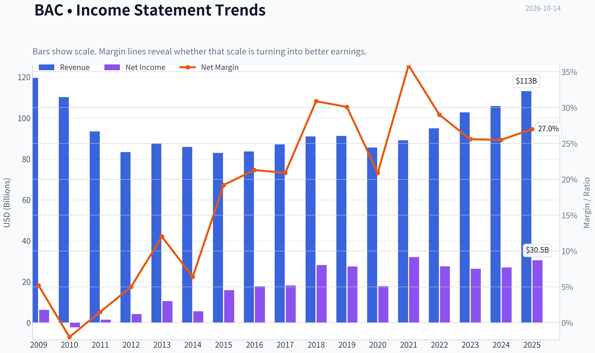

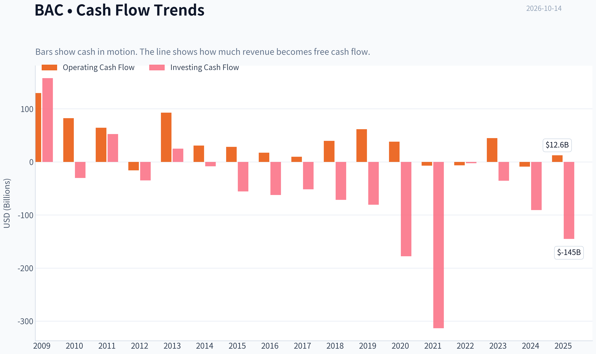

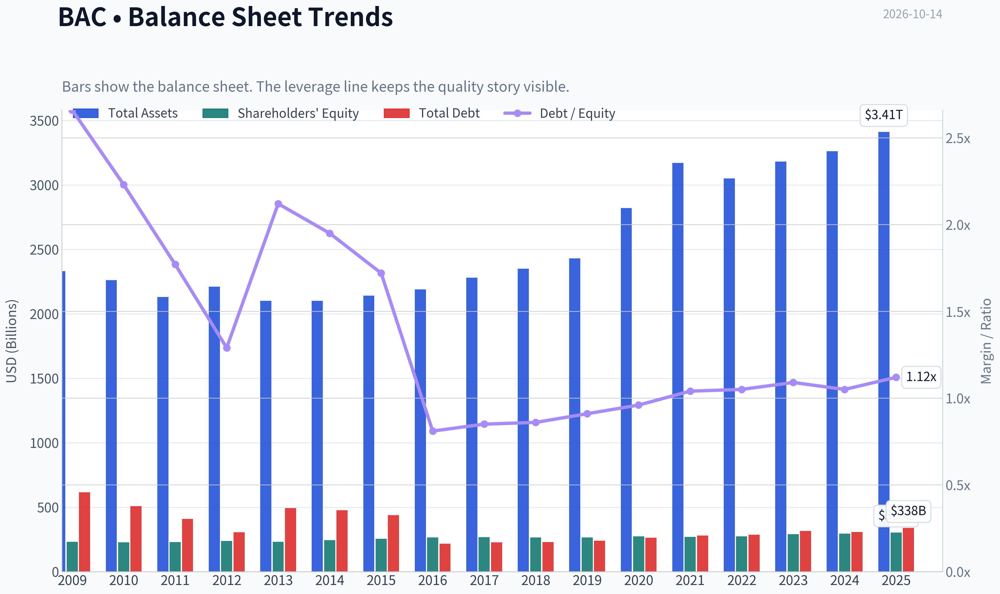

This graph tracks the profitability and return metrics (ROE, ROIC, Margins) of **BAC** over the past decade, highlighting capital efficiency trends.

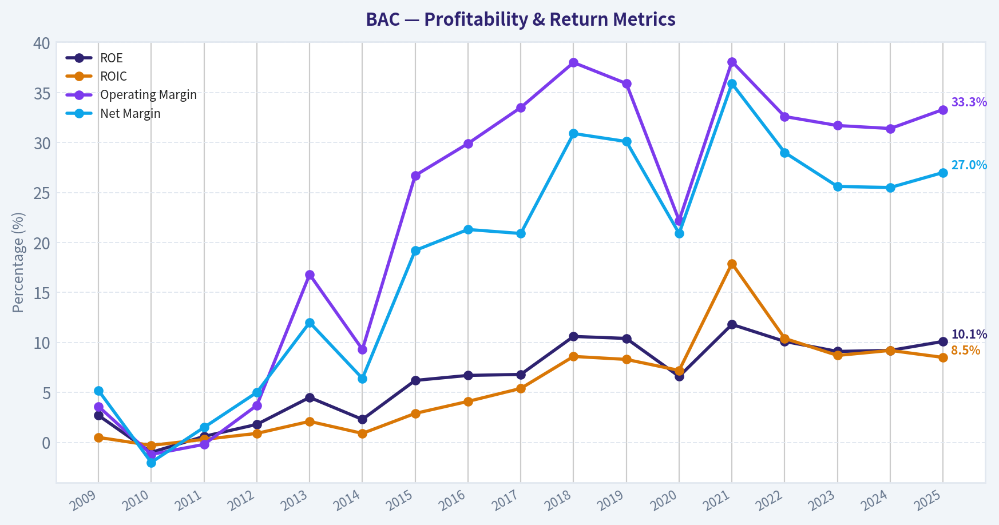

This chart illustrates the financial health of **BAC** over the last 10 years, mapping cash equivalents and free cash flow against total obligations (Debt).

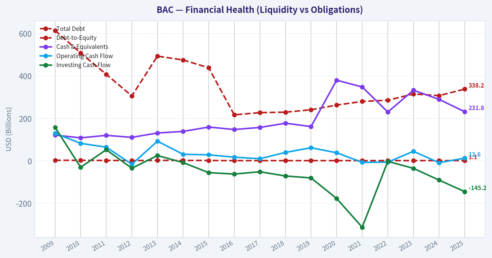

This breakdown chart from <em>Revenue Breakdown</em> shows the proportional composition for **BAC** - useful for understanding what drives or risks the business.

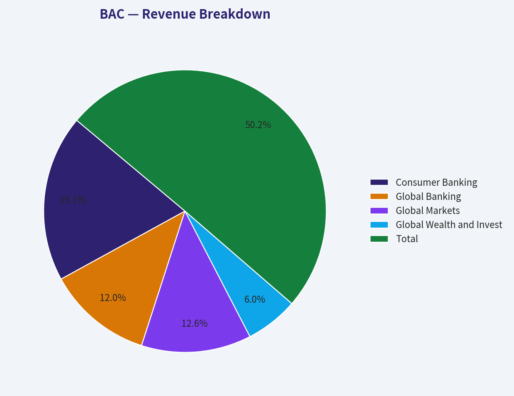

---

### Intrinsic Value Analysis (Buffett)

> *Following Warren Buffett's value investing philosophy: Circle of Competence, Economic Moat, Management Quality, and Margin of Safety.*

#### Intrinsic Value Snapshot

Price is what you pay. Intrinsic value is what the business may be worth based on the cash it can create for owners over time. We show a range, not one magic number.

- Current Price: $53.96
- Value Range (conservative to optimistic across both DCF methods): $45.06 to $790.01

##### Owner Earnings (Buffett Method)
- Net Income: $30,509,000,000.00
- Depreciation & Amortization: $2,314,000,000.00
- Capital Expenditures: N/A
- Working Capital Changes: $-33,081,000,000.00
- Owner Earnings: $65,904,000,000.00

##### Intrinsic Value
###### Buffett Method
Uses owner earnings. Stricter, and usually more conservative.
- Conservative: $45.06
- Average: $175.71
- Optimistic: $790.01
- Discount Rate: 10.0%

ANALYST STANCE: **WATCH**

#### Executive View

Bank of America is a large, systemically important banking franchise with substantial scale, a broad deposit base, and meaningful competitive advantages. At approximately **$54 per share and 12.5 times earnings**, valuation is reasonable rather than demanding.

However, the current **10.1% ROE is below a truly superior banking franchise's ideal level**, and the newly reported **$1.2 billion money-laundering and sanctions penalty** raises governance and control concerns. The stock is attractive enough to monitor, but the evidence does not yet support an outright Advocate rating.

#### 1. Factor Scorecard

| Factor | Score | Assessment |
|---|---:|---|
| Circle of Competence and Simplicity | 4/5 | The model is understandable: gather deposits, make loans and investments, provide payments and financial services, and earn a spread plus fees. Predictability is supported by scale, but banking remains sensitive to credit cycles, interest rates, regulation, and liquidity conditions. |
| Moat | 4/5 | Strong deposit franchise, national scale, branch and technology infrastructure, customer relationships, and regulatory barriers create a wide but not flawless moat. |
| Management and Capital Allocation | 3/5 | The institution has considerable operating scale and has attracted long-term investors, including a newly disclosed Berkshire Hathaway position. However, the large compliance penalty is a material negative for controls and oversight. |
| Industry Structure | 4/5 | U.S. banking is a regulated, scale-driven industry with significant barriers to entry. Competition is rational in some areas but intense in consumer banking, lending, and payments. |

**Gate 5-Quality and Solvency:** **Not tripped.** The available evidence does not indicate deteriorating earnings and cash flow combined with a solvency red line. Bank-specific leverage and liquidity ratios must be assessed using regulatory capital metrics rather than industrial-company debt ratios.

**Key Takeaways:** BAC operates in a comprehensible, scale-driven industry with a meaningful franchise moat. The principal weaknesses are moderate profitability and a serious compliance failure, not evidence of immediate financial distress.

#### 2. Moat Analysis

| Moat Source | Evidence | Quality |
|---|---|---|
| Deposit franchise | A national customer and deposit base provides relatively durable, low-cost funding and supports cross-selling. | Strong |
| Scale and cost infrastructure | Technology, branches, compliance systems, payments infrastructure, and regulatory capability require enormous investment to replicate. | Strong |
| Switching costs | Customers often embed checking, direct deposit, credit cards, mortgages, brokerage, and payments into one financial relationship. | Moderate to strong |
| Network and ecosystem effects | The value of the platform rises with customers, merchants, payment activity, data, and product breadth. | Moderate |
| Brand and regulatory position | A recognized national brand and banking license create trust and entry barriers, although compliance failures damage this advantage. | Moderate to strong |

The moat is best characterized as **wide and stable**, rather than clearly widening. Bank of America benefits from scale and customer relationships, but its advantages are partially offset by regulatory scrutiny, technology spending, and the ease with which customers can compare financial products.

#### 3. Management Quality and Capital Allocation

Management quality is mixed.

Positive indicators include:

- Large-scale operation through multiple banking cycles.
- A business model capable of retaining deposits and cross-selling products.
- Berkshire Hathaway's reported initiation of a **483.39 million-share position**, worth approximately **$27.54 billion** as of June 30, 2026.
- A valuation that does not appear dependent on extreme growth assumptions.

The primary negative is the reported **$1.2 billion Treasury penalty** involving anti-money-laundering and sanctions-control failures. The financial cost is manageable for a bank of BAC's size, but the more important issue is what the event says about internal controls, compliance culture, and management execution.

Management receives **3/5** until the bank demonstrates sustained improvement in compliance, returns, and risk-adjusted profitability.

#### 4. Financial Summary

| Metric | Latest Available |
|---|---:|
| Share price | $54.00 |
| Market capitalization | $377.33 billion |
| P/E ratio | 12.46x |
| ROE | 10.1% |
| Revenue growth, year over year | 6.8% |
| Implied earnings per share | Approximately $4.34 |
| Gross margin | Not meaningful for a bank |
| FCF yield | Not meaningful for a bank |
| Current ratio | Not meaningful for a bank |
| Intrinsic value headline metric | Not meaningful; use earnings, book value, capital, and regulatory measures |
| Recent regulatory penalty | $1.2 billion |

*Implied EPS is calculated as $54 divided by the stated P/E ratio.*

**Key Takeaways:** BAC is growing revenue, but its 10.1% ROE is respectable rather than exceptional. The 12.5-times earnings multiple provides some valuation support, while the compliance penalty is the most important current non-financial risk.

#### 5. Owner Earnings Analysis

For a commercial bank, conventional owner earnings must be adapted. Reported free cash flow is not a useful measure because deposits, loans, securities, and regulatory capital are central operating inputs rather than simple working-capital items.

A reasonable bank owner-earnings framework is:

> Sustainable net income minus the capital that must be retained to support organic growth and maintain regulatory capital.

Using the available earnings proxy:

| Item | Approximate Amount |
|---|---:|
| Implied EPS | $4.34 |
| Earnings yield | 8.0% |
| Less: required capital retention | Not disclosed in the available data |
| Sustainable owner earnings per share | Cannot be finalized without payout, capital-retention, and regulatory data |

BAC's earnings yield of approximately **8.0%** is attractive relative to a 10% required return, but that is not automatically equivalent to an 8% owner-earnings yield. The difference is the portion of earnings that must remain inside the bank to support loan growth and capital requirements.

#### 6. Three-Scenario Valuation

Because BAC is a financial institution, the following is an **earnings-capitalization framework**, not a traditional industrial-company FCFF DCF. It uses implied EPS of approximately $4.34 and a 10% required return.

| Scenario | Method | Estimated Value |
|---|---|---:|
| A. No growth | $4.34 ÷ 10% | $43 |
| B. 3% perpetual growth | $4.34 x 1.03 ÷ (10% - 3%) | $64 |
| C. Historical-growth proxy | 6.8% revenue growth, discounted to a 3.4%-5.1% sustainable earnings range | $66-$89 |

The historical-growth scenario is deliberately broad because revenue growth is not the same as sustainable earnings growth. A conservative midpoint of approximately **$77** would imply meaningful upside, but it should not be treated as a precise intrinsic value.

**Key Takeaways:** The no-growth case suggests BAC is fully valued to somewhat expensive at $54. The 3% growth case supports the current price, while a durable mid-single-digit earnings-growth outcome would create substantial upside. The valuation therefore depends on whether profitability can improve without excessive risk-taking.

#### 7. Margin of Safety

| Valuation Reference | Estimated Value | Margin Versus $54 |
|---|---:|---:|
| No-growth value | $43 | Negative 26% |
| 3% growth value | $64 | Approximately 16% upside |
| Historical-growth proxy range | $66-$89 | Approximately 22%-64% upside |
| Conservative blended view | Approximately $64-$70 | Approximately 16%-30% upside |

For an average-quality financial institution with regulatory and credit-cycle risks, a **25%-35% margin of safety** would be preferable. BAC appears fairly valued under a reasonable-growth case, but the margin of safety is not wide enough to compensate fully for the compliance issue and only moderate ROE.

#### 8. Final Buffett Scorecard

| Criterion | Weight | Score | Weighted Contribution |
|---|---:|---:|---:|
| Moat width and durability | 25% | 4.0 | 1.00 |
| Valuation and margin of safety | 20% | 3.5 | 0.70 |
| Capital returns versus cost of capital | 15% | 3.0 | 0.45 |
| Business understanding and predictability | 12% | 4.0 | 0.48 |
| Management quality and capital allocation | 12% | 3.0 | 0.36 |
| Reinvestment runway | 8% | 4.0 | 0.32 |
| Balance-sheet strength | 4% | 3.5 | 0.14 |
| Industry structure | 4% | 4.0 | 0.16 |
| **Total** | **100%** |  | **3.61/5.00** |

**Key Takeaways:** BAC scores well on franchise quality, scale, industry structure, and reinvestment opportunity. The score is held back by only moderate ROE, uncertainty around capital efficiency, and the recent compliance penalty. The aggregate result supports Watch rather than Avoid.

#### 9. Investment Stance

**WATCH - Moderate conviction**

Bank of America is a high-quality, understandable banking franchise trading at a reasonable valuation. It becomes more compelling if:

1. ROE moves sustainably above approximately 12%-15%.
2. Compliance and money-laundering controls show clear improvement.
3. The share price declines toward the mid-to-high $40s without a corresponding deterioration in fundamentals.
4. Sustainable earnings growth remains at least in the low-to-mid single digits.

At $54, BAC is not obviously overpriced, but the current price does not provide enough margin of safety for a business with only moderate returns and a newly highlighted control failure.
#### Valuation Bridge

This bridge places the current market price beside each intrinsic value lens so readers can see whether upside depends on one method or shows up across several methods.

| Scenario | Intrinsic Value / Share |
| --- | ---: |
| Buffett Method | $175.71 |
| Current Price | $53.96 |

#### Key Takeaways

If one method is far above the others, the upside case depends on a specific modelling assumption. When several methods cluster together, the valuation story is more robust.

#### Valuation Visuals

This comparison chart from *Latest Earnings Snapshot* stacks current figures against historical benchmarks for **BAC**, making it easy to see where the company trades relative to its own averages.

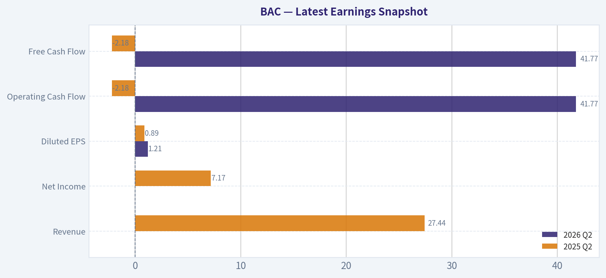

This comparison chart from *Current Metrics Versus 10-Year Averages* stacks current figures against historical benchmarks for **BAC**, making it easy to see where the company trades relative to its own averages.

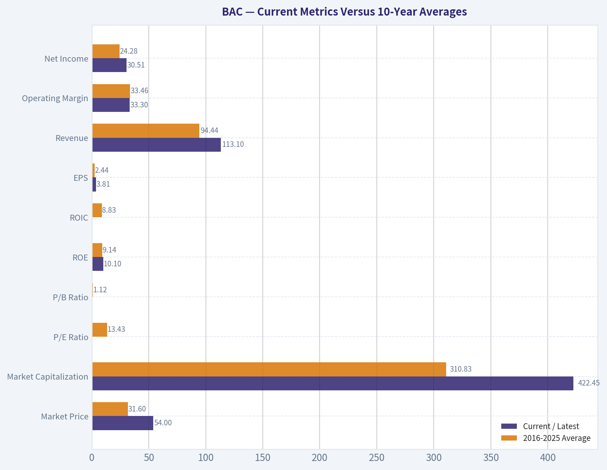

This comparison chart from *Cash Flow and Dividends* stacks current figures against historical benchmarks for **BAC**, making it easy to see where the company trades relative to its own averages.

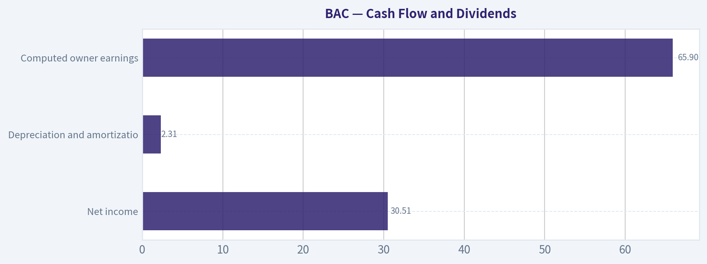

The following chart maps the **BAC** Owner Earnings DCF valuation scenarios (Conservative, Average, Optimistic) to visually represent the margin of safety based on intrinsic value calculations.

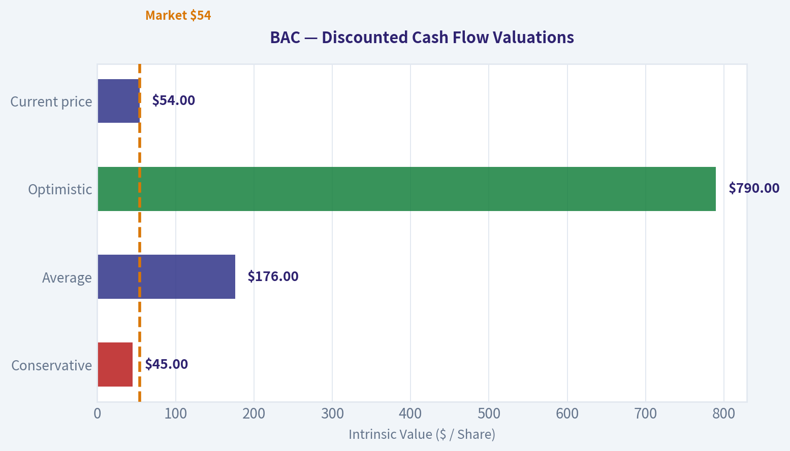

---

### Trend & Growth Analysis (Lynch/Druckenmiller/Fisher)

> *Following Peter Lynch's GARP, Stanley Druckenmiller's macro-aware approach, and Philip Fisher's scuttlebutt methodology.*

ANALYST STANCE: **AVOID**

#### 1. Lynch Classification

**Bank of America is a stalwart, not a fast grower.** Reported revenue growth of 6.8% places it in the 5-12% stalwart range. It may be a reasonable value or income-oriented bank, but it does not currently meet the growth-investing requirement of sustained 15-25%+ growth.

#### 2. The Story

- Bank of America is a large, diversified U.S. banking franchise benefiting from consumer deposits, commercial banking, wealth management, and capital markets.
- Its scale, brand, distribution network, and low-cost deposit base provide meaningful competitive advantages.
- The investment case is primarily normalized earnings, capital returns, and valuation-not a rapidly expanding TAM or disruptive product cycle.

#### 3. Core Fundamentals

| Metric | BAC |
|---|---:|
| Current price | $54 |
| Market capitalization | $377.3B |
| Revenue growth, year over year | 6.8% |
| P/E ratio | 12.46x |
| ROE | 10.1% |
| Gross margin | Not meaningful for a bank |
| FCF yield | Not meaningful for a bank |
| Intrinsic value headline | Not meaningful; use book value, earnings, and capital metrics |

**Key Takeaways:** BAC is modestly growing and trades at a low headline earnings multiple. However, its 10.1% ROE is not exceptional for a major bank, and conventional industrial-company metrics such as gross margin and free-cash-flow yield are not useful here. The valuation looks reasonable, but not obviously mispriced based on the available data.

#### 4. TAM Analysis and 10x Test

The U.S. banking market is enormous, but BAC is already one of the largest institutions in the sector. A literal 10x revenue or market-cap outcome would require either substantial share gains, major international expansion, or a structural transformation in financial services.

| TAM Question | Assessment |
|---|---|
| Is banking a large market? | Yes |
| Is the market expanding rapidly? | No; generally mature and tied to nominal economic growth |
| Can BAC grow revenue 10x while remaining below 20% market share? | Unlikely under conventional banking economics |
| Does digital banking create a new high-growth TAM? | It improves efficiency and engagement, but does not automatically create 10x revenue potential |
| Runway for fast-growth investors | Limited |

**Key Takeaways:** BAC operates in a large but mature market. Digital adoption can improve cost efficiency and customer retention, but it does not by itself create a venture-scale growth runway. The 10x test is weak for a company of BAC's size and market position.

#### 5. Revenue Growth Trend

Only the latest year-over-year growth figure is available in the shared research pack, so acceleration cannot be confirmed.

| Growth Indicator | Evidence | Interpretation |
|---|---:|---|
| Latest revenue growth | 6.8% | Stalwart-level growth |
| Multi-period acceleration | Not available | Cannot confirm an inflection |
| Organic versus acquisition growth | Not available | Requires earnings disclosures |
| Customer concentration | Not available | Requires filings |
| Growth classification | Stalwart | Below fast-grower threshold |

**Key Takeaways:** The available evidence shows steady but moderate growth rather than acceleration. Without a multi-quarter trend, there is no basis to claim a Druckenmiller-style earnings inflection. BAC needs sustained growth materially above 15% to become compelling for a dedicated growth portfolio.

#### 6. Unit Economics and Banking Operating Metrics

Traditional SaaS measures such as LTV/CAC, NRR, and Rule of 40 do not apply directly to a diversified bank.

| Metric | Assessment |
|---|---|
| LTV/CAC | Not disclosed or directly applicable |
| Net revenue retention | Not applicable in the SaaS sense |
| Rule of 40 | Not applicable |
| ROE | 10.1% |
| Net interest margin trend | Not available |
| Efficiency ratio trend | Not available |
| Credit losses and provisions | Critical, but not available in the pack |

**Key Takeaways:** The key unit economics for BAC are deposit costs, net interest margin, fee growth, credit losses, operating efficiency, and capital requirements. The available 10.1% ROE suggests an adequate but not outstanding profitability profile. A stronger thesis would require evidence of improving efficiency, stable credit quality, and rising ROE.

#### 7. Inflection Point Assessment

| Potential Inflection | Current Evidence | Assessment |
|---|---|---|
| Product cycle | No specific catalyst identified | Neutral |
| Market-share gain | Not established | Neutral |
| Margin or efficiency inflection | Not established | Neutral |
| TAM expansion | Mature banking market | Weak |
| Competitive inflection | No clear competitor disruption identified | Neutral |
| Earnings acceleration | Not demonstrated | Weak |

**Key Takeaways:** No clear inflection point is visible from the available information. BAC's potential upside is more likely to come from normalization of interest income, expense control, capital returns, or credit-cycle improvement than from accelerating top-line growth.

#### 8. Macro Setup

The macro backdrop is mixed. Banks can benefit from nominal economic growth, loan demand, and a favorable yield curve, but they remain sensitive to interest rates, deposit competition, credit deterioration, regulation, and recession risk.

The most important current macro variables are:

- Direction and shape of the yield curve.
- Deposit pricing pressure.
- Commercial real estate and consumer credit losses.
- Loan growth and investment-banking activity.
- Regulatory capital requirements.

The $1.2 billion Treasury penalty reported on October 14, 2026 is an additional near-term governance and earnings headwind. It reportedly reduces quarterly earnings by approximately $0.17 per share.

#### 9. Fisher 15-Point Assessment

This is a preliminary score based on limited public information in the research pack, not a full scuttlebutt investigation.

| Fisher Criterion Group | Score |
|---|---:|
| Market potential and long-term sales opportunity | 3/5 |
| Product and R&D orientation | 3/5 |
| Sales organization and distribution | 4/5 |
| Profit margins and margin outlook | 3/5 |
| Personnel and management depth | 3/5 |
| Cost controls and accounting | 3/5 |
| Competitive advantages | 4/5 |
| Long-range profit outlook | 3/5 |
| Dilution and capital discipline | 3/5 |
| Candor, integrity, and governance | 2/5 |
| **Preliminary Fisher Score** | **31/50 equivalent; approximately 47/75** |

**Key Takeaways:** BAC scores well for scale, distribution, and franchise strength, but less well for growth potential and governance confidence. The recent anti-money-laundering and sanctions penalty is a meaningful deduction under Fisher's management-integrity and operational-excellence criteria. The result is approximately average rather than outstanding.

#### 10. Valuation Analysis

| Valuation Measure | Calculation or Observation | Assessment |
|---|---:|---|
| P/E | 12.46x | Reasonable for a mature bank |
| Revenue growth | 6.8% | Moderate |
| PEG | 12.46 ÷ 6.8 = **1.83** | Fair to somewhat expensive for the growth rate |
| P/S | Not emphasized for banks | Less useful than P/B and P/E |
| P/B | Not available | Important missing metric |
| Earnings scenario | Dependent on rates, credit, and capital returns | Wide uncertainty |

**Key Takeaways:** BAC's PEG of approximately 1.83 is not attractive under Lynch's framework because the company is growing slowly relative to its earnings multiple. The low P/E can still be justified by franchise quality and balance-sheet strength, but a proper bank valuation also requires tangible book value, capital ratios, credit losses, and normalized ROE.

#### 11. Growth Investor Scorecard

| Criterion | Weight | Score / 5 |
|---|---:|---:|
| The Story | 10% | 3.0 |
| TAM and runway | 20% | 2.0 |
| Revenue growth | 20% | 2.5 |
| Unit economics | 15% | 3.0 |
| Competitive position | 10% | 4.0 |
| Management quality | 10% | 2.5 |
| Macro setup | 5% | 3.0 |
| Profitability path | 5% | 3.0 |
| Valuation | 5% | 3.0 |
| **Weighted score** | **100%** | **2.8 / 5.0** |

**Key Takeaways:** BAC's franchise quality and valuation prevent it from being an outright poor business, but its score is below the threshold for a growth-oriented advocate position. The principal weaknesses are limited runway, insufficient growth acceleration, and recent governance concerns.

#### 12. Position Size Stance

- **New growth position:** 0%.
- **Existing diversified portfolio holding:** Hold only if the objective is value, dividends, or broad financial-sector exposure.
- **Growth portfolio:** Do not initiate until revenue growth accelerates, ROE improves materially, and regulatory-control issues are resolved.
- **Potential re-rating trigger:** Sustained earnings acceleration without a deterioration in credit quality or capital ratios.

#### 13. Key Risks and Catalysts

| Catalysts | Risks |
|---|---|
| Better-than-expected loan and fee growth | Recession and rising credit losses |
| Lower deposit-cost pressure | Net interest margin compression |
| Improving efficiency ratio and ROE | Commercial real estate exposure |
| Strong capital returns or buybacks | Higher regulatory capital requirements |
| Resolution of compliance issues | Additional fines or control failures |
| Favorable yield-curve normalization | Deposit outflows and funding pressure |

**Key Takeaways:** The upside case depends on earnings normalization, operating efficiency, and capital returns rather than explosive growth. The most immediate risk is that the regulatory penalty signals broader control weaknesses or creates additional financial and reputational costs.

#### Bottom Line

BAC is a large, defensible, reasonably valued bank, but it is **not currently a compelling Lynch-Druckenmiller growth opportunity**. The evidence supports a mature stalwart classification with limited 10-bagger potential. The recent $1.2 billion penalty further weakens the near-term setup, so the appropriate growth-investor action is **AVOID for new purchases and WATCH for a genuine earnings and ROE inflection**.

---

### Market Technical Analysis

ANALYST STANCE: **WATCH**

#### BAC technical overview

The latest available trading session is October 13, 2026, when BAC closed at **$53.96**. The October 14 date supplied is not a trading day in the retrieved dataset.

BAC remains in a **damaged medium-term trend**, despite some evidence that the recent selling pressure is beginning to ease. The stock has fallen sharply from its August high near **$64.48**, and the September decline carried price below both the 50-day and 200-day moving averages. The long-term trend is only modestly negative by the 200-day average, but the medium-term trend is clearly weaker.

#### Selected indicators and current readings

| Indicator | Latest reading | Recent direction | Interpretation |
|---|---:|---|---|
| Close | $53.96 on Oct. 13 | Stabilizing after decline | Below key moving averages, but above the recent low near $52.24 |
| 10 EMA | $54.43 | Declining, but flattening somewhat | Short-term price momentum remains weak; reclaiming this level would be an initial improvement |
| 50 SMA | $59.60 | Falling rapidly | Medium-term trend is bearish and currently represents substantial overhead resistance |
| 200 SMA | $54.80 | Nearly flat to slightly rising | BAC is slightly below its long-term trend benchmark, making $54.80 an important pivot |
| MACD | -1.66 | Negative, but improving from approximately -1.98 | Bearish momentum remains in force, although downside acceleration has moderated |
| RSI | 31.57 | Recovered from deeply oversold readings below 25 | Selling pressure is easing, but RSI has not yet established a durable bullish reversal |
| Bollinger Upper Band | $58.60 | Falling | Upside volatility range has compressed as price has moved lower |
| Bollinger Lower Band | $52.11 | Slightly rising recently | Provides a near-term volatility boundary and potential support area |
| ATR | $1.07 | Lower than late September | Daily movement remains meaningful at roughly 2% of the share price, requiring appropriately sized positions |

**Key Takeaways:** BAC is trading below both its 50-day SMA and 200-day SMA, so the dominant trend remains bearish. However, the MACD is becoming less negative and RSI has recovered from extreme oversold conditions, suggesting that downside momentum may be losing intensity. The setup is better described as a potential stabilization phase than a confirmed uptrend.

#### Trend structure and moving averages

The moving-average configuration is unfavorable:

- The **50-day SMA is approximately $59.60**, almost $5.65 above the latest close. It has declined from roughly $61.74 over the past month, confirming persistent medium-term deterioration.
- The **200-day SMA is approximately $54.80**, only about $0.84 above the latest close. This places BAC directly around an important long-term decision level.
- The **10-day EMA is $54.43**, slightly above the latest close. A close back above the 10-day EMA would be an early indication that short-term selling pressure is easing.
- The 50-day SMA remains well above the 200-day SMA, so the broader moving-average structure has not yet produced a formal death cross. Nevertheless, the sharply falling 50-day average indicates that the intermediate trend is deteriorating faster than the long-term average.

The most important near-term test is the **$54.40 to $54.80 zone**, defined by the 10-day EMA and 200-day SMA. A sustained close above that zone would improve the technical picture, while repeated rejection there would suggest that the recent bounce is only corrective.

#### Momentum analysis

The MACD remains decisively negative at **-1.66**, which confirms that the medium-term momentum trend is still bearish. However, it has improved from approximately **-1.98** in early October. This is a meaningful change: BAC is still below its prior momentum baseline, but the rate of deterioration has slowed.

RSI provides a more constructive short-term signal. It reached the low twenties during the early-October decline and has recovered to **31.57**. That move indicates that the stock is no longer accelerating lower at the same pace. Still, RSI remains close to the traditional oversold threshold of 30, and an oversold reading by itself does not confirm a bottom. In a sustained downtrend, RSI can remain below 40 for an extended period.

The best confirmation would be a combination of:

1. RSI moving above 40,
2. MACD continuing to rise toward its signal line,
3. price reclaiming the $54.40 to $54.80 resistance zone.

Without those developments, the oversold reading should be treated as a warning against chasing new short positions rather than as a standalone buy signal.

#### Bollinger Bands and volatility

The latest Bollinger readings place BAC between the lower band at **$52.11** and the estimated middle band near **$55.36**. Price is therefore no longer pressing directly against the lower band, but it remains below the middle band, which is consistent with a bearish-to-neutral short-term structure.

The lower band has begun to stabilize and rise slightly, while the upper band has fallen substantially from above $65 to $58.60. This indicates that the trading range is compressing after the sharp September selloff. Compression can precede a directional move, but the indicators do not yet identify whether the next break will be higher or lower.

ATR has declined to roughly **$1.07**, from more than $1.30 during the most volatile part of the selloff. Volatility is therefore moderating, but a normal daily range remains large enough that tight stops could be vulnerable to ordinary price noise. A volatility-aware stop would need to account for at least approximately one ATR, with the exact distance depending on position size and time horizon.

#### Important price levels and scenarios

| Price area | Technical significance | What traders should watch |
|---|---|---|
| $52.10-$52.25 | Lower Bollinger Band and recent swing-low region | A breakdown would reopen downside risk and invalidate the stabilization thesis |
| $53.30-$53.70 | Recent trading support and October consolidation area | Holding this zone would preserve the possibility of a short-term base |
| $54.40-$54.80 | 10 EMA and 200 SMA resistance cluster | A close above this area would be the first meaningful bullish improvement |
| Around $55.35 | Approximate Bollinger middle band | Reclaiming this level would indicate stronger short-term control by buyers |
| $58.60-$59.60 | Upper Bollinger Band and 50 SMA region | Major overhead resistance; unlikely to be cleared without a broader trend reversal |

**Key Takeaways:** The immediate battleground is between approximately $52.10 on the downside and $54.80 on the upside. A break below $52.10 would signal renewed weakness, while a sustained move above $54.80 would improve the probability of a recovery toward the mid-$55 area. The $59-$60 region remains a much more distant resistance zone because it aligns with the falling 50-day average.

#### Trading interpretation

For short-term traders, BAC presents a **countertrend rebound watch**, not a confirmed long setup. Oversold RSI and improving MACD momentum create the possibility of a relief rally, but the stock remains below its key trend averages and has not yet reclaimed the 200-day SMA.

A more favorable bullish entry would require price to hold above recent support and then close convincingly above **$54.40-$54.80**, preferably with improving volume. Until then, traders may consider smaller position sizes, staged entries, or waiting for confirmation rather than attempting to catch the decline.

For bearish traders, initiating new positions after the substantial selloff may offer less favorable risk-reward unless BAC breaks below the **$52.10-$52.25** support zone. A failed rally into the $54.40-$55.35 region would provide a more technically coherent bearish setup than selling directly into oversold conditions.

Overall, BAC is **bearish on the medium-term trend but showing early signs of short-term stabilization**. The appropriate stance is to watch for confirmation rather than assume that oversold conditions have already produced a durable bottom.

#### Market Visuals

This comparison chart from *Market Metrics and Valuation* stacks current figures against historical benchmarks for **BAC**, making it easy to see where the company trades relative to its own averages.

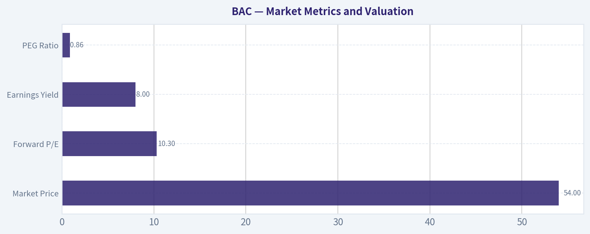

---

### Options Market Analysis

> *Reading options flow - put/call ratios, IV skew, and unusual activity - to gauge institutional positioning and event-driven risk.*

ANALYST STANCE: **WATCH**

#### BAC Options Flow Report

**As of October 14, 2026.** The available near-term options data shows a mildly call-heavy volume profile, but the dataset reports zero open interest across all listed expirations. That makes positioning analysis materially less reliable than usual.

#### Put/Call Ratio Analysis

| Expiration | Call Volume | Put Volume | Volume Put/Call Ratio | Call OI | Put OI |
|---|---:|---:|---:|---:|---:|
| Oct. 16, 2026 | 69,615 | 52,290 | 0.75 | 0 | 0 |
| Oct. 23, 2026 | 15,918 | 3,527 | 0.22 | 0 | 0 |
| Oct. 30, 2026 | 2,013 | 956 | 0.48 | 0 | 0 |
| **Aggregate** | **87,546** | **56,773** | **0.65** | **0** | **0** |

**Key Takeaways:** The aggregate put/call volume ratio is 0.65, modestly below the approximately 0.70 neutral baseline, indicating somewhat stronger call activity than put activity. The strongest call bias is in the October 23 expiration. However, the zero open-interest readings prevent confirmation that this activity represents durable institutional positioning rather than intraday trading or a data-quality issue.

#### Implied Volatility Assessment

| Expiration | Call ATM IV | Put ATM IV | IV Relationship |
|---|---:|---:|---|
| Oct. 16, 2026 | 3.2% | 4.2% | Put premium |
| Oct. 23, 2026 | 1.9% | 1.9% | Balanced |
| Oct. 30, 2026 | 1.9% | 1.9% | Balanced |

**Key Takeaways:** Very near-term puts carry a 1.0 percentage-point premium to calls for October 16, signaling some immediate downside-hedging demand. IV then normalizes and becomes balanced in the later expirations. Absolute IV readings appear unusually low for equity options, so they should be treated cautiously and may reflect a vendor or quote-quality limitation.

#### IV Skew and Catalyst Risk

The data does not provide explicit out-of-the-money put and call IV by strike, so a full strike-based skew calculation is unavailable. The October 16 ATM figures nevertheless show a modest downside skew, with puts at 4.2% IV versus 3.2% for calls.

No earnings date, product event, or other catalyst is supplied in the options data. Therefore, elevated event-related IV cannot be confirmed. The low reported IV levels do not suggest aggressive broad-based event hedging, although the front-expiration put premium warrants caution.

#### Unusual Options Activity

| Finding | Interpretation |
|---|---|
| No contracts exceeded 5x open interest | No qualifying unusual activity detected |
| Contract-level directional read | Not available |
| Smart-money versus retail distinction | Not possible from supplied data |

**Key Takeaways:** There are no contracts with volume greater than five times open interest, so no identifiable fresh directional sweep or large new bet can be isolated. Because all reported open interest is zero, the absence of unusual activity may reflect incomplete OI data rather than genuinely quiet institutional positioning.

#### Open Interest Concentration and Gamma Levels

| Metric | Result |
|---|---|
| Highest call OI strike | Not available; reported OI is zero |
| Highest put OI strike | Not available; reported OI is zero |
| OI concentration by expiration | None observable |
| Gamma walls or pinning levels | Cannot be identified |

**Key Takeaways:** No gravitational strikes, max-pain areas, or gamma walls can be calculated from the supplied chain. As a result, there is no reliable options-based price-pinning signal for BAC into the listed expirations.

#### Overall Options Sentiment

| Factor | Assessment |
|---|---|
| Volume put/call ratio | Mildly bullish at 0.65 versus a 0.70 neutral baseline |
| Front-expiration skew | Cautious; puts have higher ATM IV |
| Later-expiration IV | Balanced |
| Fresh unusual activity | None detected |
| Open-interest reliability | Very poor; all OI reported as zero |
| **Overall signal** | **NEUTRAL** |

**Key Takeaways:** BAC options flow leans slightly bullish based on the 0.65 volume put/call ratio, but the signal is not strong enough to establish a bullish view. The immediate put-IV premium adds a downside-risk hedge, while absent open interest and unusual activity make conviction low. The appropriate read is neutral, with a watch bias rather than an actionable directional trade.

#### Summary

| Category | Conclusion |
|---|---|
| Put/Call Ratio | 0.65 by volume, mildly below the 0.70 neutral baseline; OI ratio unavailable |
| IV Level | Reported IV is low; front-week put IV is higher than call IV |
| Skew Direction | Mild downside or put skew in the October 16 expiration; later skew is balanced |
| Unusual Activity | None detected; no contracts exceeded 5x OI |
| Overall Signal | **NEUTRAL** - slight call-volume bias, but low confidence because OI data is zero |

**Key Takeaways:** The most constructive feature is the modestly call-heavy volume profile, especially in the October 23 expiration. The main caution is the front-week put premium and the unusable open-interest data. Overall, BAC options imply limited conviction and do not currently provide a reliable bullish or bearish institutional signal.

---

## Research Team Commentary

> *The Research Manager synthesizes the Bull vs Bear debate into action-free commentary. This is a pre-risk view, not the final stance.*

Core takeaway: Bank of America is a durable, systemically important banking franchise, but the evidence supports patience rather than new aggressive buying at $53.96. The deposit base, national distribution, customer relationships, and diversified fee businesses provide a legitimate moat. However, a 10.1% ROE is only around a reasonable cost of equity for a large bank, while the shares appear to trade near-not materially below-reasonable intrinsic value. The business is good enough to avoid, but the price is not attractive enough to advocate.

The strongest bull argument is that BAC does not need exceptional growth to deliver acceptable returns. At 12.46 times earnings, investors receive an approximately 8% accounting earnings yield, and the current price appears to require roughly mid-single-digit per-share earnings growth. That is plausible given 6.8% revenue growth, the low-cost deposit franchise, cross-selling opportunities, and capital returns. Scale also matters: BAC can spread technology, cybersecurity, compliance, and distribution expenses over an enormous customer base. Its consumer banking, commercial banking, wealth management, and capital-markets operations provide more resilience than a narrow lender.

The bull is also right that conventional industrial metrics such as gross margin, quick ratio, and ordinary ROIC are not particularly useful for a bank. BAC should be judged mainly on ROE, ROA, deposit costs, net interest margin, credit losses, regulatory capital, tangible book value, and per-share capital allocation. The reported 7.4% ROIC should therefore not drive the conclusion.

The strongest bear argument is not that BAC is impaired; it is that the current price offers too little protection against ordinary banking risks. The approximate relationship between the 12.46 times P/E and 10.1% ROE suggests a valuation near 1.26 times book, subject to period and accounting consistency. Paying above book can be justified for a bank sustainably earning well above its cost of equity, but the supplied 10.1% ROE does not yet demonstrate substantial economic profit.

The 8% earnings yield also overstates the cash return available to shareholders. BAC must retain capital to support growth, meet regulatory requirements, and absorb losses. If roughly half of earnings is distributed and the retained half continues earning approximately 10.1%, a simplified expected return lands near 9%. That could still be respectable, but it does not provide a compelling spread over a roughly 10% required equity return.

Valuation is the deciding issue. The bull's illustrative base value is approximately $57, only about 6% above the current price, and it assumes a 14 times terminal multiple versus today's 12.46 times. Without rerating, the debate's base estimate is closer to $52. The bull case of $62-$64 provides more meaningful upside, but requires stronger growth, sustained capital distributions, and a higher terminal valuation. The cautious case in the mid-to-high $40s implies material downside. This is an unfavorable asymmetry for a leveraged, cyclical financial institution whose most important balance-sheet data have not been supplied.

Under a quality-scaled margin-of-safety framework, BAC should not receive the same narrow discount requirement as an elite, predictable, asset-light compounder. It is a strong franchise, but bank earnings remain exposed to credit cycles, deposit repricing, regulation, and confidence-sensitive funding conditions. A merely average-to-good cyclical business generally requires a wider discount than the roughly 5% offered by the bull's base valuation. A price around $46-$49 could become attractive if credit quality, capital, and normalized earnings remain intact; alternatively, the current price could become justified by clear evidence of sustainable ROE expansion.

The technical picture reinforces patience without changing the long-term business assessment. BAC is below its $54.43 10-day EMA, its approximately $54.80 200-day SMA, and substantially below its declining $59.60 50-day SMA. That is best described as persistent medium-term deterioration with the stock sitting near a long-term decision level-not as proof of permanent fundamental weakness. A sustained recovery above roughly $54.40-$54.80 would be an early stabilization signal, while reclaiming the declining 50-day average would provide stronger confirmation. The options put/call volume ratio of 0.65 is mildly constructive, but zero reported open interest makes the dataset too unreliable to influence the decision.

The reported Berkshire position should carry almost no weight until verified against the original filing. The characterization as an "initiation," the reporting-date valuation, and the share count all require reconciliation. Even if accurate, Berkshire's ownership would be corroborating evidence about franchise quality, not proof that BAC is attractive at today's price. This is an important lesson from prior mistakes: never substitute a famous investor's position for independent underwriting.

Management also deserves a neutral rather than emphatically positive assessment based on the available evidence. BAC's survival and scale across multiple cycles demonstrate institutional durability, but the handoff does not establish exceptional current capital allocation. That requires evidence on net share-count reduction, repurchase prices, expense efficiency, credit underwriting, stress-test performance, and returns on retained equity.

Over the next one to four quarters, I would monitor BAC's CET1 ratio and stress-capital buffer; tangible book value per share; net interest income and net interest margin; deposit balances, mix, and deposit beta; net charge-offs, delinquencies, nonperforming loans, and reserve coverage; commercial-real-estate and consumer-credit exposures; expense growth and efficiency ratio; and the net share-count trend. Improvement in ROE toward 12% or better, accompanied by stable credit quality and tangible-book growth, would materially strengthen the thesis. Mid-single-digit EPS growth produced by genuine operating improvement-not reserve releases or temporary trading gains-would also support the bull case.

I would weaken the thesis if deposit costs rise faster than asset yields, net interest income disappoints, consumer or commercial credit deteriorates beyond management's assumptions, regulatory capital requirements constrain distributions, tangible book value stagnates, or buybacks occur near fair value without meaningful net share reduction.

Operationally, WATCH means holding an existing appropriately sized strategic position but not making a full new allocation. A small starter position could be defensible for a ten-year investor, but meaningful accumulation should wait for either a wider valuation discount or evidence that profitability is improving. Technical stabilization above $54.80 would improve timing, but it would not cure the thin margin of safety by itself. Conversely, a decline into the upper $40s should only be purchased after confirming that the lower price reflects market fear rather than deteriorating credit or capital fundamentals.

The balanced conclusion is that BAC may generate acceptable long-term returns, but the current valuation does not compensate sufficiently for bank-specific uncertainty. This is neither a distressed institution nor a clear overvaluation deserving avoidance. It is a good franchise at approximately a fair price, with weak current price action and incomplete underwriting data.

Stance: WATCH

---

## Value Investing Team Commentary

> *The Investor translates the research view into an investment thesis before risk review. This is still not the final stance.*

### Investment Commentary

Bank of America is a durable, systemically important banking franchise, but durability alone does not make the shares attractive at every price. At **$53.96**, the evidence points to a sound business trading around reasonable value rather than a compelling long-term bargain.

### Business quality and moat

BAC's principal advantage is its enormous, relatively sticky deposit franchise. Its national distribution, brand, digital platform, customer relationships, and ability to cross-sell lending, payments, wealth management, and capital-markets services create meaningful economies of scale. Technology, cybersecurity, compliance, and regulatory costs can be spread across a vast customer base-an advantage smaller competitors cannot easily replicate.

Diversification also reduces dependence on any single business line. Consumer banking supplies deposits and lending income, while commercial banking, wealth management, and capital markets contribute additional revenue streams. This is a legitimate moat, although it is not as predictable or capital-light as the moat of an elite consumer or software compounder.

Banking remains inherently leveraged, cyclical, regulated, and confidence-sensitive. BAC cannot be evaluated as though it were an ordinary industrial company. Gross margin, quick ratio, and generic ROIC are of limited relevance. The more important measures are:

- Return on equity and tangible common equity
- Tangible book value per share
- CET1 capital and the stress-capital buffer
- Deposit costs, deposit mix, and deposit beta
- Net interest margin and net interest income
- Charge-offs, delinquencies, reserves, and nonperforming loans
- Efficiency ratio and expense discipline
- Net share-count reduction and repurchase prices

### Profitability is adequate, not exceptional

The supplied **10.1% ROE** is respectable but does not yet establish that BAC is creating substantial economic value above its cost of equity. For a large bank exposed to credit, regulatory, and funding risks, investors would ideally want a sustainable ROE of approximately **12% or better**, supported by tangible-book growth and conservative underwriting.

Revenue growth of **6.8%** is encouraging, but revenue growth by itself does not reveal whether the improvement came from durable operating gains, favorable rate conditions, trading activity, or other less repeatable sources. The quality of that growth matters more than the headline percentage.

The key question is whether BAC can raise normalized profitability without taking greater credit risk or relying on a favorable rate environment. If it can sustain higher returns while maintaining strong capital and credit metrics, the shares deserve a higher valuation. If ROE remains near 10%, paying meaningfully above book value becomes more difficult to justify.

### Valuation and expected return

At **12.46 times earnings**, BAC offers an accounting earnings yield of roughly **8%**. That appears reasonable, but it is not equivalent to an 8% distributable cash yield. Banks must retain capital to support asset growth, comply with regulatory requirements, and absorb future credit losses.

If approximately half of earnings is distributed and the retained portion earns around the current 10.1% ROE, a simplified long-term return expectation lands near the high single digits. That may be acceptable, but it offers little excess return relative to a roughly 10% required return for bank equity.

The supplied base intrinsic value of approximately **$57** implies only about **6% upside**. That is too narrow a margin of safety for a cyclical, leveraged financial institution. Moreover, the $57 estimate appears partly dependent on terminal multiple expansion from 12.46 times earnings toward 14 times. Without rerating, fair value may be closer to the low-$50s.

A reasonable scenario framework is:

- **Cautious case:** Mid-to-high $40s if profitability or credit conditions weaken
- **Base case:** Approximately $52-$57 with normalized, modest growth
- **Optimistic case:** Approximately $62-$64 if ROE expands, credit remains sound, and capital returns are strong

This distribution is not especially favorable at $53.96. The optimistic outcome is possible, but the current price already reflects much of the base case.

For a bank of BAC's quality and cyclicality, I would normally seek a margin of safety closer to **25%**, not the 10%-15% discount suitable for a highly predictable, capital-light compounder. A price around **$46-$49** could become attractive if credit quality, capital strength, and normalized earnings remain intact. Alternatively, BAC could earn its way into the current valuation through sustainable ROE expansion.

### Reverse-valuation check

The present multiple appears to assume that BAC can deliver approximately mid-single-digit per-share earnings growth while maintaining its current valuation. That is plausible, but not obviously conservative.

Growth could come from:

- Modest balance-sheet and fee-income expansion
- Operating leverage
- Improved net interest income
- Dividends and net share repurchases
- Better utilization of retained capital

However, the implied outcome becomes less credible if deposit costs remain elevated, credit losses normalize above recent levels, capital requirements increase, or repurchases fail to produce meaningful net share-count reduction. The market is not pricing an implausible growth story, but neither is it offering substantial protection if execution is merely average.

### Selective contrarian interpretation

The weak price trend should not automatically be interpreted as evidence that BAC's franchise is deteriorating. The shares are below the **10-day EMA of $54.43**, the **200-day SMA near $54.80**, and the declining **50-day SMA near $59.60**. That indicates persistent selling pressure, but technical weakness can create opportunity when it reflects broad discomfort with banks rather than worsening deposits, capital, or credit.

The contrarian opportunity would arise if:

1. The stock declined into the upper $40s;
2. CET1 capital and tangible book value remained healthy;
3. Deposits were stable;
4. Credit deterioration remained manageable; and
5. Normalized earnings power was unchanged.

That would represent a lower price without a corresponding decline in intrinsic value.

The opposite risk is assuming every bank selloff is irrational. Bank equity can fall before deteriorating credit becomes fully visible in reported earnings. A lower share price is not automatically a bargain if charge-offs, delinquencies, funding costs, or regulatory capital requirements are moving adversely. Contrarianism should follow balance-sheet verification, not precede it.

The mildly call-heavy options ratio of **0.65** offers little useful information because the reported zero open interest makes the dataset unreliable. More broadly, the current evidence does not suggest genuine capitulation. BAC is only modestly below its 200-day average and trades at a normal earnings multiple. Sentiment appears cautious, not panicked-so there is no clear "fear price" to exploit.

### The reported Berkshire position

The reported Berkshire Hathaway "initiation" of **483.39 million shares** should not influence the decision unless it is verified against the original regulatory filing. The description is questionable because Berkshire has had a long and publicly documented history with Bank of America, making the word "initiation" especially important to reconcile. The filing date, ownership entity, transaction history, share count, and valuation should all be checked.

Even if the position is accurate, it would validate franchise quality more than current valuation. An investor should not outsource underwriting to Berkshire, particularly when Berkshire's cost basis, tax considerations, portfolio constraints, and intended holding period may differ substantially from those of a new buyer.

### What would justify an upgrade?

I would become more constructive if either valuation or business performance improved.

**Valuation-based upgrade:**

- Price declines toward **$46-$49**
- Credit and capital fundamentals remain intact
- Tangible book value continues to grow
- The lower price reflects sentiment rather than impairment

**Fundamentals-based upgrade:**

- Sustainable ROE moves toward or above **12%**
- CET1 remains comfortably above requirements
- Net interest income stabilizes or improves
- Deposit balances and mix remain healthy
- Charge-offs and delinquencies stay manageable
- Buybacks meaningfully reduce the share count at sensible prices

A recovery above **$54.40-$54.80** would suggest short-term stabilization, while reclaiming the declining 50-day average would confirm stronger price momentum. Those signals might improve entry timing, but they would not independently create a margin of safety.

Existing long-term shareholders can reasonably continue holding an appropriately sized position. A small starter allocation may also be defensible for an investor committed to averaging over many years. However, a full new allocation at $53.96 would depend too heavily on satisfactory execution and offers insufficient protection against ordinary banking risks.

### ANALYST STANCE: **WATCH**

Bank of America is a good banking franchise at approximately a fair price, not a distressed business and not an obvious overvaluation. Its deposit moat, scale, and diversified earnings support long-term durability, but a 10.1% ROE and roughly 6% upside to the supplied base value do not provide an adequate margin of safety. Hold existing appropriately sized positions, but wait for either a price in the upper $40s with intact fundamentals or clear evidence of sustainable ROE expansion before making a meaningful new investment.

---

## Deep Values Commentary

> *The Risk Management Team debates and the Risk Judge provides the final action-free verdict. This section determines the final ADVOCATE / WATCH / AVOID stance.*

#### Final Stance Scorecard

This scorecard converts the final research view into a weighted decision frame. It does not replace the narrative judgement, but it makes the main drivers of the verdict easier to scan.

| Criterion | Score | Weight | Commentary |
| --- | ---: | ---: | --- |
| Business Quality | 3.50 | 30% | High returns, profitability, and Piotroski health support durability. |
| Valuation Support | 4.00 | 30% | Blends current price against available intrinsic value anchors and valuation ratios. |
| Financial Strength | 3.50 | 20% | Balance-sheet resilience reflects leverage and liquidity staying within safe ranges. |
| Growth Durability | 3.33 | 20% | Recent revenue, earnings, and free cash flow growth indicate how durable expansion looks. |
| TOTAL / FINAL STANCE | 3.62 | 100% | AVOID |

#### Key Takeaways

The weighted score lands at **3.62 / 5.0**, while the final stance remains **AVOID**. This is useful as a quick calibration aid rather than a mechanical signal.

#### Risk Summary

Higher scores indicate more risk pressure. The watch threshold is a simple guardrail: above it, the position needs tighter monitoring or a wider margin of safety.

| Dimension | Current Score | Watch Threshold | Commentary |
| --- | ---: | ---: | --- |
| Business Quality | 2.50 | 3.00 | High returns, profitability, and Piotroski health support durability. |
| Valuation Support | 2.00 | 3.00 | Blends current price against available intrinsic value anchors and valuation ratios. |
| Financial Strength | 2.50 | 3.00 | Balance-sheet resilience reflects leverage and liquidity staying within safe ranges. |
| Growth Durability | 2.67 | 3.00 | Recent revenue, earnings, and free cash flow growth indicate how durable expansion looks. |

#### Key Takeaways

This view helps readers separate *where* the risk sits: valuation, business quality, balance sheet, or growth durability. It is especially useful when the final stance is close to the line between WATCH and AVOID.
