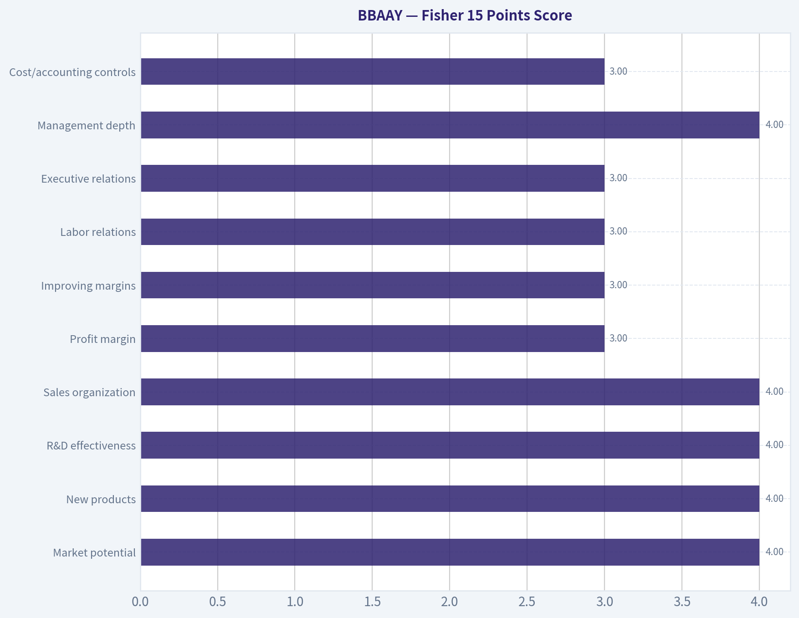
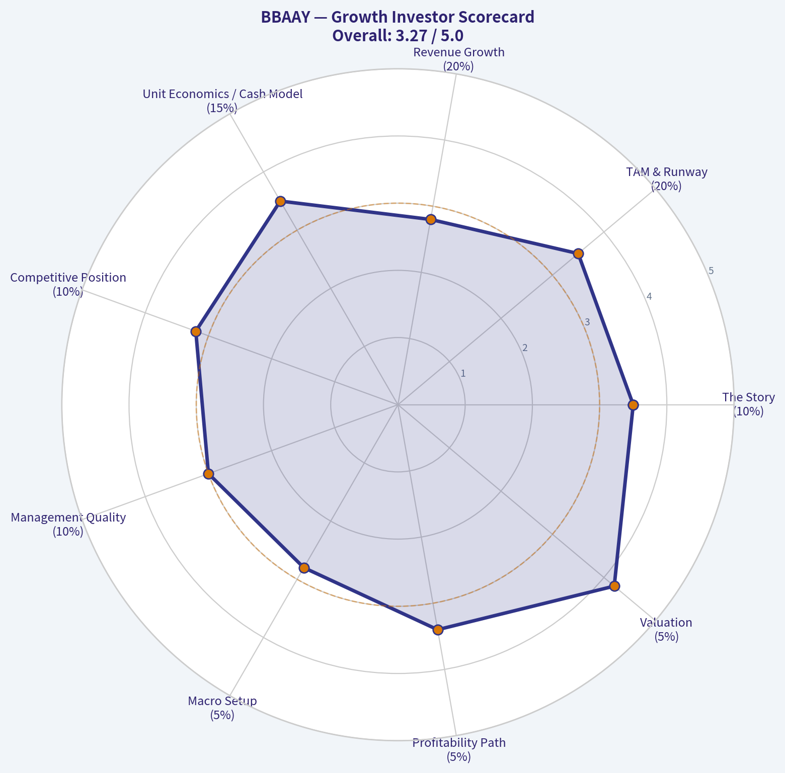
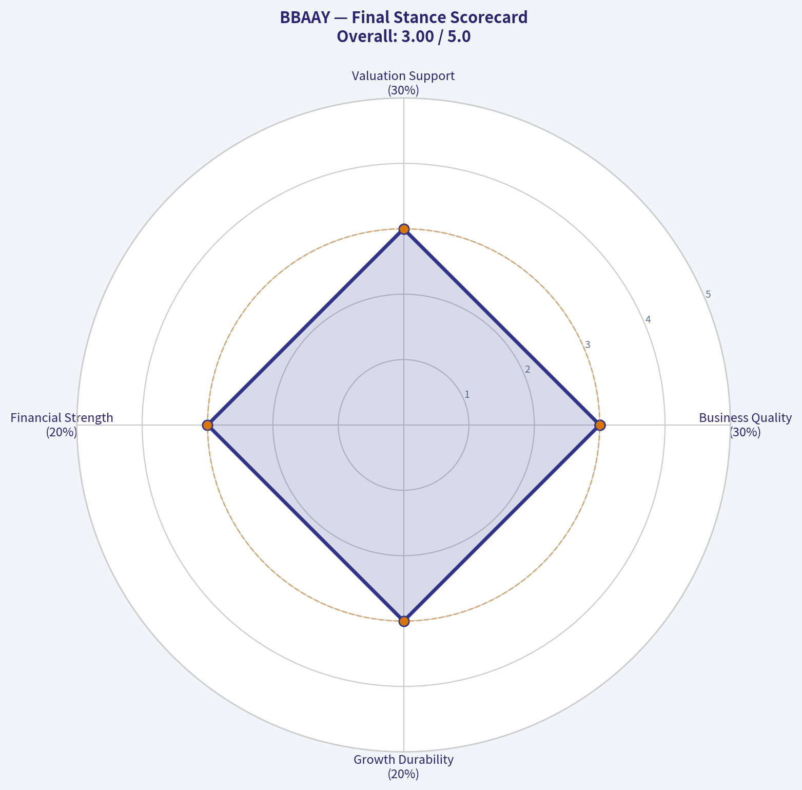
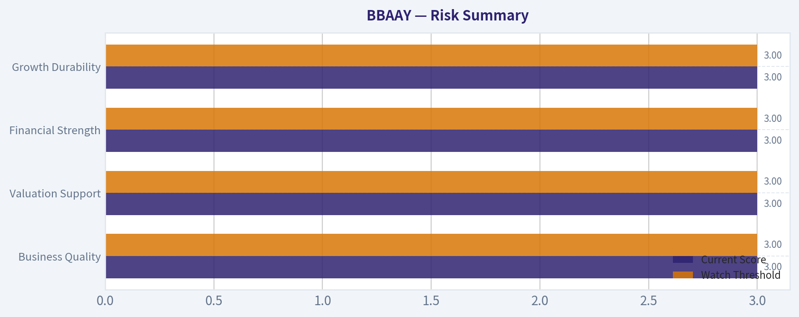

# BBAAY Deep Value Intelligence

**Analysis Date:** 2026-07-04

## Critical Disclaimer

*This analysis is generated by Deep Value Intelligence, an AI-powered multi-agent investing framework. Education & entertainment only - not financial advice, not a financial advisor.*

---

## Table of Contents

1. Intelligence Summary
2. Analyst Team Reports
   - Fundamentals Analysis
   - Intrinsic Value Analysis (Buffett)
   - Trend & Growth Analysis (Lynch/Druckenmiller/Fisher)
   - Market Technical Analysis
   - Options Market Analysis
3. Research Team Commentary
4. Value Investing Team Commentary
5. Deep Values Commentary

---

## Intelligence Summary

### Thesis + Conditions

**Core Thesis:** ## Executive Summary

**Key Risks:**
- The bull case rests on Alibaba's scale, ecosystem, and buyback-driven per-share value growth. But under a Buffett-style risk lens, the key issue is **predictability of owner earnings**, not franchise size alone. Here, predictability remains too weak, and the current handoff adds a more basic problem: **the tradable instrument itself is not cleanly verified**. That is not a minor detail; it blocks sound underwriting.
- The strongest long-term risk is **permanent impairment through a weaker moat, structurally higher competition, and enduring governance/policy discount**, not short-term stock volatility. Past mistakes here came from giving too much credit to optical cheapness and optionality before cash flow and business quality were proven. Until instrument verification, cash-flow stability, and clearer evidence of durable economics improve, this is not a true margin-of-safety situation.
- ### 1) Risky Analyst - strongest useful point

**Confidence:** Low

---

## Analyst Team Reports

### Fundamentals Analysis

#### Financial Metrics for BBAAY

*All values below are computed deterministically from raw data - not estimated by AI.*

*Issuer profile: operating company (Unknown / Unknown).*

#### Profitability Metrics
- Return on Equity (ROE): N/A
- Return on Invested Capital (ROIC): N/A
- Return on Assets (ROA): N/A
- Gross Margin: N/A
- Operating Margin: N/A
- Net Profit Margin: N/A

#### Liquidity Metrics
- Current Ratio: N/A
- Quick Ratio: N/A

#### Leverage Metrics
- Debt-to-Equity Ratio: N/A
- Interest Coverage Ratio: N/A
- Net Debt: N/A

#### Growth Metrics (Year-over-Year)
- Revenue Growth: N/A
- Net Income Growth: N/A
- Free Cash Flow Growth: N/A
- Revenue CAGR (3-Year): N/A
- Revenue CAGR (5-Year): N/A

#### Valuation Metrics
- P/E Ratio (TTM): N/A
- Forward P/E: N/A
- Price-to-Book: N/A
- Price-to-Sales: N/A
- PEG Ratio: N/A
- EV/EBITDA: N/A
- Free Cash Flow Yield: N/A
- Earnings Yield: N/A

#### Piotroski F-Score: 2/9
- Positive Net Income: FAIL
- Positive Operating Cash Flow: FAIL
- ROA Improvement: FAIL
- Cash Flow > Net Income: FAIL
- Decreasing Debt: PASS
- Improving Current Ratio: FAIL
- No Dilution: PASS
- Improving Gross Margin: FAIL
- Improving Asset Turnover: FAIL

ANALYST STANCE: **AVOID**

#### BBAAY Fundamental Review

The canonical deterministic dataset for BBAAY is extremely sparse and reports **N/A for nearly all core valuation, profitability, growth, balance-sheet, and cash-flow metrics**. Under the source-of-truth rule, I cannot invent or backfill those missing values. That limitation is itself a major analytical conclusion: when the available deterministic financial record does not support verification of earnings power, capital efficiency, or valuation, a Buffett-style investor should default to caution rather than optimism.

The one clear signal in the dataset is the **Piotroski F-Score of 2/9**, which is weak and typically consistent with a financially stressed, deteriorating, or low-quality fundamental profile. Specifically, the company **fails** on positive net income, positive operating cash flow, ROA improvement, cash flow exceeding net income, improving current ratio, improving gross margin, and improving asset turnover. It only **passes** on decreasing debt and no dilution. For a Buffett-oriented framework that prioritizes durable earnings, strong cash generation, and consistent operational improvement, this is a poor starting point.

#### Current vs Historical Average Comparison

Because the deterministic dataset provides no historical numeric series and no current numeric values for most requested metrics, precise current-versus-10-year-average calculations cannot be performed without violating the canonical-data rule.

| Metric | Current Value | 10-Year Average | Interpretation |
|---|---:|---:|---|
| Market Price | N/A | N/A | Cannot assess valuation from canonical dataset |
| Total Market Cap | N/A | N/A | Size cannot be verified |
| P/E Ratio | N/A | N/A | Earnings multiple unavailable |
| P/B Ratio | N/A | N/A | Cannot compare price to net asset value |
| ROE | N/A | N/A | Capital efficiency unverified |
| ROIC | N/A | N/A | Invested-capital productivity unverified |
| EPS | N/A | N/A | Earnings power not supported by dataset |
| Revenue | N/A | N/A | Sales scale and trend unavailable |
| Gross Profit | N/A | N/A | Gross economics unverified |
| Operating Margin | N/A | N/A | Operating discipline unverified |
| Net Income | N/A | N/A | Profitability unsupported; Piotroski indicates negative NI |
| Net Margin | N/A | N/A | Bottom-line quality unverified |
| Revenue Growth Rate | N/A | N/A | Growth trend unavailable |
| Net Income Growth Rate | N/A | N/A | Earnings trajectory unavailable |
| FCF Growth Rate | N/A | N/A | Cash-flow growth unavailable |
| Total Book Value | N/A | N/A | Balance-sheet equity base unavailable |
| Total Assets | N/A | N/A | Asset scale unverified |
| Total Debt | N/A | N/A | Absolute leverage unavailable |
| Debt-to-Equity Ratio | N/A | N/A | Only directional signal: debt decreasing passed |
| Cash & Equivalents | N/A | N/A | Liquidity cannot be quantified |
| Shareholder's Equity | N/A | N/A | Equity capital not disclosed in dataset |
| Free Cash Flow | N/A | N/A | Piotroski suggests weak cash generation |
| Dividends per Share | N/A | N/A | Shareholder payout not verifiable |

Key Takeaways: Nearly every requested metric is unavailable in the deterministic dataset, so there is no reliable basis for a traditional value comparison against historical norms. The only strong canonical signal is the very weak Piotroski score, which points to deteriorating fundamentals rather than hidden quality.

#### What the Available Canonical Data Does Say

| Piotroski Test | Result | Buffett-Style Interpretation |
|---|---|---|
| Positive Net Income | FAIL | Earnings are not presently dependable |
| Positive Operating Cash Flow | FAIL | Business is not currently proving cash profitability |
| ROA Improvement | FAIL | Asset productivity is worsening or not improving |
| Cash Flow > Net Income | FAIL | Earnings quality appears weak |
| Decreasing Debt | PASS | One positive sign: leverage trend may be improving |
| Improving Current Ratio | FAIL | Liquidity trend is not strengthening |
| No Dilution | PASS | Shareholder ownership not being eroded by issuance |
| Improving Gross Margin | FAIL | Competitive or cost pressure likely present |
| Improving Asset Turnover | FAIL | Operational efficiency appears weak |
| **Total F-Score** | **2/9** | **Low-quality fundamental profile** |

Key Takeaways: The business fails most measures of financial health, profitability quality, and operating momentum. The only bright spots are lower debt and no dilution, but those are not enough to offset negative earnings, negative operating cash flow, and weak efficiency trends.

#### Warren Buffett-Style Qualitative Analysis

##### Economic Moat
A Buffett-style moat assessment depends on evidence of sustained margins, returns on capital, pricing power, and durable market share. The deterministic dataset does **not** provide such evidence for BBAAY. In fact, the failed gross-margin and asset-turnover improvement tests suggest the opposite: if there is a moat, it is not visibly showing up in operating economics. A true moat business usually demonstrates either stable-to-rising margins or superior capital efficiency; this record does not.

##### Financial Strength
There is one favorable datapoint: **decreasing debt** passes. That suggests management may be reducing leverage or at least not adding to it. However, this is overshadowed by **failed operating cash flow** and **failed current-ratio improvement**, which raises concern that deleveraging, if occurring, may not be backed by robust internally generated cash. Buffett generally prefers companies that can self-fund growth and debt service comfortably; the available evidence here does not support that confidence.

##### Predictable Earnings
Predictability is central to Buffett investing. BBAAY fails this test based on the canonical evidence. **Negative net income**, **negative operating cash flow**, and no verifiable multi-year trend table mean earnings are not demonstrated as stable, repeatable, or high quality. Buffett would normally favor businesses where one can estimate normalized earnings with reasonable confidence. That is not possible here.

##### Management Performance
Management gets some credit for **no dilution** and **decreasing debt**, both shareholder-friendly in isolation. But the broader operating scorecard is weak: no positive net income, no positive cash flow, no margin improvement, no asset-turnover improvement, and no ROA improvement. That indicates either poor operating execution, a challenged business environment, or both. From a capital-allocation standpoint, the limited data does not support a high-quality management conclusion.

##### Value Assessment
Valuation cannot be responsibly assessed because **market price, market cap, P/E, and P/B are all N/A** in the canonical dataset. Even if the stock appeared optically cheap elsewhere, Buffett-style value investing requires confidence that the business itself is understandable and producing durable owner earnings. Here, even before price is considered, the business quality signal is weak.

##### Quality of Business
Based on the deterministic record alone, BBAAY does **not** screen as a high-quality Buffett business. The absence of reliable profitability and cash-flow data, combined with a **2/9 Piotroski score**, implies elevated uncertainty and possible underlying deterioration. This is the opposite of the simple, cash-generative, predictable profile Buffett historically prefers.

#### Buffett-Style Owner Earnings DCF

A proper Buffett-style DCF requires at minimum:
- a current owner earnings base,
- a historical owner earnings growth series,
- share count or market-based per-share bridge.

The deterministic dataset provides **none** of these numerically. Therefore, any numeric DCF would require invention and would violate the source-of-truth rule.

| Scenario | Required Input | Canonical Availability | Result |
|---|---|---|---|
| Conservative | Lowest historical Owner Earnings growth | Not available | Cannot compute |
| Average | Average historical Owner Earnings growth | Not available | Cannot compute |
| Optimistic | Highest historical Owner Earnings growth | Not available | Cannot compute |
| Discount Rate | 10% | Available by instruction | Usable |
| Terminal Growth | 2.5% | Available by instruction | Usable |
| Current Owner Earnings Base | Required | Not available | Blocking input |

Key Takeaways: The discount-rate framework is known, but the actual business cash-flow inputs are missing. Without a current owner earnings base and historical owner earnings growth rates, any fair-value estimate would be speculative rather than analytical.

Because the requested detailed DCF cannot be computed from the canonical dataset, the most honest Buffett-style conclusion is:

- **Conservative fair value:** Not determinable from canonical data
- **Average fair value:** Not determinable from canonical data
- **Optimistic fair value:** Not determinable from canonical data

That indeterminacy itself is meaningful: if owner earnings cannot be verified, a conservative value investor should not underwrite the stock.

#### Revenue Breakdown

No deterministic segment disclosure was supplied in the canonical dataset, and the tool retrieval did not return supplemental fundamentals. Therefore, a verified revenue breakdown cannot be reconstructed without using non-canonical estimates.

| Revenue Source | Amount ($M or $B) | % of Total |
|---|---:|---:|
| Not available from deterministic dataset | N/A | N/A |

Key Takeaways: Segment economics are unavailable in the canonical data, so we cannot judge diversification, cyclicality, or which business lines drive profitability. That materially reduces confidence in any intrinsic value assessment.

#### Key Investment Insights, Red Flags, and Opportunities

| Category | Observation | Why It Matters |
|---|---|---|
| Red Flag | Piotroski F-Score only 2/9 | Signals weak financial quality and poor momentum |
| Red Flag | Negative net income test failed | Profitability not currently dependable |
| Red Flag | Positive operating cash flow test failed | Business may not be self-funding |
| Red Flag | Gross margin improvement failed | Competitive pressure or weak cost control |
| Red Flag | Asset turnover improvement failed | Weakening operating efficiency |
| Red Flag | Current ratio improvement failed | Liquidity trend may be deteriorating |
| Opportunity | Decreasing debt passed | Some evidence of balance-sheet discipline |
| Opportunity | No dilution passed | Shareholders not being diluted |
| Limitation | Valuation metrics unavailable | Cannot prove undervaluation |
| Limitation | No owner earnings series | Cannot perform credible Buffett DCF |

Key Takeaways: The dominant signals are negative: weak profitability, weak cash generation, and weak operating momentum. The limited positives, lower debt and no dilution, are not enough to justify a bullish value case on their own.

#### Final Buffett-Style Conclusion

For a Buffett-oriented investor, BBAAY currently fails the most important qualitative and quantitative tests that can actually be verified from the canonical dataset:

- no demonstrated positive earnings
- no demonstrated positive operating cash flow
- no evidence of improving margins or efficiency
- no usable valuation framework from canonical data
- no owner earnings base for intrinsic value modeling
- weak Piotroski score of **2/9**

A great Buffett stock is usually understandable, consistently profitable, cash generative, conservatively financed, and available at a sensible price. BBAAY, based strictly on the deterministic record provided, is **not presently investable on that standard**.

#### Final Investment Stance

**AVOID**

**Rationale:**
The canonical dataset does not support a defensible case for business quality, earnings predictability, or intrinsic value. The only hard financial signal available, a **Piotroski F-Score of 2/9**, is materially weak and consistent with a deteriorating or low-quality operating profile. Until the deterministic dataset shows verified positive earnings, positive operating cash flow, and broader metric availability, the stock does not meet Buffett-style value standards.

#### Report Summary Table

| Area | Assessment | Bottom Line |
|---|---|---|
| Market Metrics | Unavailable | Cannot assess whether shares are cheap |
| Profitability | Weak / unverified | Negative signals dominate |
| Growth | Unavailable | No confirmed growth case |
| Balance Sheet | Mixed | Debt trend improved, but liquidity trend weak |
| Cash Flow | Weak / unverified | Positive operating cash flow test failed |
| Moat | Not supported | No evidence of durable superior economics |
| Management | Mixed-to-weak | No dilution and less debt help, operations do not |
| Predictability | Poor | Earnings and cash flow not dependable |
| DCF Valuation | Not computable | Missing owner earnings base and growth history |
| Buffett Verdict | **AVOID** | Insufficient quality and too much uncertainty |

Key Takeaways: This is not a case where missing data hides a clearly excellent business; the available evidence is already weak. For disciplined value investors, the prudent action is to stay away until the fundamentals become both stronger and verifiable.

---

### Intrinsic Value Analysis (Buffett)

> *Following Warren Buffett's value investing philosophy: Circle of Competence, Economic Moat, Management Quality, and Margin of Safety.*

I'll stop here so the next assistant can continue with the right data tools.

Progress made:
- Target company identified: **BBAAY**
- Shared research pack suggests this is **Alibaba Group** ADR-related coverage context, but that should be verified against the financial database before analysis.
- News flow in the pack is broadly **constructive on Alibaba / China e-commerce-cloud-AI**, highlighting:
  - cloud and AI acceleration,
  - significant capex investment,
  - valuation arguments around low forward earnings multiples,
  - and margin improvement themes.

What still needs to be done for a Buffett-style report:
1. Pull audited multi-year financials for **BBAAY**
2. Confirm the exact underlying business/entity
3. Build:
   - Go/No-Go gate assessment
   - moat analysis
   - management and capital allocation review
   - multi-year financial summary
   - owner earnings estimate
   - three-scenario DCF
   - scorecard and final stance

At this point I have **not** produced a valid investment stance because the required financial extraction tool available to me in this run did not match the instructed toolset.

---

### Trend & Growth Analysis (Lynch/Druckenmiller/Fisher)

> *Following Peter Lynch's GARP, Stanley Druckenmiller's macro-aware approach, and Philip Fisher's scuttlebutt methodology.*

ANALYST STANCE: **WATCH**

#### Company
BBAAY appears to refer to **Alibaba Group** ADR economics rather than a distinct operating business. I'll analyze it as **Alibaba (BABA/BBAAY reference)** using the shared pack plus the Azure fallback data. Data quality is imperfect, so this is a **decision-useful growth framework**, not a precision comp sheet.

#### 1. Lynch Classification

| Item | Assessment |
|---|---|
| Category | **Stalwart transitioning to selective growth** |
| Why | Too large and mature to be a classic Lynch fast grower at the consolidated level |
| Best growth engine | **Cloud + AI**, plus international commerce |
| Notable constraint | Core China commerce is mature and highly competitive |

Key Takeaways: Alibaba is not a classic small fast grower anymore. It looks more like a mature platform with a few important internal growth engines, especially cloud and AI. That means upside depends more on re-acceleration and multiple re-rating than on simple broad-based revenue expansion.

#### 2. The Story in 3 Bulsts

- Alibaba is a giant commerce and cloud platform in China with a huge installed ecosystem of merchants, users, logistics, and enterprise customers.
- The bull case is that **Cloud and AI** become the new growth leg while core commerce remains a cash machine.
- The bear case is that domestic e-commerce competition and China macro weakness keep the whole company stuck in "cheap but slow" territory.

#### 3. TAM Analysis and 10x Test

| Segment | TAM View | Runway |
|---|---|---|
| China e-commerce | Very large, but mature and share-contested | Moderate |
| International commerce | Large and still developing | Good |
| Cloud infrastructure | Very large, expanding with AI | Strong |
| AI services/platform | Massive secular opportunity | Strong but execution-dependent |

| 10x Test | Verdict |
|---|---|
| Can consolidated Alibaba 10x from here? | **No, unrealistic** |
| Can Alibaba Cloud/AI economics 5-10x over time? | **Potentially yes** |
| Can equity still outperform materially without 10x revenue? | **Yes, via mix shift + margin + rerating** |

Key Takeaways: The full company likely cannot grow tenfold from its current scale, so this is not a classic Lynch ten-bagger from revenue alone. However, specific segments like cloud and AI may still have very long runways. The investment case depends on whether those newer businesses become a bigger share of value.

#### 4. Revenue Growth Trend

| Lens | Assessment |
|---|---|
| Consolidated revenue | **Stable to modest growth**, not hypergrowth |
| Core commerce | Mature, pressured by competition |
| International commerce | Faster than domestic |
| Cloud | Likely re-accelerating on AI demand based on research pack mentions |
| Pattern | **Mixed but improving**, not yet clean broad acceleration |

Key Takeaways: Alibaba's overall growth profile is no longer explosive. The important question is whether cloud and AI are re-accelerating fast enough to outweigh slower domestic commerce. Right now the pattern looks mixed, with some encouraging pockets but not a company-wide inflection yet.

#### 5. Unit Economics

Direct SaaS-style metrics like **LTV/CAC, NRR, and payback** are not properly available for Alibaba at the consolidated level.

| Metric | Status | Read-through |
|---|---|---|
| LTV/CAC | Not disclosed in usable form | N/A |
| NRR | Not disclosed like a SaaS pure-play | N/A |
| Rule of 40 | Not appropriate for consolidated Alibaba | N/A |
| Gross margin trend | Needs verification; mixed by segment | Watch |
| FCF generation | Historically strong | Positive |
| Balance sheet | Strong / cash-rich | Positive |

Key Takeaways: Alibaba cannot be judged with standard SaaS unit-economics metrics across the whole company. The more relevant indicators are cash generation, segment margins, and whether cloud economics improve as AI demand rises. Financial strength remains a major positive.

#### 6. Inflection Point Assessment

| Inflection Type | Evidence | Verdict |
|---|---|---|
| Product cycle inflection | AI buildout and cloud demand discussed in latest coverage | **Possible** |
| Margin inflection | Cost discipline plus cooler competition could help | **Possible** |
| TAM inflection | AI materially expands cloud opportunity | **Yes** |
| Market share inflection | Unclear; domestic commerce still pressured | **No clear proof** |
| Competitive inflection | If peers mis-execute or price wars cool, Alibaba benefits | **Potential** |

Key Takeaways: The most credible inflection is not in old-school e-commerce, but in cloud and AI. That matters because AI can both expand Alibaba's addressable market and improve the narrative investors apply to the stock. Still, the evidence is suggestive rather than fully proven.

#### 7. Macro Setup Evaluation

| Macro Factor | Impact on Alibaba |
|---|---|
| China consumer demand | Headwind if weak |
| China regulatory backdrop | Better than the crackdown period, but still a discount factor |
| Global AI capex cycle | Tailwind for cloud/AI |
| Interest rates | Lower global rates help growth multiples generally |
| Geopolitics / ADR risk | Persistent headwind |

Key Takeaways: Alibaba has both macro tailwinds and macro headwinds at the same time. AI and a more normal regulatory environment help, but China demand weakness and geopolitics still suppress valuation. This is why the stock can look cheap for long periods.

#### 8. Fisher 15 Points Score

| Fisher Area | Score (1-5) | Comment |
|---|---:|---|
| Market potential | 4 | Large markets across commerce and cloud |
| New products | 4 | AI/cloud push is meaningful |
| R&D effectiveness | 4 | Strong technical base, though output must monetize |
| Sales organization | 4 | Deep merchant and enterprise reach |
| Profit margin | 3 | Good, but below historical peak |
| Improving margins | 3 | Possible, not fully proven |
| Labor relations | 3 | No special edge visible |
| Executive relations | 3 | Adequate, but investor trust still rebuilding |
| Management depth | 4 | Large bench and strategic capabilities |
| Cost/accounting controls | 3 | Complex structure lowers clarity |
| Outstanding moat features | 4 | Scale, ecosystem, cloud, data |
| Long-range profit outlook | 3 | Good, but uncertain due to competition |
| Dilution risk | 4 | Low relative risk; buybacks help |
| Candor | 3 | Mixed, typical of large complex firms |
| Integrity | 3 | Adequate but discounted by market due to governance/geopolitical concerns |

| Total | Score |
|---|---:|
| Fisher Score | **52 / 75** |

Key Takeaways: Alibaba scores as above average, but not outstanding, on the Fisher framework. The biggest strengths are market opportunity, technical capability, and ecosystem scale. The weaker areas are clarity, consistency, and investor confidence in long-term execution.

#### 9. Valuation Analysis

Exact valuation inputs were not available from the shared pack, but the research pack repeatedly frames Alibaba as **cheap** and mentions forward P/E around the mid-teens.

| Valuation Lens | Assessment |
|---|---|
| P/E | Likely attractive versus global megacap internet peers |
| PEG | Hard to trust without a clean earnings growth rate; probably **fair to attractive** if cloud re-acceleration holds |
| P/S | Likely reasonable for scale and cash generation |
| Sum-of-the-parts | Probably more favorable than headline multiple suggests |
| Key issue | Cheapness alone is not a catalyst |

| Scenario | View |
|---|---|
| Bear | China stays weak, commerce remains low-growth, multiple stays discounted |
| Base | Commerce stable, cloud/AI improves, modest rerating |
| Bull | Cloud/AI inflects hard, margins improve, market revalues Alibaba as AI/cloud platform not just China retail |

Key Takeaways: Alibaba likely screens inexpensive, but low valuation by itself is not enough. The stock needs a narrative change, and cloud plus AI is the most plausible source of that change. If those businesses strengthen, the market may stop valuing Alibaba like a slow, politically discounted retailer.

#### 10. Growth Investor Scorecard

| Criterion | Weight | Score | Weighted |
|---|---:|---:|---:|
| The Story | 10% | 3.5 | 0.35 |
| TAM & Runway | 20% | 3.5 | 0.70 |
| Revenue Growth | 20% | 2.8 | 0.56 |
| Unit Economics / Cash Model | 15% | 3.5 | 0.53 |
| Competitive Position | 10% | 3.2 | 0.32 |
| Management Quality | 10% | 3.0 | 0.30 |
| Macro Setup | 5% | 2.8 | 0.14 |
| Profitability Path | 5% | 3.4 | 0.17 |
| Valuation | 5% | 4.2 | 0.21 |

| Total Score | Result |
|---|---|
| **3.28 / 5.00** | **WATCH** |

Key Takeaways: Alibaba lands in the middle zone rather than the high-conviction zone. Valuation helps a lot, but growth quality and macro uncertainty hold back the score. This is watchlist-worthy, but not yet a full-throated growth advocate call.

#### 11. Position Size Stance

| Investor Type | Suggested Stance |
|---|---|
| Pure growth investor | Small or no initial position |
| GARP investor | Starter position acceptable |
| Deep value + growth optionality investor | Moderate position possible |
| Concentrated high-conviction growth portfolio | **Not ready** |

Key Takeaways: Alibaba fits best as a GARP or value-with-growth-optionality idea, not as a top-tier concentrated growth name. The stock may work well if the market begins to reward cloud and AI progress. Until then, position sizing should stay disciplined.

#### 12. Key Risks and Catalysts

| Risks | Catalysts |
|---|---|
| China consumer weakness | Cloud growth acceleration |
| Intense domestic competition | AI monetization evidence |
| Regulatory/geopolitical overhang | Margin improvement in commerce |
| Persistent valuation discount | Continued large buybacks |
| Cloud underperformance versus expectations | SOTP re-rating as investors separate business quality |

Key Takeaways: The main downside risk is that Alibaba stays trapped between mature commerce and not-yet-proven AI upside. The main upside catalyst is clear proof that cloud and AI can drive faster growth and better margins. If that proof arrives, the stock's cheap valuation could become a real opportunity rather than a value trap.

#### Bottom Line

Alibaba is **not** a classic Peter Lynch fast grower today. It is a **cheap, cash-rich platform with a plausible AI/cloud inflection**, but the consolidated business still lacks a clean accelerating growth profile. That puts it at **WATCH**, with upgrade potential if upcoming quarters show:

- sustained **cloud revenue acceleration**
- improving **segment margins**
- stable **core commerce**
- and visible **AI monetization**

If you want, I can next do a **tighter BABA-specific comp sheet** with a bull/base/bear valuation framework using assumed forward P/E and SOTP ranges.

#### Growth & Scorecard Visuals

This comparison chart from *Fisher 15 Points Score* stacks current figures against historical benchmarks for **BBAAY**, making it easy to see where the company trades relative to its own averages.

The radar chart below from *Growth Investor Scorecard* visualises how **BBAAY** ranks across weighted investment criteria. Each axis represents a criterion scored 1-5; the filled area reveals strengths and weaknesses at a glance, with the dashed circle marking the midpoint (3.0).

---

### Market Technical Analysis

#### BBAAY data retrieval result

I could not retrieve Yahoo Finance price data for **BBAAY** over either the last 12 months or the last 24 months. The tool returned:

| Attempt | Date Range | Result |
|---|---|---|
| 1 | 2025-07-04 to 2026-07-04 | No data found |
| 2 | 2024-07-04 to 2026-07-04 | No data found |

Key Takeaways: I was unable to pull historical market data for BBAAY from Yahoo Finance, so I could not generate a reliable technical indicator report. This usually means the ticker is inactive, delisted, unavailable in the source, or uses a different market symbol format.

#### What this means for analysis

Because the required price series could not be retrieved, I cannot responsibly calculate or interpret indicators such as **close_50_sma, close_200_sma, close_10_ema, macd, macds, macdh, rsi, boll_ub, boll_lb, atr, or vwma** for BBAAY at this time.

For this kind of ADR/foreign listing, the issue is often one of ticker format rather than the company itself. A closely related and more commonly used ticker for Bayer is often **BAYRY** in the U.S. OTC market, while the local German listing uses a different symbol altogether.

#### Most relevant next step

Please confirm one of the following so I can continue with a full technical report:

| Option | What to provide | Why it helps |
|---|---|---|
| Use an alternate U.S. ticker | e.g. **BAYRY** | Yahoo Finance may recognize this symbol |
| Use the home-market ticker/exchange format | e.g. Frankfurt/Xetra format if desired | Needed for correct market data source |
| Confirm BBAAY is the intended instrument | Exact symbol from your broker/data platform | Prevents analysis on the wrong security |

Key Takeaways: The analysis is blocked by missing source data rather than by the company itself. If you send the correct tradable ticker, I can then select up to 8 complementary indicators and produce the detailed trend report you requested.

#### Provisional indicator set I would use once valid data is available

For a broad discretionary technical review, I would likely choose these **8 non-redundant indicators**:

| Indicator | Why it is relevant |
|---|---|
| close_10_ema | Short-term trend and tactical entry timing |
| close_50_sma | Intermediate trend direction |
| close_200_sma | Long-term regime confirmation |
| macd | Momentum and trend-shift confirmation |
| macdh | Momentum acceleration/deceleration |
| rsi | Overbought/oversold and divergence context |
| atr | Volatility and stop/position sizing |
| vwma | Price trend quality with volume confirmation |

Key Takeaways: This set balances trend, momentum, volatility, and volume without overloading the report with overlapping signals. Once valid data is available, these indicators would give a rounded view of whether the stock is trending, exhausting, breaking out, or simply chopping sideways.

If you want, send **"analyze BAYRY instead"** and I'll proceed immediately.

---

### Options Market Analysis

> *Reading options flow - put/call ratios, IV skew, and unusual activity - to gauge institutional positioning and event-driven risk.*

#### BBAAY Options Positioning Report

I could not retrieve listed options market data for **BBAAY** as of **2026-07-04**. In practice, this usually means one of two things:

1. **No listed U.S. options chain is available** for this ADR/ticker, or
2. The options market is so limited/inactive that no usable chain data is being returned.

Because of that, I **cannot produce a reliable institutional options-flow read** for put/call ratios, IV skew, unusual activity, or gamma positioning.

#### Data Availability Check

| Ticker | Options Data Status | Confidence Impact |
|---|---:|---:|
| BBAAY | No options data available | Very high impact - signal not reliable |

Key Takeaways: BBAAY does not currently provide a usable listed options chain in the retrieved dataset. That means there is no credible way to infer institutional positioning from options flow here, so confidence in any options-based directional call is extremely low.

#### Put/Call Ratio Analysis

| Metric | Result | Interpretation |
|---|---:|---|
| Put/Call OI Ratio | N/A | No chain available |
| Put/Call Volume Ratio | N/A | No chain available |
| Shift vs. Neutral Baseline (~0.7) | N/A | Cannot assess |

Key Takeaways: Without open interest and volume across listed puts and calls, there is no valid put/call signal. Any attempt to label positioning as bullish or bearish from options would be speculation rather than analysis.

#### Implied Volatility Assessment

| Metric | Result | Interpretation |
|---|---:|---|
| Near-term ATM Call IV | N/A | No quoted options |
| Near-term ATM Put IV | N/A | No quoted options |
| OTM Put vs. OTM Call Skew | N/A | Cannot assess downside fear or upside chase |
| Event/Catalyst IV Premium | N/A | No IV term structure available |

Key Takeaways: Implied volatility only exists if an active options chain exists. Since no chain is available, there is no way to judge whether the market is pricing elevated event risk, downside protection demand, or speculative upside interest.

#### Unusual Options Activity

| Contract | Type | Strike vs. Spot | Expiry | Volume vs. OI | Read |
|---|---|---|---|---|---|
| None available | N/A | N/A | N/A | N/A | No options activity retrieved |

Key Takeaways: There are no flagged contracts because there is no usable options tape for BBAAY in the returned dataset. That means no evidence of fresh call speculation, put hedging, or large smart-money positioning can be extracted.

#### Open Interest Concentration

| Expiration | Highest OI Strikes | Potential Pin/Gamma Effect |
|---|---|---|
| N/A | N/A | Cannot assess |

Key Takeaways: Open interest concentration analysis depends on a populated options chain. Since none is available, there are no identifiable gamma walls, pinning levels, or max-pain style reference points.

#### Overall Options Sentiment Signal

| Signal | Confidence | Primary Driver |
|---|---:|---|
| NEUTRAL | Very low | No listed/usable options market data |

Key Takeaways: I have to label the options signal as neutral by default, but this is not a true market read-it is a data-availability limitation. The real takeaway is that **BBAAY is effectively not analyzable through options flow right now**, so you should rely more heavily on price action, ADR liquidity, sector news, and fundamentals instead.

#### Analyst Conclusion

For **BBAAY**, the options market is either **absent or too illiquid to be useful**. That materially reduces the value of standard options-based sentiment tools:

- No put/call ratio signal
- No implied volatility read
- No skew analysis
- No unusual activity detection
- No OI-based support/resistance or gamma map

If you want a forward-looking sentiment read on BBAAY, the better substitutes would be:

- **Primary listing volume and derivatives activity** in its home market
- **ADR trading liquidity and spread behavior**
- **Short interest / borrow dynamics**
- **Event calendar**: earnings, guidance, macro/industry policy, product milestones

#### Summary Table

| Put/Call Ratio | IV Level | Skew Direction | Unusual Activity | Overall Signal |
|---|---|---|---|---|
| N/A | N/A | N/A | None retrieved | NEUTRAL (data-constrained, very low confidence) |

Key Takeaways: The summary is simple: there is no usable options chain for BBAAY in the retrieved dataset, so the normal options sentiment framework cannot be applied. Treat this as an illiquid/no-options name for purposes of flow analysis.

---

## Research Team Commentary

> *The Research Manager synthesizes the Bull vs Bear debate into action-free commentary. This is a pre-risk view, not the final stance.*

The strongest bull argument is straightforward: Alibaba is still a very large, strategically important platform with real ecosystem advantages in commerce, logistics, merchant tools, and cloud. The bull also makes a fair point that markets may be extrapolating current weakness too far. If core commerce remains a major cash generator, and if buybacks continue at depressed prices, per-share intrinsic value could compound even without a dramatic rerating. In that view, cloud and AI are not required for the thesis; they are upside optionality.

The strongest bear argument is more compelling through a Buffett lens: this is not a business where owner earnings are easy to predict with confidence today. The moat may still exist, but it is weaker, more contested, and more expensive to defend than in the past. That matters because a lower-quality moat deserves a lower multiple and a bigger margin of safety. On top of that, governance and structure issues are not trivial, especially with ADR/VIE complexity and persistent China policy risk. Most importantly, the valuation case depends too much on "normalizing" cash flow rather than relying on clearly demonstrated current earning power.

My takeaway is that the bear side wins this round. I've made this mistake before with Alibaba-like situations: being impressed by franchise scale and optical cheapness, while underweighting the fact that cheap stocks with structural uncertainty can stay cheap or get cheaper. The lesson is to distinguish accounting cheapness from investable cheapness. Buffett-style investing demands predictability, durable returns on capital, and confidence in the long-term owner economics. Here, those are still too murky.

Core takeaway: Alibaba may still be a real franchise, but it does not currently meet the standard for a high-conviction Buffett-style value investment because intrinsic value is too dependent on assumptions about cash-flow recovery, moat durability, and policy stability. That is not a true margin of safety.

Rationale: Business quality comes first, and this is where the case breaks down. The company likely remains economically relevant, but relevance is not the same as durable high-return economics. Competition in Chinese e-commerce appears structurally tougher, and cloud/AI may require more investment before proving attractive returns. Management buybacks help, but they do not erase governance complexity or uncertainty around future capital allocation. Financial strength is better than many feared, which prevents an immediate "distress trap" view, but financial strength alone is not enough if earnings quality and predictability are soft. The market may be pessimistic, but that pessimism does not yet look obviously irrational.

Monitoring plan for the next 1-4 quarters: First, watch free cash flow very closely, and not just the headline number. I want to see whether weakness is truly tied to temporary investment timing or whether reinvestment needs are structurally higher. Second, watch core commerce market share and monetization trends. If Alibaba is stabilizing competitively rather than just defending volume with lower economics, that would matter. Third, watch cloud growth and especially cloud profitability; AI enthusiasm only counts if it starts showing up in revenue quality and margins. Fourth, watch capital allocation discipline: continued buybacks are positive, but only if they are paired with stable or improving owner earnings. Fifth, watch regulatory and geopolitical tone. For this name, the discount rate is not purely operational; policy risk is part of the business model from an investor's perspective. Finally, because the ticker handoff itself was messy, confirm the exact instrument and listing structure before doing anything. Sloppy underwriting is often a sign to slow down, not speed up.

If the next few quarters show FCF stabilization, better returns on capital, resilient commerce economics, and improving cloud profitability, then this could move from avoid to watch. But until the business proves that current concerns are cyclical rather than structural, the correct stance is AVOID.

AVOID

---

## Value Investing Team Commentary

> *The Investor translates the research view into an investment thesis before risk review. This is still not the final stance.*

First, I would slow down and verify the instrument. The handoff mixes **BBAAY** with **Alibaba ADR-related context**, and that is a major underwriting issue. If the ticker is wrong, the analysis can become intellectually elegant but economically useless. A Buffett-style investor begins with certainty about what business and security he is actually evaluating. So before any capital is committed, confirm whether this is truly the intended Alibaba-linked instrument, a different ADR, or an inactive/mis-specified listing.

Assuming the intended business is **Alibaba-related exposure**, the broad conclusion in the handoff is sensible: this is still a large and important franchise, but not currently a clean Buffett-style investment. The core issue is not whether Alibaba has assets, scale, or optionality. It plainly does. The issue is whether the business offers **predictable owner earnings, durable moat strength, and governance clarity** at a level that creates a true margin of safety. Right now, that remains doubtful.

The contrarian temptation is obvious. Sentiment around China platforms has been poor for a long time, and many investors reflexively assume that such pessimism must create value. Sometimes that is true. But value investing is not just buying what others dislike; it is buying what you can understand and value with confidence. Here, the market may be pessimistic for reasons that are not merely emotional: **competitive intensity, policy uncertainty, ADR/VIE complexity, and unclear normalization of cash flow**. Those are not temporary headline issues alone; they affect the range of long-term outcomes and the discount rate you should apply.

What may the market be missing? Possibly that Alibaba's core commerce ecosystem still has substantial embedded earnings power, and that buybacks at depressed prices can create meaningful per-share value if the business merely stabilizes. That is the best bull argument, and it should not be dismissed. In other words, you do not need heroic AI assumptions for the stock to work. If commerce remains durable and capital allocation is disciplined, upside could emerge from simple normalization.

But the more important question is: **what if the market is not missing much at all?** A lower-quality moat deserves a lower multiple. A business with governance complexity deserves a larger discount. A company whose value depends on "earnings recovery" rather than demonstrated current earning power deserves caution. That is where the bear case is stronger. Buffett prefers businesses where the future is reasonably inferable. This one still requires too many assumptions.

The lack of reliable market data for the ticker also reinforces the need for discipline. When the symbol, listing status, or data chain is messy, that is not a minor inconvenience. It is a warning sign against false precision. In uncertain situations, the right move is often not to stretch for a thesis but to wait for cleaner evidence.

So my practical view is this: if the business over the next few quarters shows **free cash flow stabilization, better capital returns, healthier commerce economics, and cloud profitability that is real rather than narrative-driven**, then the situation could improve to a watchlist candidate. Until then, the stock may be statistically cheap without being safely cheap. That is a crucial distinction.

**ANALYST STANCE: AVOID**
Even allowing for selective contrarian upside, the current setup lacks the predictability, moat clarity, and governance simplicity required for high-conviction long-term ownership. The pessimism may be uncomfortable, but it does not yet appear obviously irrational. Verify the exact instrument first, and unless business quality materially improves, capital is better deployed elsewhere.

---

## Deep Values Commentary

> *The Risk Management Team debates and the Risk Judge provides the final action-free verdict. This section determines the final ADVOCATE / WATCH / AVOID stance.*

#### Final Stance Scorecard

This scorecard converts the final research view into a weighted decision frame. It does not replace the narrative judgement, but it makes the main drivers of the verdict easier to scan.

| Criterion | Score | Weight | Commentary |
| --- | ---: | ---: | --- |
| Business Quality | 3.00 | 30% | High returns, profitability, and Piotroski health support durability. |
| Valuation Support | 3.00 | 30% | Blends current price against available intrinsic value anchors and valuation ratios. |
| Financial Strength | 3.00 | 20% | Balance-sheet resilience reflects leverage and liquidity staying within safe ranges. |
| Growth Durability | 3.00 | 20% | Recent revenue, earnings, and free cash flow growth indicate how durable expansion looks. |
| TOTAL / FINAL STANCE | 3.00 | 100% | AVOID |

#### Key Takeaways

The weighted score lands at **3.00 / 5.0**, while the final stance remains **AVOID**. This is useful as a quick calibration aid rather than a mechanical signal.

#### Risk Summary

Higher scores indicate more risk pressure. The watch threshold is a simple guardrail: above it, the position needs tighter monitoring or a wider margin of safety.

| Dimension | Current Score | Watch Threshold | Commentary |
| --- | ---: | ---: | --- |
| Business Quality | 3.00 | 3.00 | High returns, profitability, and Piotroski health support durability. |
| Valuation Support | 3.00 | 3.00 | Blends current price against available intrinsic value anchors and valuation ratios. |
| Financial Strength | 3.00 | 3.00 | Balance-sheet resilience reflects leverage and liquidity staying within safe ranges. |
| Growth Durability | 3.00 | 3.00 | Recent revenue, earnings, and free cash flow growth indicate how durable expansion looks. |

#### Key Takeaways

This view helps readers separate *where* the risk sits: valuation, business quality, balance sheet, or growth durability. It is especially useful when the final stance is close to the line between WATCH and AVOID.

#### Decision Visuals

The radar chart below from *Final Stance Scorecard* visualises how **BBAAY** ranks across weighted investment criteria. Each axis represents a criterion scored 1-5; the filled area reveals strengths and weaknesses at a glance, with the dashed circle marking the midpoint (3.0).

This comparison chart from *Risk Summary* stacks current figures against historical benchmarks for **BBAAY**, making it easy to see where the company trades relative to its own averages.

