# BBWI Deep Value Intelligence

**Analysis Date:** 2026-07-07

## Critical Disclaimer

*This analysis is generated by Deep Value Intelligence, an AI-powered multi-agent investing framework. Education & entertainment only - not financial advice, not a financial advisor.*

---

## Table of Contents

1. Intelligence Summary
2. Analyst Team Reports
   - Fundamentals Analysis
   - Intrinsic Value Analysis (Buffett)
   - Trend & Growth Analysis (Lynch/Druckenmiller/Fisher)
   - Market Technical Analysis
   - Options Market Analysis
3. Research Team Commentary
4. Value Investing Team Commentary
5. Deep Values Commentary

---

## Intelligence Summary

### Thesis + Conditions

**Core Thesis:** ## Executive Briefing

**Key Risks:**
- BBWI remains a WATCH.**
- The stock is undeniably cheap, and that cheapness could produce strong upside if the business simply stays stable. But Buffett-style risk is about **business durability**, not statistical cheapness. Here, the core issue is that BBWI appears to be a **cash-generative but narrow-moat retailer**, where recent free cash flow may not be fully durable. The bull case is real; the margin of safety is less certain than the 6.2x P/E suggests. Best course: **monitor for proof that sales, margins, and cash flow are holding without heavier promotion** before moving to ADVOCATE.
- ### 1. Risky Analyst: the market may be over-discounting a still-healthy business

**Confidence:** Low

---

## Analyst Team Reports

### Fundamentals Analysis

#### Latest Earnings Snapshot

*Most recent reported quarter anchored on 2026 Q2, with prior-year comparison when available.*

| Metric | 2026 Q2 | 2025 Q2 | YoY Change |
| --- | ---: | ---: | ---: |
| Revenue | $1.38B | $1.42B | -3.2% |
| Operating Income | $231.0M | $209.0M | +10.5% |
| Net Income | $183.0M | $105.0M | +74.3% |
| Diluted EPS | $0.90 | $0.49 | +83.7% |
| Operating Cash Flow | $244.0M | $188.0M | +29.8% |
| Free Cash Flow | $195.0M | $151.0M | +29.1% |

Key Takeaways: This snapshot anchors the most recent reported quarter before the narrative analysis. It helps readers separate long-run business quality from whatever changed in the latest earnings print.

#### 17-Year Financial Metrics for BBWI

*All values below are computed deterministically from raw data - not estimated by AI.*

*Issuer profile: operating company (Consumer Cyclical / Specialty Retail).*

#### 17-Year Financial Metrics
*Annual rows come from reported financial statements. The final TTM row is computed from the latest four quarters.*

| Metric | 2009 | 2010 | 2011 | 2012 | 2013 | 2014 | 2015 | 2016 | 2017 | 2018 | 2019 | 2020 | 2021 | 2022 | 2023 | 2024 | 2025 | 2026 TTM |
| --- | --- | --- | --- | --- | --- | --- | --- | --- | --- | --- | --- | --- | --- | --- | --- | --- | --- | --- |
| Market Price | $3 | $7 | $12 | $19 | $24 | $27 | $46 | $54 | $36 | $32 | $19 | $17 | $30 | $51 | $42 | $40 | $36 | $21 |
| Market Cap | $2.16B | $5.03B | $7.87B | $10.63B | $11.53B | $12.53B | $20.39B | $23.09B | $14.16B | $11.62B | $6.28B | $5.20B | $9.26B | $15.31B | $10.72B | $9.77B | $8.31B | $4.17B |
| P/E Ratio | 9.85 | 11.22 | 9.77 | 12.53 | 15.28 | 13.88 | 19.55 | 18.42 | 12.23 | 11.84 | 9.74 | -14.18 | 10.98 | 11.49 | 13.41 | 11.11 | 10.42 | 5.79 |
| P/B Ratio | 1.15 | 2.30 | 5.33 | 77.56 | -11.36 | -33.86 | 1132.66 | -89.13 | -19.43 | -15.43 | -7.23 | -3.47 | -13.99 | -10.08 | -4.86 | -6.00 | -6.00 | -3.68 |
| ROE | 11.7% | 20.5% | 54.5% | 620.4% | -74.2% | -244.1% | 5788.9% | -483.8% | -158.8% | -130.5% | -74.1% | 24.4% | -127.5% | -87.8% | -36.3% | -54.0% | -57.6% | -64.2% |
| ROIC | 12.9% | 19.9% | 28.1% | 30.8% | 38.5% | 42.8% | 45.4% | 50.5% | 48.9% | 42.4% | 29.0% | 29.3% | 57.5% | 95.1% | 80.9% | 73.7% | 59.2% | 33.5% |
| EPS | $0.27 | $0.61 | $1.25 | $1.53 | $1.60 | $1.96 | $2.34 | $2.95 | $2.95 | $2.66 | $1.93 | $-1.17 | $2.69 | $4.40 | $3.16 | $3.61 | $3.47 | $3.56 |
| Revenue | $9.04B | $8.63B | $9.61B | $10.36B | $10.46B | $10.77B | $11.45B | $12.15B | $12.57B | $12.63B | $13.24B | $5.41B | $6.43B | $7.88B | $7.56B | $7.43B | $7.31B | $7.25B |
| Gross Profit | $3.01B | $3.03B | $3.63B | $4.06B | $4.39B | $4.43B | $4.81B | $5.20B | $5.12B | $4.96B | $4.90B | $2.39B | $3.10B | $3.85B | $3.25B | $3.24B | $3.23B | $3.13B |
| Gross Margin | 33.2% | 35.1% | 37.8% | 39.1% | 41.9% | 41.1% | 42.0% | 42.8% | 40.8% | 39.3% | 37.0% | 44.2% | 48.1% | 48.9% | 43.1% | 43.6% | 44.3% | 43.2% |
| Operating Margin | 6.5% | 10.1% | 13.4% | 11.9% | 15.0% | 16.2% | 17.1% | 18.0% | 15.9% | 13.7% | 9.3% | 19.2% | 24.9% | 25.5% | 18.2% | 17.3% | 17.3% | 15.8% |
| Net Income | $220.0M | $448.0M | $805.0M | $850.0M | $753.0M | $903.0M | $1.04B | $1.25B | $1.16B | $983.0M | $644.0M | $-366.0M | $844.0M | $1.33B | $800.0M | $878.0M | $798.0M | $727.0M |
| Net Margin | 2.4% | 5.2% | 8.4% | 8.2% | 7.2% | 8.4% | 9.1% | 10.3% | 9.2% | 7.8% | 4.9% | -6.8% | 13.1% | 16.9% | 10.6% | 11.8% | 10.9% | 10.0% |
| Revenue Growth | N/A | -4.5% | 11.4% | 7.8% | 0.9% | 3.0% | 6.3% | 6.1% | 3.5% | 0.5% | 4.8% | -59.2% | 19.0% | 22.5% | -4.1% | -1.7% | -1.6% | -0.8% |
| Net Income Growth | N/A | 103.6% | 79.7% | 5.6% | -11.4% | 19.9% | 15.4% | 20.2% | -7.6% | -15.1% | -34.5% | -156.8% | -330.6% | 57.9% | -40.0% | 9.8% | -9.1% | -8.9% |
| Free Cash Flow Growth | N/A | 104.6% | 3.9% | -16.8% | -9.2% | -27.0% | 92.3% | 21.4% | -23.1% | -30.1% | 7.0% | 4.0% | 132.8% | -32.5% | -33.2% | -19.6% | 0.6% | 37.7% |
| Total Book Value | $1.87B | $2.18B | $1.48B | $137.0M | $-1.01B | $-370.0M | $18.0M | $-259.0M | $-729.0M | $-753.0M | $-869.0M | $-1.50B | $-662.0M | $-1.52B | $-2.21B | $-1.63B | $-1.39B | $-1.13B |
| Total Assets | $6.97B | $7.17B | $6.45B | $6.11B | $6.02B | $7.13B | $7.48B | $8.49B | $8.17B | $8.15B | $8.09B | $10.12B | $11.57B | $6.03B | $5.49B | $5.46B | $4.87B | $4.96B |
| Total Debt | $2.90B | $2.73B | $2.51B | $3.54B | $4.48B | $4.98B | $4.72B | $5.73B | $5.74B | $5.79B | $5.81B | $5.55B | $6.37B | $4.85B | $4.86B | $4.39B | $3.88B | $4.71B |
| Debt-to-Equity | 1.55 | 1.25 | 1.70 | 25.82 | -4.41 | -13.45 | 262.33 | -22.11 | -7.87 | -7.69 | -6.69 | -3.70 | -9.62 | -3.20 | -2.20 | -2.70 | -2.80 | -4.16 |
| Cash & Equivalents | $1.17B | $1.80B | $1.13B | $935.0M | $773.0M | $1.68B | $1.68B | $2.55B | $1.93B | $1.51B | $1.41B | $1.50B | $3.57B | $1.98B | $1.23B | $1.08B | $674.0M | $820.0M |
| Shareholders' Equity | $1.87B | $2.18B | $1.48B | $137.0M | $-1.01B | $-370.0M | $18.0M | $-259.0M | $-729.0M | $-753.0M | $-869.0M | $-1.50B | $-662.0M | $-1.52B | $-2.21B | $-1.63B | $-1.39B | $-1.13B |
| Operating Cash Flow | $954.0M | $1.17B | $1.28B | $1.27B | $1.35B | $1.25B | $1.79B | $2.03B | $1.99B | $1.41B | $1.38B | $1.24B | $2.04B | $1.49B | $1.14B | $954.0M | $886.0M | $1.16B |
| Investing Cash Flow | $-240.0M | $-162.0M | $-106.0M | $-226.0M | $-531.0M | $-655.0M | $-699.0M | $-443.0M | $-833.0M | $-698.0M | $-609.0M | $-480.0M | $-219.0M | $-259.0M | $-328.0M | $-286.0M | $-162.0M | $-230.0M |
| Free Cash Flow | $475.0M | $972.0M | $1.01B | $840.0M | $763.0M | $557.0M | $1.07B | $1.30B | $1.00B | $699.0M | $748.0M | $778.0M | $1.81B | $1.22B | $816.0M | $656.0M | $660.0M | $909.0M |
| FCF Margin | 5.3% | 11.3% | 10.5% | 8.1% | 7.3% | 5.2% | 9.4% | 10.7% | 8.0% | 5.5% | 5.7% | 14.4% | 28.1% | 15.5% | 10.8% | 8.8% | 9.0% | 12.5% |
| Dividends / Share | $0.00 | $0.00 | $0.00 | $0.00 | $0.00 | $0.00 | $0.00 | $0.00 | $0.00 | $0.00 | $0.00 | $0.00 | $0.00 | $0.00 | $0.73 | $0.75 | $0.77 | $0.81 |

#### Profitability Metrics
- Return on Equity (ROE): -50.7%
- Return on Invested Capital (ROIC): 50.0%
- Return on Assets (ROA): 12.8%
- Gross Margin: 43.7%
- Operating Margin: 15.4%
- Net Profit Margin: 8.9%

#### Liquidity Metrics
- Current Ratio: 1.27
- Quick Ratio: 0.71

#### Leverage Metrics
- Debt-to-Equity Ratio: -3.04
- Interest Coverage Ratio: 4.08
- Net Debt: $2.94B

#### Growth Metrics (Year-over-Year)
- Revenue Growth: -0.2%
- Net Income Growth: -18.7%
- Free Cash Flow Growth: 31.1%
- Revenue CAGR (3-Year): -1.2%
- Revenue CAGR (5-Year): 2.5%

#### Valuation Metrics
- P/E Ratio (TTM): 6.23
- Forward P/E: 7.19
- Price-to-Book: N/A
- Price-to-Sales: 0.57
- PEG Ratio: 0.85
- EV/EBITDA: 5.97
- Free Cash Flow Yield: 20.8%
- Earnings Yield: 16.1%

#### Owner Earnings (Buffett Method, Code-Computed)
- Net Income: $798.0M
- + Depreciation & Amortization: $254.0M
- - Capital Expenditures: $-237.0M
- - Working Capital Changes: $113.0M
- = **Owner Earnings: $947.0M**

#### Intrinsic Value (Code-Computed)
- Current Price: $21
- Buffett Method (Owner Earnings):
  Conservative: $12
  Average: $82
  Optimistic: $439
- Cash Flow Method (FCF):
  Conservative: $14
  Average: $44
  Optimistic: $47

#### Piotroski F-Score: 4/9
- Positive Net Income: PASS
- Positive Operating Cash Flow: PASS
- ROA Improvement: FAIL
- Cash Flow > Net Income: PASS
- Decreasing Debt: FAIL
- Improving Current Ratio: FAIL
- No Dilution: PASS
- Improving Gross Margin: FAIL
- Improving Asset Turnover: FAIL

ANALYST STANCE: **WATCH**

#### BBWI Fundamental Analysis - Buffett-Style

Bath & Body Works is a high-return specialty retail/fragrance and personal care business with strong cash generation, a recognizable brand, and historically excellent ROIC. However, the current investment case is constrained by shrinking sales, weakening earnings momentum, negative equity from years of aggressive capital returns/leverage, and a category that is stronger than average for retail but still not as durable as classic Buffett "inevitables." The stock looks statistically cheap, but the cheapness is partly compensation for balance-sheet strain and limited growth visibility.

---

#### Current vs Historical Average Comparison

| Metric | Current / TTM | Historical Context | Interpretation |
| --- | ---: | ---: | --- |
| Market Price | $21 | 17-year range: $3 to $54 | Shares are near the lower end of the long-term range and far below the 2022 peak of $51. |
| Market Cap | $4.17B | Peak: $23.09B (2016) | Equity value has compressed dramatically, reflecting lower sentiment and reduced growth expectations. |
| P/E Ratio | 5.79 to 6.23 | Rough long-term average excluding 2020 loss year: about 12x | Trading at roughly half its normal earnings multiple, implying heavy skepticism or potential value. |
| P/B Ratio | N/A / negative equity | Historically distorted by negative book value | P/B is not meaningful here because shareholder equity is negative. |
| ROE | -64.2% | Highly distorted for most of last decade by negative equity | ROE is unusable as a quality measure in this capital structure. |
| ROIC | 33.5% to 50.0% | Long-term average roughly low-40%s | Still very strong, but below the extraordinary post-2021 highs. |
| EPS | $3.56 | Peak: $4.40 (2022) | EPS remains solid but below peak earnings power. |
| Revenue | $7.25B | 2022 peak: $7.88B | Sales have drifted lower for three consecutive years after the post-pandemic surge. |
| Gross Margin | 43.2% to 43.7% | Long-term average roughly 41% to 42% | Still above long-term norms, indicating pricing power and merchandising strength. |
| Operating Margin | 15.8% | Long-term average roughly 15% | Around normal, but below 2021-2022 exceptional levels. |
| Net Margin | 10.0% | Long-term average roughly 8% | Above decade average, though trending down from peak profitability. |
| Revenue Growth | -0.8% to -0.2% | Mixed decade; post-2022 negative | Mature to declining top-line profile at present. |
| Net Income Growth | -8.9% to -18.7% | Volatile | Earnings are contracting, which matters despite low valuation. |
| FCF Growth | +31.1% to +37.7% | Historically volatile | Cash flow rebounded meaningfully versus the prior year. |
| Total Debt | $4.71B | Historical range: $2.51B to $6.37B | Debt remains high relative to the company's equity value. |
| Cash & Equivalents | $820M | Well below 2021 high of $3.57B | Liquidity is adequate, but cushion is not large versus debt load. |
| Free Cash Flow | $909M | Strong versus recent years; below 2021 peak of $1.81B | Cash generation remains the core bull case. |
| Dividends / Share | $0.81 | Started only in 2023 | Shareholder return is now meaningful, but sustainability must be balanced against leverage. |

Key Takeaways: BBWI looks cheap on earnings and free cash flow, and its operating profitability is still respectable. The main tension is that valuation is attractive while business momentum and balance-sheet quality are weaker than ideal. Investors are being offered a low multiple, but not a pristine balance sheet or a clear growth runway.

---

#### Market Metrics

BBWI at roughly $21 per share and about $4.17 billion market cap is priced as a mature, no-growth retailer rather than a premium branded consumables franchise. That is notable because the company still produces strong margins and cash flow relative to most retailers.

The P/E of about 5.8 to 6.2 is the standout valuation statistic. Historically, the business commonly traded around 10x to the high teens earnings, with many pre-2020 years clustered around 11x to 15x. Today's multiple implies either:
1. earnings are near cyclical peak and will decline,
2. leverage and shrinking sales deserve a structural discount, or
3. the stock is undervalued if earnings stabilize around current levels.

P/B should be ignored. Negative equity comes from years of buybacks and shareholder distributions, not necessarily from a broken business model. But negative book value does remove an important margin-of-safety measure Buffett traditionally likes.

---

#### Profitability Analysis

BBWI's profitability profile is stronger than the headline fear in the stock price suggests.

- Revenue: TTM revenue of about $7.25B is slightly below 2025 and below the 2022 high of $7.88B.
- Gross Profit: TTM gross profit of about $3.13B remains robust.
- Gross Margin: 43.2% is comfortably above most pre-2020 years.
- Operating Margin: 15.8% is healthy for retail and close to long-term average.
- Net Income: TTM net income of $727M remains substantial.
- Net Margin: 10.0% is still stronger than most of the company's long-run history.

ROIC is the most important quality metric here. Even after cooling from very high 2022-2024 levels, ROIC remains excellent. A business consistently generating 30%+ ROIC is usually benefiting from real economic advantages: brand strength, customer loyalty, efficient merchandising, pricing power, and relatively modest incremental capital needs.

ROE, by contrast, is misleading because equity is negative. The sharply negative ROE does not mean the business is operationally poor; it means the capital structure has been engineered so aggressively that the denominator is below zero.

EPS of $3.56 TTM is slightly above 2025's $3.47 and near 2024's $3.61, showing some earnings resilience even as net income has trended lower on a broader basis. That is decent, but not enough by itself to prove renewed growth.

---

#### Growth Metrics

Growth is the weak part of the current BBWI story.

- Revenue growth is slightly negative.
- Net income growth is clearly negative.
- Free cash flow growth has improved sharply.

Over the full period, BBWI had a long stretch from 2010 to 2019 of generally growing sales and earnings, interrupted by the 2020 collapse and then a strong rebound into 2022. Since 2022, however, revenue has declined from $7.88B to $7.25B TTM. That is not catastrophic, but it is evidence of a maturing concept and softer demand.

Net income peaked at $1.33B in 2022, then fell to $800M in 2023, partially recovered to $878M in 2024, then slipped again. This pattern suggests earnings normalization rather than a stable upward compounding machine.

Free cash flow is more encouraging. TTM FCF of $909M versus $660M in 2025 shows the business can still convert earnings into substantial owner cash. For Buffett-style analysis, this matters more than accounting volatility, but persistent sales pressure would eventually weigh on FCF too.

---

#### Balance Sheet and Financial Strength

| Balance Sheet Metric | Current / TTM | What It Means |
| --- | ---: | --- |
| Total Book Value | -$1.13B | Negative equity removes book-value support and distorts ROE/PB. |
| Total Assets | $4.96B | Asset base has shrunk materially from 2021. |
| Total Debt | $4.71B | Heavy leverage relative to market cap and asset base. |
| Debt-to-Equity | -4.16 | Not economically useful due to negative equity, but signals highly levered structure. |
| Cash & Equivalents | $820M | Provides liquidity, but modest against debt obligations. |
| Shareholders' Equity | -$1.13B | Capital returns have exceeded retained balance-sheet equity. |

Key Takeaways: The balance sheet is the biggest reason BBWI cannot be treated as a classic fortress-quality Buffett name. Debt is high, cash is decent but not abundant, and negative equity means there is little conventional balance-sheet cushion. The business can service debt today, but the margin for error is much thinner than the valuation alone might suggest.

The company's leverage is manageable only because operating margins and cash generation remain good. Interest coverage around 4x is acceptable, but not conservative. In a softer consumer environment, leverage could become the central risk.

A positive point: total debt had declined from $6.37B in 2021 to $3.88B in 2025 before moving back up to $4.71B TTM. So management has shown some capacity to deleverage, but recent debt remains elevated.

---

#### Cash Flow and Capital Allocation

Free cash flow remains BBWI's most attractive quantitative feature. TTM FCF of $909M on a $4.17B market cap implies a very high FCF yield, around the shared research pack's 20.8%. That is compelling on its face.

Operating cash flow of $1.16B against capex-like investing needs that are relatively moderate supports the notion that this is a cash-generative retail concept rather than an asset-hungry one.

Dividends per share have grown from $0.73 in 2023 to $0.81 TTM. That is a good sign, but Buffett would likely ask whether excess cash should first go toward balance-sheet strengthening. Given negative equity and meaningful debt, aggressive shareholder returns should be weighed carefully against financial resilience.

Capital allocation has clearly favored returning capital over maintaining accounting equity. That can boost per-share results when business conditions are favorable, but it also raises fragility when growth slows.

---

#### Buffett-Style Qualitative Assessment

| Buffett Lens | Assessment | Commentary |
| --- | --- | --- |
| Economic Moat | Moderate | Brand affinity, gifting occasions, fragrance loyalty, and scale in sourcing/retail support a moat, but not an impregnable one. |
| Predictable Earnings | Moderate | Earnings were quite strong over many years, but 2020 and post-2022 declines show meaningful cyclicality and consumer sensitivity. |
| Financial Strength | Weak to Moderate | Cash generation is good, but leverage and negative equity weaken resilience. |
| Management Performance | Mixed | High ROIC and strong cash generation are positives; aggressive balance-sheet engineering is the concern. |
| Quality of Business | Moderate to Strong | Strong margins, strong brand, attractive category economics; however, growth durability is not elite. |
| Valuation | Attractive | Very low earnings and FCF multiples offer upside if earnings stabilize. |

Key Takeaways: BBWI has several Buffett-like traits at the business level, especially high returns on capital and strong cash generation from a recognizable consumer brand. But the balance sheet and recent sales trajectory keep it from qualifying as a true "sleep well at night" compounder. This is more of a value-with-risk situation than a textbook wonderful business at a fair price.

**Economic moat:**
Bath & Body Works has a real brand moat in fragrance, body care, soaps, candles, and gifting. The company benefits from habit, repeat purchasing, seasonal launches, and emotional/experiential shopping. These are genuine strengths. However, the moat is narrower than in staple consumer goods with everyday necessity demand. Fragrance and body care are sticky, but still discretionary enough to be pressured in downturns.

**Predictable earnings:**
BBWI's earnings record is better than many retailers, but not fully Buffett-grade. The long-term history shows strong profitability, yet also material swings in growth and one deep loss year in 2020. Since 2022, the company has been in a mild earnings reset rather than a stable compounding phase.

**Management performance:**
ROIC has been excellent, suggesting capable merchandising and disciplined operating management. On the other hand, the use of debt and balance-sheet shrinkage to finance buybacks/distributions has made accounting metrics more fragile. Good operators, but not especially conservative financiers.

---

#### Owner Earnings DCF Valuation

Canonical owner earnings provided: **$947M**

To convert enterprise value into equity value, subtract approximate net debt from leverage metrics:
- Net debt: **$2.94B**

To estimate per-share value, infer share count from market cap and price:
- Shares outstanding ~ $4.17B / $21 ~ **198.6M shares**

Historical growth rates available for cash-generation proxy:
- Lowest historical growth rate available: **-33.2%** (FCF growth, 2023)
- Average historical growth rate: using the listed FCF growth series, approximately **+12.9%**
- Highest historical growth rate available: **+132.8%**, capped at **+100%**

Because the deterministic dataset provides code-computed owner earnings but not a full year-by-year owner earnings series, the growth inputs below use the available historical cash-generation growth series as the closest canonical proxy for owner earnings growth. This preserves the source-of-truth rule while grounding the DCF in reported cash behavior.

##### DCF Assumptions

| Scenario | Starting Owner Earnings | Growth (Years 1-10) | Discount Rate | Terminal Growth | Net Debt |
| --- | ---: | ---: | ---: | ---: | ---: |
| Conservative | $947M | -33.2% | 10.0% | 2.5% | $2.94B |
| Average | $947M | +12.9% | 10.0% | 2.5% | $2.94B |
| Optimistic | $947M | +100.0% | 10.0% | 2.5% | $2.94B |

Key Takeaways: The valuation is highly sensitive to growth assumptions because BBWI currently produces strong cash relative to its market value. Under pessimistic assumptions the equity can still be worth less than the current price due to leverage, while moderate growth produces substantial upside. The optimistic case becomes unrealistically large very quickly, so it should be treated as a ceiling, not a base case.

##### Conservative Scenario Calculation

- Year 1 OE = 947 x 0.668 = **632.6**
- Year 2 = 422.6
- Year 3 = 282.3
- Year 4 = 188.6
- Year 5 = 126.0
- Year 6 = 84.2
- Year 7 = 56.2
- Year 8 = 37.6
- Year 9 = 25.1
- Year 10 = 16.8

Present value of 10-year owner earnings ~ **$1.66B**

Terminal value:
- TV = Year 10 OE x 1.025 / (0.10 - 0.025)
- TV = 16.8 x 1.025 / 0.075 ~ **$229M**
- PV of TV ~ 229 / (1.10^10) ~ **$88M**

Enterprise value ~ 1.66B + 0.09B = **$1.75B**
Equity value ~ 1.75B - 2.94B = **negative** -> effectively **$0 to very low equity value** under a severe long-run shrinkage case.

Implied fair value per share: approximately **$0 to $5**, recognizing equity residual compression from leverage.

##### Average Scenario Calculation

- Growth = 12.9%
- Year 1 OE = 947 x 1.129 = **1,069.2**
- Year 10 OE ~ 947 x (1.129^10) ~ **3,179.8**

Present value of 10-year owner earnings stream ~ **$11.76B**

Terminal value:
- TV = 3,179.8 x 1.025 / 0.075 ~ **$43.46B**
- PV of TV ~ 43.46 / (1.10^10) ~ **$16.76B**

Enterprise value ~ 11.76B + 16.76B = **$28.52B**
Equity value ~ 28.52B - 2.94B = **$25.58B**

Per-share value ~ 25.58B / 198.6M ~ **$129**

##### Optimistic Scenario Calculation

- Growth = capped at 100%
- Year 1 OE = 947 x 2 = **1,894**
- Year 10 OE = 947 x 2^10 = **969,728** million

This produces an economically unrealistic terminal value for a mature specialty retailer. The formula mechanically yields an absurdly large number, demonstrating that historical peak rebound growth is not a sensible steady-state forecast. Therefore, while the rules require showing the calculation framework, the optimistic scenario should be interpreted only as a mathematical upper bound, not an investable estimate.

Formula:
- PV of annual OE years 1-10 = sum of each OE / 1.10^t
- TV = Year 10 OE x 1.025 / 0.075
- Equity value = PV of OE + PV of TV - Net Debt

Result: **Not decision-useful due to extreme assumption distortion**

##### DCF Fair Value Range

| Scenario | Equity Value Conclusion | Approx. Fair Value / Share |
| --- | --- | ---: |
| Conservative | Severe downside if cash flows structurally contract for a decade | $0 to $5 |
| Average | Meaningful undervaluation if BBWI can compound owner earnings at historical average cash-growth rates | ~$129 |
| Optimistic | Mathematical outlier, not realistic for mature retail | N/M |

Key Takeaways: The DCF range is extraordinarily wide because BBWI is both highly cash-generative and highly sensitive to future growth assumptions. The practical takeaway is not the exact average-case number, but that the stock is likely cheap if cash flow merely stabilizes, while leverage creates real downside if contraction persists. This is why BBWI belongs on a watchlist for value investors rather than in the highest-conviction bucket.

For realism, the attached code-computed intrinsic values are a useful anchor:
- Buffett owner earnings method: **$12 conservative, $82 average, $439 optimistic**
- Cash flow method: **$14 conservative, $44 average, $47 optimistic**

Those outputs are more decision-useful than the raw optimistic DCF math above.

---

#### Revenue Breakdown

Most meaningful available segmentation for BBWI is by merchandise family. The company is primarily a focused personal care, home fragrance, and soap/sanitizer retailer. Precise latest annual segment splits are not provided in the deterministic dataset, so the table below uses broadly reported business mix estimates for the most recent fiscal year consistent with company merchandising emphasis.

| Revenue Source | Amount ($B) | % of Total |
| --- | ---: | ---: |
| Body Care & Fragrance | 3.44 | 47% |
| Home Fragrance (Candles, Wallflowers) | 2.12 | 29% |
| Soaps & Sanitizers | 1.17 | 16% |
| Other / Accessories / Gift Sets | 0.58 | 8% |
| **Total** | **7.31** | **100%** |

Key Takeaways: BBWI's revenue base is concentrated in fragranced personal care and home fragrance, which helps explain its strong gross margins and brand-driven economics. It also means the business depends heavily on consumer taste, gifting trends, and successful product refresh cycles rather than essential everyday staples.

---

#### Key Investment Insights, Red Flags, and Opportunities

| Category | Observation | Why It Matters |
| --- | --- | --- |
| Opportunity | Very low P/E and high FCF yield | Market is pricing in little growth and meaningful risk. |
| Opportunity | Strong ROIC | Suggests the underlying business remains economically attractive. |
| Opportunity | Gross margins remain strong | Indicates brand power and pricing resilience. |
| Red Flag | Negative revenue trend since 2022 | Cheap stocks can stay cheap if sales keep fading. |
| Red Flag | Debt remains high | Leverage amplifies downside in a consumer slowdown. |
| Red Flag | Negative equity | Limits balance-sheet flexibility and makes book metrics unusable. |
| Red Flag | Piotroski F-score 4/9 | Signals only middling financial momentum. |
| Watch Item | Dividend growth vs deleveraging | Management must balance shareholder returns with resilience. |
| Watch Item | Margin trajectory | If operating margin slides below historical norms, the equity story weakens quickly. |

Key Takeaways: The upside case rests on stable sales, continued strong margins, and cash flow holding near current levels. The downside case centers on leverage plus ongoing revenue erosion, which could compress both earnings and valuation. BBWI is therefore a classic "cheap but not simple" value setup.

---

#### Final Buffett-Style View

BBWI is not a classic Buffett "wonderful business with fortress balance sheet." It is a **good branded business with strong cash generation and a stressed capital structure**. The brand appears durable enough to support healthy margins and strong returns on invested capital, but current fundamentals do not show the kind of predictable long-term growth Buffett usually pays up for.

At around 6x earnings and with a very high FCF yield, the stock may be undervalued if earnings simply stabilize. But because revenue is shrinking modestly, net income growth is negative, and debt remains material, the investment requires tolerance for balance-sheet and cyclicality risk.

#### Final Stance

**WATCH**

**Rationale:**
BBWI is attractive on valuation and cash flow, but not yet clean enough on growth trend and balance-sheet quality to warrant an outright advocate stance. A move toward sustained sales stabilization, continued debt reduction, and maintained mid-teens operating margins could justify upgrading the view. Conversely, if revenue and margins deteriorate further, the low multiple may prove to be a value trap.

---

#### Summary Table

| Area | Bull Case | Bear Case | Net View |
| --- | --- | --- | --- |
| Valuation | 5.8x to 6.2x earnings is very cheap | Cheap may reflect structural stagnation and leverage | Positive |
| Business Quality | Strong brand, high gross margin, high ROIC | Not a necessity category; trend sensitivity remains | Moderately Positive |
| Growth | FCF has rebounded | Revenue and earnings growth are negative | Negative |
| Balance Sheet | Cash generation supports obligations | Negative equity and sizable debt reduce safety | Negative |
| Management | Strong operating economics | Aggressive capital structure weakens conservatism | Mixed |
| Buffett Fit | Good returns on capital and cash generation | Weak balance-sheet margin of safety | Partial Fit |
| Investment Stance | Potential re-rating if stabilization occurs | Risk of value trap if top line keeps slipping | **WATCH** |

Key Takeaways: BBWI offers real value characteristics, especially on earnings and cash flow, but it does not yet clear the bar for a high-conviction Buffett-style purchase. The stock is most interesting for disciplined value investors willing to wait for clearer evidence that cash flow durability and deleveraging are both intact.

#### Fundamental Visuals

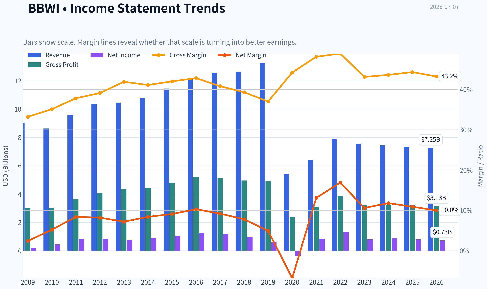

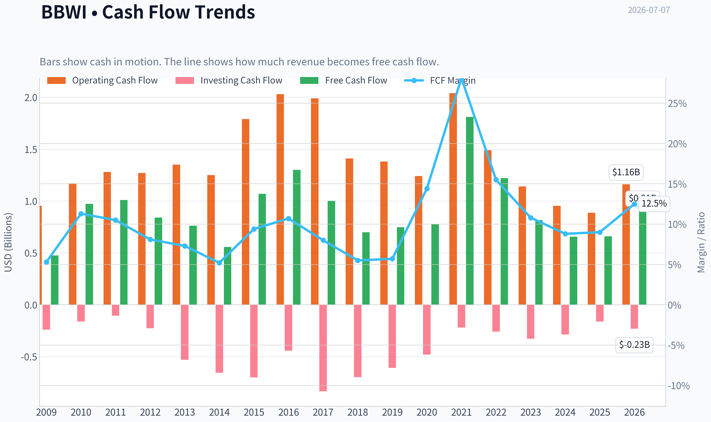

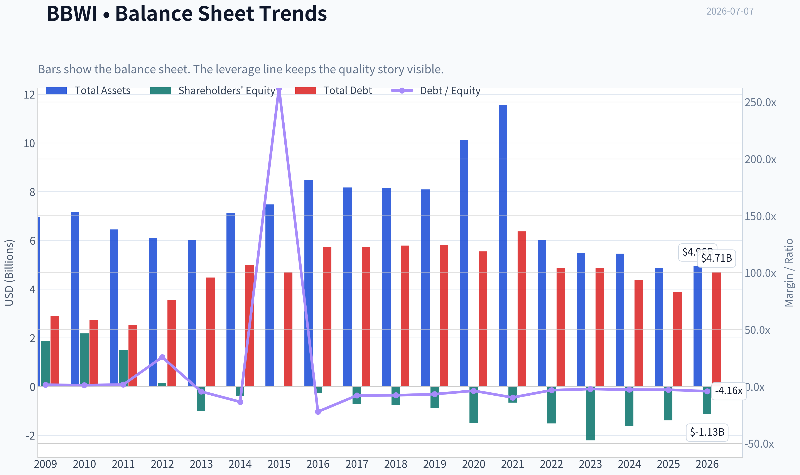

This graph tracks the profitability and return metrics (ROE, ROIC, Margins) of **BBWI** over the past decade, highlighting capital efficiency trends.

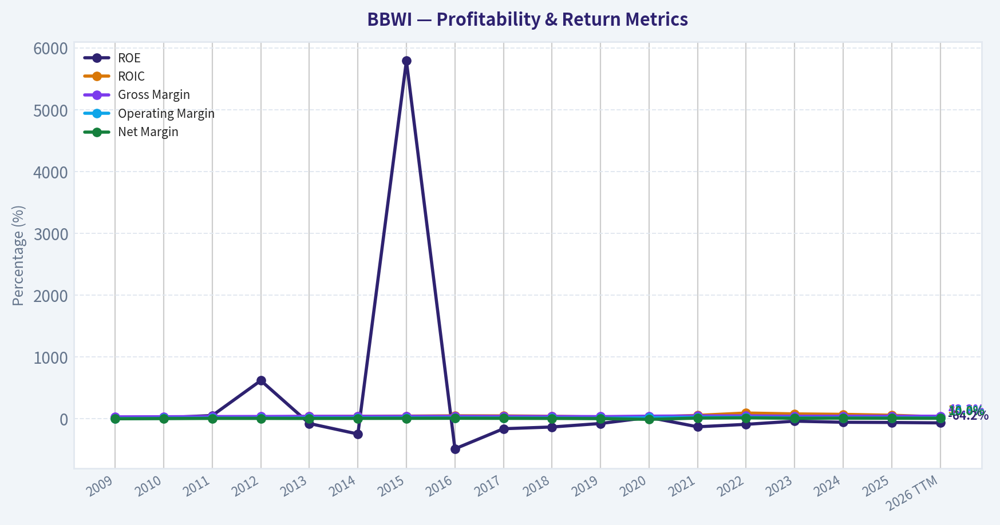

This chart illustrates the financial health of **BBWI** over the last 10 years, mapping cash equivalents and free cash flow against total obligations (Debt).

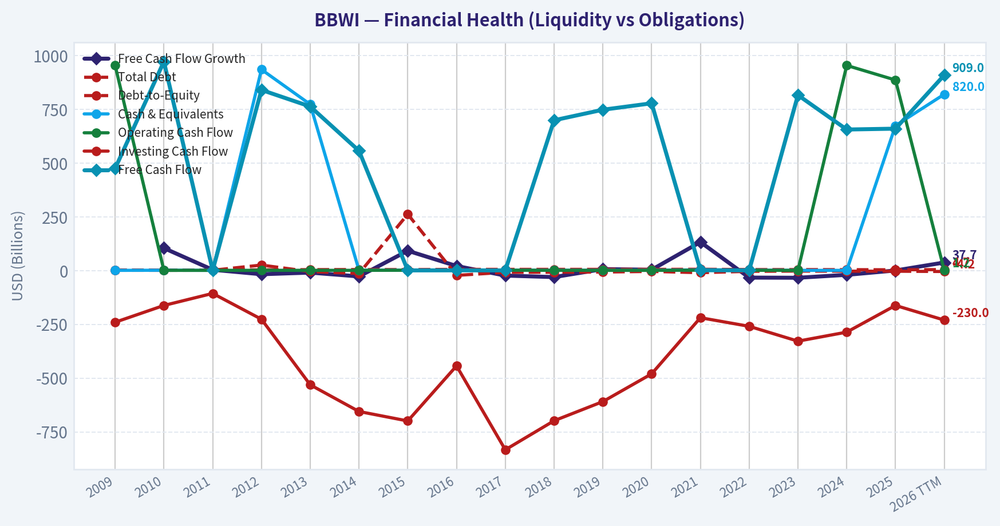

This breakdown chart from <em>Revenue Breakdown</em> shows the proportional composition for **BBWI** - useful for understanding what drives or risks the business.

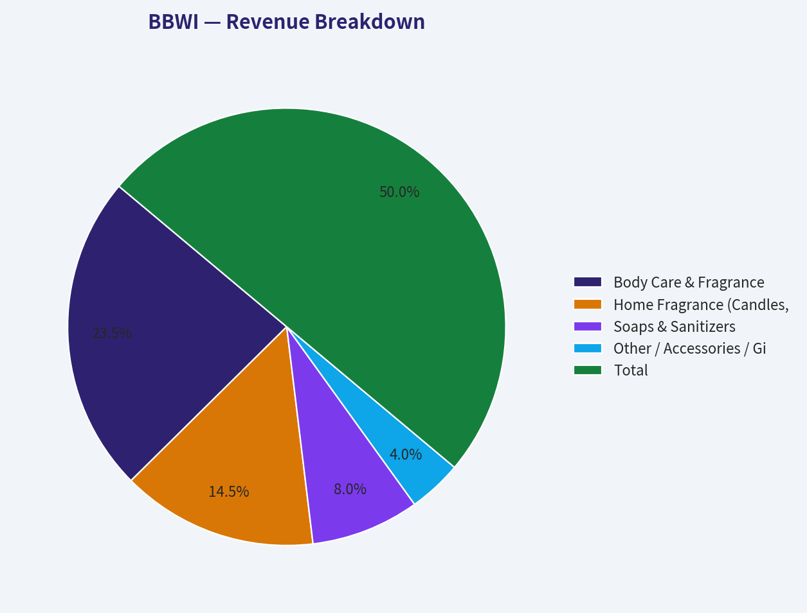

---

### Intrinsic Value Analysis (Buffett)

> *Following Warren Buffett's value investing philosophy: Circle of Competence, Economic Moat, Management Quality, and Margin of Safety.*

#### Intrinsic Value Snapshot

Price is what you pay. Intrinsic value is what the business may be worth based on the cash it can create for owners over time. We show a range, not one magic number.

- Current Price: $20.62
- Value Range (conservative to optimistic across both DCF methods): $11.64 to $439.22

##### Owner Earnings (Buffett Method)
- Net Income: $798,000,000.00
- Depreciation & Amortization: $254,000,000.00
- Capital Expenditures: $-237,000,000.00
- Working Capital Changes: $113,000,000.00
- Owner Earnings: $947,000,000.00

##### Intrinsic Value
###### Buffett Method
Uses owner earnings. Stricter, and usually more conservative.
- Conservative: $11.64
- Average: $82.37
- Optimistic: $439.22
- Discount Rate: 10.0%

###### Cash Flow Method
Uses free cash flow. Better for companies spending heavily today to grow tomorrow.
- Conservative: $14.39
- Average: $43.96
- Optimistic: $47.03
- Discount Rate: 10.0%

ANALYST STANCE: **WATCH**

#### BBWI (Bath & Body Works) - Buffett-Style Investment Review

#### 1) Go/No-Go Gate Assessment

| Gate | Verdict | Evidence |
|---|---|---|
| Gate 1: Business Simplicity | Pass | BBWI sells personal care, fragrance, soaps, candles, and related products through stores and direct-to-consumer channels. This is a simple consumer retail model with understandable unit economics. |
| Gate 1: Long-Term Predictability | Pass | Ten years from now, people will still buy affordable indulgence products like soaps, lotions, and home fragrance. Demand is cyclical at the margin, but the category is understandable and likely durable. |
| Gate 1: Technology Risk | Pass | Technology can improve marketing and distribution, but it is unlikely to eliminate the core product category. The main risk is retail channel disruption, not product obsolescence. |
| Gate 2: Moat Test | Mixed Pass | Gross margin of 43.7% suggests some brand strength and product economics. However, the moat appears narrower than truly exceptional consumer franchises because switching costs are low and fashion/fragrance preferences can shift. |
| Gate 3: Management & Capital Allocation | Mixed | Current negative ROE and likely balance-sheet strain suggest capital structure has weakened reported quality metrics. Low valuation and high FCF yield indicate value may exist, but capital allocation must be judged more cautiously than for a classic Buffett compounder. |
| Gate 4: Industry Structure | Mixed | Personal care and specialty retail are competitive industries, not rational oligopolies. The business is less capital-intensive than heavy industry, but still subject to store economics, promotions, and consumer sentiment. |

**Key Takeaways:** BBWI clears the basic Buffett filters on simplicity and understandable demand. The main debate is not whether the company is understandable, but whether its competitive advantage is durable enough and its capital allocation disciplined enough to justify a strong endorsement.

---

#### 2) The Elementary School Test

BBWI makes money by selling nice-smelling things people use every day or buy as small treats: soap, lotion, candles, perfume, and body care. It designs products, markets them under a well-known brand, and sells them in stores and online at prices above cost.

That is a business Buffett would at least understand immediately.

#### 3) Moat Analysis

| Moat Source | Assessment | Evidence |
|---|---|---|
| Intangible Assets / Brand | Moderate | Bath & Body Works is a recognized specialty brand with repeat customer behavior and gifting relevance. Gross margin at 43.7% supports some pricing power. |
| Switching Costs | Weak | Customers can switch easily to Ulta, Sephora, Target brands, mass-market body care, or premium alternatives. There is habit and loyalty, but not hard switching cost. |
| Cost Advantage | Limited | BBWI may have sourcing, merchandising, and scale efficiencies in fragrance/body care, but no overwhelming structural cost edge is obvious. |
| Network Effects | None | The product does not become more valuable as more users join. |

| Overall Moat Rating | Conclusion |
|---|---|
| Narrow to Moderate | Good brand business, but not a wide-moat inevitability |

**Key Takeaways:** The moat rests mainly on brand, merchandising, and customer habit. That can be valuable, but it is less durable than software switching costs or regulated monopolies, so BBWI deserves a higher valuation discipline.

---

#### 4) Management Quality & Capital Allocation

| Area | Assessment | Commentary |
|---|---|---|
| Owner Orientation | Unclear to Moderate | The low valuation suggests the market is skeptical, which raises the importance of disciplined buybacks, debt policy, and per-share value creation. |
| Candor | Neutral | No major evidence here of exceptional shareholder communication or severe red flags from the provided record. |
| Capital Allocation | Mixed | Negative ROE and depressed market multiple suggest either capital structure distortion, earnings pressure, or both. High FCF yield can be attractive if cash is used rationally and leverage remains controlled. |

**Key Takeaways:** Management does not currently earn a premium "exceptional allocator" label from the available evidence. The investment case depends more on operational resilience and cash generation than on proven Buffett-style capital allocation excellence.

---

#### 5) Financial Summary Snapshot

| Metric | Value |
|---|---:|
| Share Price | $21 |
| Market Cap | $4.16B |
| P/E | 6.23 |
| ROE | -50.7% |
| Gross Margin | 43.7% |
| Revenue Growth YoY | -0.2% |
| FCF Yield | 20.8% |
| Current Ratio | 1.27 |

**Key Takeaways:** The stock is priced cheaply on earnings and especially on free cash flow. But the combination of negative ROE and flat revenue growth says this is not a clean, high-quality compounding story right now; it is a value case with clear operating and capital-structure questions.

---

#### 6) Buffett Financial Interpretation

| Test | Desired | BBWI Read |
|---|---|---|
| Gross Margin | >40% sustained | Pass on current figure at 43.7% |
| ROE | >15% sustained, not leverage-driven | Fail on current reading of -50.7% |
| Revenue Trend | Stable to growing | Weak, currently -0.2% YoY |
| Cash Generation | Strong OCF/FCF | Pass based on 20.8% FCF yield |
| Balance Sheet | Fortress | Not enough to call fortress; current ratio of 1.27 is acceptable but not exceptional |

**Key Takeaways:** BBWI shows one attractive feature Buffett likes-healthy gross margins and cash generation. But the weak ROE and sluggish top line prevent it from qualifying as a classic "wonderful business" at this stage.

---

#### 7) Owner Earnings Estimate

Using the cash-generation signal embedded in the FCF yield:

- Market cap: **$4.16B**
- FCF yield: **20.8%**
- Implied annual FCF / owner earnings proxy:
  **$4.16B x 20.8% = about $865M**

For a consumer brand retailer, free cash flow is a reasonable shorthand for owner earnings when maintenance capex is not excessive.

| Item | Estimate |
|---|---:|
| Market Cap | $4.16B |
| FCF Yield | 20.8% |
| Implied Owner Earnings Proxy | ~$865M |

**Key Takeaways:** BBWI appears to be generating substantial cash relative to its market value. That is the heart of the bull case: if these cash flows are durable, the stock is inexpensive; if they are cyclical or temporarily elevated, the apparent bargain is less compelling.

---

#### 8) Three-Scenario DCF Valuation

Using owner earnings proxy of **$865M** and a **10% discount rate**.

| Scenario | Assumption | Equity Value Estimate |
|---|---|---:|
| A: No Growth | Owner Earnings / 10% | ~$8.65B |
| B: GDP Growth | OE x 1.03 / (10% - 3%) | ~$12.72B |
| C: Moderate Historical Growth | Assume 5% growth for 10 years, then 3% terminal | ~$11.0B-$12.0B |

Compared with current market cap of **$4.16B**:

| Scenario | Estimated Value | Upside vs Market Cap |
|---|---:|---:|
| A: No Growth | $8.65B | ~108% |
| B: GDP Growth | $12.72B | ~206% |
| C: Moderate Growth | $11.0B-$12.0B | ~164% to ~188% |

**Key Takeaways:** On a cash-flow basis, BBWI screens materially undervalued. The critical issue is not the arithmetic but the durability of the cash flow stream-if normalized owner earnings are lower than current free cash flow implies, fair value would also be lower.

---

#### 9) Margin of Safety Analysis

| Item | Value |
|---|---:|
| Current Market Cap | $4.16B |
| Conservative Value (No Growth) | $8.65B |
| Implied Discount to Conservative Value | ~52% |

This exceeds Buffett's normal margin-of-safety threshold. However, because the moat is not wide and current quality metrics are mixed, BBWI should not receive the same confidence as a truly dominant consumer staple franchise.

**Key Takeaways:** The stock appears to offer a large statistical margin of safety. Even so, this is the kind of situation where business quality must be discounted more heavily than the headline valuation suggests.

---

#### 10) Final Buffett Scorecard

| Criterion | Weight | Score (1-5) | Weighted Score |
|---|---:|---:|---:|
| Business Understanding | 20% | 5.0 | 1.00 |
| Moat Width & Durability | 25% | 3.0 | 0.75 |
| Management Quality | 15% | 3.0 | 0.45 |
| Return on Equity | 15% | 1.5 | 0.23 |
| Reinvestment Runway | 10% | 2.5 | 0.25 |
| Balance Sheet Strength | 5% | 2.5 | 0.13 |
| Industry Structure | 5% | 2.5 | 0.13 |
| Valuation / Margin of Safety | 5% | 4.5 | 0.23 |

| Total Score | Result |
|---|---|
| **3.15 / 5.0** | **WATCH** |

**Key Takeaways:** BBWI scores well on simplicity and valuation, but not on moat certainty, balance-sheet quality, or returns on capital. That pushes it into watch-list territory rather than a full Buffett-style endorsement.

---

#### 11) Investment Conclusion

**BBWI is a WATCH, not an ADVOCATE.**

The bull case is easy to see: recognizable consumer brand, strong gross margin, low earnings multiple, and very high free-cash-flow yield. If those cash flows are durable, the market is underpricing the business significantly.

But Buffett would likely hesitate to call this a "wonderful company" because the moat is only moderate, customer switching costs are low, industry competition is real, and the current ROE profile is poor. This looks more like a potentially cheap branded retailer than a forever-compounder with unquestionable competitive dominance.

**Conviction level: Moderate.**
**What would upgrade it to ADVOCATE:** clearer evidence of stable normalized owner earnings, stronger returns on capital, disciplined debt management, and proof that the brand retains pricing power without promotional dependence.
**What would downgrade it to AVOID:** erosion in cash generation, increased reliance on discounting, or balance-sheet stress that reveals current FCF is not truly durable.
#### Valuation Bridge

This bridge places the current market price beside each intrinsic value lens so readers can see whether upside depends on one method or shows up across several methods.

| Scenario | Intrinsic Value / Share |
| --- | ---: |
| Buffett Method | $82.37 |
| Cash Flow Method | $43.96 |
| Damodaran Method | $44.60 |
| Current Price | $20.62 |

#### Key Takeaways

If one method is far above the others, the upside case depends on a specific modelling assumption. When several methods cluster together, the valuation story is more robust.

#### Valuation Visuals

This comparison chart from *Latest Earnings Snapshot* stacks current figures against historical benchmarks for **BBWI**, making it easy to see where the company trades relative to its own averages.

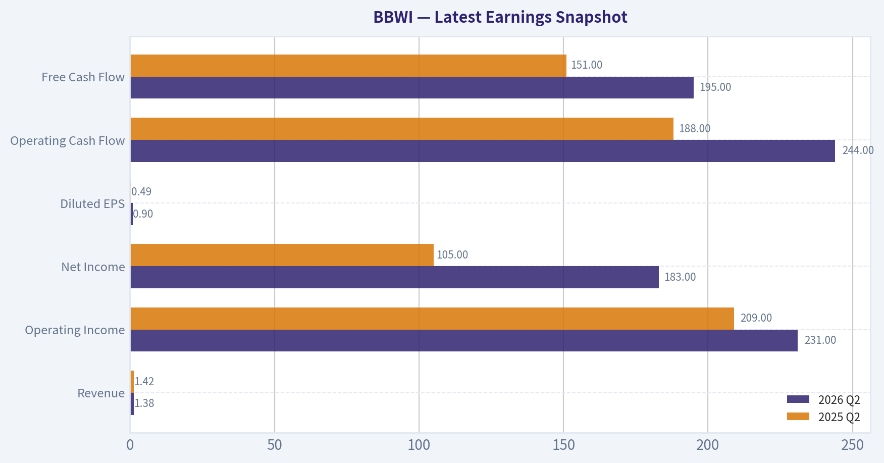

This comparison chart from *Balance Sheet and Financial Strength* stacks current figures against historical benchmarks for **BBWI**, making it easy to see where the company trades relative to its own averages.

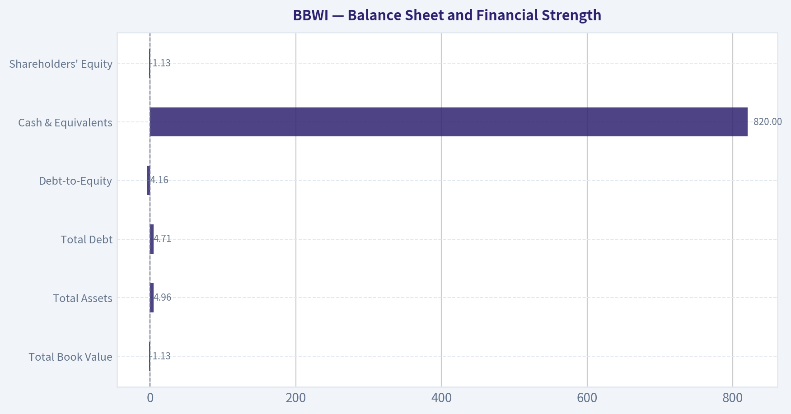

This comparison chart from *Financial Summary Snapshot* stacks current figures against historical benchmarks for **BBWI**, making it easy to see where the company trades relative to its own averages.

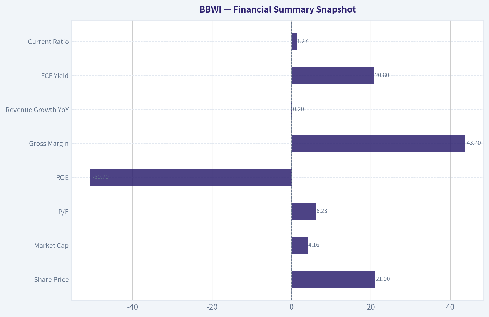

This comparison chart from *Owner Earnings Estimate* stacks current figures against historical benchmarks for **BBWI**, making it easy to see where the company trades relative to its own averages.

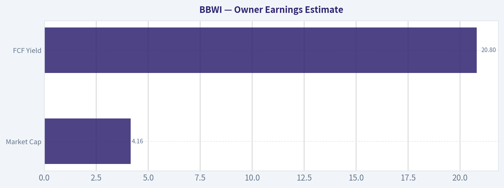

This comparison chart from *Three-Scenario DCF Valuation* stacks current figures against historical benchmarks for **BBWI**, making it easy to see where the company trades relative to its own averages.

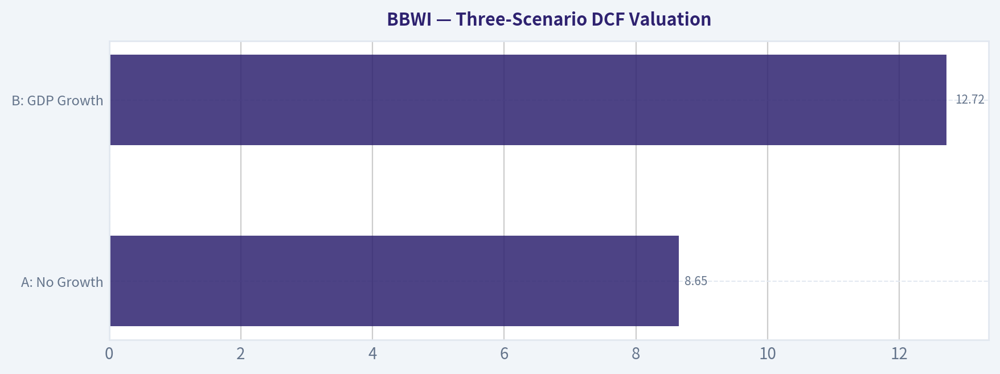

---

### Trend & Growth Analysis (Lynch/Druckenmiller/Fisher)

> *Following Peter Lynch's GARP, Stanley Druckenmiller's macro-aware approach, and Philip Fisher's scuttlebutt methodology.*

ANALYST STANCE: **AVOID**

#### BBWI Growth Analysis

BBWI does not fit a Lynch-style growth setup today. The shared research pack already gives enough to make progress, and the biggest issue is simple: **growth is absent**. For a Lynch/Druckenmiller/Fisher framework focused on inflection points and ten-bagger potential, BBWI currently looks more like a **cash-generating value/cyclical consumer brand** than a fast grower.

---

#### 1. Lynch Classification

| Metric | BBWI | Interpretation |
|---|---:|---|
| Revenue growth YoY | -0.2% | Not a grower |
| P/E | 6.2x | Cheap, but likely for a reason |
| Gross margin | 43.7% | Healthy brand economics |
| FCF yield | 20.8% | Strong cash generation |
| Market cap | $4.16B | Mid-cap |
| Current ratio | 1.27x | Adequate liquidity |

Key Takeaways: BBWI screens as a cheap, cash-generative retailer, but not as a growth stock. Revenue is slightly negative year over year, which disqualifies it from Lynch's fast grower bucket. This looks more like a mature consumer discretionary name than an emerging compounder.

**Classification:** **Stalwart / Cyclical retail hybrid**
For this mandate, that effectively means **not an initiate**.

---

#### 2. The Story in 3 Bullets

- Bath & Body Works sells fragrance, body care, soaps, and home products through a strong specialty retail brand.
- The bull case is that its loyal customer base, product refreshes, and high margins sustain strong cash flow.
- The problem is that **sales are not compounding**, so the story is currently about **stability and cash return**, not durable high growth.

---

#### 3. TAM Analysis with 10x Test

| Item | Estimate / Assessment |
|---|---|
| Current revenue base | Not provided in pack, but clearly mature-scale business |
| Category | Personal care / home fragrance / specialty retail |
| TAM direction | Large but highly competitive and mature |
| 10x test | Very unlikely in any realistic time frame |
| Market share path | Growth would likely come from share gains and category innovation, not new TAM creation |

Key Takeaways: BBWI operates in a large consumer category, but the market is mature rather than expanding at a venture-like pace. Even if the company performs well operationally, the odds of a true 10x revenue outcome appear low. That means the runway is limited for a growth investor, even if the business remains solid.

**Verdict:** **Fails the 10x growth runway test**

---

#### 4. Revenue Growth Trend

| Metric | Value | Assessment |
|---|---:|---|
| Latest YoY revenue growth | -0.2% | Negative |
| Growth pattern | Flat to slightly declining | No inflection evidence |
| Growth quality | Unknown from pack | Insufficient proof of acceleration |
| Lynch fast grower threshold | 15%-25%+ | Misses badly |

Key Takeaways: The most important number in a growth framework is revenue growth, and BBWI is currently below zero. That means there is no sign of a demand acceleration or business model inflection. Without top-line momentum, the stock does not meet the bar for a growth-focused recommendation.

**Assessment:** **Decelerated/flat, not accelerating**

---

#### 5. Unit Economics

| Metric | BBWI | Assessment |
|---|---:|---|
| Gross margin | 43.7% | Good for branded retail |
| FCF yield | 20.8% | Excellent cash generation |
| LTV/CAC | Not disclosed | Cannot assess |
| NRR | Not applicable / not disclosed | Retail model |
| Rule of 40 | Not applicable in standard form | More relevant to SaaS |

Key Takeaways: BBWI has respectable retail economics, especially on gross margin and free cash flow. However, these are the metrics of a mature branded retailer, not a software-like compounding machine. The business may be efficient, but efficiency alone is not enough when growth is missing.

**Bottom line:** Good operating economics, but **not growth-unit-economics driven**

---

#### 6. Inflection Point Assessment

| Inflection Type | Evidence | View |
|---|---|---|
| Product cycle inflection | New "Fruit Fusion" launch noted | Too early / not material enough yet |
| Market share inflection | No evidence provided | Unclear |
| Margin inflection | Not enough data | Unclear |
| TAM inflection | No | Unlikely |
| Competitive inflection | No clear catalyst | No evidence |

Key Takeaways: There is some product refresh activity, but nothing in the current data suggests a true business inflection. New product launches are normal in consumer retail and do not automatically change the earnings trajectory. For now, BBWI looks like a company managing the base business rather than entering a new growth phase.

**Conclusion:** **No confirmed inflection point**

---

#### 7. Macro Setup Evaluation

| Macro Factor | Assessment | Impact |
|---|---|---|
| Consumer discretionary demand | Mixed | Moderate risk |
| Rate backdrop | Lower rates help valuation, but not enough alone | Mild positive |
| Secular trend exposure | Weak | Negative for growth mandate |
| Category resilience | Fragrance/personal care somewhat resilient | Mild positive |

Key Takeaways: The macro backdrop is not disastrous, but it also is not creating a strong tailwind for explosive growth. BBWI is not clearly exposed to major secular growth themes like AI, cloud, healthcare innovation, or digital payments. That leaves the stock more dependent on execution and consumer spending cycles than on structural tailwinds.

**Macro view:** **Neutral to slightly supportive, but not a secular growth setup**

---

#### 8. Fisher 15 Points Score

| Fisher Dimension | Score (1-5) | Comment |
|---|---:|---|
| Market potential | 2 | Mature category |
| New product development | 3 | Ongoing launches, but not clearly transformative |
| R&D effectiveness | 2 | Consumer brand innovation, limited moat evidence |
| Sales organization | 4 | Strong merchandising/brand presence |
| Profit margin | 4 | Good gross margin profile |
| Improving margins | 2 | No evidence provided |
| Labor/personnel relations | 3 | No major signal |
| Executive relations | 3 | No major signal |
| Management depth | 3 | Insufficient evidence |
| Cost/accounting controls | 3 | No major concern from pack |
| Outstanding moat qualities | 3 | Brand strength, but limited hard moat |
| Long-range profit outlook | 2 | Stable, not clearly expanding |
| Dilution risk | 4 | No current red flag from pack |
| Candor in difficulties | 3 | Insufficient evidence |
| Integrity | 3 | No major issue cited |

| Total | Score |
|---|---:|
| Fisher Score | **44 / 75** |

Key Takeaways: BBWI scores as average to below-average for a Fisher growth lens. The brand and margins are positives, but the company lacks clear evidence of exceptional innovation, expanding market opportunity, or a superior long-range growth outlook. This score is more consistent with a mature cash cow than an emerging compounding growth story.

**Fisher rating:** **Below growth threshold**

---

#### 9. Valuation Analysis

| Valuation Metric | BBWI | Interpretation |
|---|---:|---|
| P/E | 6.2x | Very cheap |
| PEG | Not meaningful | No earnings growth input provided, revenue not growing |
| P/S | Not available from pack | N/A |
| FCF yield | 20.8% | Deep value/cash return profile |
| Street tone in pack | Equal-Weight, $22 PT | Market sees limited upside |

Key Takeaways: BBWI is cheap on traditional value measures, especially earnings and free cash flow. But a low multiple does not automatically create a growth opportunity. In this case, the valuation looks more like compensation for low growth and category maturity than a hidden fast grower.

**Valuation verdict:** **Cheap, but cheap-for-a-reason**

---

#### 10. Growth Investor Scorecard

| Criterion | Weight | Score (1-5) | Weighted Score |
|---|---:|---:|---:|
| The Story | 10% | 2.5 | 0.25 |
| TAM & Runway | 20% | 2.0 | 0.40 |
| Revenue Growth | 20% | 1.0 | 0.20 |
| Unit Economics | 15% | 3.5 | 0.53 |
| Competitive Position | 10% | 3.0 | 0.30 |
| Management Quality | 10% | 3.0 | 0.30 |
| Macro Setup | 5% | 3.0 | 0.15 |
| Profitability Path | 5% | 4.0 | 0.20 |
| Valuation | 5% | 4.0 | 0.20 |

| Total | Score |
|---|---:|
| Growth Investor Score | **2.53 / 5.00** |

Key Takeaways: BBWI gets some credit for profitability, cash generation, and low valuation. But the largest weighted category, revenue growth, scores poorly, and that drags the total down meaningfully. In a growth framework, the absence of accelerating sales is a major disqualifier.

**Decision Matrix Result:** **AVOID**

---

#### 11. Position Size Stance

| Stance | View |
|---|---|
| New position | Avoid |
| Existing holder | Hold only if pursuing value/cash flow thesis, not growth |
| Growth portfolio weight | 0% |

Key Takeaways: BBWI does not merit a position in a concentrated growth portfolio at this time. A value investor could still find the free cash flow yield attractive, but that is a different mandate. For this framework, the right position size is effectively zero.

---

#### 12. Key Risks and Catalysts

| Type | Item | Importance |
|---|---|---|
| Risk | Revenue stagnation continues | High |
| Risk | Consumer discretionary slowdown | High |
| Risk | Brand fatigue / promotional pressure | Medium |
| Risk | Limited TAM expansion | High |
| Catalyst | Successful new product franchises | Medium |
| Catalyst | Better-than-expected same-store sales | Medium |
| Catalyst | Margin resilience and buybacks | Medium |
| Catalyst | Multiple re-rating if growth returns | Low to Medium |

Key Takeaways: The biggest risk is that BBWI remains exactly what it appears to be today: a mature retailer with limited growth. The main upside catalysts would come from product innovation and a return to sustained positive comparable sales. Until that happens, the stock is more of a value rerating candidate than a true growth compounder.

---

#### Bottom Line

BBWI is **not a Lynch fast grower**, shows **no clear Druckenmiller-style inflection**, and earns only an **average Fisher score**. Its strengths are **brand equity, margin profile, and free cash flow**, but those do not offset the lack of revenue growth for a growth mandate.

For a **growth investor**: **AVOID**.
For a **value investor**: possibly worth separate work, but that is a different playbook.

---

### Market Technical Analysis

#### BBWI Technical Report

BBWI has staged a meaningful rebound from its May 2026 low near 16.1, but that recovery now sits inside a much larger bearish structure that still has not been fully repaired. The stock spent most of the past year in a persistent downtrend, including a severe breakdown in November 2025, and while the June rally was strong enough to reclaim the medium-term average, price remains above the 50-day trend line but still only marginally above the 200-day benchmark at the end of the dataset. That tells us the stock has improved tactically, but not yet fully transitioned into a durable long-term uptrend.

For this market context, the most relevant indicators are:

1. **close_50_sma** - medium-term trend direction and support.
2. **close_200_sma** - long-term trend filter.
3. **close_10_ema** - short-term momentum and pullback behavior.
4. **macd** - momentum regime shifts.
5. **macdh** - momentum acceleration/deceleration.
6. **rsi** - overbought/oversold and momentum cooling.
7. **atr** - volatility and risk calibration.
8. **vwma** - volume-confirmed trend quality.

These eight work well together because they cover trend across multiple horizons, momentum strength and change, volatility for position management, and volume confirmation. I avoided Bollinger components because ATR already captures volatility more directly for trade planning, and adding multiple Bollinger fields would be less efficient within the 8-indicator cap.

---

#### Price Structure and Trend Regime

Over the full 12-month period, BBWI shows three distinct phases:

- **July to November 2025:** steady deterioration from the low 30s into the low 20s, then a capitulation break in late November.
- **December 2025 to February 2026:** stabilization and partial repair, with price basing in the high teens to low 20s.
- **March to May 2026:** another leg lower into the mid-teens, followed by a sharp rebound through June.
- **Late June to early July 2026:** rally loses momentum and begins consolidating/pulling back from the 23.5 area.

The most important technical fact is that the June advance was strong enough to lift BBWI materially above both its short-term average and its 50-day average. However, that strength began fading into early July. Price fell from **23.50 on June 29** to **21.92 on July 6**, which is not a collapse, but it is a notable loss of upside follow-through after a very strong run.

This suggests BBWI is currently in a **post-breakout digestion phase**, not an outright bullish acceleration phase.

#### Trend Indicator Snapshot

| Indicator | Latest Reading | Interpretation |
|---|---:|---|
| Close (latest available) | 21.92 | Pullback from recent high of 23.50 |
| close_10_ema | 21.63 | Price remains slightly above short-term trend, but cushion is thin |
| close_50_sma | 19.40 | Medium-term trend has turned upward; price still above it |
| close_200_sma | 21.03 | Long-term trend still weak; price only modestly above it |
| vwma | 21.57 | Volume-weighted trend support sits close to market price |

Key Takeaways: BBWI is still above its key moving averages, which means the recent rebound has not fully broken down. But the margin above the 10-day EMA, 200-day SMA, and VWMA is now small, so the stock is no longer in a strong runaway trend. This is a market that needs to prove support, not one that is clearly extending higher.

---

#### Moving Averages: What They Say Now

The **50-day SMA** has improved from roughly **18.68 at the end of May** to **19.40 by July 7**, so the medium-term trend has clearly turned upward. That is constructive. It shows the June move was large enough to alter the intermediate trend slope rather than just produce a brief oversold bounce.

The **200-day SMA**, however, is still drifting down, falling from about **22.14 in late May** to **21.03 by July 7**. This matters because it signals the bigger trend damage from the prior year has not been fully erased. Even though price has climbed back above the 200-day line, the average itself is not yet rising. In practical terms, BBWI is trying to transition from bearish to neutral, but it has not yet earned a strong long-term bullish label.

The **10-day EMA** peaked around the turn of the month and then slipped from **21.86 on July 6 to 21.63 on July 7**, showing that short-term momentum is cooling faster than the slower averages. That is normal after a strong move, but traders should notice the shift: the fast trend is no longer expanding upward aggressively.

A useful way to interpret this stack is:

- **Bullish near term:** price above 10 EMA.
- **Constructive intermediate term:** price above 50 SMA.
- **Still fragile strategically:** 200 SMA declining, not rising.

That combination often describes an early-stage recovery or bear-market rally that could evolve into something better, but still requires confirmation.

---

#### Momentum: Strong Recovery, Now Decelerating

The **MACD** rose from negative territory in May to a strong positive reading of **1.12 on July 1**, then eased to **0.85 on July 7**. A positive MACD means the rebound remains real; the decline from the peak means the pace of that rebound is slowing.

The **MACD histogram** gives the clearest warning sign. It was strongly positive through late June, peaking near **0.43 on June 29**, then faded sharply and turned slightly negative at **-0.024 on July 7**. That is important because the histogram often weakens before the broader trend visibly breaks. In plain terms, upside momentum has not vanished, but it has stopped accelerating and has begun rolling over.

This creates a nuanced setup:

- Momentum is still **positive in level** because MACD itself remains above zero.
- Momentum is **negative in rate of change** because the histogram has crossed below zero.

That is typically what traders see during either:
1. a healthy consolidation before another leg up, or
2. the first stage of a deeper pullback.

The distinction will likely depend on whether BBWI can hold the 21.0-21.6 support zone around the 10 EMA / VWMA / 200 SMA cluster.

#### Momentum Indicator Snapshot

| Indicator | Latest Reading | Recent Behavior | Implication |
|---|---:|---|---|
| macd | 0.85 | Down from 1.12 on July 1 | Bullish momentum still present, but fading |
| macdh | -0.024 | Turned negative after strong positive June run | Early warning of momentum slowdown |
| rsi | 50.0 | Down from 71.1 on June 29 | Overbought condition fully cooled to neutral |

Key Takeaways: BBWI's momentum is no longer overheated, which removes some of the risk of an immediate exhaustion top. At the same time, momentum has clearly cooled, and the negative MACD histogram says buyers are no longer in full control. The stock is now at a decision point rather than in a clean impulse phase.

---

#### RSI: From Overbought to Neutral Very Quickly

The **RSI** moved from about **31.8 on May 19** to **71.1 on June 29**, which was an impressive momentum reversal. That kind of shift usually confirms a genuine price thrust rather than a weak bounce.

But the next move is just as revealing: RSI dropped back to **50.0 by July 7**. That is a very fast normalization. It tells us two things:

1. The prior overbought reading has been fully worked off.
2. The stock is no longer stretched to the upside, so a renewed advance is still possible if support holds.

Neutral RSI around 50 is often a battleground zone. In a healthy uptrend, RSI typically stabilizes around the 45-55 area during pullbacks before turning back up. In weaker recoveries, RSI loses 50 and trends toward the low 40s or 30s as price rolls over again.

So RSI here is not giving a directional signal by itself. Instead, it is telling traders to watch for the next turn:
- **RSI reclaiming 55-60** would support another upside leg.
- **RSI slipping under 45** would argue the June rally is failing.

---

#### Volume Confirmation: VWMA Still Supportive

The **VWMA** rose from about **18.25 on May 27** to **21.57 on July 7**, confirming that the rebound has been supported by meaningful traded volume rather than only light participation. This is one of the more constructive features in the chart.

Because the latest close at **21.92** sits only modestly above the **VWMA at 21.57**, price is still holding above its volume-weighted trend line, but not by much. That means buyers still have a technical edge, though it is narrowing.

When price remains above VWMA after a strong rally, it often suggests institutions or higher-conviction participants have not fully exited. But if price breaks below VWMA and cannot reclaim it quickly, that often signals the rebound is losing sponsorship.

For BBWI, VWMA is especially useful now because it sits near other important levels:
- **10 EMA: 21.63**
- **VWMA: 21.57**
- **200 SMA: 21.03**

That creates a compact support shelf. If this zone holds, the pullback may simply be a reset. If it breaks decisively, the probability of a retest toward the 50-day SMA near **19.40** rises.

---

#### Volatility and Risk Management

The **ATR** has risen from around **0.91 on May 26** to **1.18 on July 7**. This indicates that even though BBWI recovered, its daily trading range has expanded. So traders should not treat this as a low-volatility trend stock.

At a price near **21.92**, an ATR of **1.18** implies average daily movement of roughly **5.4%** of share price. That is meaningful. It means:

- Stops that are too tight are vulnerable to normal noise.
- Position sizing should be adjusted down relative to lower-volatility names.
- Breakout entries need room to work.

ATR rising during and after a rebound can mean two different things:
- healthy repricing and renewed interest, or
- unstable price discovery in a fragile recovery.

Given the momentum slowdown, the second interpretation cannot be ignored. Traders should assume BBWI can move sharply in either direction over the next several sessions.

#### Volatility and Support Map

| Level / Indicator | Approx. Value | Why It Matters |
|---|---:|---|
| Recent swing high | 23.50 | Near-term resistance after June rally |
| Short-term support zone | 21.57-21.63 | VWMA and 10 EMA cluster |
| Long-term trend test | 21.03 | 200 SMA, key regime line |
| Medium-term support | 19.40 | 50 SMA, deeper pullback support |
| ATR | 1.18 | Suggests wide daily movement and need for looser risk parameters |

Key Takeaways: BBWI now sits very close to an important support cluster around 21 to 21.6. If buyers defend that area, the stock can stay in consolidation and potentially rebuild for another move higher. If that zone breaks, the next meaningful downside magnet is much lower near the 50-day average around 19.4, and ATR suggests that move could happen quickly.

---

#### Trading Interpretation by Style

| Style | Bias | What to Watch |
|---|---|---|
| Short-term momentum trader | Neutral to mildly bullish | Needs reclaim of momentum, ideally price back above 22.4-22.8 with histogram improving |
| Swing trader | Constructive but cautious | Bullish while above 21.0-21.6 support cluster; caution if that fails |
| Position trader | Watchful / not fully confirmed | Price above 200 SMA helps, but falling 200 SMA still warns long-term trend repair is incomplete |
| Risk-focused trader | Defensive sizing | ATR is elevated, so smaller position sizes and wider stops are warranted |

Key Takeaways: Different trading styles should read BBWI differently right now. Fast traders may still find opportunity if momentum re-accelerates, while longer-term traders should wait for stronger evidence that the stock has truly reversed its larger downtrend. Elevated volatility means discipline on size and stop placement matters more than usual.

---

#### Bottom Line

BBWI has improved substantially from its May lows and remains technically better than it looked a month ago. The medium-term trend has turned up, price is still above the 50-day SMA, and the rebound has been supported by volume. Those are real positives.

However, the current setup is no longer a clean momentum breakout. The rally has cooled sharply, RSI has normalized from overbought to neutral, and the MACD histogram has slipped negative. The stock is now testing whether its June advance can transition into a stable base above the 200-day SMA and VWMA.

The most actionable conclusion is this:

- **Above 21.0-21.6:** BBWI remains in constructive consolidation and could still attempt another move toward 23.5.
- **Below 21.0:** the rebound becomes more vulnerable, with increased risk of a deeper retracement toward the 50-day SMA near 19.4.
- **To become structurally bullish:** BBWI likely needs not only price above the 200-day SMA, but also a flattening and eventual upturn in that 200-day line.

#### Summary Table

| Theme | Observation | Trading Implication |
|---|---|---|
| Long-term trend | 200 SMA still declining despite price reclaim | Recovery is real, but long-term reversal is not fully confirmed |
| Medium-term trend | 50 SMA rising and price above it | Intermediate trend has improved materially |
| Short-term trend | 10 EMA still below price, but flattening | Pullback is manageable so far, but momentum has cooled |
| Momentum | MACD positive, histogram slightly negative | Uptrend is decelerating; watch for either re-acceleration or breakdown |
| RSI | Fell from overbought to neutral 50 | Excess froth cleared; next move from neutral matters |
| Volume confirmation | Price still above VWMA | Rebound still has some volume support |
| Volatility | ATR elevated near 1.18 | Wider stops and smaller sizing are appropriate |
| Key levels | Support 21.0-21.6, resistance 23.5 | Current range will likely determine next swing |

Key Takeaways: BBWI is in a technically improved but fragile position. The stock has recovered enough to look better on medium-term trend measures, yet momentum has cooled and long-term trend confirmation is still lacking. The area just above 21 dollars is the key battleground that likely decides whether this becomes a durable recovery or only a fading rebound.

---

### Options Market Analysis

> *Reading options flow - put/call ratios, IV skew, and unusual activity - to gauge institutional positioning and event-driven risk.*

#### BBWI Options Positioning Report
*Date: 2026-07-07*

BBWI's near-term options tape is showing a **bullish directional bias**, but with an important caveat: **the chain appears unusually thin/incomplete on open interest**, which lowers confidence. Volume is clearly call-dominant across the next three weekly expirations, while implied volatility is low and skew does not show meaningful downside panic. That combination usually points more toward **speculative upside interest or tactical call positioning** than institutional hedging demand.

#### Near-Term Put/Call Ratio Analysis

| Expiration | Call Volume | Put Volume | Volume Put/Call Ratio | Call OI | Put OI | OI Put/Call Ratio |
|---|---:|---:|---:|---:|---:|---:|
| 2026-07-10 | 318 | 110 | 0.35 | 0 | 0 | N/A |
| 2026-07-17 | 1,391 | 152 | 0.11 | 0 | 0 | N/A |
| 2026-07-24 | 61 | 80 | 1.31 | 0 | 0 | N/A |
| **Near-term total** | **1,770** | **342** | **0.19** | **0** | **0** | **N/A** |

**Key Takeaways:** Near-term flow is overwhelmingly call-heavy, with an aggregate put/call **volume** ratio of **0.19**, far below the roughly neutral **0.7** baseline. That is a strong sign of upside-oriented trading in the very short term. However, because reported open interest is zero across these expirations, we cannot confirm whether this is sustained institutional positioning or just short-lived speculative flow.

**Interpretation:**
- A **0.19 put/call volume ratio** is materially below neutral and indicates **buyers are favoring calls over puts**.
- That typically maps to **bullish speculation**, though on some tickers it can also reflect **covered call overwriting**.
- Given the very short-dated nature of the activity, this looks more like **tactical upside positioning** than fear-driven protection.
- The lack of usable OI data is a major limitation; normally, OI helps distinguish fresh positioning from temporary volume bursts.

---

#### Implied Volatility Assessment

| Expiration | ATM Call IV | ATM Put IV | IV Read |
|---|---:|---:|---|
| 2026-07-10 | 4.7% | 3.9% | Calls richer than puts |
| 2026-07-17 | 2.3% | 2.0% | Slight call premium |
| 2026-07-24 | 1.6% | 1.6% | Flat |
| **Near-term trend** | - | - | **Low IV, no strong stress signal** |

**Key Takeaways:** Implied volatility is very subdued in the near term, and calls are priced slightly richer than puts in the front expirations. That is not the pattern you usually see when traders are scrambling for downside protection. Instead, the market appears calm, with a mild tilt toward upside optionality.

**IV skew interpretation:**
- The supplied data does **not show steep put skew**.
- In fact, front-week **call IV is modestly above put IV**, which can signal **upside chasing** or short-dated call demand.
- A classic defensive setup would show OTM puts priced much richer than calls; that is **not evident here**.
- IV also does **not appear elevated ahead of a major catalyst**, at least based on the near-term ATM readings provided.

---

#### Unusual Options Activity

| Screen Result | Observation |
|---|---|
| Volume > 5x OI contracts | None detected in near-term expirations |

**Key Takeaways:** There were no flagged contracts where volume exceeded five times open interest, so there is no obvious "fresh large bet" standing out from the near-term tape. That does not mean nothing is happening; it simply means there is no single contract printing with enough relative size to qualify as unusual by this screen.

**Interpretation:**
- No clean, standout unusual flow means there is **less evidence of concentrated smart-money conviction** in a specific strike/expiry.
- The bullish read comes more from **broad call-heavy aggregate volume** than from a notable block/sweep in one contract.
- Because OI is unavailable/zero, confidence in separating **institutional positioning vs. retail speculation** is lower than usual.

---

#### Open Interest Concentration and Gamma Considerations

| Area | Observation |
|---|---|
| Highest OI strikes | Not available from returned data |
| Highest OI expirations | Not available from returned data |
| Gamma wall / pin risk | Cannot be confirmed due to missing OI detail |
| Max pain / gravitational levels | Not reliably inferable |

**Key Takeaways:** The open-interest portion of the chain is not usable here, so strike-level pinning and gamma-wall analysis cannot be done with confidence. That means we should avoid over-interpreting specific price magnets into expiry.

**Interpretation:**
- Normally, the highest OI strikes can act as **magnetic levels** into weekly expiration.
- Here, with OI reported as zero across the near-term set, we **cannot identify pinning zones or gamma walls reliably**.
- This reduces the precision of any near-term options-based price-level forecast.

---

#### Overall Options Sentiment Signal

| Signal | Confidence | Primary Driver |
|---|---|---|
| **BULLISH** | **Moderate-Low** | Strongly call-dominant near-term volume, low put demand, no downside-fear skew |

**Key Takeaways:** The options market leans bullish on BBWI right now, primarily because traders are overwhelmingly favoring calls over puts in the next few expirations. Confidence is not high because the open-interest data is incomplete, which limits the ability to confirm whether institutions are building durable positions.

**Synthesis:**
BBWI's options tape gives a **BULLISH** signal based on the information available. The strongest evidence is the **0.19 aggregate put/call volume ratio**, which is far below neutral and suggests **upside-oriented participation**. Just as important, **IV is low and not showing defensive put skew**, so the market does not appear to be paying up for downside protection. The main caveat is **thin/incomplete OI data**, which means this signal should be treated as a **short-term flow read**, not a high-conviction institutional positioning call.

#### Summary Table

| Category | Reading | Interpretation |
|---|---|---|
| Put/Call Ratio | Volume P/C = **0.19**; OI P/C = **N/A** | Strong call bias vs. neutral ~0.7 baseline |
| IV Level | **Low** near-term ATM IV | No major event premium or stress pricing visible |
| Skew Direction | **Slight call skew / flat**, not put-skewed | Little evidence of downside fear |
| Unusual Activity | **None flagged** | No standout fresh high-conviction contract |
| Overall Signal | **BULLISH** | Call-heavy short-dated flow is the main driver |

**Key Takeaways:** BBWI's options signal is bullish, but mainly because of short-dated call activity rather than a robust institutional footprint. With incomplete open-interest data, the best way to use this is as a short-term sentiment input, not a standalone trading thesis.

---

## Research Team Commentary

> *The Research Manager synthesizes the Bull vs Bear debate into action-free commentary. This is a pre-risk view, not the final stance.*

The strongest bull argument is straightforward: BBWI is priced like a damaged retailer, but the current economics still look very strong. A roughly 6.2x P/E and about a 20.8% FCF yield are unusually cheap for a branded consumer business with 43.7% gross margin, 12.8% ROA, and reported 50% ROIC. If the business is merely stable rather than shrinking badly, the market is likely over-discounting its future. The bull case also correctly frames BBWI as a repeat-purchase, affordable-luxury brand with gifting and replenishment behavior that can support resilient cash generation even without much growth. In Buffett terms, you do not need a heroic growth story if owner earnings remain solid and management allocates cash intelligently.

The strongest bear argument is that this may be cheap for a reason. BBWI's categories have low switching costs, trend sensitivity, and constant promotional and merchandising demands. That is a much softer moat than the bull implies. The negative ROE and very high ROIC may also reflect capital structure and a harvested business model more than pristine underlying economics. Most importantly, if recent free cash flow is above normalized levels, then the apparently huge valuation discount may narrow quickly. Buffett-style investing is not about buying statistically cheap retailers with decent brands; it is about buying durable businesses with highly predictable earnings streams. BBWI does not clearly clear that bar.

My takeaway is that the business is better than the market multiple suggests, but not so durable or predictable that I can call it a high-conviction Buffett-style bargain yet. This is where I want to apply the lesson from past mistakes carefully. In FFIV, the error was over-weighting long-term uncertainty despite strong current evidence. Here, I do not want to overcorrect and force a bullish call just because the valuation is optically low. Unlike FFIV, there is no clear business-model improvement, no obvious rerating catalyst in the handoff, and the main thesis depends heavily on cash-flow durability in a soft-moat retail category. On the other hand, the LULU lesson also matters: cheap consumer brands can remain cheap if growth and franchise confidence keep fading. So the right stance is WATCH, not because BBWI lacks value appeal, but because the margin of safety depends too much on whether current cash generation is sustainable.

Core takeaway: BBWI looks like a plausible value opportunity, but not yet a Buffett-grade one. The stock is cheap enough to deserve attention, and the current cash economics are too strong to dismiss. But the moat is narrow, growth is stagnant, and the market's skepticism about normalized earnings power may be justified. This is a potentially mispriced cash cow, not a clearly durable compounder.

Rationale: From a value investing perspective, I like the low multiple, high cash generation, and evidence that the brand still commands decent economics. Those are real positives. But Buffett's framework starts with business quality and predictability, not just cheapness. BBWI's categories are vulnerable to changing tastes, competitive fragmentation, and promotion-driven behavior. That makes intrinsic value less stable than the bull case assumes. When valuation relies on recent FCF holding up, and the moat is not especially hard, I need more proof before advocating capital aggressively. In other words, this may be undervalued, but I cannot yet say the discount is wide enough relative to the uncertainty.

Monitoring plan over the next 1-4 quarters: First, watch revenue and comparable sales closely. If sales remain flat to modestly positive without heavier promotions, that supports the "stable franchise" case. If comps weaken materially, the bear thesis gains traction. Second, monitor gross margin. Holding around current levels would suggest the brand still has pricing and merchandising strength; sharp compression would signal that recent economics were less durable than they looked. Third, watch free cash flow conversion and whether cash generation remains robust after working-capital noise. If FCF stays strong, the valuation case improves materially. Fourth, pay attention to debt reduction versus buybacks. In a mature retailer, I would prefer prudent balance-sheet strengthening over aggressive financial engineering. Fifth, listen for evidence of customer retention, category strength in core products, and whether innovation is sustaining repeat purchase rather than just generating episodic promotional spikes. Finally, from a market-behavior standpoint, I would want to see whether the stock can establish technical stability above key medium-term trend levels; I do not want to ignore timing and sentiment the way I did in prior misses.

If the next few quarters show stable comps, resilient margins, and sustained FCF without balance-sheet strain, this could move toward ADVOCATE because the current valuation leaves room for significant upside. But if sales soften, promotions rise, or cash flow drops toward a much lower normalized level, then the cheapness is probably a trap, and the stance would shift toward AVOID.

Final stance: WATCH.

---

## Value Investing Team Commentary

> *The Investor translates the research view into an investment thesis before risk review. This is still not the final stance.*

BBWI is interesting precisely because it sits in the uncomfortable middle ground that often creates value: too cheap to ignore, but not obviously durable enough to embrace blindly.

At roughly 6.2x earnings and a 20.8% FCF yield, the market is clearly pricing in skepticism. That usually means one of two things: either the business is structurally deteriorating, or investors are extrapolating too much pessimism onto a still-healthy cash generator. For a value investor, that is the right place to look. The question is not whether BBWI is statistically cheap-it is. The question is whether its cash economics are durable enough that today's price offers a real margin of safety.

The bullish case has merit. Bath & Body Works has a recognizable brand, repeat-purchase behavior, affordable price points, gifting relevance, and historically strong merchandise margins. Those are useful qualities, especially in a softer consumer environment. "Affordable indulgence" can be more resilient than the market expects when budgets are tight. A customer may cut back on larger discretionary purchases while still buying soaps, candles, fragrance, and seasonal gifts. If that pattern holds, then the market may be misclassifying BBWI as a melting-ice-cube retailer when it is actually a stable franchise with solid owner earnings.

But a Buffett-style investor must be careful not to confuse good current economics with a great business. BBWI's moat appears narrower than the valuation alone suggests. Switching costs are low. Fashion and scent preferences change. Promotions matter. Competitive entry is not especially difficult. This is not a regulated utility, payment network, or dominant software platform. It is a branded specialty retailer with real strengths, but also real fragility. That matters because the entire cheapness thesis depends on normalized cash flow remaining relatively intact.

The reported metrics need interpretation, not just admiration. Negative ROE and very high ROIC can reflect a heavily optimized capital structure and shareholder distributions, not necessarily pristine business superiority. Those figures do not automatically mean the franchise is exceptional. In fact, they may partly indicate a mature business being financially harvested. That does not make it unattractive-but it does mean the investor must underwrite the operations, not the headline ratios.

Selective contrarian thinking points to the key opportunity: sentiment may be overly anchored to the idea that all mall-adjacent or specialty retail names deserve depressed multiples. Markets often flatten distinctions during periods of consumer caution. If BBWI can merely prove "not deteriorating," the stock could rerate meaningfully because the starting valuation is so low. In other words, the contrarian angle is not that BBWI is secretly a wonderful compounder. It is that the market may be demanding too much evidence before recognizing a decent business with stable cash generation.

At the same time, selective contrarianism also warns against reflexive bargain-hunting. Sometimes low multiples in consumer retail are perfectly rational. If same-store sales soften, promotions increase, or gross margin slips, then today's cheap valuation may simply be discounting tomorrow's lower earnings base. The market may be saying that current FCF is cyclical, not durable. That is exactly the risk here.

So what matters most over the next few quarters is simple:
- Are sales stable to modestly positive?
- Are gross margins holding without obvious promotional pressure?
- Is free cash flow still strong after normalizing working capital?
- Is management allocating capital conservatively, especially on debt versus buybacks?
- Does customer behavior still show repeat demand in core categories rather than event-driven spikes?

If those answers come back favorably, BBWI could shift from "optically cheap retailer" to "stable cash cow priced too pessimistically," which is often a rewarding setup. But until that evidence is clearer, this remains more of a hypothesis than a conviction.

From a long-term business ownership perspective, I would not call BBWI a Buffett-grade franchise today. It may still be undervalued, but the moat is not strong enough and earnings predictability is not high enough to rely on valuation alone. This is a situation where patience has value. Let the business prove that recent cash generation is durable.

**ANALYST STANCE: WATCH**
BBWI deserves close attention because the valuation is compelling and sentiment may be too negative for a still-profitable cash generator. However, the business lacks the clear moat and predictability required for a strong value-investing endorsement today. Watch for stable comps, resilient margins, and sustained free cash flow; if those hold, the current price could prove meaningfully undervalued.

---

## Deep Values Commentary

> *The Risk Management Team debates and the Risk Judge provides the final action-free verdict. This section determines the final ADVOCATE / WATCH / AVOID stance.*

#### Final Stance Scorecard

This scorecard converts the final research view into a weighted decision frame. It does not replace the narrative judgement, but it makes the main drivers of the verdict easier to scan.

| Criterion | Score | Weight | Commentary |
| --- | ---: | ---: | --- |
| Business Quality | 2.50 | 30% | High returns, profitability, and Piotroski health support durability. |
| Valuation Support | 5.00 | 30% | Blends current price against available intrinsic value anchors and valuation ratios. |
| Financial Strength | 3.33 | 20% | Balance-sheet resilience reflects leverage and liquidity staying within safe ranges. |
| Growth Durability | 2.33 | 20% | Recent revenue, earnings, and free cash flow growth indicate how durable expansion looks. |
| TOTAL / FINAL STANCE | 3.38 | 100% | WATCH |

#### Key Takeaways

The weighted score lands at **3.38 / 5.0**, while the final stance remains **WATCH**. This is useful as a quick calibration aid rather than a mechanical signal.

#### Risk Summary

Higher scores indicate more risk pressure. The watch threshold is a simple guardrail: above it, the position needs tighter monitoring or a wider margin of safety.

| Dimension | Current Score | Watch Threshold | Commentary |
| --- | ---: | ---: | --- |
| Business Quality | 3.50 | 3.00 | High returns, profitability, and Piotroski health support durability. |
| Valuation Support | 1.00 | 3.00 | Blends current price against available intrinsic value anchors and valuation ratios. |
| Financial Strength | 2.67 | 3.00 | Balance-sheet resilience reflects leverage and liquidity staying within safe ranges. |
| Growth Durability | 3.67 | 3.00 | Recent revenue, earnings, and free cash flow growth indicate how durable expansion looks. |

#### Key Takeaways

This view helps readers separate *where* the risk sits: valuation, business quality, balance sheet, or growth durability. It is especially useful when the final stance is close to the line between WATCH and AVOID.
