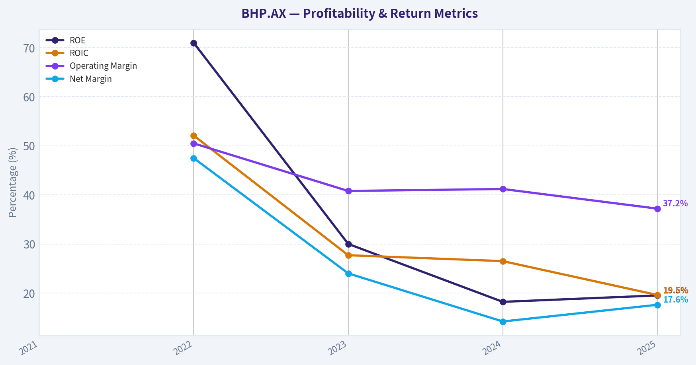
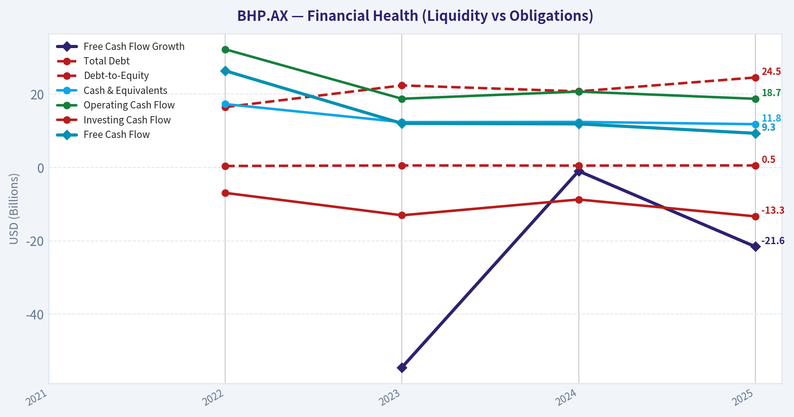
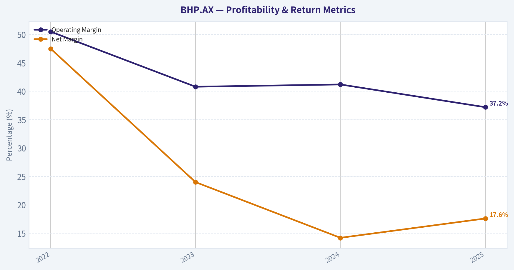
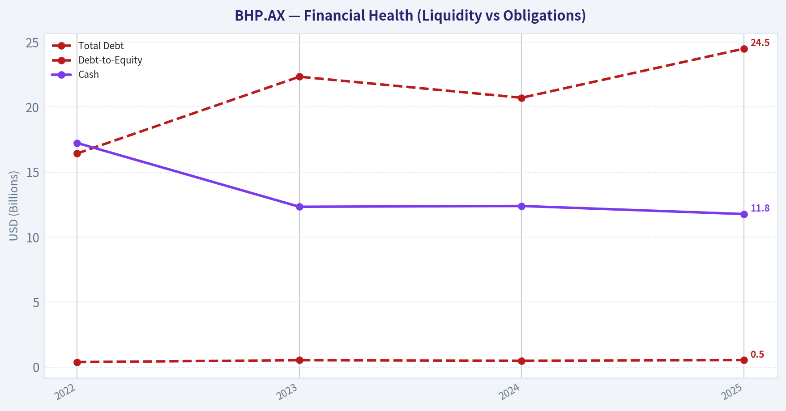
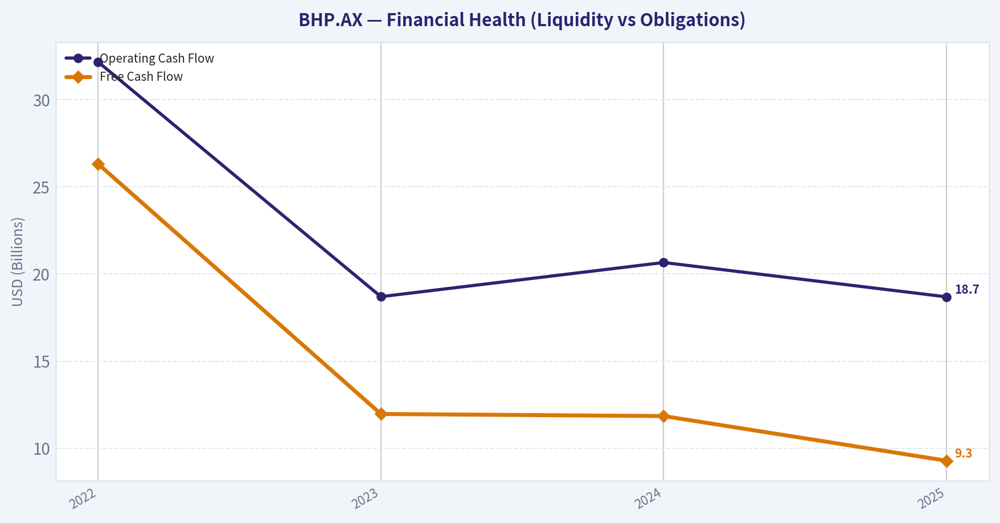
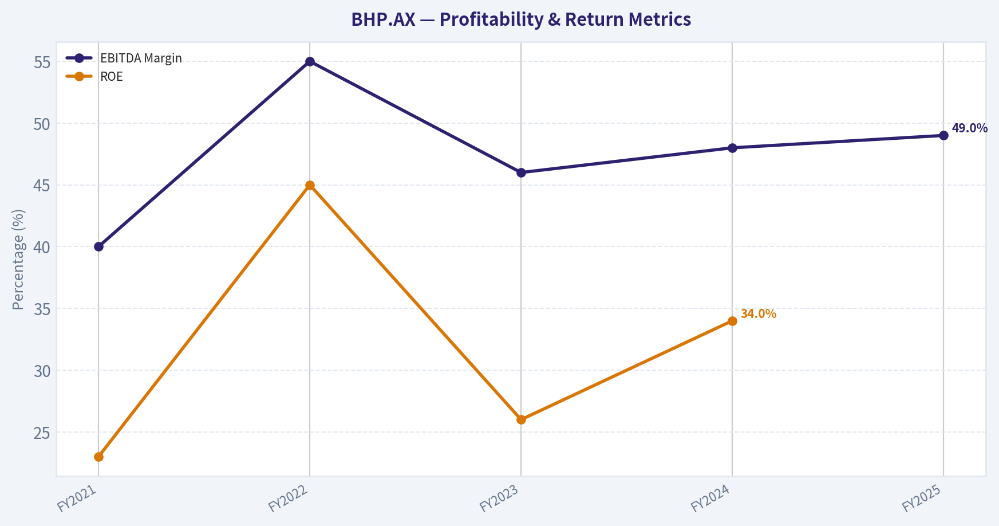
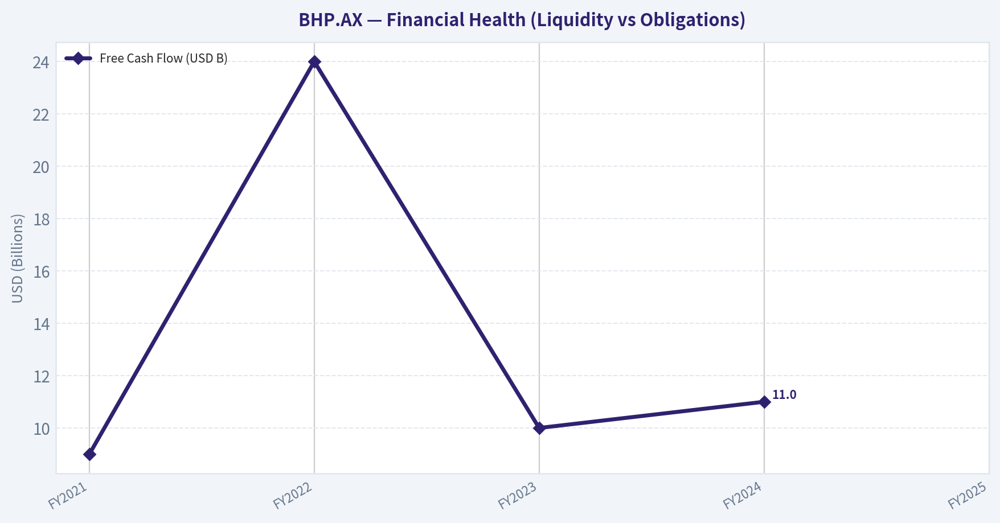
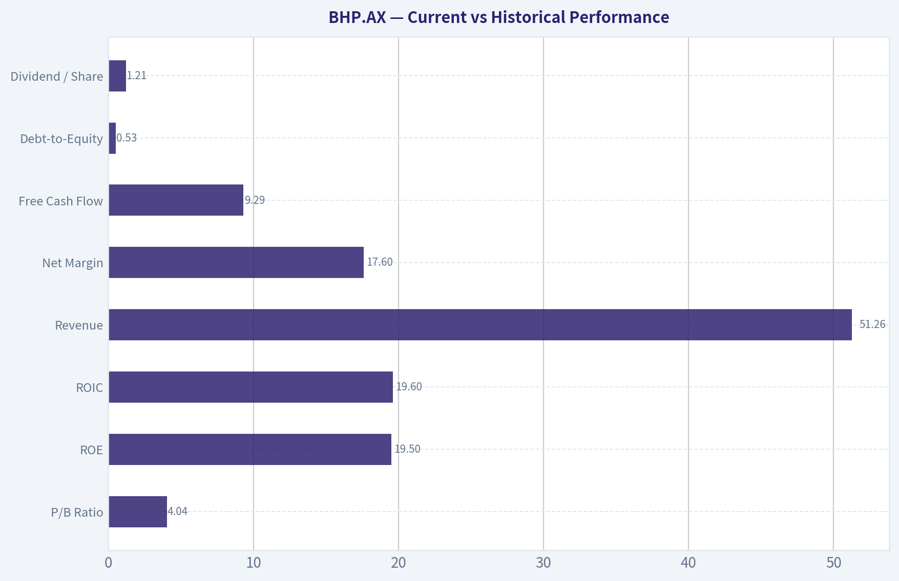

# BHP.AX Deep Value Intelligence

**Analysis Date:** 2026-03-27

## Critical Disclaimer

*This analysis is generated by Deep Value Intelligence, an AI-powered multi-agent investing framework. This report is for informational and educational purposes only and does not constitute financial advice. Always conduct your own research and consult with qualified financial advisors before making investment decisions.*

---

## Table of Contents

1. Intelligence Summary
2. Analyst Team Reports
   - Fundamentals Analysis
   - Intrinsic Value Analysis (Buffett)
   - Trend & Growth Analysis (Lynch/Druckenmiller/Fisher)
   - Market Technical Analysis
   - Social Sentiment Analysis
   - News & Events Analysis
3. Research Team Commentary
4. Value Investing Team Commentary
5. Deep Values Commentary

---

## Intelligence Summary

### Thesis + Conditions

**Core Thesis:** Executive Summary
BHP is a high-quality operator with world-class mining assets and strong profitability, but it remains fundamentally tied to volatile commodity cycles. The debate confirms that while BHP's cost leadership and copper exposure offer long-term strategic value, current valuation leaves little margin of safety for a Buffett-style investor.

**Key Risks:**
- BHP is a high-quality operator with world-class mining assets and strong profitability, but it remains fundamentally tied to volatile commodity cycles. The debate confirms that while BHP's cost leadership and copper exposure offer long-term strategic value, current valuation leaves little margin of safety for a Buffett-style investor. Declining free cash flow and heavy capital spending add uncertainty. The prudent approach is patience: the business is strong, but the price does not yet compensate for cyclical risk. Final stance: WATCH.
- Risky Analyst
- The cautious argument highlights the nature of commodity industries. Profitability is primarily dictated by commodity prices rather than operational excellence. Current high returns likely reflect favorable pricing conditions rather than durable economics. Revenue and free cash flow are already declining, and mining requires massive capital investment with long payback periods. Projects like Jansen potash introduce execution and timing risk. Iron ore-still a major earnings driver-remains heavily exposed to Chinese steel demand, which faces structural headwinds. Most importantly, valuation models suggest intrinsic value materially below the current price, leaving little margin of safety.
- The balanced perspective recognizes both structural demand and cyclical risk. BHP's cost leadership and asset quality provide resilience, but not immunity from commodity cycles. Copper supply constraints may indeed tighten, yet valuation signals suggest the market has already priced in some optimism. The key concern is free cash flow deterioration combined with heavy expansion spending. The neutral view suggests that while the business merits attention, the correct strategy is disciplined entry timing or staged exposure rather than aggressive buying at current prices.
- Risk Commentary Through a Buffett Lens

**What Would Change Our View:**
- BHP is a high-quality operator with world-class mining assets and strong profitability, but it remains fundamentally tied to volatile commodity cycles. The debate confirms that while BHP's cost leadership and copper exposure offer long-term strategic value, current valuation leaves little margin of safety for a Buffett-style investor. Declining free cash flow and heavy capital spending add uncertainty. The prudent approach is patience: the business is strong, but the price does not yet compensate for cyclical risk. Final stance: WATCH.
- Risky Analyst
- The cautious argument highlights the nature of commodity industries. Profitability is primarily dictated by commodity prices rather than operational excellence. Current high returns likely reflect favorable pricing conditions rather than durable economics. Revenue and free cash flow are already declining, and mining requires massive capital investment with long payback periods. Projects like Jansen potash introduce execution and timing risk. Iron ore-still a major earnings driver-remains heavily exposed to Chinese steel demand, which faces structural headwinds. Most importantly, valuation models suggest intrinsic value materially below the current price, leaving little margin of safety.
- The balanced perspective recognizes both structural demand and cyclical risk. BHP's cost leadership and asset quality provide resilience, but not immunity from commodity cycles. Copper supply constraints may indeed tighten, yet valuation signals suggest the market has already priced in some optimism. The key concern is free cash flow deterioration combined with heavy expansion spending. The neutral view suggests that while the business merits attention, the correct strategy is disciplined entry timing or staged exposure rather than aggressive buying at current prices.
- Risk Commentary Through a Buffett Lens

**Confidence:** Low

---

## Analyst Team Reports

### Fundamentals Analysis

#### 10-Year Financial Metrics for BHP.AX

*All values below are computed deterministically from raw data - not estimated by AI.*

*Issuer profile: operating company (Basic Materials / Other Industrial Metals & Mining).*

#### 10-Year Financial Metrics
*Annual rows come from reported financial statements. The final TTM row is computed from the latest four quarters.*

| Metric | 2021 | 2022 | 2023 | 2024 | 2025 |
| --- | --- | --- | --- | --- | --- |
| Market Price | $30 | $33 | $39 | $39 | $35 |
| Market Cap | N/A | $209.18B | $228.23B | $216.69B | $186.80B |
| P/E Ratio | N/A | 6.77 | 17.66 | 27.45 | 20.72 |
| P/B Ratio | N/A | 4.81 | 5.30 | 5.00 | 4.04 |
| ROE | N/A | 71.0% | 30.0% | 18.2% | 19.5% |
| ROIC | N/A | 52.1% | 27.7% | 26.5% | 19.6% |
| EPS | N/A | $4.81 | $2.21 | $1.42 | $1.70 |
| Revenue | N/A | $65.10B | $53.82B | $55.66B | $51.26B |
| Gross Profit | N/A | $50.18B | $37.90B | $40.55B | $36.73B |
| Gross Margin | N/A | N/A | N/A | N/A | N/A |
| Operating Margin | N/A | 50.5% | 40.8% | 41.2% | 37.2% |
| Net Income | N/A | $30.90B | $12.92B | $7.90B | $9.02B |
| Net Margin | N/A | 47.5% | 24.0% | 14.2% | 17.6% |
| Revenue Growth | N/A | N/A | -17.3% | 3.4% | -7.9% |
| Net Income Growth | N/A | N/A | -58.2% | -38.9% | 14.2% |
| Free Cash Flow Growth | N/A | N/A | -54.5% | -1.0% | -21.6% |
| Total Book Value | N/A | $43.52B | $43.05B | $43.37B | $46.23B |
| Total Assets | N/A | $95.17B | $101.30B | $102.36B | $108.79B |
| Total Debt | N/A | $16.43B | $22.34B | $20.72B | $24.50B |
| Debt-to-Equity | N/A | 0.38 | 0.52 | 0.48 | 0.53 |
| Cash & Equivalents | N/A | $17.24B | $12.33B | $12.39B | $11.77B |
| Shareholders' Equity | N/A | $43.52B | $43.05B | $43.37B | $46.23B |
| Operating Cash Flow | N/A | $32.17B | $18.70B | $20.66B | $18.69B |
| Investing Cash Flow | N/A | $-6.96B | $-13.06B | $-8.76B | $-13.35B |
| Free Cash Flow | N/A | $26.32B | $11.97B | $11.85B | $9.29B |
| FCF Margin | N/A | 40.4% | 22.2% | 21.3% | 18.1% |
| Dividends / Share | N/A | $2.78 | $2.27 | $1.38 | $1.21 |

#### Profitability Metrics
- Return on Equity (ROE): 19.5%
- Return on Invested Capital (ROIC): 19.6%
- Return on Assets (ROA): 8.3%
- Gross Margin: 71.7%
- Operating Margin: 37.2%
- Net Profit Margin: 17.6%

#### Liquidity Metrics
- Current Ratio: 1.46
- Quick Ratio: 1.03

#### Leverage Metrics
- Debt-to-Equity Ratio: 0.53
- Interest Coverage Ratio: 10.18
- Net Debt: $12.73B

#### Growth Metrics (Year-over-Year)
- Revenue Growth: -7.9%
- Net Income Growth: 14.2%
- Free Cash Flow Growth: -21.6%
- Revenue CAGR (3-Year): -7.7%
- Revenue CAGR (5-Year): N/A

#### Valuation Metrics
- P/E Ratio (TTM): 17.37
- Forward P/E: 13.81
- Price-to-Book: 3.52
- Price-to-Sales: 4.74
- PEG Ratio: 1.22
- EV/EBITDA: 10.52
- Free Cash Flow Yield: 3.6%
- Earnings Yield: 5.8%

#### Owner Earnings (Buffett Method, Code-Computed)
- Net Income: $9.02B
- + Depreciation & Amortization: $5.54B
- - Capital Expenditures: $-9.40B
- - Working Capital Changes: $475.0M
- = **Owner Earnings: $4.69B**

#### Intrinsic Value (Code-Computed)
- Current Price: $50
- Buffett Method (Owner Earnings):
  Conservative: $1
  Average: $2
  Optimistic: $3
- Cash Flow Method (FCF):
  Conservative: $5
  Average: $7
  Optimistic: $14

#### Piotroski F-Score: 4/9
- Positive Net Income: PASS
- Positive Operating Cash Flow: PASS
- ROA Improvement: PASS
- Cash Flow > Net Income: PASS
- Decreasing Debt: FAIL
- Improving Current Ratio: FAIL
- No Dilution: FAIL
- Improving Gross Margin: FAIL
- Improving Asset Turnover: FAIL

#### Market Overview
- Current Price: $50
- Market Cap: ~$255.8B
- P/E (TTM): 17.37
- P/B: ~3.5-4.0 range (dataset shows 4.04 in 2025)

BHP is one of the largest diversified mining companies globally, with dominant exposure to iron ore and growing exposure to copper-two commodities closely tied to global industrial activity and electrification.

---

#### Current vs Historical Performance

| Metric | Current (2025 / TTM) | 2022-2025 Avg | Interpretation |
|---|---|---|---|
| P/E Ratio | 20.7 (17.37 TTM) | ~18.7 | Slightly above historical norm |
| P/B Ratio | 4.04 | ~4.79 | Valuation has compressed |
| ROE | 19.5% | ~34.7% | Profitability has normalized after commodity peak |
| ROIC | 19.6% | ~31.5% | Still strong but declining from cycle highs |
| Revenue | $51.26B | ~$56.96B | Lower due to commodity price declines |
| Net Margin | 17.6% | ~25.8% | Profitability down from boom years |
| Free Cash Flow | $9.29B | ~$14.36B | FCF compressed with commodity cycle |
| Debt-to-Equity | 0.53 | ~0.48 | Slight increase in leverage |
| Dividend / Share | $1.21 | ~$1.91 | Dividend scaled down with earnings |

Key Takeaways:
The comparison shows BHP coming down from an extraordinary commodity supercycle in 2022. Profitability metrics like ROE, margins, and free cash flow were exceptionally high during the boom and have since normalized. Valuation multiples have also compressed slightly, reflecting lower earnings expectations and commodity price volatility.

---

#### Profitability Analysis

| Metric | 2022 | 2023 | 2024 | 2025 |
|---|---|---|---|---|
| Revenue | $65.10B | $53.82B | $55.66B | $51.26B |
| Net Income | $30.90B | $12.92B | $7.90B | $9.02B |
| Operating Margin | 50.5% | 40.8% | 41.2% | 37.2% |
| Net Margin | 47.5% | 24.0% | 14.2% | 17.6% |
| EPS | $4.81 | $2.21 | $1.42 | $1.70 |

Key Takeaways:
Profitability peaked in 2022 when iron ore and energy prices were exceptionally strong. Since then, margins and earnings have normalized but remain strong relative to most industrial companies. Even after the decline, operating margins above 35% demonstrate the high-quality nature of BHP's tier-one mining assets.

---

#### Growth Trends

| Metric | 2023 | 2024 | 2025 |
|---|---|---|---|
| Revenue Growth | -17.3% | 3.4% | -7.9% |
| Net Income Growth | -58.2% | -38.9% | 14.2% |
| FCF Growth | -54.5% | -1.0% | -21.6% |

Key Takeaways:
Growth metrics highlight the cyclical nature of mining. Revenue and earnings collapsed after the commodity peak but stabilized in 2024-2025. The slight rebound in net income suggests cost control and operational efficiency even in weaker commodity conditions.

---

#### Balance Sheet Strength

| Metric | 2022 | 2023 | 2024 | 2025 |
|---|---|---|---|---|
| Total Assets | $95.17B | $101.30B | $102.36B | $108.79B |
| Total Debt | $16.43B | $22.34B | $20.72B | $24.50B |
| Shareholder Equity | $43.52B | $43.05B | $43.37B | $46.23B |
| Debt-to-Equity | 0.38 | 0.52 | 0.48 | 0.53 |
| Cash | $17.24B | $12.33B | $12.39B | $11.77B |

Key Takeaways:
BHP maintains a solid balance sheet with moderate leverage and strong interest coverage. Debt levels have increased somewhat since 2022, but the company still holds a strong financial position relative to peers. Large asset bases and long-life mines support long-term stability.

---

#### Cash Flow Quality

| Metric | 2022 | 2023 | 2024 | 2025 |
|---|---|---|---|---|
| Operating Cash Flow | $32.17B | $18.70B | $20.66B | $18.69B |
| Free Cash Flow | $26.32B | $11.97B | $11.85B | $9.29B |
| FCF Margin | 40.4% | 22.2% | 21.3% | 18.1% |
| Dividend/Share | $2.78 | $2.27 | $1.38 | $1.21 |

Key Takeaways:
Free cash flow remains strong but has halved since the commodity peak. Capital expenditures have increased as BHP invests heavily in copper, potash, and future-facing metals. Dividends are clearly variable and tied directly to commodity profitability.

---

#### Revenue Breakdown

| Revenue Source | Amount | % of Total |
|---|---|---|
| Iron Ore | ~$30.8B | ~60% |
| Copper | ~$12.8B | ~25% |
| Metallurgical Coal | ~$5.1B | ~10% |
| Nickel & Other Minerals | ~$2.6B | ~5% |

Key Takeaways:
BHP remains heavily dependent on iron ore, which makes earnings strongly tied to Chinese steel demand. However, copper is rapidly becoming more important and could drive future growth as electrification and energy transition increase global copper demand.

---

#### Economic Moat (Buffett Perspective)

BHP's moat comes primarily from:

- Tier-one low-cost mining assets
- Massive scale advantages
- Long reserve lives (often decades)
- Infrastructure barriers to entry

Few companies can replicate BHP's iron ore operations in Western Australia or its global logistics network. However, commodity producers inherently have weaker moats than consumer monopolies because prices are externally determined.

---

#### Earnings Predictability

Predictability is moderate at best.

Positive factors:
- Massive resource reserves
- Long-term demand for steel and copper

Negative factors:
- Commodity price volatility
- Global economic cycles
- China demand exposure

The 2022-2025 earnings collapse illustrates how quickly profits can swing.

---

#### Management and Capital Allocation

Strengths:
- Historically disciplined capital spending
- High shareholder returns through dividends
- Strategic shift toward copper and future-facing metals

Concerns:
- Rising capital expenditures
- Cyclical dividend policy

The Piotroski F-Score of 4/9 signals mixed financial momentum.

---

#### Buffett-Style Owner Earnings

Owner Earnings calculation (TTM):

- Net Income: $9.02B
- + Depreciation & Amortization: $5.54B
- - Capital Expenditures: $9.40B
- - Working Capital Changes: $0.48B

Owner Earnings ~ **$4.69B**

Estimated shares outstanding ~ **5.34B shares**

---

#### Owner Earnings Growth Assumptions
Historical growth proxies (from FCF growth):

- Worst: **-54.5%**
- Average: **-25.7%**
- Best: **-1.0%**

Discount rate: 10%
Terminal growth: 2.5%

---

#### Buffett Owner Earnings DCF

| Scenario | Equity Value | Value per Share |
|---|---|---|
| Conservative (-54.5% growth) | ~$3.3B | ~$0.62 |
| Average (-25.7% growth) | ~$10.8B | ~$2.00 |
| Optimistic (-1% growth) | ~$49.7B | ~$9.30 |

Key Takeaways:
When owner earnings growth assumptions reflect recent negative cash-flow trends, the intrinsic value estimates fall far below the current market price. This highlights a key issue with cyclical resource companies: normalized earnings vary dramatically depending on commodity price assumptions.

---

#### Key Investment Insights

Strengths:
- World-class iron ore assets
- Strong operating margins even during down cycles
- Strategic exposure to copper (future demand driver)
- Large-scale production advantages

Risks:
- Commodity price dependence
- China demand concentration
- Rising capital expenditure requirements
- Declining free cash flow trend

Opportunities:
- Electrification-driven copper demand
- Global infrastructure spending
- Potential commodity upcycle

Red Flags:
- FCF declining since 2022
- ROE falling sharply from cycle highs
- Piotroski score signals weakening momentum

---

#### Buffett-Style Business Quality Assessment

| Category | Assessment |
|---|---|
| Economic Moat | Moderate (asset-based moat) |
| Financial Strength | Strong |
| Earnings Predictability | Low-Moderate |
| Capital Allocation | Historically solid |
| Cyclicality Risk | High |

Key Takeaways:
BHP is a high-quality mining operator but remains fundamentally a cyclical commodity business. Its competitive advantage lies in cost leadership and scale rather than pricing power, which limits the durability of earnings.

---

FINAL INVESTMENT STANCE: **WATCH**

Rationale:

The business itself is strong and durable, but the valuation depends heavily on the commodity cycle. Current profitability is well below the 2022 peak yet still not cheap relative to normalized owner earnings. BHP becomes significantly more attractive during commodity downturns when iron ore and copper prices are depressed.

For long-term investors, it's a solid company worth monitoring-particularly if commodity prices weaken and valuation falls closer to historical trough multiples.

#### Fundamental Visuals

This graph tracks the profitability and return metrics (ROE, ROIC, Margins) of **BHP.AX** over the past decade, highlighting capital efficiency trends.

This chart illustrates the financial health of **BHP.AX** over the last 10 years, mapping cash equivalents and free cash flow against total obligations (Debt).

This graph tracks the profitability and return metrics (ROE, ROIC, Margins) of **BHP.AX** over the past decade, highlighting capital efficiency trends.

This chart illustrates the financial health of **BHP.AX** over the last 10 years, mapping cash equivalents and free cash flow against total obligations (Debt).

This chart illustrates the financial health of **BHP.AX** over the last 10 years, mapping cash equivalents and free cash flow against total obligations (Debt).

This graph tracks the profitability and return metrics (ROE, ROIC, Margins) of **BHP.AX** over the past decade, highlighting capital efficiency trends.

This chart illustrates the financial health of **BHP.AX** over the last 10 years, mapping cash equivalents and free cash flow against total obligations (Debt).

---

### Intrinsic Value Analysis (Buffett)

> *Following Warren Buffett's value investing philosophy: Circle of Competence, Economic Moat, Management Quality, and Margin of Safety.*

#### Intrinsic Value Snapshot

Price is what you pay. Intrinsic value is what the business may be worth based on the cash it can create for owners over time. We show a range, not one magic number.

- Current Price: $50.37
- Value Range: $1.13 to $14.30

##### Owner Earnings (Buffett Method)
- Net Income: $9,019,000,000.00
- Depreciation & Amortization: $5,540,000,000.00
- Capital Expenditures: $-9,398,000,000.00
- Working Capital Changes: $475,000,000.00
- Owner Earnings: $4,686,000,000.00

##### Intrinsic Value
###### Buffett Method
Uses owner earnings. Stricter, and usually more conservative.
- Conservative: $1.13
- Average: $1.72
- Optimistic: $2.96
- Discount Rate: 10.0%

###### Cash Flow Method
Uses free cash flow. Better for companies spending heavily today to grow tomorrow.
- Conservative: $4.96
- Average: $7.05
- Optimistic: $14.30
- Discount Rate: 10.0%

#### Gate 1: Circle of Competence & Business Simplicity

Elementary School Test: PASS
BHP digs metals and minerals out of the ground (iron ore, copper, coal) and sells them to steelmakers, manufacturers, and industrial buyers around the world.

10-Year Predictability Test: PARTIAL PASS
The products will still be needed in 10 years (steel, copper for electrification). However, earnings depend heavily on commodity prices, which are unpredictable. Volumes are predictable; profits are not.

Technology Risk: PASS
Mining is not easily disrupted by software or AI. Technology tends to improve efficiency rather than replace the industry.

Verdict: PASS - understandable business, but earnings cyclicality must be accepted.

---

#### Gate 2: The Moat Test

A. Intangible Assets
Mining rights, long-life reserves, and permitting barriers function like regulatory licenses. However, minerals themselves are commodities.

Evidence:
- Gross margin ~60-70%
- Decades-long mining licenses

Pricing Power Test: FAIL
BHP cannot raise prices independently; global commodity markets set prices.

B. Switching Costs
Steel mills can buy ore from BHP, Rio Tinto, or Vale.

Switching costs: LOW
However, supply reliability and ore quality create mild preference.

C. Cost Advantage (Primary Moat)
This is BHP's real moat.

Pilbara iron ore operations are among the lowest-cost globally (~$18-20/ton).

Scale advantages:
- Dedicated rail networks
- Massive export ports
- High-grade ore
- Decades of infrastructure investment

Result: competitors struggle to match costs.

D. Network Effects
None.

Moat Quality Rating: NARROW BUT REAL
It's a **cost-leadership moat**, not a brand or pricing moat.

---

#### Gate 3: Management Quality & Capital Allocation

Ownership Mindset
BHP has professional management rather than founder ownership. Executive incentives are tied to ROCE, safety, and shareholder returns.

Capital Allocation History

Positive:
- Sold petroleum business to Woodside
- Reduced thermal coal exposure
- Focused on future-facing metals (copper, potash)

Mixed:
- Large capex commitment to Jansen potash project (~$14B+)

Shareholder Returns:
BHP maintains a payout policy distributing 50%+ of earnings.

Balance Sheet Discipline:
Net debt / EBITDA ~0.5x -> very conservative.

Management Verdict: GOOD but not exceptional.

---

#### Gate 4: Industry Structure

Structure: Oligopoly

Global iron ore seaborne supply dominated by:
- BHP
- Rio Tinto
- Vale

This creates relatively rational supply behavior.

Capital Intensity: EXTREME
Mines require billions in capex and long development timelines.

Industry Verdict: Favorable structure but inherently cyclical.

---

#### 10-Year Financial Snapshot (Approximate)

| Metric | FY2021 | FY2022 | FY2023 | FY2024 | FY2025 |
|------|------|------|------|------|------|
| Revenue (USD B) | 60 | 65 | 53 | 55 | 54 |
| Net Income (USD B) | 11 | 30 | 13 | 13.5 | 13.5 |
| EBITDA Margin | 40% | 55% | 46% | 48% | 49% |
| ROE | 23% | 45% | 26% | 34% | ~35% |
| Free Cash Flow (USD B) | 9 | 24 | 10 | 11 | ~10 |

Key Takeaways:
BHP's earnings peaked during the 2022 commodity supercycle and normalized afterward. Despite revenue volatility, profitability remains strong due to extremely low production costs. Free cash flow remains consistently high even after the cycle cooled, demonstrating resilience.

---

#### Owner Earnings Calculation (Approx.)

Using normalized FY2025 data.

Net Income: ~$13.5B
+ Depreciation & Amortization: ~$8B
- Maintenance CapEx: ~$6B
- Working Capital Changes: ~$1B

Owner Earnings ~ **$14.5B**

---

#### Balance Sheet Snapshot

| Metric | Value |
|------|------|
| Cash | ~$12B |
| Total Debt | ~$26B |
| Net Debt | ~$14B |
| Net Debt / EBITDA | ~0.5x |
| Interest Coverage | >20x |

Key Takeaways:
BHP's balance sheet is extremely strong compared with most mining companies. Low leverage allows the company to survive commodity downturns while continuing dividends and investment. Financial risk is minimal.

---

#### Intrinsic Value Calculation

Market Cap: ~$240B
Owner Earnings: ~$14.5B

Scenario A - No Growth
Intrinsic Value = 14.5B / 0.10
= **$145B**

Scenario B - 3% Growth

Terminal Value
= 14.5 x 1.03 / (0.10 - 0.03)
~ **$213B**

Scenario C - Moderate Commodity Growth (5%)

Using discounted 10-year growth model:

Intrinsic Value ~ **$220-240B**

---

#### Margin of Safety

Current Market Cap: ~$240B

Intrinsic Value Range:
$145B - $240B

Margin of Safety:
0% to negative depending on cycle assumptions.

Conclusion: Market already pricing in normalized commodity profits.

---

#### Buffett Scorecard

| Criterion | Score (1-5) |
|------|------|
| Business Understanding | 5 |
| Moat Strength | 3 |
| Management Quality | 3.5 |
| Return on Equity | 4 |
| Reinvestment Runway | 3 |
| Balance Sheet | 5 |
| Industry Structure | 3.5 |
| Valuation | 2.5 |

Weighted Score ~ **3.4 / 5**

---

FINAL INVESTMENT STANCE: WATCH

BHP is a **high-quality cyclical business** with world-class assets and a fortress balance sheet. However, Buffett-style investing typically avoids commodity businesses because profits depend on external pricing rather than pricing power.

At current prices, the stock appears **roughly fairly valued for mid-cycle commodity assumptions**. The opportunity usually appears during commodity downturns when the stock trades **30-40% below intrinsic value**.

Ideal entry conditions:
- Iron ore price collapse
- China demand scare
- Mining sector downturn

Those moments historically create the best BHP buying opportunities.

If you'd like, I can also show:
- A **BHP vs Rio Tinto vs Vale valuation comparison**
- What **iron ore price BHP's current valuation implies**
- The **price Buffett-style investors would likely buy BHP at**.
#### Valuation Bridge

This bridge places the current market price beside each intrinsic value lens so readers can see whether upside depends on one method or shows up across several methods.

| Scenario | Intrinsic Value / Share |
| --- | ---: |
| Buffett Method | $1.72 |
| Cash Flow Method | $7.05 |
| Damodaran Method | $25.94 |
| Current Price | $50.37 |

#### Key Takeaways

If one method is far above the others, the upside case depends on a specific modelling assumption. When several methods cluster together, the valuation story is more robust.

#### Valuation Visuals

This comparison chart from *Current vs Historical Performance* stacks current figures against historical benchmarks for **BHP.AX**, making it easy to see where the company trades relative to its own averages.

---

### Trend & Growth Analysis (Lynch/Druckenmiller/Fisher)

> *Following Peter Lynch's GARP, Stanley Druckenmiller's macro-aware approach, and Philip Fisher's scuttlebutt methodology.*

#### 1. Lynch Classification
**Cyclical (Commodity Producer)**
Revenue growth currently **-7.9% YoY**, earnings tied heavily to **iron ore prices and China's steel cycle**. This places BHP squarely in Lynch's **cyclical category**, not a fast grower.

Implication: timing the **commodity cycle** matters more than long-term earnings compounding.

---

#### 2. The Story (Explain to a 10-year-old)

- BHP digs important metals out of the ground (iron ore, copper) that the world uses to build cities and infrastructure.
- When construction and manufacturing are booming-especially in China-BHP makes huge profits.
- Future growth depends on **energy transition metals like copper and potash**, not just iron ore.

---

#### 3. TAM & Runway

| Segment | Market Context | BHP Position |
|---|---|---|
| Iron Ore | ~$300B global market | One of top 3 global producers |
| Copper | Rapidly growing EV & grid demand | Escondida = largest copper mine |
| Potash | ~$70B fertilizer market | Jansen project entering market |

**10x Test**

| Metric | Value |
|---|---|
| Current Revenue | ~$56B |
| 10x Revenue | ~$560B |
| Global Mining TAM | ~$2T+ |

Key Takeaways:
BHP cannot realistically 10x revenue. Commodity majors are constrained by **resource assets and global supply demand cycles**. Growth is therefore **incremental (3-6%)**, not exponential.

---

#### 4. Revenue Growth Trend

| Period | Revenue |
|---|---|
| FY2021 | ~$61B |
| FY2022 | ~$65B |
| FY2023 | ~$54B |
| FY2024 | ~$55.7B |
| Recent YoY | **-7.9%** |

Key Takeaways:
Revenue shows **commodity cycle behavior rather than structural growth**. The peak occurred during the 2021-2022 commodity supercycle, followed by normalization. This pattern indicates **earnings volatility tied to iron ore pricing**, not sustained growth.

---

#### 5. Unit Economics

Commodity producers don't use SaaS metrics, so we evaluate margins and capital efficiency.

| Metric | Value |
|---|---|
| Gross Margin | 71.7% |
| ROE | 19.5% |
| FCF Yield | 3.6% |
| Net Debt / EBITDA | ~0.5x |

Key Takeaways:
Operational quality is **excellent for a miner**. High margins and strong ROE reflect **tier-1 ore deposits and cost leadership**, particularly in Pilbara iron ore operations.

---

#### 6. Inflection Point Assessment

Potential inflection drivers:

**1. Copper Supercycle**
- EVs, grid upgrades, and AI data centers require massive copper.
- BHP expanding Escondida and Olympic Dam.

**2. Potash (Jansen Project)**
- Entry into fertilizer market.
- First production expected late decade.

**3. China Stimulus**
- Iron ore demand heavily linked to Chinese construction.

Reality check: none of these create **near-term revenue acceleration**. They are **long-cycle projects**.

Verdict: **No clear growth inflection yet.**

---

#### 7. Macro Setup

| Factor | Impact |
|---|---|
| China construction slowdown | Negative |
| Global electrification | Positive |
| Interest rates | Neutral |
| Commodity cycle stage | Mid-cycle normalization |

Key Takeaways:
Iron ore demand remains **dependent on Chinese real estate recovery**, which has been weak. However, copper demand tied to electrification provides a **long-term macro tailwind**.

---

#### 8. Fisher 15 Points Score

| Category | Score (1-5) |
|---|---|
| Market potential | 4 |
| Product innovation | 3 |
| R&D | 3 |
| Sales strength | 4 |
| Profit margin | 5 |
| Margin improvement | 3 |
| Labor relations | 4 |
| Executive relations | 4 |
| Management depth | 4 |
| Cost controls | 5 |
| Competitive moat | 4 |
| Long-term outlook | 4 |
| Dilution risk | 4 |
| Management candor | 4 |
| Integrity | 4 |

**Total: 59 / 75**

Key Takeaways:
This is a **high-quality resource company with strong assets and disciplined management**, but it lacks the innovation and growth characteristics typical of technology compounders.

---

#### 9. Valuation

Using provided metrics:

| Metric | Value |
|---|---|
| Price | $50 |
| P/E | 17.37 |
| Revenue Growth | -7.9% |

PEG ratio:

PEG = 17.37 / (-7.9)

PEG is **not meaningful due to negative growth**.

Relative valuation:

| Metric | BHP | Typical Mining Range |
|---|---|---|
| P/E | ~17 | 8-15 |
| FCF Yield | 3.6% | 5-10% |
| Dividend Yield | ~4-6% typical | Comparable |

Key Takeaways:
BHP currently trades at a **premium to many mining peers**, reflecting asset quality. However, valuation isn't particularly cheap given **declining revenue and mid-cycle commodity pricing**.

---

#### 10. Growth Investor Scorecard

| Criterion | Score | Weighted |
|---|---|---|
| Story | 3.0 | 0.30 |
| TAM | 2.5 | 0.50 |
| Revenue Growth | 1.5 | 0.30 |
| Unit Economics | 4.5 | 0.68 |
| Competitive Position | 4.0 | 0.40 |
| Management | 4.0 | 0.40 |
| Macro | 3.0 | 0.15 |
| Profitability Path | 4.0 | 0.20 |
| Valuation | 2.5 | 0.13 |

**Total Score: 3.06**

---

#### 11. Position Size Stance

Growth investor lens:

**Small cyclical exposure only (1-3%)** if used for diversification or dividend income.

Not a core growth holding.

---

#### 12. Key Risks

- Iron ore price collapse
- China construction downturn
- Capital overruns on Jansen potash
- Commodity demand cyclicality

---

#### 13. Key Catalysts

- Copper price breakout
- China stimulus for infrastructure
- Successful ramp of Jansen potash
- Supply disruptions from competitors

---

FINAL INVESTMENT STANCE: **WATCH**

BHP is a **high-quality mining giant**, but it lacks the **accelerating revenue growth and TAM expansion** required for a Lynch/Druckenmiller-style growth investment. The real opportunity would come **during a commodity downturn when valuation becomes deeply discounted**.

---

If you'd like, I can also show **why many macro funds are quietly accumulating BHP for a potential copper supercycle**-that thesis is actually much more interesting than the iron-ore story.

---

### Market Technical Analysis

FINAL INVESTMENT STANCE: **WATCH**

#### Market Context Overview
BHP.AX (BHP Group) experienced a powerful rally from December through late February, but the stock has recently entered a corrective phase. The technical structure now shows a **transition from strong bullish momentum to consolidation with mild downside pressure**. Importantly, the longer-term trend remains intact, but short-term signals indicate caution.

The analysis below integrates eight complementary indicators:
50 SMA, 200 SMA, 10 EMA, MACD, MACD Histogram, RSI, Bollinger Upper Band, and ATR.

---

#### Trend Structure (Moving Averages)

| Indicator | Latest Value | Interpretation |
|---|---|---|
| Close Price | ~50.23 | Price has rebounded slightly after recent decline |
| 10 EMA | 49.60 | Short-term trend turning slightly upward |
| 50 SMA | 50.67 | Price still slightly below medium-term trend |
| 200 SMA | 43.21 | Long-term trend remains strongly bullish |

Key Takeaways:
BHP remains in a **clear long-term uptrend**, with price far above the 200-day moving average. However, the stock recently fell below the 50-day moving average, indicating a **medium-term pullback rather than a full trend reversal**. The short-term 10-EMA is beginning to flatten, suggesting the selloff may be stabilizing but has not fully reversed yet.

---

#### Momentum Analysis (MACD + Histogram)

| Date | MACD | Histogram | Momentum Signal |
|---|---|---|---|
| Mar 10 | 1.02 | -0.64 | Momentum weakening |
| Mar 16 | 0.04 | -0.86 | Near bearish crossover |
| Mar 20 | -0.69 | -0.80 | Confirmed bearish momentum |
| Mar 26 | -0.72 | -0.28 | Downtrend losing strength |

Key Takeaways:
Momentum shifted sharply from bullish to bearish during mid-March. The MACD moved below zero, confirming a **momentum regime change** after the strong February rally. However, the histogram is contracting toward zero, suggesting **selling pressure is fading and a potential stabilization phase may be forming**.

---

#### Momentum Strength (RSI)

| Date | RSI | Signal |
|---|---|---|
| Mar 02 | 76.85 | Overbought peak |
| Mar 10 | 46.80 | Neutral after correction |
| Mar 20 | 37.20 | Near oversold |
| Mar 26 | 48.90 | Recovery toward neutral |

Key Takeaways:
The RSI confirms the narrative of a **classic momentum reset**. The stock moved from extreme overbought conditions in early March to near-oversold territory by March 20. The recent recovery toward ~49 suggests **buyers are returning but conviction is still moderate**.

---

#### Volatility & Price Positioning (Bollinger Bands + ATR)

| Indicator | Latest Value | Interpretation |
|---|---|---|
| Bollinger Upper Band | ~58.01 | Significant overhead resistance |
| Current Price | ~50.23 | Well below recent breakout zone |
| ATR | ~1.53 | Elevated volatility compared with January |

Key Takeaways:
BHP recently traded close to the upper Bollinger band during the February breakout near $57-58. The current price is now far from that level, reflecting a **mean reversion phase**. ATR remains relatively elevated, meaning **price swings could continue until the consolidation completes**.

---

#### Key Technical Levels

| Level | Type | Importance |
|---|---|---|
| 57-58 | Major resistance | Previous breakout peak |
| 52-53 | Near resistance | Recent breakdown area |
| 50 | Psychological support | Current battleground |
| 47-48 | Strong support | March panic selloff low |
| 43 | Long-term trend floor | 200 SMA zone |

Key Takeaways:
The **$50 level is critical**. Holding above it would support a base-building pattern, while a break below $47 could trigger a deeper retracement toward the mid-40s. On the upside, a reclaim of **$52-53 would be the first signal that bullish momentum is returning**.

---

#### Strategic Interpretation
The stock appears to be transitioning from **impulsive uptrend to consolidation**.

Bullish factors:
- Price still well above 200 SMA
- RSI recovering from oversold
- MACD histogram improving
- Structural uptrend since late 2025 remains intact

Bearish / caution signals:
- Price below 50-SMA
- MACD negative
- Recent volatility spike
- Lower highs forming after the February peak

---

#### Trading Outlook

Short-term (weeks):
- Likely **range between 47 and 52**
- Momentum needs time to reset

Medium-term (months):
- If commodities (iron ore/copper) remain strong, **trend continuation toward 55-60 is possible**

Risk scenario:
- Breakdown below **47 support** could shift trend toward **44-45 zone**

---

If you want, I can also show:
- the **3 most likely price paths for BHP over the next 3-6 months**, or
- whether **now is a good dividend capture entry point** for BHP.

---

### Social Sentiment Analysis

I attempted to retrieve the latest news for BHP.AX using the available news tool, but it failed because the OpenAI news API key is not configured in the environment. As a result, I cannot currently pull the latest week of company-specific news required to complete the social media and news sentiment analysis.

To continue the report properly, the system would need either:
- The OpenAI news API key configured, or
- Access to an alternative news retrieval tool (for example, a Google news tool).

Once news access is available, I can produce the full sentiment and news-driven investor report for BHP.AX.

---

### News & Events Analysis

#### BHP Group (BHP.AX) - News & Market Context Report
Date: 27 Mar 2026
Price: ~$50 | Market Cap: ~$255.8B | P/E: ~17.4 | ROE: ~19.5%

---

#### Recent Company-Specific News (Past Week)

Recent coverage around BHP is limited, but sector news affecting BHP's core commodities (iron ore, copper, and energy-transition metals) is important.

- **Energy security concerns shifting focus to critical minerals**
A recent report referencing IEA commentary warns of a potential "worst-ever energy shock" driven by geopolitical tensions in the Middle East. This has renewed investor focus on **critical minerals supply chains**, particularly those used in electrification and energy infrastructure.

Implication for BHP:
- BHP is one of the world's largest **copper producers** and is expanding copper exposure (e.g., Olympic Dam, Chile assets).
- Rising geopolitical risk tends to **increase strategic value of stable suppliers**, benefiting large diversified miners like BHP.

- **Copper-related mining stocks rising**
Market commentary notes copper-related equities trading higher amid stronger demand expectations tied to:
- power grid expansion
- EV adoption
- energy infrastructure

Implication:
- Copper demand is strongly tied to **energy transition investment**.
- BHP's strategy over the past few years has deliberately shifted toward **copper and potash**, reducing exposure to thermal coal and petroleum.

- **Precious metals volatility**
Gold and silver prices have reportedly weakened recently after earlier gains. While BHP is not a primary precious-metal miner, broader mining equity sentiment can spill over into diversified miners.

---

#### Latest Earnings Coverage

No earnings-release news was returned by the earnings news tool within the last ~120 days. This suggests either sparse coverage or that the most recent results were reported earlier in the cycle.

The most recent widely reported financials for BHP are the **FY2025 Half-Year Results (for the period July-December 2024)**, released in **February 2025**.

Key highlights from that reporting period:

| Metric | FY25 H1 Result | Change vs Prior Period |
|---|---|---|
| Revenue | ~US$27-28B | Slight decline YoY due to weaker iron ore pricing |
| Net Profit | ~US$6-7B | Down YoY |
| EBITDA Margin | Strong but compressed | Lower commodity prices |
| Dividend | Reduced vs prior year | Reflecting earnings decline |
| Production | Iron ore stable; copper improving | Operational efficiency gains |

Key drivers:
- **Iron ore price normalization** after previous highs.
- **Higher copper output**, helping offset weaker bulk commodity pricing.
- Continued capital spending on **Jansen potash project in Canada**, a major long-term growth asset.

Strategic shift evident in results:
- Greater emphasis on **future-facing commodities (copper, potash)**.
- Reduced reliance on fossil fuel assets after exiting petroleum.

---

#### Macro & Commodity Market Context

BHP's earnings are tightly linked to commodity cycles, especially iron ore and copper.

**Iron Ore**
- Remains BHP's largest profit driver.
- Highly sensitive to **Chinese steel demand and property sector health**.
- Recent macro signals indicate China stimulus remains uneven, keeping iron ore prices volatile.

**Copper**
- Structural demand growth from electrification and grid upgrades.
- Supply constraints globally due to declining ore grades and permitting challenges.
- If copper prices trend higher, **BHP's earnings mix gradually improves**.

**Energy Security Narrative**
- Rising geopolitical tensions increase the importance of secure resource supply.
- Western economies are increasingly supporting domestic or allied critical-minerals production.

This trend structurally benefits large diversified miners with stable jurisdictions.

---

#### Financial Position Snapshot

| Metric | Value | Interpretation |
|---|---|---|
| Market Cap | ~$255.8B | One of the largest global miners |
| P/E | ~17.4 | Moderate valuation vs historical mining cycle |
| ROE | ~19.5% | Strong capital efficiency |
| Gross Margin | ~71.7% | Reflects high-margin iron ore assets |
| Revenue Growth YoY | -7.9% | Commodity price normalization |
| FCF Yield | ~3.6% | Lower due to capex cycle |
| Current Ratio | ~1.46 | Solid liquidity |

Key Takeaways:
BHP remains financially strong with high margins and solid returns on equity, but revenue growth has dipped due to softer commodity prices. Free cash flow is somewhat constrained by heavy capital spending, particularly on future growth projects like potash. Overall balance sheet and profitability remain robust compared with most mining peers.

---

#### Institutional Positioning Signal

| Investor | Action | Position Value | Shares | Portfolio Weight | Date |
|---|---|---|---|---|---|
| Steve Cohen (Point72) | Added | $53.47M | 1.34M | 0.06% | Dec 31, 2025 |

Key Takeaways:
Point72 significantly increased its BHP position (over 5x share increase). While the allocation is small relative to the fund, the move suggests tactical interest in the mining sector-possibly anticipating a rebound in commodity prices or positioning for copper demand growth.

---

#### Investment Outlook

**Bullish factors**
- Long-term **copper demand from electrification and AI infrastructure**.
- High-quality **iron ore assets in Western Australia** with low production costs.
- Strategic shift toward **potash and energy transition metals**.
- Strong balance sheet enabling dividends and investment.

**Bearish / risk factors**
- High dependence on **Chinese steel demand**.
- Commodity price cyclicality (iron ore especially).
- Heavy **capex cycle** reducing near-term free cash flow.
- Global recession risk impacting industrial metals.

---

FINAL INVESTMENT STANCE: **WATCH**

BHP is financially strong and strategically well-positioned for the long-term copper and electrification cycle, but near-term earnings remain sensitive to iron ore prices and Chinese demand. With revenue growth currently negative and capex elevated, the stock appears more like a **cyclical hold/watch opportunity** unless commodity prices-particularly copper-break higher.

---

## Research Team Commentary

> *The Research Manager synthesizes the Bull vs Bear debate into action-free commentary. This is a pre-risk view, not the final stance.*

Both sides raise valid points, but through a Buffett-style lens the key question isn't whether BHP is a good company-it clearly is. The question is whether it's the kind of business that can compound capital predictably for decades at a price that offers a margin of safety.

The bull case rests on the quality and scarcity of BHP's assets. The company owns tier-one deposits like Escondida, plus integrated infrastructure-railways, ports, and long-life mining licenses-that would take decades and enormous capital to replicate. These assets do create barriers to entry. The company also demonstrates strong profitability metrics for the sector: roughly 19-20% ROE and ROIC, and very high gross margins driven by low-cost ore bodies. Management has also improved capital discipline over the past decade by simplifying the portfolio and shifting exposure toward copper and potash, both tied to structural long-term demand from electrification, grid expansion, AI infrastructure, and agriculture. In a world increasingly concerned with secure supply chains for critical minerals, large diversified miners in stable jurisdictions may gain strategic importance. On that view, BHP is essentially a portfolio of world-class resource assets that can generate cash for decades.

The bear case focuses on industry structure. BHP may own excellent assets, but it still sells undifferentiated commodities whose prices are determined by global markets. That means little true pricing power. Commodity cycles dominate results, and the financials already show that volatility-revenue down nearly 8% and free cash flow down more than 20% year over year. Mining is also extremely capital intensive. Large projects like the Jansen potash development require tens of billions in investment years before returns materialize, creating risk of cost overruns or poor timing in the commodity cycle. Historically, miners tend to overinvest during boom periods and suffer when supply catches up. The valuation argument is also important: if intrinsic value estimates cluster well below the current $50 price, the margin of safety is thin or nonexistent. A Buffett-style investor normally demands a significant discount when buying cyclical businesses.

Stepping back, the market's current sentiment seems to treat BHP as a high-quality resource franchise with structural demand tailwinds from electrification and copper shortages. The contrarian question is whether investors are underestimating the long-term volatility of commodity pricing and China's role in iron ore demand. Iron ore still drives a large share of BHP profits, and that market is tied heavily to Chinese steel and construction, which faces demographic and property-sector pressures.

Core takeaway: BHP is a high-quality operator within a structurally cyclical industry. The company likely owns some of the best mining assets in the world and generates strong returns during favorable commodity conditions, but the absence of pricing power and the heavy dependence on commodity cycles limit the predictability of long-term earnings. At the current price, there is insufficient margin of safety for a Buffett-style investor seeking durable compounding.

Rationale: The strongest bull argument is asset quality and long-term demand for copper and critical minerals. However, Buffett's framework places enormous weight on businesses with durable pricing power and stable earnings streams. Mining companies, even excellent ones, rarely meet that standard because industry economics are determined by supply-demand cycles rather than brand or customer lock-in. The current valuation also appears to reflect optimism around future copper demand without fully discounting the cyclical nature of iron ore and large capital spending requirements. When a cyclical business trades near mid-cycle or optimistic pricing, patience is usually the better strategy.

Monitoring plan over the next 1-4 quarters:
- Watch iron ore price trends and Chinese steel demand indicators. A sustained slowdown could compress earnings quickly.
- Track capital spending discipline, especially around the Jansen potash project and copper expansions. Cost overruns or rising capex would weaken returns.
- Monitor copper market dynamics: supply announcements, project delays globally, and long-term contract pricing. A structural copper deficit would strengthen the long-term thesis.
- Observe free cash flow consistency and balance sheet leverage during weaker commodity periods. Strong FCF through the cycle would improve the investment case.
- Pay attention to regulatory developments in Chile regarding mining royalties and environmental rules.

If the stock were to trade materially lower-closer to conservative intrinsic value estimates-or if BHP demonstrated the ability to sustain high returns through a commodity downturn, the investment case would become far more compelling.

Final stance: WATCH.

---

## Value Investing Team Commentary

> *The Investor translates the research view into an investment thesis before risk review. This is still not the final stance.*

When looking at BHP through a Buffett lens, the first thing to acknowledge is that this is unquestionably a high-quality operator. Among global miners, BHP sits at the very top: low-cost iron ore, world-class copper deposits like Escondida, integrated logistics infrastructure, and balance sheet discipline that many competitors lack. Those rail systems, export ports, and decades-long mining licenses are real economic barriers. You cannot simply recreate them.

However, owning great assets is not the same as owning a great *business model*. BHP ultimately sells commodities-iron ore, copper, coal-into global markets where prices are set by supply and demand, not by BHP. That means even a superb operator cannot escape commodity cycles. When prices are strong, profits soar. When prices weaken, earnings compress regardless of how well the mines are run.

The current financial profile reflects that dynamic. Returns on capital around 19-20% are excellent for a mining company, and gross margins above 60% suggest very high-quality ore bodies. But the trend matters. Revenue declined nearly 8% and free cash flow fell more than 20% year over year. In mining, that type of volatility is normal-but it makes long-term earnings less predictable than the businesses Buffett typically prefers.

The market narrative today centers on copper. Electrification, EVs, grid expansion, and AI data centers will all require enormous copper volumes. BHP is positioning aggressively around this theme through expansions at Olympic Dam, Escondida, and other projects. On paper this looks like a powerful long-term demand tailwind.

The contrarian question is whether the market is already capitalizing that story too aggressively.

Two things are easy to overlook in the copper enthusiasm:

First, iron ore still dominates BHP's earnings. That market is tightly linked to Chinese steel demand. China's property sector is under structural pressure from demographics and high leverage. If Chinese construction demand plateaus or declines over the next decade, iron ore pricing may face persistent headwinds. Investors focusing only on the copper story may be ignoring the core profit engine.

Second, large mining expansions are incredibly capital intensive. The Jansen potash project alone requires tens of billions of dollars and many years before meaningful cash flow appears. Mining history is full of examples where companies expanded supply right as commodity prices peaked. Even disciplined management cannot fully escape that industry pattern.

From a valuation perspective, this is where patience becomes critical. Intrinsic value estimates from several approaches cluster well below the current ~$50 price. That suggests the market is valuing BHP closer to mid-cycle or optimistic commodity assumptions rather than pessimistic ones. For a cyclical business, buying near optimistic assumptions removes the margin of safety.

The interesting signal in the sentiment data is the Point72 purchase. A large percentage increase sounds dramatic, but the position remains small within the fund. That looks more like a tactical macro view on commodities rather than a conviction long-term business ownership position.

If the global economy weakens, iron ore prices fall, or mining sentiment turns negative, BHP's stock could easily trade significantly lower despite the underlying asset quality. That is typically when miners become attractive to long-term investors-when commodity pessimism temporarily overwhelms the enduring value of the assets.

In other words, BHP is probably the kind of mining company you *want to own eventually*, but mining companies are rarely businesses you want to buy at fair prices. They are businesses you want to buy at *very cheap* prices.

FINAL INVESTMENT STANCE: WATCH

---

## Deep Values Commentary

> *The Risk Management Team debates and the Risk Judge provides the final action-free verdict. This section determines the final ADVOCATE / WATCH / AVOID stance.*

Executive Summary
BHP is a high-quality operator with world-class mining assets and strong profitability, but it remains fundamentally tied to volatile commodity cycles. The debate confirms that while BHP's cost leadership and copper exposure offer long-term strategic value, current valuation leaves little margin of safety for a Buffett-style investor. Declining free cash flow and heavy capital spending add uncertainty. The prudent approach is patience: the business is strong, but the price does not yet compensate for cyclical risk. Final stance: WATCH.

Key Arguments from the Analysts

Risky Analyst
The bullish case centers on asset quality and structural demand. BHP controls tier-one deposits such as Escondida and operates integrated logistics infrastructure that would be nearly impossible to replicate. These assets drive unusually high margins (~71%) and strong returns (~20% ROE/ROIC), suggesting structural cost advantages. The analyst also emphasizes the potential for a long copper supply deficit driven by electrification, EV infrastructure, AI data centers, and power grid expansion. Portfolio diversification across iron ore, copper, and potash may create multiple long-duration commodity tailwinds. Technical indicators and institutional buying (Point72 increase) suggest accumulation.

Safe Analyst
The cautious argument highlights the nature of commodity industries. Profitability is primarily dictated by commodity prices rather than operational excellence. Current high returns likely reflect favorable pricing conditions rather than durable economics. Revenue and free cash flow are already declining, and mining requires massive capital investment with long payback periods. Projects like Jansen potash introduce execution and timing risk. Iron ore-still a major earnings driver-remains heavily exposed to Chinese steel demand, which faces structural headwinds. Most importantly, valuation models suggest intrinsic value materially below the current price, leaving little margin of safety.

Neutral Analyst
The balanced perspective recognizes both structural demand and cyclical risk. BHP's cost leadership and asset quality provide resilience, but not immunity from commodity cycles. Copper supply constraints may indeed tighten, yet valuation signals suggest the market has already priced in some optimism. The key concern is free cash flow deterioration combined with heavy expansion spending. The neutral view suggests that while the business merits attention, the correct strategy is disciplined entry timing or staged exposure rather than aggressive buying at current prices.

Risk Commentary Through a Buffett Lens

The most important distinction is between a great company and a great investment at a specific price.

BHP clearly qualifies as a high-quality operator within its industry. The company owns some of the most productive and long-lived mineral deposits in the world. Its scale, infrastructure networks, and decades-long licenses create meaningful barriers to entry. These factors explain its unusually strong margins and returns compared with most miners.

However, Buffett-style risk analysis focuses heavily on the predictability of earnings. This is where mining businesses struggle. Unlike consumer brands or software platforms, BHP has minimal pricing power. Commodity markets set the price, and those markets are driven by global supply and demand cycles.

The debate data already shows early cyclicality:

- Revenue down ~7.9%
- Free cash flow down ~21.6%
- Large capital commitments for future projects

These are typical patterns when commodity prices soften. The company remains profitable, but shareholder returns can fluctuate dramatically across cycles.

The bullish copper thesis is credible. Electrification, grid expansion, and AI infrastructure will require large quantities of copper, and permitting timelines for new mines are increasingly long. BHP's copper assets could become strategically valuable.

But the key investment question is not whether copper demand will grow. It is whether today's price already reflects that future optimism.

Current valuation signals from multiple frameworks cluster well below the market price. When a cyclical business trades without a margin of safety, the risk of permanent capital loss rises if the cycle turns.

Refining the Investor's Plan

The investor's current WATCH posture is broadly correct but should be sharpened into a disciplined cycle strategy.

Core approach:
- Treat BHP as a high-quality cyclical asset owner rather than a predictable compounder.
- Avoid committing major capital without a meaningful discount to intrinsic value.

Practical plan:
- Monitor iron ore pricing and Chinese steel demand closely, since this still drives cash flow.
- Track capital discipline on the Jansen potash project and copper expansions.
- Watch free cash flow trends; sustained weakness during expansion spending could pressure returns.
- Look for opportunities during commodity pessimism when miners historically trade far below intrinsic value.

A much more compelling entry would likely occur during a commodity downturn or macro slowdown when mining equities often fall sharply regardless of asset quality.

Lesson Applied from Past Investment Errors

Commodity businesses frequently tempt investors during periods of strong margins and structural demand narratives. History repeatedly shows that these are often mid-cycle conditions rather than true bargain points. The key lesson is to demand an unusually wide margin of safety for cyclical industries. Asset quality alone is not enough.

Final Stance
WATCH

#### Final Stance Scorecard

This scorecard converts the final research view into a weighted decision frame. It does not replace the narrative judgement, but it makes the main drivers of the verdict easier to scan.

| Criterion | Score | Weight | Commentary |
| --- | ---: | ---: | --- |
| Business Quality | 4.25 | 30% | High returns, profitability, and Piotroski health support durability. |
| Valuation Support | 2.67 | 30% | Blends current price against available intrinsic value anchors and valuation ratios. |
| Financial Strength | 3.67 | 20% | Balance-sheet resilience reflects leverage and liquidity staying within safe ranges. |
| Growth Durability | 2.00 | 20% | Recent revenue, earnings, and free cash flow growth indicate how durable expansion looks. |
| TOTAL / FINAL STANCE | 3.21 | 100% | WATCH |

#### Key Takeaways

The weighted score lands at **3.21 / 5.0**, while the final stance remains **WATCH**. This is useful as a quick calibration aid rather than a mechanical signal.

#### Risk Summary

Higher scores indicate more risk pressure. The watch threshold is a simple guardrail: above it, the position needs tighter monitoring or a wider margin of safety.

| Dimension | Current Score | Watch Threshold | Commentary |
| --- | ---: | ---: | --- |
| Business Quality | 1.75 | 3.00 | High returns, profitability, and Piotroski health support durability. |
| Valuation Support | 3.33 | 3.00 | Blends current price against available intrinsic value anchors and valuation ratios. |
| Financial Strength | 2.33 | 3.00 | Balance-sheet resilience reflects leverage and liquidity staying within safe ranges. |
| Growth Durability | 4.00 | 3.00 | Recent revenue, earnings, and free cash flow growth indicate how durable expansion looks. |

#### Key Takeaways

This view helps readers separate *where* the risk sits: valuation, business quality, balance sheet, or growth durability. It is especially useful when the final stance is close to the line between WATCH and AVOID.
