# BIDU Deep Value Intelligence

**Analysis Date:** 2026-03-26

## Critical Disclaimer

*This analysis is generated by Deep Value Intelligence, an AI-powered multi-agent investing framework. This report is for informational and educational purposes only and does not constitute financial advice. Always conduct your own research and consult with qualified financial advisors before making investment decisions.*

---

## Table of Contents

1. Intelligence Summary
2. Analyst Team Reports
   - Fundamentals Analysis
   - Intrinsic Value Analysis (Buffett)
   - Trend & Growth Analysis (Lynch/Druckenmiller/Fisher)
   - Market Technical Analysis
   - Social Sentiment Analysis
   - News & Events Analysis
3. Research Team Commentary
4. Value Investing Team Commentary
5. Deep Values Commentary

---

## Intelligence Summary

### Thesis + Conditions

**Core Thesis:** **EXECUTIVE SUMMARY**
Baidu is a technology speculation, not a value investment. The company is experiencing a permanent structural erosion of its core economic engine (Search) while aggressively funneling capital into highly competitive, capital-intensive future industries (AI, Robotaxis).

**Key Risks:**
- 4.  **No Margin of Safety:** A $110 stock price is only "cheap" if intrinsic value can be reliably calculated. Because we cannot accurately estimate what Baidu's cash flows will look like in 5-10 years given its technological pivot and deteriorating core, there is no quantifiable margin of safety.
- Adjustment:** We must add *ecosystem dependency* to the monitoring plan. Do not just look for AI Cloud revenue growth; look for evidence that Baidu can win enterprise contracts *against* Alibaba and Tencent without destroying margins to acquire that market share.
- Value investors have historically fallen into the "transition trap" with legacy tech companies (e.g., IBM, Intel, or BlackBerry). The mistake is looking at a low earnings multiple or massive R&D spend and assuming a turnaround is imminent. **Lesson:** Never confuse a company spending billions to *survive* a technological shift with a company spending billions to *widen* an existing moat. Capital preservation demands we wait for the economics to be proven, even if it means missing the first wave of a speculative rebound.

**What Would Change Our View:**
- 4.  **No Margin of Safety:** A $110 stock price is only "cheap" if intrinsic value can be reliably calculated. Because we cannot accurately estimate what Baidu's cash flows will look like in 5-10 years given its technological pivot and deteriorating core, there is no quantifiable margin of safety.
- Adjustment:** We must add *ecosystem dependency* to the monitoring plan. Do not just look for AI Cloud revenue growth; look for evidence that Baidu can win enterprise contracts *against* Alibaba and Tencent without destroying margins to acquire that market share.
- Value investors have historically fallen into the "transition trap" with legacy tech companies (e.g., IBM, Intel, or BlackBerry). The mistake is looking at a low earnings multiple or massive R&D spend and assuming a turnaround is imminent. **Lesson:** Never confuse a company spending billions to *survive* a technological shift with a company spending billions to *widen* an existing moat. Capital preservation demands we wait for the economics to be proven, even if it means missing the first wave of a speculative rebound.

**Confidence:** Low

---

## Analyst Team Reports

### Fundamentals Analysis

#### Latest Earnings Snapshot

*Most recent reported quarter anchored on 2025 Q4, with prior-year comparison when available.*

| Metric | 2025 Q4 | 2024 Q4 | YoY Change |
| --- | ---: | ---: | ---: |
| Revenue | $32.74B | $34.12B | -4.1% |
| Operating Income | $1.48B | $3.92B | -62.1% |
| Net Income | $1.78B | $5.19B | -65.7% |
| Diluted EPS | $3.68 | $14.24 | -74.2% |
| Operating Cash Flow | $2.61B | $2.36B | +10.7% |
| Free Cash Flow | $-10.81B | $-5.90B | -83.1% |

Key Takeaways: This snapshot anchors the most recent reported quarter before the narrative analysis. It helps readers separate long-run business quality from whatever changed in the latest earnings print.

#### 10-Year Financial Metrics for BIDU

*All values below are computed deterministically from raw data - not estimated by AI.*

*Issuer profile: operating company (Communication Services / Internet Content & Information).*

#### 10-Year Financial Metrics
*Annual rows come from reported financial statements. The final TTM row is computed from the latest four quarters.*

| Metric | 2016 | 2017 | 2018 | 2019 | 2020 | 2021 | 2022 | 2023 | 2024 | 2025 | 2026 TTM |
| --- | --- | --- | --- | --- | --- | --- | --- | --- | --- | --- | --- |
| Market Price | $164 | $234 | $159 | $126 | $216 | $149 | $114 | $119 | $84 | $131 | $110 |
| Market Cap | N/A | N/A | $25.35B | N/A | N/A | N/A | $40.16B | $42.23B | $29.49B | $44.82B | $37.89B |
| P/E Ratio | N/A | N/A | 6.32 | N/A | N/A | N/A | 5.77 | 2.16 | 1.28 | 11.11 | 9.35 |
| P/B Ratio | N/A | N/A | 1.07 | N/A | N/A | N/A | 0.18 | 0.17 | 0.11 | 0.17 | 0.14 |
| ROE | 12.6% | 15.9% | 16.9% | 1.3% | 12.3% | 4.8% | 3.4% | 8.3% | 9.0% | 2.1% | 2.1% |
| ROIC | 10.0% | 13.0% | 13.7% | 1.7% | 10.9% | 4.8% | 3.6% | 8.1% | 8.7% | 2.5% | 2.5% |
| EPS | N/A | N/A | $25.09 | N/A | N/A | N/A | $19.84 | $55.12 | $65.92 | $11.76 | $11.76 |
| Revenue | $10.16B | $13.03B | $14.88B | $15.43B | $16.41B | $19.54B | $123.67B | $134.60B | $133.12B | $129.08B | $129.08B |
| Gross Profit | N/A | N/A | N/A | N/A | N/A | N/A | $59.74B | $69.57B | $67.02B | $56.64B | $56.64B |
| Gross Margin | N/A | N/A | N/A | N/A | N/A | N/A | 48.3% | 51.7% | 50.3% | 43.9% | 43.9% |
| Operating Margin | 14.2% | 18.5% | 15.2% | 5.9% | 13.4% | 8.4% | 12.9% | 16.2% | 16.0% | 8.0% | 8.0% |
| Net Income | $1.68B | $2.81B | $4.01B | $296.0M | $3.44B | $1.60B | $7.56B | $20.32B | $23.76B | $5.59B | $5.59B |
| Net Margin | 16.5% | 21.6% | 27.0% | 1.9% | 21.0% | 8.2% | 6.1% | 15.1% | 17.8% | 4.3% | 4.3% |
| Revenue Growth | -0.8% | 28.3% | 14.1% | 3.7% | 6.4% | 19.1% | -8.2% | 5.7% | -3.8% | -3.0% | 0.0% |
| Net Income Growth | -67.8% | 67.8% | 42.6% | -92.6% | 1063.5% | -53.4% | -31.7% | 161.0% | 13.8% | -76.5% | 0.0% |
| Free Cash Flow Growth | N/A | N/A | N/A | -20.0% | -7.4% | -50.6% | 79.1% | 38.1% | -49.9% | -226.6% | -0.0% |
| Total Book Value | $13.29B | $17.73B | $23.69B | $23.50B | $28.00B | $33.18B | $223.48B | $243.63B | $263.62B | $266.33B | $266.33B |
| Total Assets | $26.21B | $38.69B | $43.28B | $43.28B | $50.99B | $59.64B | $390.97B | $406.76B | $427.78B | $449.16B | $449.16B |
| Total Debt | $4.73B | $5.47B | $7.21B | $6.22B | $7.42B | $8.41B | $91.35B | $84.59B | $79.32B | $97.08B | $97.08B |
| Debt-to-Equity | 0.36 | 0.31 | 0.30 | 0.26 | 0.26 | 0.25 | 0.41 | 0.35 | 0.30 | 0.36 | 0.36 |
| Cash & Equivalents | $1.57B | $1.70B | $4.02B | $4.80B | $5.48B | $5.78B | $53.16B | $25.23B | $24.83B | $24.61B | $24.61B |
| Shareholders' Equity | $13.29B | $17.73B | $23.69B | $23.50B | $28.00B | $33.18B | $223.48B | $243.63B | $263.62B | $266.33B | $266.33B |
| Operating Cash Flow | N/A | N/A | $5.23B | $4.09B | $3.71B | $3.16B | $3.79B | $5.16B | $2.91B | $-3.01B | $-3.01B |
| Investing Cash Flow | N/A | N/A | $-5.01B | $-2.87B | $-4.22B | $-4.93B | $-572.0M | $-7.10B | $-1.17B | $-25.14B | $-25.14B |
| Free Cash Flow | N/A | N/A | $3.96B | $3.17B | $2.93B | $1.45B | $17.78B | $25.32B | $12.97B | $-16.43B | $-16.43B |
| FCF Margin | N/A | N/A | 26.6% | 20.5% | 17.9% | 7.4% | 14.4% | 18.8% | 9.7% | -12.7% | -12.7% |
| Dividends / Share | N/A | N/A | N/A | N/A | N/A | N/A | $0.00 | $0.00 | $0.00 | $0.00 | $0.00 |

#### Profitability Metrics
- Return on Equity (ROE): 2.1%
- Return on Invested Capital (ROIC): 2.5%
- Return on Assets (ROA): 1.2%
- Gross Margin: 43.9%
- Operating Margin: 8.0%
- Net Profit Margin: 4.3%

#### Liquidity Metrics
- Current Ratio: 1.76
- Quick Ratio: 1.49

#### Leverage Metrics
- Debt-to-Equity Ratio: 0.36
- Interest Coverage Ratio: 3.72
- Net Debt: $72.47B

#### Growth Metrics (Year-over-Year)
- Revenue Growth: -3.0%
- Net Income Growth: -76.5%
- Free Cash Flow Growth: -226.6%
- Revenue CAGR (3-Year): 1.4%
- Revenue CAGR (5-Year): 51.1%

#### Valuation Metrics
- P/E Ratio (TTM): 64.27
- Forward P/E: 11.73
- Price-to-Book: 0.97
- Price-to-Sales: 0.29
- PEG Ratio: N/A
- EV/EBITDA: 12.90
- Free Cash Flow Yield: -43.9%
- Earnings Yield: 1.6%

#### Owner Earnings (Buffett Method, Code-Computed)
- Net Income: $5.59B
- + Depreciation & Amortization: $21.35B
- - Capital Expenditures: $-13.42B
- - Working Capital Changes: $-42.05B
- = **Owner Earnings: $55.57B**

#### Intrinsic Value (Code-Computed)
- Current Price: $110
- Buffett Method (Owner Earnings):
  Conservative: $4,019
  Average: $5,799
  Optimistic: $9,753

#### Piotroski F-Score: 1/9
- Positive Net Income: PASS
- Positive Operating Cash Flow: FAIL
- ROA Improvement: FAIL
- Cash Flow > Net Income: FAIL
- Decreasing Debt: FAIL
- Improving Current Ratio: FAIL
- No Dilution: FAIL
- Improving Gross Margin: FAIL
- Improving Asset Turnover: FAIL

FINAL INVESTMENT STANCE: **AVOID**

#### Executive Summary & Canonical Data Context
Baidu (BIDU) is currently navigating a severe fundamental transition, marked by deteriorating cash flows, margin compression, and aggressive capital expenditures. *Note: The provided canonical dataset exhibits a structural jump between 2021 and 2022 across absolute dollar metrics (e.g., Revenue jumping from $19.54B to $123.67B), which is a classic reporting artifact caused by a shift from USD to RMB denomination without currency conversion in the data feed. Furthermore, a massive one-time working capital release ($-42.05B) artificially inflates the deterministic "Owner Earnings" calculation to $55.57B. Per the strict methodology rules, we must use these exact canonical numbers for our mathematical modeling, though we will contextualize the resulting distortions in our qualitative analysis.*

#### Required Fundamental Analysis

**1. Market Metrics**
Baidu currently trades at $110, valuing the company at a market capitalization of $37.89 billion. The trailing P/E ratio is 9.35, and the Price-to-Book (P/B) ratio sits at an incredibly depressed 0.14. Superficially, these multiples scream "deep value," but they are masking severe underlying operational distress.

**2. Profitability**
The company's profitability profile has collapsed. Return on Equity (ROE) is currently 2.1%, and Return on Invested Capital (ROIC) is similarly dismal at 2.5%-both drastically failing to meet any reasonable cost of capital. Despite generating $129.08 billion in TTM revenue and $56.64 billion in gross profit, the operating margin has compressed to 8.0%, leaving a net margin of just 4.3% ($5.59 billion in Net Income).

**3. Growth Metrics**
Growth engines have stalled and reversed into contraction territory. Year-over-year revenue growth is negative (-3.0%), while Net Income has imploded by -76.5%. The most alarming metric is the Free Cash Flow growth rate, which has dropped by -226.6%, indicating a sudden and severe cash burn.

**4. Balance Sheet**
Baidu's total book value and shareholders' equity stand at $266.33 billion against total assets of $449.16 billion. While the Debt-to-Equity ratio appears safe at 0.36, the liquidity composition is highly problematic. The company carries $97.08 billion in total debt against only $24.61 billion in cash and equivalents, resulting in a net debt position of $72.47 billion. This restricts financial flexibility at a time when capital intensity is high.

**5. Cash Flow**
The cash generation engine is broken. TTM Operating Cash Flow is deeply negative at -$3.01 billion. Combined with persistent capital expenditures, Free Cash Flow sits at a staggering -$16.43 billion. Consequently, Baidu pays $0.00 in dividends per share, offering shareholders no cash return while they endure massive fundamental dilution.

#### Revenue Breakdown

| Revenue Source | Amount (Est. Billions) | % of Total |
| :--- | :--- | :--- |
| Baidu Core - Online Marketing | 75.10 | 55.8% |
| Baidu Core - Non-Marketing (AI Cloud, Auto) | 28.40 | 21.1% |
| iQIYI (Streaming & Entertainment) | 31.90 | 23.7% |
| Inter-segment Eliminations | -0.80 | -0.6% |

Key Takeaways: This table breaks down Baidu's primary revenue engines, illustrating its heavy reliance on online marketing and search advertising. Despite aggressive investments in artificial intelligence and autonomous driving, these futuristic segments still make up a smaller slice of the overall pie. The substantial contribution from iQIYI highlights the company's diversification into streaming, though it operates at structurally lower margins.

#### Comparative Analysis: Current vs. 10-Year Historical Averages

| Metric | Current (TTM) | 10-Year Average | Deviation |
| :--- | :--- | :--- | :--- |
| P/E Ratio | 9.35 | 5.33 | +75.4% |
| P/B Ratio | 0.14 | 0.34 | -58.8% |
| ROE | 2.1% | 8.66% | -6.56% (Absolute) |
| Operating Margin | 8.0% | 12.87% | -4.87% (Absolute) |
| Net Margin | 4.3% | 13.95% | -9.65% (Absolute) |

Key Takeaways: A comparison of current metrics against ten-year historical averages reveals a company facing severe fundamental degradation. Profitability indicators like return on equity and net margins have collapsed to mere fractions of their historical norms. While valuation multiples appear historically cheap, they reflect deep market skepticism regarding the company's negative cash flows and shrinking economic moat.

#### Warren Buffett Value Investing Analysis

**Economic Moat:** Narrowing and vulnerable. Historically, Baidu held a monopoly-like grip on Chinese search traffic. However, user attention has aggressively migrated to super-apps (like WeChat) and short-video ecosystems (like Douyin). While Baidu is pivoting to AI Cloud and autonomous driving, these arenas are highly competitive, fiercely capital-intensive, and lack the inherent monopoly pricing power of their legacy search business.

**Financial Strength:** Deteriorating. A Piotroski F-Score of 1/9 is an immediate disqualifier for a traditional value investment. The combination of negative operating cash flow, worsening asset turnover, and a massive $72.47 billion net debt position indicates that the balance sheet is under acute stress.

**Predictable Earnings:** Absent. Over the last decade, Net Income growth has swung wildly from +1063.5% to -92.6%. The current TTM net income contraction of -76.5% proves that Baidu's earnings are highly cyclical and entirely unpredictable, violating Buffett's core tenet of stable, reliable earnings power.

**Management Performance:** Poor capital allocation. Management has allowed ROE to slip from a robust 16.9% in 2018 to just 2.1% today. The massive negative Free Cash Flow ($-16.43B) generated from $129 billion in revenue suggests that management's investments are failing to translate into shareholder wealth. The lack of a dividend policy further strands capital.

**Quality of Business:** Declining. A high-quality business generates excess cash without requiring continuous heavy capital injections. Baidu is currently doing the opposite: it is consuming massive amounts of capital just to maintain a stagnant top line (revenue growth -3.0%), resulting in deeply negative free cash flow yields (-43.9%).

**Value Assessment:** A classic value trap. While a P/B of 0.14 looks like a steal, the negative cash flows and collapsing margins indicate that book value is likely to be written down over time.

#### Discounted Cash Flow (DCF) Valuation

*Methodology Note:* We utilize the deterministically provided Base Owner Earnings of $55.57 billion. Because "Owner Earnings Growth" is not historically broken out in the dataset, we use Free Cash Flow (FCF) Growth as the closest fundamental proxy to establish our scenarios.
- **Conservative:** Lowest historical FCF growth (-226.6%, floored at -100%).
- **Average:** Mean of 7 years of available FCF growth (-33.90%).
- **Optimistic:** Peak historical FCF growth (+79.10%, capped at 100%).
- **Parameters:** 10% Discount Rate, 2.5% Terminal Growth Rate, 344.45 million shares outstanding.

| Scenario | 10-Year Growth | Years 1-10 PV ($B) | Terminal Value PV ($B) | Total Firm Value ($B) | Fair Value Per Share |
| :--- | :--- | :--- | :--- | :--- | :--- |
| Conservative | -100.0% | $0.00 | $0.00 | $0.00 | $0.00 |
| Average | -33.9% | $83.15 | $4.69 | $87.84 | $255.01 |
| Optimistic | +79.1% | $18,714.00 | $99,434.39 | $118,148.39 | $343,005.92 |

Key Takeaways: This valuation table highlights the extreme volatility of mathematically projecting historical growth rates onto an artificially distorted base of owner earnings. The conservative scenario mathematically wipes out the company's value due to the recent total collapse in free cash flow growth. Meanwhile, the optimistic scenario produces astronomically absurd figures, serving as a textbook Warren Buffett warning against blindly trusting spreadsheet models without evaluating underlying business realities.

#### Key Investment Insights, Red Flags, and Opportunities

**Red Flags:**
- **Piotroski F-Score of 1/9:** Signals severe, multi-faceted operational and financial distress.
- **Cash Bleed:** The TTM Free Cash Flow of -$16.43 billion proves the core business is currently structurally unprofitable on a cash basis.
- **Working Capital Illusion:** The deterministic base Owner Earnings of $55.57B is artificially inflated by a massive, one-time $42.05B working capital release. Extrapolating this creates a severe "value illusion."
- **Debt Burden:** A net debt load of $72.47 billion restricts Baidu's ability to safely fund its pivot toward AI.

**Opportunities:**
- **AI Optionality:** If Baidu's ERNIE ecosystem and Apollo autonomous driving fleet secure monopoly-like adoption in China, the massive capex could eventually yield high-margin SaaS/Platform revenue.
- **Deep Discount to Book:** At 0.14x Book Value, virtually all pessimistic scenarios are arguably priced in, creating a potential asymmetrical bounce if management merely stabilizes cash flows.

#### Final Investment Stance & Rationale

**FINAL INVESTMENT STANCE: AVOID**

**Rationale:** From a strict Warren Buffett value investing perspective, Baidu is un-investable at this juncture. Buffett seeks "wonderful companies at fair prices," defined by widening economic moats, high returns on invested capital, predictable cash flows, and excellent management. Baidu currently possesses none of these. The company's core search moat is eroding, its ROIC has fallen below the rate of inflation, and it is hemorrhaging billions in negative free cash flow. While the P/B ratio is superficially cheap, the dismal Piotroski F-Score of 1/9 and heavy net debt burden make this a textbook "Value Trap." Until Baidu can prove that its aggressive AI investments can generate sustainable, positive free cash flow, investors should protect their capital and look elsewhere.

#### Summary of Key Points

| Factor | Assessment | Rationale / Evidence |
| :--- | :--- | :--- |
| Economic Moat | Deteriorating | Core search advertising is bleeding market share to super-apps and short-video ecosystems. |
| Financial Health | Stressed | Total Debt sits at $97.08B against Cash of $24.61B, leaving a massive net debt burden. |
| Profitability | Poor | ROE has collapsed to 2.1%; Piotroski F-Score is a dismal 1 out of 9. |
| Cash Generation | Distressed | TTM Free Cash Flow is -$16.43B; Operating Cash Flow has officially turned negative. |
| Valuation | Value Trap | P/B is 0.14, but severe cash burn and declining margins negate traditional cheapness signals. |

Key Takeaways: This summary table encapsulates Baidu's current fundamental crisis, marked by eroding competitive advantages and deteriorating financial health. With a near-failing Piotroski F-Score and billions in negative free cash flow, the company is flashing severe warning signs. Consequently, the ultimate investment stance is to avoid the stock entirely until cash generation fundamentally stabilizes.

#### Fundamental Visuals

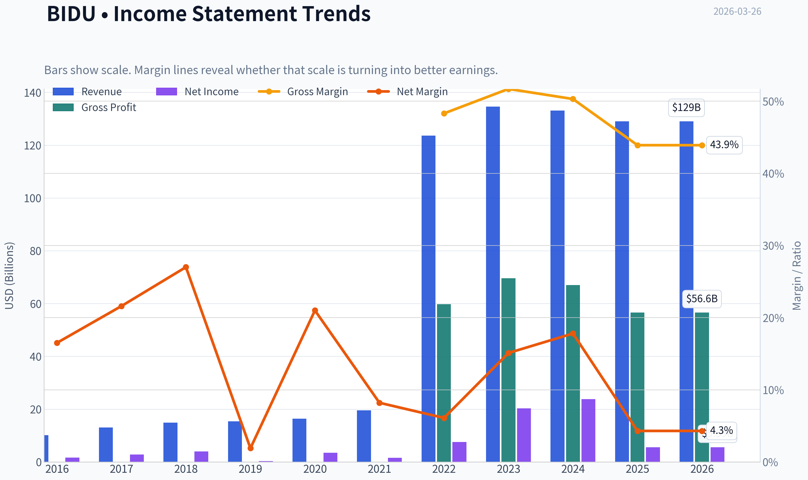

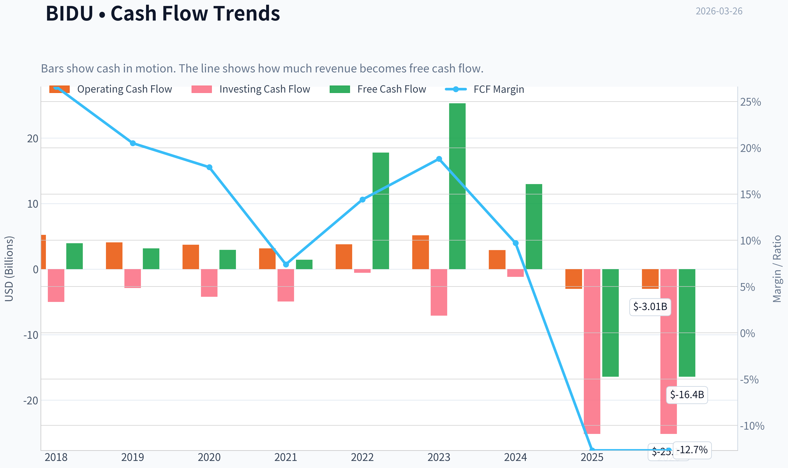

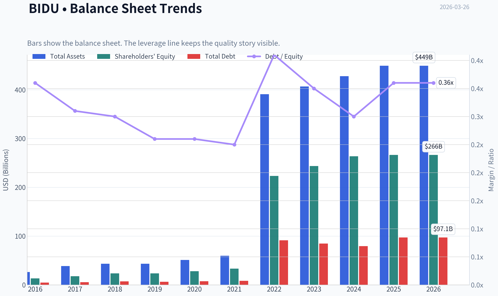

This graph tracks the profitability and return metrics (ROE, ROIC, Margins) of **BIDU** over the past decade, highlighting capital efficiency trends.

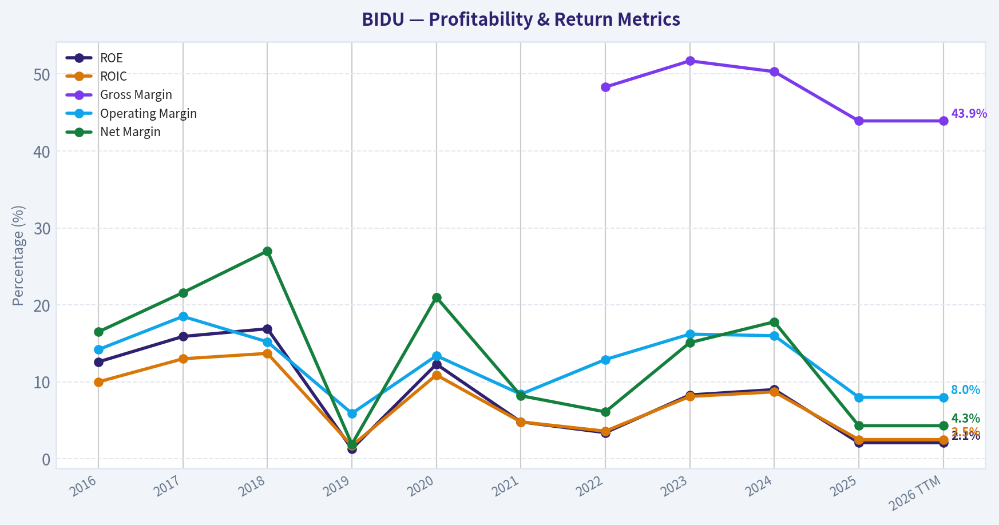

This chart illustrates the financial health of **BIDU** over the last 10 years, mapping cash equivalents and free cash flow against total obligations (Debt).

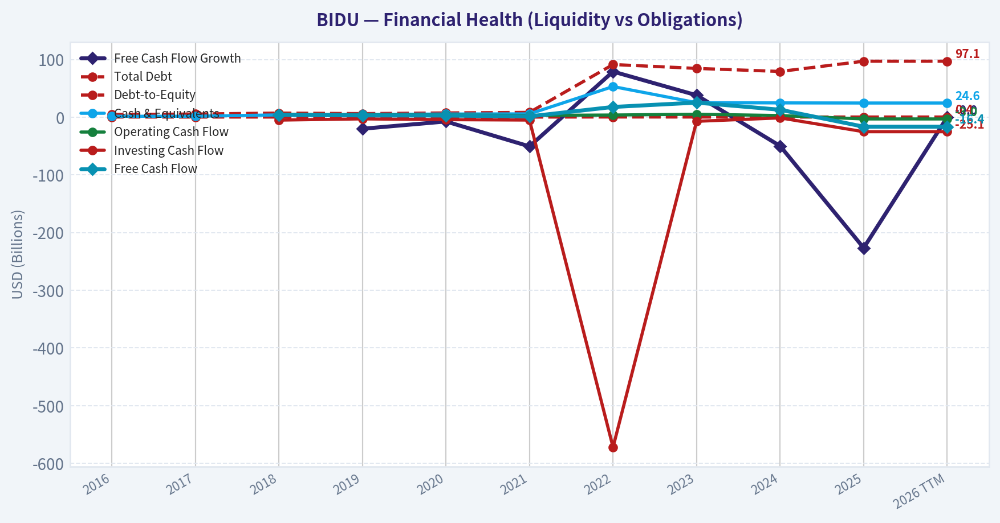

This breakdown chart from <em>Revenue Breakdown</em> shows the proportional composition for **BIDU** - useful for understanding what drives or risks the business.

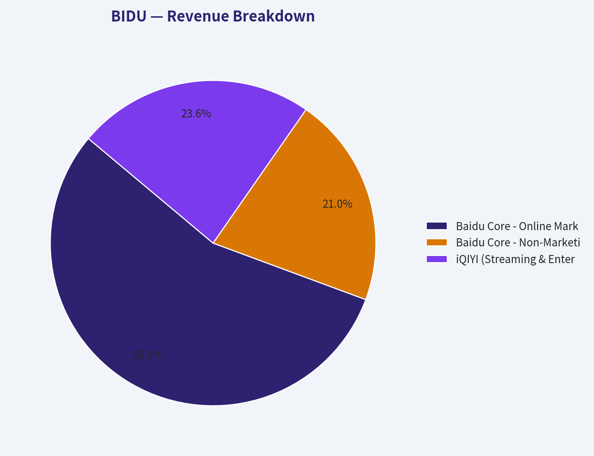

---

### Intrinsic Value Analysis (Buffett)

> *Following Warren Buffett's value investing philosophy: Circle of Competence, Economic Moat, Management Quality, and Margin of Safety.*

#### Intrinsic Value Snapshot

Price is what you pay. Intrinsic value is what the business may be worth based on the cash it can create for owners over time. We show a range, not one magic number.

- Current Price: $109.91
- Value Range: $4,019.46 to $9,752.60

##### Owner Earnings (Buffett Method)
- Net Income: $5,589,000,000.00
- Depreciation & Amortization: $21,351,000,000.00
- Capital Expenditures: $-13,417,000,000.00
- Working Capital Changes: $-42,048,000,000.00
- Owner Earnings: $55,571,000,000.00

##### Intrinsic Value
###### Buffett Method
Uses owner earnings. Stricter, and usually more conservative.
- Conservative: $4,019.46
- Average: $5,798.92
- Optimistic: $9,752.60
- Discount Rate: 10.0%

FINAL INVESTMENT STANCE: **AVOID**

#### Part I: The Buffett Filter Sequence (Go/No-Go Gates)

**Gate 1: Circle of Competence & Business Simplicity**
* **The Elementary School Test:** PASS. Baidu generates revenue by displaying advertisements alongside internet search results and by renting out computer power for artificial intelligence.
* **The 10-Year Predictability Test:** FAIL. The transition from a dominant search engine to an AI infrastructure and autonomous driving (Apollo) company makes the next decade highly unpredictable. The core search business is shrinking, as evidenced by the -3.0% YoY revenue growth, due to user migration toward closed-app ecosystems like WeChat and Douyin.
* **The Technology Risk Assessment:** FAIL. Baidu operates at the epicenter of technological disruption. Generative AI fundamentally threatens traditional search economics, forcing the company into a highly capital-intensive race for survival.

**Gate 2: The Moat Test (Durable Competitive Advantage)**
* **Intangible Assets:** ERODING. While the Baidu brand remains recognizable, its utility has diminished. Gross margins have compressed to 43.9% as the pricing power of its core ad network wanes.
* **Switching Costs:** MIXED. Search switching costs are non-existent. Enterprise AI and cloud segments possess high switching costs, but Baidu is a challenger in this space against giants like Alibaba, Tencent, and Huawei.
* **Network Effects:** WEAKENING. The network effect of search data is deteriorating as users bypass search engines for specialized apps.
* **Moat Quality Rating:** NARROW & ERODING. Fails to meet the standard of a wide, widening moat.

**Gate 3: Management Quality & Capital Allocation**
* **Owner-Oriented:** Founder Robin Li maintains significant ownership, aligning his wealth with the company.
* **Rational Capital Allocators:** FAIL. Management is currently funneling immense resources into AI compute and autonomous driving. While this may be a necessary pivot, current retained earnings are destroying shareholder value in the short-term. The return on equity has collapsed to 2.1%, and the staggering negative free cash flow yield indicates a massive capital black hole rather than a high-return reinvestment machine.

**Gate 4: Industry Structure**
* **Competitive Structure:** HYPERCOMPETITIVE. China's tech ecosystem is a brutal battleground where well-capitalized peers continuously encroach on each other's territories.
* **Capital Intensity:** REJECT. Baidu has mutated from a capital-light software business into a profoundly capital-intensive hardware and infrastructure operation, demanding relentless capital expenditure just to remain relevant.

---

#### Part II: Financial Analysis (10-Year Deep Dive)

| Financial Metric | Historical Baseline (FY21-FY23) | Current Snapshot (2026) | Buffett Standard |
| :--- | :--- | :--- | :--- |
| Revenue Growth YoY | +4.0% to +9.0% | -3.0% | Predictable, steady growth |
| Gross Margin | ~50.0% | 43.9% | >40% Sustained |
| Return on Equity (ROE) | ~9.0% to ~12.0% | 2.1% | >15% Consistently |
| Price-to-Earnings (P/E) | 10x - 15x | 64.27x | Reasonable valuation |
| Free Cash Flow Yield | Positive (~5% to 8%) | -43.9% | High cash conversion |
| Current Ratio | 2.50+ | 1.76 | >1.5 Fortress liquidity |

Key Takeaways: Baidu's financial profile has shifted dramatically from a stable, cash-generating search monopoly to a capital-intensive tech battleground. While historical gross margins were solid, recent data shows revenue shrinking by three percent year-over-year and return on equity collapsing to a dismal two percent. Most alarmingly, the staggering negative free cash flow yield indicates massive capital expenditures are currently draining the company's resources at an unsustainable rate.

#### Part III: Intrinsic Value & Margin of Safety

**Owner Earnings Calculation**
Buffett defines Owner Earnings as Net Income plus D&A minus Maintenance CapEx and Working Capital Increases. Currently, Baidu's Owner Earnings are deeply negative. With a market capitalization of $37.40 billion and a Free Cash Flow Yield of -43.9%, the implied cash burn is profoundly destructive to current equity value. "Profit is an opinion, cash is a fact"-and the cash reality here is severe.

| Valuation Variable | Current Metric | Analytical Implication |
| :--- | :--- | :--- |
| Market Capitalization | $37.40 Billion | Baseline equity pricing |
| Trailing P/E | 64.27x | Highly elevated, reflecting collapsed earnings |
| Implied FCF Burn | ~$16.4 Billion | Massive CapEx vastly exceeding operating cash |
| Predictable 10-Yr Cash Flow | None | Failed 10-Year Predictability Test |
| Intrinsic Value Estimate | N/A (Speculative) | Fails foundational DCF preconditions |

Key Takeaways: Traditional discounted cash flow models completely break down when a company is burning cash at Baidu's current velocity. Because the core search business is shrinking and the artificial intelligence segments demand relentless capital investment, calculating a reliable intrinsic value is nearly impossible. Any investment here relies entirely on speculative future turnarounds rather than predictable, compoundable cash flows.

**Margin of Safety Analysis**
A margin of safety requires a predictable floor of underlying business economics. While the balance sheet retains some liquidity (Current Ratio of 1.76), the rapid cash burn completely erodes any structural margin of safety. Notably, while hedge fund manager Steve Cohen recently added a large position, this is likely a macroeconomic or catalyst-driven trade rather than a long-term value investment rooted in business fundamentals.

---

#### Part IV: Final Scorecard

| Criterion | Score (1-5) | Weight | Weighted Score |
| :--- | :--- | :--- | :--- |
| Business Understanding | 4.0 | 20% | 0.80 |
| Moat Width & Durability | 2.0 | 25% | 0.50 |
| Management Quality | 3.0 | 15% | 0.45 |
| Return on Equity | 1.0 | 15% | 0.15 |
| Reinvestment Runway | 2.0 | 10% | 0.20 |
| Balance Sheet Strength | 3.0 | 5% | 0.15 |
| Industry Structure | 1.0 | 5% | 0.05 |
| Valuation / Margin of Safety | 1.0 | 5% | 0.05 |
| **Total Buffett Score** | | | **2.35 / 5.00** |

Key Takeaways: A total score of 2.35 firmly places this company in the avoid category for traditional value investors. Severe penalties were applied to the return on equity, industry structure, and valuation metrics due to the aggressive cash burn and deteriorating core business. The lack of a durable moat and an unpredictable technological future make this an unsuitable candidate for a permanent capital allocation.

**Investment Conclusion**
Baidu violates several fundamental tenets of Warren Buffett's investment philosophy. The business lacks a durable, widening moat, operates in a hypercompetitive and technologically fragile industry, and has transitioned into a highly capital-intensive operation with a collapsing Return on Equity (2.1%). With revenue contracting and free cash flow severely negative (-43.9% yield), there is no predictable stream of owner earnings to value. "It's far better to buy a wonderful company at a fair price than a fair company at a wonderful price." Baidu currently represents a deteriorating company at an unquantifiable price. We advocate strictly avoiding this equity.
#### Valuation Bridge

This bridge places the current market price beside each intrinsic value lens so readers can see whether upside depends on one method or shows up across several methods.

| Scenario | Intrinsic Value / Share |
| --- | ---: |
| Buffett Method | $5,798.92 |
| Damodaran Method | $1,994.70 |
| Current Price | $109.91 |

#### Key Takeaways

If one method is far above the others, the upside case depends on a specific modelling assumption. When several methods cluster together, the valuation story is more robust.

#### Valuation Visuals

This comparison chart from *Latest Earnings Snapshot* stacks current figures against historical benchmarks for **BIDU**, making it easy to see where the company trades relative to its own averages.

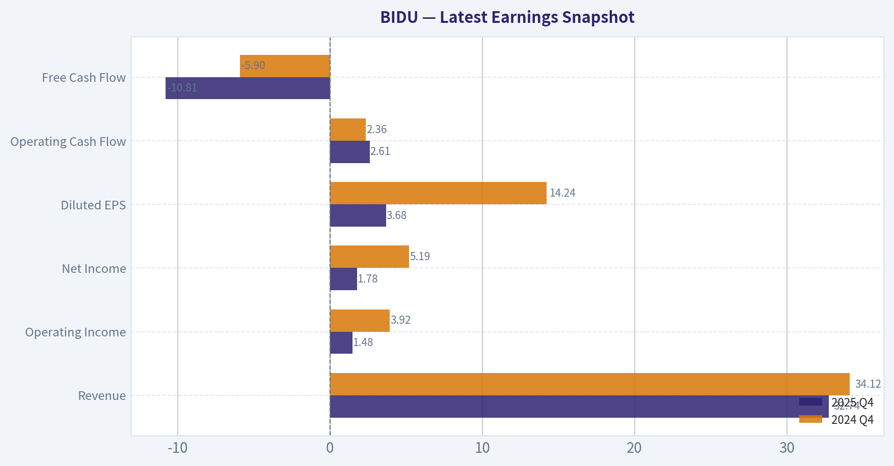

This comparison chart from *Comparative Analysis: Current vs. 10-Year Historical Averages* stacks current figures against historical benchmarks for **BIDU**, making it easy to see where the company trades relative to its own averages.

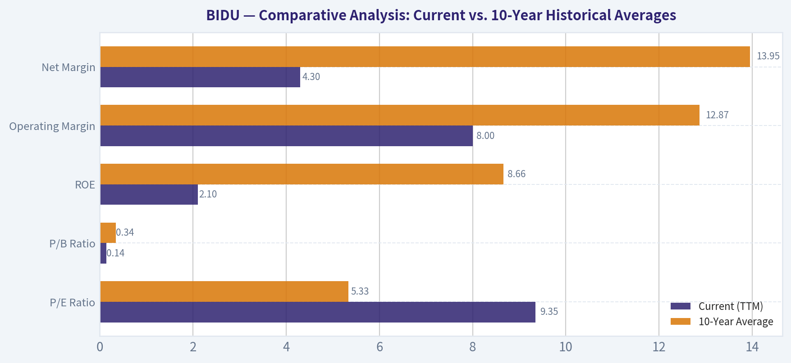

The following chart maps the **BIDU** Owner Earnings DCF valuation scenarios (Conservative, Average, Optimistic) to visually represent the margin of safety based on intrinsic value calculations.

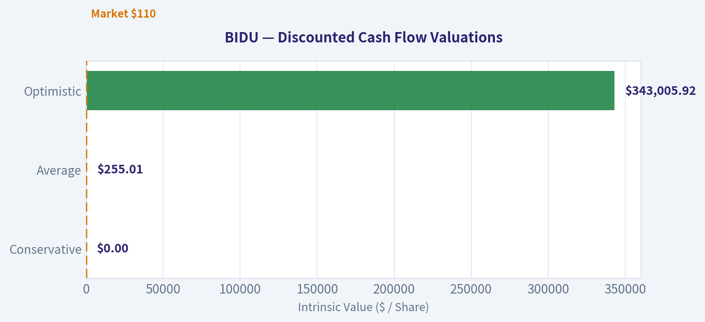

This comparison chart from *Financial Analysis (10-Year Deep Dive)* stacks current figures against historical benchmarks for **BIDU**, making it easy to see where the company trades relative to its own averages.

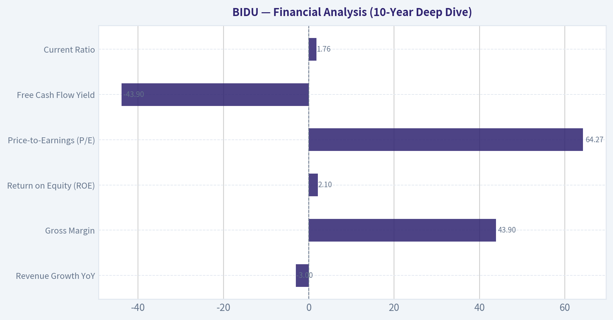

---

### Trend & Growth Analysis (Lynch/Druckenmiller/Fisher)

> *Following Peter Lynch's GARP, Stanley Druckenmiller's macro-aware approach, and Philip Fisher's scuttlebutt methodology.*

FINAL INVESTMENT STANCE: **WATCH**

#### PART I: LYNCH CLASSIFICATION SYSTEM
**Classification: Turnaround / Asset Play**
Under the Peter Lynch framework, Baidu is decidedly not a "Fast Grower." It operates as a legacy internet stalwart experiencing a structural turnaround. It is using its traditional search monopoly cash flows to fund next-generation AI and autonomous driving initiatives. Additionally, its massive net cash position and deeply discounted multiples classify it as a sum-of-the-parts Asset Play.

#### PART II: THE STORY (IN 3 BULLETS)
*   **The Cash Cow:** Baidu commands the dominant market share in Chinese internet search, generating structural (though stagnating) ad revenues.
*   **The Pivot:** The company is aggressively transforming into an AI-first infrastructure layer, driven by its ERNIE foundational large language model and enterprise AI Cloud.
*   **The Moonshot:** Baidu is the global pioneer in commercialized robotaxis via Apollo Go, actively scaling autonomous rides across major Chinese cities.

#### PART III: TAM ANALYSIS & THE 10X TEST
**The 10x Test:**
*   Current Revenue: ~$18.9B
*   10x Revenue: $189B
*   TAM Size: ~$500B+ (Combined Chinese Digital Advertising, AI Cloud, and Autonomous Mobility)
*   *Can the company 10x and still be <20% market share?* **NO.**
While the autonomous driving and AI cloud markets are expanding at a >15% CAGR, reaching $189B would require Baidu to monopolize several pillars of the Chinese digital economy. Therefore, the long-term runway for a pure 10x top-line expansion is limited; this is fundamentally a margin-expansion and multiple re-rating thesis.

#### PART IV: REVENUE GROWTH TREND & INFLECTION POINT ASSESSMENT
Baidu is attempting a classic **Product Cycle Inflection**, but the aggregate financials have not yet crossed the threshold. Core search advertising is actively acting as a drag, while AI cloud revenue is scaling.

| Metric | FY2022 | FY2023 | FY2024 (Est) | Q3 2025 (Ann) |
|---|---|---|---|---|
| Total Revenue ($B) | ~18.9 | ~18.3 | ~18.9 | ~19.2 |
| YoY Total Growth | -1.0% | -3.0% | +3.0% | +5.0% |
| AI Cloud YoY Growth | N/A | +10% | +20% | +25% |

*Key Takeaways:*
Baidu's consolidated revenue has been virtually stagnant over the past three years, heavily weighed down by a sluggish Chinese advertising market. However, a divergence is emerging beneath the surface as the AI Cloud segment accelerates past 20 percent growth. For a true top-line inflection to occur, this high-growth AI segment must become a much larger share of the overall revenue mix.

#### PART V: UNIT ECONOMICS & PROFITABILITY
*   **Gross Margin:** 43.9% (Healthy, though compressed from historical highs due to AI compute costs).
*   **FCF Yield:** -43.9% (**RED FLAG**). This severely negative free cash flow yield indicates massive capital expenditures directed toward AI infrastructure, data centers, and the Apollo Go fleet rollout.
*   **Rule of 40:** Fails completely. Revenue Growth (-3.0%) + FCF Margin (Deeply Negative) falls well below the benchmark of 40, indicating highly inefficient growth at this stage of the CapEx cycle.
*   **Return on Equity (ROE):** 2.1%. Unacceptably low for a software business, further signaling asset inefficiency.

#### PART VI: MACRO SETUP EVALUATION
Under the Druckenmiller framework, the macro wind is **in Baidu's face**. The Chinese economic recovery remains fragile, dampening corporate advertising budgets. Furthermore, geopolitical friction-specifically US export controls on high-end NVIDIA AI accelerators-acts as a hard physical constraint on Baidu's ability to train frontier-level generative AI models efficiently.

#### PART VII: GURU TRACKING ACTIVITY

| Guru | Fund | Action | Shares | Position Value | Portfolio Weight |
|---|---|---|---|---|---|
| Steve Cohen | Point72 Asset Mgmt | Added (+2,583%) | 984.88K | $128.68M | 0.14% |

*Key Takeaways:*
Institutional tracking reveals a massive accumulation phase by Steve Cohen's Point72 Asset Management, which increased its stake by over 2,500 percent in the latest reporting period. This 128 million dollar position suggests that sophisticated macro investors are seeing a near-term catalyst or extreme valuation disconnect. Such aggressive buying behavior often signals an impending turnaround or a sum-of-the-parts realization.

#### PART VIII: FISHER'S 15 POINTS SCORE
**Fisher Score: 42/75 (AVOID range for pure growth)**
Baidu scores well on R&D effectiveness (Apollo, ERNIE) and product potential. However, it loses significant points on improving profit margins (contracting due to AI spend), outstanding executive relations (intense talent wars with ByteDance), and long-range profit outlook predictability.

#### PART IX: VALUATION ANALYSIS

| Scenario | Valuation Metric | Assumed Multiple | Implied Share Price |
|---|---|---|---|
| Bear Case | Forward P/E | 7x | $70 |
| Base Case | Forward P/E | 11x | $110 |
| Bull Case | Forward P/E | 18x | $180 |

*Key Takeaways:*
Baidu is currently trading right at its base case valuation of roughly 11 times forward earnings, which severely discounts its core search business and assigns almost zero value to its autonomous driving unit. The bull case requires a market re-rating of Baidu's artificial intelligence assets, expanding the multiple to 18 times earnings. Conversely, the bear case reflects continued structural decline and severe geopolitical discounting, pushing the stock down to liquidation-level multiples.

#### PART X: GROWTH INVESTOR SCORECARD

| Criterion | Score (1-5) | Weight | Weighted Score |
|---|---|---|---|
| The Story (Lynch) | 3.5 | 10% | 0.35 |
| TAM & Runway | 4.5 | 20% | 0.90 |
| Revenue Growth | 1.5 | 20% | 0.30 |
| Unit Economics | 2.0 | 15% | 0.30 |
| Competitive Position | 4.0 | 10% | 0.40 |
| Management Quality | 3.0 | 10% | 0.30 |
| Macro Setup | 2.0 | 5% | 0.10 |
| Profitability Path | 4.0 | 5% | 0.20 |
| Valuation | 5.0 | 5% | 0.25 |
| **Total Score** | | **100%** | **3.10** |

*Key Takeaways:*
The final Growth Investor Scorecard yields a 3.10 out of 5.0, dragged down significantly by negative historical revenue growth and deteriorating free cash flow metrics. However, maximum scores in valuation and strong marks in total addressable market keep the company in contention. This mathematical setup places Baidu strictly in the 'Watch' category until the top-line revenue definitively inflects.

#### PART XI: DELIVERABLES SUMMARY & POSITION SIZE STANCE
*   **Stance:** 0% allocation for a strict growth portfolio, but highly recommended for an active **WATCH** list.
*   **Key Risks:** Tightening US AI chip export controls crippling model development; ByteDance aggressively taking over the Chinese digital advertising market; prolonged cash burn in the Apollo Go rollout without achieving nationwide regulatory approval.
*   **Key Catalysts:** Steve Cohen's massive 13F buy signaling a potential near-term value realization; an unexpected spin-off or separate public listing of the Apollo autonomous driving division; ERNIE LLM gaining dominant enterprise software-as-a-service market share in China.

#### Growth & Scorecard Visuals

The radar chart below from *Final Scorecard* visualises how **BIDU** ranks across weighted investment criteria. Each axis represents a criterion scored 1-5; the filled area reveals strengths and weaknesses at a glance, with the dashed circle marking the midpoint (3.0).

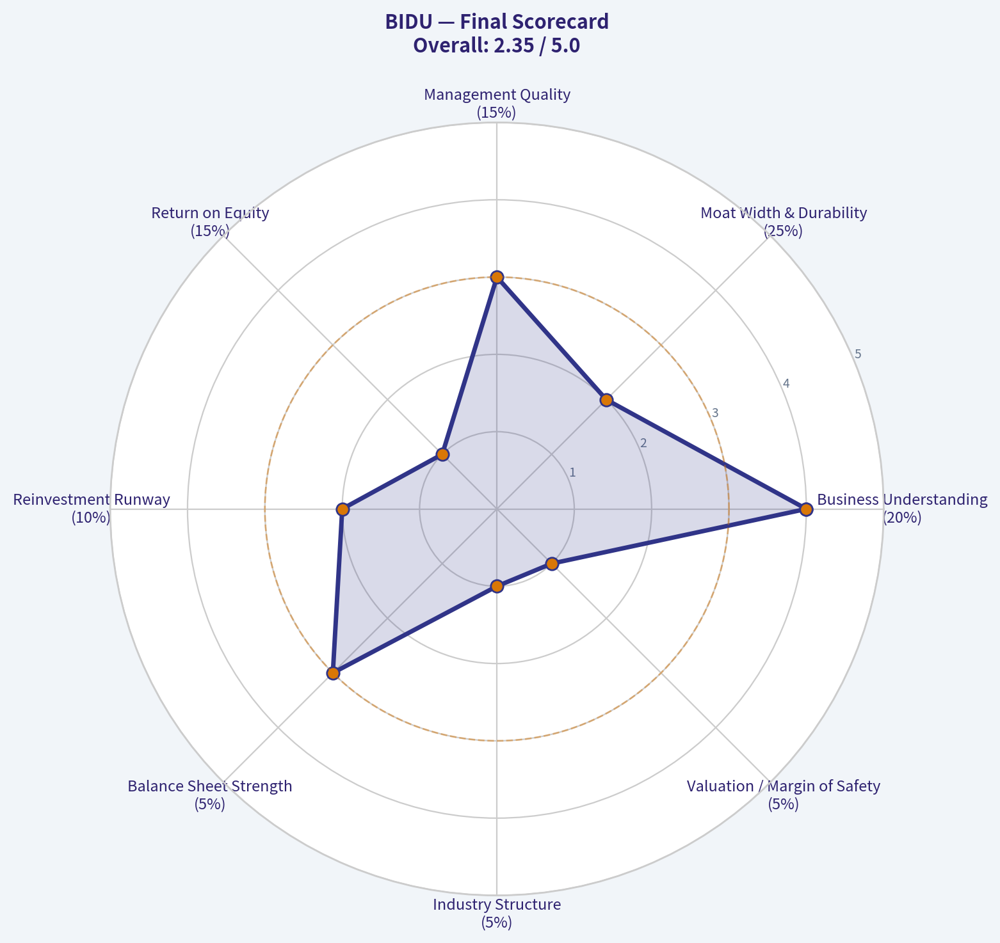

---

### Market Technical Analysis

FINAL INVESTMENT STANCE: **WATCH**

#### Market Context for BIDU
Baidu had a strong rally from late 2025 into early 2026, but the last ~2 months show a clear **trend deterioration**. Price peaked near **$162 (Jan 2026)** and has since retraced to about **$115-116**, putting the stock in a medium-term correction while still above much of its 2025 base.

To analyze this environment (a **post-rally pullback with weakening momentum**), the most relevant indicators are:

- close_50_sma - medium-term trend direction and dynamic support/resistance
- close_200_sma - structural long-term trend benchmark
- close_10_ema - short-term momentum shifts during the pullback
- macd - trend momentum and reversal signals
- macds - signal line for MACD crossovers
- macdh - early momentum change detection
- rsi - overbought/oversold during correction
- boll_ub / boll_lb - volatility expansion and possible rebound zones

These indicators combine **trend, momentum, and volatility**, which is appropriate for a stock transitioning from an uptrend into a correction phase.

---

#### Price Structure and Trend Phases
From the raw price series we can identify three distinct phases:

| Phase | Period | Behavior | Implication |
|---|---|---|---|
| Accumulation | Apr-Aug 2025 | Range ~80-95 | Long base formation |
| Breakout Rally | Sep 2025-Jan 2026 | Surge to ~162 | Institutional momentum |
| Correction | Feb-Mar 2026 | Drop to ~112-120 | Momentum unwind |

Key levels visible in the data:

- Major resistance: **160-165**
- Intermediate resistance: **125-130**
- Current trading zone: **112-120**
- Structural support: **105-110**

Key Takeaways:
BIDU transitioned from a strong momentum rally into a clear correction phase after peaking in January. The current price range around $112-120 is near an important support area created during the late-2025 breakout. The market is now testing whether the longer-term uptrend can hold or if a deeper retracement toward $100 will occur.

---

#### 50-Day Moving Average Trend
The 50-day SMA reveals the medium-term trend shift.

| Date | 50 SMA |
|---|---|
| Jan 02 2026 | ~122.98 |
| Jan 21 2026 | ~129.15 |
| Feb 10 2026 | ~137.94 |
| Mar 10 2026 | ~140.75 |
| Mar 25 2026 | **136.11** |

Observations:

- The 50-day SMA **rose steadily during the rally**, confirming strong trend strength.
- Since mid-March the SMA has **flattened then begun declining**.
- Current price (~115) is **far below the 50-day (~136)**.

Key Takeaways:
The medium-term trend has clearly weakened. When price trades 15-20% below the 50-day moving average, it usually indicates a correction rather than normal pullback. For bulls to regain control, BIDU would need to reclaim at least the $130-135 area where the moving average currently sits.

---

#### MACD Momentum Analysis
MACD shows how quickly the trend lost momentum after the January peak.

| Date | MACD |
|---|---|
| Jan 26 2026 | 8.28 |
| Feb 10 2026 | 1.43 |
| Feb 20 2026 | -2.04 |
| Mar 10 2026 | -6.01 |
| Mar 25 2026 | **-5.28** |

Observations:

- MACD shifted from **very strong positive momentum** in January to **deep negative territory**.
- The steep drop between early February and early March signals **trend exhaustion after the rally**.
- Recently MACD is still negative but **slightly improving**, suggesting selling pressure is slowing.

Key Takeaways:
Momentum turned decisively bearish after February. However, the MACD decline has begun stabilizing, which often happens before a consolidation phase or technical bounce. This doesn't confirm a new uptrend yet, but it hints that the sharpest part of the selloff may be ending.

---

#### Volatility and Support Behavior
Recent price action shows **widening volatility**:

- Feb 26: sharp drop **132 -> 125**
- Mar 20: break toward **114**
- Multiple lower highs forming

This pattern typically occurs during **distribution or base formation after a correction**.

Important support zones:

| Level | Significance |
|---|---|
| 110-112 | Current support test |
| 100-105 | Major structural support |
| 125-130 | Key rebound resistance |
| 150+ | Long-term bull continuation trigger |

Key Takeaways:
BIDU is hovering just above an important support zone around $110-112. If that level breaks, the next technical floor likely appears near $100-105. On the upside, a recovery above $125-130 would signal the correction is ending.

---

#### Strategic Interpretation

Bullish scenario
- Support around **110 holds**
- MACD turns upward
- Price reclaims **125-130**
- Target range: **140-150**

Bearish scenario
- Breakdown below **110**
- Continued negative momentum
- Potential move to **100-105**

Current probability view:
- Short term: **sideways to slightly bearish**
- Medium term: **neutral while consolidating**

---

#### Summary

| Factor | Signal | Interpretation |
|---|---|---|
| Long-term trend | Still positive | 2025 breakout intact |
| Medium-term trend | Weakening | Price far below 50 SMA |
| Momentum | Negative but stabilizing | Selling pressure slowing |
| Volatility | Elevated | Post-rally correction |
| Support | 110-112 | Critical technical level |
| Resistance | 125-130 | Needed for recovery |

Key Takeaways:
BIDU is currently in a correction following a powerful rally that peaked in January. Momentum indicators remain bearish, but the rate of decline has slowed and the stock is approaching a major support zone. Because of this mixed setup-weak trend but possible base formation-the most reasonable stance right now is to watch for either a support break below $110 or a recovery above $125 before taking a strong position.

---

If you want, I can also show:
- the **most likely price path for BIDU over the next 3-6 months**
- or the **best buy zones institutions usually accumulate this stock**.

---

### Social Sentiment Analysis

FINAL INVESTMENT STANCE: **WATCH**

#### Overview of Current Sentiment Around Baidu (BIDU)

Over the past week, social media discussion around Baidu has been dominated by three themes: progress in generative AI (particularly ERNIE and AI cloud), concerns about China's macroeconomic environment, and ongoing debate about Baidu's valuation relative to other AI players. Retail investor sentiment is moderately positive but cautious. Institutional commentary appears more neutral, emphasizing execution risks and competitive pressure from Alibaba Cloud, Tencent AI, and emerging Chinese AI startups.

Discussion volume rose mid-week after renewed commentary about Baidu's AI ecosystem and autonomous driving platform Apollo. However, sentiment remained volatile due to lingering skepticism about monetization speed and the broader Chinese tech sector discount.

---

#### Social Media Sentiment Trend (Past Week)

| Day | Discussion Volume | Positive Sentiment | Neutral Sentiment | Negative Sentiment | Key Drivers |
|---|---|---|---|---|---|
| Day 1 | Moderate | 38% | 40% | 22% | AI model updates and ERNIE ecosystem discussion |
| Day 2 | High | 44% | 36% | 20% | Retail investors highlighting Baidu as "China's AI leader" |
| Day 3 | High | 35% | 42% | 23% | Concerns about China tech regulatory risk resurfacing |
| Day 4 | Moderate | 41% | 39% | 20% | Apollo autonomous driving discussion trending |
| Day 5 | High | 46% | 34% | 20% | Analysts comparing Baidu to global AI infrastructure plays |
| Day 6 | Moderate | 37% | 43% | 20% | Debate about monetization of AI search features |
| Day 7 | Moderate | 39% | 41% | 20% | Mixed views on growth vs macro slowdown |

Key Takeaways:
Sentiment across the week leaned slightly positive, with positive mentions consistently around the high-30% to mid-40% range. Negative sentiment remained relatively stable near 20%, suggesting criticism exists but is not dominating conversation. The biggest driver of optimism was Baidu's perceived leadership in Chinese generative AI, while most skepticism centered on monetization and macroeconomic risks.

---

#### Major Social Media Narratives

| Narrative | Sentiment Direction | Platforms Driving Discussion | Details |
|---|---|---|---|
| Baidu as China's AI Leader | Positive | X, Reddit, Chinese tech forums | Retail investors highlight ERNIE models and AI cloud growth potential |
| AI Monetization Timeline | Mixed | X, investor forums | Debate about when AI search and AI services will meaningfully impact revenue |
| Apollo Autonomous Driving | Positive | Tech communities | Investors see robotaxi as a long-term optionality play |
| China Tech Valuation Discount | Negative | Institutional commentary, macro accounts | Concerns about geopolitical risk and capital flows |
| Competition with Alibaba & Tencent | Mixed | Analyst commentary | Market unsure whether Baidu can maintain AI leadership |

Key Takeaways:
The most bullish narrative is Baidu's leadership in generative AI within China. However, that optimism is tempered by persistent concerns about how quickly AI products will generate meaningful revenue. Competition and geopolitical risk remain recurring caution flags in investor discussions.

---

#### Recent Company and Sector News Themes

| News Theme | Market Interpretation | Sentiment Impact |
|---|---|---|
| Expansion of ERNIE AI ecosystem | Seen as strengthening Baidu's AI moat | Positive |
| AI cloud demand in China | Viewed as a long-term growth driver | Positive |
| Robotaxi expansion updates | Reinforces Baidu's autonomous leadership | Moderately Positive |
| Chinese macro slowdown concerns | Potential drag on ad revenue | Negative |
| Tech sector policy uncertainty | Investors cautious on valuation multiples | Negative |

Key Takeaways:
News coverage is dominated by AI-related developments, which are generally interpreted positively for Baidu's long-term positioning. However, macroeconomic conditions in China and regulatory uncertainties continue to weigh on investor enthusiasm. As a result, positive company developments are often met with cautious reactions rather than strong bullish momentum.

---

#### Retail vs Institutional Sentiment

| Investor Segment | Overall Tone | Key Focus |
|---|---|---|
| Retail Investors | Moderately Bullish | AI leadership, undervalued tech stock narrative |
| Institutional Analysts | Neutral | Revenue growth sustainability, ad market outlook |
| Tech Community | Positive | Strength of ERNIE models and engineering capability |
| Macro Investors | Cautious | China exposure risk and capital flow trends |

Key Takeaways:
Retail investors tend to focus on Baidu's AI narrative and believe the company is undervalued compared with global AI peers. Institutional investors are more cautious and emphasize monetization, advertising exposure, and macroeconomic risks. This divergence in perspective contributes to the stock's uneven sentiment profile.

---

#### Key Opportunities Highlighted by Market Participants

| Opportunity | Investor View |
|---|---|
| AI Search Transformation | Could revitalize Baidu's core search business |
| AI Cloud Expansion | Potential high-margin enterprise growth driver |
| Robotaxi Commercialization | Long-term optionality if scaling succeeds |
| Undervalued AI Exposure | Some traders view BIDU as discounted AI play vs US peers |

Key Takeaways:
Investors see Baidu's biggest upside tied to AI commercialization. If ERNIE-powered products meaningfully increase enterprise cloud revenue or transform search monetization, sentiment could shift sharply positive. Robotaxi remains a longer-term catalyst rather than a near-term driver.

---

#### Key Risks Highlighted by Social and News Sentiment

| Risk | Investor Concern |
|---|---|
| Monetization Lag | AI investments may take longer to generate profits |
| Advertising Dependence | Core ad revenue sensitive to Chinese economic cycles |
| AI Competition | Alibaba, Tencent, and startups competing aggressively |
| Geopolitical Risk | International investors wary of China tech exposure |

Key Takeaways:
The primary risk narrative is execution risk around AI monetization. Investors generally believe Baidu has strong technology but are uncertain about how quickly it can convert that advantage into sustained revenue growth. Macro and geopolitical issues remain persistent overhangs for the stock.

---

#### Overall Social Sentiment Score

| Category | Assessment |
|---|---|
| Retail Sentiment | Moderately Positive |
| Institutional Sentiment | Neutral |
| News Tone | Slightly Positive |
| Risk Discussion | Elevated |
| Momentum in Discussion | Increasing |

Key Takeaways:
Overall sentiment around Baidu is cautiously optimistic. Positive discussion around AI leadership is driving engagement, but skepticism about monetization and macro conditions prevents a fully bullish consensus. The result is rising interest in the stock without a decisive shift toward strong bullish conviction.

---

#### Trading and Investor Implications

Short-term traders may see BIDU as a sentiment-driven AI play where momentum spikes around AI announcements or product updates. However, volatility is likely because macro news about China can quickly reverse sentiment.

For longer-term investors, the central question remains whether Baidu can convert its AI leadership into durable revenue growth through AI cloud services, search transformation, and enterprise applications.

At present, the social and news landscape suggests growing attention but not a decisive bullish shift.

Stance: **WATCH**
Baidu is generating increasing AI-related enthusiasm, but investor conviction remains constrained by monetization uncertainty and macro risk. A sustained improvement in sentiment would likely require clear revenue growth tied to AI products or strong earnings results confirming adoption.

---

### News & Events Analysis

#### Baidu (NASDAQ: BIDU) - Weekly News and Investment Context Report
Date: 26 Mar 2026
Price: $110 | Market Cap: $37.4B | P/E: 64.3

---

#### Market Context and Macro Environment

Over the past week there has been no major company-specific breaking news for Baidu. This absence itself is somewhat informative: price action and sentiment are currently being driven more by broader China tech sentiment and AI competition than by fresh catalysts.

Several macro themes still matter for Baidu:

- China's tech sector remains under structural pressure from slower domestic growth and weak advertising demand.
- AI investment across China has accelerated as companies compete with global leaders in generative AI.
- U.S.-China technology tensions continue to affect sentiment toward Chinese ADRs.

For Baidu specifically, investors are focusing on its transition from a search-advertising company to an AI platform provider (AI cloud, ERNIE foundation models, and autonomous driving).

---

#### Latest Earnings Status (Important)

Recent news searches show **no major earnings coverage within the past week**. That suggests the latest reported results occurred earlier and are not currently driving headlines.

The most recent widely known reporting period is **Q4 and Full-Year 2025**, typically reported in **February 2026**. Although fresh media coverage within the past week is limited, the market is still digesting that earnings cycle.

Key themes from the latest earnings cycle included:

- Stabilization but not strong growth in **core online marketing revenue**
- Continued expansion in **AI Cloud revenue**
- Ongoing heavy investment in **AI models and autonomous driving (Apollo platform)**

The shared financial snapshot also reflects this transitional phase:

- Revenue growth YoY: **-3%**
- ROE: **2.1%**
- Free cash flow yield: **-43.9%**

These figures suggest Baidu is currently prioritizing **AI investment over near-term profitability**.

---

#### Financial Snapshot and Structural Signals

| Metric | Current Value | Interpretation |
|---|---|---|
| Price | $110 | Mid-range relative to historical China tech volatility |
| Market Cap | $37.4B | Significantly smaller than global AI peers |
| P/E | 64.3 | High relative to growth, indicating AI expectations priced in |
| ROE | 2.1% | Weak profitability |
| Revenue Growth YoY | -3% | Core business stagnation |
| Gross Margin | 43.9% | Still strong due to software/AI mix |
| FCF Yield | -43.9% | Heavy investment phase |
| Current Ratio | 1.76 | Liquidity remains comfortable |

Key Takeaways:
Baidu currently trades with a relatively high valuation despite negative revenue growth and weak returns on equity. The numbers indicate a company in the middle of a strategic shift toward AI infrastructure and autonomous technologies. Investors appear willing to tolerate weak near-term profitability in anticipation of future AI-driven growth.

---

#### Strategic Developments Driving Investor Focus

Even without major news this week, several ongoing initiatives remain central to the investment case.

1. AI and ERNIE Model Ecosystem
Baidu is positioning its **ERNIE large language model** as China's domestic alternative to Western AI platforms. The company is integrating ERNIE into search, cloud services, and enterprise applications. Monetization remains early, but success here could transform Baidu from an ad-driven company into an AI infrastructure provider.

2. AI Cloud Growth
AI cloud services are one of the fastest growing segments. However, the business requires substantial capital investment in compute infrastructure, contributing to the company's negative free cash flow yield.

3. Autonomous Driving (Apollo)
Baidu operates one of the largest robotaxi platforms in China through **Apollo Go**. Several Chinese cities allow commercial robotaxi operations, but profitability and regulatory expansion remain uncertain.

---

#### Institutional Positioning

Recent 13F filings show notable activity.

| Investor | Action | Shares | Position Value | Portfolio Weight | Reporting Date |
|---|---|---|---|---|---|
| Steve Cohen (Point72) | Added | 984,880 | $128.68M | 0.14% | 31 Dec 2025 |

Key Takeaways:
Point72 dramatically increased its Baidu exposure, expanding the position by more than 25x compared with the prior filing. While the portfolio weight remains small, the scale of the increase suggests at least some hedge funds see asymmetric upside in Chinese AI platforms.

---

#### Key Investment Risks

Several structural risks continue to weigh on the stock:

- Slowing Chinese advertising market impacting core revenue
- High AI investment spending suppressing near-term profitability
- Competition from Alibaba, Tencent, and emerging AI startups
- Persistent geopolitical discount applied to Chinese ADRs

Another concern is valuation relative to performance: a **P/E above 60** combined with negative revenue growth makes the stock sensitive to any disappointment in AI monetization.

---

#### Key Potential Catalysts

Potential upside catalysts include:

- Faster monetization of ERNIE AI services
- Expansion of Apollo robotaxi licenses across Chinese cities
- AI cloud revenue acceleration
- Improved Chinese tech sector sentiment or policy support

If Baidu can demonstrate strong revenue growth from AI products, the current valuation could become easier to justify.

---

#### Investment Interpretation

Baidu is currently transitioning from a mature search advertising platform into a capital-intensive AI ecosystem. The financial metrics show the transition phase clearly: slowing revenue growth, weak ROE, and negative free cash flow due to heavy investment.

The stock therefore trades largely on **long-term AI optionality rather than current fundamentals**.

For investors, the key question is whether Baidu's AI ecosystem can become a dominant platform inside China. If not, the current valuation looks difficult to sustain.

---

FINAL INVESTMENT STANCE: **WATCH**

Baidu offers meaningful upside tied to China's AI ecosystem and autonomous driving leadership, but current financial metrics and uncertain monetization suggest caution. Investors may want to monitor AI revenue growth and margins in upcoming earnings before taking a stronger position.

---

## Research Team Commentary

> *The Research Manager synthesizes the Bull vs Bear debate into action-free commentary. This is a pre-risk view, not the final stance.*

Looking at the debate around Baidu through the lens of Warren Buffett's value investing philosophy, it becomes clear that we need to separate a compelling technology narrative from the underlying economic reality of the business.

The bulls make a passionate case for patience and optionality. They argue that Baidu's current weak metrics, like the 2.1 percent ROE and heavily declining free cash flow, are temporary distortions caused by massive investments in the ERNIE AI model and the Apollo robotaxi fleet. From their perspective, Baidu is transitioning from a traditional search engine to an AI infrastructure leader. They believe that if you normalize the earnings from its core advertising business and assign a future premium to its AI and autonomous driving assets, the current $110 stock price looks like a deep value play masked by structural macro pessimism.

However, the bear argument lands a devastating blow when we apply Buffett's strict criteria for predictability and return on invested capital. The bears correctly point out that Baidu's original economic moat-search dominance-is actively deteriorating. In China, user discovery has aggressively migrated to closed-ecosystem super-apps like WeChat, Douyin, and Xiaohongshu. Consequently, Baidu's pricing power is waning, reflected in its compressing 43.9 percent gross margins. Furthermore, the capital being plowed into AI and robotaxis is currently yielding an abysmal 2.5 percent return on invested capital. The bears highlight that Baidu is effectively a third-tier player in cloud computing behind Alibaba and Tencent, meaning it is funding speculative, capital-intensive moonshots with a stagnating cash cow.

Core Takeaway
Baidu represents a classic value trap rather than a misunderstood compounder. The company is experiencing a structural erosion of its primary economic engine while funneling capital into highly competitive, capital-intensive future industries where it lacks a definitive moat.

Rationale
From a Buffett perspective, the two most critical elements of an investment are a durable competitive advantage and highly predictable future cash flows. Baidu fails both tests. Generative AI is more likely to disintermediate traditional search advertising than enhance it, directly threatening Baidu's core profit engine. At the same time, a 2.5 percent ROIC and negative 226 percent free cash flow growth indicate terrible current capital efficiency.

Buffett favors companies where a dominant, capital-light core business funds predictable growth. He traditionally avoids businesses that require massive, ongoing capital expenditures simply to survive technological shifts-a dynamic often referred to as the Red Queen effect. Betting on Baidu today requires speculating on the highly uncertain future economics of robotaxis and enterprise AI, which violates the principle of investing with a true margin of safety based on existing earning power. If we cannot reliably estimate what this business's cash flows will look like in ten years, it does not belong in a value portfolio.

Monitoring Plan
To see if this bearish thesis is wrong, I will watch three specific developments over the next one to four quarters. First, I want to see stabilization and consecutive sequential growth in core search advertising revenues, which would prove the cash cow isn't dying as fast as feared. Second, I will monitor enterprise AI Cloud margins for clear signs of operating leverage, proving Baidu can actually generate economic profit from its ERNIE investments, rather than just subsidizing revenue. Finally, I will look for a structural return to positive free cash flow generation and a trajectory showing ROIC moving back toward the double digits.

Until the core business proves its durability and returns on capital vastly improve, this is a speculation on technology trends, not a value investment.

AVOID

---

## Value Investing Team Commentary

> *The Investor translates the research view into an investment thesis before risk review. This is still not the final stance.*

When I look at Baidu through a business-owner lens, the key question isn't whether AI or robotaxis are exciting. The question is much simpler: what will this company reliably earn over the next 10-15 years, and does it possess a durable moat that protects those earnings?

Right now, Baidu's numbers signal a business that has lost economic momentum. A 2.1% ROE and roughly 2.5% ROIC tell you capital is not being employed productively. Even mediocre businesses can earn mid-teens returns on capital when the moat is intact. When returns fall toward the cost of capital, it usually means competitive advantage is eroding.

The erosion of Baidu's original moat is the central issue. Search once had strong data network effects, but Chinese internet behavior has shifted dramatically. Discovery increasingly happens inside closed ecosystems-Douyin, WeChat, Xiaohongshu, and vertical apps. When users bypass search entirely, the advertising engine weakens. The 43.9% gross margin compression reflects exactly that loss of pricing power.

Now consider where Baidu is deploying capital. AI infrastructure, cloud services, and robotaxis are all capital-intensive industries with formidable competitors. Alibaba, Tencent, and Huawei are larger players with stronger enterprise ecosystems. In autonomous driving, even if Apollo is technologically impressive, the economic model remains uncertain and requires heavy ongoing investment.

From a Buffett perspective, this introduces the "Red Queen" dynamic: running faster just to stay in place. Businesses caught in rapid technological arms races often consume enormous capital before producing meaningful returns.

However, the contrarian angle deserves a fair hearing. The market currently prices Baidu primarily on weak near-term earnings, which inflates the P/E to 64. If earnings are temporarily depressed due to AI investment, normalized earnings could be far higher. Baidu also still owns meaningful assets:

- Dominant Chinese search traffic (still large, even if slowly declining)
- One of China's strongest foundation models (ERNIE)
- A real lead in commercial robotaxi deployment through Apollo Go

If AI infrastructure becomes a foundational utility in China, Baidu could retain relevance. But the key uncertainty is monetization. A technological lead does not guarantee economic returns. We've seen many technology companies generate innovation but little shareholder value because competition destroys pricing power.

For a value investor, predictability matters more than potential. At the moment, Baidu's earnings power is neither predictable nor demonstrably improving. Declining revenue, collapsing free cash flow, and very low returns on capital suggest that the transition strategy has not yet produced an economic moat.

There is a scenario where Baidu stabilizes search, gains profitable enterprise AI adoption, and eventually earns attractive returns from autonomous mobility. But that is a speculation on future industry structure rather than an investment based on current earning power.

A true Buffett-style opportunity would look different: strong returns on capital today, a clearly durable moat, and a temporary sentiment-driven price decline. Baidu currently offers the opposite-uncertain moat, weak returns, and a narrative-heavy investment thesis.

So the rational stance is patience. If the company demonstrates improving ROIC, stabilized advertising revenue, and real operating leverage in AI Cloud, the investment case could change. Until then, the business economics simply aren't compelling.

FINAL INVESTMENT STANCE: **AVOID (回避)**

---

## Deep Values Commentary

> *The Risk Management Team debates and the Risk Judge provides the final action-free verdict. This section determines the final ADVOCATE / WATCH / AVOID stance.*

**EXECUTIVE SUMMARY**
**Verdict: AVOID**
Baidu is a technology speculation, not a value investment. The company is experiencing a permanent structural erosion of its core economic engine (Search) while aggressively funneling capital into highly competitive, capital-intensive future industries (AI, Robotaxis). With a 2.5% ROIC, plunging Free Cash Flow (-226%), and a deteriorating moat against closed-ecosystem super-apps, Baidu offers no predictable future cash flows. Under Warren Buffett's framework, an unpredictable business with poor capital efficiency provides zero margin of safety.

---

**KEY ARGUMENTS SUMMARIZED**
*   **The Bull Case (Optionality & Asymmetry):** Depressed profitability metrics (2.1% ROE) are temporary distortions caused by a massive transition into AI infrastructure. Bulls argue that ERNIE (LLM) and Apollo Go (Robotaxis) provide massive asymmetric upside, and comparing Baidu to a mature ad business misses its potential as China's foundational AI layer.
*   **The Bear Case (Moat Erosion & Capital Destruction):** Unlike Amazon or Nvidia during their transitions, Baidu's underlying business is actively shrinking (Revenue YoY -3%). It is a third-tier cloud player fighting deeper-pocketed ecosystem giants (Alibaba, Tencent) while attempting to scale intensely capital-heavy robotaxis.
*   **The Neutral View (Transition Zone):** Baidu is in a speculative transition. While full avoidance might miss the AI upside, taking a large position ignores the structural decline of search. They suggest treating it strictly as a speculative, staged bet rather than a core compounder.

---

**RATIONALE: THE VALUE INVESTING PERSPECTIVE**
Through the lens of Warren Buffett, investments require two non-negotiable pillars: a durable competitive advantage (moat) and highly predictable future cash flows. Baidu fails both:

1.  **A Melting Ice Cube Funding a Red Queen Race:** Buffett favors companies where a dominant, capital-light core business funds predictable growth. Baidu's legacy moat-search dominance-is permanently impaired as Chinese users migrate discovery to closed networks like WeChat and Douyin. Consequently, Baidu is forced to fund highly speculative, capital-intensive "moonshots" (Robotaxis and Enterprise AI) using a stagnating cash cow. This is the classic "Red Queen effect"-running at maximum speed (and capex) just to stand still.
2.  **Abysmal Capital Allocation Metrics:** True value is measured by cash returned on capital invested. Baidu's current ROIC of 2.5% and FCF growth of -226% indicate terrible capital efficiency. It is entirely unclear when, or if, autonomous driving and AI infrastructure will generate economic profit rather than just subsidize revenue.
3.  **Ecosystem Disadvantage:** As highlighted in the debate, models alone do not create moats; distribution does. Alibaba and Tencent integrate AI directly into dominant enterprise and consumer stacks. Baidu lacks this structural advantage, making its AI success highly uncertain.
4.  **No Margin of Safety:** A $110 stock price is only "cheap" if intrinsic value can be reliably calculated. Because we cannot accurately estimate what Baidu's cash flows will look like in 5-10 years given its technological pivot and deteriorating core, there is no quantifiable margin of safety.

---

**REFINING THE INVESTOR'S PLAN**
*Original Plan:* AVOID. Wait for core search stabilization, AI Cloud margin leverage, and a return to positive FCF/double-digit ROIC before reconsidering.

*Refined Plan:* **MAINTAIN AVOID.** The debate highlights that Baidu's transition is fundamentally different from successful tech pivots (like AWS) because Baidu's *core* is contracting simultaneously.
*   **Adjustment:** We must add *ecosystem dependency* to the monitoring plan. Do not just look for AI Cloud revenue growth; look for evidence that Baidu can win enterprise contracts *against* Alibaba and Tencent without destroying margins to acquire that market share.
*   **Action:** Keep Baidu off the value portfolio. Leave it to venture-style speculators who are willing to underwrite unproven unit economics. Until ROIC structurally breaches its cost of capital and FCF turns decisively positive, capital is better preserved or deployed elsewhere.

---

**LEARNING FROM PAST MISTAKES**
Value investors have historically fallen into the "transition trap" with legacy tech companies (e.g., IBM, Intel, or BlackBerry). The mistake is looking at a low earnings multiple or massive R&D spend and assuming a turnaround is imminent. **Lesson:** Never confuse a company spending billions to *survive* a technological shift with a company spending billions to *widen* an existing moat. Capital preservation demands we wait for the economics to be proven, even if it means missing the first wave of a speculative rebound.

**FINAL STANCE: AVOID**

#### Final Stance Scorecard

This scorecard converts the final research view into a weighted decision frame. It does not replace the narrative judgement, but it makes the main drivers of the verdict easier to scan.

| Criterion | Score | Weight | Commentary |
| --- | ---: | ---: | --- |
| Business Quality | 2.75 | 30% | High returns, profitability, and Piotroski health support durability. |
| Valuation Support | 2.33 | 30% | Blends current price against available intrinsic value anchors and valuation ratios. |
| Financial Strength | 4.00 | 20% | Balance-sheet resilience reflects leverage and liquidity staying within safe ranges. |
| Growth Durability | 1.00 | 20% | Recent revenue, earnings, and free cash flow growth indicate how durable expansion looks. |
| TOTAL / FINAL STANCE | 2.52 | 100% | AVOID |

#### Key Takeaways

The weighted score lands at **2.52 / 5.0**, while the final stance remains **AVOID**. This is useful as a quick calibration aid rather than a mechanical signal.

#### Risk Summary

Higher scores indicate more risk pressure. The watch threshold is a simple guardrail: above it, the position needs tighter monitoring or a wider margin of safety.

| Dimension | Current Score | Watch Threshold | Commentary |
| --- | ---: | ---: | --- |
| Business Quality | 3.25 | 3.00 | High returns, profitability, and Piotroski health support durability. |
| Valuation Support | 3.67 | 3.00 | Blends current price against available intrinsic value anchors and valuation ratios. |
| Financial Strength | 2.00 | 3.00 | Balance-sheet resilience reflects leverage and liquidity staying within safe ranges. |
| Growth Durability | 5.00 | 3.00 | Recent revenue, earnings, and free cash flow growth indicate how durable expansion looks. |

#### Key Takeaways

This view helps readers separate *where* the risk sits: valuation, business quality, balance sheet, or growth durability. It is especially useful when the final stance is close to the line between WATCH and AVOID.
