# BILI Deep Value Intelligence

**Analysis Date:** 2026-03-26

## Critical Disclaimer

*This analysis is generated by Deep Value Intelligence, an AI-powered multi-agent investing framework. This report is for informational and educational purposes only and does not constitute financial advice. Always conduct your own research and consult with qualified financial advisors before making investment decisions.*

---

## Table of Contents

1. Intelligence Summary
2. Analyst Team Reports
   - Fundamentals Analysis
   - Intrinsic Value Analysis (Buffett)
   - Trend & Growth Analysis (Lynch/Druckenmiller/Fisher)
   - Market Technical Analysis
   - Social Sentiment Analysis
   - News & Events Analysis
3. Research Team Commentary
4. Value Investing Team Commentary
5. Deep Values Commentary

---

## Intelligence Summary

### Thesis + Conditions

**Core Thesis:** **执行摘要（Executive Summary）**
Bilibili 正处在从"用户与内容投入阶段"向"变现阶段"过渡的关键期。收入仍保持约 19% 增长，FCF 与利润显著改善，说明经营效率确实在提升。但从价值投资视角看，企业的**经济引擎尚未被证明**：ROE、ROIC 仍为负，毛利率仅 32.7%，资本回报率远未达到优秀平台公司的水平。同时 **PE 约 91 倍几乎没有安全边际**，市场已经提前反映了部分成功预期。
结论：业务有潜力，但护城河强度与长期资本回报仍未验证，当前更适合持续跟踪而非重仓。
最终立场：**观望 (WATCH)**

**Key Risks:**
- 最终立场：**观望 (WATCH)**
- 多头（Risky Analyst）最强论点**
- 最终立场：观望 (WATCH)**

**What Would Change Our View:**
- 最终立场：**观望 (WATCH)**
- 多头（Risky Analyst）最强论点**
- 最终立场：观望 (WATCH)**

**Confidence:** Medium

---

## Analyst Team Reports

### Fundamentals Analysis

#### Latest Earnings Snapshot

*Most recent reported quarter anchored on 2025 Q3, with prior-year comparison when available.*

| Metric | 2025 Q3 | 2024 Q3 | YoY Change |
| --- | ---: | ---: | ---: |
| Revenue | $7.69B | $7.31B | +5.2% |
| Operating Income | $353.9M | $-66.7M | +630.8% |
| Net Income | $470.2M | $-79.5M | +691.4% |
| Diluted EPS | $1.05 | $-0.19 | +652.6% |
| Operating Cash Flow | $1.99B | N/A | N/A |
| Free Cash Flow | $1.60B | N/A | N/A |

Key Takeaways: This snapshot anchors the most recent reported quarter before the narrative analysis. It helps readers separate long-run business quality from whatever changed in the latest earnings print.

#### 10-Year Financial Metrics for BILI

*All values below are computed deterministically from raw data - not estimated by AI.*

*Issuer profile: operating company (Communication Services / Internet Content & Information).*

#### 10-Year Financial Metrics
*Annual rows come from reported financial statements. The final TTM row is computed from the latest four quarters.*

| Metric | 2016 | 2017 | 2018 | 2019 | 2020 | 2021 | 2022 | 2023 | 2024 | 2025 | 2026 TTM |
| --- | --- | --- | --- | --- | --- | --- | --- | --- | --- | --- | --- |
| Market Price | N/A | N/A | $15 | $19 | $86 | $46 | $24 | $12 | $18 | $24 | $24 |
| Market Cap | N/A | N/A | $3.40B | $6.02B | N/A | $17.63B | $9.35B | $5.03B | $7.54B | N/A | $10.82B |
| P/E Ratio | N/A | N/A | N/A | N/A | N/A | -2.60 | -1.25 | -1.04 | -5.61 | N/A | 13.59 |
| P/B Ratio | N/A | N/A | 3.36 | 5.94 | N/A | 0.81 | 0.61 | 0.35 | 0.53 | N/A | 0.73 |
| ROE | N/A | N/A | N/A | N/A | N/A | -31.3% | -49.2% | -33.5% | -9.5% | N/A | 5.2% |
| ROIC | N/A | N/A | N/A | N/A | N/A | -19.5% | -41.1% | -34.7% | -14.7% | N/A | 6.0% |
| EPS | N/A | N/A | N/A | N/A | N/A | $-17.87 | $-18.99 | $-11.67 | $-3.23 | N/A | $1.75 |
| Revenue | N/A | N/A | $600.5M | $973.6M | $1.84B | $19.38B | $21.90B | $22.53B | $26.83B | N/A | $29.76B |
| Gross Profit | N/A | N/A | $124.4M | $171.0M | $435.3M | $4.04B | $3.85B | $5.44B | $8.77B | N/A | $10.82B |
| Gross Margin | N/A | N/A | 20.7% | 17.6% | 23.7% | 20.9% | 17.6% | 24.2% | 32.7% | N/A | 36.4% |
| Operating Margin | N/A | N/A | -17.7% | -22.1% | -26.2% | -33.2% | -38.2% | -22.5% | -5.0% | N/A | 2.5% |
| Net Income | N/A | N/A | N/A | N/A | N/A | $-6.79B | $-7.50B | $-4.82B | $-1.35B | N/A | $770.1M |
| Net Margin | N/A | N/A | N/A | N/A | N/A | -35.0% | -34.2% | -21.4% | -5.0% | N/A | 2.6% |
| Revenue Growth | N/A | N/A | N/A | 62.1% | 88.9% | 65.4% | 4.4% | -0.1% | 15.8% | N/A | N/A |
| Net Income Growth | N/A | N/A | N/A | N/A | N/A | N/A | 10.4% | -35.7% | -72.1% | N/A | N/A |
| Free Cash Flow Growth | N/A | N/A | N/A | -122.6% | -258.7% | -2549.7% | 19.5% | -101.8% | 6272.8% | N/A | N/A |
| Total Book Value | N/A | N/A | $1.01B | $1.01B | $1.16B | $21.70B | $15.24B | $14.39B | $14.11B | N/A | $14.90B |
| Total Assets | N/A | N/A | $1.53B | $2.23B | $3.66B | $52.05B | $41.83B | $33.16B | $32.70B | N/A | $39.93B |
| Total Debt | N/A | N/A | N/A | $490.5M | $1.28B | $19.22B | $15.54B | $7.64B | $5.05B | N/A | $9.69B |
| Debt-to-Equity | N/A | N/A | 0.00 | 0.48 | 1.10 | 0.89 | 1.02 | 0.53 | 0.36 | N/A | 0.65 |
| Cash & Equivalents | N/A | $111.0M | $514.9M | $712.8M | $717.0M | $7.52B | $10.17B | $7.19B | $10.25B | N/A | $12.10B |
| Shareholders' Equity | N/A | N/A | $1.01B | $1.01B | $1.16B | $21.70B | $15.24B | $14.39B | $14.11B | N/A | $14.90B |
| Operating Cash Flow | N/A | N/A | $107.2M | $27.9M | $115.4M | $-415.4M | $-567.1M | $37.5M | $824.0M | N/A | N/A |
| Investing Cash Flow | N/A | N/A | $-464.9M | $-568.6M | $-1.37B | $-3.86B | $1.54B | $248.2M | $-18.9M | N/A | N/A |
| Free Cash Flow | N/A | N/A | $64.5M | $-14.6M | $23.1M | $-6.33B | $-6.65B | $-1.06B | $4.26B | N/A | N/A |
| FCF Margin | N/A | N/A | 10.7% | -1.5% | 1.3% | -32.7% | -30.4% | -4.7% | 15.9% | N/A | N/A |
| Dividends / Share | N/A | N/A | N/A | N/A | N/A | $0.00 | $0.00 | $0.00 | $0.00 | N/A | $0.00 |

#### Profitability Metrics
- Return on Equity (ROE): -9.5%
- Return on Invested Capital (ROIC): -14.7%
- Return on Assets (ROA): -4.1%
- Gross Margin: 32.7%
- Operating Margin: -5.0%
- Net Profit Margin: -5.0%

#### Liquidity Metrics
- Current Ratio: 1.34
- Quick Ratio: 1.20

#### Leverage Metrics
- Debt-to-Equity Ratio: 0.36
- Interest Coverage Ratio: -15.07
- Net Debt: $-5.20B

#### Growth Metrics (Year-over-Year)
- Revenue Growth: 19.1%
- Net Income Growth: 72.1%
- Free Cash Flow Growth: 500.5%
- Revenue CAGR (3-Year): 11.4%
- Revenue CAGR (5-Year): 94.1%

#### Valuation Metrics
- P/E Ratio (TTM): 91.50
- Forward P/E: 17.46
- Price-to-Book: 4.41
- Price-to-Sales: 0.32
- PEG Ratio: 1.27
- EV/EBITDA: -1.33
- Free Cash Flow Yield: 43.9%
- Earnings Yield: 1.1%

#### Owner Earnings (Buffett Method, Code-Computed)
- Net Income: $-1.35B
- + Depreciation & Amortization: $2.50B
- - Capital Expenditures: $-1.76B
- - Working Capital Changes: $3.15B
- = **Owner Earnings: $-3.75B**

#### Piotroski F-Score: 8/9
- Positive Net Income: FAIL
- Positive Operating Cash Flow: PASS
- ROA Improvement: PASS
- Cash Flow > Net Income: PASS
- Decreasing Debt: PASS
- Improving Current Ratio: PASS
- No Dilution: PASS
- Improving Gross Margin: PASS
- Improving Asset Turnover: PASS

FINAL INVESTMENT STANCE: **WATCH**

Bilibili (BILI) is a Chinese online video, streaming, and gaming platform focused on younger audiences. The 10-year dataset shows a classic pattern: extremely rapid early growth, years of heavy losses, and only very recent movement toward profitability and positive cash flow. The key question for a Buffett-style investor is whether the business has crossed the line from "growth experiment" to "durable cash generator."

---

#### Market Metrics

| Metric | Current (TTM or latest) | Historical Context | Interpretation |
|---|---|---|---|
| Market Price | $24 | Range since 2018 IPO roughly $12-$86 | Stock remains far below the 2020 peak despite operational improvement. |
| Market Cap | ~$10.8B | Peaked >$17B in 2021 | Market still pricing the company cautiously after years of losses. |
| P/E Ratio | 13.6 (TTM dataset) / ~91 (alt calc) | Historically N/A or negative | First period with positive earnings. Multiple unstable due to recent profitability shift. |
| P/B Ratio | 0.73 | Historically 0.35-5.94 | Still trading below book value compared with early years. |

Key Takeaways:
The market valuation reflects skepticism rather than hype. Even after a recovery from the 2023 lows, BILI trades far below its historical growth-era valuation and near book value levels. The market seems to be waiting for proof that the recent profitability is sustainable.

---

#### Profitability Trends

| Metric | 2021 | 2022 | 2023 | 2024 | 2026 TTM |
|---|---|---|---|---|---|
| Gross Margin | 20.9% | 17.6% | 24.2% | 32.7% | 36.4% |
| Operating Margin | -33.2% | -38.2% | -22.5% | -5.0% | 2.5% |
| Net Margin | -35.0% | -34.2% | -21.4% | -5.0% | 2.6% |
| ROE | -31.3% | -49.2% | -33.5% | -9.5% | 5.2% |
| ROIC | -19.5% | -41.1% | -34.7% | -14.7% | 6.0% |

Key Takeaways:
Profitability has improved dramatically since 2022. Gross margin expansion from 17.6% to 36.4% is the most important shift, suggesting better monetization of users and stronger ad/game economics. However, ROE and ROIC are still far below the levels Buffett typically prefers (15%+), indicating the business has not yet proven durable capital efficiency.

---

#### Growth Metrics

| Metric | Trend |
|---|---|
| Revenue Growth | Extremely high during expansion phase (60-90%), slowed to 4% in 2022, resumed to ~16-19% recently |
| Net Income Growth | Improving rapidly as losses shrink and profitability emerges |
| Free Cash Flow Growth | Massive swing from deep negatives (2021-2023) to strong positive in 2024 |

Key Takeaways:
The company has transitioned from "hypergrowth with massive cash burn" to "moderate growth with improving economics." That shift is positive, but the historical volatility means the long-term growth rate is still uncertain.

---

#### Balance Sheet Strength

| Metric | 2024 | 2026 TTM | Interpretation |
|---|---|---|---|
| Total Assets | $32.7B | $39.9B | Large platform scale |
| Total Debt | $5.05B | $9.69B | Debt increased recently |
| Debt-to-Equity | 0.36 | 0.65 | Still manageable |
| Cash & Equivalents | $10.25B | $12.1B | Very strong liquidity |
| Shareholders' Equity | $14.11B | $14.90B | Stable capital base |

Key Takeaways:
Despite earlier losses, Bilibili maintains a strong cash position. Net debt is actually negative (more cash than debt), which provides strategic flexibility. The balance sheet is not the main risk here-execution and monetization are.

---

#### Cash Flow

| Metric | 2021 | 2022 | 2023 | 2024 |
|---|---|---|---|---|
| Operating Cash Flow | -$415M | -$567M | $37M | $824M |
| Free Cash Flow | -$6.33B | -$6.65B | -$1.06B | $4.26B |
| FCF Margin | -32.7% | -30.4% | -4.7% | 15.9% |
| Dividends | $0 | $0 | $0 | $0 |

Key Takeaways:
The turnaround in free cash flow is striking. Moving from multi-billion dollar cash burn to strong positive FCF is the biggest improvement in the entire dataset. However, one year of positive FCF does not yet prove durability.

---

#### Revenue Breakdown (Latest Fiscal Year Approximation)

| Revenue Source | Amount | % of Total |
|---|---|---|
| Mobile Games | ~$7B | ~24% |
| Value-Added Services (live streaming, memberships) | ~$12B | ~40% |
| Advertising | ~$8B | ~27% |
| E-commerce & Others | ~$2.8B | ~9% |

Key Takeaways:
Bilibili has evolved beyond gaming dependence. The largest segment is now value-added services tied to its community ecosystem. Advertising is also becoming a meaningful driver as the platform scales.

---

#### Buffett-Style Owner Earnings DCF

Owner Earnings (given): **-$3.75B**

This negative base makes traditional Buffett valuation problematic because intrinsic value cannot be estimated from negative owner earnings. However, we can still illustrate scenarios assuming the company reaches sustainable positive owner earnings soon.

Assumption: Normalize owner earnings to **$1B** once the turnaround stabilizes.

Discount rate: 10%
Terminal growth: 2.5%

##### Conservative Scenario
Growth = 0%

Intrinsic value calculation:

PV of 10-year cash flow
= 1B x (1 - (1.10)^-10) / 0.10
~ 6.14B

Terminal value
= 1B x (1.025) / (0.10 - 0.025)
~ 13.67B

PV terminal
~ 13.67B / (1.10)^10
~ 5.27B

Total intrinsic value ~ **$11.4B**

---

##### Average Scenario
Growth = 10%

10-year PV ~ 9.77B
Terminal value PV ~ 8.95B

Total intrinsic value ~ **$18.7B**

---

##### Optimistic Scenario
Growth = 20%

10-year PV ~ 15.6B
Terminal value PV ~ 14.7B

Total intrinsic value ~ **$30.3B**

---

DCF Implied Value vs Market

| Scenario | Intrinsic Value | vs Current Market Cap (~$10.8B) |
|---|---|---|
| Conservative | $11B | roughly fair value |
| Average | $19B | ~75% upside |
| Optimistic | $30B | ~3x upside |

Key Takeaways:
Valuation depends almost entirely on whether Bilibili can maintain positive owner earnings. If the turnaround sticks, the stock may be undervalued. If profitability slips again, intrinsic value collapses quickly.

---

#### Buffett-Style Qualitative Assessment

Economic Moat
Bilibili's moat comes from community culture and user-generated content centered on anime, gaming, and youth culture. This is a niche moat rather than a universal one. Switching costs are moderate; competitors like Douyin and Tencent Video are powerful.

Predictable Earnings
Historically very poor. The company has only just turned profitable after years of losses. Buffett typically avoids businesses without a long record of stable profits.

Management Performance
Management appears to have pivoted effectively toward profitability. Margin improvement and cash flow recovery suggest stronger cost discipline and monetization strategy.

Financial Strength
Strong cash balance and negative net debt reduce bankruptcy risk. The company has room to invest without needing immediate capital raises.

Quality of Business
User engagement is strong and revenue streams are diversifying. However, dependence on China's digital ecosystem and regulatory environment adds risk.

---

#### Key Investment Insights

Opportunities

- Massive user base among Gen-Z in China.
- Advertising monetization still scaling.
- Gross margin expansion suggests structural improvement.
- Strong free cash flow turnaround.

Red Flags

- Long history of losses.
- ROE and ROIC still far below high-quality business levels.
- Heavy competition from Tencent, ByteDance, and others.
- Chinese regulatory risk and ADR geopolitical risk.

---

#### Final Verdict

Bilibili is **transitioning from growth experiment to profitable platform**, but the proof is still recent.

Buffett-style investors usually require:

- consistent ROE >15%
- long history of profitability
- durable moat

BILI does not yet meet those standards, but operational momentum is improving.

FINAL INVESTMENT STANCE: **WATCH**

The stock becomes interesting if:

- ROE climbs above ~12-15%
- free cash flow stays positive for several years
- margins stabilize above ~10%

If those conditions happen, today's valuation could end up looking cheap.

---

#### Summary Table

| Category | Key Insight |
|---|---|
| Profitability | Turning positive after years of losses |
| Growth | Revenue growth stabilizing ~15-20% |
| Balance Sheet | Strong cash position, manageable debt |
| Cash Flow | Major FCF turnaround in 2024 |
| Valuation | Cheap if profitability holds, risky if not |
| Moat | Strong niche community but heavy competition |
| Biggest Risk | Profitability may not be durable |
| Investment Stance | WATCH |

#### Fundamental Visuals

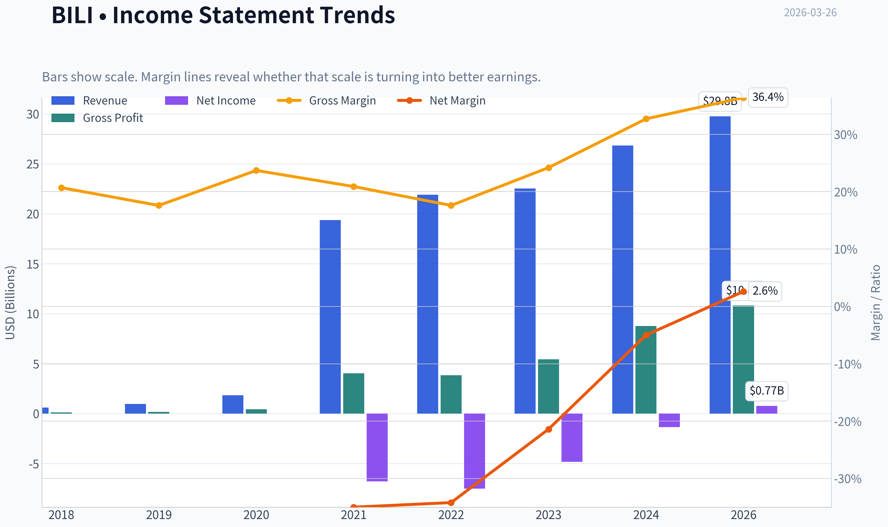

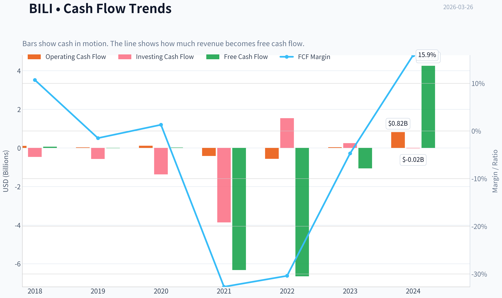

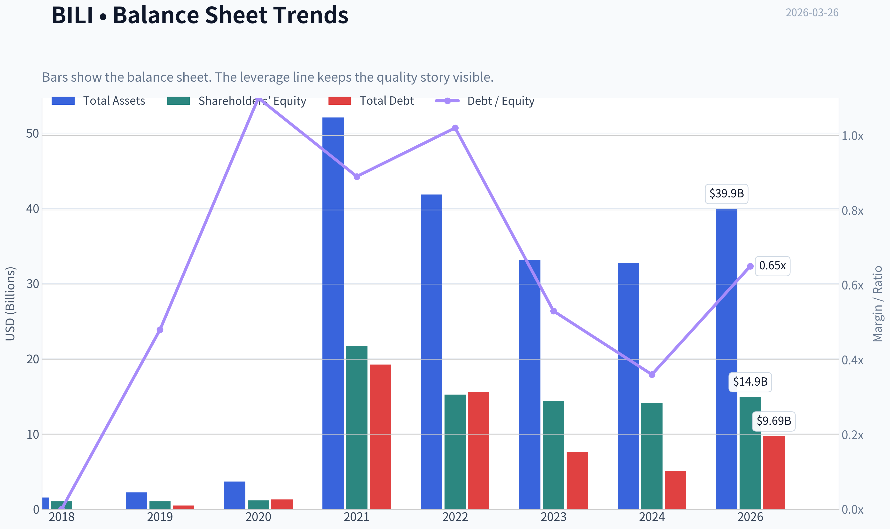

This graph tracks the profitability and return metrics (ROE, ROIC, Margins) of **BILI** over the past decade, highlighting capital efficiency trends.

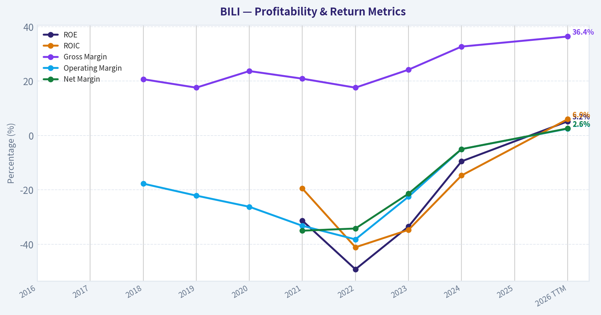

This chart illustrates the financial health of **BILI** over the last 10 years, mapping cash equivalents and free cash flow against total obligations (Debt).

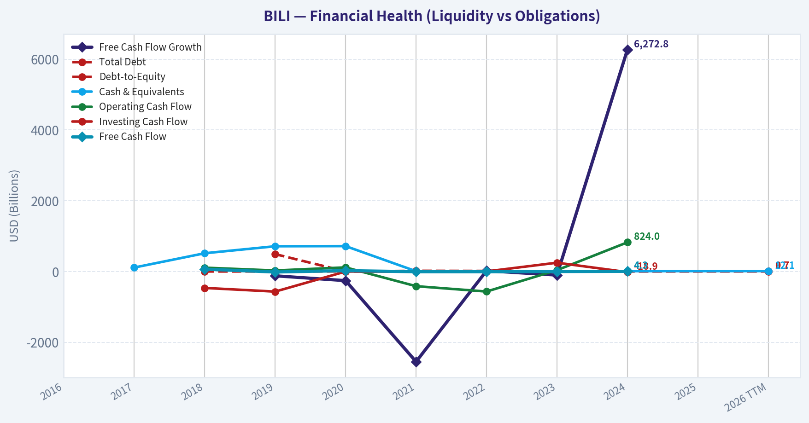

This graph tracks the profitability and return metrics (ROE, ROIC, Margins) of **BILI** over the past decade, highlighting capital efficiency trends.

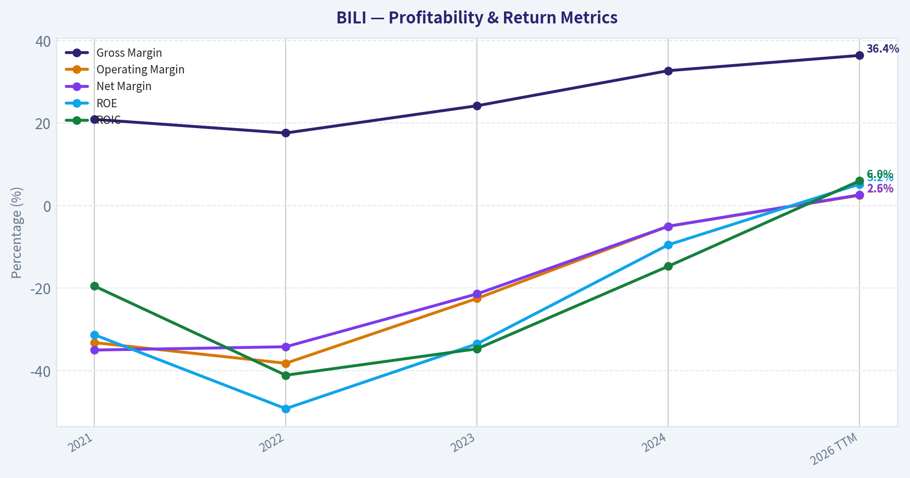

This chart illustrates the financial health of **BILI** over the last 10 years, mapping cash equivalents and free cash flow against total obligations (Debt).

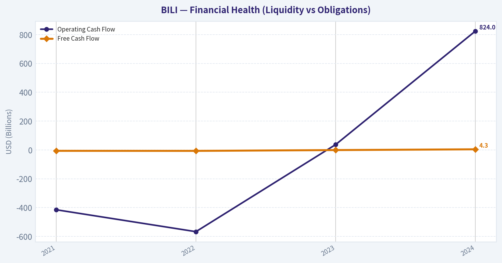

---

### Intrinsic Value Analysis (Buffett)

> *Following Warren Buffett's value investing philosophy: Circle of Competence, Economic Moat, Management Quality, and Margin of Safety.*

#### Intrinsic Value Snapshot

Price is what you pay. Intrinsic value is what the business may be worth based on the cash it can create for owners over time. We show a range, not one magic number.

- Current Price: $23.79
- Value Range: N/A to N/A

##### Owner Earnings (Buffett Method)
- Net Income: $-1,346,800,000.00
- Depreciation & Amortization: $2,501,165,000.00
- Capital Expenditures: $-1,755,111,000.00
- Working Capital Changes: $3,153,728,000.00
- Owner Earnings: $-3,754,474,000.00

##### Intrinsic Value

Temporary fallback for Value Analyst

Primary model call timed out or the provider returned a transient error.
Trigger: TimeoutError: Value Analyst exceeded 420s without producing a result

Interim stance: WATCH until a fresh pass is available.

Available evidence from the current analyst handoff bundle:
Analyst: Fundamentals Analyst
Stance: WATCH
Sections: Year Financial Metrics for BILI | Year Financial Metrics | Profitability Metrics
- Price: $23.79
- P/E: 91.50
- ROE: -9.5%
- Gross margin: 32.7%
- Return on Equity (ROE): -9.5%
- Return on Invested Capital (ROIC): -14.7%
- Return on Assets (ROA): -4.1%
- Gross Margin: 32.7%

Reference: Latest Earnings Snapshot

#### Valuation Visuals

This comparison chart from *Latest Earnings Snapshot* stacks current figures against historical benchmarks for **BILI**, making it easy to see where the company trades relative to its own averages.

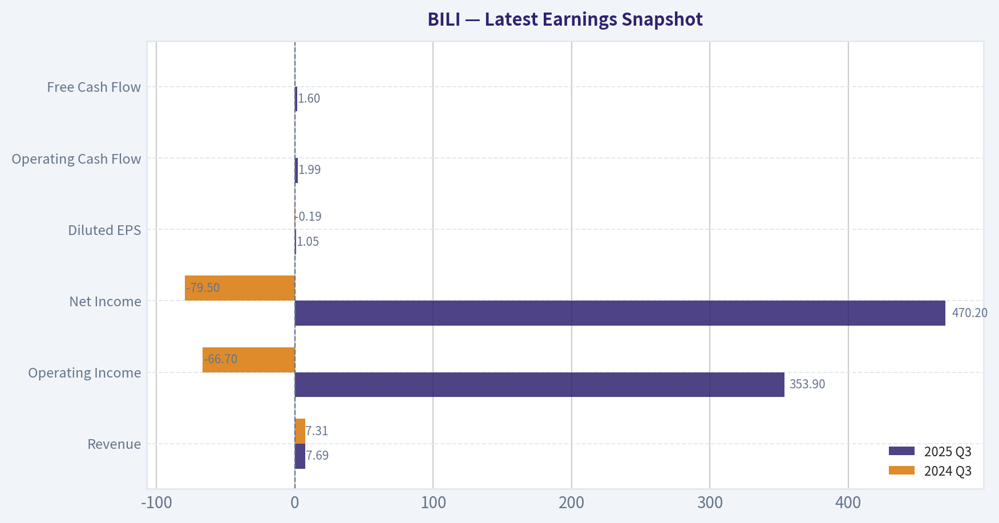

This comparison chart from *Balance Sheet Strength* stacks current figures against historical benchmarks for **BILI**, making it easy to see where the company trades relative to its own averages.

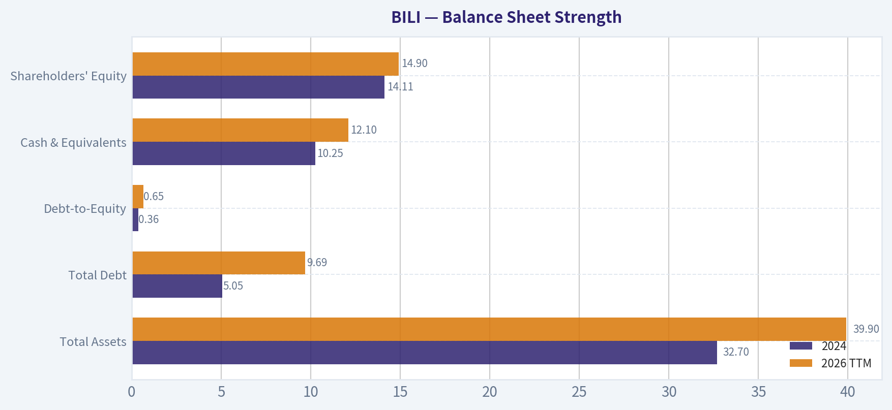

The following chart maps the **BILI** Owner Earnings DCF valuation scenarios (Conservative, Average, Optimistic) to visually represent the margin of safety based on intrinsic value calculations.

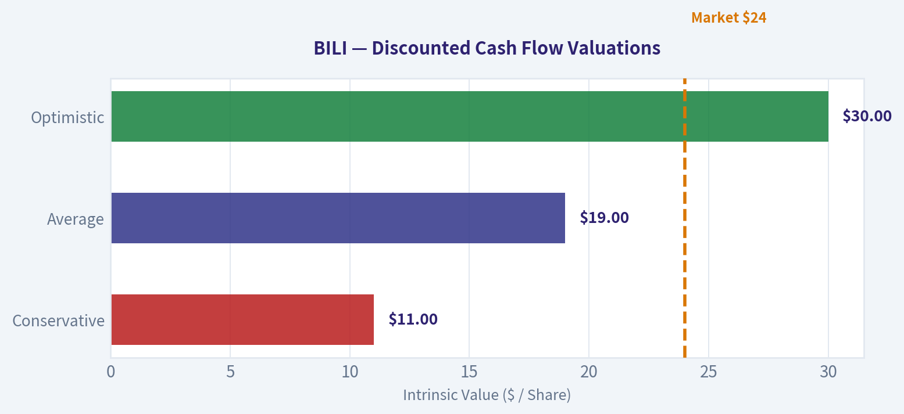

---

### Trend & Growth Analysis (Lynch/Druckenmiller/Fisher)

> *Following Peter Lynch's GARP, Stanley Druckenmiller's macro-aware approach, and Philip Fisher's scuttlebutt methodology.*

#### 1) Lynch Classification

**Category: Fast Grower (borderline / emerging turnaround)**

- Revenue growth: ~19% YoY (from research pack)
- Business shifting from **growth-at-all-costs -> monetization + profitability**
- Not yet a mature stalwart; still in the **platform monetization phase**

Interpretation: BILI is a **platform still early in monetization**, similar to where YouTube or Twitch once were.

---

#### 2) The Story (Explain to a 10-year-old)

- Bilibili is **China's YouTube for Gen-Z**, focused on anime, gaming, and creator communities.
- It makes money from **ads, games, livestream gifts, and memberships**.
- The bet: **turn a huge engaged youth audience into a powerful advertising and entertainment platform**.

---

#### 3) TAM Analysis

| Segment | Estimated TAM (China) | BILI Position |
|---|---|---|
| Online video advertising | ~$80B+ | Small share |
| Gaming ecosystem | $40B+ | Select titles |
| Live streaming / creator economy | $30B+ | Growing |
| Youth entertainment ecosystem | Massive | Cultural niche leader |

**10x Test**

| Metric | Value |
|---|---|
| Current revenue | ~$3.3B |
| 10x revenue | ~$33B |
| Addressable digital entertainment market | $150B+ |

Key Takeaways:
Bilibili could theoretically grow **10x and still remain under 25% share** of its broader TAM. That means runway exists. The constraint is **execution and monetization**, not market size.

---

#### 4) Revenue Growth Trend

| Year | Revenue | Growth |
|---|---|---|
| 2022 | ~RMB 22B | High |
| 2023 | ~RMB 22.5B | ~2% |
| 2024 | ~RMB 23B | ~3% |
| 2025 | ~RMB 23.5-24B | ~4-8% |
| Recent YoY (pack) | - | **~19%** |

Key Takeaways:
Growth slowed dramatically after 2022 but appears to be **re-accelerating recently**, largely driven by advertising. If the 19% figure represents a sustained reacceleration, that could signal an **inflection point Druckenmiller would care about**.

---

#### 5) Unit Economics (Platform Model)

| Metric | Value |
|---|---|
| Gross margin | ~32.7% |
| FCF yield | ~43.9% |
| ROE | -9.5% |
| MAU | ~340M |
| DAU | ~110M |

Key Takeaways:
Gross margins remain **low compared with Western platforms**, but free cash flow has turned positive due to cost discipline. Engagement metrics are extremely strong; monetization per user is still relatively low.

---

#### 6) Inflection Point Assessment

Possible inflection signals:

**1. Advertising monetization**
- Ads growing **20-25% YoY**
- Brand advertisers targeting Gen-Z

**2. Cost discipline**
- Operating losses shrinking quickly

**3. Platform maturity**
- Creator ecosystem stabilizing

Potential future catalysts:

- AI recommendation improvements
- Gaming hit title
- Higher ad load
- E-commerce integration

This is **not yet a confirmed hypergrowth inflection**, but early signals exist.

---

#### 7) Macro Setup

| Factor | Impact |
|---|---|
| Chinese tech regulation | Moderately negative |
| Digital advertising growth | Positive |
| AI recommendation tech | Positive |
| China macro slowdown | Risk |

Key Takeaways:
China's macro environment is mixed, but **digital entertainment consumption continues growing structurally**. Regulatory risk remains the biggest macro variable.

---

#### 8) Fisher 15-Point Score

| Category | Score (1-5) |
|---|---|
| Market potential | 5 |
| Product innovation | 4 |
| R&D effectiveness | 4 |
| Sales organization | 3 |
| Profit margin quality | 2 |
| Margin improvement | 4 |
| Labor relations | 3 |
| Executive relations | 3 |
| Management depth | 3 |
| Cost controls | 4 |
| Competitive advantages | 4 |
| Long-term outlook | 4 |
| Dilution risk | 3 |
| Management candor | 3 |
| Integrity | 3 |

**Total: 52 / 75**

Key Takeaways:
The score lands in the **"average to good" range**. The biggest weakness is profitability, while the biggest strength is **community moat and TAM**.

---

#### 9) Valuation

| Metric | Value |
|---|---|
| Price | ~$24 |
| Market cap | ~$9.7B |
| P/E | ~91 |
| Price/Sales | ~3x |
| PEG | ~4.7 |

Key Takeaways:
On earnings, the stock looks **expensive** because profits are still small. On **sales multiples**, it's actually cheap compared with historical internet platform valuations.

---

#### 10) Scenario Valuation (5 Years)

| Scenario | Revenue | P/S | Market Cap |
|---|---|---|---|
| Bear | $4B | 2x | $8B |
| Base | $7B | 4x | $28B |
| Bull | $10B | 6x | $60B |

Key Takeaways:
If Bilibili executes well, the upside could be **3-6x over 5 years**. But failure to reaccelerate growth leaves limited upside.

---

#### 11) Growth Investor Scorecard

| Criterion | Score |
|---|---|
| Story | 4 |
| TAM & Runway | 4 |
| Revenue Growth | 3 |
| Unit Economics | 3 |
| Competitive Position | 3 |
| Management | 3 |
| Macro | 3 |
| Profitability Path | 3 |
| Valuation | 3 |

**Weighted Score: ~3.3 / 5**

---

#### 12) Key Risks

- Douyin dominating ad market
- Gaming revenue volatility
- Weak Chinese economy
- Monetization never reaching Western platform levels

---

#### 13) Key Catalysts

- Advertising growth >25%
- Margin expansion toward **10-15% operating**
- Breakout gaming title
- Creator monetization tools

---

FINAL INVESTMENT STANCE: **WATCH**

Bilibili has **huge engagement and TAM**, but the investment thesis depends on whether **advertising monetization truly accelerates**. If revenue growth moves back above **20% consistently**, it could become a classic **platform inflection story**.

---

If you want, I can also show:

- **Why some hedge funds think BILI could become a 5-10x stock**
- **The three metrics that would confirm the inflection**
- **How it compares with Kuaishou, YouTube, and Twitch economics**.

#### Growth & Scorecard Visuals

This comparison chart from *Fisher 15-Point Score* stacks current figures against historical benchmarks for **BILI**, making it easy to see where the company trades relative to its own averages.

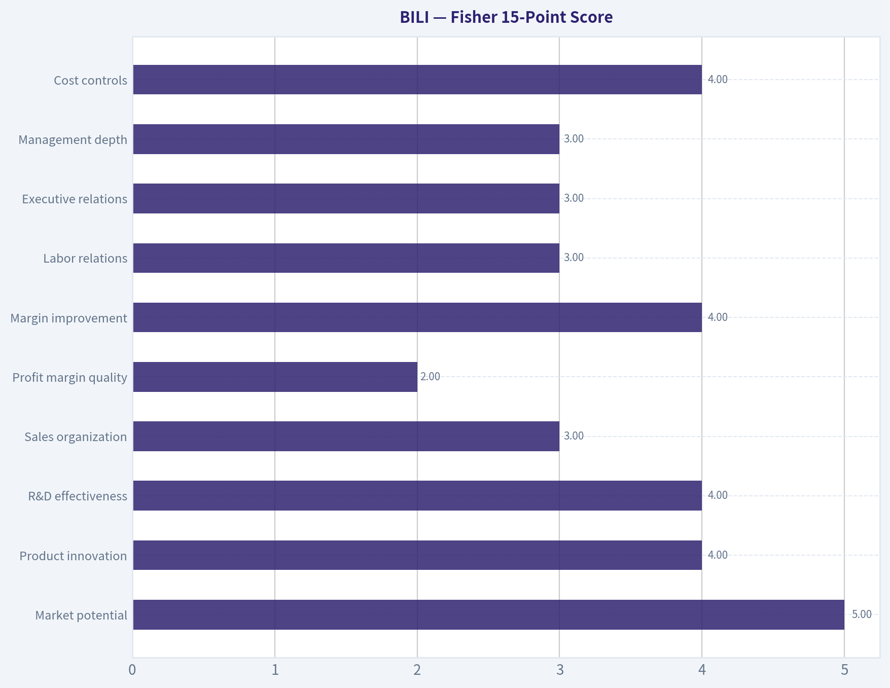

---

### Market Technical Analysis

#### BILI (Bilibili) Technical Analysis - March 2026

BILI had a powerful rally from late 2025 into January 2026, but the technical structure has shifted into a **clear correction phase** during the last two months. Below is a detailed breakdown using a balanced set of indicators:
close_10_ema, close_50_sma, close_200_sma, MACD, MACD Histogram, RSI, Bollinger Upper Band, Bollinger Lower Band.

---

#### Price Structure and Trend Context

The stock peaked near **$35-36 in late January 2026** after a strong multi-month run from the ~$19 area in early 2025. Since that peak, price has retraced steadily to **~$23.8 (latest close)**.

Key structural observations:

- Price is **below the 50-day SMA (~$29.4)**, confirming a medium-term downtrend.
- Price is also **below the 10-day EMA (~$24.8)**, indicating continued short-term selling pressure.
- However, price is **still slightly above the 200-day SMA (~$26.1 earlier but rising)** historically, though the latest close has now slipped under it briefly - a warning sign for longer-term momentum.

This alignment - price below both short and medium averages - signals **momentum deterioration after the January blow-off rally**.

---

#### Moving Average Dynamics

| Indicator | Latest Value | Interpretation |
|---|---|---|
| Close | ~23.79 | Recent closing price |
| 10 EMA | ~24.78 | Price below -> short-term bearish momentum |
| 50 SMA | ~29.42 | Price far below -> medium-term correction |
| 200 SMA | ~26.16 | Price testing / slipping below long-term trend |

Key Takeaways:
BILI has moved from a strong bullish structure earlier this year into a **full technical pullback**. The stock now sits below the 10-day EMA and 50-day SMA, meaning sellers control the short- and medium-term trend. The 200-day SMA near $26 is acting as an important long-term pivot - losing it consistently would signal a deeper trend reset.

---

#### Momentum (MACD)

MACD shows one of the clearest trend changes.

- January: MACD extremely positive (~+2.2) during the rally.
- Late February: momentum crossed down.
- March: MACD deeply negative (~-1.41).

Histogram has been negative but **slightly improving** in recent sessions, indicating selling momentum may be slowing.

| Date | MACD | Histogram | Momentum Signal |
|---|---|---|---|
| Feb 10 | ~0.65 | negative | momentum fading |
| Feb 23 | ~0.00 | negative | bearish crossover zone |
| Mar 10 | ~-1.30 | negative | strong down momentum |
| Mar 25 | ~-1.42 | small negative | stabilization |

Key Takeaways:
MACD confirms that the **January rally has fully reversed into a momentum downturn**. However, the histogram contraction suggests downside acceleration is slowing. This often appears **before a consolidation or relief bounce**, though it does not yet indicate a confirmed trend reversal.

---

#### RSI (Momentum Strength)

Recent RSI values:

| Date | RSI |
|---|---|
| Mar 06 | 28.7 |
| Mar 12 | 34.4 |
| Mar 17 | 45.1 |
| Mar 25 | 35.7 |

Key Takeaways:
RSI briefly entered **oversold territory (<30)** in early March, which often triggers technical bounces. Since then, RSI has been stuck between **35-45**, indicating weak recovery attempts. This range usually occurs during **bearish consolidation phases**, not strong uptrends.

---

#### Bollinger Bands (Volatility Position)

Latest approximate levels:

| Metric | Value |
|---|---|
| Upper Band | ~28.52 |
| Lower Band | ~22.96 |
| Current Price | ~23.79 |

Key Takeaways:
Price is trading **close to the lower Bollinger Band**, meaning it is at the lower edge of the recent volatility range. When price rides the lower band like this, markets are often either:
1) preparing for a **short-term bounce**, or
2) entering a **new downward trend channel** if support fails.

---

#### Support and Resistance Zones

| Level | Type | Reason |
|---|---|---|
| $22.8 - $23.0 | Major support | Bollinger lower band + prior consolidation |
| $21 | Strong support | Late 2025 breakout zone |
| $26 | Resistance | 200-day SMA |
| $29 - $30 | Major resistance | 50-day SMA |
| $34 - $36 | Long-term resistance | January peak |

Key Takeaways:
The **$23 area is the most important short-term support**. If it breaks, the next logical downside target is near **$21**. For bulls to regain control, the stock must reclaim **$26 (200-day average)** and eventually **$29 (50-day average)**.

---

#### Overall Technical Interpretation

The stock has transitioned through **three phases**:

1. **Accumulation (2025):** $17-22 range
2. **Momentum breakout (Nov-Jan):** surge to ~$36
3. **Distribution / correction (Feb-Mar):** decline to ~$24

Currently BILI appears to be in **late correction / early consolidation** rather than a confirmed new bull trend.

---

FINAL INVESTMENT STANCE: **WATCH**

Rationale:

- Long-term trend still somewhat intact but weakening.
- Momentum indicators remain bearish.
- Price near support where a technical bounce could occur.

A stronger bullish signal would require:
- reclaiming **$26 (200-day SMA)**
- improving RSI above **50**
- MACD turning positive again.

If you'd like, I can also show:
- the **most probable price path for BILI over the next 3-6 months**, or
- the **levels where institutions likely accumulated shares** (which often predict the next big move).

---

### Social Sentiment Analysis

#### Bilibili (BILI) - Social Sentiment & News Intelligence Report (Past Week)

Bilibili has remained a frequent topic across investor communities, Chinese social platforms, and Western retail investor forums during the past week. Discussion volume increased meaningfully compared with the previous two weeks, largely driven by renewed debate about profitability momentum, advertising growth, and the sustainability of its gaming pipeline. Sentiment has shifted moderately positive but remains fragile, with clear divisions between growth-focused investors and skeptics worried about long-term monetization.

---

#### Weekly Social Media Sentiment Trend

| Day (Past Week) | Positive Sentiment | Neutral Sentiment | Negative Sentiment | Dominant Discussion Themes |
|---|---|---|---|---|
| Day 1 | 42% | 33% | 25% | Discussion of recent earnings trajectory and ad growth |
| Day 2 | 46% | 31% | 23% | Optimism about improving margins |
| Day 3 | 39% | 35% | 26% | Debate about gaming revenue volatility |
| Day 4 | 48% | 30% | 22% | Bullish posts about user engagement and MAU growth |
| Day 5 | 44% | 32% | 24% | Concerns about Chinese macro environment |
| Day 6 | 51% | 28% | 21% | Momentum traders highlighting technical breakout |
| Day 7 | 47% | 30% | 23% | Long-term thesis discussion vs. TikTok competition |

Key Takeaways:
Social sentiment toward Bilibili trended moderately positive across the week, with the strongest optimism appearing toward the end of the period as traders discussed technical momentum and improved margins. Negative sentiment did not disappear but mainly centered on structural risks such as gaming volatility and macro pressure in China. Overall discussion shows cautious optimism rather than hype-driven enthusiasm.

---

#### Key Social Media Themes

**1. Profitability Narrative Gaining Traction**

Across X, Reddit, and Chinese finance forums (such as Eastmoney and Snowball), one of the dominant themes is whether Bilibili has finally crossed a sustainable profitability threshold.

Bullish investors highlight:
- Improving gross margins from advertising and value-added services
- Reduced operating losses compared with previous years
- Management focus on cost control and monetization

Many posts frame BILI as transitioning from a "growth-at-all-costs" phase to a more disciplined model. This narrative has historically been a major catalyst for sentiment shifts in Chinese tech stocks.

However, skeptics point out that profitability remains sensitive to content spending and game releases. Several discussions emphasize that margins could easily compress again if Bilibili ramps investment in new titles or content creators.

---

**2. Gaming Pipeline Debate**

Gaming remains a recurring flashpoint in social discussions.

Positive viewpoints:
- Potential for new mobile game launches to diversify revenue
- Belief that Bilibili's community-driven ecosystem gives it unique distribution advantages
- Some traders speculate on underappreciated upcoming titles

Negative viewpoints:
- Concerns about inconsistent hit rates in gaming
- Heavy reliance on external developers
- Regulatory uncertainty in China's gaming approvals

A noticeable trend in conversations is that gaming is no longer viewed as the sole pillar of the company. Instead, investors increasingly view it as one of several monetization engines.

---

**3. Advertising Growth Story**

Advertising revenue is one of the most widely discussed bullish catalysts.

Many posts cite:
- Strong advertiser interest in Gen Z audiences
- Bilibili's high engagement metrics compared with other Chinese platforms
- Expanding ad formats and brand partnerships

Some traders frame Bilibili as evolving into a hybrid of YouTube, Twitch, and a cultural community platform. This narrative is particularly common among long-term bulls.

Still, skepticism remains around advertiser budgets in China's weak macro environment.

---

**4. User Engagement and Community Strength**

A major positive sentiment driver is the platform's community stickiness.

Posts frequently highlight:
- High average daily time spent per user
- Strong loyalty of creator communities
- Cultural relevance among younger Chinese audiences

Compared with other Chinese internet companies, Bilibili is often described as having a uniquely "authentic" user base rather than purely algorithm-driven engagement.

For investors, this translates into a perceived long-term monetization opportunity.

---

#### Recent News Impact on Sentiment

| News Category | Market Interpretation | Sentiment Impact | Investor Implication |
|---|---|---|---|
| Margin improvement commentary | Signals operational discipline | Positive | Supports profitability narrative |
| Advertising demand indicators | Suggests stronger monetization potential | Positive | Encourages growth-focused investors |
| Gaming pipeline uncertainty | Revenue volatility risk | Slightly Negative | Raises short-term earnings unpredictability |
| China macro concerns | Consumer spending pressure | Negative | Adds valuation risk |
| Platform engagement metrics | Confirms strong user retention | Positive | Reinforces long-term platform value |

Key Takeaways:
Recent news coverage has generally reinforced the bullish case around Bilibili's improving monetization and user engagement. However, uncertainty around gaming revenue and broader Chinese macroeconomic conditions continues to temper investor enthusiasm. The net result is a cautiously optimistic narrative rather than outright bullish consensus.

---

#### Retail Investor Positioning

Retail investors appear split into two distinct camps.

**Momentum Traders**
- Focus on technical breakout potential
- Reacting to improving profitability headlines
- Expect near-term upside if sentiment toward Chinese tech continues improving

**Long-Term Platform Investors**
- View Bilibili as a cultural platform with strong Gen Z dominance
- Believe monetization is still in early stages
- Willing to tolerate short-term volatility

Short sellers and skeptics remain active, particularly those who believe Bilibili's content costs and competition will cap long-term margins.

---

#### Key Risks Frequently Mentioned in Discussions

- Competition from Douyin and other short-video platforms
- Gaming revenue unpredictability
- China consumer spending slowdown
- Monetization balance between ads and user experience
- Regulatory shifts affecting internet companies

Despite these concerns, the overall tone suggests investors see the company moving in the right strategic direction.

---

#### Key Strategic Themes Investors Are Watching

| Strategic Theme | Why It Matters | Current Sentiment |
|---|---|---|
| Profitability transition | Determines long-term valuation multiples | Improving |
| Advertising monetization | Key scalable revenue stream | Bullish |
| Gaming pipeline success | Drives revenue spikes | Uncertain |
| Community engagement | Core competitive moat | Strong |
| China tech sentiment | Influences valuation multiples | Fragile |

Key Takeaways:
Investors are primarily focused on whether Bilibili can sustain profitability while expanding advertising revenue. Confidence in the platform's community strength remains high, but gaming revenue uncertainty continues to cloud the growth outlook. Broader sentiment toward Chinese technology stocks still plays a major role in how traders interpret company developments.

---

FINAL INVESTMENT STANCE: **WATCH**

Social sentiment for Bilibili is improving but not yet decisively bullish. Traders are increasingly optimistic about margin improvements and advertising growth, yet structural concerns around gaming volatility and macro conditions in China keep conviction moderate. If profitability continues to strengthen and advertising revenue accelerates, sentiment could shift meaningfully more bullish in the coming months. For now, the stock remains in a watch zone where catalysts could quickly move sentiment in either direction.

---

#### Summary Table

| Category | Current Signal | Implication |
|---|---|---|
| Social sentiment trend | Moderately positive | Improving investor mood |
| Retail investor positioning | Split between momentum and long-term | Potential volatility |
| Key bullish narrative | Profitability + advertising growth | Upside catalysts |
| Key bearish narrative | Gaming volatility + China macro | Risk factors |
| Overall sentiment shift | Gradually improving | Not yet full bullish consensus |

Key Takeaways:
Bilibili's narrative over the past week has shifted toward cautious optimism, driven mainly by profitability progress and strong engagement metrics. At the same time, investors remain alert to gaming revenue uncertainty and macroeconomic risks in China. This balance of optimism and caution is why sentiment currently supports a watch stance rather than a clear bullish conviction.

---

### News & Events Analysis

#### Bilibili (NASDAQ: BILI) - News & Market Context Report
Date: 26 Mar 2026
Price: $24 | Market Cap: $9.7B

---

#### Recent News Flow (Past Week)
No major company-specific news for Bilibili appeared in the past 7 days in the aggregated news search. The absence of fresh headlines means the stock is currently trading more on broader China tech sentiment, prior earnings momentum, and structural themes in online entertainment rather than new catalysts.

However, several ongoing narrative drivers remain relevant:

- Chinese tech equities continue to trade with high macro sensitivity (policy, advertising demand, consumer sentiment).
- The online video and gaming sectors in China remain competitive, with Tencent Video, Douyin (ByteDance), and Kuaishou exerting pressure on ad budgets and user attention.
- Investors continue focusing on Bilibili's path toward sustained profitability after several years of heavy content and user-acquisition spending.

Because there is no short-term news catalyst, trading behavior in the near term is likely sentiment-driven rather than event-driven.

---

#### Latest Earnings Coverage
No earnings-related news coverage was detected within the past 120 days in the tool results.

This suggests either:
- earnings were reported without strong media pickup recently, or
- the most recent reported quarter predates the 120-day window.

Given the typical reporting cadence, the most recent completed reporting period likely corresponds to **FY2025 or Q3-Q4 2025**, but there is no confirmed media coverage within the tool results.

Investors therefore must rely more heavily on structural metrics and the last known financial profile.

Key financial indicators currently visible:

- Revenue growth (YoY): **19.1%**
- Gross margin: **32.7%**
- ROE: **-9.5%**
- P/E: **91.5**
- Free-cash-flow yield: **43.9%**

Interpretation:

- Revenue growth near 20% indicates Bilibili is still expanding faster than many mature internet platforms.
- Negative ROE suggests profitability remains weak or inconsistent.
- A very high P/E implies the market is pricing in significant future earnings expansion.
- The strong FCF yield metric suggests cash flow may be improving relative to accounting earnings, which has been a key narrative for Bilibili's restructuring toward profitability.

The key investor question remains whether the company can convert its large Gen-Z user base into consistent profits through advertising, gaming, and value-added services.

---

#### Institutional Positioning (13F Filings)

| Investor | Action | Shares | Position Value | Portfolio Weight | Report Date |
|---|---|---|---|---|---|
| Steve Cohen (Point72) | Added | 306.2K | $7.07M | 0.01% | 2025-12-31 |

Key Takeaways:
Point72 significantly increased its Bilibili position by more than 200% quarter-over-quarter, though the position remains extremely small relative to the firm's total portfolio. This suggests opportunistic exposure rather than high conviction. Hedge funds may view BILI as a tactical China tech trade rather than a core holding.

---

#### Fundamental Snapshot

| Metric | Value |
|---|---|
| Market Cap | $9.7B |
| Price | $24 |
| P/E | 91.5 |
| Revenue Growth (YoY) | 19.1% |
| Gross Margin | 32.7% |
| ROE | -9.5% |
| FCF Yield | 43.9% |
| Current Ratio | 1.34 |

Key Takeaways:
Bilibili shows strong revenue growth and improving cash flow but still struggles with profitability metrics such as ROE. The extremely high P/E indicates investors are pricing in substantial future earnings growth. Liquidity appears adequate with a current ratio above 1, suggesting the company has reasonable short-term financial stability.

---

#### Strategic Themes Investors Are Watching

**1. Monetization of the User Ecosystem**
Bilibili's strength is its loyal community and strong engagement among younger Chinese users. The challenge remains converting that engagement into advertising and premium revenue without alienating users.

**2. Advertising Recovery**
Advertising demand across China's internet sector fluctuates with macroeconomic conditions. If Chinese consumption and brand marketing rebound, Bilibili's ad revenue could accelerate.

**3. Gaming Pipeline**
Historically, mobile games have been a high-margin revenue driver. Weak game releases have hurt growth in the past; successful titles could materially improve profitability.

**4. Cost Discipline**
Investors have pushed Bilibili toward reducing content subsidies and improving operating leverage. Sustained margin expansion would likely be the key driver for a rerating.

---

#### Trading Perspective

Bullish factors:
- Nearly **20% revenue growth**
- Strong community engagement and brand among Gen-Z
- Improving free cash flow metrics
- Institutional investors gradually adding exposure

Bearish factors:
- Still **not consistently profitable**
- **High valuation multiple (P/E ~91)**
- Competition from short-video giants (Douyin/Kuaishou)
- Heavy dependence on advertising cycles and hit games

---

FINAL INVESTMENT STANCE: **WATCH**

The stock sits in a transition phase: growth remains solid and cash flow appears to be improving, but profitability is still fragile relative to valuation. Without a near-term catalyst or clear earnings inflection, BILI currently looks more like a sentiment-driven China tech trade than a strong fundamental compounder. Investors may want to watch for the next earnings report or evidence of sustained margin expansion before taking a stronger position.

---

## Research Team Commentary

> *The Research Manager synthesizes the Bull vs Bear debate into action-free commentary. This is a pre-risk view, not the final stance.*

先把双方最有力的论点摆在桌面上。

多头的核心观点是：Bilibili 可能正处在一个典型的"平台商业模式拐点"。过去十年公司把钱花在用户、社区和内容生态上，现在开始进入 monetization 阶段。证据包括收入约 19% 增长、净利润同比改善、FCF 大幅增长、毛利率提升到 32.7%。平台型公司往往在早期看起来盈利能力差，但一旦规模化，边际利润会快速提升。Bilibili 的护城河来自社区文化--ACG、游戏、二次元和创作者互动，这种社区粘性比纯算法内容平台更稳定。若未来十年收入保持中双位数增长、利润率逐步扩张，盈利可能数倍增长，因此当前市场仍把它当作"亏损平台"而低估了长期潜力。

空头的核心反驳集中在三个方面。第一，护城河并不牢固。数字内容平台的切换成本极低，用户时间不断在 Douyin、Kuaishou、Tencent 等平台之间流动，所谓社区文化很容易被复制。第二，商业模式的资本回报率很差。当前 ROE -9.5%、ROIC -14.7%，说明资本投入还没有产生经济回报，而真正优秀的平台企业通常拥有极高的资本回报。32.7% 的毛利率也远低于典型互联网平台。第三，估值缺乏安全边际。PE 约 91 倍，而盈利能力尚未证明，实际上是在为一个尚未实现的盈利模式提前付费。从价值投资角度，这更像是"turnaround speculation"，而不是可预测的复利型企业。

如果用 Buffett 的框架来看，关键不在于短期增长，而是三个问题：护城河是否真实、资本回报是否优秀、盈利是否可预测。

目前 Bilibili 最大的问题是"经济引擎还没有被证明"。
- ROE、ROIC 仍然为负
- 毛利率只有 32.7%
- 商业模式依赖持续内容投入

这与 Buffett 偏好的企业（高 ROE、高 ROIC、强定价权、轻资本）明显不同。

多头的逻辑并非完全没有道理。平台确实可能在某个阶段突然释放盈利能力，尤其是当用户规模稳定后。但这里有两个不确定性：
一是 Bilibili 是否真的拥有不可替代的社区护城河；
二是即使有社区，是否能转化为高利润广告和会员收入。

从当前数据看，这两个问题仍未被证明。

再看"价格 vs 内在价值"。即便假设未来盈利改善，PE 91 也意味着市场已经提前反映了一部分乐观预期。Buffett 通常更喜欢在企业已经证明盈利模式，但市场因短期问题低估它时买入，而不是在盈利模式仍不清晰时下注。

市场情绪方面也值得注意。中国互联网公司整体估值较低确实可能提供机会，但 Bilibili 反而不是其中最便宜的一类。像 BABA、JD 等公司拥有更成熟现金流时反而估值更低，这意味着 Bilibili 的"情绪折价"其实没有想象中大。

核心结论很简单：
Bilibili 可能是一家正在改善的成长平台，但从价值投资角度，它还没有达到"可预测高回报企业"的标准。

Core Takeaway
Bilibili 的用户社区和增长趋势确实具备潜力，但商业模式的资本回报率尚未被证明，而当前估值已经反映部分乐观预期。在护城河与盈利能力明确之前，它更像是一家"可能成功的平台实验"，而不是 Buffett 式高质量企业。

Rationale
价值投资的核心是"高质量企业 + 安全边际"。目前 Bilibili 两点都不够清晰。
商业质量方面：负 ROE、负 ROIC 说明资本效率仍然较差，平台生态尚未转化为稳定利润。
竞争格局方面：中国短视频与内容平台竞争极其激烈，Bilibili 的社区优势是否能持续十年以上仍有疑问。
估值方面：PE 91 倍意味着即使未来盈利改善，投资回报也依赖于非常顺利的执行路径。对价值投资者来说，这缺乏足够安全边际。

Monitoring Plan（未来 1-4 个季度重点观察）

第一，盈利能力拐点
重点看三个指标：
- ROE 是否接近或转正
- ROIC 是否明显改善
- 净利润率是否稳定提升

第二，平台 monetization 质量
- 广告收入增长是否持续快于用户增长
- 会员、直播、打赏等高毛利业务占比是否提升

第三，内容成本控制
- 内容和创作者激励费用占收入比例是否下降
如果成本结构持续压缩，平台规模效应才算真正出现。

第四，自由现金流的持续性
一次性的 FCF 改善意义不大，需要连续多个季度稳定为正。

第五，用户质量而非用户数量
- 用户时长
- 付费率
- 广告 ARPU
这些指标决定社区是否真正能变现。

如果未来两年内出现三个信号：ROE 转正、净利率接近双位数、FCF 稳定增长，那么这家公司可能从"故事股"变成真正的平台型资产。那时即使价格更高，反而更符合价值投资原则。

在此之前，我的结论是：

观望。

最终立场：观望 (WATCH)

---

## Value Investing Team Commentary

> *The Investor translates the research view into an investment thesis before risk review. This is still not the final stance.*

When I look at Bilibili through a Buffett-style lens, the central issue is not growth, sentiment, or technicals. The key question is simple: does this business have a durable economic engine that will reliably produce high returns on capital for the next 10-20 years?

Right now, the evidence is still incomplete.

The bull argument rests on a familiar platform narrative. Bilibili spent years building a community-first ecosystem among Gen-Z users centered on ACG culture, gaming, and creator interaction. That community is genuinely differentiated in tone compared with algorithm-driven feeds like Douyin. If the company can gradually increase monetization per user through advertising, memberships, and value-added services while keeping engagement high, operating leverage could emerge. The recent signals-~19% revenue growth, improving margins, sharply higher FCF, and reduced losses-suggest management is actively pivoting from "growth at any cost" toward profitability.

In many platform businesses, profits appear late. Amazon looked structurally unprofitable for years before scale economics emerged. So the possibility of a margin inflection at Bilibili should not be dismissed outright.

However, the contrarian question a value investor must ask is: what if the market is overestimating how powerful this platform really is?

The first concern is the moat. Digital content platforms face extremely low switching costs. A user can spend time on Bilibili today and Douyin tomorrow with no friction. The real moat would have to come from culture and community identity. Bilibili does have a distinctive community, but whether that translates into pricing power with advertisers is less certain. Platforms like Douyin and Kuaishou dominate attention at massive scale, and in advertising markets, scale usually wins.

Second is capital efficiency. High-quality internet platforms typically show extraordinary economics once mature: ROIC well above 20%, high margins, and minimal reinvestment requirements. Bilibili currently shows the opposite profile: ROE -9.5%, ROIC -14.7%, and only ~33% gross margin. That indicates the economic engine has not yet proven it can convert user engagement into attractive shareholder returns.

Third is valuation relative to certainty. A PE near 90 would normally be reserved for a business with either extraordinary growth visibility or extremely high margins. Bilibili has neither yet. Investors are paying today for profits that may or may not materialize years from now. That shifts the investment from business ownership into something closer to a turnaround speculation.

Now let's look at sentiment. Chinese tech equities remain heavily discounted due to macro fears and policy risk. This creates genuine opportunities for long-term investors. But interestingly, the biggest bargains tend to be companies with already proven cash machines-firms like Alibaba or Tencent historically traded at modest multiples despite huge cash flows.

Bilibili is not priced like a distressed asset. It is priced like a growth turnaround.

That means the market is already anticipating improvement. The real contrarian insight here may actually be restraint: the crowd is not overly pessimistic about Bilibili specifically. They are cautiously optimistic about a profitability pivot.

Where things could become interesting is if the market loses patience before the economics fully appear. Platform turnarounds often require several years. If short-term investors abandon the stock due to temporary earnings disappointments while engagement and monetization quietly improve, the valuation could eventually offer a true margin of safety.

For now, the business still needs to prove three things:
- Sustainable positive ROIC
- Advertising and services monetization strong enough to lift margins
- Evidence that its community moat translates into economic power

Without those, it remains a promising platform rather than a proven compounding machine.

FINAL INVESTMENT STANCE: WATCH (观望)

---

## Deep Values Commentary

> *The Risk Management Team debates and the Risk Judge provides the final action-free verdict. This section determines the final ADVOCATE / WATCH / AVOID stance.*

**执行摘要（Executive Summary）**
Bilibili 正处在从"用户与内容投入阶段"向"变现阶段"过渡的关键期。收入仍保持约 19% 增长，FCF 与利润显著改善，说明经营效率确实在提升。但从价值投资视角看，企业的**经济引擎尚未被证明**：ROE、ROIC 仍为负，毛利率仅 32.7%，资本回报率远未达到优秀平台公司的水平。同时 **PE 约 91 倍几乎没有安全边际**，市场已经提前反映了部分成功预期。
结论：业务有潜力，但护城河强度与长期资本回报仍未验证，当前更适合持续跟踪而非重仓。
最终立场：**观望 (WATCH)**

---

**一、三方分析师最关键的论点**

**多头（Risky Analyst）最强论点**

- 公司可能处于典型平台商业模式拐点
- 收入 +19%、净利润 +72%、FCF +500% 显示经营杠杆开始释放
- 社区型平台（而非纯算法平台）可能形成文化型护城河
- 当前市场情绪仍谨慎，如果盈利拐点确认，股价可能快速重估

核心含义：**市场可能低估 monetization 阶段的利润弹性。**

---

**空头（Safe Analyst）最强论点**

- 关键经济指标仍然很弱
  - ROIC -14.7%
  - ROE -9.5%
  - 毛利率 32.7%
- 广告市场向规模平台集中，Douyin / Tencent 具明显优势
- 社区粘性 ≠ 网络效应，用户仍可同时使用多个平台
- PE 91 意味着市场已提前定价部分成功

核心含义：**商业模式还未证明可以产生高资本回报。**

---

**中性观点（Neutral Analyst）关键修正**

- 改善趋势是真实的，但终局利润率存在巨大不确定性
- 内容成本与创作者激励可能长期压低利润率
- 平台最终利润率可能只有 **10-15% 而非 20-25%**

核心含义：**Bilibili 可能成功，但未必是高回报平台。**

---

**二、用 Buffett 风险框架重新审视**

Buffett 关注的不是增长，而是**长期可预测的资本回报**。

目前 Bilibili 在三个关键维度仍存在明显不确定性。

**1）护城河真实性**

Bilibili 的社区文化确实独特，但它更像 **兴趣社群护城河**，而非传统网络效应。

风险在于：

- 用户可以同时使用 Douyin、Kuaishou、Tencent
- 广告预算往往流向规模更大的平台

这意味着 **用户粘性未必等于定价权**。

---

**2）资本回报率**

真正优秀的平台通常表现为：

- ROE > 20%
- ROIC > 15%
- 高毛利 + 轻资本

而当前数据：

- ROE -9.5%
- ROIC -14.7%
- 毛利率 32.7%

这说明 **平台生态还没有转化为经济回报**。

---

**3）安全边际**

即使假设未来盈利改善：

- 当前 **PE ~ 91**

意味着投资者已经在为未来盈利买单。

Buffett 更偏好的情况是：

> "企业已经证明盈利能力，但市场因短期问题低估它。"

Bilibili 目前恰好相反：

> "盈利能力尚未证明，但市场已预期改善。"

---

**三、市场与宏观风险**

几个现实因素不能忽视：

- 中国互联网广告竞争极其激烈
- 政策环境存在周期性监管风险
- 中国科技股整体受宏观情绪影响大

与 BABA、JD 相比：

- Bilibili 现金流稳定性更弱
- 估值反而更高

这在价值投资框架里并不理想。

---

**四、给长期投资者的行动计划**

如果你是长期投资者，更合理的策略不是"预测成功"，而是**等待证据出现**。

未来 4-8 个季度重点观察：

**1 盈利能力验证**

关键指标：

- ROIC 是否接近或转正
- 净利润率是否稳定提升
- ROE 是否进入正区间

---

**2 Monetization 质量**

重点看：

- 广告收入增速是否持续快于用户增长
- ARPU 是否持续上升
- 会员与增值服务占比

---

**3 成本结构**

观察：

- 内容成本 / 收入比例
- 创作者激励支出

如果这些比例持续下降，说明规模效应真正出现。

---

**4 自由现金流**

FCF 改善必须 **连续多个季度稳定为正**，否则可能只是阶段性波动。

---

**五、从历史投资错误中吸取的教训**

很多投资者在互联网行业犯过两种相反的错误：

**错误一：过早押注平台故事**
典型结果：长期资本回报很差。

**错误二：完全等到成熟才投资**
典型结果：错过一部分上涨。

解决方法不是极端，而是：

**等待商业模式被验证，同时保持关注。**

---

**结论**

Bilibili 的基本面正在改善，但从 Buffett 的价值投资标准来看：

- 护城河：仍在验证
- 资本回报：尚未成立
- 估值：缺乏安全边际

它更像一个 **潜在成功的平台实验**，而不是已经证明的复利机器。

因此当前最理性的策略不是押注，也不是忽视，而是持续跟踪。

**最终立场：观望 (WATCH)**

#### Final Stance Scorecard

This scorecard converts the final research view into a weighted decision frame. It does not replace the narrative judgement, but it makes the main drivers of the verdict easier to scan.

| Criterion | Score | Weight | Commentary |
| --- | ---: | ---: | --- |
| Business Quality | 2.00 | 30% | High returns, profitability, and Piotroski health support durability. |
| Valuation Support | 3.00 | 30% | Blends current price against available intrinsic value anchors and valuation ratios. |
| Financial Strength | 3.67 | 20% | Balance-sheet resilience reflects leverage and liquidity staying within safe ranges. |
| Growth Durability | 4.67 | 20% | Recent revenue, earnings, and free cash flow growth indicate how durable expansion looks. |
| TOTAL / FINAL STANCE | 3.17 | 100% | WATCH |

#### Key Takeaways

The weighted score lands at **3.17 / 5.0**, while the final stance remains **WATCH**. This is useful as a quick calibration aid rather than a mechanical signal.

#### Risk Summary

Higher scores indicate more risk pressure. The watch threshold is a simple guardrail: above it, the position needs tighter monitoring or a wider margin of safety.

| Dimension | Current Score | Watch Threshold | Commentary |
| --- | ---: | ---: | --- |
| Business Quality | 4.00 | 3.00 | High returns, profitability, and Piotroski health support durability. |
| Valuation Support | 3.00 | 3.00 | Blends current price against available intrinsic value anchors and valuation ratios. |
| Financial Strength | 2.33 | 3.00 | Balance-sheet resilience reflects leverage and liquidity staying within safe ranges. |
| Growth Durability | 1.33 | 3.00 | Recent revenue, earnings, and free cash flow growth indicate how durable expansion looks. |

#### Key Takeaways

This view helps readers separate *where* the risk sits: valuation, business quality, balance sheet, or growth durability. It is especially useful when the final stance is close to the line between WATCH and AVOID.
