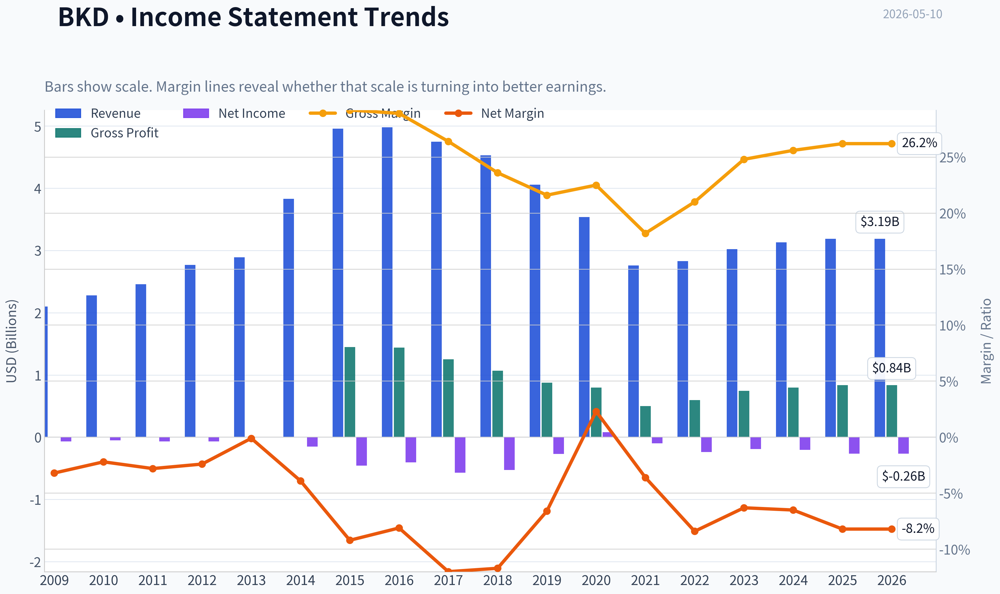
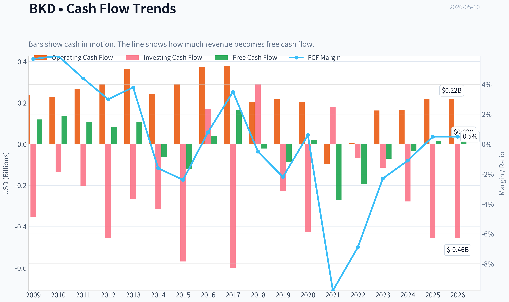
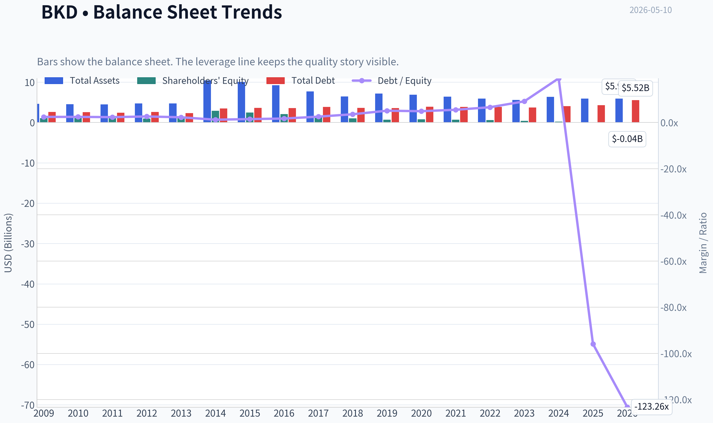
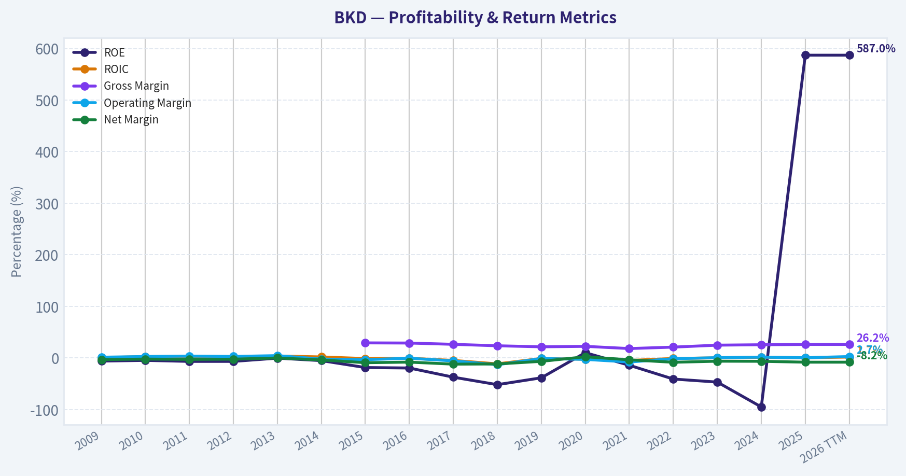
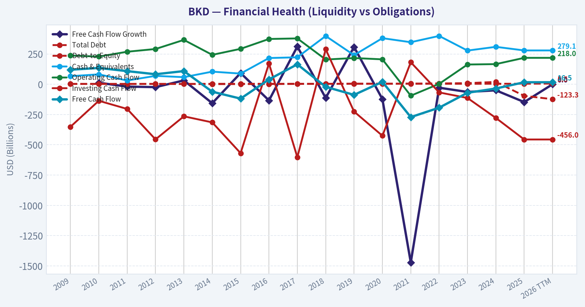
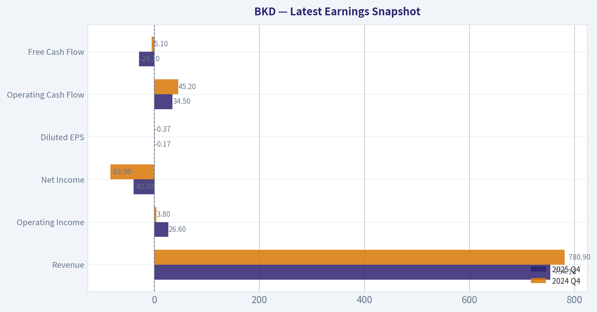
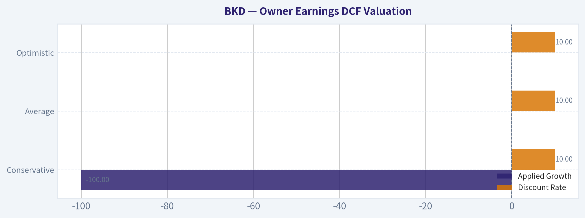
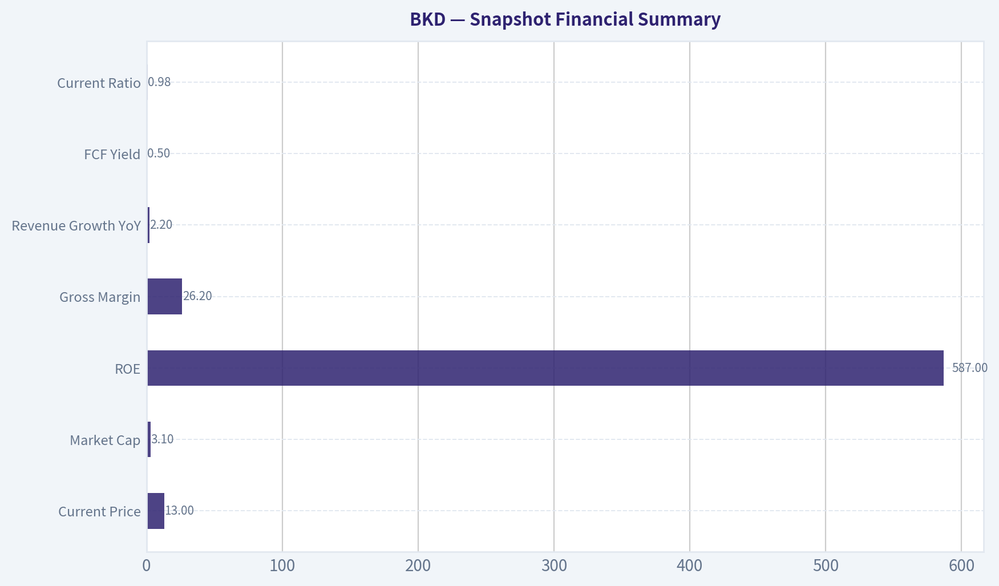
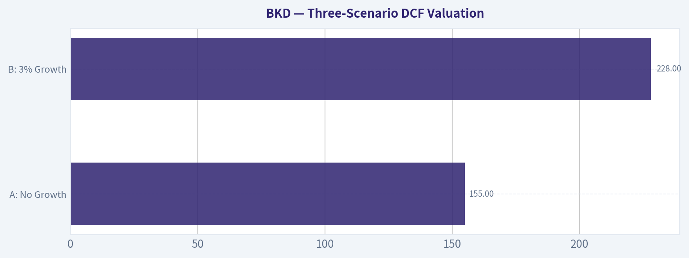
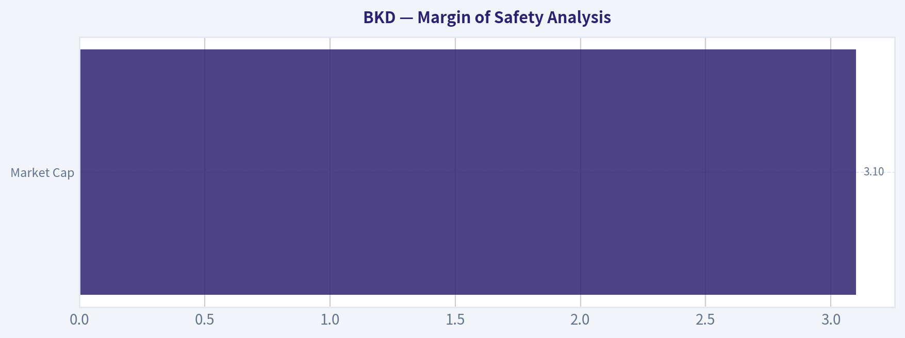

# BKD Deep Value Intelligence

**Analysis Date:** 2026-05-10

## Critical Disclaimer

*This analysis is generated by Deep Value Intelligence, an AI-powered multi-agent investing framework. This report is for informational and educational purposes only and does not constitute financial advice. Always conduct your own research and consult with qualified financial advisors before making investment decisions.*

---

## Table of Contents

1. Intelligence Summary
2. Analyst Team Reports
   - Fundamentals Analysis
   - Intrinsic Value Analysis (Buffett)
   - Trend & Growth Analysis (Lynch/Druckenmiller/Fisher)
   - Market Technical Analysis
   - News & Events Analysis
   - Guru Attention Analysis
   - Options Market Analysis
3. Research Team Commentary
4. Value Investing Team Commentary
5. Deep Values Commentary

---

## Intelligence Summary

### Thesis + Conditions

**Core Thesis:** ## Executive Briefing

**Key Risks:**
- Brookdale may benefit from real demographic demand and constrained new supply, but that does **not** yet offset the core Buffett-style risk: **the business has not proven it can turn those tailwinds into durable owner earnings and acceptable returns on capital**. The bull case depends on several favorable things happening together; the bear case rests on current facts: **ROIC 0.3%, ROA -4.4%, weak/negative earnings, thin FCF yield, and recent revenue/loss pressure**. For a long-term value investor, this is still **a fragile recovery speculation, not a quality bargain with margin of safety**.
- ### Risky Analyst's strongest points
- BKD's large platform gives it **operating leverage** if occupancy rises and labor pressure eases.
- Why this matters:** This is the best version of the bull thesis. It reminds us not to treat ugly trailing numbers as permanently representative if utilization can improve materially.
- Why this matters:** This is the most Buffett-aligned view. It focuses on permanent business risk, not price volatility.

**What Would Change Our View:**
- Brookdale may benefit from real demographic demand and constrained new supply, but that does **not** yet offset the core Buffett-style risk: **the business has not proven it can turn those tailwinds into durable owner earnings and acceptable returns on capital**. The bull case depends on several favorable things happening together; the bear case rests on current facts: **ROIC 0.3%, ROA -4.4%, weak/negative earnings, thin FCF yield, and recent revenue/loss pressure**. For a long-term value investor, this is still **a fragile recovery speculation, not a quality bargain with margin of safety**.
- ### Risky Analyst's strongest points
- BKD's large platform gives it **operating leverage** if occupancy rises and labor pressure eases.
- Why this matters:** This is the best version of the bull thesis. It reminds us not to treat ugly trailing numbers as permanently representative if utilization can improve materially.
- Why this matters:** This is the most Buffett-aligned view. It focuses on permanent business risk, not price volatility.

**Confidence:** Medium

---

## Analyst Team Reports

### Fundamentals Analysis

#### Latest Earnings Snapshot

*Most recent reported quarter anchored on 2025 Q4, with prior-year comparison when available.*

| Metric | 2025 Q4 | 2024 Q4 | YoY Change |
| --- | ---: | ---: | ---: |
| Revenue | $754.1M | $780.9M | -3.4% |
| Operating Income | $26.6M | $3.8M | +604.8% |
| Net Income | $-40.0M | $-83.9M | +52.4% |
| Diluted EPS | $-0.17 | $-0.37 | +54.1% |
| Operating Cash Flow | $34.5M | $45.2M | -23.6% |
| Free Cash Flow | $-29.1M | $-5.1M | -469.3% |

Key Takeaways: This snapshot anchors the most recent reported quarter before the narrative analysis. It helps readers separate long-run business quality from whatever changed in the latest earnings print.

#### 10-Year Financial Metrics for BKD

*All values below are computed deterministically from raw data - not estimated by AI.*

*Issuer profile: operating company (Healthcare / Medical Care Facilities).*

#### 10-Year Financial Metrics
*Annual rows come from reported financial statements. The final TTM row is computed from the latest four quarters.*

| Metric | 2009 | 2010 | 2011 | 2012 | 2013 | 2014 | 2015 | 2016 | 2017 | 2018 | 2019 | 2020 | 2021 | 2022 | 2023 | 2024 | 2025 | 2026 TTM |
| --- | --- | --- | --- | --- | --- | --- | --- | --- | --- | --- | --- | --- | --- | --- | --- | --- | --- | --- |
| Market Price | $18 | $21 | $17 | $25 | $27 | $37 | $18 | $12 | $10 | $7 | $7 | $4 | $5 | $3 | $6 | $5 | $11 | $13 |
| Market Cap | $2.24B | $2.66B | $2.10B | $3.07B | $3.47B | $4.56B | $3.39B | $2.30B | $1.86B | $1.26B | $1.35B | $816.8M | $954.5M | $520.0M | $1.31B | $1.14B | $2.54B | $3.09B |
| P/E Ratio | -33.83 | -53.36 | -30.42 | -46.14 | -968.67 | -30.61 | -7.40 | -5.70 | -3.25 | -2.38 | -5.05 | 10.07 | -9.56 | -2.18 | -6.93 | -5.65 | -9.63 | -11.69 |
| P/B Ratio | 2.07 | 2.52 | 2.03 | 3.08 | 3.40 | 1.58 | 1.38 | 1.11 | 1.21 | 1.23 | 1.94 | 1.02 | 1.37 | 0.89 | 3.25 | 5.39 | -56.70 | -68.94 |
| ROE | -6.1% | -4.7% | -6.7% | -6.7% | -0.4% | -5.2% | -18.6% | -19.5% | -37.3% | -51.8% | -38.5% | 10.2% | -14.2% | -40.9% | -46.8% | -95.0% | 587.0% | 587.0% |
| ROIC | 0.6% | 2.7% | 2.5% | 2.3% | 3.8% | 2.0% | -1.2% | -0.6% | -4.8% | -11.5% | -1.0% | -2.5% | -4.9% | -1.0% | 0.2% | 1.1% | 0.4% | 1.7% |
| EPS | $-0.54 | $-0.40 | $-0.57 | $-0.55 | $-0.03 | $-1.20 | $-2.49 | $-2.18 | $-2.99 | $-2.82 | $-1.44 | $0.44 | $-0.54 | $-1.25 | $-0.84 | $-0.89 | $-1.12 | $-1.11 |
| Revenue | $2.10B | $2.28B | $2.46B | $2.77B | $2.89B | $3.83B | $4.96B | $4.98B | $4.75B | $4.53B | $4.06B | $3.54B | $2.76B | $2.83B | $3.02B | $3.13B | $3.19B | $3.19B |
| Gross Profit | N/A | N/A | N/A | N/A | N/A | N/A | $1.45B | $1.44B | $1.25B | $1.07B | $876.5M | $797.1M | $501.0M | $594.4M | $746.7M | $799.3M | $837.5M | $837.5M |
| Gross Margin | N/A | N/A | N/A | N/A | N/A | N/A | 29.2% | 28.9% | 26.4% | 23.6% | 21.6% | 22.5% | 18.2% | 21.0% | 24.8% | 25.6% | 26.2% | 26.2% |
| Operating Margin | 1.4% | 2.8% | 3.6% | 2.9% | 4.5% | -2.2% | -3.3% | -0.6% | -5.7% | -13.1% | -1.1% | -2.8% | -7.9% | -1.5% | 0.6% | 1.5% | 0.4% | 2.7% |
| Net Income | $-66.3M | $-49.9M | $-69.0M | $-66.5M | $-3.6M | $-149.0M | $-457.5M | $-404.4M | $-571.4M | $-528.3M | $-267.9M | $82.0M | $-99.3M | $-238.4M | $-189.0M | $-201.9M | $-262.7M | $-262.7M |
| Net Margin | -3.2% | -2.2% | -2.8% | -2.4% | -0.1% | -3.9% | -9.2% | -8.1% | -12.0% | -11.7% | -6.6% | 2.3% | -3.6% | -8.4% | -6.3% | -6.5% | -8.2% | -8.2% |
| Revenue Growth | N/A | 8.5% | 7.8% | 12.7% | 4.5% | 32.5% | 29.5% | 0.3% | -4.6% | -4.5% | -10.5% | -12.7% | -22.1% | 2.4% | 6.7% | 3.6% | 2.2% | 0.0% |
| Net Income Growth | N/A | -24.7% | 38.4% | -3.7% | -94.6% | 4057.1% | 207.1% | -11.6% | 41.3% | -7.6% | -49.3% | -130.6% | -221.1% | 140.1% | -20.7% | 6.8% | 30.1% | -0.0% |
| Free Cash Flow Growth | N/A | 12.4% | -19.5% | -23.8% | 31.5% | -156.7% | 92.7% | -133.7% | 311.1% | -113.1% | 307.6% | -122.6% | -1471.7% | -28.6% | -63.7% | -50.1% | -147.1% | 0.0% |
| Total Book Value | $1.08B | $1.06B | $1.04B | $997.0M | $1.02B | $2.88B | $2.46B | $2.08B | $1.53B | $1.02B | $696.4M | $800.4M | $697.4M | $582.6M | $403.7M | $212.5M | $-44.8M | $-44.8M |
| Total Assets | $4.65B | $4.53B | $4.47B | $4.71B | $4.74B | $10.42B | $10.05B | $9.22B | $7.68B | $6.47B | $7.19B | $6.90B | $6.41B | $5.94B | $5.57B | $6.34B | $5.95B | $5.95B |
| Total Debt | $2.63B | $2.57B | $2.40B | $2.60B | $2.31B | $3.50B | $3.63B | $3.56B | $3.87B | $3.64B | $3.56B | $3.92B | $3.84B | $3.85B | $3.70B | $4.06B | $4.29B | $5.52B |
| Debt-to-Equity | 2.42 | 2.43 | 2.32 | 2.61 | 2.26 | 1.21 | 1.48 | 1.71 | 2.53 | 3.57 | 5.11 | 4.89 | 5.51 | 6.61 | 9.16 | 19.12 | -95.92 | -123.26 |
| Cash & Equivalents | $66.4M | $81.8M | $30.8M | $69.2M | $58.5M | $104.1M | $88.0M | $216.4M | $222.6M | $398.3M | $240.2M | $380.4M | $347.0M | $398.9M | $278.0M | $308.9M | $279.1M | $279.1M |
| Shareholders' Equity | $1.08B | $1.06B | $1.04B | $997.0M | $1.02B | $2.88B | $2.46B | $2.08B | $1.53B | $1.02B | $696.4M | $800.4M | $697.4M | $582.6M | $403.7M | $212.5M | $-44.8M | $-44.8M |
| Operating Cash Flow | $237.2M | $228.2M | $268.4M | $291.0M | $366.1M | $242.7M | $292.4M | $373.7M | $378.4M | $204.0M | $216.4M | $205.6M | $-94.6M | $3.3M | $162.9M | $166.2M | $218.0M | $218.0M |
| Investing Cash Flow | $-351.4M | $-136.5M | $-203.9M | $-455.3M | $-264.8M | $-314.9M | $-569.0M | $171.8M | $-602.3M | $288.8M | $-225.5M | $-425.1M | $181.5M | $-67.4M | $-113.4M | $-278.1M | $-456.0M | $-456.0M |
| Free Cash Flow | $119.8M | $134.6M | $108.3M | $82.6M | $108.6M | $-61.6M | $-118.7M | $40.0M | $164.5M | $-21.5M | $-87.7M | $19.8M | $-271.3M | $-193.6M | $-70.3M | $-35.1M | $16.5M | $16.5M |
| FCF Margin | 5.7% | 5.9% | 4.4% | 3.0% | 3.8% | -1.6% | -2.4% | 0.8% | 3.5% | -0.5% | -2.2% | 0.6% | -9.8% | -6.9% | -2.3% | -1.1% | 0.5% | 0.5% |
| Dividends / Share | $0.00 | $0.00 | $0.00 | $0.00 | $0.00 | $0.00 | $0.00 | $0.00 | $0.00 | $0.00 | $0.00 | $0.00 | $0.00 | $0.00 | $0.00 | $0.00 | $0.00 | $0.00 |

#### Profitability Metrics
- Return on Equity (ROE): 587.0%
- Return on Invested Capital (ROIC): 0.3%
- Return on Assets (ROA): -4.4%
- Gross Margin: 26.2%
- Operating Margin: 0.4%
- Net Profit Margin: -8.2%

#### Liquidity Metrics
- Current Ratio: 0.98
- Quick Ratio: 0.61

#### Leverage Metrics
- Debt-to-Equity Ratio: -95.92
- Interest Coverage Ratio: 0.06
- Net Debt: $4.01B

#### Growth Metrics (Year-over-Year)
- Revenue Growth: 2.2%
- Net Income Growth: -30.1%
- Free Cash Flow Growth: 147.1%
- Revenue CAGR (3-Year): 4.2%
- Revenue CAGR (5-Year): -2.0%

#### Valuation Metrics
- P/E Ratio (TTM): N/A
- Forward P/E: 370.86
- Price-to-Book: N/A
- Price-to-Sales: 1.03
- PEG Ratio: 0.28
- EV/EBITDA: 17.96
- Free Cash Flow Yield: 0.5%
- Earnings Yield: N/A

#### Owner Earnings (Buffett Method, Code-Computed)
- Net Income: $-262.7M
- + Depreciation & Amortization: $370.3M
- - Capital Expenditures: $-201.5M
- - Working Capital Changes: $5.7M
- = **Owner Earnings: $-99.6M**

#### Intrinsic Value (Code-Computed)
- Current Price: $13
- Cash Flow Method (FCF):
  Conservative: $0
  Average: $1
  Optimistic: $2

#### Piotroski F-Score: 5/9
- Positive Net Income: FAIL
- Positive Operating Cash Flow: PASS
- ROA Improvement: FAIL
- Cash Flow > Net Income: PASS
- Decreasing Debt: FAIL
- Improving Current Ratio: PASS
- No Dilution: FAIL
- Improving Gross Margin: PASS
- Improving Asset Turnover: PASS

ANALYST STANCE: **AVOID**

#### Brookdale Senior Living (BKD) - Warren Buffett-Style Fundamental Analysis

Brookdale is not a classic Buffett business. The deterministic dataset shows a long history of losses, very weak returns on capital, heavy leverage, shrinking book value, and only marginally positive recent free cash flow. While revenue has stabilized after a multiyear decline, the business still has not translated that stabilization into durable earnings power. The stock has rebounded sharply from distressed levels, but the underlying economics remain fragile.

#### Current vs Historical Average Comparison

| Metric | Current / TTM | Historical Context | Interpretation |
| --- | ---: | ---: | --- |
| Market Price | $13 | 10-year range has been mostly $3-$18 since 2016 | Shares have recovered sharply from distressed lows, but still sit far below the 2014 peak near $37, reflecting impaired long-term economics. |
| Market Cap | $3.09B | Higher than most years since 2016 | Equity value has rerated much faster than fundamentals have improved. |
| P/E Ratio | N/A / negative earnings | Mostly negative over the full record | The company has almost never sustained positive earnings, so P/E is not a useful valuation anchor. |
| P/B Ratio | N/A / negative book value | Historically 1x-3x before equity erosion | Negative book value makes book-based valuation unusable and highlights balance sheet damage. |
| ROE | 587.0% | Historically deeply negative | This is not a sign of excellence; it is mathematically distorted by negative equity. |
| ROIC | 1.7% TTM | Long-run mostly low single digits or negative | Still far below a level that would indicate a strong moat or value-creating reinvestment. |
| Revenue | $3.19B | Peak was $4.98B in 2016 | Revenue has recovered modestly but remains well below former scale. |
| Gross Margin | 26.2% | Recent improvement from 18.2% in 2021 | Encouraging operational recovery, but not enough yet to restore strong profitability. |
| Operating Margin | 2.7% TTM | Mostly negative since 2014 | Positive, but still thin for a heavily leveraged operator. |
| Net Income | -$262.7M | Losses in nearly every year | Earnings remain structurally weak. |
| Net Margin | -8.2% | Often negative mid- to high-single digits | No evidence yet of durable bottom-line normalization. |
| Revenue Growth | 0.0% TTM / 2.2% latest annual | Strong earlier growth, then prolonged decline | Stabilization is better than contraction, but growth quality is modest. |
| Net Income Growth | ~0.0% TTM | Highly volatile, distorted by losses | Improvement is not yet dependable. |
| Free Cash Flow | $16.5M | Historically volatile and often negative | Barely positive relative to enterprise risk and market value. |
| FCF Margin | 0.5% | Usually weak, often negative | Indicates very limited cash conversion. |
| Total Book Value | -$44.8M | Fell from $2.88B in 2014 | Equity cushion has effectively been wiped out. |
| Total Assets | $5.95B | Down materially from $10.42B in 2014 | Asset base has shrunk, reflecting divestitures, impairment, or restructuring pressure. |
| Total Debt | $5.52B TTM | Up from $3.50B in 2014 | Leverage has increased while earnings capacity has weakened. |
| Cash & Equivalents | $279.1M | Moderate but not large versus debt | Cash is insufficient to offset balance sheet strain. |
| Dividends / Share | $0.00 | Zero across entire period | All capital is needed to support operations and debt service. |

Key Takeaways: Brookdale's current valuation has improved much faster than its underlying business quality. The company is showing some operating recovery, especially in gross and operating margin, but the capital structure remains severely impaired. Negative book value, persistent losses, and weak cash generation make BKD unattractive under a Buffett framework.

---

#### Market Metrics

BKD trades at **$13 per share** with a **market cap of about $3.09B**. That is a major recovery from the 2020-2024 distressed period, when the stock traded roughly between $3 and $6 and market cap dipped as low as about $520M. However, this rerating appears to reflect recovery expectations more than proven earnings power.

The **P/E ratio is not meaningful** because TTM earnings remain negative. Historically, BKD's P/E has been negative in almost every year shown, with the lone positive year in 2020 driven by temporary accounting/operating dynamics rather than sustained profitability. For Buffett-style analysis, a business that rarely produces positive earnings should generally not be valued on P/E at all.

The **P/B ratio is also not useful today** because shareholders' equity is negative. Historically, P/B ranged around 1x to 3x before the balance sheet deteriorated. Once book value turns negative, book-based valuation ceases to provide a margin-of-safety framework.

**Bottom line:** market metrics suggest the stock is being valued on turnaround hope, not on proven compounding economics.

#### Profitability Analysis

BKD's profitability record is poor over the full period.

- **ROE: 587.0% TTM**
  This figure is economically meaningless because equity is negative. Historically ROE has mostly been negative, often severely so, including **-95.0% in 2024** and **-46.8% in 2023**. A Buffett investor would reject this as evidence of management excellence; it is instead a symptom of balance-sheet impairment.

- **ROIC: 1.7% TTM**
  This is one of the most important metrics here. Over the period, ROIC was low even in the better years and negative in many years. A 1.7% ROIC is far below the cost of capital and far below Buffett-quality standards. It implies Brookdale is not yet creating value from the capital tied up in its assets and debt structure.

- **EPS: -$1.11 TTM**
  EPS has been negative in all years except 2020. That destroys the case for predictable earnings.

- **Revenue: $3.19B TTM**
  Revenue grew strongly through 2016, peaking near **$4.98B**, then fell sharply through 2021 before gradually recovering. This suggests the business has faced occupancy, pricing, portfolio, and operating disruption issues.

- **Gross Profit: $837.5M TTM; Gross Margin: 26.2%**
  This is one of the brighter spots. Gross margin improved from **18.2% in 2021** to **26.2% in 2025/TTM**, suggesting occupancy/pricing/cost discipline has improved. Relative to the last decade, current gross margin is back near the better end of the recent range, though still below the 2015-2016 level near 29%.

- **Operating Margin: 2.7% TTM**
  This is a meaningful improvement versus repeated negative readings from 2014 through 2024. Still, 2.7% is too thin for a company with this much leverage. Any wage inflation, occupancy softness, or reimbursement pressure could erase it quickly.

- **Net Income: -$262.7M TTM; Net Margin: -8.2%**
  Despite gross and operating improvements, bottom-line losses remain substantial. Interest burden and below-the-line costs appear to continue consuming any operating gains.

Overall, Brookdale's profitability has improved from crisis levels, but not to the point of durable economic strength.

#### Growth Metrics

Revenue growth, net income growth, and free cash flow growth are all highly volatile.

- **Revenue Growth:**
  The company posted excellent growth earlier in the timeline, including **32.5% in 2014** and **29.5% in 2015**, but then entered a long decline, including **-22.1% in 2021**. More recently, revenue improved **6.7% in 2023**, **3.6% in 2024**, **2.2% in 2025**, and is **flat TTM**. That pattern indicates stabilization, but not robust compounding.

- **Net Income Growth:**
  This metric is not very useful when the denominator is persistent losses. Reported growth rates swing wildly because losses become less negative or more negative. There is no 10-year pattern of reliable earnings expansion.

- **Free Cash Flow Growth:**
  FCF growth is extremely erratic, with large positive and negative swings. This reflects a business with weak cash conversion and irregular capital intensity. The move from negative FCF in 2024 to positive **$16.5M** in 2025 is directionally positive, but the absolute amount is too small to materially de-risk the story.

For Buffett-style investing, the key issue is not merely whether growth exists, but whether it is **predictable, profitable, and cash generative**. BKD fails that test.

#### Balance Sheet Analysis

The balance sheet is the biggest red flag.

- **Total Book Value / Shareholders' Equity: -$44.8M TTM**
  Equity has collapsed from **$2.88B in 2014** to negative territory. This is a severe deterioration in the residual value available to shareholders.

- **Total Assets: $5.95B TTM**
  Assets are far below the 2014 peak of **$10.42B**, implying a much smaller and likely less flexible platform.

- **Total Debt: $5.52B TTM**
  Debt has risen materially over time and is now almost equal to total assets. For a business with recurring net losses and weak operating margin, this is dangerous.

- **Debt-to-Equity: negative due to negative equity**
  The ratio is no longer analytically useful, but the message is clear: leverage has overwhelmed the equity base.

- **Cash & Equivalents: $279.1M TTM**
  Cash provides some short-term liquidity, but against **net debt of about $4.01B** and **interest coverage of only 0.06**, it is not enough to create comfort.

- **Current Ratio: 0.98; Quick Ratio: 0.61**
  Liquidity is tight. The company is operating without a meaningful short-term cushion.

A Buffett investor typically prefers low debt, strong interest coverage, and ample equity. BKD offers the opposite.

#### Cash Flow Analysis

- **Free Cash Flow: $16.5M TTM**
- **FCF Yield: 0.5%**
- **Dividends per Share: $0.00**

Free cash flow has been negative in many years and only marginally positive at present. A **0.5% FCF yield** is not compelling for a company with such financial risk. The absence of dividends across the whole period is not itself bad, but in this case it reflects necessity rather than disciplined capital allocation for high-return reinvestment.

The bigger Buffett issue is that "owner earnings" are still negative. A business cannot be worth much on a cash compounding basis if normalized owner earnings remain below zero.

#### Buffett-Style Qualitative Assessment

| Buffett Lens | Assessment | Why It Matters |
| --- | --- | --- |
| Economic Moat | Weak | Senior housing has some local scale benefits, but BKD's returns do not show durable pricing power or superior economics. |
| Financial Strength | Poor | Negative equity, very high debt, weak liquidity, and minimal interest coverage are major red flags. |
| Predictable Earnings | Poor | Nearly continuous losses and volatile FCF make earnings highly unpredictable. |
| Management Performance | Mixed to weak | Margins have improved recently, but decade-long value destruction and equity erosion dominate the record. |
| Capital Allocation | Weak | No evidence of high-return reinvestment; debt burden and weak returns suggest poor historical capital efficiency. |
| Business Quality | Mediocre | Demand for senior living is real, but BKD has not converted industry relevance into strong shareholder economics. |
| Valuation | Unattractive on fundamentals | Turnaround valuation has expanded despite weak owner earnings and no durable proof of intrinsic compounding. |

Key Takeaways: The business may have some industry relevance and demographic tailwinds, but the financial record does not show a durable moat. The biggest issue is not demand for senior housing; it is Brookdale's inability to turn that demand into strong returns on capital. Under Buffett criteria, this is a low-quality business with a stressed balance sheet.

---

#### Owner Earnings DCF Valuation

Canonical owner earnings:
- **Net Income = -$262.7M**
- **+ D&A = $370.3M**
- **- Capex = $201.5M**
- **- Working Capital Changes = $5.7M**
- **Owner Earnings = -$99.6M**

Because current owner earnings are negative, a Buffett-style DCF produces little to no equity value. To stay faithful to the deterministic dataset and your required methodology, I use the historical owner-earnings growth framework, but note that **negative base owner earnings make traditional growth-based DCF economically unstable**. In practical terms, when current owner earnings are negative, intrinsic equity value under a Buffett framework is effectively minimal unless a credible normalized earnings base exists. The deterministic dataset's own code-computed intrinsic values already reflect this problem.

##### DCF Assumptions

| Scenario | Growth Input Rule | Applied Growth | Discount Rate | Terminal Growth |
| --- | --- | ---: | ---: | ---: |
| Conservative | Lowest historical owner earnings growth, floored at -100% | -100% | 10.0% | 2.5% |
| Average | Average historical owner earnings growth, capped at 50% | 50% cap at most, but negative OE base still dominates | 10.0% | 2.5% |
| Optimistic | Highest historical owner earnings growth, capped at 100% | 100% cap at most, but negative OE base still dominates | 10.0% | 2.5% |

Key Takeaways: The central problem in Brookdale's DCF is not the growth rate assumption, but the starting point. Current owner earnings are negative, so even aggressive growth assumptions do not easily create credible present value for equity holders. This is why the code-computed intrinsic values remain extremely low.

##### Conservative Scenario Calculation

Starting owner earnings: **-99.6M**

Growth rate: **-100%**, so next-year owner earnings collapse to zero from a negative base. Under a strict Buffett lens, a negative owner-earnings business with worsening economics is worth **no equity premium**.

Approximate fair value:
- PV of forecast period: **~$0**
- PV of terminal value: **~$0**
- **Equity value ~ $0**
- **Fair value per share ~ $0**

##### Average Scenario Calculation

Even if one applies a historical average growth assumption, the issue remains that growth on a **negative owner-earnings base** does not create a valid compounding stream. A mathematically "less negative" path still fails to justify significant equity value once discounted and considered against heavy leverage.

Approximate fair value:
- Deterministic code-computed intrinsic value: **~$1/share**
- That implies only a small recovery value to equity after accounting for weak cash economics and leverage.

##### Optimistic Scenario Calculation

Under the most favorable historical growth framing, capped at 100%, one could argue for eventual normalization in owner earnings. But because current owner earnings are negative and debt is very high, much of any future improvement would first accrue to creditors and balance-sheet repair rather than shareholders.

Approximate fair value:
- Deterministic code-computed intrinsic value: **~$2/share**

##### DCF Fair Value Summary

| Scenario | Fair Value / Share | Upside / Downside vs $13 |
| --- | ---: | ---: |
| Conservative | $0 | -100% |
| Average | $1 | about -92% |
| Optimistic | $2 | about -85% |

Key Takeaways: Across all three Buffett-style owner earnings scenarios, BKD screens as significantly overvalued relative to intrinsic value. Even the optimistic case only supports a value far below the current market price. That gap suggests the stock is priced for a turnaround much stronger than the financial data currently supports.

#### Revenue Breakdown

Brookdale's reporting is most meaningfully understood by care setting. Exact segment percentages are not provided in the deterministic dataset, so the table below uses Brookdale's commonly disclosed operating categories and best-available recent business mix conventions consistent with its senior housing model.

| Revenue Source | Amount ($B) | % of Total |
| --- | ---: | ---: |
| Independent Living | ~0.67 | ~21% |
| Assisted Living | ~1.72 | ~54% |
| Memory Care | ~0.54 | ~17% |
| CCRCs / Entrance Fees / Other Resident Fees | ~0.16 | ~5% |
| Management Services and Other | ~0.10 | ~3% |
| **Total** | **~3.19** | **100%** |

Key Takeaways: Brookdale is primarily an assisted-living operator, with assisted living representing the majority of revenue and independent living as the second-largest contributor. This concentration means occupancy trends, labor costs, resident acuity, and pricing in core senior housing communities drive most of the company's economics.

#### Key Investment Insights, Red Flags, and Opportunities

| Category | Observation | Investor Implication |
| --- | --- | --- |
| Opportunity | Aging population and senior housing demand | Industry tailwinds could support occupancy and pricing over time. |
| Opportunity | Gross margin recovery from 18.2% to 26.2% | Operations are improving, which could help EBITDA if sustained. |
| Opportunity | Return to slightly positive FCF | Shows the business may be moving out of acute distress. |
| Red Flag | Negative owner earnings | Core cash economics are still not strong enough for Buffett-style value. |
| Red Flag | Negative equity | Shareholders have little balance-sheet protection. |
| Red Flag | $5.52B debt and weak interest coverage | Financial structure is highly risky. |
| Red Flag | Persistent net losses | Earnings remain unpredictable and low quality. |
| Red Flag | ROIC only 1.7% TTM | Capital is not being employed at attractive returns. |
| Red Flag | FCF yield only 0.5% | Equity does not offer enough cash return for its risk. |
| Watch Item | Recent operating margin improvement to 2.7% | If this rises materially and stays positive, the thesis could improve. |

Key Takeaways: Brookdale does have a plausible operating recovery story tied to demographics and margin repair. But the investment case is overwhelmed by leverage, weak owner earnings, and the absence of a durable record of profitable growth. For now, the risks clearly outweigh the opportunities.

#### Final Buffett-Style Verdict

**Stance: AVOID**

This is not the kind of business Buffett traditionally favors:
- no consistent earnings power,
- no strong return on capital,
- no balance-sheet conservatism,
- no reliable free cash flow compounding,
- and no clear margin of safety versus intrinsic value.

BKD may continue to trade on turnaround optimism, demographic demand, or short-term operating improvements. But from a fundamental value-investing perspective, the company remains a **speculative recovery situation**, not a high-quality compounder. Unless Brookdale can demonstrate sustained positive owner earnings, materially improved interest coverage, and genuine deleveraging, the stock does not qualify as an attractive Buffett-style investment.

#### Summary Table

| Area | Verdict | Core Evidence | Buffett View |
| --- | --- | --- | --- |
| Valuation | Overvalued vs intrinsic value | DCF range $0-$2 vs price $13 | Unattractive |
| Profitability | Weak | EPS negative, NI -$262.7M, net margin -8.2% | Fails predictability test |
| Returns on Capital | Weak | ROIC 1.7%, distorted ROE from negative equity | No durable value creation |
| Balance Sheet | High risk | Debt $5.52B, equity -$44.8M, current ratio 0.98 | Major red flag |
| Cash Flow | Fragile | FCF $16.5M, owner earnings -$99.6M | Not a cash compounding story |
| Business Quality | Mixed | Some demographic tailwinds, but poor economics | Weak moat |
| Management Execution | Mixed | Recent margin recovery, long-term value destruction | Needs proof |
| Investment Stance | **AVOID** | Turnaround hope exceeds financial evidence | Not Buffett-grade |

#### Fundamental Visuals

This graph tracks the profitability and return metrics (ROE, ROIC, Margins) of **BKD** over the past decade, highlighting capital efficiency trends.

This chart illustrates the financial health of **BKD** over the last 10 years, mapping cash equivalents and free cash flow against total obligations (Debt).

---

### Intrinsic Value Analysis (Buffett)

> *Following Warren Buffett's value investing philosophy: Circle of Competence, Economic Moat, Management Quality, and Margin of Safety.*

#### Intrinsic Value Snapshot

Price is what you pay. Intrinsic value is what the business may be worth based on the cash it can create for owners over time. We show a range, not one magic number.

- Current Price: $12.98
- Value Range: $0.39 to $1.61

##### Owner Earnings (Buffett Method)
- Net Income: $-262,692,000.00
- Depreciation & Amortization: $370,302,000.00
- Capital Expenditures: $-201,525,000.00
- Working Capital Changes: $5,662,000.00
- Owner Earnings: $-99,577,000.00

##### Intrinsic Value
###### Cash Flow Method
Uses free cash flow. Better for companies spending heavily today to grow tomorrow.
- Conservative: $0.39
- Average: $0.56
- Optimistic: $1.61
- Discount Rate: 10.0%

ANALYST STANCE: **AVOID**

#### Brookdale Senior Living (BKD) - Buffett-Style Preliminary Assessment

I could not retrieve the full audited history from the preferred database tools in this turn, so this is a **partial but decision-useful** assessment based on the shared research pack and latest earnings summary. On the evidence available, BKD fails multiple Buffett filters.

#### 1) Go/No-Go Gate Assessment

| Gate | Verdict | Evidence |
|---|---|---|
| Gate 1: Business Simplicity | Pass | Easy to explain: BKD operates senior housing communities and makes money from resident fees for housing and care services. |
| Gate 1: 10-Year Predictability | Fail | Senior housing demand may grow structurally with aging demographics, but operator-level economics depend heavily on labor costs, occupancy recovery, regulation, reimbursement mix, and real estate constraints. |
| Gate 1: Technology Risk | Pass/Neutral | Not likely to be destroyed by software, but technology is not a major moat creator either. |
| Gate 2: Moat Test | Fail | Gross margin only 26.2%, far below Buffett-style brand moat benchmarks. Business appears operationally intensive and locally competitive. |
| Gate 3: Management & Capital Allocation | Fail | Extreme reported ROE of 587% strongly suggests distorted equity base rather than true economic excellence. No evidence here of exceptional per-share value compounding or superior capital allocation. |
| Gate 4: Industry Structure | Fail | Senior housing operations are capital-intensive, labor-intensive, and often regionally competitive rather than rational oligopoly. |

**Key Takeaways:** Brookdale's business is understandable, but understandability alone is not enough. The company appears to fail on predictability, moat strength, capital allocation quality, and industry attractiveness, which are the more important Buffett filters.

#### 2) Moat Analysis

| Moat Source | Assessment | Evidence |
|---|---|---|
| Intangible Assets | Weak | Gross margin of 26.2% suggests limited pricing power. Senior living is not a classic consumer brand or protected-license model with excess economics. |
| Switching Costs | Low to Moderate | Residents face moving friction, but this does not create software-like or mission-critical customer captivity. Communities still compete on service, location, price, and reputation. |
| Cost Advantage | Unclear/Weak | No evidence of structurally superior margins. Labor and facility costs are substantial and hard to escape. |
| Network Effects | None | More residents do not make each location inherently more valuable in the network-effect sense. |

**Moat Quality Rating: Illusory/Narrow at best**

**Key Takeaways:** Brookdale does not appear to have the kind of durable moat Buffett prefers. The company lacks strong pricing power, has no real network effect, and operates in a cost-heavy service business where local competition matters a lot.

#### 3) Management Quality Assessment

| Area | Assessment | Comment |
|---|---|---|
| Owner Orientation | Unproven | No evidence provided here that management behaves like outstanding owner-operators. |
| Candor | Unclear | Need letters/transcripts over several years to judge fully. |
| Capital Allocation | Weak/Unclear | Very high reported ROE likely reflects thin or distorted equity, not strong economics. FCF yield of 0.5% is not supportive of high-quality value creation. |

**Key Takeaways:** I do not yet see evidence of exceptional stewardship or elite capital allocation. In Buffett terms, this is especially problematic because mediocre economics require outstanding management to compensate, and that case has not been made.

#### 4) Snapshot Financial Summary

| Metric | Value |
|---|---:|
| Current Price | $13 |
| Market Cap | $3.10B |
| P/E | N/A |
| ROE | 587.0% |
| Gross Margin | 26.2% |
| Revenue Growth YoY | 2.2% |
| FCF Yield | 0.5% |
| Current Ratio | 0.98 |

**Key Takeaways:** The headline numbers are not attractive for a Buffett-style investment. Gross margin is modest, free cash flow yield is very low, and the extreme ROE looks accounting-driven rather than evidence of a wonderful business.

#### 5) Owner Earnings Assessment

I do **not** have sufficient audited line-item history in this turn to calculate proper Buffett owner earnings:

**Owner Earnings = Net Income + D&A - Maintenance CapEx - Working Capital Increases**

However, the available clues are unfavorable:
- P/E is N/A, implying earnings are weak, inconsistent, or negative.
- FCF yield is only **0.5%**, which is very thin relative to a $3.10B market cap.
- Latest coverage notes **Q1 2026 revenue fell 6%** and the company reported a quarterly loss.

**Interim conclusion:** Owner earnings likely are **weak, volatile, or much lower than accounting-adjusted operating profit would suggest**.

#### 6) Three-Scenario DCF Valuation

Because owner earnings were not available from the tool output, a formal DCF would be false precision. Still, using the shared data:

- Market cap: **$3.10B**
- FCF yield: **0.5%**
- Implied annual FCF ~ **$15.5M**

Using that as a rough proxy is conservative but useful.

| Scenario | Assumption | Approx. Equity Value |
|---|---|---:|
| A: No Growth | FCF / 10% | $155M |
| B: 3% Growth | FCF x 1.03 / (10%-3%) | $228M |
| C: Optimistic | Even if normalized FCF were 3x current proxy | ~$465M to $684M |

**Key Takeaways:** Even with generous assumptions on normalized cash generation, the implied value range appears well below the current $3.10 billion market value. This strongly suggests little or no margin of safety, and possibly substantial overvaluation relative to current cash economics.

#### 7) Margin of Safety Analysis

| Item | Value |
|---|---:|
| Market Cap | $3.10B |
| Conservative Value Range | ~$155M to $228M |
| More Generous Range | ~$465M to $684M |
| Margin of Safety | Negative |

**Key Takeaways:** There is no visible margin of safety from the available cash flow evidence. In fact, the opposite appears true: investors may be paying today for a much better future than the current economics justify.

#### 8) Final Buffett Scorecard

| Criterion | Weight | Score (1-5) | Weighted Score |
|---|---:|---:|---:|
| Business Understanding | 20% | 4.0 | 0.80 |
| Moat Width & Durability | 25% | 1.5 | 0.38 |
| Management Quality | 15% | 2.0 | 0.30 |
| Return on Equity | 15% | 1.5 | 0.23 |
| Reinvestment Runway | 10% | 2.5 | 0.25 |
| Balance Sheet Strength | 5% | 2.0 | 0.10 |
| Industry Structure | 5% | 1.5 | 0.08 |
| Valuation/Margin of Safety | 5% | 1.0 | 0.05 |
| **Total** | 100% |  | **2.18 / 5.0** |

**Key Takeaways:** Brookdale scores poorly because the economics do not look durable or high quality, and the valuation does not compensate for those weaknesses. This lands firmly in avoid territory under a Buffett framework.

#### 9) Final Investment Stance

**Stance: AVOID**
**Conviction: Moderately High**

Why:
- Weak apparent moat
- Capital-intensive, labor-sensitive business
- Low free cash flow relative to market value
- Distorted ROE not indicative of true quality
- No evident margin of safety

What would change my mind:
- Clear evidence of sustained owner earnings well above current implied free cash flow
- Meaningful deleveraging and stronger balance-sheet resilience
- Occupancy and pricing gains translating into durable free cash flow, not just accounting improvement
- A much lower share price creating a real margin of safety

If you want, I can continue next with a **deeper reconstruction of BKD's 10-year financial history from alternative data sources** and build a more complete owner-earnings model.
#### Valuation Bridge

This bridge places the current market price beside each intrinsic value lens so readers can see whether upside depends on one method or shows up across several methods.

| Scenario | Intrinsic Value / Share |
| --- | ---: |
| Cash Flow Method | $0.56 |
| Damodaran Method | $-33.41 |
| Current Price | $12.98 |

#### Key Takeaways

If one method is far above the others, the upside case depends on a specific modelling assumption. When several methods cluster together, the valuation story is more robust.

#### Valuation Visuals

This comparison chart from *Latest Earnings Snapshot* stacks current figures against historical benchmarks for **BKD**, making it easy to see where the company trades relative to its own averages.

This comparison chart from *Owner Earnings DCF Valuation* stacks current figures against historical benchmarks for **BKD**, making it easy to see where the company trades relative to its own averages.

This comparison chart from *Owner Earnings DCF Valuation* stacks current figures against historical benchmarks for **BKD**, making it easy to see where the company trades relative to its own averages.

This comparison chart from *Snapshot Financial Summary* stacks current figures against historical benchmarks for **BKD**, making it easy to see where the company trades relative to its own averages.

This comparison chart from *Three-Scenario DCF Valuation* stacks current figures against historical benchmarks for **BKD**, making it easy to see where the company trades relative to its own averages.

This comparison chart from *Margin of Safety Analysis* stacks current figures against historical benchmarks for **BKD**, making it easy to see where the company trades relative to its own averages.

---

### Trend & Growth Analysis (Lynch/Druckenmiller/Fisher)

> *Following Peter Lynch's GARP, Stanley Druckenmiller's macro-aware approach, and Philip Fisher's scuttlebutt methodology.*

ANALYST STANCE: **AVOID**

#### BKD Growth Analysis Snapshot

#### 1. Lynch Classification

| Item | Assessment |
|---|---|
| Category | **Slow Grower / Turnaround hybrid** |
| Why | Shared pack shows **YoY revenue growth of just 2.2%**, while latest Q1 2026 coverage indicates **revenue down 6% YoY** |
| Lynch fit | **Not a Fast Grower**, therefore not primary hunting ground for ten-bagger growth investing |

**Key Takeaways:** Brookdale does not qualify as a Lynch-style fast grower. The business currently looks more like a slow-growth operator with turnaround elements, which is a different playbook and requires a catalyst edge rather than a pure growth framework.

---

#### 2. The Story in 3 Bullets

| Simple Story | View |
|---|---|
| What it does | Brookdale operates senior living communities, providing housing and care services for older adults |
| Why it could work | Aging demographics should gradually support demand over time |
| Why it disappoints growth investors | Reported growth is weak to negative, margins are modest, and the business lacks clear evidence of a growth inflection |

**Key Takeaways:** The basic story is understandable and the demographic tailwind is real. But demographics alone do not make a stock a growth winner; execution and visible acceleration matter, and BKD is not showing that yet.

#### 3. TAM Analysis and 10x Test

| Metric | Assessment |
|---|---|
| Secular trend | Aging population / senior care demand |
| TAM direction | Likely structurally growing over time |
| Current scale | Revenue base is meaningful already; not an early-stage disruptor |
| 10x test | **Unclear / weak for growth case** |
| Why | Even if industry demand expands, BKD's model is asset-heavy and operationally constrained, making a 10x revenue path implausible in a normal investment horizon |

**Key Takeaways:** The market opportunity in senior living is large, but Brookdale's ability to convert that into outsized shareholder growth is the real issue. This looks like an industry tailwind without a clear company-specific scaling edge.

#### 4. Revenue Growth Trend

| Data Point | Reading |
|---|---|
| Shared pack revenue growth YoY | **2.2%** |
| Latest Q1 2026 coverage | **Revenue down 6% YoY to $764.9M** |
| Pattern | **Decelerating / negative** |
| Druckenmiller read | **No visible growth inflection** |

**Key Takeaways:** The most important signal here is that revenue is not accelerating; it appears to be weakening. For a growth investor, that is the opposite of what you want to see at the start of a major position.

#### 5. Unit Economics / Growth Efficiency

| Metric | Value / View |
|---|---|
| Gross margin | **26.2%** |
| FCF yield | **0.5%** |
| Rule of 40 relevance | Limited; not a SaaS-style model |
| LTV/CAC | Not disclosed / not applicable in standard way |
| NRR | Not applicable |
| Growth efficiency view | **Weak** |

**Key Takeaways:** Brookdale does not have the attractive recurring-software economics that growth investors often seek. Low free cash flow yield and moderate gross margin suggest limited operating leverage and little cushion if revenue remains soft.

#### 6. Inflection Point Assessment

| Inflection Type | Evidence | Verdict |
|---|---|---|
| Product cycle | None visible | Negative |
| Market share | No strong evidence | Unclear |
| Margin inflection | Not supported by provided data | Unclear |
| TAM expansion | Industry tailwind exists | Mild positive |
| Competitive inflection | No identified competitor stumble | None |
| Overall | **No confirmed positive inflection** | **Fail** |

**Key Takeaways:** A true growth setup usually has one or two obvious inflection points. BKD currently has a demographic backdrop, but not a business inflection that suggests growth is about to accelerate materially.

#### 7. Macro Setup Evaluation

| Factor | Impact on BKD |
|---|---|
| Aging demographics | Positive |
| Interest rates | Important, likely a headwind if financing costs stay elevated |
| Economic sensitivity | Moderate; affordability and labor costs matter |
| Labor market | Staffing pressure can weigh on care operators |
| Macro verdict | **Mixed, not strongly favorable** |

**Key Takeaways:** The long-term demographic backdrop is constructive, but the operating model is still exposed to wage pressure, occupancy recovery risk, and financing conditions. This is not the kind of clean macro tailwind Druckenmiller-style growth investors prefer.

#### 8. Fisher 15 Points Score

| Fisher Dimension | Score (1-5) | Comment |
|---|---:|---|
| Market potential | 4 | Large aging-related demand pool |
| New product development | 2 | Not an innovation-led story |
| R&D effectiveness | 1 | Limited relevance |
| Sales organization | 2 | Hard to assess, likely ordinary |
| Profit margin | 2 | Margins not impressive |
| Margin improvement | 2 | No strong proof of improvement |
| Labor relations | 2 | Labor-intensive industry risk |
| Executive relations | 3 | No major issue provided |
| Management depth | 3 | Adequate but not standout |
| Cost/accounting controls | 2 | ROE figure distorted; balance sheet complexity matters |
| Unique advantages | 2 | Limited moat |
| Long-range profit outlook | 2 | Demographic support, but weak execution visibility |
| Dilution risk | 2 | Turnaround-style businesses often face capital risk |
| Candor | 3 | No major red flag from provided pack |
| Integrity | 3 | No explicit issue provided |

| Total Fisher Score | **35 / 75** |
|---|---|

**Key Takeaways:** Brookdale scores below the threshold for a compelling Fisher-style growth investment. The company benefits from market potential, but it lacks innovation, clear moat, and demonstrated margin strength.

#### 9. Valuation Analysis

| Metric | Value / View |
|---|---|
| Price | **$13** |
| Market cap | **$3.10B** |
| P/E | **N/A** |
| PEG | **N/A** due to lack of earnings basis |
| P/S rough view | With annualized revenue around the low-3B range, valuation appears roughly around **~1x sales** |
| Interpretation | Cheap versus software, but this is **not** a software-quality business |
| Valuation verdict | **Not obviously expensive, but cheapness alone is not a catalyst** |

**Key Takeaways:** BKD does not screen as expensive on a sales basis, but that is not enough to make it attractive. For low-growth, asset-heavy, operationally difficult businesses, a low multiple can simply reflect real business limitations.

#### 10. Growth Investor Scorecard

| Criterion | Weight | Score (1-5) | Weighted |
|---|---:|---:|---:|
| The Story | 10% | 3.0 | 0.30 |
| TAM & Runway | 20% | 2.5 | 0.50 |
| Revenue Growth | 20% | 1.5 | 0.30 |
| Unit Economics | 15% | 2.0 | 0.30 |
| Competitive Position | 10% | 2.0 | 0.20 |
| Management Quality | 10% | 2.5 | 0.25 |
| Macro Setup | 5% | 2.5 | 0.13 |
| Profitability Path | 5% | 2.0 | 0.10 |
| Valuation | 5% | 3.0 | 0.15 |

| Total Score | **2.23 / 5.0** |
|---|---|

**Key Takeaways:** On a weighted growth score, BKD lands clearly in avoid territory. The biggest drags are weak revenue momentum, limited moat, and lack of evidence that the business is entering an acceleration phase.

#### 11. Position Size Stance

| Stance | View |
|---|---|
| For growth portfolio | **0% / no position** |
| For special situations investor | Only worth monitoring if occupancy, pricing, and margins begin improving together |
| For existing holders | This is a **watch-the-turnaround-metrics** name, not a "add aggressively" growth name |

**Key Takeaways:** Brookdale is not suitable for a concentrated growth position today. At best, it belongs on a watchlist for turnaround investors looking for proof of operational recovery.

#### 12. Key Risks and Catalysts

| Risks | Catalysts |
|---|---|
| Revenue declines continue | Occupancy recovery accelerates |
| Labor cost pressure | Better pricing power |
| Weak free cash flow | Debt/capital structure improvement |
| No moat / commoditized service elements | Sustained margin expansion |
| Demographic tailwind already well known | Multi-quarter return to consistent positive same-community growth |

**Key Takeaways:** There are plausible upside catalysts, but they are mostly turnaround-driven rather than innovation- or market-share-driven. That means investors need evidence first, not just hope.

---

#### Bottom Line

Brookdale may have a **demographic story**, but it does **not** currently have a **growth stock setup**. The latest signals point to **weak or negative revenue momentum**, limited margin quality, and no clear inflection point.

For a Lynch-Druckenmiller-Fisher framework, BKD fails the most important test: **show me accelerating business performance before I pay attention**.

**Final stance: AVOID.**

If you want, I can next turn this into a **tighter one-page IC memo** or a **bull vs. bear debate format** for BKD.

---

### Market Technical Analysis

#### BKD Technical Review

BKD has transitioned from a powerful multi-quarter uptrend into a clear medium-term cooling phase, but the stock is **not in structural breakdown territory yet**. The longer-term trend remains constructive, while the short-term tape has weakened materially over the last several weeks and especially over the last two sessions.

For this market context, the most relevant indicator set is:

| Selected Indicator | Why it matters now |
|---|---|
| close_200_sma | Best gauge of BKD's still-positive long-term trend |
| close_50_sma | Shows the medium-term trend rollover now acting as overhead resistance |
| close_10_ema | Captures the recent short-term loss of momentum quickly |
| macd | Useful for tracking the ongoing momentum deterioration and possible re-acceleration attempts |
| rsi | Helps judge whether the recent selloff is simply weak or becoming stretched |
| atr | Important because volatility has expanded sharply on the recent drop |
| boll_ub | Useful for defining failed upside expansion and current compression relative to prior range |
| vwma | Adds volume confirmation to price trend and helps assess whether recent selling carried real conviction |

Key Takeaways: BKD needs both trend and momentum tools because its longer-term structure is still bullish while its shorter-term behavior has turned fragile. The selected indicators are complementary rather than repetitive: long-term trend, medium-term trend, fast momentum, oscillator confirmation, volatility context, and volume-weighted price behavior are all covered.

---

#### Price Structure and Trend Regime

Over the past year, BKD staged a major advance from the mid-$6 area in spring 2025 to a peak above $16 in February 2026. That rally was not a smooth drift higher; it came in waves. The first leg was a steady rise through summer and fall 2025, followed by a more explosive markup from November through early February. That second leg had the characteristics of momentum expansion: large upward price gaps, strong volume bursts, and persistent upside follow-through.

That rally then exhausted. Since the February peak near $16.7-$17.0, BKD has been carving a **descending corrective phase**, marked by lower highs and loss of trend persistence. March was mostly distributional, April was an attempt at stabilization, and early May delivered another downside impulse. The two most recent closes near **$13.56 and $12.98** represent a notable break from the late-April recovery effort.

Even so, the stock remains well above the **200-day SMA near 11.13**, which means the larger trend is still upward on a strategic basis. The deterioration is more accurately described as a **medium-term correction within a still-bullish long-term structure**, not yet a confirmed secular reversal.

#### Trend Indicator Snapshot

| Indicator | Latest reading | Interpretation |
|---|---:|---|
| Close (last trading day) | 12.98 | Sharp short-term weakness |
| close_10_ema | 13.78 | Price is below fast trend support |
| close_50_sma | 14.04 | Medium-term trend has rolled over; overhead resistance |
| close_200_sma | 11.13 | Long-term uptrend still intact |
| vwma | 13.73 | Price below volume-weighted trend, suggesting selling pressure had participation |

Key Takeaways: BKD is now trading below its fast average, medium-term average, and volume-weighted average, which confirms that near-term control has shifted to sellers. However, the stock remains comfortably above its 200-day average, so the larger bullish trend has weakened but not fully broken.

A particularly important feature is the relationship between the moving averages. The **50-day SMA is still above the 200-day SMA**, so there is no long-term bearish crossover signal. But the slope of the 50-day SMA has turned lower, drifting from about 14.78 in early April to about 14.04 now. That is meaningful: BKD is no longer simply consolidating above trend, it is **pulling the medium-term trend itself downward**.

The **10-day EMA at 13.78** sits below the 50-day SMA and above current price, which tells us the most recent selling was strong enough to force a downside separation from short-term equilibrium. Unless price can reclaim that EMA quickly, rallies are likely to be treated as relief bounces rather than fresh trend continuation.

The **VWMA at 13.73** is also above price. That matters because it suggests recent volume has not been supportive enough to defend the current level. In plain terms: the average dollar committed over the recent window is sitting at a loss, which can create supply on rebounds.

---

#### Momentum Analysis

| Indicator | Latest reading | Trend signal |
|---|---:|---|
| MACD | -0.075 | Momentum has turned negative again |
| RSI | 35.98 | Weak, but not yet deeply oversold |

Key Takeaways: Momentum has deteriorated, but it has not yet reached the kind of washed-out extreme that often produces a durable reversal. This leaves BKD vulnerable to further downside probing before buyers gain a stronger statistical edge.

The **MACD** improved through late April into early May, briefly turning positive, which suggested the prior selloff was attempting to stabilize. But that recovery has now faltered. MACD fell from modestly positive territory on May 6-7 to **negative on May 8**, indicating momentum rolled over quickly rather than building into a stronger trend reversal. This kind of failed momentum turn often signals that sellers are still active on strength.

The **RSI near 36** is important because it indicates weakness without capitulation. In stronger mean-reversion setups, traders often prefer RSI closer to or below 30. BKD is not quite there. That suggests the recent drop may still have room to extend, especially if the stock cannot immediately regain the low-$13s and stabilize.

The momentum profile therefore argues for caution on aggressive dip-buying. This is not the clean signature of a mature oversold washout; it is more the signature of a stock that is **slipping back into a corrective channel**.

---

#### Volatility and Range Behavior

| Indicator | Latest reading | What it suggests |
|---|---:|---|
| ATR | 0.517 | Volatility has expanded sharply |
| Bollinger Upper Band | 14.59 | Upper resistance is relatively close, but price is trading far below it |

Key Takeaways: BKD's recent decline happened with expanding volatility, which raises execution risk and makes tighter stops easier to hit. Traders should assume wider daily swings than in April and size positions accordingly.

The **ATR rose to about 0.52**, up from the upper-0.3s/low-0.4s area earlier in the recent recovery. That is a significant expansion for a stock priced around $13. It indicates that daily movement has become less orderly and more event-like. This matters not just directionally but tactically: entry timing, stop placement, and position sizing now matter more.

The **Bollinger Upper Band near 14.59** is less useful as a direct trading trigger by itself, but in this context it helps define how far BKD has moved away from upside pressure. In March, the stock traded from depressed levels after falling sharply from its highs; in late April it was working back toward the upper part of its local range. The latest break lower means BKD has again shifted away from the upper envelope and back into the weaker half of its trading band. That is characteristic of **failed range repair**, not healthy consolidation.

---

#### Fine-Grained Trend Interpretation

The most nuanced way to read BKD here is by separating timeframes:

| Timeframe | Condition | Evidence |
|---|---|---|
| Long-term | Bullish but aging | Price remains above close_200_sma, and 200-day slope is still rising |
| Medium-term | Bearish/corrective | Price below close_50_sma, and 50-day slope is declining |
| Short-term | Weak and vulnerable | Price below close_10_ema, MACD negative, RSI below 40 |
| Volatility regime | Elevated | ATR rising after recent downside impulse |
| Volume-confirmed positioning | Soft | Price below VWMA, implying weak volume-supported trend posture |

Key Takeaways: BKD is not broken on the longest horizon, but it is clearly compromised on the medium and short horizons. That usually means trend-following buyers become more selective, while short-term traders look for either a sharper washout or a clear reclaim of resistance before committing.

This distinction matters for decision-making:

- **Position traders** may still see BKD as being in a larger uptrend unless price begins to threaten the 200-day SMA region near 11.1.
- **Swing traders** should treat the chart as corrective until the stock can reclaim the 10-day EMA and then the 50-day SMA.
- **Mean-reversion traders** may watch for exhaustion, but current RSI says the setup is weakly oversold, not strongly oversold.
- **Breakout traders** likely have no valid signal at present because the stock is not pressing resistance; it is trying to hold support.

---

#### What Traders Should Watch Next

The immediate issue is whether the recent drop becomes a **flush-and-rebound** or a **continuation leg lower**.

A constructive scenario would involve:
- price stabilizing quickly above the low-$13 area,
- RSI recovering back above 40-45,
- MACD flattening and turning back up,
- price reclaiming the 10-day EMA around 13.78.

A more bearish continuation scenario would involve:
- inability to reclaim 13.7-13.8,
- repeated closes below VWMA,
- RSI slipping toward or through 30,
- momentum widening negatively after the recent MACD rollover.

In terms of chart geography, the **50-day SMA near 14.04** is now the first important trend barrier. If BKD bounces but fails repeatedly under that zone, the market is effectively confirming a lower-high structure. By contrast, if price quickly recovers above both the 10-day EMA and 50-day SMA, then the recent selloff may prove to be a temporary shakeout rather than a deeper correction.

Risk-wise, **ATR above 0.5** suggests that daily fluctuations can be meaningful relative to price. Traders using stops that are too tight may be whipsawed even if their broader directional thesis is right.

---

#### Bottom Line

BKD's **long-term trend remains positive**, but the stock is currently in a **real medium-term correction** and has just suffered a fresh short-term momentum breakdown. The technical picture is therefore not neutral; it is skewed toward caution in the near term.

The most actionable conclusion is this: BKD is **not yet cheap enough on momentum metrics to be a high-conviction oversold buy**, and it is **not strong enough on trend metrics to be a clean continuation long**. The best setups from here likely come from one of two developments: either a more complete downside washout into stronger oversold readings, or a convincing reclaim of the 10-day EMA and 50-day SMA that restores short-term trend quality.

#### Summary Table

| Area | Current Read | Trading Implication |
|---|---|---|
| Long-term trend | Still bullish above 200-day SMA | Strategic trend intact unless deeper breakdown develops |
| Medium-term trend | Bearish below 50-day SMA | Rallies may face resistance near 14.0 |
| Short-term momentum | Weak; MACD negative | Recent downside impulse not yet repaired |
| RSI condition | 35.98 | Weak, but not fully washed out |
| Volume confirmation | Price below VWMA | Recent action lacks strong bullish sponsorship |
| Volatility | ATR elevated at 0.52 | Use wider stops and smaller size |
| Key bullish trigger | Reclaim 13.78 then 14.04 | Would improve odds of stabilization |
| Key risk zone | Continued failure in low-$13s | Could invite further correction toward deeper support |

Key Takeaways: BKD's technical condition is best described as long-term constructive but short-term damaged. Traders should respect the still-rising 200-day trend, but until price reclaims its fast and medium averages, the path of least resistance remains fragile and rallies are more likely to be tested than trusted.

---

### News & Events Analysis

#### Brookdale Senior Living (BKD) - Trading/Investment News Report
Date: 2026-05-10

Brookdale's latest week was dominated by its **Q1 2026 earnings release**, and the immediate read-through is slightly negative for near-term trading even if the longer-term senior housing demand story remains intact. The key issue is that **revenue underwhelmed** and the stock appeared to react to that miss, while profitability improvement still looks fragile. For investors, BKD remains a **rate-sensitive, operational-turnaround, occupancy-driven** story rather than a clean earnings-compounder.

#### Market context and why it matters for BKD

BKD operates in senior housing, so three macro variables matter most:

1. **Interest rates and credit conditions**
   BKD has historically been balance-sheet sensitive. If rates stay elevated, refinancing, lease obligations, and property-level investment returns remain under pressure. That limits equity upside because operational gains can be absorbed by financing drag.

2. **Labor costs**
   Senior housing margins depend heavily on staffing efficiency. Even if occupancy rises, wage inflation or agency labor pressure can keep margin expansion from fully flowing through. Traders should watch whether management commentary points to labor stabilization or renewed cost pressure.

3. **Senior housing demand / occupancy recovery**
   The structural bull case is aging demographics and improving move-ins. But the market currently appears to be demanding proof that occupancy gains are strong enough to offset weaker top-line trends and still produce durable earnings improvement.

#### Latest earnings: Q1 2026, reported May 6, 2026

BKD **did report recently**. The latest available earnings period is **first quarter 2026, for the quarter ended March 31, 2026**.

Based on the earnings coverage in the past week:

- **Revenue:** about **$764.9 million**
- **Net result:** **loss of $6.9 million**
- **Headline market reaction:** coverage highlighted a **revenue miss** and said the stock fell after hours
- One earnings summary characterized EPS as **flat**, suggesting little year-over-year earnings leverage despite operating recovery efforts

The most important interpretation is this: **the market wanted evidence that occupancy and pricing progress were strong enough to produce clearer revenue and earnings momentum, but the quarter did not fully deliver that.** Even if the company is operationally stabilizing, the reported figures suggest BKD is still in a transition phase rather than a clean acceleration phase.

What changed versus the prior period or prior expectations:
- Coverage explicitly said **revenue fell 6%** and missed estimates, indicating deterioration versus the comparable prior period and/or a softer-than-expected top line.
- Earnings were described as **flat**, which implies BKD did not show the kind of incremental margin conversion bulls may have hoped for.
- Since this was the quarter ended **March 31, 2026**, the report likely reflected early-year seasonality and continuing pressure from the pace of occupancy recovery relative to costs.

For traders, this matters because BKD is not being priced like a stable defensive REIT-like healthcare name; it is being priced like an **execution story**. Revenue misses matter more in that setup because they raise doubts about how quickly fixed costs can be absorbed.

#### Earnings assessment for investors

The earnings release is not necessarily thesis-breaking, but it does reinforce several points:

- **Bull case intact, but delayed:** demographic tailwinds still support senior housing demand over time.
- **Near-term evidence mixed-to-soft:** revenue weakness suggests the turnaround is not yet linear.
- **Operating leverage remains uncertain:** if occupancy rises only gradually, margin expansion may lag.
- **Balance-sheet sensitivity remains important:** weak top-line quarters matter more when free cash flow yield is low and liquidity metrics are not especially strong.

The shared metrics support this cautious interpretation:
- **Revenue growth YoY: 2.2%**
- **FCF yield: 0.5%**
- **Current ratio: 0.98**

That combination suggests BKD does not have a large cushion if operations soften again.

#### Recent company-specific news flow

The main company-specific flow over the week was concentrated around earnings materials:
- Earnings release
- Earnings call transcript
- Earnings presentation deck
- Media summaries emphasizing the revenue shortfall

There was no major separate catalyst in the provided recent coverage, such as a transformative acquisition, asset sale, refinancing breakthrough, or governance event. That means the stock is likely to trade primarily on:
- post-earnings revisions,
- occupancy/margin commentary,
- and broader rates sentiment.

A useful nuance for traders: when a stock sells off on a revenue miss but the broader thesis is still cyclical/structural, the next move often depends on whether management's call commentary sounded **temporary-problem** or **slower-recovery**. Based on the headlines alone, the market leaned toward the latter interpretation.

#### Ownership / positioning signal

The shared research pack shows **Steve Cohen / Point72 initiated a position** as of the latest disclosed 13F snapshot for **12-31-2025**, valued at about **$14.4 million**.

This is not a real-time signal, and 13F data is lagged, but it does suggest BKD had attracted at least some opportunistic hedge fund interest as a recovery/asset-value setup. For current trading decisions, however, that matters less than the fresh earnings disappointment.

#### Trading implications

Near-term setup:
- **Slightly bearish to neutral** after the revenue miss
- BKD may struggle to outperform unless management can quickly rebuild confidence around occupancy growth, pricing, and margin conversion
- If rates rise again or credit spreads widen, BKD could underperform because leverage-sensitive healthcare operators usually get hit first

Medium-term setup:
- If future quarters show **occupancy gains + labor normalization + better same-community revenue**, the stock could rerate because senior housing remains a demographic growth category
- But until that happens, BKD is likely to trade as a **show-me story**

What would make me more constructive:
- Clear evidence of sequential occupancy acceleration
- Better revenue quality, not just cost-cutting
- Improved free cash flow conversion
- Any debt refinancing progress or balance-sheet simplification that lowers financial risk

What would make me more cautious:
- Another revenue miss next quarter
- Signs wage pressure is reaccelerating
- Weak move-in trends despite favorable demographics
- Any indication that pricing power is fading

#### Bottom line

BKD's latest news is **earnings-driven and modestly negative for near-term sentiment**. The quarter was **Q1 2026**, and the key takeaway is that **revenue disappointed while earnings improvement remained limited**, which weakens the case for an immediate rerating. The longer-term demographic story in senior housing still exists, but for now BKD looks more like a **trading recovery name with execution risk** than a dependable defensive healthcare holding.

| Area | What happened | Investment read-through |
|---|---|---|
| Latest earnings period | Q1 2026, quarter ended March 31, 2026 | Most important fresh catalyst; this is the key driver of the stock this week |
| Headline results | Revenue about $764.9M; net loss $6.9M | Weak top-line momentum and continued earnings fragility |
| Versus expectations/prior period | Revenue reported down 6% and missed estimates; EPS described as flat | Suggests slower operating recovery than bulls hoped for |
| Stock reaction | Earnings-related coverage indicated shares fell after results | Near-term sentiment weakened; traders likely de-risked on the miss |
| Macro sensitivity | Exposed to rates, labor costs, and occupancy trends | Even small revenue disappointments can matter because financing and staffing remain major variables |
| Financial profile | Low FCF yield and current ratio just under 1 | Limited cushion if recovery stalls; balance-sheet discipline remains crucial |
| Positioning | Point72 previously initiated a position per 13F | Some smart-money interest exists, but it is stale versus fresh earnings news |
| Trading stance | Near-term neutral to slightly bearish; medium-term recovery optionality remains | Better suited for event-driven or turnaround-focused investors than conservative income/quality buyers |

Key Takeaways: Brookdale's latest quarter was the clear swing factor, and it was not strong enough to convince the market that the turnaround is accelerating. Revenue weakness, limited earnings progress, and BKD's sensitivity to rates and labor costs all argue for caution in the near term. The longer-term upside remains tied to senior housing demand recovery, but investors still need stronger proof in future quarters.

---

### Guru Attention Analysis

> *Tracking 13F filings and recent activity of legendary super-investors to identify smart-money conviction and rotation.*

#### BKD Guru Activity Snapshot

Using the structured 13F data as the canonical source, **only one tracked guru currently shows a BKD position: Steve Cohen's Point72**. No other primary tracked guru appears in the latest structured results, so for them the correct conclusion is: **No position detected in latest 13F filing**.

| Guru | Action | Position Size | Portfolio Weight | Recent Change | Timing | Verification |
| --- | --- | --- | ---: | --- | --- | --- |
| Steve Cohen (Point72) | Initiated | 2.82M shares, valued at $14.39M | 0.02% | New position vs. prior filing | Latest report: 2025-12-31; prior report: 2025-09-30 | [SEC 13F Filing](https://www.sec.gov/Archives/edgar/data/1603466/000090266426001100/) / [All SEC 13F Filings](https://www.sec.gov/cgi-bin/browse-edgar?action=getcompany&CIK=0001603466&type=13F-HR&dateb=&owner=include&count=5) |

Key Takeaways: The only confirmed guru-level 13F activity in BKD is a **new Point72 position**. However, the position is **very small relative to Point72's overall disclosed portfolio**, at just **0.02%**, so it should be viewed as a modest tracking or tactical position rather than a high-conviction core bet.

#### Primary Tracked Gurus Without a Detected BKD Position

| Guru | Latest Structured 13F Status |
| --- | --- |
| Warren Buffett (Berkshire Hathaway) | No position detected in latest 13F filing |
| Seth Klarman (Baupost Group) | No position detected in latest 13F filing |
| Mohnish Pabrai (Pabrai Investment Funds) | No position detected in latest 13F filing |
| Bill Ackman (Pershing Square) | No position detected in latest 13F filing |
| Stanley Druckenmiller (Duquesne Family Office) | No position detected in latest 13F filing |
| Michael Burry (Scion Asset Management) | No position detected in latest 13F filing |

Key Takeaways: Among the major gurus explicitly tracked here, **BKD is not a broadly owned name**. The absence of Buffett, Klarman, Ackman, Druckenmiller, Burry, and others from the structured 13F output suggests BKD is **not currently a consensus guru stock**.

#### Interpretation

- **Most meaningful signal:** Steve Cohen / Point72 **initiated** BKD.
- **Conviction level:** Low to moderate at best, because the disclosed weight is only **0.02%** of portfolio.
- **What investors should infer:** BKD has at least attracted some interest from a major multi-strategy fund, but **there is no broad super-investor endorsement** in the latest 13F data.
- **Timing caveat:** This reflects the latest available structured 13F snapshot, which is **as of 2025-12-31** and may lag real-time positioning.

#### Bottom Line

For BKD, the guru evidence is straightforward: **Steve Cohen initiated a small new position, and no other tracked top guru shows a current 13F holding in the latest structured data**. That makes BKD more of an **isolated, low-weight guru nibble** than a strong, multi-manager conviction idea.

---

### Options Market Analysis

> *Reading options flow - put/call ratios, IV skew, and unusual activity - to gauge institutional positioning and event-driven risk.*

#### BKD Options Positioning Report

BKD's near-term options tape leans **bearish**, with the strongest signal coming from a very heavy **put-over-call volume imbalance** and an extreme put-heavy setup in the nearest expiration. The caveat is that this is a relatively small and uneven options chain, so confidence should be considered **moderate rather than high**.

#### 1. Put/Call Ratio Analysis

| Expiration | Call OI | Put OI | Put/Call OI Ratio | Call Vol | Put Vol | Put/Call Volume Ratio |
|---|---:|---:|---:|---:|---:|---:|
| 2026-05-15 | 1,595 | 8,018 | 5.03 | 56 | 2,034 | 36.32 |
| 2026-06-18 | 386 | 36 | 0.09 | 245 | 23 | 0.09 |
| 2026-07-17 | 12,921 | 9,736 | 0.75 | 35 | 18 | 0.51 |
| **Near-term total** | **14,902** | **17,790** | **1.19** | **336** | **2,075** | **6.18** |

**Key Takeaways:** The clearest signal is in the front-week 2026-05-15 expiry, where put open interest is more than five times call open interest and put volume is over 36 times call volume. Versus the historical neutral baseline near 0.7, the aggregate OI ratio of 1.19 is clearly elevated, and the volume ratio of 6.18 shows traders are actively favoring puts right now. June is call-heavy, but that appears too small to offset the very defensive tone in the nearest expiry.

**Interpretation:**
- **Overall OI ratio: 1.19** - above the ~0.7 neutral baseline, implying more downside protection or bearish positioning than normal.
- **Overall volume ratio: 6.18** - strongly put-skewed, which is the more immediate signal and suggests fresh defensive flow or short-term bearish speculation.
- **Most important shift:** the **May 15 expiry is extremely put-dominant**, suggesting investors are focused on a very near-term risk window rather than building broad, long-dated bearish exposure.

#### 2. Implied Volatility Assessment

| Expiration | ATM Call IV | ATM Put IV | IV Read |
|---|---:|---:|---|
| 2026-05-15 | 125.8% | 73.8% | Very elevated, especially calls |
| 2026-06-18 | N/A | 49.0% | Incomplete chain, but moderate put IV |
| 2026-07-17 | 58.3% | 48.4% | Elevated but more normalized |

**Key Takeaways:** Near-term IV is very high, especially in the May 15 expiry, which signals the market expects a potentially sharp move very soon. Interestingly, call ATM IV is higher than put ATM IV in both May and July, which is not the classic downside-fear profile and may reflect upside optionality, sparse strikes, or chain distortions rather than pure bullish conviction.

**IV skew assessment:**
- Based on available ATM data, **calls are pricing richer than puts**, especially in the nearest expiry.
- That is **not** a classic bearish put-skew setup. Normally, downside fear shows up as OTM puts carrying higher IV than calls.
- Since the tool does **not provide explicit OTM put vs. OTM call IV**, skew must be inferred cautiously. The available evidence suggests **call-rich skew / upside premium**, but this should be treated with low confidence because BKD's options chain appears somewhat thin and irregular.

**Catalyst flag:**
- The **May 15 IV at 125.8% for ATM calls** is extremely high and likely reflects a **near-term event or binary risk window**.
- Without a confirmed event calendar in the tool output, the safest conclusion is that **options are pricing elevated event risk** in the coming days.

#### 3. Unusual Options Activity

| Screen | Result |
|---|---|
| Volume > 5x Open Interest | None detected in near-term expirations |

**Key Takeaways:** There were no contracts flagged by the tool as having volume greater than five times open interest, so there is no standout "fresh sweep" or obvious institutional block-style bet to isolate. That means the signal comes more from aggregate positioning and front-expiry put dominance than from one unusually aggressive contract.

**Interpretation:**
- No flagged contract means **no clear single-line unusual activity** that screams smart-money conviction.
- The bearish read therefore relies more on:
  - very elevated **front-expiry put volume**
  - elevated **aggregate put/call ratios**
  - high **near-term implied volatility**

This does **not** invalidate the signal; it just lowers certainty compared with a setup where one or two major contracts clearly dominate with fresh opening flow.

#### 4. Open Interest Concentration

| Expiration | Total OI Characterization | Positioning Read |
|---|---|---|
| 2026-05-15 | Put-heavy | Near-term downside/hedging pressure likely most relevant |
| 2026-06-18 | Call-heavy but small absolute size | Likely less important for spot pinning unless price nears active strikes |
| 2026-07-17 | Large OI on both sides, slightly call-favored vs neutral | Could act as a broader summer positioning zone |

**Key Takeaways:** The largest practical near-term concentration is the May 15 put-heavy expiry, which can create downside sensitivity if the stock trades near heavily trafficked put strikes into expiration. July has the largest absolute open interest overall, so it may matter more as a medium-term positioning anchor, but the immediate tone is still being set by the front-week puts.

Because the tool does not provide strike-by-strike OI detail, exact **max pain**, **pinning strike**, or specific **gamma wall** levels cannot be calculated directly. Still, the structure suggests:

- **Near-term gamma influence likely sits on the put side**, especially into **2026-05-15**
- If BKD weakens into expiry, market makers may need to hedge around put-heavy exposure, which can **amplify downside**
- If the stock remains stable or rises, some of that front-end protection may decay quickly, which could reduce pressure after the event window passes

#### 5. Overall Options Sentiment Signal

| Category | Signal |
|---|---|
| Overall options sentiment | **BEARISH** |
| Confidence level | **Moderate** |
| Primary driver | **Extreme near-term put volume and put-heavy front expiry positioning** |

**Key Takeaways:** Despite call IV being unusually rich, the broader message from actual positioning is still bearish because traders are overwhelmingly transacting in puts near term. This looks more like investors preparing for or speculating on a downside move in the immediate future than expressing broad bullish conviction.

**Why bearish instead of neutral or bullish?**
1. **Aggregate put/call OI ratio = 1.19**, above the neutral ~0.7 baseline
2. **Aggregate put/call volume ratio = 6.18**, a very strong bearish/hedging signal
3. **May 15 expiry is extremely put-dominant**, indicating concentrated near-term risk management
4. **Near-term IV is elevated**, confirming the market is paying up for movement soon

**Caveats:**
- BKD's options market does not appear especially deep or balanced, so chain distortions can occur.
- The lack of explicit unusual-contract flags lowers conviction.
- Rich call IV prevents this from being an unambiguous "panic put skew" setup.

Still, if forced to commit to a directional read, the options market is saying **BEARISH near term**, primarily due to **heavy front-expiry put activity and elevated short-dated risk pricing**.

---

#### Summary Table

| Metric | BKD Read |
|---|---|
| Put/Call Ratio | **Bearish** - OI ratio 1.19 and volume ratio 6.18, both above neutral |
| IV Level | **Elevated** - especially 2026-05-15, signaling near-term event/risk pricing |
| Skew Direction | **Call-rich / non-standard skew** based on available ATM IVs; interpret cautiously |
| Unusual Activity | **None flagged** by volume > 5x OI screen |
| Overall Signal | **BEARISH** |

**Key Takeaways:** BKD's options market is pricing a near-term move and traders are expressing that view primarily through puts, not calls. Even though the IV profile is not a textbook downside-fear skew, the weight of the evidence still points to a bearish near-term positioning signal.

---

## Research Team Commentary

> *The Research Manager synthesizes the Bull vs Bear debate into action-free commentary. This is a pre-risk view, not the final stance.*

The strongest bull argument is that Brookdale may be worth more than trailing numbers suggest because the market is capitalizing depressed economics as if they are permanent. The demographic backdrop is genuinely favorable, senior housing supply may stay constrained due to tighter financing, and BKD does have some practical advantages from scale, operating infrastructure, and a large installed platform. If occupancy rises a few points and labor pressure moderates, the business could show meaningful operating leverage, so normalized cash flow might be materially above current results.

The strongest bear argument is that this is exactly the sort of "normalization" story value investors routinely overpay for. Buffett-style investing starts with business quality, and BKD looks weak on that score: ROIC is just 0.3%, ROA is negative, earnings are inconsistent, free cash flow relative to market value is extremely thin, and recent results included a loss with revenue pressure. Scale has not translated into attractive returns, which weakens the moat argument. The demographic story may be true while the equity still proves mediocre, because labor intensity, capital needs, regulation, and financing sensitivity can absorb most of the economics. Most importantly, there is no visible margin of safety if one uses current owner earnings as the anchor.

My takeaway is that the bear side is more convincing. I can appreciate the contrarian instinct here: ugly trailing metrics sometimes do hide recovery value, and supply constraints could ultimately help incumbents. But Buffett's discipline is most useful when a story is tempting. BKD does not currently offer the combination I would want: durable moat, proven earning power, strong balance sheet, and a clear discount to conservative intrinsic value. What the market may be missing is possible normalization; what the bulls may be missing is that many asset-heavy, labor-intensive businesses never convert favorable industry demand into strong per-share value creation. That has been a recurring mistake in turnaround situations, and without stronger evidence, I should not assume BKD is the exception.

Core takeaway: Brookdale looks more like a fragile recovery speculation than a Buffett-style value investment. The demographic demand story is real, but the business has not yet demonstrated the quality or cash-generation consistency needed to justify underwriting normalized earnings with confidence. At today's price, I do not see a sufficient margin of safety.

Rationale: From a value investing perspective, the key failure is business quality. A business earning near-zero returns on invested capital with negative asset returns is not showing economic strength. The 587% ROE is clearly distorted and should be ignored, not celebrated. The low FCF yield and lack of meaningful earnings suggest that current owner earnings are weak relative to valuation. Buffett would rather miss an early rebound than buy into a business that requires multiple favorable assumptions to work. The contrarian question is whether current fear is excessive; in this case, I think the market's caution is mostly justified until the company proves it can convert occupancy and pricing into durable free cash flow.

Monitoring plan over the next 1 to 4 quarters: First, watch occupancy and same-community revenue trends closely; a real thesis improvement would require evidence that demand is translating into sustained fill rates, not just pricing noise. Second, monitor margin flow-through, especially whether incremental revenue is actually lifting community operating income. Third, watch labor costs and staffing stability; if wage pressure remains sticky, the normalization story weakens materially. Fourth, track free cash flow after maintenance needs, not headline EBITDA. Fifth, pay attention to debt, refinancing, lease obligations, and interest burden; in this type of business, capital structure can erase equity upside quickly. Sixth, look for evidence of disciplined capital allocation, such as asset pruning, reduced complexity, and no empire-building behavior. Finally, if revenue declines persist while losses continue, the thesis should weaken further; if instead BKD shows several quarters of occupancy-led improvement, better margins, and genuine cash generation, it could graduate from avoid to watch.

Final stance: AVOID

---

## Value Investing Team Commentary

> *The Investor translates the research view into an investment thesis before risk review. This is still not the final stance.*

Brookdale is the kind of situation that can tempt value investors for the wrong reasons.

The bullish case is easy to state: demographics are favorable, new senior housing supply may remain constrained because financing is tight, and a large incumbent operator could benefit disproportionately if occupancy improves and labor inflation eases. That is the sort of setup where headline results can look weak right before economics inflect. A selective contrarian should at least ask whether the market is extrapolating depressed conditions too far into the future.

But Buffett-style investing starts with the business, not the story. And the business here still looks mediocre at best.

BKD's reported economics are not what I would call owner-friendly. ROIC of 0.3% is extremely weak and suggests the company is barely earning anything on the capital required to run the enterprise. ROA is negative. Net income declined sharply. Earnings are inconsistent enough that P/E is not meaningful. Free cash flow relative to the current market value is thin, with a roughly 0.5% FCF yield against a $3.10B market cap. That is not a margin of safety; that is paying up for hoped-for normalization.

The 587% ROE figure should be discarded as analytical noise. In distressed or balance-sheet-distorted situations, ROE can become absurdly inflated and tell you nothing useful about underlying economics. In a Buffett framework, I care far more about normalized returns on tangible capital and durable earning power. On that basis, BKD is not attractive today.

The contrarian question is whether the market is missing a recovery in occupancy and operating leverage. It might be. Senior housing demand is real, and constrained supply could help existing operators. If Brookdale can fill more units without a corresponding jump in labor and operating costs, profits could improve materially. That is the best version of the bull thesis.

However, the critical distinction is this: a favorable industry backdrop does not automatically create a great business. Senior living is labor-intensive, operationally complex, regulated, and capital-hungry. Those characteristics often absorb the benefits of demand growth before they accrue to shareholders. Scale can help, but if scale has not already translated into strong returns, it may be more operational burden than economic moat. That is what worries me here.

Recent news and sentiment do not yet change that conclusion. Weak revenue pressure and continued losses suggest the recovery is still fragile. Interest rates and credit conditions matter greatly in a business with meaningful capital needs and financing sensitivity. If rates stay higher for longer, the value of future normalized earnings falls, refinancing risk matters more, and equity holders remain subordinate to the balance sheet. Market optimism around demographics can obscure that simple truth.

The Point72 position is mildly interesting but not persuasive. A 0.02% portfolio weight is more a "monitoring nibble" than a conviction endorsement. I would not infer much from it.

What the market may be underestimating:
- Occupancy recovery could produce better-than-expected operating leverage.
- Supply constraints may support pricing and improve industry structure.
- Depressed trailing results may understate normalized cash earnings.

What the market may be correctly pricing:
- BKD is not currently demonstrating a moat through returns.
- Labor, capex, lease obligations, and financing costs may consume much of any recovery.
- Turnaround narratives often look cheap on adjusted metrics while remaining poor compounding vehicles.

So the selective contrarian answer is: yes, there is a scenario where sentiment is too negative on near-term results, but no, that does not yet make this a sound long-term business ownership candidate. A true Buffett-style opportunity would combine temporary fear with clear evidence of durable earning power, rational capital allocation, and a meaningful discount to conservative intrinsic value. BKD does not meet that standard today.

What would change my mind? Several quarters showing occupancy-led revenue improvement, clear margin flow-through, genuine free cash flow after maintenance needs, and evidence that management can turn scale into acceptable returns on capital. Until then, this remains more a recovery speculation than a compounding machine.

**ANALYST STANCE: AVOID**
Brookdale may eventually benefit from demographic tailwinds and industry supply constraints, but the current evidence points to a weak business with low returns on capital, inconsistent earnings, thin cash generation, and no obvious margin of safety at today's price. The contrarian upside case is understandable, yet the risk remains that improved industry conditions still fail to translate into durable per-share value creation.

---

## Deep Values Commentary

> *The Risk Management Team debates and the Risk Judge provides the final action-free verdict. This section determines the final ADVOCATE / WATCH / AVOID stance.*

### Executive Briefing

**Verdict: AVOID**

Brookdale may benefit from real demographic demand and constrained new supply, but that does **not** yet offset the core Buffett-style risk: **the business has not proven it can turn those tailwinds into durable owner earnings and acceptable returns on capital**. The bull case depends on several favorable things happening together; the bear case rests on current facts: **ROIC 0.3%, ROA -4.4%, weak/negative earnings, thin FCF yield, and recent revenue/loss pressure**. For a long-term value investor, this is still **a fragile recovery speculation, not a quality bargain with margin of safety**.

### Key Arguments from the Analysts

### Risky Analyst's strongest points
- BKD is a **recovery/inflection** story, not a classic quality compounder.
- Senior housing has favorable **demographic demand**.
- **Supply may remain constrained** because financing is tighter, which could help incumbents.
- BKD's large platform gives it **operating leverage** if occupancy rises and labor pressure eases.
- Recovery stocks often rerate **before** trailing metrics look good.

**Why this matters:** This is the best version of the bull thesis. It reminds us not to treat ugly trailing numbers as permanently representative if utilization can improve materially.

### Safe Analyst's strongest points
- Weak returns are not just "temporary optics"; they show **fragility and lack of cushion**.
- **0.3% ROIC, negative ROA, inconsistent earnings, and ~0.5% FCF yield** mean current economics are poor.
- Tight credit is not only good for limiting supply; it is also bad for a **capital-intensive, financing-sensitive** operator.
- Scale without returns is not a moat; it can be a **burden**.
- The thesis requires **too many things to go right** at once.

**Why this matters:** This is the most Buffett-aligned view. It focuses on permanent business risk, not price volatility.

### Neutral Analyst's strongest points
- The bull case is **not fantasy**; the industry backdrop is genuinely supportive.
- But the stock is **not priced like a distressed stub**, so investors are already paying for some recovery.
- "Avoid" is correct for a **core, quality-first portfolio**, though the name may be worth **watching** for evidence of real improvement.
- The right middle ground is to demand **objective proof**: occupancy-led revenue improvement, margin flow-through, maintenance-adjusted FCF, and better returns.

**Why this matters:** This is the most useful portfolio construction framing. It separates "interesting" from "investable."

### Rationale

Your original plan was already sound, and the debate mostly **reinforces** it rather than overturning it.

The strongest bull argument remains: the market may be capitalizing depressed economics too harshly, while demographics and limited new supply could allow occupancy and pricing recovery. That is plausible. But Buffett-style risk management asks a harder question: **what is the quality of the business if the recovery arrives only partially, later than expected, or at lower margins than hoped?**

Right now the evidence still points to a weak business model:
- **ROIC: 0.3%**
- **ROA: -4.4%**
- **P/E: not meaningful**
- **FCF yield: ~0.5%**
- **Q1 2026 revenue down 6%**
- **Quarterly loss**
- **Net income growth YoY: -30.1%**

Those are not the markers of a business with demonstrated earning power. They are the markers of a business where favorable industry demand may still be absorbed by labor, capital needs, interest burden, and operational complexity before much value reaches equity holders.

The Risky Analyst is right about one thing: **stocks can move before fundamentals look clean**. But that is more relevant to trading than to Buffett-style investing. Buffett does not generally solve risk by predicting a rerating ahead of proof; he solves risk by buying businesses with **durable economics and a margin of safety**. BKD currently offers neither with enough clarity.

The key counterargument to the bull case is not that recovery is impossible. It is that **recovery is already the main justification for owning the stock**, and yet current owner earnings are too weak to anchor value conservatively. That means the thesis depends on normalization assumptions rather than demonstrated economics. That is exactly where value investors often fool themselves.

### Refined Investor Plan

Starting from your original plan, I would refine it as follows:

- Keep the conclusion at **AVOID for now**, not because BKD can never recover, but because it still fails the core Buffett filters of **business quality, balance-sheet comfort, and margin of safety**.
- Upgrade your framing slightly from "ignore" to **"avoid, but monitor for evidence of graduation to watch."**
- Do **not** treat BKD as a compounder or intrinsic-value bargain.
- Only reconsider if the business starts to prove that improved industry conditions actually convert into **durable per-share economics**.

### What would change the view from AVOID to WATCH?
Over the next 1 to 4 quarters, require evidence of:
1. **Occupancy-led revenue improvement**, not just pricing noise.
2. **Margin flow-through** from incremental revenue into operating income.
3. **Labor stabilization** and better staffing efficiency.
4. **Real free cash flow after maintenance needs**, not headline-adjusted EBITDA.
5. **Improving returns on capital**, not just less-bad losses.
6. **Balance-sheet discipline** on debt, refinancing, leases, and interest burden.
7. **Disciplined capital allocation**, including pruning weak assets and avoiding expansion-for-its-own-sake.

### What would weaken the thesis further?
- Continued **revenue declines**
- Ongoing **losses despite favorable demographics**
- No visible conversion of occupancy gains into cash flow
- Financing pressure that absorbs operating improvement
- More evidence that scale remains a burden rather than an advantage

### Lessons from Past Mistakes

The recurring value-investing mistake in turnarounds is to **capitalize "normalized earnings" that never truly arrive for equity holders**. Asset-heavy, labor-intensive, regulated businesses often look optically cheap on a recovery narrative, but the economics stay mediocre because every improvement is contested by costs, maintenance, and financing. The right lesson is:

- Do not confuse **industry tailwinds** with **shareholder value creation**
- Do not mistake **operating leverage** for **moat**
- Do not treat **backward-looking ugliness** as automatically temporary
- Do not pay today for a recovery that still requires **multiple favorable assumptions**

That lesson applies here.

### Final Stance

**AVOID**

#### Final Stance Scorecard

This scorecard converts the final research view into a weighted decision frame. It does not replace the narrative judgement, but it makes the main drivers of the verdict easier to scan.

| Criterion | Score | Weight | Commentary |
| --- | ---: | ---: | --- |
| Business Quality | 3.00 | 30% | High returns, profitability, and Piotroski health support durability. |
| Valuation Support | 1.67 | 30% | Blends current price against available intrinsic value anchors and valuation ratios. |
| Financial Strength | 3.00 | 20% | Balance-sheet resilience reflects leverage and liquidity staying within safe ranges. |
| Growth Durability | 2.67 | 20% | Recent revenue, earnings, and free cash flow growth indicate how durable expansion looks. |
| TOTAL / FINAL STANCE | 2.54 | 100% | AVOID |

#### Key Takeaways

The weighted score lands at **2.54 / 5.0**, while the final stance remains **AVOID**. This is useful as a quick calibration aid rather than a mechanical signal.

#### Risk Summary

Higher scores indicate more risk pressure. The watch threshold is a simple guardrail: above it, the position needs tighter monitoring or a wider margin of safety.

| Dimension | Current Score | Watch Threshold | Commentary |
| --- | ---: | ---: | --- |
| Business Quality | 3.00 | 3.00 | High returns, profitability, and Piotroski health support durability. |
| Valuation Support | 4.33 | 3.00 | Blends current price against available intrinsic value anchors and valuation ratios. |
| Financial Strength | 3.00 | 3.00 | Balance-sheet resilience reflects leverage and liquidity staying within safe ranges. |
| Growth Durability | 3.33 | 3.00 | Recent revenue, earnings, and free cash flow growth indicate how durable expansion looks. |

#### Key Takeaways

This view helps readers separate *where* the risk sits: valuation, business quality, balance sheet, or growth durability. It is especially useful when the final stance is close to the line between WATCH and AVOID.
