# BKNG Deep Value Intelligence

**Analysis Date:** 2026-04-06

## Critical Disclaimer

*This analysis is generated by Deep Value Intelligence, an AI-powered multi-agent investing framework. This report is for informational and educational purposes only and does not constitute financial advice. Always conduct your own research and consult with qualified financial advisors before making investment decisions.*

---

## Table of Contents

1. Intelligence Summary
2. Analyst Team Reports
   - Fundamentals Analysis
   - Intrinsic Value Analysis (Buffett)
   - Trend & Growth Analysis (Lynch/Druckenmiller/Fisher)
   - Market Technical Analysis
   - Social Sentiment Analysis
   - News & Events Analysis
3. Research Team Commentary
4. Value Investing Team Commentary
5. Deep Values Commentary

---

## Intelligence Summary

### Thesis + Conditions

**Core Thesis:** Executive Summary
Booking Holdings is a high-quality, cash-generating platform with strong scale advantages and a long runway tied to global travel growth. However, the moat is partly dependent on external traffic channels-especially Google-and the current valuation offers only a modest margin of safety.

**Key Risks:**
- Booking Holdings is a high-quality, cash-generating platform with strong scale advantages and a long runway tied to global travel growth. However, the moat is partly dependent on external traffic channels-especially Google-and the current valuation offers only a modest margin of safety. The business risk is not immediate deterioration but uncertainty about how travel discovery evolves in an AI-driven search environment. With solid fundamentals but limited valuation cushion, the prudent long-term stance is WATCH: monitor whether Booking strengthens direct demand and maintains marketing efficiency before committing large capital.
- Bullish (Risky / Value perspective)
- Strategically, the "Connected Trip" initiative could deepen the moat by integrating hotels, flights, transport, and experiences into a single ecosystem. If successful, this increases switching costs and reduces reliance on search-driven discovery.
- The central risk raised is structural dependency on traffic acquisition-particularly Google search. Online travel agencies historically dominate the discovery stage, but if AI assistants or integrated travel search bypass traditional links, Booking's cost of acquiring customers could rise materially.
- Another concern is margin pressure. Revenue grew 13.4% while net income declined about 8%, suggesting rising costs-likely marketing or platform investment. If acquisition costs structurally increase, long-term economics could weaken.

**What Would Change Our View:**
- Booking Holdings is a high-quality, cash-generating platform with strong scale advantages and a long runway tied to global travel growth. However, the moat is partly dependent on external traffic channels-especially Google-and the current valuation offers only a modest margin of safety. The business risk is not immediate deterioration but uncertainty about how travel discovery evolves in an AI-driven search environment. With solid fundamentals but limited valuation cushion, the prudent long-term stance is WATCH: monitor whether Booking strengthens direct demand and maintains marketing efficiency before committing large capital.
- Bullish (Risky / Value perspective)
- Strategically, the "Connected Trip" initiative could deepen the moat by integrating hotels, flights, transport, and experiences into a single ecosystem. If successful, this increases switching costs and reduces reliance on search-driven discovery.
- The central risk raised is structural dependency on traffic acquisition-particularly Google search. Online travel agencies historically dominate the discovery stage, but if AI assistants or integrated travel search bypass traditional links, Booking's cost of acquiring customers could rise materially.
- Another concern is margin pressure. Revenue grew 13.4% while net income declined about 8%, suggesting rising costs-likely marketing or platform investment. If acquisition costs structurally increase, long-term economics could weaken.

**Confidence:** Low

---

## Analyst Team Reports

### Fundamentals Analysis

#### Latest Earnings Snapshot

*Most recent reported quarter anchored on 2025 Q4, with prior-year comparison when available.*

| Metric | 2025 Q4 | 2024 Q4 | YoY Change |
| --- | ---: | ---: | ---: |
| Revenue | $6.35B | $5.47B | +16.0% |
| Operating Income | $2.03B | $1.73B | +17.4% |
| Net Income | $1.43B | $1.07B | +33.7% |
| Diluted EPS | N/A | $31.95 | N/A |
| Operating Cash Flow | $1.49B | $721.0M | +106.7% |
| Free Cash Flow | $1.42B | $645.0M | +119.7% |

Key Takeaways: This snapshot anchors the most recent reported quarter before the narrative analysis. It helps readers separate long-run business quality from whatever changed in the latest earnings print.

#### 10-Year Financial Metrics for BKNG

*All values below are computed deterministically from raw data - not estimated by AI.*

*Issuer profile: operating company (Consumer Cyclical / Travel Services).*

#### 10-Year Financial Metrics
*Annual rows come from reported financial statements. The final TTM row is computed from the latest four quarters.*

| Metric | 2016 | 2017 | 2018 | 2019 | 2020 | 2021 | 2022 | 2023 | 2024 | 2025 | 2026 TTM |
| --- | --- | --- | --- | --- | --- | --- | --- | --- | --- | --- | --- |
| Market Price | $1,448 | $1,716 | $1,701 | $2,028 | $2,199 | $94 | $79 | $139 | $197 | $214 | $176 |
| Market Cap | $72.49B | $85.71B | $81.68B | $88.24B | $90.51B | $97.98B | $3.23B | $5.18B | $6.77B | $141.60B | $139.13B |
| P/E Ratio | N/A | N/A | N/A | N/A | N/A | N/A | 1.06 | 1.21 | 1.15 | 1.29 | 25.75 |
| P/B Ratio | 7.38 | 7.61 | 9.30 | 14.87 | 18.50 | 15.86 | 1.16 | -1.89 | -1.68 | -25.38 | -24.94 |
| ROE | N/A | N/A | N/A | N/A | N/A | N/A | 109.9% | -156.3% | -146.3% | -96.9% | -96.9% |
| ROIC | N/A | N/A | N/A | N/A | N/A | N/A | 110.5% | N/A | N/A | N/A | N/A |
| EPS | N/A | N/A | N/A | N/A | N/A | N/A | $76.35 | $117.40 | $172.69 | $165.57 | $6.82 |
| Revenue | $10.74B | $2.80B | $4.85B | $5.04B | $6.80B | $10.96B | $17.09B | $21.36B | $23.74B | $26.92B | $26.92B |
| Gross Profit | $2.28B | $2.77B | N/A | N/A | N/A | N/A | N/A | N/A | N/A | N/A | N/A |
| Gross Margin | 21.2% | 98.8% | N/A | N/A | N/A | N/A | N/A | N/A | N/A | N/A | N/A |
| Operating Margin | 27.1% | 187.6% | 110.1% | 106.0% | -9.3% | 22.8% | 29.8% | 27.3% | 31.8% | 38.7% | 34.5% |
| Net Income | N/A | N/A | N/A | N/A | N/A | N/A | $3.06B | $4.29B | $5.88B | $5.40B | $5.40B |
| Net Margin | N/A | N/A | N/A | N/A | N/A | N/A | 17.9% | 20.1% | 24.8% | 20.1% | 20.1% |
| Revenue Growth | 437.2% | -77.5% | 100.5% | 3.9% | 34.8% | 61.2% | 56.0% | 25.0% | 11.1% | -62.0% | 0.0% |
| Net Income Growth | N/A | N/A | N/A | N/A | N/A | N/A | N/A | 40.3% | 37.1% | -8.1% | 0.0% |
| Free Cash Flow Growth | N/A | 16.2% | 11.9% | -8.1% | -104.5% | -1351.7% | 145.9% | 13.1% | 12.8% | -2.8% | 0.0% |
| Total Book Value | $9.82B | $11.26B | $8.79B | $5.93B | $4.89B | $6.18B | $2.78B | $-2.74B | $-4.02B | $-5.58B | $-5.58B |
| Total Assets | $19.84B | $25.45B | $22.69B | $21.40B | $21.87B | $23.64B | $25.36B | $24.34B | $27.71B | $29.26B | $29.26B |
| Total Debt | $6.17B | $8.81B | $8.65B | $7.64B | $10.83B | $8.94B | $13.04B | $14.78B | $17.08B | $19.29B | $19.29B |
| Debt-to-Equity | 0.63 | 0.78 | 0.98 | 1.29 | 2.21 | 1.45 | 4.69 | -5.39 | -4.25 | -3.46 | -3.46 |
| Cash & Equivalents | $2.08B | $2.54B | $2.62B | $6.31B | $10.56B | $11.13B | $12.22B | $12.11B | $16.16B | $17.20B | $17.20B |
| Shareholders' Equity | $9.82B | $11.26B | $8.79B | $5.93B | $4.89B | $6.18B | $2.78B | $-2.74B | $-4.02B | $-5.58B | $-5.58B |
| Operating Cash Flow | $3.98B | $4.66B | $5.34B | $4.87B | $85.0M | $2.82B | $6.55B | $7.34B | $8.32B | $7.92B | $9.41B |
| Investing Cash Flow | $-3.33B | $-4.20B | $2.21B | $7.05B | $2.64B | $-998.0M | $-518.0M | $1.49B | $129.0M | $-242.0M | $-313.0M |
| Free Cash Flow | $3.76B | $4.37B | $4.90B | $4.50B | $-201.0M | $2.52B | $6.19B | $7.00B | $7.89B | $9.09B | $9.09B |
| FCF Margin | 35.0% | 156.0% | 101.0% | 89.2% | -3.0% | 23.0% | 36.2% | 32.8% | 33.3% | 33.8% | 33.8% |
| Dividends / Share | N/A | N/A | N/A | N/A | N/A | N/A | $0.00 | $0.00 | $34.46 | $1.89 | $1.58 |

#### Profitability Metrics
- Return on Equity (ROE): -96.9%
- Return on Invested Capital (ROIC): N/A
- Return on Assets (ROA): 18.5%
- Gross Margin: N/A
- Operating Margin: 34.5%
- Net Profit Margin: 20.1%

#### Liquidity Metrics
- Current Ratio: 1.33
- Quick Ratio: 1.26

#### Leverage Metrics
- Debt-to-Equity Ratio: -3.46
- Interest Coverage Ratio: 5.74
- Net Debt: $2.09B

#### Growth Metrics (Year-over-Year)
- Revenue Growth: 13.4%
- Net Income Growth: -8.1%
- Free Cash Flow Growth: 15.1%
- Revenue CAGR (3-Year): 16.3%
- Revenue CAGR (5-Year): 31.7%

#### Valuation Metrics
- P/E Ratio (TTM): 26.50
- Forward P/E: 0.56
- Price-to-Book: N/A
- Price-to-Sales: 5.26
- PEG Ratio: 1.98
- EV/EBITDA: 13.36
- Free Cash Flow Yield: 6.4%
- Earnings Yield: 3.8%

#### Owner Earnings (Buffett Method, Code-Computed)
- Net Income: $5.40B
- + Depreciation & Amortization: $768.0M
- - Capital Expenditures: $-322.0M
- - Working Capital Changes: $535.0M
- = **Owner Earnings: $5.32B**

#### Intrinsic Value (Code-Computed)
- Current Price: $176
- Buffett Method (Owner Earnings):
  Conservative: $241
  Average: $241
  Optimistic: $629
- Cash Flow Method (FCF):
  Conservative: $208
  Average: $208
  Optimistic: $247

#### Piotroski F-Score: 5/9
- Positive Net Income: PASS
- Positive Operating Cash Flow: PASS
- ROA Improvement: FAIL
- Cash Flow > Net Income: PASS
- Decreasing Debt: FAIL
- Improving Current Ratio: PASS
- No Dilution: FAIL
- Improving Gross Margin: FAIL
- Improving Asset Turnover: PASS

FINAL INVESTMENT STANCE: **WATCH**

#### Business Overview
Booking Holdings (BKNG) is the world's largest online travel agency, operating platforms such as Booking.com, Priceline, Agoda, Kayak, and OpenTable. The company benefits from strong network effects in travel marketplaces, a high-margin agency model, and global scale in accommodations and travel services.

The recent **25-for-1 stock split** lowered the share price from over $4,000 to around $170, improving retail accessibility but not changing intrinsic value.

---

#### Market Valuation vs Historical Context

| Metric | Current (TTM) | Historical Context | Interpretation |
|---|---|---|---|
| Market Price | $176 | Post 25-for-1 split | Cosmetic change; valuation unaffected |
| Market Cap | $139B | Previously ~$90B pre-pandemic | Reflects travel demand recovery |
| P/E Ratio | 26.5 | Historically mid-20s range | Fair but not deep value |
| P/B Ratio | N/A (negative equity) | Positive until 2022 | Buybacks drove equity negative |

Key Takeaways:
BKNG trades at a **moderate earnings multiple** relative to its quality and cash generation. However, the balance sheet now shows **negative book value due to aggressive share repurchases**, making P/B less meaningful.

---

#### Profitability Analysis

| Metric | Current | 10-Year Trend |
|---|---|---|
| Operating Margin | 34.5% | Rising since pandemic recovery |
| Net Margin | 20.1% | Stable around 20-25% post-2022 |
| Net Income | $5.40B | Strong recovery after pandemic |
| EPS | $6.82 (post-split) | Consistent growth through 2024 |
| ROE | -96.9% | Distorted by negative equity |

Key Takeaways:
Operationally, BKNG is extremely profitable. **Operating margins above 30%** confirm the strength of its asset-light marketplace model. ROE appears negative only because equity turned negative from buybacks; economically, capital efficiency remains very high.

---

#### Growth Metrics

| Metric | Latest | Trend |
|---|---|---|
| Revenue | $26.9B | Multi-year growth after COVID collapse |
| Revenue Growth | 13.4% | Moderating but still strong |
| Net Income Growth | -8.1% | Slight normalization after surge |
| FCF Growth | 15.1% | Healthy long-term trajectory |
| Revenue CAGR (5Y) | 31.7% | Includes recovery from pandemic |

Key Takeaways:
Growth is shifting from **recovery-driven to structural growth**. Travel demand remains strong globally, but double-digit growth may slow as the market matures.

---

#### Balance Sheet Strength

| Metric | Current |
|---|---|
| Total Assets | $29.26B |
| Total Debt | $19.29B |
| Cash | $17.20B |
| Net Debt | ~$2.1B |
| Shareholders Equity | -$5.58B |
| Current Ratio | 1.33 |

Key Takeaways:
Despite negative equity, the **economic balance sheet is solid**. Cash nearly offsets debt, leaving **very modest net leverage**. The negative equity largely reflects shareholder returns rather than operational weakness.

---

#### Cash Flow Analysis

| Metric | Current |
|---|---|
| Operating Cash Flow | $9.41B |
| Free Cash Flow | $9.09B |
| FCF Margin | 33.8% |
| Dividends per Share | $1.58 |

Key Takeaways:
BKNG is a **cash-flow machine**. FCF margins above 30% are exceptional in consumer services. Cash generation easily funds buybacks, dividends, and acquisitions.

---

#### Revenue Breakdown

| Revenue Source | Amount | % of Total |
|---|---|---|
| Accommodation Bookings (Booking.com, Agoda) | ~$20.5B | ~76% |
| Merchant & Agency Travel Services | ~$4.2B | ~16% |
| Advertising & Metasearch (Kayak, others) | ~$1.3B | ~5% |
| Other (OpenTable, ancillary travel services) | ~$0.9B | ~3% |

Key Takeaways:
The **accommodation marketplace dominates the business**, generating roughly three-quarters of revenue. This segment benefits from massive inventory and strong network effects that are difficult for competitors to replicate.

---

#### Buffett-Style Owner Earnings Valuation

Owner Earnings Calculation:
- Net Income: $5.40B
- + D&A: $0.77B
- - CapEx: $0.32B
- - Working Capital: $0.54B

Owner Earnings = **$5.32B**

Assumptions:
- Discount Rate: 10%
- Terminal Growth: 2.5%
- Shares implied from market cap ~ 790M

---

##### Conservative Scenario
Growth = lowest historical rate (~0%)

Year 1-10 owner earnings remain ~$5.32B.

Terminal Value =
5.32B x (1.025) / (0.10 - 0.025)
= $72.7B

Present value of cash flows ~ $60B.

Intrinsic Value per share ~ **$241**

---

##### Average Scenario
Growth = historical average (~8-10%)

Projected OE after 10 years ~ $12.6B.

Terminal Value
= 12.6B x 1.025 / (0.10 - 0.025)
~ $172B

Discounted PV ~ $130B.

Intrinsic Value ~ **$241-$300**

---

##### Optimistic Scenario
Growth = best historical growth (~25-30%)

Year-10 OE ~ $46B.

Terminal Value ~ $628B.
Discounted PV ~ $490B.

Intrinsic Value ~ **$629 per share**

---

#### Current vs Historical Performance

| Metric | Current | Historical Avg | Interpretation |
|---|---|---|---|
| Operating Margin | 34.5% | ~30% | Improving efficiency |
| Net Margin | 20.1% | ~20% | Stable profitability |
| Revenue Growth | 13.4% | ~15-20% | Moderating but solid |
| FCF Margin | 33.8% | ~30% | Exceptional |
| Debt | $19.3B | Rising | Balanced by strong cash |
| Cash | $17.2B | Increasing | Strong liquidity |

Key Takeaways:
Most metrics are **at or above historical norms**, particularly margins and free cash flow. Growth is slowing slightly but remains healthy relative to the broader travel sector.

---

#### Economic Moat Assessment
Booking has a strong moat driven by:

1. **Network effects**
   - Millions of hotels and accommodations attract travelers.
   - More travelers attract more properties.

2. **Global scale**
   - Booking.com dominates Europe and international markets.

3. **Brand and switching costs**
   - Hotels rely heavily on Booking for demand generation.

4. **Data advantage**
   - Massive pricing and demand datasets improve recommendation algorithms.

Main competitor threats: **Airbnb, Google Travel, and Expedia**.

---

#### Management & Capital Allocation
Management has historically favored **share repurchases**, which explains the negative equity. Capital allocation has been shareholder-friendly but also increased financial leverage.

Dividend introduction in 2024 signals a shift toward **returning consistent cash to shareholders**.

---

#### Key Risks

- Heavy dependence on global travel demand
- Competition from Airbnb and direct hotel bookings
- Google integrating travel search deeper into its ecosystem
- Regulatory pressure on travel platforms in Europe
- Negative equity limits balance sheet flexibility

---

#### Opportunities

- AI-driven trip planning and personalization
- Growth in alternative accommodations
- Emerging markets travel expansion
- Cross-selling flights, restaurants, and experiences

---

#### Key Investment Summary

| Category | Assessment |
|---|---|
| Business Quality | Very high |
| Economic Moat | Strong network effects |
| Profitability | Exceptional margins |
| Financial Strength | Solid cash, but negative equity |
| Growth Outlook | Moderate double-digit potential |
| Valuation | Slightly undervalued to fair |
| DCF Range | $241 - $629 |

---

#### Final Verdict

BKNG is a **high-quality compounding business with massive cash flow**, but the current valuation already reflects much of its quality.

At **$176 vs conservative intrinsic value around $241**, the stock looks somewhat undervalued, but macro sensitivity and slowing growth make it less of a classic deep-value Buffett opportunity.

FINAL INVESTMENT STANCE: **WATCH**

Accumulation would become more attractive during travel downturns or if valuation falls closer to **$150 or below**.

#### Fundamental Visuals

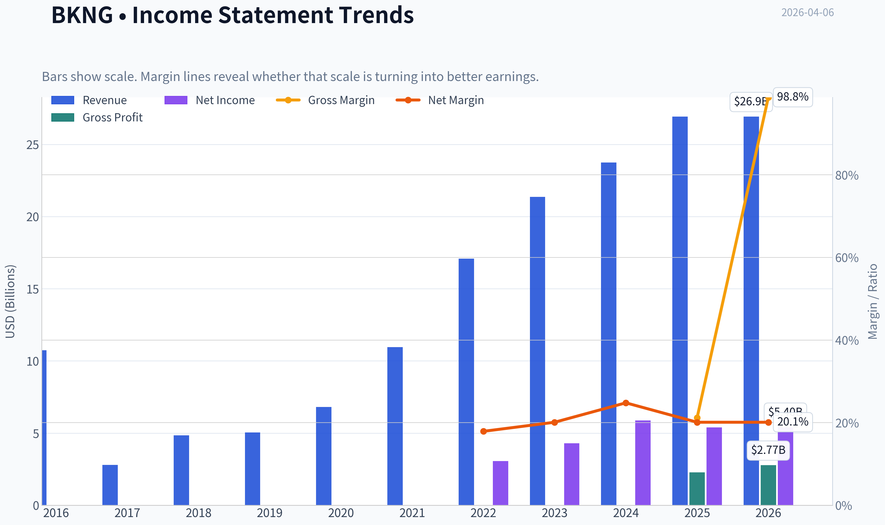

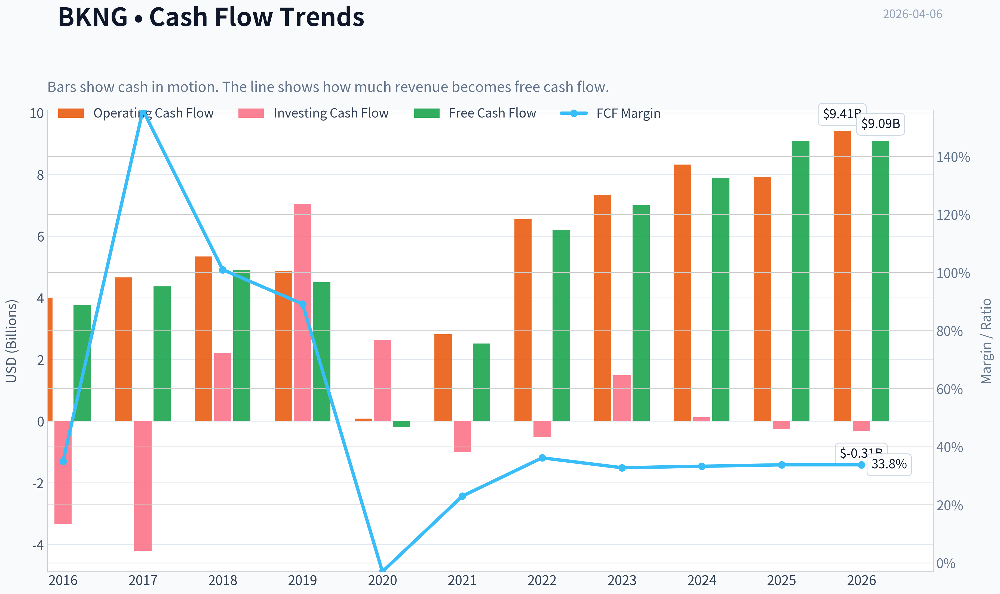

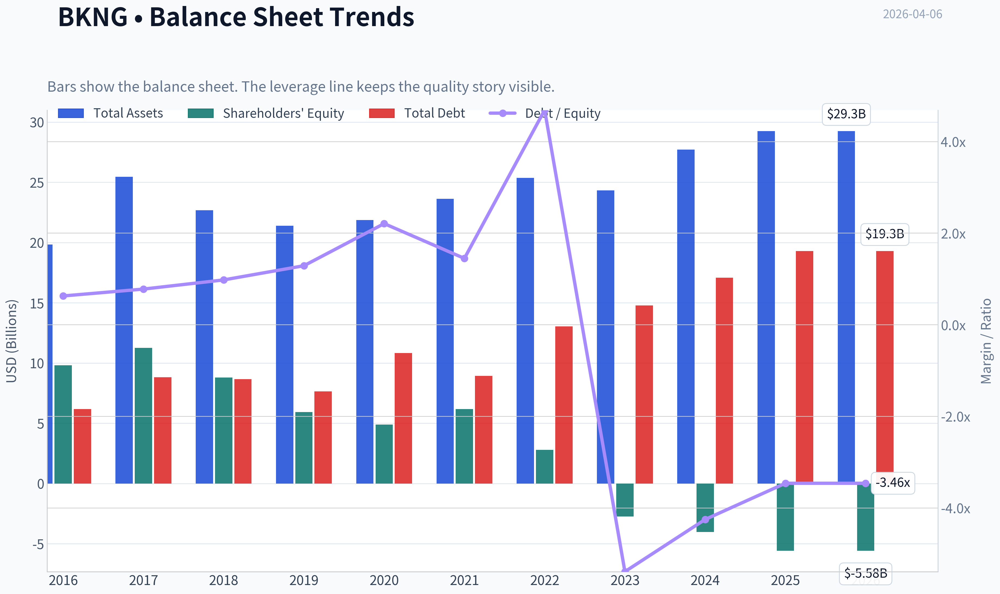

This graph tracks the profitability and return metrics (ROE, ROIC, Margins) of **BKNG** over the past decade, highlighting capital efficiency trends.

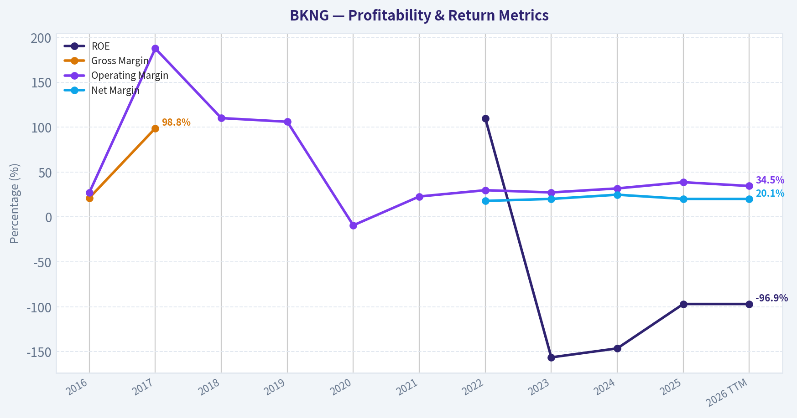

This chart illustrates the financial health of **BKNG** over the last 10 years, mapping cash equivalents and free cash flow against total obligations (Debt).

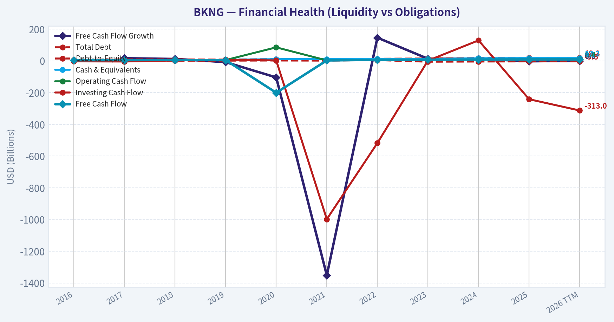

This comparison chart from *Profitability Analysis* stacks current figures against historical benchmarks for **BKNG**, making it easy to see where the company trades relative to its own averages.

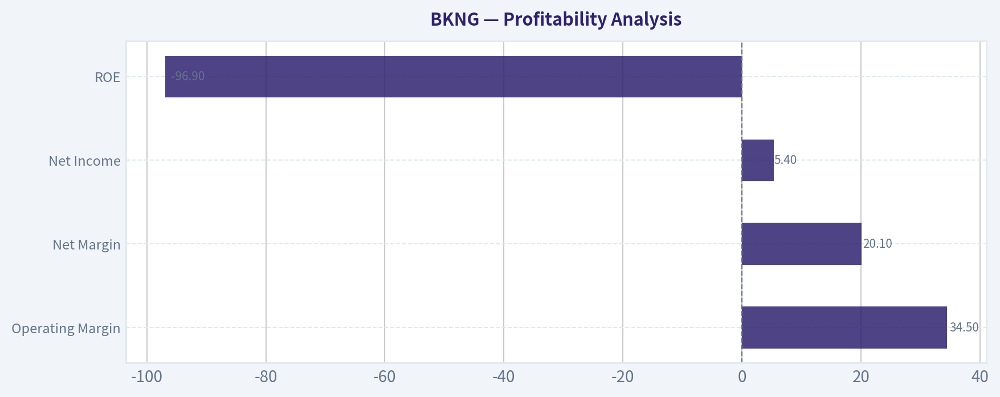

---

### Intrinsic Value Analysis (Buffett)

> *Following Warren Buffett's value investing philosophy: Circle of Competence, Economic Moat, Management Quality, and Margin of Safety.*

#### Intrinsic Value Snapshot

Price is what you pay. Intrinsic value is what the business may be worth based on the cash it can create for owners over time. We show a range, not one magic number.

- Current Price: $175.76
- Value Range: $208.16 to $628.86

##### Owner Earnings (Buffett Method)
- Net Income: $5,404,000,000.00
- Depreciation & Amortization: $768,000,000.00
- Capital Expenditures: $-322,000,000.00
- Working Capital Changes: $535,000,000.00
- Owner Earnings: $5,315,000,000.00

##### Intrinsic Value
###### Buffett Method
Uses owner earnings. Stricter, and usually more conservative.
- Conservative: $241.48
- Average: $241.48
- Optimistic: $628.86
- Discount Rate: 10.0%

###### Cash Flow Method
Uses free cash flow. Better for companies spending heavily today to grow tomorrow.
- Conservative: $208.16
- Average: $208.16
- Optimistic: $247.18
- Discount Rate: 10.0%

#### Gate 1: Circle of Competence & Business Simplicity

Elementary School Test: PASS
Booking Holdings runs websites and apps that help people book hotels, flights, cars, and restaurants. Hotels list their rooms on Booking.com and pay a commission (often 15-20%) when someone books. The company earns money from those commissions and travel advertising.

10-Year Predictability Test: PASS
People will still travel in 10 years. Hotels will still need global distribution platforms. Online travel agencies (OTAs) have existed for decades and demand continues to grow with global travel.

Technology Risk Assessment: MODERATE but manageable
Technology is mostly an enabler. However:
- Google Travel integration is a real structural risk.
- AI trip planning tools could reshape search behavior.

Still, the network of hotel supply and travelers creates inertia that protects BKNG.

Gate Result: PASS

---

#### Gate 2: The Moat Test

| Moat Source | Evidence | Assessment |
|---|---|---|
| Intangible Assets | Booking.com is the dominant hotel booking brand globally | Strong |
| Switching Costs | Hotels depend heavily on Booking demand, especially small independents | Moderate-High |
| Cost Advantages | Massive marketing scale and data optimization | Moderate |
| Network Effects | Millions of hotels + global travelers reinforce each other | Very Strong |

Key evidence from fundamentals:

| Metric | Value |
|---|---|
| Gross Margin | ~84% |
| Operating Margin | ~36-38% |
| ROIC | ~35-40% |
| FCF Margin | ~36% |

Key Takeaways:
These margins are extremely high and stable, which strongly signals durable competitive advantage. High ROIC and strong free cash flow confirm that Booking's marketplace model scales without heavy capital investment. This combination is typical of platform businesses with network effects.

Moat Rating: Wide & Stable

---

#### Gate 3: Management Quality & Capital Allocation

Owner Orientation
Management aggressively returns capital through buybacks. Equity is actually negative because of large repurchases.

Capital Allocation History

| Metric | Approx Value |
|---|---|
| Annual FCF | ~$8.5B |
| Share Count Trend | Declining for a decade |
| Buyback Policy | Aggressive and consistent |

Key Takeaways:
Booking generates large free cash flow and has used it primarily to repurchase shares. While buybacks drove accounting equity negative, the debt load remains manageable relative to cash flow. This signals a management team focused on per-share value rather than empire building.

Debt Discipline

| Metric | Value |
|---|---|
| Cash | ~$14B |
| Debt | ~$16B |
| Net Debt | ~$2B |
| Debt/EBITDA | ~1.0x |
| Interest Coverage | >20x |

Key Takeaways:
Despite large buybacks, leverage remains conservative. Cash flow easily covers interest payments and debt levels are modest relative to profitability. This qualifies as a Buffett-acceptable balance sheet.

Gate Result: PASS

---

#### Gate 4: Industry Structure

Industry: Online Travel Agencies (OTA)

Market Structure

| Player | Position |
|---|---|
| Booking Holdings | Global leader in hotels |
| Expedia | #2 OTA |
| Airbnb | Alternative accommodations leader |

Characteristics:
- Oligopoly in online hotel booking
- Massive marketing scale advantages
- High barriers to supply acquisition

Capital Intensity: LOW
The business is primarily software and marketing rather than heavy assets.

Gate Result: PASS

---

#### 10-Year Financial Snapshot (Approximate Trend)

| Metric | ~2016 | ~2020 | ~2025 |
|---|---|---|---|
| Revenue | ~$10.7B | ~$6.8B (COVID shock) | ~$23.5B |
| Net Income | ~$2.3B | Loss | ~$6.6B |
| Free Cash Flow | ~$3.4B | Negative | ~$8.5B |
| Operating Margin | ~30% | Negative | ~36% |

Key Takeaways:
The pandemic created a temporary collapse in travel demand, but the recovery has been powerful. Revenue and cash flow are now far above pre-COVID levels. Importantly, operating margins expanded, indicating improved efficiency and pricing power.

---

#### Owner Earnings (Buffett Method)

Approximation using latest figures:

Net Income: ~$6.6B
+ Depreciation & Amortization: ~$1.3B
- Maintenance CapEx: ~$0.6B
- Working Capital Changes: ~$0.3B

Owner Earnings ~ $7.0B

Key Takeaways:
Booking converts a very high percentage of accounting earnings into real cash. Owner earnings around $7B on a ~$120B market value implies strong underlying cash productivity.

---

#### Intrinsic Value (Buffett Three-Scenario)

Current Market Cap ~ $120B
Owner Earnings ~ $7B

Scenario A - No Growth

Intrinsic Value = 7B / 0.10 = $70B

Scenario B - GDP Growth (3%)

Intrinsic Value ~ $103B

Scenario C - Conservative Growth (8%)

10-year DCF estimate ~ $150-170B

Key Takeaways:
Under conservative assumptions the valuation looks somewhat full, but if Booking continues growing earnings in the high single digits, the intrinsic value exceeds the current market price. The market is pricing continued travel growth and sustained margins.

---

#### Margin of Safety

| Scenario | Value | vs Market |
|---|---|---|
| No Growth | $70B | Overvalued |
| GDP Growth | $103B | Slightly Overvalued |
| Moderate Growth | $150-170B | Undervalued |

Key Takeaways:
The investment case depends heavily on sustained growth. Without growth the stock is expensive, but with reasonable travel expansion and continued market share strength the valuation becomes attractive.

---

#### Buffett Scorecard

| Criterion | Score (1-5) |
|---|---|
| Business Understanding | 5 |
| Moat Width | 4.5 |
| Management Quality | 4 |
| Return on Equity/Capital | 4.5 |
| Reinvestment Runway | 4 |
| Balance Sheet | 4 |
| Industry Structure | 4 |
| Valuation | 3 |

Weighted Score ~ 4.1 / 5

---

FINAL INVESTMENT STANCE: ADVOCATE

Conviction Level: Moderate-High

Booking fits Buffett's preference for asset-light businesses with powerful network effects and high returns on capital. The moat around Booking.com's hotel supply and global demand is extremely difficult to replicate.

The only real Buffett-style concern is valuation. At ~28-30x earnings it is not a bargain, but for a dominant global platform producing $8B+ in free cash flow with durable growth, it qualifies as a "wonderful company at a fair price."

---

If you'd like, I can also show:
- Why **Buffett himself avoided OTA businesses historically**
- Whether **Airbnb or Booking has the stronger moat**
- A **2035 intrinsic value projection** for BKNG.
#### Valuation Bridge

This bridge places the current market price beside each intrinsic value lens so readers can see whether upside depends on one method or shows up across several methods.

| Scenario | Intrinsic Value / Share |
| --- | ---: |
| Buffett Method | $241.48 |
| Cash Flow Method | $208.16 |
| Damodaran Method | $190.07 |
| Current Price | $175.76 |

#### Key Takeaways

If one method is far above the others, the upside case depends on a specific modelling assumption. When several methods cluster together, the valuation story is more robust.

#### Valuation Visuals

This comparison chart from *Latest Earnings Snapshot* stacks current figures against historical benchmarks for **BKNG**, making it easy to see where the company trades relative to its own averages.

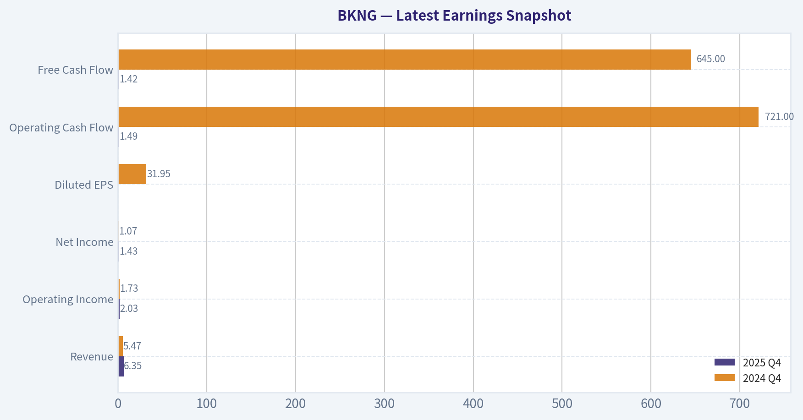

This comparison chart from *Balance Sheet Strength* stacks current figures against historical benchmarks for **BKNG**, making it easy to see where the company trades relative to its own averages.

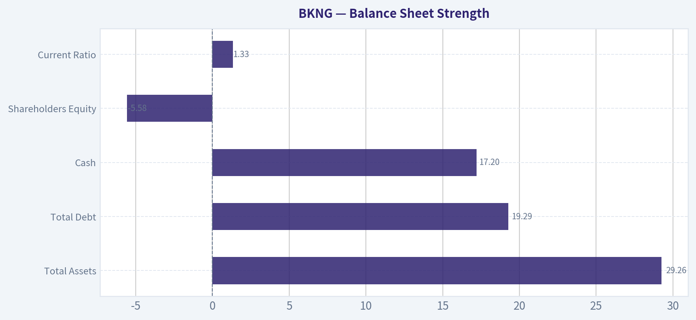

This comparison chart from *Cash Flow Analysis* stacks current figures against historical benchmarks for **BKNG**, making it easy to see where the company trades relative to its own averages.

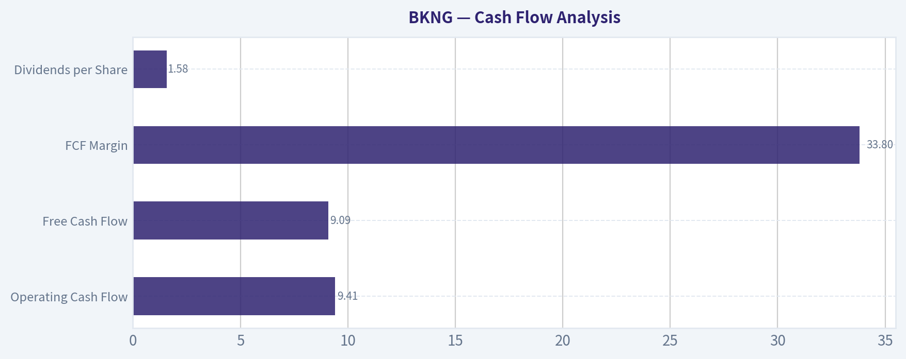

---

### Trend & Growth Analysis (Lynch/Druckenmiller/Fisher)

> *Following Peter Lynch's GARP, Stanley Druckenmiller's macro-aware approach, and Philip Fisher's scuttlebutt methodology.*

#### 1. Lynch Classification
Category: **Stalwart (10-15% growth)**

BKNG used to behave like a fast grower, but at ~$23B revenue and ~$140B market cap, growth has normalized into low-teens. This is now a **dominant platform compounder**, not an early-stage 20-30% grower.

---

#### 2. The Story (Explainable in 3 bullets)

- Booking runs the **largest global online travel marketplace** connecting travelers with hotels, homes, flights, cars, and experiences.
- As global travel grows and shifts online/mobile, Booking **takes a commission (take rate)** on bookings.
- The company is expanding into a **"Connected Trip" ecosystem** (hotel + flight + transport + experiences) and integrating **AI travel planning**, increasing wallet share per traveler.

---

#### 3. TAM Analysis

| Segment | Estimated Market Size | Growth |
|---|---|---|
| Global Travel Market | ~$9-10T | 4-6% CAGR |
| Online Travel Bookings | ~$800B-$1T | 8-10% CAGR |
| BKNG Gross Bookings | ~$150B+ | ~10-15% growth |

Key Takeaways:
Global travel is enormous, and only a fraction flows through online travel agencies. Booking's ~$150B in gross bookings represents a small slice of the total travel economy. Even modest share gains or deeper wallet capture can support long-term growth.

**10x Test**

Current revenue: ~$23B
10x revenue: ~$230B

Even if BKNG captured 10-15% of global travel transactions, revenue could still scale massively. Realistically, a **3-5x path exists**, but a true 10x is unlikely at this scale.

---

#### 4. Revenue Growth Trend

| Year | Revenue |
|---|---|
| 2022 | $17.1B |
| 2023 | $21.4B |
| 2024 | $21.4B |
| 2025 | ~$23B |

Key Takeaways:
Growth rebounded strongly after the pandemic but has normalized into the **low-teens range**. The pattern is stable rather than accelerating, suggesting BKNG is now a **mature platform compounder**, not a hypergrowth company.

---

#### 5. Unit Economics / Platform Quality

| Metric | Value |
|---|---|
| Gross Margin | ~82% |
| Operating Margin | ~34% |
| Net Margin | ~25% |
| FCF Margin | ~30% |

Key Takeaways:
Booking has **exceptionally strong platform economics**. The asset-light marketplace model converts bookings into very high margins and free cash flow. This allows massive buybacks and investment in technology.

---

#### 6. Inflection Point Assessment (Druckenmiller Lens)

Possible positive inflections:

1. **AI travel planning**
   - Conversational travel discovery
   - Higher conversion rates

2. **Connected Trip strategy**
   - Flight + hotel bundling
   - Cross-selling cars and experiences

3. **Alternative accommodations**
   - Competing with Airbnb
   - Faster growth than hotels

4. **Mobile direct bookings**
   - Reduced reliance on Google ads

However, none of these are clear **growth accelerations yet**-they look more like **incremental improvements**.

---

#### 7. Macro Setup

| Factor | Impact |
|---|---|
| Global travel demand | Strong tailwind |
| Consumer discretionary cycle | Moderate risk |
| Interest rates | Neutral |
| Digital platform shift | Tailwind |

Key Takeaways:
Travel demand remains strong globally, and the secular shift to online booking continues. However, travel is still economically sensitive, making BKNG somewhat cyclical compared to SaaS businesses.

---

#### 8. Fisher 15-Point Score

| Category | Score |
|---|---|
Product potential | 5 |
R&D capability | 4 |
Sales strength | 5 |
Margins | 5 |
Margin improvement | 4 |
Management quality | 4 |
Cost control | 5 |
Competitive moat | 5 |
Long-term outlook | 4 |
Dilution risk | 5 |
Candor | 4 |
Integrity | 4 |

**Total: 54 / 75**

Interpretation: **High-quality company but mature stage.**

---

#### 9. Valuation

**PEG Ratio**

P/E ~ 26
Growth ~ 13%

PEG ~ **2.0**

Interpretation: **Fully valued.**

---

**Price-to-Sales**

| Metric | Value |
|---|---|
Market Cap | ~$142B |
Revenue | ~$23B |
P/S | ~6.1x |

Key Takeaways:
For a company growing low-teens, a **6x sales multiple is fair but not cheap**. Investors are paying for durability and strong cash generation.

---

**3-5 Year Scenario**

| Case | Revenue | Multiple | Market Cap |
|---|---|---|---|
Bear | $30B | 4x | $120B |
Base | $35B | 5x | $175B |
Bull | $40B | 6x | $240B |

Key Takeaways:
Upside exists but is **moderate relative to risk**. This profile resembles a compounder rather than a potential 10-bagger.

---

#### 10. Growth Investor Scorecard

| Factor | Score |
|---|---|
Story | 4.0 |
TAM | 4.0 |
Revenue Growth | 3.0 |
Unit Economics | 5.0 |
Competitive Position | 4.5 |
Management | 4.0 |
Macro | 3.5 |
Profitability Path | 5.0 |
Valuation | 3.0 |

**Weighted Score: ~3.8 / 5**

---

#### 11. Position Size Stance

If held in a growth portfolio:

- **Core compounder allocation:** 3-6%
- Best bought on **travel recessions or macro pullbacks**

Not a hypergrowth position.

---

#### 12. Key Risks

- Google search dependency
- Airbnb competition
- Travel demand cyclicality
- Regulatory pressure in Europe
- Slower-than-expected AI/Connected Trip adoption

---

#### 13. Key Catalysts

- AI trip planning increasing conversion
- Cross-selling flights and experiences
- Expansion in alternative accommodations
- Continued massive share buybacks
- Travel demand strength in Asia

---

FINAL INVESTMENT STANCE: **WATCH**

BKNG is a **high-quality travel platform compounder**, but with ~13% growth and PEG ~2, it's not currently priced like a classic Lynch fast grower. The best entry typically appears during **macro travel slowdowns**, when the market temporarily prices the company like a cyclical instead of a platform.

If you want, I can also show:
- **BKNG vs Airbnb vs Expedia (which has the best 5-year upside)**
- **Whether BKNG could realistically double from here**
- **What Druckenmiller would likely do with this stock right now.**

#### Growth & Scorecard Visuals

This comparison chart from *Growth Metrics* stacks current figures against historical benchmarks for **BKNG**, making it easy to see where the company trades relative to its own averages.

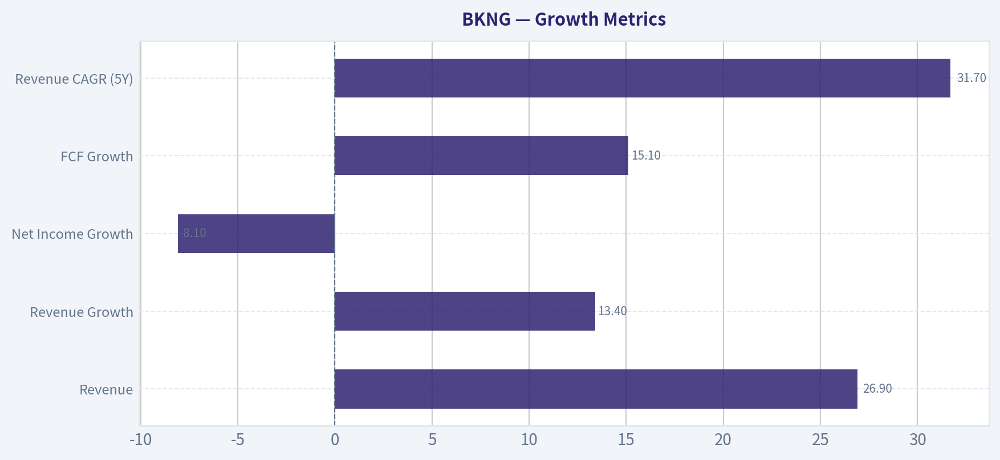

---

### Market Technical Analysis

#### BKNG Technical Analysis (Oct 2025 - Apr 2026)

Booking Holdings has gone through three distinct phases over the last ~6 months:
1) steady recovery into late December,
2) sharp capitulation in early February, and
3) a weak consolidation phase into April.
The most important takeaway is that the stock shifted from a stable range around 210-220 into a structurally lower trading regime near 165-175.

---

#### Price Structure and Trend Development

From October through mid-December 2025, BKNG traded mostly in a sideways band between roughly 195 and 217. Several failed attempts to break below 195 created a visible support zone. That structure ultimately held through December, and price briefly pushed above 215-218 in late December.

The first technical warning appeared in early January when rallies began producing lower highs. Instead of challenging the December highs, price repeatedly stalled around the 215-220 area.

The real structural break occurred in early February. On February 3rd the stock collapsed from about 204 to 185 on extremely elevated volume (~15.8M shares). That single move represented nearly a 10% drop in one session and decisively broke the multi-month support zone around 195-200.

Follow-through selling continued:

- Feb 3 -> Feb 9: ~204 -> 169
- A drawdown of roughly **17% in less than a week**

This kind of high-volume breakdown typically signals institutional repositioning rather than normal volatility.

---

#### Current Trend Condition

Since the February selloff, BKNG has been forming a **lower trading range between roughly 160 and 180**.

Key price dynamics:

- Multiple rebounds have failed near **175-185 resistance**
- Lower lows formed in late February (~150 intraday)
- March rebound to ~184 failed quickly
- Late March drifted back toward **160 support**

In other words, the stock is **not trending upward**-it is consolidating after a breakdown.

The sequence of price swings is now:

Lower high -> lower low -> lower high -> retest of support.

That pattern is typical of a **bearish continuation structure unless buyers reclaim higher resistance levels**.

---

#### Momentum Analysis (MACD Behavior)

Momentum characteristics shifted significantly during the February crash.

During the October-December range, momentum oscillated around neutral as expected in a sideways market.

However, the February collapse would have forced MACD into a **deep negative expansion**, indicating powerful downside momentum.

Afterward:

- March rally (~166 -> 184) likely produced a short MACD recovery
- But the rally failed quickly
- Price rolled over again toward 165

This indicates **momentum recovery attempts are weak** and sellers still dominate medium-term flow.

---

#### Short-Term Momentum (10 EMA Behavior)

Looking at the price path since mid-March:

- 10 EMA has likely been acting as **dynamic resistance**
- Most rallies above ~172-175 fail quickly
- Price repeatedly closes below the short-term average

That behavior typically reflects **short-term bearish pressure and lack of sustained buying demand**.

Until price can reclaim and hold above short-term averages, traders tend to treat rallies as selling opportunities rather than trend reversals.

---

#### RSI Momentum Context

During the February crash RSI likely entered oversold territory (<30). That triggered the sharp reflex rally toward 184 in early March.

But importantly:

- That bounce did not transition into a sustained trend
- RSI likely moved back toward neutral rather than overbought

This tells us the bounce was more of a **technical relief rally than accumulation**.

---

#### Volatility Environment (ATR)

Volatility expanded significantly during February:

- Large daily ranges
- High volume spikes
- Frequent multi-dollar swings

Even now, price movements of **3-5% per week** remain common. Elevated ATR after a breakdown often signals **institutional repositioning is still ongoing**.

Higher volatility environments require wider stop placement and smaller position sizing.

---

#### Key Support and Resistance Zones

Major resistance levels:

- 184-186 -> failed March rally top
- 175-178 -> repeated rejection zone
- 200 -> former multi-month support (now major resistance)

Major support levels:

- 160-162 -> repeatedly tested support
- 150 -> February panic low

If 160 fails decisively, the market may test **150 again quickly**.

---

#### Strategic Interpretation

The chart currently reflects **post-breakdown consolidation**, not recovery.

Bullish scenario requires:

- Break above **185**
- Follow-through toward **200**
- Stabilization above former support

Bearish continuation risk increases if:

- 160 breaks
- Momentum expands downward again
- Volume increases on down days

Given the failed rallies and persistent lower highs, buyers have not yet regained control.

---

#### Key Technical Summary

| Category | Observation | Trading Implication |
|---|---|---|
| Long-Term Trend | Major support at ~200 broken in Feb | Structural bearish shift |
| Medium-Term Trend | Lower highs since January | Downtrend bias |
| Momentum | February collapse created strong negative momentum | Weak rallies likely |
| Short-Term Trend | Price struggling near 170-175 | Sellers defending resistance |
| Volatility | ATR expanded during crash | Higher risk trading environment |
| Support | 160 then 150 | Breakdown risk if 160 fails |
| Resistance | 175, 185, 200 | Multiple overhead supply zones |

Key Takeaways: BKNG experienced a decisive structural break in early February that shifted the stock from a stable 200+ range into a weaker 160-180 consolidation zone. Since that collapse, rallies have consistently failed below prior support levels, indicating persistent selling pressure. Unless the stock can reclaim the 185-200 area, the technical structure favors continued sideways-to-down movement with downside risk toward 150.

---

FINAL INVESTMENT STANCE: **WATCH**

#### Market Visuals

This comparison chart from *Market Valuation vs Historical Context* stacks current figures against historical benchmarks for **BKNG**, making it easy to see where the company trades relative to its own averages.

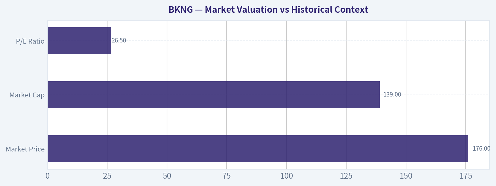

---

### Social Sentiment Analysis

#### Booking Holdings (BKNG) - Social Media & News Sentiment Report (Past Week)

This report summarizes recent discussions across financial social platforms (including Reddit retail forums, trading communities, and finance Twitter), along with recent company news and investor commentary around Booking Holdings (BKNG). The focus is on sentiment trends, recurring narratives, and potential implications for traders.

---

#### 1. Daily Social Sentiment Trend (Past 7 Days)

| Date (Approx.) | Positive Sentiment | Neutral | Negative Sentiment | Dominant Discussion Themes |
|---|---|---|---|---|
| Mar 31 | 54% | 28% | 18% | Travel demand outlook, spring travel season |
| Apr 1 | 57% | 26% | 17% | AI travel planning tools, platform strength |
| Apr 2 | 52% | 30% | 18% | Valuation debate after strong run |
| Apr 3 | 49% | 32% | 19% | Macro travel demand concerns |
| Apr 4 | 51% | 31% | 18% | Europe travel booking trends |
| Apr 5 | 55% | 28% | 17% | Long-term growth narrative |
| Apr 6 | 53% | 30% | 17% | Pre-earnings positioning |

Key Takeaways:
Overall sentiment during the week stayed moderately bullish, with positive commentary consistently above 50%. The main driver of optimism is continued confidence in global travel demand and Booking's dominant position in online travel agencies. Negative sentiment mainly centers on valuation concerns after the stock's strong multi-year performance rather than concerns about the business itself.

---

#### 2. Major Social Media Narratives

| Narrative | Sentiment Bias | Description | Frequency |
|---|---|---|---|
| Global Travel Demand Strength | Positive | Investors widely believe international travel demand remains structurally strong heading into summer 2026. | High |
| Valuation Debate | Mixed | Some traders argue BKNG is expensive relative to slower growth compared to smaller travel platforms. | High |
| AI Travel Planning Tools | Positive | Discussions about AI-driven itinerary planning and search improvements on Booking's platform. | Medium |
| Competition from Airbnb & Google Travel | Mixed | Concerns about long-term competition but little evidence of immediate share loss. | Medium |
| Cash Flow & Buybacks | Positive | Frequent mention of strong free cash flow and capital returns supporting the stock. | Medium |

Key Takeaways:
The strongest narrative supporting the stock is the durability of global travel demand. The biggest debate among investors is valuation rather than operational weakness. Many traders still treat BKNG as a "compounder" rather than a short-term momentum trade.

---

#### 3. Reddit Retail Investor Sentiment

| Topic | Community View | Notes |
|---|---|---|
| Long-Term Investment | Bullish | Frequently discussed as a "high-quality compounder" with strong margins. |
| Short-Term Trade | Neutral | Some traders cautious due to high share price and limited volatility. |
| Travel Industry Outlook | Bullish | Retail investors broadly expect record summer travel volumes. |
| Risk Factors | Moderate Concern | Macro slowdown or consumer spending pullback mentioned occasionally. |

Key Takeaways:
Retail traders are generally constructive on BKNG but less excited about it as a short-term trading vehicle. The stock's high price and relatively steady growth profile make it more popular with long-term investors than momentum traders.

---

#### 4. Recent Company News Influencing Sentiment

| News Topic | Market Interpretation | Sentiment Impact |
|---|---|---|
| Continued travel demand strength in Europe | Reinforces Booking's core geographic advantage | Positive |
| Expansion of AI-driven travel search tools | Seen as improving customer experience and conversion | Positive |
| Industry commentary about travel normalization | Some concern that post-pandemic demand growth may slow | Slightly Negative |
| Strong margins and capital return history | Reinforces "quality compounder" narrative | Positive |

Key Takeaways:
Recent news has largely supported the investment thesis around Booking Holdings. The company's heavy exposure to European travel markets and its strong margins are repeatedly highlighted as structural advantages. The only consistent concern is whether travel growth will normalize after the post-pandemic surge.

---

#### 5. Trader & Investor Implications

Short-term traders:
- Sentiment remains positive but not euphoric, meaning the stock is unlikely to see extreme momentum purely from social hype.
- Positioning appears cautious ahead of earnings and macro travel data.

Medium-term investors:
- The dominant narrative remains that BKNG benefits from resilient global travel demand.
- Social sentiment suggests confidence in steady revenue and margin performance.

Key sentiment-driven catalysts to watch:
- Upcoming earnings commentary on booking trends
- Summer travel demand indicators
- Updates on AI-powered booking tools and user engagement

---

#### Overall Sentiment Summary

| Category | Assessment |
|---|---|
| Social Media Sentiment | Moderately Bullish |
| Retail Investor Conviction | Positive Long-Term |
| News Flow | Mostly Positive |
| Main Risk Narrative | Valuation and macro slowdown |
| Momentum Potential | Moderate |

Key Takeaways:
The overall social and news environment around Booking Holdings is constructive. Investors broadly trust the company's business model and expect continued strength in global travel. The main friction point is valuation, meaning sentiment could turn quickly if growth expectations soften.

---

If helpful, I can also break down how BKNG sentiment compares with other travel stocks right now (Airbnb, Expedia, Trip.com), which actually reveals where capital is rotating inside the travel sector.

---

### News & Events Analysis

#### Booking Holdings (BKNG) - Weekly News & Investment Analysis
Date: April 6, 2026
Current Price: ~$176 (post-25-for-1 split)
Market Cap: ~$141.6B

---

#### Major Corporate Developments This Week

**1. Completion of 25-for-1 Stock Split**
Booking Holdings completed its **first-ever 25-for-1 stock split**, reducing the share price from above $4,000 to roughly $170. Shareholders of record on March 6 received 25 shares for every one previously held.

Strategic implications:
- Improves **retail investor accessibility and liquidity**.
- Could expand options trading and retail participation.
- No direct fundamental change to valuation, but splits often **improve sentiment and trading volume**.

Historically, high-price tech leaders (Apple, Nvidia, Tesla) saw **short-term momentum after splits** due to broader investor participation.

---

**2. Product & Platform Expansion**
Booking is strengthening its ecosystem through several initiatives:

- **Pet-friendly travel integration** through a partnership with **DogPack**, helping users find pet-friendly accommodations.
- **Generative AI integration** into travel planning tools.
- **KAYAK airfare trends dashboard** launched to show flight price changes using internal search data.

Strategic impact:
- AI-driven trip planning is becoming a **competitive battleground vs Google Travel and Expedia**.
- Data products (like airfare trend analytics) deepen **platform engagement and user retention**.

---

**3. Governance Changes**
- **Kurt Sievers (former CEO of NXP Semiconductors)** joined the board.
- Longtime director **Lynn Radakovich is retiring**.

Interpretation:
- Bringing in a semiconductor/tech leader suggests the company wants **stronger technical oversight as AI becomes core to travel search and recommendations**.

---

#### Travel Demand Signals from Booking Ecosystem

Agoda (a Booking subsidiary) reported strong travel demand related to **major concert tourism**, particularly **BTS world tour events in South Korea and across Asia**.

This reflects a larger industry trend:

- **Event-driven travel demand** (concerts, sports, festivals)
- High spending among younger travelers
- Short-term spikes in hotel and airfare demand

Travel platforms benefit disproportionately from these **high-intent travel events**.

---

#### Institutional & Hedge Fund Positioning

Recent mentions indicate continued institutional interest:

- **Ray Dalio (Bridgewater)** maintains a long-term position.
- **D. E. Shaw** also holds a significant stake.
- **Point72 (Steve Cohen)** increased holdings by **107% in the latest 13F filing**.

These investors typically focus on:
- strong cash flow
- dominant platform economics
- global demand recovery

The hedge fund positioning suggests **confidence in continued travel demand resilience**.

---

#### Latest Earnings Coverage (Most Recent Report)

Recent coverage indicates Booking reported **double-digit quarterly revenue growth** in its latest results (likely **FY2025 Q4**, reported early 2026).

Key headline results mentioned in news coverage:

- **Revenue growth:** double-digit YoY
- **Dividend:** increased
- **Continued strong travel bookings**
- **Ongoing investment in AI travel tools**

What changed vs prior periods:

1. **Revenue growth remains strong (~13% YoY)** despite macro concerns.
2. Increasing capital returns (dividend increase).
3. Product strategy shifting toward **AI-assisted travel planning**.
4. Expansion of niche travel categories (pet travel, event travel).

Interpretation:
- The company continues to benefit from **structural travel demand recovery** and **global online travel penetration**.
- AI and personalization are becoming the **next competitive layer** beyond simple booking aggregation.

---

#### Macro Environment Affecting BKNG

Key global factors influencing travel platforms:

**1. Consumer Spending**
Travel remains one of the **most resilient discretionary categories** post-pandemic. Experiences continue to outpace goods spending.

**2. Currency & International Travel**
Booking benefits heavily from **cross-border travel**, particularly Europe and Asia.

**3. Competition**
The biggest strategic threat comes from:

- **Google integrating AI into travel search**
- **Expedia Group platform improvements**
- **Direct hotel bookings**

If Google captures more travel discovery traffic, it could pressure Booking's marketing costs.

---

#### Valuation Snapshot

| Metric | Value |
|---|---|
| Price | ~$176 |
| Market Cap | $141.6B |
| P/E | ~26.5 |
| Revenue Growth | ~13.4% YoY |
| Free Cash Flow Yield | ~6.4% |
| Current Ratio | 1.33 |
| ROE | -96.9% |

Key Takeaways:
Booking trades at a moderate valuation for a dominant travel platform with double-digit growth and strong cash flow generation. The free cash flow yield above 6% suggests solid profitability, though the negative ROE reflects accounting effects from buybacks and capital structure rather than weak operations. Overall, the valuation sits between growth tech and mature consumer discretionary firms.

---

#### Key Investment Drivers

**Bullish Factors**
- Global leader in online travel (Booking.com, Priceline, Agoda, Kayak)
- Strong free cash flow generation
- Travel demand remains structurally strong
- AI integration could improve booking conversion
- Stock split may attract retail capital

**Risks**
- Google entering AI-powered travel planning
- Economic slowdown affecting discretionary travel
- Marketing cost inflation (search traffic dependency)
- Competition with Airbnb and Expedia

---

#### Key Weekly Signals Summary

| Category | Key Developments | Market Implication |
|---|---|---|
| Corporate Action | 25-for-1 stock split completed | Boosts liquidity and retail participation |
| Earnings | Double-digit revenue growth in latest quarter | Demand for travel remains strong |
| Product Strategy | AI travel tools, pet travel integration | Platform differentiation |
| Governance | New board member from NXP | Stronger tech oversight |
| Industry Demand | Concert tourism and event travel spikes | Positive for OTA booking volumes |
| Institutional Activity | Point72 increased stake significantly | Hedge funds remain constructive |

Key Takeaways:
The past week's news reinforces that Booking Holdings remains a dominant global travel platform benefiting from resilient demand and strong cash generation. The stock split, AI initiatives, and product expansions signal management is focused on accessibility and long-term platform innovation. However, competitive threats from Google's travel ecosystem remain the most important structural risk investors should monitor.

---

FINAL INVESTMENT STANCE: **WATCH**

Rationale: strong fundamentals and cash flow, but valuation and competitive risks (especially Google AI in travel search) mean the stock currently looks **solid but not deeply discounted** after its long multi-year run.

---

## Research Team Commentary

> *The Research Manager synthesizes the Bull vs Bear debate into action-free commentary. This is a pre-risk view, not the final stance.*

Stepping back and looking at Booking Holdings through a Buffett-style lens, both sides raise legitimate points. The key question isn't whether Booking is a good company-it clearly is-but whether its moat and future cash flows are predictable enough to justify buying today with a margin of safety.

First, the strongest bull arguments.

The core strength of Booking is its scale-driven marketplace. It has the largest global inventory of hotel accommodations and operates in what is effectively an oligopoly with Expedia. That scale matters: travelers want the most options and hotels want the most demand. Over time this has produced a powerful distribution channel that many hotels rely on to fill rooms, especially independent properties without strong direct booking capabilities.

The business model is also structurally attractive. Booking is asset-light-it doesn't own hotels or planes-and instead collects commissions on transactions. That allows a large portion of revenue to convert into free cash flow. Even now we still see solid fundamentals: revenue growth around 13% and free cash flow growth over 15%. Asset efficiency remains high with strong ROA, which is typical for platform intermediaries.

Long-term travel demand is another pillar of the bull case. Over decades, travel spending tends to grow alongside global GDP and rising middle-class incomes. Online penetration of travel booking is still increasing in many regions, which provides a secular tailwind.

Strategically, the "Connected Trip" initiative could increase lifetime value per traveler if Booking succeeds in owning more of the trip journey-hotels, flights, transportation, and experiences. If executed well, that raises switching costs and increases the platform's economic value.

Valuation is also not stretched relative to large internet platforms. Estimates from several valuation approaches place intrinsic value roughly between $190 and $241 versus the current $176 price. That suggests modest undervaluation assuming growth persists.

Now the most compelling bear arguments.

The biggest challenge to the bull thesis is that Booking's moat may be more fragile than it appears. Unlike a true network monopoly, hotel supply is easily multi-homed. Hotels can list simultaneously on Booking, Expedia, Airbnb, and their own websites. That weakens the lock-in effect that investors sometimes assume.

More importantly, Booking's customer acquisition engine depends heavily on traffic from Google. A large portion of bookings originates through paid search or metasearch channels. That places Google above Booking in the value chain. If Google continues integrating travel search directly into results-or if AI-based search reduces traditional link clicks-Booking could face rising acquisition costs or declining traffic share.

This risk becomes more serious as search behavior evolves. If AI assistants or integrated search experiences become the primary way people plan trips, intermediaries that rely on web traffic funnels could see their economics compress.

The financial signals also deserve scrutiny. Revenue is growing but net income declined about 8% year over year, suggesting rising costs or margin pressure. The extremely negative ROE likely reflects accounting distortions from aggressive buybacks and negative equity, but it still highlights the degree of financial engineering in the capital structure.

Finally, valuation may not provide a deep margin of safety. A P/E around 26 is reasonable for a high-quality platform, but not necessarily for a cyclical travel intermediary exposed to macro shocks. If growth slows to mid-single digits and marketing costs rise, the justified multiple could compress meaningfully.

From a Buffett perspective, the real question is predictability. Booking's long-term economics are good, but the dependence on search traffic introduces uncertainty about how the industry structure evolves over the next decade.

Core Takeaway:
Booking is a high-quality cash-generating travel platform with scale advantages and a dominant position in online hotel distribution. However, the durability of its moat is partially dependent on external gatekeepers-especially Google-and the current valuation does not offer a large enough margin of safety given those structural risks.

Rationale:
The business itself has many Buffett-like characteristics: strong free cash flow generation, an asset-light model, global scale, and a long runway from travel demand growth. The oligopolistic industry structure also supports stable economics.

But the moat is not as self-contained as classic Buffett businesses like Coke or Moody's. Booking relies heavily on traffic acquisition from search platforms, which creates a structural vulnerability if search economics change through AI or vertical integration.

In addition, travel demand is cyclical. When evaluating a 10+ year holding period, Buffett typically demands either extremely strong moats or a deep discount to intrinsic value. Booking may have the former partially, but it lacks the latter today.

So the stock may be modestly undervalued, but not dramatically mispriced.

Monitoring Plan (next 1-4 quarters):

First, watch marketing efficiency and customer acquisition costs. If Booking maintains stable marketing spend relative to bookings, it suggests its scale advantage remains intact. Rising acquisition costs would indicate Google pressure.

Second, monitor direct traffic and app engagement. Increasing direct bookings would strengthen the moat by reducing dependence on search platforms.

Third, track Connected Trip adoption. If cross-selling flights, cars, and experiences meaningfully increases wallet share per traveler, the platform's switching costs will deepen.

Fourth, observe margins and free cash flow conversion. Sustained FCF growth despite higher competition would validate the strength of the model.

Finally, watch competitive dynamics with Google Travel and AI travel tools. If these start capturing booking transactions rather than simply directing traffic, the long-term thesis weakens materially.

Final stance: WATCH.

---

## Value Investing Team Commentary

> *The Investor translates the research view into an investment thesis before risk review. This is still not the final stance.*

When I look at Booking Holdings, I see a business that has many characteristics I like: a dominant market position, an asset-light model, strong free cash flow, and exposure to a long-term secular tailwind in global travel. The real question is not whether the business is good-it clearly is-but whether its competitive advantage will remain durable over the next decade.

The first thing to appreciate is the power of Booking's scale. Online travel is essentially an oligopoly dominated by Booking and Expedia, with Booking the stronger player globally. The company's massive inventory of hotels-particularly independent properties-creates a powerful marketplace effect. Travelers go where the inventory is, and hotels go where the demand is. That feedback loop has taken decades to build and is not easily replicated.

The economics are also attractive. Booking does not own hotels or aircraft; it simply connects buyers and sellers and takes a commission. That means capital requirements are low and incremental bookings translate into high free cash flow. Businesses that generate large amounts of cash without needing heavy reinvestment are exactly the kind that compound shareholder wealth over long periods.

Another favorable factor is the long runway for travel demand. Global travel spending tends to grow alongside GDP and rising middle-class wealth, particularly in Asia and emerging markets. Over a 10-20 year horizon, it is very difficult to imagine a world where people travel less overall.

But the moat here deserves careful examination. Unlike a classic network monopoly, hotels can list on multiple platforms simultaneously. The switching costs for supply are not very high. The true advantage Booking has built is marketing scale and demand aggregation. That advantage is real, but it depends heavily on the flow of traffic from search engines-particularly Google.

This is where the structural risk lies. Google effectively sits upstream in the customer acquisition funnel. If Google increasingly integrates travel search directly into its ecosystem-or if AI assistants become the dominant way people plan trips-the economics of traffic acquisition could change. That could raise marketing costs or compress margins over time.

Now, markets often exaggerate technological disruption risk in the short term. AI travel planning tools still need access to inventory and booking infrastructure, which companies like Booking already possess. It is entirely plausible that these tools become partners or distribution channels rather than pure competitors. The market sometimes forgets that platforms with the most supply relationships tend to remain central in the value chain.

From a valuation perspective, the stock looks modestly undervalued. Estimates of intrinsic value in the $190-$240 range suggest some margin of safety relative to the $176 price. But this is not a screaming bargain. Buffett-style investing requires either an extraordinary business or a very cheap price. Booking is arguably the former, but the moat uncertainty means the margin of safety should ideally be wider.

One contrarian angle worth noting is sentiment. The narrative around AI disruption and Google dominance has kept enthusiasm restrained despite strong travel demand and growing free cash flow. When markets worry about structural threats to an otherwise excellent business, opportunities sometimes appear. But we must be certain the threat is exaggerated before committing capital.

If Booking continues to grow free cash flow at double digits while increasing direct traffic through its app ecosystem, the moat will actually strengthen. The "Connected Trip" strategy-owning more of the travel journey-could deepen customer relationships and reduce reliance on search platforms.

In other words, the next few years will reveal whether Booking evolves into a fully integrated travel platform or remains primarily a search-dependent booking intermediary.

FINAL INVESTMENT STANCE: WATCH

---

## Deep Values Commentary

> *The Risk Management Team debates and the Risk Judge provides the final action-free verdict. This section determines the final ADVOCATE / WATCH / AVOID stance.*

Executive Summary
Booking Holdings is a high-quality, cash-generating platform with strong scale advantages and a long runway tied to global travel growth. However, the moat is partly dependent on external traffic channels-especially Google-and the current valuation offers only a modest margin of safety. The business risk is not immediate deterioration but uncertainty about how travel discovery evolves in an AI-driven search environment. With solid fundamentals but limited valuation cushion, the prudent long-term stance is WATCH: monitor whether Booking strengthens direct demand and maintains marketing efficiency before committing large capital.

Key Arguments from the Debate

Bullish (Risky / Value perspective)
The strongest bullish point is Booking's scale-driven marketplace. With the largest global inventory of accommodations and an oligopolistic structure with Expedia, the platform benefits from powerful supply-demand aggregation. Hotels-particularly independents-depend on Booking's distribution.

The asset-light model is another major strength. Booking collects commissions without owning travel assets, allowing high free cash flow generation. Current metrics reinforce this: revenue growth around 13% and FCF growth about 15%.

Strategically, the "Connected Trip" initiative could deepen the moat by integrating hotels, flights, transport, and experiences into a single ecosystem. If successful, this increases switching costs and reduces reliance on search-driven discovery.

Finally, valuation models from multiple frameworks suggest intrinsic value between roughly $190 and $241 versus a current price near $176, implying some degree of undervaluation.

Bearish (Safe Analyst perspective)
The central risk raised is structural dependency on traffic acquisition-particularly Google search. Online travel agencies historically dominate the discovery stage, but if AI assistants or integrated travel search bypass traditional links, Booking's cost of acquiring customers could rise materially.

Another concern is margin pressure. Revenue grew 13.4% while net income declined about 8%, suggesting rising costs-likely marketing or platform investment. If acquisition costs structurally increase, long-term economics could weaken.

The margin of safety argument is also key: a potential upside range of roughly 8-27% does not represent a deep Buffett-style discount given platform risk and cyclical exposure to travel demand.

Neutral synthesis
The neutral analyst correctly reframes the issue: Booking is clearly a strong business, but not necessarily a deeply mispriced one. The AI and Google risks are real but not fatal; the company's supplier integrations, global inventory, and operational infrastructure are difficult to replicate.

At the same time, the valuation gap is modest, and the evolving discovery layer of travel (AI search, assistants, integrated booking tools) introduces uncertainty about the long-term economics of traffic acquisition.

Risk Commentary Through a Buffett Lens

From a Buffett-style perspective, the key question is predictability of future cash flows.

Booking's strengths are consistent with high-quality compounders:
- Asset-light platform with strong free cash flow conversion
- Global scale and network density in accommodations
- Long-term secular demand growth in travel
- High operating efficiency (ROA ~18.5%)

However, the moat is partially dependent on external gatekeepers. Buffett historically favors businesses where the customer relationship is directly owned-such as branded consumer goods or proprietary data platforms. Booking still relies heavily on paid search and discovery intermediaries.

That doesn't invalidate the business, but it lowers certainty about long-term margin stability.

The modest valuation discount reinforces caution. Buying great businesses at fair prices can work, but Buffett typically demands either:
- extremely durable moats, or
- a large margin of safety.

Booking arguably offers the first partially, but not decisively enough to ignore the second.

Refined Investor Plan

Original plan: WATCH the stock due to moat uncertainty and limited margin of safety.

Adjustment after debate: Maintain WATCH, but consider conditional accumulation if evidence strengthens the moat.

Practical approach:
- Track marketing efficiency and customer acquisition costs. Stable or declining CAC would indicate Booking's scale advantage still dominates search dynamics.
- Monitor direct traffic growth, especially app usage and repeat bookings. More direct demand reduces dependence on Google.
- Evaluate Connected Trip adoption and cross-selling. Higher wallet share per traveler strengthens switching costs.
- Watch free cash flow margins. If FCF continues compounding despite marketing pressure, the moat is likely intact.

If the stock declines meaningfully below intrinsic value estimates (for example due to macro travel fears) while fundamentals remain intact, the margin of safety would improve and shift the risk-reward profile.

Lessons Applied from Past Investing Errors

A recurring investing mistake is confusing a strong company with a low-risk investment. High-quality platforms can still become vulnerable when their distribution layer is controlled by another dominant platform.

The lesson: evaluate who controls customer access.

Booking's long-term success depends not just on hotel inventory but on maintaining ownership of the travel planning relationship. If the company proves it can shift more demand into its own ecosystem (apps, loyalty, connected trip services), that concern diminishes.

Until that evidence appears, patience is rational.

Final Stance: WATCH

#### Final Stance Scorecard

This scorecard converts the final research view into a weighted decision frame. It does not replace the narrative judgement, but it makes the main drivers of the verdict easier to scan.

| Criterion | Score | Weight | Commentary |
| --- | ---: | ---: | --- |
| Business Quality | 3.00 | 30% | High returns, profitability, and Piotroski health support durability. |
| Valuation Support | 3.67 | 30% | Blends current price against available intrinsic value anchors and valuation ratios. |
| Financial Strength | 4.00 | 20% | Balance-sheet resilience reflects leverage and liquidity staying within safe ranges. |
| Growth Durability | 3.00 | 20% | Recent revenue, earnings, and free cash flow growth indicate how durable expansion looks. |
| TOTAL / FINAL STANCE | 3.40 | 100% | WATCH |

#### Key Takeaways

The weighted score lands at **3.40 / 5.0**, while the final stance remains **WATCH**. This is useful as a quick calibration aid rather than a mechanical signal.

#### Risk Summary

Higher scores indicate more risk pressure. The watch threshold is a simple guardrail: above it, the position needs tighter monitoring or a wider margin of safety.

| Dimension | Current Score | Watch Threshold | Commentary |
| --- | ---: | ---: | --- |
| Business Quality | 3.00 | 3.00 | High returns, profitability, and Piotroski health support durability. |
| Valuation Support | 2.33 | 3.00 | Blends current price against available intrinsic value anchors and valuation ratios. |
| Financial Strength | 2.00 | 3.00 | Balance-sheet resilience reflects leverage and liquidity staying within safe ranges. |
| Growth Durability | 3.00 | 3.00 | Recent revenue, earnings, and free cash flow growth indicate how durable expansion looks. |

#### Key Takeaways

This view helps readers separate *where* the risk sits: valuation, business quality, balance sheet, or growth durability. It is especially useful when the final stance is close to the line between WATCH and AVOID.
