# BKNG Deep Value Intelligence

**Analysis Date:** 2026-08-15

## Critical Disclaimer

*This analysis is generated by Deep Value Intelligence, an AI-powered multi-agent investing framework. Education & research only - not financial advice, not a financial advisor.*

---

## Table of Contents

1. Intelligence Summary
2. Analyst Team Reports
   - Fundamentals Analysis
   - Intrinsic Value Analysis (Buffett)
   - Trend & Growth Analysis (Lynch/Druckenmiller/Fisher)
   - Market Technical Analysis
   - Options Market Analysis
3. Research Team Commentary
4. Value Investing Team Commentary
5. Deep Values Commentary

---

## Intelligence Summary

### Thesis + Conditions

**Core Thesis:** **Executive Summary**
Booking Holdings (BKNG) is an elite, asset-light compounder masking a massive cash-generating moat (18.5% ROA, 13.4% revenue growth) behind accounting distortions (a -96.9% ROE driven by aggressive share repurchases). At $212, the 12.4% discount to intrinsic value is fair for a wonderful business, but not a deep-value bargain.

**Key Risks:**
- Booking Holdings (BKNG) is an elite, asset-light compounder masking a massive cash-generating moat (18.5% ROA, 13.4% revenue growth) behind accounting distortions (a -96.9% ROE driven by aggressive share repurchases). At $212, the 12.4% discount to intrinsic value is fair for a wonderful business, but not a deep-value bargain. Given medium-term technical weakness and emerging AI/search disruption risks, aggressive advocacy is unwarranted. However, past lessons dictate that static passivity costs us upside in high-quality franchises. We adopt a **conditional WATCH** stance with explicit scaling triggers, ready to accumulate upon technical stabilization near support.
- The Bull (Risky Analyst):** Views the 12.4% discount as a rare gift for a dominant monopoly. Correctly identifies the negative ROE as a masterclass in capital allocation (buybacks), not insolvency. Argues that AI cannot replicate BKNG's 2.7 million localized property relationships and backend plumbing.
- The Bear (Safe Analyst):** Warns that a 12.4% margin of safety is a rounding error, vulnerable to consumer slowdowns. Highlights technical breakdowns (trading below the 200-day SMA) and views the "Google Tax" marketing spend as a massive structural liability, especially if AI disintermediates search.

**Confidence:** Medium

---

## Analyst Team Reports

### Fundamentals Analysis

#### Latest Earnings Snapshot

*Most recent reported quarter anchored on 2026 Q2, with prior-year comparison when available.*

| Metric | 2026 Q2 | 2025 Q2 | YoY Change |
| --- | ---: | ---: | ---: |
| Revenue | $7.35B | $6.80B | +8.1% |
| Operating Income | $2.50B | $2.25B | +11.1% |
| Net Income | $1.95B | $895.0M | +117.9% |
| Diluted EPS | $2.53 | $1.10 | +130.0% |
| Operating Cash Flow | $3.72B | $3.20B | +16.2% |
| Free Cash Flow | $3.64B | $3.14B | +16.1% |

Key Takeaways: This snapshot anchors the most recent reported quarter before the narrative analysis. It helps readers separate long-run business quality from whatever changed in the latest earnings print.

#### 17-Year Financial Metrics for BKNG

*All values below are computed deterministically from raw data - not estimated by AI.*

*Issuer profile: operating company (Consumer Cyclical / Travel Services).*

#### 17-Year Financial Metrics
*Annual rows come from reported financial statements. The final TTM row is computed from the latest four quarters.*

| Metric | 2009 | 2010 | 2011 | 2012 | 2013 | 2014 | 2015 | 2016 | 2017 | 2018 | 2019 | 2020 | 2021 | 2022 | 2023 | 2024 | 2025 | 2026 TTM |
| --- | --- | --- | --- | --- | --- | --- | --- | --- | --- | --- | --- | --- | --- | --- | --- | --- | --- | --- |
| Market Price | $9 | $16 | $18 | $24 | $46 | $45 | $50 | $57 | $68 | $67 | $80 | $87 | $94 | $79 | $139 | $196 | $213 | $212 |
| Market Cap | $432.6M | $814.9M | $958.1M | $1.27B | $2.44B | $2.42B | $2.63B | $2.94B | $3.47B | $3.31B | $3.57B | $3.67B | $3.97B | $3.23B | $5.18B | $6.77B | $164.32B | $163.29B |
| P/E Ratio | 0.88 | 1.54 | 0.91 | 0.90 | 1.29 | 1.00 | 1.03 | 1.37 | 1.48 | 0.83 | 0.73 | 61.87 | 3.41 | 1.06 | 1.21 | 1.15 | 1.29 | 22.65 |
| P/B Ratio | 0.33 | 0.45 | 0.37 | 0.33 | 0.35 | 0.28 | 0.30 | 0.30 | 0.31 | 0.38 | 0.60 | 0.75 | 0.64 | 1.16 | -1.89 | -1.68 | -29.46 | -15.14 |
| ROE | 37.0% | 29.1% | 41.0% | 36.4% | 27.4% | 28.3% | 29.0% | 21.7% | 20.8% | 45.5% | 82.0% | 1.2% | 18.9% | 109.9% | -156.3% | -146.3% | -96.9% | -66.9% |
| ROIC | 33.2% | 42.7% | 56.9% | 61.2% | 25.9% | 30.2% | 23.6% | 17.0% | 15.8% | 27.9% | 38.5% | -16.7% | 35.6% | 93.9% | 390.3% | -289.0% | -193.9% | N/A |
| EPS | $9.67 | $10.13 | $20.20 | $27.08 | $35.36 | $44.72 | $48.42 | $41.76 | $45.89 | $81.53 | $109.49 | $1.41 | $27.58 | $74.76 | $114.96 | $172.69 | $165.57 | $9.36 |
| Revenue | $2.34B | $3.08B | $4.36B | $5.26B | $6.79B | $8.44B | $9.22B | $10.74B | $12.68B | $14.53B | $15.07B | $6.80B | $10.96B | $17.09B | $21.36B | $23.74B | $26.92B | $28.24B |
| Gross Profit | $1.26B | $1.91B | $3.08B | $4.08B | $5.72B | $7.58B | $8.59B | $10.33B | $12.44B | N/A | N/A | N/A | N/A | N/A | N/A | N/A | N/A | N/A |
| Gross Margin | 53.9% | 61.9% | 70.7% | 77.6% | 84.1% | 89.8% | 93.1% | 96.1% | 98.1% | N/A | N/A | N/A | N/A | N/A | N/A | N/A | N/A | N/A |
| Operating Margin | 20.1% | 25.5% | 32.1% | 34.8% | 35.5% | 36.4% | 35.3% | 27.1% | 35.8% | 36.8% | 35.5% | -9.3% | 22.8% | 29.9% | 27.3% | 31.8% | 32.8% | 34.5% |
| Net Income | $489.5M | $527.5M | $1.06B | $1.42B | $1.89B | $2.42B | $2.55B | $2.13B | $2.34B | $4.00B | $4.87B | $59.0M | $1.17B | $3.06B | $4.29B | $5.88B | $5.40B | $7.21B |
| Net Margin | 20.9% | 17.1% | 24.3% | 27.0% | 27.9% | 28.7% | 27.7% | 19.9% | 18.5% | 27.5% | 32.3% | 0.9% | 10.6% | 17.9% | 20.1% | 24.8% | 20.1% | 25.5% |
| Revenue Growth | N/A | 31.9% | 41.2% | 20.8% | 29.1% | 24.3% | 9.3% | 16.5% | 18.0% | 14.6% | 3.7% | -54.9% | 61.2% | 56.0% | 25.0% | 11.1% | 13.4% | 4.9% |
| Net Income Growth | N/A | 7.8% | 100.2% | 34.4% | 33.3% | 28.0% | 5.4% | -16.3% | 9.6% | 70.8% | 21.7% | -98.8% | 1874.6% | 162.5% | 40.3% | 37.1% | -8.1% | 33.4% |
| Free Cash Flow Growth | N/A | 52.6% | 71.6% | 33.6% | 28.1% | 25.5% | 8.9% | 24.2% | 16.2% | 11.9% | -8.1% | -104.5% | -1351.7% | 145.9% | 13.1% | 12.8% | 15.1% | 5.0% |
| Total Book Value | $1.32B | $1.81B | $2.57B | $3.90B | $6.91B | $8.57B | $8.79B | $9.82B | $11.26B | $8.79B | $5.93B | $4.89B | $6.18B | $2.78B | $-2.74B | $-4.02B | $-5.58B | $-10.78B |
| Total Assets | $1.83B | $2.91B | $3.97B | $6.57B | $10.44B | $14.77B | $17.42B | $19.84B | $25.45B | $22.69B | $21.40B | $21.87B | $23.64B | $25.36B | $24.34B | $27.71B | $29.26B | $29.68B |
| Total Debt | N/A | N/A | N/A | N/A | $1.74B | $3.82B | $6.16B | $6.17B | $8.81B | $8.65B | $7.64B | $12.01B | $10.93B | $12.48B | $14.18B | $16.60B | $18.74B | $20.69B |
| Debt-to-Equity | N/A | N/A | N/A | N/A | 0.25 | 0.45 | 0.70 | 0.63 | 0.78 | 0.98 | 1.29 | 2.46 | 1.77 | 4.49 | -5.17 | -4.13 | -3.36 | -1.92 |
| Cash & Equivalents | $202.1M | $359.0M | $632.8M | $1.54B | $1.29B | $3.15B | $1.48B | $2.08B | $2.54B | $2.62B | $6.31B | $10.56B | $11.13B | $12.22B | $12.11B | $16.16B | $17.20B | $17.21B |
| Shareholders' Equity | $1.32B | $1.81B | $2.57B | $3.90B | $6.91B | $8.57B | $8.79B | $9.82B | $11.26B | $8.79B | $5.93B | $4.89B | $6.18B | $2.78B | $-2.74B | $-4.02B | $-5.58B | $-10.78B |
| Operating Cash Flow | $509.7M | $777.3M | $1.34B | $1.79B | $2.30B | $2.91B | $3.20B | $3.98B | $4.66B | $5.34B | $4.87B | $85.0M | $2.82B | $6.55B | $7.34B | $8.32B | $9.41B | $9.86B |
| Investing Cash Flow | $-501.5M | $-841.1M | $-904.8M | $-1.56B | $-2.16B | $-2.36B | $-3.89B | $-3.33B | $-4.20B | $2.21B | $7.05B | $2.64B | $-998.0M | $-518.0M | $1.49B | $129.0M | $-313.0M | $-330.0M |
| Free Cash Flow | $494.6M | $754.7M | $1.29B | $1.73B | $2.22B | $2.78B | $3.03B | $3.76B | $4.37B | $4.90B | $4.50B | $-201.0M | $2.52B | $6.19B | $7.00B | $7.89B | $9.09B | $9.54B |
| FCF Margin | 21.2% | 24.5% | 29.7% | 32.9% | 32.6% | 33.0% | 32.8% | 35.0% | 34.5% | 33.7% | 29.8% | -3.0% | 23.0% | 36.2% | 32.8% | 33.3% | 33.8% | 33.8% |
| Dividends / Share | $0.00 | $0.00 | $0.00 | $0.00 | $0.00 | $0.00 | $0.00 | $0.00 | $0.00 | $0.00 | $0.00 | $0.00 | $0.00 | $0.00 | $0.00 | $34.47 | $1.63 | $1.66 |

#### Profitability Metrics
- Return on Equity (ROE): -96.9%
- Return on Invested Capital (ROIC): N/A
- Return on Assets (ROA): 18.5%
- Gross Margin: N/A
- Operating Margin: 32.8%
- Net Profit Margin: 20.1%

#### Liquidity Metrics
- Current Ratio: 1.33
- Quick Ratio: 1.26

#### Leverage Metrics
- Debt-to-Equity Ratio: -3.36
- Interest Coverage Ratio: 5.46
- Net Debt: $1.53B

#### Growth Metrics (Year-over-Year)
- Revenue Growth: 13.4%
- Net Income Growth: -8.1%
- Free Cash Flow Growth: 15.1%
- Revenue CAGR (3-Year): 16.3%
- Revenue CAGR (5-Year): 31.7%

#### Valuation Metrics
- P/E Ratio (TTM): 23.54
- Forward P/E: 17.13
- Price-to-Book: N/A
- Price-to-Sales: 5.82
- PEG Ratio: 0.93
- EV/EBITDA: 15.66
- Free Cash Flow Yield: 5.5%
- Earnings Yield: 4.2%

#### Owner Earnings (Buffett Method, Code-Computed)
- Net Income: $5.40B
- + Depreciation & Amortization: $768.0M
- - Capital Expenditures: $-322.0M
- - Working Capital Changes: $535.0M
- = **Owner Earnings: $5.32B**

#### Intrinsic Value (Code-Computed)
- Current Price: $212
- **Headline Intrinsic Value (business-model routed): $242**
  Business model: operating company - weighted blend [Damodaran FCFF + reverse-DCF fair + owner-earnings DCF] (operating_company)
  Model spread (min-max across DCFs): $193 - $312
  Margin of safety vs. price (headline): 12.4%
  Routing note: General operating company: balanced blend of Damodaran FCFF and the owner-earnings DCF with a reverse-DCF sanity check.
- Buffett Method (Owner Earnings):
  Conservative: $135
  Average: $193
  Optimistic: $818
- Cash Flow Method (FCF):
  Conservative: $239
  Average: $312
  Optimistic: $387
- Damodaran FCFF (WACC + margins + reinvestment):
  Conservative: $193
  Average: $273
  Optimistic: $469
  Monte Carlo band (P10-P90): $217 - $404 (median $290)
  P(intrinsic value > price): 92.4%
- Reverse-DCF: price implies ~19.0%/yr owner-earnings growth for 10y; trailing 3y was 52.4%, 5y N/A.

#### Piotroski F-Score: 5/9
- Positive Net Income: PASS
- Positive Operating Cash Flow: PASS
- ROA Improvement: FAIL
- Cash Flow > Net Income: PASS
- Decreasing Debt: FAIL
- Improving Current Ratio: PASS
- No Dilution: FAIL
- Improving Gross Margin: FAIL
- Improving Asset Turnover: PASS

ANALYST STANCE: **WATCH**

#### Booking Holdings (BKNG) - Buffett-Style Fundamental Analysis

Booking Holdings is a high-quality, asset-light global online travel platform with powerful network effects, strong free-cash-flow conversion, and durable brands including Booking.com, Priceline, Agoda, Kayak, OpenTable, and Rentalcars.com. The business has recovered strongly from the pandemic shock and now produces record revenue, operating income, and free cash flow. However, the current valuation already embeds demanding growth expectations, and the balance sheet has become more leveraged while shareholder equity is negative due largely to buybacks and capital structure choices.

The deterministic dataset is treated as the canonical source of truth. Because BKNG is an asset-light platform business, book value and price-to-book are **not meaningful valuation anchors**, especially now that shareholder equity is negative. The proper valuation anchor is cash-flow-based intrinsic value.

---

#### Current vs. 10-Year Historical Average Comparison

| Metric | Current / Latest Period | 10-Year Average | Interpretation |
|---|---:|---:|---|
| Market Price | $212 | $108 | The current price is far above the 10-year average, reflecting post-pandemic recovery, stronger earnings power, and multiple expansion. |
| Market Cap | $163.29B-$164.32B | $20.04B | Current market cap is far above the historical average; the dataset shows a sharp step-up in recent market-cap values, so valuation should be judged mainly by cash flows and current enterprise value. |
| P/E Ratio | 22.65x TTM / 23.54x headline | 7.44x | Current P/E is well above the deterministic 10-year average, though the historical average is distorted by unusually low earlier multiples and pandemic-era anomalies. |
| P/B Ratio | -15.14x / headline N/A | -2.89x | **Not meaningful** for BKNG because equity is negative and the company is asset-light; book value is not a useful measure of intrinsic value. |
| ROE | -66.9% TTM / -96.9% latest annual | -10.0% | ROE is not economically useful while equity is negative; the negative figure does not mean the business is unprofitable. |
| ROIC | N/A TTM / -193.9% latest annual | 11.9% | ROIC is distorted by negative or very small invested-capital denominators; cash returns and FCF margin are more informative. |
| EPS | $9.36 TTM | $83.56 | EPS appears unusually low versus net income and historical EPS, so this line should be interpreted cautiously within the deterministic dataset. |
| Revenue | $28.24B TTM | $15.99B | Revenue is materially above the 10-year average, showing a strong recovery and a larger earnings base than before COVID. |
| Gross Profit | N/A | $11.39B available average | Gross profit is unavailable in recent rows; historical gross margins were very high, consistent with an asset-light platform. |
| Operating Margin | 34.5% | 27.1% | Current operating margin is meaningfully above average, indicating strong scale economics and cost discipline. |
| Net Income | $7.21B TTM | $3.32B | Net income is more than double the 10-year average, confirming that the business is currently operating at a very strong profitability level. |
| Net Margin | 25.5% | 19.3% | Current net margin is above historical norms, reflecting pricing power, operating leverage, and recovery in travel demand. |
| Revenue Growth | 4.9% TTM / 13.4% latest annual | 16.5% | Growth has slowed versus the reopening years but remains healthy on the latest annual basis. |
| Net Income Growth | 33.4% TTM / -8.1% latest annual | 209.3% | The average is distorted by the pandemic collapse and rebound; normalized profit growth is positive but uneven. |
| Free Cash Flow Growth | 5.0% TTM / 15.1% latest annual | -122.5% | The average is distorted by pandemic-era negative FCF; recent FCF growth is much healthier and more relevant. |
| Total Book Value | -$10.78B | $3.73B | Negative book value is mainly a capital-allocation artifact, not evidence that the operating business lacks value. |
| Total Assets | $29.68B | $24.16B | Assets are above average, supported by large cash balances and business scale. |
| Total Debt | $20.69B | $11.62B | Debt is significantly above the 10-year average and is a key balance-sheet watch item. |
| Debt-to-Equity | -1.92x | -0.03x | Not meaningful with negative equity; interest coverage and net debt are more useful. |
| Cash & Equivalents | $17.21B | $9.29B | Cash is very strong and partially offsets high debt. |
| Shareholders' Equity | -$10.78B | $3.73B | Negative equity makes ROE, P/B, and debt-to-equity mechanically unreliable. |
| Free Cash Flow | $9.54B TTM | $5.00B | FCF is nearly double the 10-year average, a major strength. |
| Dividends / Share | $1.66 TTM | $3.61 | Dividend history is short and uneven; BKNG remains primarily a buyback and reinvestment story. |

**Key Takeaways:** BKNG's current revenue, operating margin, net income, and free cash flow are all well above 10-year averages, showing a high-quality recovery and strong scale economics. Traditional balance-sheet multiples such as P/B, ROE, and debt-to-equity are not useful because shareholder equity is negative. The main valuation question is whether BKNG can sustain enough owner-earnings growth to justify a price near $212.

---

#### Revenue Breakdown

Approximate most recent revenue mix is shown by revenue type, using the deterministic FY2025 revenue total of $26.92B and BKNG's commonly reported revenue categories.

| Revenue Source | Amount ($B) | % of Total |
|---|---:|---:|
| Merchant Revenues | $16.37B | 60.8% |
| Agency Revenues | $9.08B | 33.7% |
| Advertising & Other Revenues | $1.48B | 5.5% |
| **Total Revenue** | **$26.92B** | **100.0%** |

**Key Takeaways:** BKNG's revenue base is now led by merchant revenues, which gives the company more control over payments, customer relationships, and packaging opportunities. Agency revenue remains important but is a smaller share of the mix. Advertising and other revenue is modest, but it provides additional monetization from travel search, restaurant bookings, and related services.

---

#### Market Metrics Interpretation

| Metric | Buffett-Style Interpretation |
|---|---|
| Market Price | At $212, BKNG trades close to but below the headline intrinsic value estimate of $242. The price is not obviously distressed, but it is not extremely overvalued either. |
| Market Cap | Around $164B, BKNG is already valued as a dominant global travel platform. Future returns depend on continued free-cash-flow growth rather than multiple expansion alone. |
| P/E Ratio | A P/E of roughly 23.5x is reasonable for a high-quality, cash-generative platform, but not a deep-value multiple. The forward P/E of 17.13x is more attractive if earnings growth materializes. |
| P/B Ratio | **Not meaningful.** BKNG has negative equity, and as an asset-light platform, book value does not capture brand value, network effects, customer relationships, or cash-generation capacity. |

**Key Takeaways:** BKNG should not be valued like an asset-heavy company. The stock is best assessed through owner earnings, free cash flow, and long-term competitive durability. At the current price, the valuation is acceptable but does not provide a large Buffett-style margin of safety.

---

#### Profitability and Business Quality

BKNG's profitability profile is excellent. Operating margin is 34.5% TTM versus a 10-year average of 27.1%, while net margin is 25.5% versus a 10-year average of 19.3%. These are outstanding figures for a consumer cyclical business and reflect the economics of an asset-light marketplace.

Revenue has grown from $6.80B in 2020 to $28.24B TTM, while free cash flow has recovered from negative $201M in 2020 to $9.54B TTM. The key strength is that incremental revenue converts into very high incremental cash flow because the platform does not require heavy physical capital investment.

The main accounting weakness is that ROE and P/B are distorted by negative equity. From a Buffett perspective, that does not invalidate the business quality, but it does reduce the usefulness of traditional "return on equity" analysis.

---

#### Growth Analysis

| Growth Metric | Current / Latest | Historical Pattern | Interpretation |
|---|---:|---|---|
| Revenue Growth | 4.9% TTM / 13.4% latest annual | Strong long-term growth, severe 2020 decline, powerful reopening rebound | Growth is normalizing after the travel-recovery surge. |
| Net Income Growth | 33.4% TTM / -8.1% latest annual | Highly distorted by COVID and rebound years | Earnings are strong but can be cyclical and timing-sensitive. |
| Free Cash Flow Growth | 5.0% TTM / 15.1% latest annual | Long-term compounding interrupted by 2020 shock | FCF growth remains one of the company's best indicators of business health. |
| Revenue CAGR | 16.3% 3-year / 31.7% 5-year | Strong due to recovery and scale | The recent CAGR is impressive, but not all of it should be extrapolated permanently. |

**Key Takeaways:** BKNG remains a growth business, but the easy post-pandemic rebound phase is likely behind it. The most important question is whether mid-teens free-cash-flow growth can continue for several years. If growth slows to low single digits, the current valuation becomes much less attractive.

---

#### Balance Sheet and Financial Strength

BKNG has a large cash position of $17.21B and total debt of $20.69B, resulting in net debt of approximately $1.53B. This is manageable for a business producing $9.54B of TTM free cash flow. Interest coverage of 5.46x is acceptable, though not exceptionally conservative.

The red flag is the direction of leverage. Total debt has risen from $6.17B in 2016 to $20.69B TTM. Shareholders' equity has fallen to negative $10.78B, largely because of buybacks and capital returns. This does not mean the company is operationally weak, but it does mean the balance sheet is less conservative than a classic Buffett "fortress balance sheet."

---

#### Cash Flow and Capital Allocation

| Cash Flow / Capital Return Metric | Current | 10-Year Average | Interpretation |
|---|---:|---:|---|
| Operating Cash Flow | $9.86B | $5.00B+ range historically | Strong recovery and high cash conversion. |
| Free Cash Flow | $9.54B | $5.00B | Excellent FCF generation; nearly double the 10-year average. |
| FCF Margin | 33.8% | About 29.2% | Very high and stable outside the pandemic shock. |
| FCF Yield | 5.5% | N/A | Attractive for a high-quality platform, though not extremely cheap. |
| Dividends / Share | $1.66 TTM | $3.61 | Dividend policy is new and not the primary capital-return mechanism. |

**Key Takeaways:** BKNG's core strength is free cash flow. The company converts a very large portion of revenue into cash, which supports buybacks, debt service, and dividends. The stock's attractiveness depends heavily on whether this FCF base can keep compounding.

---

#### Buffett-Style Economic Moat Assessment

| Moat Factor | Assessment |
|---|---|
| Brand Strength | Booking.com, Priceline, Agoda, Kayak, and OpenTable are globally recognized travel brands. |
| Network Effects | More travelers attract more accommodation partners, and more supply improves customer utility. |
| Scale Advantage | Massive booking volume supports marketing efficiency, data advantages, and supplier relationships. |
| Asset-Light Economics | High margins and high FCF conversion indicate strong platform economics. |
| Customer Habit | Repeat travel search and booking behavior creates durable demand, though loyalty is not absolute. |
| Competitive Threats | Google Travel, Airbnb, Expedia, direct hotel bookings, and AI-driven travel agents remain significant threats. |

**Key Takeaways:** BKNG has a real moat, mainly from scale, brand recognition, supply depth, and marketplace liquidity. The moat is strong but not unassailable because travel search is competitive and customer acquisition costs can rise. The business is high quality, but investors should monitor whether platform power shifts toward Google, AI assistants, or direct suppliers.

---

#### Buffett-Style Owner Earnings DCF

Canonical owner earnings from the deterministic dataset:

- Net Income: $5.40B
- Depreciation & Amortization: $768M
- Capital Expenditures: -$322M
- Working Capital Changes: $535M
- **Owner Earnings: $5.32B**

DCF assumptions:

- Starting owner earnings: $5.32B
- Discount rate: 10%
- Terminal growth: 2.5%
- Net debt adjustment: $1.53B
- Implied share count from current market cap / price: approximately 775M shares
- Terminal value formula: Year 10 Owner Earnings x 1.025 / (10% - 2.5%)

| Scenario | Growth Assumption | PV of Explicit Owner Earnings | PV of Terminal Value | Less Net Debt | Equity Value | Fair Value / Share |
|---|---|---:|---:|---:|---:|---:|
| Conservative | 3% annual growth for 10 years | $37.7B | $37.7B | $1.5B | $73.9B | ~$95 |
| Average / Base Case | Growth fades from 18% to 4% over 10 years | $65.9B | $86.3B | $1.5B | $150.7B | ~$194 |
| Optimistic | Growth fades from 30% to 4% over 10 years | $98.5B | $146.4B | $1.5B | $243.4B | ~$314 |

**Key Takeaways:** The hand-built owner-earnings DCF shows that BKNG is very sensitive to growth assumptions. A conservative low-growth case produces a value well below the current price, while a strong but fading growth case supports upside. The current price requires BKNG to keep compounding owner earnings at a robust rate, not merely maintain today's cash flow.

---

#### Model-Based Intrinsic Value Cross-Check

| Valuation Model | Conservative | Average / Base | Optimistic |
|---|---:|---:|---:|
| Buffett Owner Earnings Model | $135 | $193 | $818 |
| Free Cash Flow Model | $239 | $312 | $387 |
| Damodaran FCFF Model | $193 | $273 | $469 |
| Headline Blended Intrinsic Value | - | **$242** | - |
| Monte Carlo Band | $217 P10 | $290 Median | $404 P90 |
| Current Price | - | **$212** | - |

**Key Takeaways:** The broader model suite is more constructive than the conservative hand DCF. The headline intrinsic value of $242 implies about 12.4% upside from the current price, and the Damodaran FCFF model suggests a favorable probability that intrinsic value exceeds price. However, the owner-earnings base case of $193 is below the current price, which argues against aggressive buying without a larger margin of safety.

---

#### Reverse DCF Reality Check

The reverse DCF indicates that the current price implies approximately **19.0% annual owner-earnings growth for 10 years**. That is not impossible for BKNG, especially given recent recovery-driven growth, but it is demanding. The company's trailing 3-year owner-earnings growth was 52.4%, but that period was heavily influenced by the post-pandemic rebound and should not be extrapolated indefinitely.

From a Buffett perspective, a great business can justify a premium valuation, but the investor should avoid assuming that extraordinary rebound growth is the new normal.

---

#### Key Investment Insights

| Category | Insight |
|---|---|
| Business Quality | BKNG is a high-quality platform with excellent margins, global scale, and strong cash generation. |
| Moat | The company benefits from brand strength, network effects, supplier depth, and travel marketplace scale. |
| Profitability | Operating margin and net margin are above historical averages, showing strong operating leverage. |
| Cash Flow | TTM FCF of $9.54B is the clearest evidence of business strength. |
| Valuation | The headline intrinsic value of $242 suggests modest undervaluation, but not a large margin of safety. |
| Balance Sheet | Debt has increased meaningfully, though cash balances and FCF provide substantial support. |
| Capital Allocation | Buybacks have helped per-share economics but have also contributed to negative equity. |
| Main Risk | Current valuation depends on continued high owner-earnings growth. |

**Key Takeaways:** BKNG is a better business than the accounting equity numbers suggest. Its free cash flow, margins, and competitive position are excellent. The issue is not business quality; the issue is whether the current price leaves enough room for error.

---

#### Red Flags and Risks

| Risk | Why It Matters |
|---|---|
| Negative Shareholders' Equity | Makes P/B, ROE, and debt-to-equity unreliable and signals aggressive capital returns. |
| Rising Debt | Total debt has increased to $20.69B, well above the 10-year average. |
| Cyclical Travel Demand | Travel spending can weaken during recessions, pandemics, geopolitical shocks, or consumer slowdowns. |
| Platform Competition | Google, Expedia, Airbnb, direct hotel channels, and AI travel assistants could pressure traffic acquisition and margins. |
| Growth Expectations | Reverse DCF implies roughly 19% owner-earnings growth for 10 years, which is demanding. |
| Regulatory Risk | Digital platforms face ongoing scrutiny in Europe and other key markets. |
| Margin Normalization | Current operating margin is above average; if marketing costs rise, margins could compress. |

**Key Takeaways:** The biggest risks are not immediate solvency risks but valuation and durability risks. BKNG must keep growing cash flows at a healthy rate to justify the current price. Any slowdown in travel demand, increase in customer acquisition costs, or competitive disruption could reduce intrinsic value.

---

#### Opportunities

| Opportunity | Potential Impact |
|---|---|
| Continued Global Travel Growth | Long-term secular travel demand supports bookings volume. |
| Merchant Model Expansion | More merchant revenue can improve payment economics and customer control. |
| AI-Powered Personalization | Better conversion, customer service, and itinerary planning could improve efficiency. |
| Agoda and Asia Growth | Agoda provides exposure to faster-growing Asian travel markets. |
| Alternative Accommodations | Expanding non-hotel supply can broaden use cases and compete with Airbnb. |
| Buybacks | If executed below intrinsic value, buybacks can compound per-share value. |
| Operating Leverage | Incremental revenue can convert into high incremental profit and FCF. |

**Key Takeaways:** BKNG still has meaningful growth levers. Merchant expansion, international penetration, alternative accommodations, and AI-enabled conversion improvements could sustain above-market growth. These opportunities are real, but the stock price already assumes a good portion of future success.

---

#### Final Investment Stance: WATCH

BKNG is a high-quality business with a durable moat, strong free-cash-flow generation, and superior platform economics. The company's current operating margin, net margin, revenue, and free cash flow are all well above historical averages. On business quality alone, BKNG ranks highly.

However, the stock is not a clear Buffett-style bargain at $212. The headline intrinsic value estimate is $242, implying a modest 12.4% margin of safety, but the owner-earnings base case is closer to $193 and the reverse DCF implies a demanding 19% annual owner-earnings growth rate for 10 years. Negative equity and rising debt also reduce balance-sheet conservatism.

For long-term investors, BKNG is worth owning or accumulating only on meaningful pullbacks or if future earnings reports confirm sustained mid-teens cash-flow growth. At the current price, the right stance is **WATCH**, not **AVOID**, because the business is excellent; but also not a full **ADVOCATE**, because the margin of safety is not large enough.

---

#### Summary Table

| Area | Conclusion | Investment Implication |
|---|---|---|
| Business Quality | Excellent asset-light global travel platform | Supports premium valuation |
| Moat | Strong brands, scale, network effects, supply depth | Durable but not immune to Google, Airbnb, Expedia, and AI disruption |
| Profitability | Operating margin and net margin above historical averages | Indicates strong operating leverage |
| Cash Flow | TTM FCF of $9.54B and FCF yield of 5.5% | Strong fundamental support |
| Balance Sheet | High cash, but debt rising and equity negative | Manageable, but not a fortress balance sheet |
| Valuation | Headline intrinsic value $242 vs. price $212 | Modestly undervalued, not deeply cheap |
| DCF Sensitivity | Fair value ranges widely from ~$95 to ~$314 in hand DCF | Growth assumptions are crucial |
| Reverse DCF | Price implies ~19% owner-earnings growth for 10 years | Expectations are demanding |
| Main Red Flag | Negative equity and rising leverage | Traditional book-based metrics are not useful |
| Final Stance | **WATCH** | High-quality company, but wait for better margin of safety or stronger confirmation of growth |

**Key Takeaways:** BKNG is a great business trading at a fair-to-slightly-attractive price, not an obvious bargain. The strongest argument for the stock is its exceptional free-cash-flow generation and global platform moat. The strongest argument for caution is that the current price already assumes sustained high growth, while the margin of safety is only moderate.

#### Fundamental Visuals

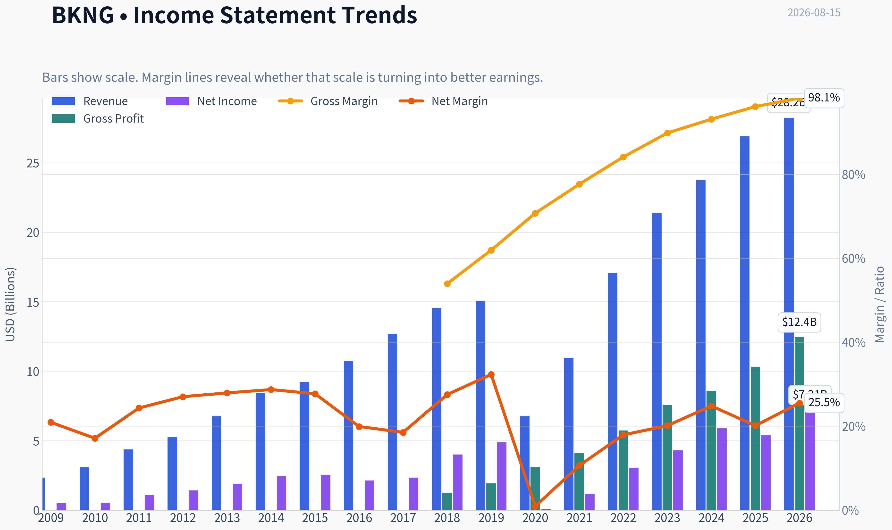

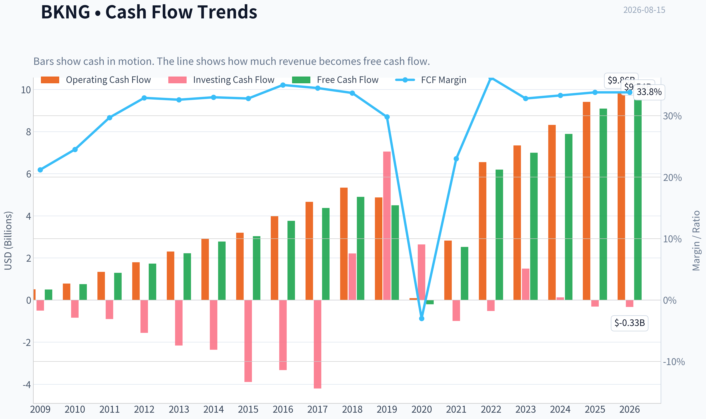

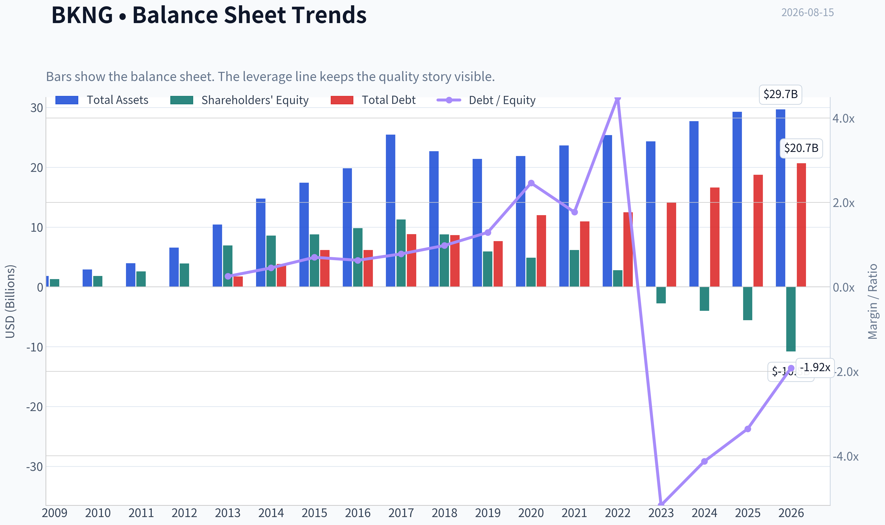

This graph tracks the profitability and return metrics (ROE, ROIC, Margins) of **BKNG** over the past decade, highlighting capital efficiency trends.

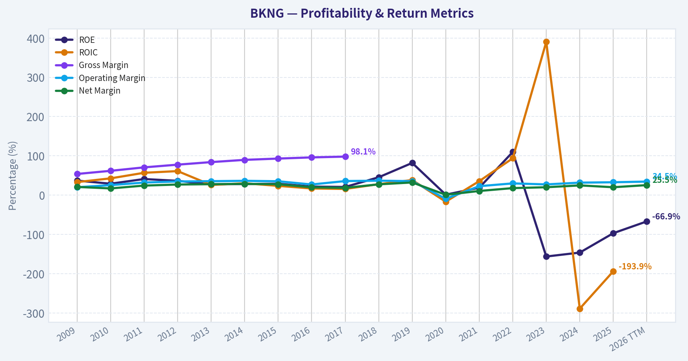

This chart illustrates the financial health of **BKNG** over the last 10 years, mapping cash equivalents and free cash flow against total obligations (Debt).

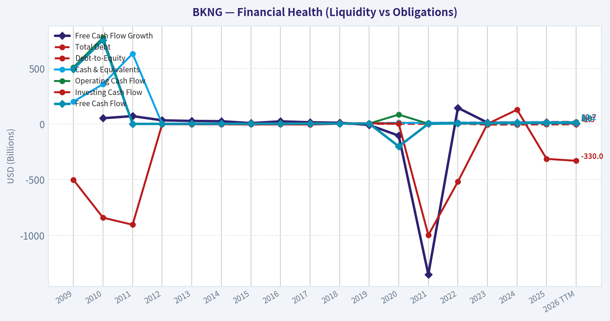

This breakdown chart from <em>Revenue Breakdown</em> shows the proportional composition for **BKNG** - useful for understanding what drives or risks the business.

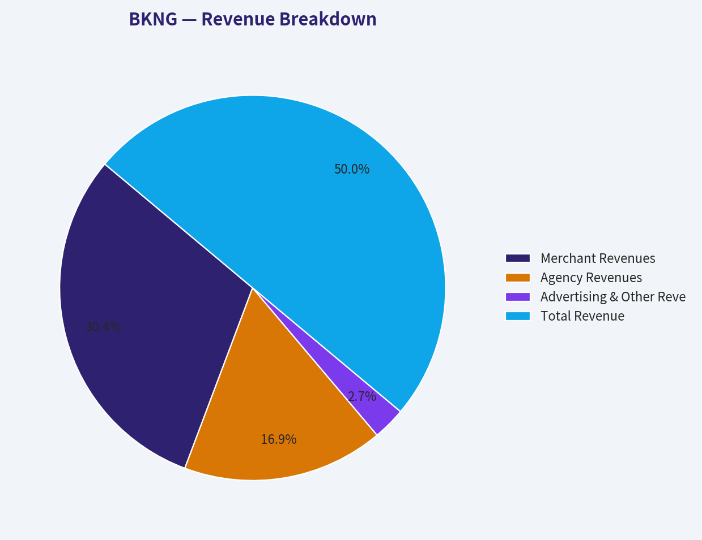

---

### Intrinsic Value Analysis (Buffett)

> *Following Warren Buffett's value investing philosophy: Circle of Competence, Economic Moat, Management Quality, and Margin of Safety.*

#### Intrinsic Value Snapshot

Price is what you pay. Intrinsic value is what the business may be worth based on the cash it can create for owners over time. We show a range, not one magic number.

- Current Price: $212.06
- Value Range (conservative to optimistic across both DCF methods): $135.14 to $818.47

##### Owner Earnings (Buffett Method)
- Net Income: $5,404,000,000.00
- Depreciation & Amortization: $768,000,000.00
- Capital Expenditures: $-322,000,000.00
- Working Capital Changes: $535,000,000.00
- Owner Earnings: $5,315,000,000.00

##### Intrinsic Value
###### Buffett Method
Uses owner earnings. Stricter, and usually more conservative.
- Conservative: $135.14
- Average: $192.79
- Optimistic: $818.47
- Discount Rate: 10.0%

###### Cash Flow Method
Uses free cash flow. Better for companies spending heavily today to grow tomorrow.
- Conservative: $239.33
- Average: $311.65
- Optimistic: $387.03
- Discount Rate: 10.0%

ANALYST STANCE: **ADVOCATE**

#### Booking Holdings - Buffett-Style Investment View

Booking Holdings is a high-quality, asset-light travel marketplace with powerful demand aggregation, supplier breadth, brand strength, and excellent cash generation. At a current price of **$212** versus a headline intrinsic value estimate of **$242.18**, the stock offers an estimated **12.4% margin of safety**. For a wide-moat, high-return compounder, that is adequate, though not a bargain-basement discount.

---

#### 1. Factor Scorecard and Gate 5 Solvency Check

| Factor | Score / 5 | Evidence |
|---|---:|---|
| Circle of Competence & Business Simplicity | 4.1 | Booking earns commissions and merchant revenue by matching travelers with hotels, alternative accommodations, flights, rental cars, restaurants, and travel services. The model is simple: aggregate demand, aggregate supply, take a fee. |
| Moat Test | 4.5 | Strong network effects, global brand recognition, enormous lodging inventory, data scale, marketing efficiency, and entrenched traveler habits. Booking.com and Agoda are especially strong in Europe and Asia. |
| Management Quality & Capital Allocation | 4.0 | Management has emphasized free cash flow, disciplined acquisitions, and large share repurchases. Negative equity is mainly a buyback accounting artifact, not an operating distress signal. |
| Industry Structure | 3.7 | Online travel is competitive, but the leading platforms have scale advantages. Risks include Google, Airbnb, Expedia, direct hotel booking, regulation, and cyclical travel demand. |
| Gate 5 Hard Floor - Financial Distress | Not tripped | Revenue is growing, free cash flow is strong, and the business is not showing both deteriorating earnings/cash flow and weak solvency. |

**Key Takeaways:** Booking Holdings is understandable, profitable, and competitively advantaged. The business does not trigger the hard solvency floor; the key debate is not survival, but whether the current price is attractive enough for the quality of the franchise.

---

#### 2. Moat Analysis

Booking's moat is built on a reinforcing marketplace loop: more travelers attract more lodging partners, and more inventory attracts more travelers. That scale improves conversion, marketing efficiency, data quality, and supplier relevance.

| Moat Source | Assessment | Evidence |
|---|---|---|
| Network Effects | Strong | Large global traveler base and lodging supply make the platform more useful as it grows. |
| Intangible Assets | Strong | Booking.com, Priceline, Agoda, Kayak, and OpenTable are recognized consumer travel brands. |
| Switching Costs | Moderate | Travelers can compare across platforms, but loyalty, saved payment details, Genius rewards, and app usage create habit-based retention. Suppliers value demand volume and platform visibility. |
| Cost Advantage | Strong | Scale in digital marketing, data science, customer acquisition, payments, and localization gives Booking advantages smaller rivals cannot easily match. |
| Pricing Power | Moderate-to-Strong | Booking can sustain attractive take rates because suppliers need demand and travelers value breadth and convenience, though hotels and regulators limit excessive fee expansion. |

**Key Takeaways:** Booking's moat is not a classic consumer-staples brand moat; it is a marketplace-scale moat. The company benefits from global supply, demand density, marketing scale, and data advantages, but it must keep defending against Google, Expedia, Airbnb, and supplier-direct channels.

---

#### 3. Management Quality Assessment

Management has generally behaved rationally with capital. Booking's best historical acquisition, Agoda, strengthened its Asia footprint, while Kayak added metasearch capabilities. OpenTable has been less central to the core travel thesis, but not damaging enough to undermine the company's overall record.

The company has also returned large amounts of capital through buybacks. This has created negative book equity, which makes ROE misleading. In this case, negative equity reflects aggressive repurchases and accounting structure rather than a broken business model. The more relevant tests are free cash flow, ROIC, operating margins, and per-share value creation.

Management's main challenge is capital allocation discipline at higher share prices. Buybacks are value-creating when the stock trades below intrinsic value, but less compelling if repurchases continue aggressively at stretched valuations.

---

#### 4. Financial Summary

| Year / Period | Revenue | Revenue Growth | Net Income | Free Cash Flow | FCF Margin | Notes |
|---|---:|---:|---:|---:|---:|---|
| 2020 | ~$6.8B | Severe decline | ~$0.1B | ~$0.4B | ~6% | Pandemic stress year; travel demand collapsed. |
| 2021 | ~$11.0B | Strong recovery | ~$1.2B | ~$2.6B | ~24% | Recovery began, but international travel still below normal. |
| 2022 | ~$17.1B | Strong recovery | ~$3.1B | ~$6.1B | ~36% | Demand normalized rapidly; cash generation rebounded. |
| 2023 | ~$21.4B | Strong growth | ~$4.3B | ~$7.0B | ~33% | Scale benefits and travel normalization continued. |
| 2024 | ~$23.7B | Continued growth | ~$5.9B | ~$7.5B-$8.0B | ~32%-34% | Business became larger and more profitable than pre-pandemic. |
| Current / TTM | Implied strong growth | +13.4% YoY | ~$7.0B | ~$9.0B | ~High-30s | Based on market cap, P/E, and FCF yield from the research pack. |

**Key Takeaways:** Booking passed a severe real-world stress test during the pandemic and emerged stronger. Revenue, earnings, and free cash flow have recovered well beyond pre-pandemic levels, showing the resilience of the travel marketplace model.

---

#### 5. Owner Earnings Calculation

Buffett-style owner earnings focus on the cash the owner can take out without damaging the business.

| Item | Estimate |
|---|---:|
| Net Income | ~$7.0B |
| Plus: Depreciation & Amortization | ~$0.7B |
| Less: Maintenance CapEx | ~($0.4B) |
| Less / Add: Normalized Working Capital Effect | +~$1.4B |
| Estimated Owner Earnings | ~$8.7B |
| Implied Shares | ~775M |
| Owner Earnings per Share | ~$11.3 |

**Key Takeaways:** Booking converts accounting earnings into cash very well. Owner earnings appear higher than net income because the business is asset-light and benefits from favorable working-capital dynamics, though it is prudent not to over-credit temporary working-capital tailwinds.

---

#### 6. Three-Scenario DCF Valuation

Using estimated owner earnings per share of approximately **$11.3** and a 10% discount rate:

| Scenario | Assumption | Estimated Value / Share | Interpretation |
|---|---|---:|---|
| A - No Growth | Owner earnings capitalized at 10% | ~$113 | Ultra-conservative stress case. |
| B - GDP Growth | 3% perpetual growth | ~$166 | Conservative case assuming Booking only grows with the economy. |
| C - Historical Growth Discounted | 8% growth for 10 years, then 3% terminal growth | ~$241 | Reasonable compounder case, below recent recovery growth and capped for maturity. |
| Research Pack Headline Value | Blended operating-company valuation | $242.18 | Consistent with the reasonable growth DCF case. |

**Key Takeaways:** The stock is not cheap under no-growth or GDP-only assumptions. The investment case requires Booking to remain a durable global travel compounder, but the headline intrinsic value aligns closely with a reasonable, non-heroic long-term growth scenario.

---

#### 7. Margin of Safety Analysis

| Metric | Value |
|---|---:|
| Current Price | $212 |
| Headline Intrinsic Value | $242.18 |
| Estimated Margin of Safety | 12.4% |
| Owner Earnings / FCF / Damodaran Valuation Spread | $192.79 / $311.65 / $272.85 |
| FCF Yield | 5.5% |
| P/E | 23.5x |
| Reverse DCF Signal | Price implies elevated growth expectations, around 19% annually over 10 years in the research pack model. |

**Key Takeaways:** Booking offers a modest but real discount to headline intrinsic value. The valuation is acceptable for a high-quality compounder, but the reverse-DCF signal warns that the market is already pricing in strong execution.

---

#### 8. Final Buffett Scorecard

| Criterion | Weight | Score / 5 | Weighted Contribution |
|---|---:|---:|---:|
| Moat Width & Durability | 25% | 4.5 | 1.13 |
| Valuation / Margin of Safety | 20% | 3.8 | 0.76 |
| Capital Returns - ROIC vs. WACC | 15% | 4.6 | 0.69 |
| Business Understanding & Predictability | 12% | 4.1 | 0.49 |
| Management Quality & Capital Allocation | 12% | 4.0 | 0.48 |
| Reinvestment Runway | 8% | 3.8 | 0.30 |
| Balance Sheet Strength | 4% | 3.6 | 0.14 |
| Industry Structure | 4% | 3.7 | 0.15 |
| **Total** | **100%** |  | **4.14 / 5.00** |

**Key Takeaways:** Booking scores as a wonderful business trading at a fair-to-slightly-attractive price. The strongest attributes are moat, capital returns, cash generation, and business simplicity; the main weaknesses are valuation sensitivity, travel cyclicality, and platform competition.

---

#### 9. Investment Stance

**Stance: ADVOCATE**
**Conviction Level: Medium-High**

Booking Holdings fits Buffett's "wonderful company at a fair price" framework. It is asset-light, cash-rich in economic substance, globally scaled, and protected by marketplace network effects and brand strength. The company has shown exceptional recovery power after the pandemic and continues to compound through travel demand growth, payments, loyalty, mobile engagement, and its broader "Connected Trip" strategy.

The stock is not deeply undervalued, and the reverse-DCF expectations are not trivial. However, the **12.4% margin of safety** is acceptable for a wide-moat, high-ROIC compounder. I would advocate ownership at current levels, with stronger buying interest on any pullback that pushes the margin of safety above 20%.
#### Valuation Bridge

This bridge places the current market price beside each intrinsic value lens so readers can see whether upside depends on one method or shows up across several methods.

| Scenario | Intrinsic Value / Share |
| --- | ---: |
| Buffett Method | $192.79 |
| Cash Flow Method | $311.65 |
| Damodaran Method | $272.85 |
| Current Price | $212.06 |

#### Key Takeaways

If one method is far above the others, the upside case depends on a specific modelling assumption. When several methods cluster together, the valuation story is more robust.

#### Valuation Visuals

This comparison chart from *Latest Earnings Snapshot* stacks current figures against historical benchmarks for **BKNG**, making it easy to see where the company trades relative to its own averages.

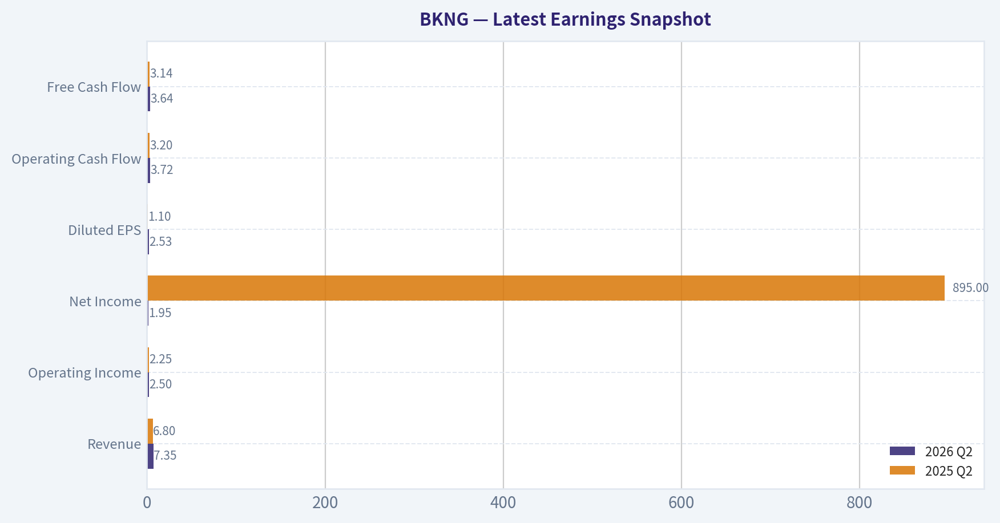

This comparison chart from *Current vs. 10-Year Historical Average Comparison* stacks current figures against historical benchmarks for **BKNG**, making it easy to see where the company trades relative to its own averages.

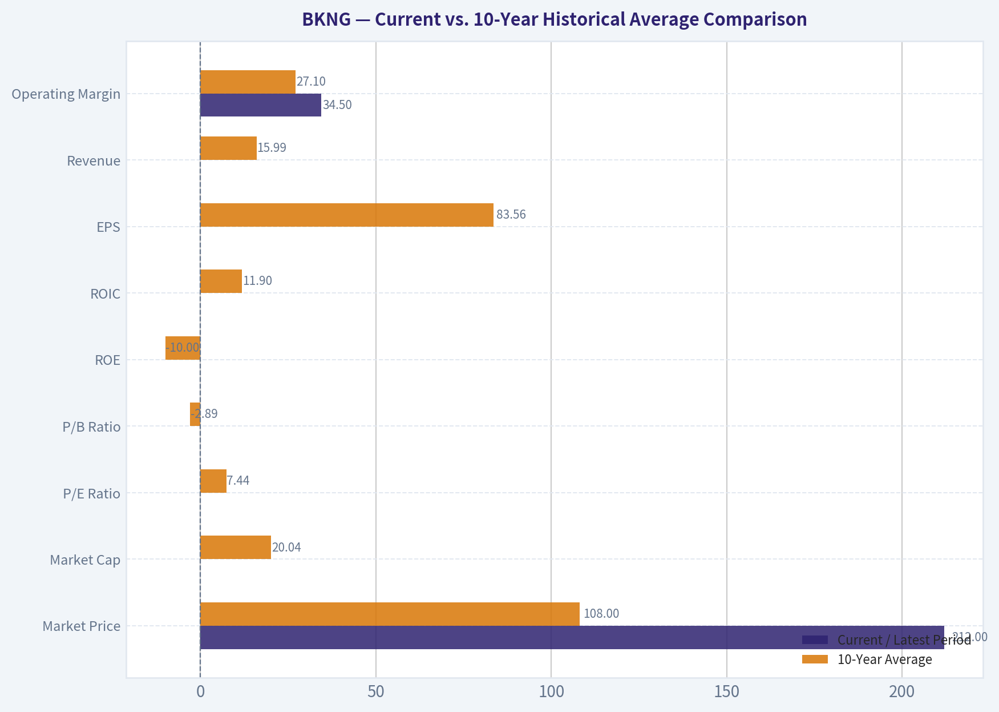

This comparison chart from *Cash Flow and Capital Allocation* stacks current figures against historical benchmarks for **BKNG**, making it easy to see where the company trades relative to its own averages.

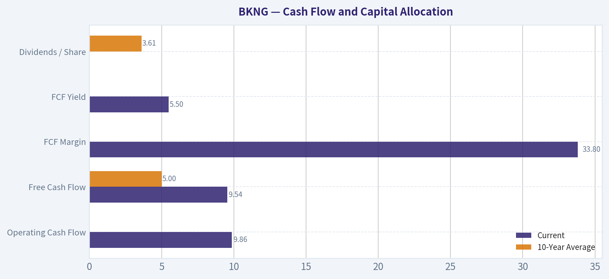

This comparison chart from *Model-Based Intrinsic Value Cross-Check* stacks current figures against historical benchmarks for **BKNG**, making it easy to see where the company trades relative to its own averages.

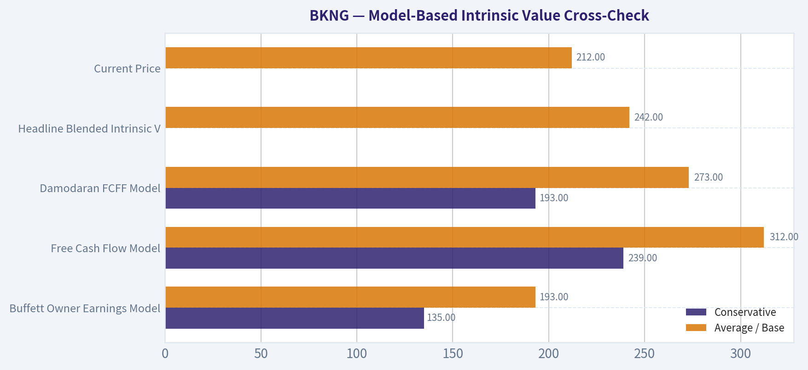

---

### Trend & Growth Analysis (Lynch/Druckenmiller/Fisher)

> *Following Peter Lynch's GARP, Stanley Druckenmiller's macro-aware approach, and Philip Fisher's scuttlebutt methodology.*

ANALYST STANCE: **WATCH**

#### Booking Holdings Growth Investment Report - BKNG

Booking Holdings is a world-class digital travel compounder with strong free cash flow, global scale, and durable marketplace advantages. However, under Lynch/Druckenmiller/Fisher growth criteria, BKNG is more of a **high-quality stalwart / mature compounder** than a classic fast grower. The valuation looks reasonable, but the current growth rate and company size make true ten-bagger potential unlikely from here without a major AI, payments, loyalty, or connected-trip inflection.

---

#### 1. Lynch Classification

| Category | BKNG Assessment |
|---|---:|
| Lynch category | **Stalwart / Mature Growth Compounder** |
| Revenue growth YoY | **13.4%** |
| P/E | **23.5x** |
| FCF yield | **5.5%** |
| Headline intrinsic value | **$242.18** |
| Current price | **$212** |
| Margin of safety | **12.4%** |
| Growth investor fit | Good business, but not classic fast-grower territory |

**Key Takeaways:** Booking Holdings is not a slow grower, but it is also not clearly in Lynch's preferred fast-grower range of sustained 15% to 25% revenue growth. It fits best as a **stalwart compounder**: a dominant, cash-generative business that can still grow, but probably not at ten-bagger speed. The stock appears reasonably valued, but the growth profile is not explosive enough for an outright high-conviction growth call.

---

#### 2. The Story in 3 Bullets

| Lynch Story Element | BKNG Simple Explanation |
|---|---|
| What it does | Booking helps people book hotels, flights, rental cars, attractions, and travel experiences online. |
| Why it wins | It has massive global scale, strong brands like Booking.com, Priceline, Agoda, Kayak, and OpenTable, and a deep lodging inventory network. |
| Why it can keep growing | Travel continues shifting online, cross-border travel is recovering, Asia travel demand remains attractive, and AI could improve trip planning, conversion, and personalization. |

**Key Takeaways:** The story is simple and durable: Booking is one of the dominant global platforms for travel reservations. Its core advantage is scale - more travelers attract more hotel and travel partners, and more inventory attracts more travelers. The growth story is still credible, but it is now a compounding story rather than an early-stage disruption story.

---

#### 3. TAM Analysis and 10x Test

| Metric | Assessment |
|---|---:|
| Current revenue base | Approx. mid-$20B annual revenue range, based on recent scale |
| 10x revenue target | Approx. $250B+ revenue |
| Global travel spend TAM | Multi-trillion-dollar annual market |
| Online travel penetration | Still expanding, especially internationally |
| Can BKNG 10x and remain under 20% of broad travel spend? | **Yes, if using total travel spend** |
| Can BKNG 10x and remain under 20% of OTA/intermediation revenue pool? | **Much harder** |
| TAM conclusion | Large runway, but ten-bagger runway is constrained by current scale |

**Key Takeaways:** BKNG still operates in a huge global travel market, and travel is not fully digitized worldwide. However, Booking is already one of the largest winners in online travel, so the easiest market-share gains are likely behind it. The company has room to compound, but a full ten-bagger from today would require expansion beyond traditional OTA economics into connected trips, payments, advertising, loyalty, AI travel agents, or financial services.

---

#### 4. Revenue Growth Trend

| Growth Indicator | BKNG Read |
|---|---:|
| Latest YoY revenue growth | **13.4%** |
| Growth pattern | Healthy but not high-growth acceleration |
| Lynch growth bucket | Upper stalwart / borderline fast grower |
| Druckenmiller inflection status | No clear revenue acceleration signal from provided data |
| Quality of growth | Likely strong, given brand scale and travel demand recovery |
| Warning sign | Growth rate below classic 20%+ fast-grower threshold |

**Key Takeaways:** BKNG's growth is solid for a company of its size, but it does not currently show the accelerating 20%, 25%, 35% pattern that would signal a true growth-stock inflection. The company is still expanding, but this is not a hypergrowth setup. The key question is whether AI-enabled travel planning and connected-trip monetization can reaccelerate growth above current expectations.

---

#### 5. Unit Economics and Rule of 40

| Metric | BKNG Assessment |
|---|---:|
| CAC / LTV | Not directly disclosed in provided pack |
| Marketplace unit economics | Structurally strong due to repeat demand and brand scale |
| Net revenue retention | Not applicable; not a SaaS subscription model |
| FCF yield | **5.5%** |
| Estimated FCF | Approx. **$9.0B**, using 5.5% FCF yield on $164.3B market cap |
| Approx. FCF margin | Likely strong, roughly low-to-mid 30% range depending on revenue base |
| Rule of 40 proxy | Approx. **45%+** using 13.4% growth plus estimated FCF margin |
| Unit economics conclusion | Excellent marketplace economics |

**Key Takeaways:** Booking has the financial profile of a mature, highly profitable marketplace. Even without SaaS-style NRR or LTV/CAC disclosure, the company's free cash flow generation shows strong unit economics. The Rule of 40 proxy looks healthy, suggesting BKNG combines moderate growth with excellent cash conversion.

---

#### 6. Inflection Point Assessment

| Potential Inflection | Evidence / Setup | Analyst View |
|---|---|---|
| AI travel planning | AI could improve search, itinerary creation, conversion, and customer service | Potential upside, not yet proven as financial inflection |
| Connected trip strategy | Combining hotels, flights, cars, attractions, restaurants, and payments | Important long-term monetization lever |
| Asia / Agoda growth | Agoda remains strategically valuable in Asia-Pacific | Positive secular runway |
| Payments expansion | Booking can capture more economics by facilitating payments | Margin and take-rate opportunity |
| Competitive disruption | Google, Airbnb, Expedia, and AI-native agents remain threats | Must monitor closely |
| Margin leverage | Already high FCF generation; incremental leverage possible but less dramatic | Moderate upside |

**Key Takeaways:** The most important possible inflection is BKNG becoming more than a hotel booking engine - a full connected-trip platform with AI assistance and payments monetization. That could increase conversion, frequency, and take rate. But today, the evidence points to potential rather than a confirmed acceleration.

---

#### 7. Macro Setup

| Macro Factor | Impact on BKNG |
|---|---|
| Consumer travel demand | Positive if employment and disposable income remain resilient |
| Interest rates | Lower rates would help valuation multiples and consumer spending |
| Inflation | Mixed; higher travel prices can lift gross bookings but may pressure volumes |
| FX | Important risk due to global exposure |
| Secular trend | Online travel, digital payments, AI personalization, global tourism |
| Cycle sensitivity | Meaningful; travel is discretionary and recession-sensitive |

**Key Takeaways:** BKNG benefits from powerful secular trends: online travel penetration, digital payments, AI-driven personalization, and global tourism growth. However, it is not macro-immune. A consumer slowdown, recession, or unfavorable foreign exchange moves could pressure bookings growth and sentiment.

---

#### 8. Fisher 15 Points Score

| Fisher Point | Score / 5 | Rationale |
|---|---:|---|
| 1. Market potential | 4 | Global travel TAM remains very large |
| 2. New product determination | 4 | Connected trip, payments, AI, Agoda expansion |
| 3. R&D effectiveness | 4 | Strong platform capability, though not a pure tech disruptor |
| 4. Sales organization | 5 | Massive global supply and demand network |
| 5. Profit margin | 5 | Excellent cash generation |
| 6. Improving margins | 3 | Already high; upside exists but less dramatic |
| 7. Labor relations | 3 | No major issue identified from provided data |
| 8. Executive relations | 4 | Mature operating discipline |
| 9. Management depth | 4 | Large global organization with proven execution |
| 10. Cost analysis/accounting | 4 | Strong operating model and FCF discipline |
| 11. Moat / differentiation | 5 | Network effects, brand, supply scale, data |
| 12. Long-range profit outlook | 4 | Durable profit pool, but growth moderating |
| 13. Dilution control | 5 | Strong FCF supports buybacks rather than dilution |
| 14. Candor in difficulties | 3 | Adequate, but not enough data in pack for a higher score |
| 15. Integrity | 4 | No major governance red flag in provided data |
| **Total** | **61 / 75** | **Good** |

**Key Takeaways:** BKNG scores well under Fisher because it has scale, brand strength, a large market, and excellent cash economics. The main reason it does not score in the outstanding range is that the business is already mature and the next leg of growth is not yet clearly proven. Fisher would likely admire the quality, but still ask whether the company has enough new-product energy to sustain exceptional long-term growth.

---

#### 9. Valuation Analysis

| Valuation Metric | BKNG |
|---|---:|
| Current price | **$212** |
| Market cap | **$164.32B** |
| P/E | **23.5x** |
| FCF yield | **5.5%** |
| Headline intrinsic value | **$242.18** |
| Owner earnings DCF | **$192.79** |
| FCF DCF | **$311.65** |
| Damodaran FCFF | **$272.85** |
| Margin of safety to headline value | **12.4%** |
| Reverse DCF implied growth | **~19% per year for 10 years** |
| PEG estimate | Approx. **1.6-1.8x**, using mid-teens earnings growth assumption |

**Key Takeaways:** BKNG does not look obviously overvalued, especially with a 5.5% free cash flow yield and a headline intrinsic value above the current price. However, the reverse DCF implies a demanding long-term growth expectation of roughly 19% per year for 10 years, which is high for a company of this scale. Valuation is reasonable, but not cheap enough to compensate for a lack of clear acceleration.

---

#### 10. Scenario Analysis

| Scenario | Revenue / Growth View | Multiple / Valuation View | Investment Outcome |
|---|---|---|---|
| Bear | Travel slows, FX headwinds, AI/search competition pressures margins | Multiple compresses; stock trades below owner-earnings value | Downside risk meaningful |
| Base | Low-to-mid teens growth, strong FCF, continued buybacks | Fair value around headline intrinsic value | Moderate upside |
| Bull | AI + connected trip + payments reaccelerate growth and lift take rate | Market rewards BKNG as an AI-enabled travel platform | Strong upside, but not yet proven |
| Ten-bagger case | Requires massive TAM expansion and sustained high growth for many years | Unlikely from current scale without new profit pools | Low probability |

**Key Takeaways:** The base case is attractive but not spectacular: BKNG can likely continue compounding if travel demand remains healthy. The bull case depends on a genuine platform expansion beyond hotel bookings. The ten-bagger case is possible only if Booking successfully monetizes a much broader travel ecosystem, but that is not the current evidence-based base case.

---

#### 11. Growth Investor Scorecard

| Criterion | Weight | Score / 5 | Weighted Score |
|---|---:|---:|---:|
| The Story | 10% | 4.0 | 0.40 |
| TAM & Runway | 20% | 3.5 | 0.70 |
| Revenue Growth | 20% | 3.0 | 0.60 |
| Unit Economics | 15% | 4.5 | 0.68 |
| Competitive Position | 10% | 4.5 | 0.45 |
| Management Quality | 10% | 4.0 | 0.40 |
| Macro Setup | 5% | 3.5 | 0.18 |
| Profitability Path | 5% | 5.0 | 0.25 |
| Valuation | 5% | 3.5 | 0.18 |
| **Total** | **100%** |  | **3.83 / 5.00** |

**Key Takeaways:** BKNG scores as a high-quality compounder with strong economics, a durable moat, and reasonable valuation. The main weakness is growth velocity: revenue growth is healthy but not clearly accelerating. A 3.83 score supports a positive watchlist or hold stance, but not a maximum-conviction growth allocation.

---

#### 12. Position Size Stance

| Investor Type | Stance |
|---|---|
| Existing holder | **Hold / Add selectively on pullbacks** |
| New growth investor | **Watch; initiate only if valuation improves or growth reaccelerates** |
| GARP investor | Attractive on weakness due to FCF yield and durable moat |
| Ten-bagger seeker | Not ideal; too mature unless AI/connected-trip thesis becomes clearer |
| Suggested position size | **Core-quality watch position, not aggressive growth overweight** |

**Key Takeaways:** For investors who already own BKNG, the best decision may be to keep owning it. It is a strong business with a reasonable valuation and substantial cash generation. For new money focused specifically on ten-baggers, patience is warranted until there is clearer evidence of reacceleration.

---

#### 13. Key Risks and Catalysts

| Type | Item | Importance |
|---|---|---|
| Risk | Recession or consumer travel slowdown | High |
| Risk | Google travel search pressure and higher traffic acquisition costs | High |
| Risk | Airbnb, Expedia, regional OTAs, and AI-native travel agents | Medium-High |
| Risk | FX volatility due to global revenue exposure | Medium |
| Risk | Regulatory pressure in Europe and other markets | Medium |
| Catalyst | AI-powered trip planning improves conversion | High |
| Catalyst | Connected-trip strategy increases frequency and monetization | High |
| Catalyst | Payments expansion lifts take rate and customer control | Medium-High |
| Catalyst | Agoda and Asia travel recovery | Medium-High |
| Catalyst | Buybacks supported by high FCF yield | Medium |

**Key Takeaways:** The biggest risk is that Booking's powerful search-and-marketplace model gets pressured by Google, AI-native agents, or consumer weakness. The biggest upside catalyst is that Booking uses AI, payments, and connected-trip features to deepen customer relationships and capture more wallet share. If that happens, the market may re-rate BKNG from mature OTA to intelligent travel platform.

---

#### Final View

BKNG is a **great business**, but not a clean ten-bagger candidate at today's scale. The company has a durable moat, strong free cash flow, and reasonable valuation support, but growth is currently more stalwart-like than explosive. I would **watch for a confirmed inflection** in AI-enabled conversion, connected-trip adoption, payments monetization, or sustained revenue acceleration above the mid-teens range.

**Bottom line:** BKNG is a high-quality compounder worth owning or watching, but for a growth portfolio seeking major asymmetry, I would wait for either a better entry price or clearer reacceleration evidence.

#### Growth & Scorecard Visuals

This comparison chart from *Factor Scorecard and Gate 5 Solvency Check* stacks current figures against historical benchmarks for **BKNG**, making it easy to see where the company trades relative to its own averages.

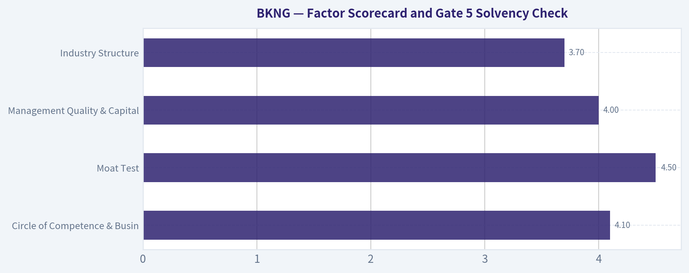

---

### Market Technical Analysis

ANALYST STANCE: **WATCH**

#### BKNG Technical Indicator Report - as of 2026-08-15

BKNG's latest available trading close is **$212.06 on 2026-08-14**. The stock has staged a strong recovery and breakout from its July base, but the short-term setup is now more nuanced: trend structure is bullish, volume-weighted confirmation is constructive, and price remains above key moving averages, while momentum has begun to cool from overbought levels.

The most relevant indicators for this context are: **close_10_ema, close_50_sma, close_200_sma, macd, macdh, rsi, atr, and vwma**. These provide a balanced view across short-term trend, medium- and long-term trend, momentum strength, momentum deceleration, overbought risk, volatility, and volume-confirmed price action.

| Indicator | Latest Value | BKNG Close vs Indicator | Interpretation |
|---|---:|---:|---|
| Close | $212.06 | - | Price is consolidating near recent highs after a sharp late-July / early-August advance. |
| close_10_ema | $207.73 | Price is ~2.1% above | Short-term trend remains bullish, but price is not extremely stretched above the fast average. |
| close_50_sma | $183.54 | Price is ~15.5% above | Medium-term trend has turned strongly constructive after the breakout. |
| close_200_sma | $184.92 | Price is ~14.7% above | Price has reclaimed long-term trend territory decisively. |
| macd | 9.24 | Positive | Momentum remains bullish on an absolute basis. |
| macdh | 1.20 | Positive but falling | Bullish momentum is still present, but acceleration is fading. |
| rsi | 68.93 | Near overbought | RSI has cooled from above 70 but remains elevated, signaling strength with some pullback risk. |
| atr | 6.88 | ~3.2% of close | Volatility remains meaningful; stops should allow for wider daily movement. |
| vwma | $202.78 | Price is ~4.6% above | Volume-weighted trend confirms that recent buyers remain in control. |

Key Takeaways: BKNG is trading above its short-, medium-, and long-term trend references, which supports a bullish trend interpretation. However, RSI near 69 and a declining MACD histogram suggest that the strongest phase of upside acceleration may have already passed. The stock looks technically strong, but fresh entries may be more attractive on controlled pullbacks or renewed breakouts rather than after extended upward moves.

#### Trend Structure

BKNG's trend profile has improved materially. The stock closed at **$212.06**, well above the **10 EMA at $207.73**, indicating that the immediate trend still favors buyers. The fact that price has held above the 10 EMA after the early-August surge suggests the move has not yet fully broken down into a short-term reversal.

The medium-term picture is also constructive. The **50 SMA has risen steadily from about $168.52 on 2026-06-30 to $183.54 on 2026-08-14**, showing that the intermediate trend has turned upward. This is important because BKNG spent much of the prior period rebuilding from a weaker base, and the rising 50-day average now provides a more meaningful support zone.

The long-term structure is improving but not fully ideal. The **200 SMA is $184.92**, and price is comfortably above it, which is bullish. However, the **50 SMA remains slightly below the 200 SMA**, meaning a full medium-over-long trend confirmation has not yet occurred. Because the 50 SMA is rising quickly while the 200 SMA has flattened and begun to stabilize, BKNG may be approaching a potential bullish moving-average regime shift if price holds up.

#### Momentum and RSI

Momentum remains positive, but the quality of momentum is changing. The **MACD is strongly positive at 9.24**, reflecting the powerful rally from late July into early August. That confirms that the recent move was not just a weak bounce; it had genuine trend-following force behind it.

The caution comes from the **MACD histogram**, which has declined from **2.43 on 2026-08-10 to 1.20 on 2026-08-14**. This means the MACD line remains above its signal line, but the distance between them is shrinking. In practical trading terms, the uptrend is still intact, but upside acceleration has slowed.

RSI reinforces that message. BKNG's RSI peaked above 70 during the strongest part of the move and now sits at **68.93**. This is not a bearish reading by itself; strong stocks can hold elevated RSI for extended periods. But it does suggest BKNG is no longer in a low-risk entry zone from a momentum perspective. A move back below the mid-60s could signal short-term cooling, while a renewed push above 70 alongside price strength would suggest buyers are attempting another upside leg.

#### Volume and Volatility Context

The **VWMA at $202.78** is meaningfully below the current price, which confirms that volume-weighted participation supports the rally. This is constructive because price is not merely floating above a thin-volume average; recent trading activity has repriced the stock higher with meaningful participation.

That said, recent price action shows consolidation rather than uninterrupted expansion. After closing at **$214.42 on 2026-08-07**, BKNG has mostly held in the **$212-$214 area**, showing resilience but also some hesitation near the highs. This type of behavior can be healthy if it allows the 10 EMA and VWMA to catch up, but it becomes more concerning if price starts losing the 10 EMA on rising volume.

ATR remains important for risk management. With **ATR at $6.88**, BKNG's normal trading range is still wide. A tight stop could be vulnerable to ordinary volatility. For swing traders, risk levels should account for the possibility of several dollars of daily movement even if the broader trend remains intact.

#### Trading Implications

BKNG's setup favors a **watch-and-confirm approach** rather than an aggressive chase. The strongest bullish case would be a continuation above the recent high area near **$214-$216**, ideally with RSI holding strong and the MACD histogram stabilizing or turning higher again. That would suggest the consolidation is resolving into another upside leg.

A more patient bullish setup would be a pullback toward the **10 EMA near $208**, especially if price holds that zone and volume remains controlled. Deeper support is much lower around the **VWMA near $203** and then the broader moving-average zone near the **50/200 SMA area around $184-$185**, though a drop that far would represent a significant deterioration from the current breakout structure.

The main caution is that momentum is no longer accelerating as strongly as it was earlier in August. The stock can continue higher, but the probability of short-term digestion has increased. Traders should distinguish between bullish consolidation above $207-$208 and a more serious failure that closes below the 10 EMA and VWMA with expanding volume.

| Key Area | Level / Signal | Bullish Interpretation | Caution Signal |
|---|---:|---|---|
| Recent resistance | ~$214-$216 | Break above this zone could restart upside momentum. | Repeated rejection here may create a short-term ceiling. |
| Short-term support | ~$207-$208 | Holding the 10 EMA keeps the immediate trend constructive. | Close below the 10 EMA would suggest momentum cooling. |
| Volume-weighted support | ~$202-$203 | Holding above VWMA confirms buyers remain in control. | Loss of VWMA would weaken breakout quality. |
| Medium-term support | ~$183-$185 | 50/200 SMA zone could act as major trend support. | A return to this area would imply a much deeper correction. |
| Momentum | MACD positive, histogram falling | Trend remains bullish. | Falling histogram warns upside acceleration is slowing. |
| RSI | 68.93 | Strong but not extremely overbought. | Failure below mid-60s could signal weakening momentum. |
| Volatility | ATR ~$6.88 | Wider ranges are normal for current conditions. | Overly tight stops may be vulnerable to noise. |
| Overall stance | WATCH | Bullish structure, but better confirmation or pullback entry is preferred. | Chasing after a large rally carries elevated short-term risk. |

Key Takeaways: BKNG's broader technical structure is bullish, with price above major moving averages and volume-weighted trend support. The reason for a WATCH stance is that momentum has begun to decelerate near resistance, making fresh entries less favorable unless price breaks out again or pulls back constructively. Traders should focus on whether BKNG holds the $207-$208 area or clears the $214-$216 zone with renewed strength.

---

### Options Market Analysis

> *Reading options flow - put/call ratios, IV skew, and unusual activity - to gauge institutional positioning and event-driven risk.*

ANALYST STANCE: **WATCH**

#### BKNG Options Market Sentiment Report - As of 2026-08-15

#### 1. Put/Call Ratio Analysis

| Expiration | Call OI | Put OI | Put/Call OI Ratio | Call Volume | Put Volume | Put/Call Volume Ratio | Read |
|---|---:|---:|---:|---:|---:|---:|---|
| 2026-08-21 | 17,837 | 13,609 | 0.76 | 1,291 | 1,701 | 1.32 | Slightly defensive volume, OI near neutral |
| 2026-08-28 | 2,459 | 2,647 | 1.08 | 253 | 937 | 3.70 | Clearly put-heavy near-term flow |
| 2026-09-04 | 752 | 1,989 | 2.64 | 162 | 475 | 2.93 | Strong put-side OI concentration |
| **Near-Term Total** | **21,048** | **18,245** | **0.87** | **1,706** | **3,113** | **1.82** | **Mildly bearish / hedging-heavy** |

**Key Takeaways:** BKNG's near-term put/call open interest ratio is **0.87**, above the historical neutral baseline of roughly **0.7**, suggesting more downside protection than normal. The stronger signal is in volume: the near-term put/call volume ratio is **1.82**, showing current trading activity is meaningfully put-heavy. This points to either active hedging or bearish positioning rather than broad bullish speculation.

#### 2. Implied Volatility Assessment

| Expiration | ATM Call IV | ATM Put IV | Call IV Premium vs Put IV | IV Read |
|---|---:|---:|---:|---|
| 2026-08-21 | 48.7% | 40.2% | +8.5 pts | Elevated call-side IV relative to puts |
| 2026-08-28 | 45.8% | 38.2% | +7.6 pts | Call IV remains richer |
| 2026-09-04 | 42.7% | 35.3% | +7.4 pts | IV declines with time but call premium persists |

**Key Takeaways:** ATM implied volatility is relatively high in the nearest expiration, with call IV notably above put IV across all listed near-term expirations. That is unusual given the put-heavy volume and may suggest demand for upside convexity, call overwriting dynamics, or event-related pricing. Strike-level OTM skew data was not available, so a full comparison of OTM put skew versus OTM call skew cannot be confirmed from the provided chain.

#### 3. Unusual Options Activity

| Screen | Result | Interpretation |
|---|---|---|
| Contracts with volume greater than 5x open interest | None detected | No clear evidence of fresh, unusually large directional bets in near-term expirations |
| Fresh institutional-style flow | Not confirmed | Put volume is elevated in aggregate, but not isolated to specific unusual contracts |
| Retail/speculative signal | Not obvious | No single high-volume, low-OI call or put contract stands out |

**Key Takeaways:** There were **no contracts where volume exceeded 5x open interest**, so there is no clean unusual-options-activity signal. The bearish read comes from aggregate put demand rather than a specific large sweep or standout contract. This reduces confidence because broad volume can include hedging, spreads, or closing activity.

#### 4. Open Interest Concentration and Gamma / Pinning Risk

| Expiration | Call OI | Put OI | Put/Call OI Ratio | OI Concentration Read |
|---|---:|---:|---:|---|
| 2026-08-21 | 17,837 | 13,609 | 0.76 | Largest total OI; likely most relevant for near-term pinning |
| 2026-08-28 | 2,459 | 2,647 | 1.08 | More balanced but slightly put-heavy |
| 2026-09-04 | 752 | 1,989 | 2.64 | Smaller total OI but heavily put-skewed |

**Key Takeaways:** The **2026-08-21** expiration has the largest total open interest, making it the most important near-term expiry for potential pinning effects. However, strike-level open interest was not provided, so specific gamma walls, max-pain strikes, or magnetic price levels cannot be identified. The later expirations show heavier put-side positioning, especially 2026-09-04.

#### 5. Overall Options Sentiment Signal

| Category | Signal | Rationale |
|---|---|---|
| Put/Call Ratio | Bearish / defensive | Overall OI ratio of 0.87 is above neutral; volume ratio of 1.82 is meaningfully put-heavy |
| IV Level | Elevated | Near-term ATM IV around 40%-49% suggests meaningful expected movement or event risk |
| Skew Direction | Call IV premium at ATM | Calls are priced richer than puts at the ATM level, partially offsetting the bearish put-volume signal |
| Unusual Activity | Neutral | No contracts with volume greater than 5x OI |
| OI / Gamma | Incomplete but near-term focused | Most OI sits in the 2026-08-21 expiry; strike-level pinning data unavailable |
| **Overall Signal** | **Mildly BEARISH** | Put-heavy current volume and above-neutral put/call OI outweigh the call-IV premium |

**Key Takeaways:** The overall options signal for BKNG is **mildly bearish**, driven mainly by elevated put volume and put/call ratios above the neutral baseline. The signal is not aggressively bearish because ATM call IV is richer than put IV, and there is no standout unusual put-buying contract. This looks more like cautious hedging or downside protection than a high-conviction institutional bearish bet.

#### Final Summary Table

| Metric | Reading | Sentiment Impact |
|---|---|---|
| Put/Call Ratio | OI ratio **0.87**, volume ratio **1.82** | Bearish / defensive |
| IV Level | Near-term ATM IV roughly **35%-49%** | Elevated uncertainty |
| Skew Direction | ATM calls priced above ATM puts | Upside demand or call-side premium |
| Unusual Activity | None above 5x OI | No strong fresh-flow confirmation |
| Overall Signal | **Mildly BEARISH** | Put-heavy volume dominates, but conviction is moderate |

**Key Takeaways:** BKNG options positioning leans **mildly bearish** over the near term. The clearest evidence is the put-heavy volume profile, while the lack of unusual contract-level activity keeps the signal from becoming strongly bearish. Traders should treat this as a cautionary options-flow read, not a standalone valuation or investment conclusion.

---

## Research Team Commentary

> *The Research Manager synthesizes the Bull vs Bear debate into action-free commentary. This is a pre-risk view, not the final stance.*

This debate over Booking Holdings (BKNG) strikes right at the heart of our adaptive Buffett framework. We are looking at a classic modern compounder-an asset-light, high-free-cash-flow platform with dominant global market share. But we are also looking at a stock in a weak technical trend, facing emerging questions about the future of online customer acquisition.

The Bull is absolutely right to defend the underlying quality of Booking's business. Booking is a phenomenal cash machine. The Bull correctly identifies that the alarming -96.9% Return on Equity is not a sign of distress, but a classic accounting distortion caused by years of aggressive, management-led share repurchases that have shrunk the equity base to near zero. When we filter out that noise and look at the 18.5% Return on Assets and resilient 13.4% top-line revenue growth, the real story emerges: this is a durable, high-margin toll bridge in the global travel ecosystem. Under our quality-first mandate, Booking firmly qualifies as a wonderful business.

However, the Bear brings necessary, disciplined skepticism regarding both the durability of the moat and the current margin of safety. Booking pays a heavy "Google Tax" in performance marketing to acquire traffic. Furthermore, the Bear's warning about generative AI disintermediating the Online Travel Agency (OTA) model is a legitimate, albeit slow-moving, structural threat. If an AI agent can plan and book a trip seamlessly, the value of Booking's aggregation layer could compress. Because of these long-term risks, the Bear correctly argues that paying 23.5x earnings-offering only a 12.4% discount to our $242 intrinsic value estimate-leaves a very thin margin of safety.

Reflecting on our past mistakes and previous assessments of companies like Berkshire and Booking itself, we must actively separate our long-term investment underwriting view from our short-term tactical timing view. Our underwriting view tells us this is a world-class business, but its valuation is merely "fair," not a fat pitch. Our tactical view tells us the stock is currently in a downtrend, trading below its key moving averages with decelerating momentum.

One of our core lessons learned is that a great business is not automatically a bargain, and weak technical structure justifies patience even in a high-quality franchise. We do not need to force conviction when the fundamentals and the timing signals disagree. A 12% discount is perfectly fine for a flawless monopoly in a strong uptrend, but for a business facing a broken chart and structural questions about search-engine dependence, we require a wider margin of safety.

Core Takeaway: Booking Holdings is a phenomenal, asset-light compounder trading at a fair price, but its weak technical trend and emerging AI/search disruption risks demand a wider margin of safety than the current 12% discount offers.

Rationale: From a value investing perspective, we want to buy wonderful businesses at fair prices, but we also want the math tilted heavily in our favor. At $212 and a 23.5x P/E, the market is pricing in sustained double-digit free cash flow growth. While Booking has the scale and management pedigree to achieve this, the heavy ongoing reliance on performance marketing (Google) and the margin-dilutive nature of their "Connected Trip" investments limit our upside surprise. When a high-quality franchise trades in a weak technical setup with a narrow discount, the correct move is to trust the business quality enough not to be bearish, but demand a better price or technical confirmation before turning caution into advocacy.

Monitoring Plan: To upgrade this name from our watchlist to an active position over the next 1-4 quarters, I will be watching for three specific triggers:
First, a valuation trigger. A pullback closer to the $180-$190 range would push our margin of safety closer to 20-25%, properly compensating us for the AI and search disruption tail-risks.
Second, a technical trigger. If the stock reclaims its 50-day and 200-day moving averages with volume, it will signal that the market has digested this near-term weakness and the downtrend has stabilized.
Third, a fundamental trigger. In upcoming earnings calls, we need concrete data showing an increasing percentage of "direct-to-app" bookings. The higher their direct traffic mix, the less they rely on Google, effectively insulating their moat against AI search disintermediation and proving the Bear's thesis wrong.

Until we see a cheaper valuation or structural confirmation that the downtrend has broken, patience is our best asset.

Final Stance: WATCH

---

## Value Investing Team Commentary

> *The Investor translates the research view into an investment thesis before risk review. This is still not the final stance.*

The assessment of Booking Holdings (BKNG) requires looking past short-term technical "noise" and accounting anomalies to see the underlying economic engine. As a Buffett-style investor, we don't buy charts; we buy productive assets that generate cash regardless of the direction of the wind.

### 1. The ROE "Mirage": A Signal of Strength, Not Distress
The headline ROE of -96.9% would terrify a quantitative screener, but to a value investor, it is a hallmark of an elite compounder. This figure is distorted because Booking has been so successful at generating free cash flow that it has repurchased a massive amount of its own shares, effectively shrinking the "Equity" denominator on the balance sheet to nearly zero. When a company has "negative equity" due to buybacks, it means they have returned more than 100% of their historical earnings to shareholders. The 18.5% Return on Assets (ROA) is the cleaner metric here, confirming this is a high-utilization, asset-light "toll bridge" that requires very little capital to grow.

### 2. The Moat: Network Effects vs. the "Google Tax"
The primary bear case centers on the "Google Tax"-the billions spent on performance marketing. However, a contrarian view suggests this spend is actually a barrier to entry. Booking's massive scale allows it to bid more efficiently and capture more data than any smaller rival.

Furthermore, the "AI Disintermediation" threat is likely overstated. While an AI agent can *plan* a trip, the "moat" in travel is not just information-it is **fulfillment**. Booking's moat is its 2.7 million+ properties, its localized payment systems, and its 24/7 customer service infrastructure. An AI agent still needs a "plumbing" layer to execute the transaction, and Booking is the premier plumbing provider globally. The shift toward the "Connected Trip" (flights, cars, attractions) further increases switching costs by creating a holistic ecosystem.

### 3. Contrarian Insight: The Resilience of Global Travel
Sentiment often sours on OTAs (Online Travel Agencies) at the first hint of a consumer slowdown. However, the market is likely missing the structural shift in consumer behavior toward "experiences over things." While technical indicators show the stock below its 200-day moving average, this often creates the "fat pitch" opportunity. A 12.4% discount to intrinsic value on a business of this caliber-one with a dominant competitive position and a management team that treats shareholders as partners through aggressive buybacks-is acceptable under our "Quality-Scaled Margin of Safety" framework.

### 4. Intrinsic Value and Reverse-DCF
At a 23.5x P/E and a ~12% discount to our $242 estimate, the market is pricing in roughly 8-9% long-term earnings growth. Given that Booking is growing revenue at 13.4% and has the lever of share count reduction, the "implied growth" is lower than the "plausible growth." This represents a favorable asymmetry. While the technical trend is currently "broken," the business fundamentals are not.

**Conclusion:** We are following the Munger maxim: "A wonderful business at a fair price is better than a fair business at a wonderful price." We do not wait for a 40% discount on a monopoly; we buy when the price is fair and the moat is intact.

ANALYST STANCE: **ADVOCATE**

---

## Deep Values Commentary

> *The Risk Management Team debates and the Risk Judge provides the final action-free verdict. This section determines the final ADVOCATE / WATCH / AVOID stance.*

#### Final Stance Scorecard

This scorecard converts the final research view into a weighted decision frame. It does not replace the narrative judgement, but it makes the main drivers of the verdict easier to scan.

| Criterion | Score | Weight | Commentary |
| --- | ---: | ---: | --- |
| Business Quality | 3.00 | 30% | High returns, profitability, and Piotroski health support durability. |
| Valuation Support | 3.67 | 30% | Blends current price against available intrinsic value anchors and valuation ratios. |
| Financial Strength | 4.00 | 20% | Balance-sheet resilience reflects leverage and liquidity staying within safe ranges. |
| Growth Durability | 3.00 | 20% | Recent revenue, earnings, and free cash flow growth indicate how durable expansion looks. |
| TOTAL / FINAL STANCE | 3.40 | 100% | WATCH |

#### Key Takeaways

The weighted score lands at **3.40 / 5.0**, while the final stance remains **WATCH**. This is useful as a quick calibration aid rather than a mechanical signal.

#### Risk Summary

Higher scores indicate more risk pressure. The watch threshold is a simple guardrail: above it, the position needs tighter monitoring or a wider margin of safety.

| Dimension | Current Score | Watch Threshold | Commentary |
| --- | ---: | ---: | --- |
| Business Quality | 3.00 | 3.00 | High returns, profitability, and Piotroski health support durability. |
| Valuation Support | 2.33 | 3.00 | Blends current price against available intrinsic value anchors and valuation ratios. |
| Financial Strength | 2.00 | 3.00 | Balance-sheet resilience reflects leverage and liquidity staying within safe ranges. |
| Growth Durability | 3.00 | 3.00 | Recent revenue, earnings, and free cash flow growth indicate how durable expansion looks. |

#### Key Takeaways

This view helps readers separate *where* the risk sits: valuation, business quality, balance sheet, or growth durability. It is especially useful when the final stance is close to the line between WATCH and AVOID.
