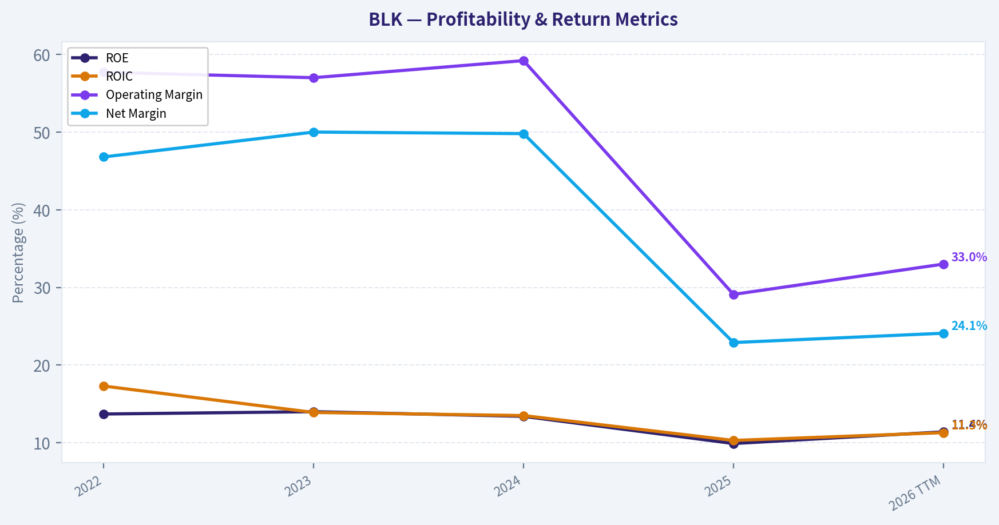
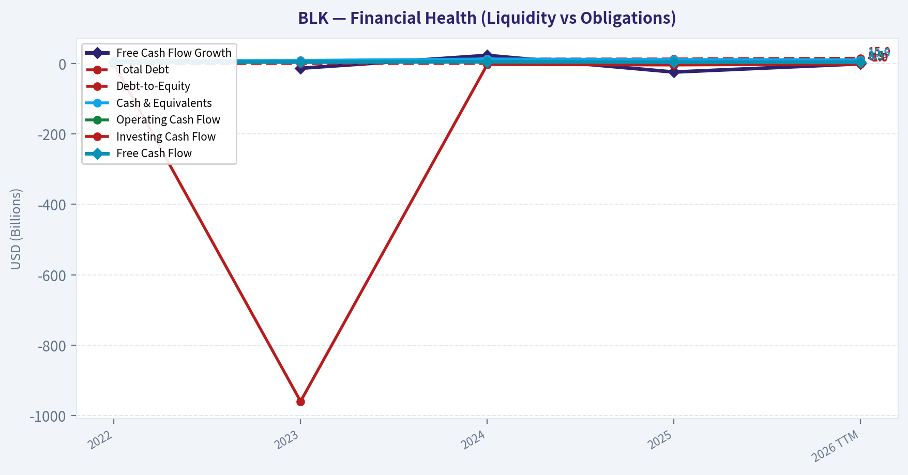
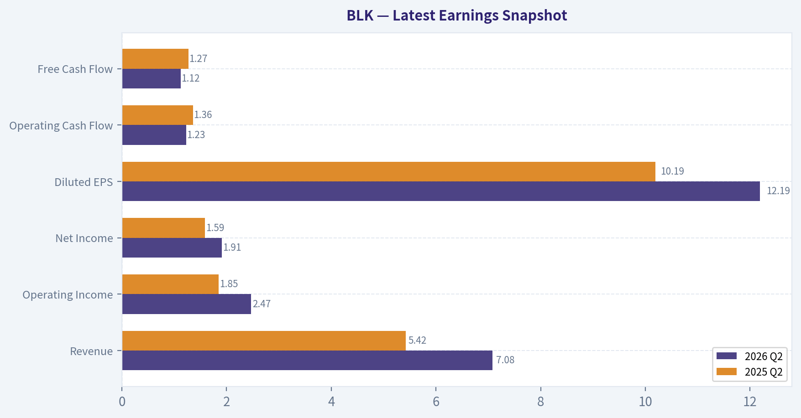
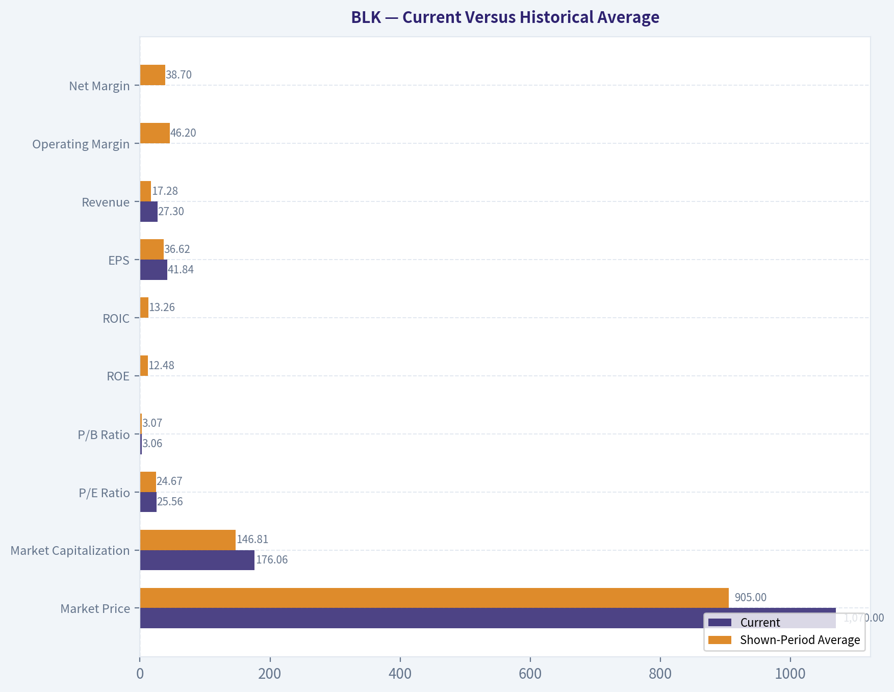
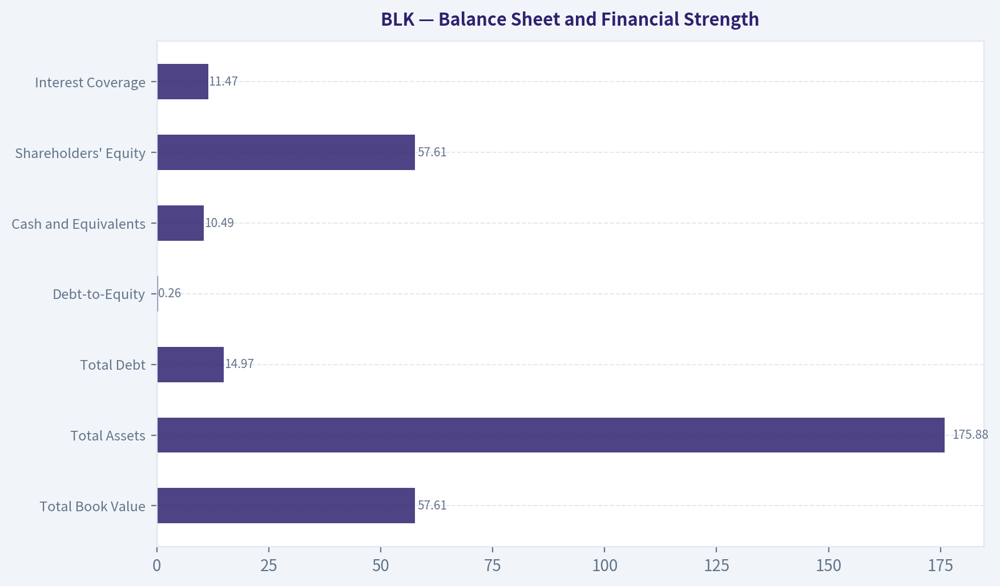
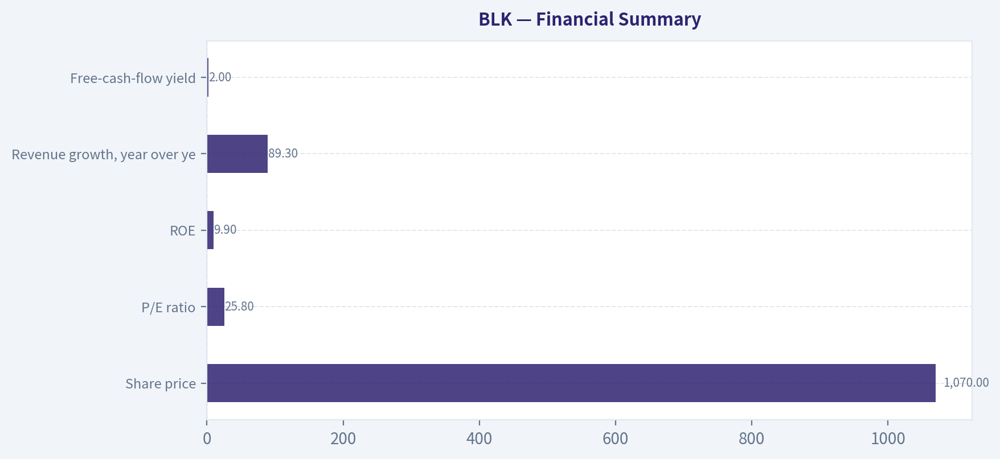
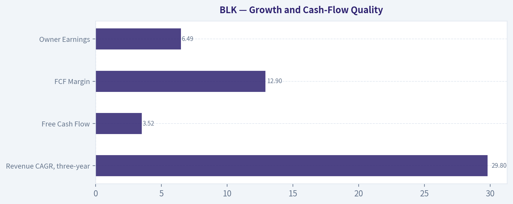
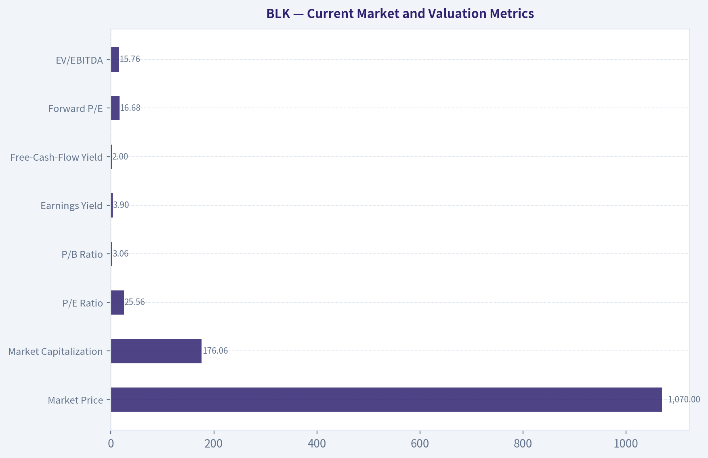

# BLK Deep Value Intelligence

**Analysis Date:** 2026-10-08

## Critical Disclaimer

*This analysis is generated by Deep Value Intelligence, an AI-powered multi-agent investing framework. Education & research only - not financial advice, not a financial advisor.*

---

## Table of Contents

1. Intelligence Summary
2. Analyst Team Reports
   - Fundamentals Analysis
   - Intrinsic Value Analysis (Buffett)
   - Trend & Growth Analysis (Lynch/Druckenmiller/Fisher)
   - Market Technical Analysis
   - Options Market Analysis
3. Research Team Commentary
4. Value Investing Team Commentary
5. Deep Values Commentary

---

## Intelligence Summary

### Thesis + Conditions

**Core Thesis:** # Risk Management Verdict

**Key Risks:**
- # Risk Management Verdict
- Business risk:** Moderate-low. No evidence supplied of distress or a broken moat.
- Valuation risk:** Moderate-high. A slowdown toward 7%-8% growth could materially reduce intrinsic value.

**Confidence:** Low

---

## Analyst Team Reports

### Fundamentals Analysis

#### Latest Earnings Snapshot

*Most recent reported quarter anchored on 2026 Q2, with prior-year comparison when available.*

| Metric | 2026 Q2 | 2025 Q2 | YoY Change |
| --- | ---: | ---: | ---: |
| Revenue | $7.08B | $5.42B | +30.6% |
| Operating Income | $2.47B | $1.85B | +33.6% |
| Net Income | $1.91B | $1.59B | +20.2% |
| Diluted EPS | $12.19 | $10.19 | +19.6% |
| Operating Cash Flow | $1.23B | $1.36B | -10.0% |
| Free Cash Flow | $1.12B | $1.27B | -12.3% |

Key Takeaways: This snapshot anchors the most recent reported quarter before the narrative analysis. It helps readers separate long-run business quality from whatever changed in the latest earnings print.

#### 4-Year Financial Metrics for BLK

*All values below are computed deterministically from raw data - not estimated by AI.*

*Issuer profile: asset manager (Financial Services / Asset Management).*

#### 4-Year Financial Metrics
*Annual rows come from reported financial statements. The final TTM row is computed from the latest four quarters.*

| Metric | 2022 | 2023 | 2024 | 2025 | 2026 TTM |
| --- | --- | --- | --- | --- | --- |
| Market Price | $649 | $764 | $988 | $1,053 | $1,070 |
| Market Cap | $108.02B | $122.35B | $155.43B | $172.19B | $176.06B |
| P/E Ratio | 20.86 | 22.24 | 24.40 | 30.31 | 25.56 |
| P/B Ratio | 2.85 | 3.11 | 3.27 | 3.08 | 3.06 |
| ROE | 13.7% | 14.0% | 13.4% | 9.9% | 11.4% |
| ROIC | 17.3% | 13.9% | 13.5% | 10.3% | 11.3% |
| EPS | $31.09 | $34.38 | $40.50 | $35.31 | $41.84 |
| Revenue | $11.06B | $11.01B | $12.79B | $24.22B | $27.30B |
| Gross Profit | N/A | N/A | N/A | N/A | $12.87B |
| Gross Margin | N/A | N/A | N/A | N/A | 47.2% |
| Operating Margin | 57.7% | 57.0% | 59.2% | 29.1% | 33.0% |
| Net Income | $5.18B | $5.50B | $6.37B | $5.55B | $6.58B |
| Net Margin | 46.8% | 50.0% | 49.8% | 22.9% | 24.1% |
| Revenue Growth | N/A | -0.4% | 16.2% | 89.3% | 12.7% |
| Net Income Growth | N/A | 6.3% | 15.8% | -12.8% | 18.4% |
| Free Cash Flow Growth | N/A | -13.6% | 23.0% | -24.4% | -1.0% |
| Total Book Value | $37.88B | $39.35B | $47.49B | $55.89B | $57.61B |
| Total Assets | N/A | $123.21B | $138.62B | $170.00B | $175.88B |
| Total Debt | $0 | $7.92B | $12.31B | $12.77B | $14.97B |
| Debt-to-Equity | 0.00 | 0.20 | 0.26 | 0.23 | 0.26 |
| Cash & Equivalents | $7.43B | $8.74B | $12.76B | $11.47B | $10.49B |
| Shareholders' Equity | $37.88B | $39.35B | $47.49B | $55.89B | $57.61B |
| Operating Cash Flow | $4.96B | $4.17B | $4.96B | $3.93B | $3.94B |
| Investing Cash Flow | $-1.13B | $-959.0M | $-3.00B | $-4.42B | $-1.88B |
| Free Cash Flow | $4.42B | $3.82B | $4.70B | $3.55B | $3.52B |
| FCF Margin | 40.0% | 34.7% | 36.7% | 14.7% | 12.9% |
| Dividends / Share | $17.95 | $18.96 | $19.72 | $20.81 | $21.91 |

#### Profitability Metrics
- Return on Equity (ROE): 9.9%
- Return on Invested Capital (ROIC): 10.1%
- Return on Assets (ROA): 3.3%
- Gross Margin: Not meaningful
- Operating Margin: 29.1%
- Net Profit Margin: 22.9%

#### Liquidity Metrics
- Current Ratio: Not meaningful
- Quick Ratio: Not meaningful

#### Leverage Metrics
- Debt-to-Equity Ratio: 0.23
- Interest Coverage Ratio: 11.47
- Net Debt: $-1.49B

#### Growth Metrics (Year-over-Year)
- Revenue Growth: 89.3%
- Net Income Growth: -12.8%
- Free Cash Flow Growth: -24.4%
- Revenue CAGR (3-Year): 29.8%
- Revenue CAGR (5-Year): N/A

#### Valuation Metrics
- P/E Ratio (TTM): 25.84
- Forward P/E: 16.68
- Price-to-Book: 2.88
- Price-to-Sales: 6.37
- PEG Ratio: 0.90
- EV/EBITDA: 15.76
- Free Cash Flow Yield: 2.0%
- Earnings Yield: 3.9%

#### Owner Earnings (Buffett Method, Code-Computed)
- Net Income: $5.55B
- + Depreciation & Amortization: $1.13B
- - Capital Expenditures: $-375.0M
- - Working Capital Changes: $-189.0M
- = **Owner Earnings: $6.49B**

#### Intrinsic Value (Code-Computed)
- Current Price: $1,070
- Headline Intrinsic Value: not meaningful (financial issuer - DCF/FCFF is not the right primary frame; use sector-specific book/earnings metrics)
- Buffett Method (Owner Earnings):
  Conservative: $556
  Average: $629
  Optimistic: $692
- Cash Flow Method (FCF):
  Conservative: $102
  Average: $177
  Optimistic: $289
- Reverse-DCF: price implies ~16.5%/yr owner-earnings growth for 10y; trailing 3y was 2.2%, 5y N/A.

#### Piotroski F-Score: 3/9
- Positive Net Income: PASS
- Positive Operating Cash Flow: PASS
- ROA Improvement: FAIL
- Cash Flow > Net Income: FAIL
- Decreasing Debt: FAIL
- Improving Current Ratio: FAIL
- No Dilution: FAIL
- Improving Gross Margin: FAIL
- Improving Asset Turnover: PASS

ANALYST STANCE: **WATCH**

#### Executive Summary

BlackRock is a high-quality, globally dominant asset manager with powerful distribution, strong brand recognition, broad ETF leadership, and the Aladdin technology platform. Its balance sheet is reasonably sound, with approximately $10.5 billion of cash, $15.0 billion of debt, and a modest 0.26 debt-to-equity ratio.

However, the current price of $1,070 reflects a demanding valuation. The trailing P/E is 25.56, the free-cash-flow yield is only 2.0%, and the reverse DCF implies approximately 16.5% annual owner-earnings growth for the next decade. That expectation is substantially above the company's recent owner-earnings growth and is not supported by the current cash-flow trend. BlackRock is an excellent business, but the stock currently offers a limited margin of safety.

#### Current Market and Valuation Metrics

| Metric | Current / 2026 TTM | Interpretation |
|---|---:|---|
| Market Price | $1,070 | Near the highest level in the shown period |
| Market Capitalization | $176.06B | Up substantially from $108.02B in 2022 |
| P/E Ratio | 25.56 | Above the shown-period average of approximately 24.67 |
| P/B Ratio | 3.06 | Close to the shown-period average of approximately 3.07 |
| Earnings Yield | 3.9% | Low relative to a 10% required return |
| Free-Cash-Flow Yield | 2.0% | Indicates substantial growth is already priced in |
| Forward P/E | 16.68 | More attractive than trailing P/E, but dependent on forecast earnings |
| EV/EBITDA | 15.76 | Reasonable for a high-quality asset manager, but not a clear bargain |

**Key Takeaways:** BlackRock's valuation is elevated primarily because the share price has risen faster than normalized cash generation. The P/E is only moderately above the period average, but the 2.0% FCF yield provides little downside protection. As a financial issuer, P/B should be interpreted alongside ROE and earnings quality rather than treated as a standalone cheapness signal; the primary valuation anchor is cash flow and sustainable earnings power.

#### Current Versus Historical Average

The deterministic dataset provides five annual or TTM observations from 2022 through 2026 TTM, rather than a full ten-year history. The averages below therefore represent the shown-period average and should not be described as ten-year averages.

| Metric | Current | Shown-Period Average | Current Versus Average |
|---|---:|---:|---|
| Market Price | $1,070 | $905 | 18% above |
| Market Capitalization | $176.06B | $146.81B | 20% above |
| P/E Ratio | 25.56 | 24.67 | 4% above |
| P/B Ratio | 3.06 | 3.07 | Approximately in line |
| ROE | 11.4% TTM | 12.48% | Below average |
| ROIC | 11.3% TTM | 13.26% | Below average |
| EPS | $41.84 | $36.62 | 14% above |
| Revenue | $27.30B | $17.28B | 58% above |
| Operating Margin | 33.0% TTM | 46.2% | Materially below |
| Net Margin | 24.1% TTM | 38.7% | Materially below |
| Net Income | $6.58B | $5.84B | 13% above |
| Free Cash Flow | $3.52B | $4.00B | 12% below |
| FCF Margin | 12.9% | 29.4% | Materially below |
| Total Debt | $14.97B | $9.59B | 56% above |
| Cash and Equivalents | $10.49B | $10.18B | Approximately in line |
| Dividends per Share | $21.91 | $19.87 | 10% above |

**Key Takeaways:** BlackRock's revenue, EPS, net income, and dividend per share are above the shown-period averages, but returns on capital, margins, and free cash flow are weaker. The most important divergence is that the stock price and market capitalization are near period highs while FCF is below average. Debt has also risen meaningfully, although leverage remains manageable.

#### Profitability and Operating Performance

| Metric | 2026 TTM | Historical Pattern |
|---|---:|---|
| ROE | 11.4% TTM; 9.9% latest annual figure | 13.4%-14.0% in 2022-2024, then declined |
| ROIC | 11.3% TTM; 10.1% latest annual figure in the profitability summary | Declined from 17.3% in 2022 |
| EPS | $41.84 | Increased from $31.09 in 2022 despite a 2025 decline |
| Revenue | $27.30B | Increased sharply from $11.06B in 2022 |
| Gross Profit | $12.87B | Gross-profit history is unavailable |
| Gross Margin | 47.2% TTM | Dataset flags gross margin as not meaningful for this issuer |
| Operating Margin | 33.0% TTM | Down from 57.7%-59.2% in 2022-2024 |
| Net Income | $6.58B | Above the 2022-2025 annual range |
| Net Margin | 24.1% TTM | Down from approximately 47%-50% in 2022-2024 |

**Key Takeaways:** BlackRock remains highly profitable, but its return metrics and margins have deteriorated from the levels seen before the large 2025 revenue step-up. The apparent revenue growth has not translated proportionally into operating profit or free cash flow. This suggests acquisition-related costs, integration effects, revenue mix changes, or lower-margin business expansion must be examined before assuming the recent revenue increase represents normalized organic economics.

ROE remains respectable at 11.4%, but it is below the approximately 12.5% average for the shown period. ROIC has fallen even more clearly, from 17.3% in 2022 to roughly 11.3% TTM. For a Buffett-style analysis, this is important: a durable moat should generally support stable or improving returns on capital unless the company is deliberately investing ahead of future growth.

#### Growth and Cash-Flow Quality

| Growth Metric | Current | Shown-Period Pattern |
|---|---:|---|
| Revenue Growth | 12.7% TTM | 2025 growth was 89.3%, following modest growth in earlier years |
| Net Income Growth | 18.4% TTM | Rebounded after a 12.8% decline in 2025 |
| Free Cash Flow Growth | -1.0% TTM | Negative in 2023, 2025, and TTM; only 2024 was strongly positive |
| Revenue CAGR, three-year | 29.8% | Strong, but heavily affected by the 2025 step-up |
| Free Cash Flow | $3.52B | Below the $4.00B shown-period average |
| FCF Margin | 12.9% | Down from 34.7%-40.0% in 2022-2024 |
| Owner Earnings | $6.49B | Above reported FCF, but requires careful normalization |

**Key Takeaways:** Revenue and net income growth have recovered, but free cash flow has not. The gap between $6.49 billion of computed owner earnings and $3.52 billion of reported FCF makes normalization especially important. Investors should not value BlackRock solely on the recent revenue CAGR until they can determine how much of the growth is recurring, organic, and cash-generative.

The owner-earnings calculation is:

- Net income: $5.55 billion
- Plus depreciation and amortization: $1.13 billion
- Less capital expenditures: $0.375 billion
- Less working-capital investment: $0.189 billion
- Computed owner earnings: **$6.49 billion**

This figure is useful as a Buffett-style earnings-power measure, but it should not automatically replace reported FCF. Financial companies can have working-capital movements, acquisitions, investment balances, and regulatory or operating cash-flow characteristics that make conventional owner-earnings adjustments less stable.

#### Balance Sheet and Financial Strength

| Balance-Sheet Metric | 2026 TTM | Assessment |
|---|---:|---|
| Total Book Value | $57.61B | Increased from $37.88B in 2022 |
| Total Assets | $175.88B | Increased from $123.21B in 2023 |
| Total Debt | $14.97B | Increased from zero in 2022 |
| Debt-to-Equity | 0.26 | Moderate and manageable |
| Cash and Equivalents | $10.49B | Strong liquidity buffer |
| Shareholders' Equity | $57.61B | Growing book capital |
| Net Debt | Negative $1.49B | Net cash position according to the dataset |
| Interest Coverage | 11.47 | Comfortable ability to service debt |
| Piotroski F-Score | 3/9 | Weak overall financial-quality signal |

**Key Takeaways:** BlackRock has a financially stable balance sheet, but debt has increased while cash has remained broadly flat. The company is still in a net-cash position and interest coverage is strong, so leverage is not currently a central investment concern. The low Piotroski score reflects deteriorating returns, weaker cash conversion, increased debt, dilution concerns, and margin-related weaknesses.

Because BlackRock is an asset manager, the balance sheet should not be interpreted exactly like that of an industrial company. Assets and liabilities can reflect investment products, acquisitions, and financial-service structures rather than only operating assets. P/B of approximately 3.06 is not obviously excessive in isolation, but its acceptability depends on whether BlackRock can restore ROE toward the mid-teens and sustain strong fee-related earnings.

#### Dividends and Capital Allocation

Dividends per share increased each year in the shown dataset, from $17.95 in 2022 to $21.91 TTM. This represents a compound increase of approximately 6.9% over the period. The rising dividend supports the view that management is committed to returning capital, but the falling ROE, lower FCF margin, and higher debt indicate that capital allocation should be monitored carefully.

Shareholder returns can also be affected by repurchases and acquisition financing. The Piotroski score flags "no dilution" as a failure, suggesting that share-count and acquisition-related capital allocation deserve further investigation. A growing dividend is positive, but it is not sufficient by itself to establish that intrinsic value is compounding at the same rate as the share price.

#### Economic Moat and Business Quality

BlackRock has several durable competitive advantages:

- **Scale:** Its enormous asset base allows technology, compliance, trading, and distribution costs to be spread across a large platform.
- **Distribution:** iShares ETFs and institutional relationships create significant distribution reach.
- **Aladdin:** The risk-management and portfolio technology platform creates switching costs and broadens the business beyond traditional asset-management fees.
- **Brand and trust:** Large institutions value operational reliability, regulatory competence, liquidity, and global product breadth.
- **Network effects:** More assets, data, products, and institutional relationships can strengthen the platform's usefulness.

The main weakness is that asset management is economically sensitive. Fee pressure, passive-investment competition, market declines, investor outflows, and changes in asset allocation can reduce revenue even when the company's operating platform remains intact. BlackRock's moat is therefore meaningful, but it is not immune to industry-wide fee compression.

#### Predictable Earnings and Management Performance

Earnings were relatively stable from 2022 through 2024, with net income rising from $5.18 billion to $6.37 billion. The 2025 decline to $5.55 billion interrupted that pattern, followed by a TTM recovery to $6.58 billion. Revenue has been much more volatile than the earlier earnings trend because the 2025 figure rose to $24.22 billion and then to $27.30 billion TTM.

The strong dividend record is a positive management signal. However, management performance is less convincing when judged by returns on capital and cash conversion. ROE and ROIC are below earlier levels, while FCF margins have fallen sharply. The central management question is whether the recent expansion improves long-term recurring earnings per share or merely increases reported revenue and asset complexity.

#### Revenue Breakdown

The deterministic dataset does not provide a precise segment revenue table. BlackRock publicly reports revenue primarily through investment advisory and administration fees, performance fees, technology services, and distribution or other income. Exact current-year amounts and percentages cannot be reliably derived from the supplied canonical dataset without introducing unsupported estimates.

| Revenue Source | Amount ($B) | % of Total |
|---|---:|---:|
| Investment advisory and administration fees | Not separately disclosed in supplied dataset | Not determinable |
| Performance fees and investment-related revenue | Not separately disclosed | Not determinable |
| Technology services, including Aladdin-related revenue | Not separately disclosed | Not determinable |
| Distribution, securities lending, and other revenue | Not separately disclosed | Not determinable |
| **Total reported revenue, 2026 TTM** | **$27.30B** | **100%** |

**Key Takeaways:** The supplied data confirms $27.30 billion of total TTM revenue but does not provide a defensible numerical split by business line. The economically important distinction is between recurring fee revenue, performance-sensitive revenue, and technology revenue. Investors should seek the company's latest filing to determine whether the recent revenue increase is primarily recurring management fees or acquisition- and performance-related revenue.

#### Buffett-Style Owner-Earnings DCF

The hand-built DCF below is a sanity check rather than the sole valuation authority. The supplied model-based intrinsic values are used as an important anchor, while recognizing that conventional DCF methods are less reliable for financial issuers.

Estimated diluted share count:

\[
\text{Shares} = \frac{\$176.06B}{\$1,070} \approx 164.5M
\]

Owner earnings per share:

\[
\text{OE/share} = \frac{\$6.49B}{164.5M} \approx \$39.44
\]

Assumptions:

- Forecast period: 10 years
- Discount rate: 10%
- Terminal growth: 2.5%
- Growth rates fade gradually toward the terminal rate
- Terminal value calculated using the Gordon growth formula
- Values are approximate because the dataset does not provide a complete ten-year owner-earnings history

| Scenario | Initial Owner-Earnings Growth | Fade Assumption | Approximate DCF Value | Supplied Model Value | Interpretation |
|---|---:|---|---:|---:|---|
| Conservative | 3.0% | Fades to 2.5% | $550-$600/share | $556/share | Mature asset-manager economics |
| Average | 8.0% | Fades to 2.5% | $630-$700/share | $629/share | Requires meaningful execution and cash-flow recovery |
| Optimistic | 12.0% | Fades to 2.5% | $700-$800/share | $692/share | Requires strong Aladdin, ETF, and acquisition synergies |

**Key Takeaways:** Even the optimistic hand DCF produces a value materially below the $1,070 market price. The supplied Buffett owner-earnings model similarly values the shares at $556, $629, and $692 under conservative, average, and optimistic cases. The market price therefore requires a much stronger outcome than the recent cash-flow record demonstrates.

A simplified conservative calculation illustrates the valuation issue:

- Starting owner earnings per share: $39.44
- Year-10 owner earnings at approximately 3% growth: about $52.9
- Terminal value at year 10:

\[
\frac{52.9 \times 1.025}{0.10 - 0.025} \approx \$723
\]

- Present value of terminal value: approximately $279 per share
- Present value of ten years of owner earnings: approximately $275-$300 per share
- Approximate conservative value: **$550-$600 per share**

The average and optimistic cases require substantially higher growth in the early years. At the current price, the reverse DCF indicates approximately 16.5% annual owner-earnings growth for ten years, compared with trailing three-year owner-earnings growth of approximately 2.2%. That gap is the clearest evidence that the stock is priced for exceptional execution.

The separate FCF-based model produces much lower values of $102, $177, and $289. Those figures may be overly punitive if current FCF is depressed by acquisition or investment effects, but they reinforce the conclusion that BlackRock's cash conversion requires normalization before a premium valuation can be justified.

#### Key Investment Insights, Risks, and Opportunities

| Category | Insight |
|---|---|
| Opportunity | Global ETF leadership and continued passive-investing adoption |
| Opportunity | Aladdin and technology services can diversify revenue and improve switching costs |
| Opportunity | Rising dividends and long-term institutional relationships support shareholder returns |
| Opportunity | Earnings recovery and lower forward P/E could create upside if cash flow normalizes |
| Risk | Current price requires approximately 16.5% owner-earnings growth for a decade |
| Risk | FCF growth is negative TTM and FCF margin has fallen to 12.9% |
| Risk | ROE and ROIC are below earlier-period levels |
| Risk | Fee compression and passive-management competition can pressure margins |
| Risk | Market declines reduce assets under management and fee revenue |
| Risk | Acquisition integration may obscure recurring organic growth |
| Risk | Higher debt and possible dilution weaken the capital-allocation profile |
| Risk | Piotroski F-Score of 3/9 indicates deteriorating financial characteristics |

**Key Takeaways:** The strongest opportunity is the combination of BlackRock's scale, iShares franchise, and Aladdin technology platform. The principal risk is not business failure but overpayment: even a very good business can produce disappointing returns when purchased at a price that assumes unusually high growth. Margin recovery, stronger FCF, and improved ROIC would be needed to support a more constructive view.

#### Final Investment Stance

**WATCH**

BlackRock is an attractive business for a long-term investor seeking a durable financial-services franchise, but the current valuation does not provide a sufficient Buffett-style margin of safety. The shares trade well above the supplied conservative, average, and optimistic owner-earnings values, while FCF, FCF margin, ROE, and ROIC remain below earlier-period levels.

A more favorable entry would require either:

1. A meaningful decline in the share price;
2. Several periods of stronger free-cash-flow conversion;
3. Restoration of ROE and ROIC toward prior levels; or
4. Evidence that Aladdin, iShares, and recent strategic investments can produce sustainable double-digit owner-earnings growth.

The company merits continued ownership by investors with a high cost basis and strong conviction in its moat, but new purchases at $1,070 appear dependent on an aggressive growth outcome rather than a clear margin of safety.

#### Report Summary

| Key Point | Assessment |
|---|---|
| Business quality | High; global scale, iShares, Aladdin, and institutional distribution |
| Balance-sheet strength | Good; modest leverage, strong interest coverage, and net cash |
| Earnings predictability | Moderate; stable earlier period but recent revenue and margin disruption |
| Profitability trend | Weakened; ROE and ROIC are below prior levels |
| Cash-flow quality | Concerning; FCF and FCF margin are below historical norms |
| Dividend policy | Positive; dividend per share has risen every year shown |
| Valuation | Expensive relative to owner earnings and FCF |
| Required growth | Approximately 16.5% owner-earnings growth for ten years at current price |
| Principal catalyst | Cash-flow normalization and successful technology/acquisition execution |
| Principal risk | Paying a premium price for growth that may not materialize |
| Final stance | **WATCH** |

#### Fundamental Visuals

This graph tracks the profitability and return metrics (ROE, ROIC, Margins) of **BLK** over the past decade, highlighting capital efficiency trends.

This chart illustrates the financial health of **BLK** over the last 10 years, mapping cash equivalents and free cash flow against total obligations (Debt).

---

### Intrinsic Value Analysis (Buffett)

> *Following Warren Buffett's value investing philosophy: Circle of Competence, Economic Moat, Management Quality, and Margin of Safety.*

#### Intrinsic Value Snapshot

Price is what you pay. Intrinsic value is what the business may be worth based on the cash it can create for owners over time. We show a range, not one magic number.

- Current Price: $1,069.63
- Value Range (conservative to optimistic across both DCF methods): $101.66 to $691.93

##### Owner Earnings (Buffett Method)
- Net Income: $5,553,000,000.00
- Depreciation & Amortization: $1,126,000,000.00
- Capital Expenditures: $-375,000,000.00
- Working Capital Changes: $-189,000,000.00
- Owner Earnings: $6,493,000,000.00

##### Intrinsic Value
###### Buffett Method
Uses owner earnings. Stricter, and usually more conservative.
- Conservative: $555.54
- Average: $629.47
- Optimistic: $691.93
- Discount Rate: 10.0%

###### Cash Flow Method
Uses free cash flow. Better for companies spending heavily today to grow tomorrow.
- Conservative: $101.66
- Average: $177.13
- Optimistic: $289.29
- Discount Rate: 10.0%

ANALYST STANCE: **WATCH**

#### Executive Conclusion

BlackRock is a high-quality global asset manager with substantial scale, strong distribution, broad product reach, and durable client relationships. Its competitive advantages are real, but the current valuation-approximately 25.8 times earnings and a 2.0% free-cash-flow yield-does not provide a clear margin of safety based on conservative earnings-based valuation.

The investment case depends on continued growth in assets under management, ETF and index-product adoption, private-market expansion, and successful integration of newer capabilities. At $1,070 per share, the market already prices in a meaningful amount of that success. BlackRock is an excellent business to monitor, but the risk-reward is not sufficiently attractive for an aggressive purchase today.

#### Factor Scorecard

| Factor | Score | Assessment |
|---|---:|---|
| Circle of Competence & Business Simplicity | 4.0/5 | BlackRock earns management fees for managing client assets. The model is understandable, although revenue depends on markets, flows, product mix, and acquisitions. |
| Moat | 4.5/5 | Wide and durable, supported by scale, institutional relationships, the iShares brand, technology, distribution, and switching costs. |
| Management & Capital Allocation | 4.0/5 | Long-term strategic execution has been strong, with disciplined expansion into ETFs, technology, private markets, and wealth management. Acquisition execution remains important. |
| Industry Structure | 4.0/5 | Large-scale asset management is increasingly concentrated among a few dominant firms, though fee compression and passive-investing competition remain persistent. |

**Gate 5: Not tripped.** There is no evidence of the combination of worsening earnings or cash flow and a solvency red line such as sub-1x interest coverage or distress-level financial condition.

#### Moat Analysis

BlackRock's principal competitive advantages are scale, distribution, product breadth, technology, and trust.

- **Scale advantage:** BlackRock can spread technology, compliance, trading, research, and distribution costs over a very large asset base.
- **Distribution advantage:** iShares products are widely available through institutions, advisers, retirement plans, and brokerage platforms.
- **Switching costs:** Institutional clients face operational, regulatory, tax, and performance-related friction when changing managers. The switching cost is not absolute, but it is meaningful.
- **Technology platform:** Aladdin embeds BlackRock's risk-management and portfolio technology into institutional workflows. This can deepen customer relationships beyond simple fund management.
- **Brand and trust:** BlackRock is a recognized global fiduciary and a default provider for many institutional and index-investing mandates.
- **Network and scale effects:** More assets support better trading infrastructure, product economics, data, and distribution, which can attract additional assets.

The moat is best characterized as **wide and stable**, with the potential to widen through technology, private markets, and retirement distribution. The main threats are fee compression, regulatory scrutiny, passive-product commoditization, and market declines that reduce assets under management.

#### Management Quality Assessment

BlackRock's management has generally demonstrated long-term strategic thinking. The company has expanded from traditional institutional asset management into ETFs, technology, alternatives, private markets, and wealth solutions rather than relying on a single product category.

The strongest capital-allocation characteristic is reinvestment into distribution, technology, and product capabilities that can increase the durability of the franchise. Acquisitions have also been strategically relevant, but their value depends on integration and whether they generate returns above the cost of capital.

A weakness is that asset-management economics can look excellent during rising markets and less impressive during market declines. Management must therefore be judged on per-share earnings growth and client retention across full market cycles, not just on asset growth during favorable periods.

#### Financial Summary

| Metric | Latest figure | Interpretation |
|---|---:|---|
| Share price | $1,070 | Current market price |
| Market capitalization | $173.79 billion | Large global financial franchise |
| P/E ratio | 25.8x | Premium valuation for a mature financial company |
| ROE | 9.9% | Solid but below the level normally associated with exceptional compounders |
| Revenue growth, year over year | 89.3% | Extremely strong reported growth, likely influenced by acquisitions, mix, or non-recurring comparisons; not a prudent long-term base rate |
| Free-cash-flow yield | 2.0% | Low cash-flow yield at the current price |
| Implied earnings per share | Approximately $41.41 | Calculated from price divided by P/E |
| Implied net income | Approximately $6.73 billion | Approximation based on market capitalization and P/E |

**Key Takeaways:** BlackRock combines a strong franchise with a premium valuation. The 89.3% revenue-growth figure is impressive but too high to use as a sustainable forecast without normalization. The more important valuation signals are the 25.8 times earnings multiple and only 2.0% free-cash-flow yield.

#### Owner Earnings Calculation

For a financial issuer such as BlackRock, traditional capital-expenditure-based owner earnings require adjustment because reported cash flow is affected by investment-product flows, consolidation effects, and financial-asset accounting. A normalized earnings proxy is therefore more useful than mechanically subtracting reported capital expenditures.

| Owner-earnings proxy | Approximate amount |
|---|---:|
| Implied normalized earnings per share | $41.41 |
| Implied normalized net income | $6.73 billion |
| Reported free-cash-flow reference | Approximately $3.48 billion |
| FCF per share reference | Approximately $21.40 |

**Key Takeaways:** Normalized earnings are materially higher than the free-cash-flow reference, which is common for financial companies whose reported cash flow can be distorted by balance-sheet and investment-accounting movements. For valuation, $41.41 per share is used as a normalized earnings and owner-earnings proxy, but it should not be treated as a precise recurring cash-flow figure.

#### Three-Scenario DCF Valuation

The following valuation uses normalized earnings of approximately $41.41 per share, a 10% discount rate, and long-term growth assumptions appropriate for a large asset manager.

| Scenario | Assumption | Estimated value per share |
|---|---|---:|
| A: No growth | Earnings capitalized at 10% | $414 |
| B: GDP-like growth | 3% perpetual growth | $609 |
| C: Historical-quality growth | 5% annual growth for 10 years, then 5% terminal growth | $883 |
| Current price | - | $1,070 |

**Key Takeaways:** Even the optimistic 5% growth case produces an estimated value below the current price. The current quotation is approximately 21% above the 5% growth valuation and substantially above the no-growth and GDP-growth cases. The market therefore requires durable growth, strong asset flows, and successful strategic expansion.

#### Margin of Safety Analysis

| Valuation reference | Estimated value | Premium or discount versus $1,070 |
|---|---:|---:|
| No-growth value | $414 | 158% premium |
| 3% growth value | $609 | 76% premium |
| 5% growth value | $883 | 21% premium |
| Current price | $1,070 | - |

**Key Takeaways:** BlackRock does not currently offer a conventional margin of safety under conservative assumptions. Because the company has a wide moat and high-quality economics, a 10% to 15% discount could be acceptable; however, the current price is still above the 5% growth valuation rather than below it. A more attractive entry point would likely be in the approximate $750 to $900 range, depending on confidence in long-term growth and acquisition returns.

#### Buffett Scorecard

| Criterion | Weight | Score | Weighted contribution |
|---|---:|---:|---:|
| Moat width and durability | 25% | 4.5/5 | 1.13 |
| Valuation and margin of safety | 20% | 2.0/5 | 0.40 |
| Capital returns versus WACC | 15% | 3.0/5 | 0.45 |
| Business understanding and predictability | 12% | 4.0/5 | 0.48 |
| Management quality and capital allocation | 12% | 4.0/5 | 0.48 |
| Reinvestment runway | 8% | 4.0/5 | 0.32 |
| Balance-sheet strength | 4% | 3.0/5 | 0.12 |
| Industry structure | 4% | 4.0/5 | 0.16 |
| **Total** | **100%** | - | **3.54/5** |

**Key Takeaways:** BlackRock scores highly on moat, management, predictability, and reinvestment runway. Valuation is the decisive weakness, preventing the company from qualifying as an attractive purchase despite its excellent business quality. The weighted score supports a watch stance rather than an avoidance call.

#### Principal Risks

| Risk | Why it matters |
|---|---|
| Market declines | Lower equity and bond prices reduce assets under management and fee revenue. |
| Fee compression | Index funds and ETFs are increasingly competitive and can carry very low fees. |
| Fund-flow risk | Clients may shift from active products, traditional institutions, or certain asset classes. |
| Acquisition risk | Large strategic acquisitions can dilute returns if integration or growth assumptions disappoint. |
| Regulatory and political scrutiny | BlackRock's size and influence create heightened regulatory attention. |
| Private-market execution | Alternatives provide growth potential but involve greater complexity, valuation subjectivity, and liquidity risk. |

#### Investment Stance

**WATCH - Moderate conviction.**

BlackRock is a wonderful business with a durable moat, strong distribution, and multiple long-term growth avenues. However, at $1,070 per share, the valuation appears to assume more than a conservative owner can comfortably underwrite. I would prefer to wait for either a meaningful price decline, a stronger recurring earnings base, or evidence that growth in technology, private markets, and ETFs is producing superior per-share returns.
#### Valuation Bridge

This bridge places the current market price beside each intrinsic value lens so readers can see whether upside depends on one method or shows up across several methods.

| Scenario | Intrinsic Value / Share |
| --- | ---: |
| Buffett Method | $629.47 |
| Cash Flow Method | $177.13 |
| Current Price | $1,069.63 |

#### Key Takeaways

If one method is far above the others, the upside case depends on a specific modelling assumption. When several methods cluster together, the valuation story is more robust.

#### Valuation Visuals

This comparison chart from *Latest Earnings Snapshot* stacks current figures against historical benchmarks for **BLK**, making it easy to see where the company trades relative to its own averages.

This comparison chart from *Current Versus Historical Average* stacks current figures against historical benchmarks for **BLK**, making it easy to see where the company trades relative to its own averages.

This comparison chart from *Balance Sheet and Financial Strength* stacks current figures against historical benchmarks for **BLK**, making it easy to see where the company trades relative to its own averages.

This comparison chart from *Financial Summary* stacks current figures against historical benchmarks for **BLK**, making it easy to see where the company trades relative to its own averages.

---

### Trend & Growth Analysis (Lynch/Druckenmiller/Fisher)

> *Following Peter Lynch's GARP, Stanley Druckenmiller's macro-aware approach, and Philip Fisher's scuttlebutt methodology.*

ANALYST STANCE: **WATCH**

#### 1. Executive conclusion

BlackRock is a high-quality asset-management franchise, but it is not currently a clean Lynch-style fast grower. The headline 89.3% revenue growth is heavily distorted by acquisitions, particularly Global Infrastructure Partners, while underlying organic growth appears materially slower. At approximately 25.8 times trailing earnings and 16.7 times forward earnings, valuation is reasonable for a durable financial compounder, but the evidence for a new ten-bagger inflection point is incomplete.

**Position stance:** Hold or monitor; initiate only a small starter position after evidence of accelerating organic flows, stronger earnings conversion, and renewed return on equity.

#### 2. Lynch classification

| Category | Assessment |
|---|---|
| Classification | Stalwart with acquisition-led transformation |
| Reported revenue growth | 89.3% year over year |
| TTM revenue growth | 12.7% |
| TTM net-income growth | 18.4% |
| Three-year revenue CAGR | 29.8% |
| Primary growth drivers | ETFs, private markets, infrastructure, Aladdin technology, wealth management |
| Ten-bagger profile | Possible over a long period, but not demonstrated today |

**Key Takeaways:** BlackRock's long-term growth profile is better than that of a traditional slow-growing asset manager, but the business currently fits a stalwart more than a fast grower. The sharp revenue acceleration is not fully organic, and return metrics have weakened. The investment case depends on future cross-selling and organic growth from the expanded platform.

#### 3. The story in three bullets

- **Scale plus distribution:** BlackRock combines the world's largest asset-management platform with iShares ETFs, institutional relationships, and global distribution.
- **Platform expansion:** Aladdin, private markets, infrastructure, and wealth-management capabilities could broaden BlackRock from a traditional asset manager into a more diversified financial infrastructure company.
- **Secular beneficiaries:** Passive investing, ETF adoption, private credit, alternatives, retirement assets, and technology-driven portfolio management all expand the company's addressable market.

The simple version: **BlackRock earns fees for helping institutions, governments, advisers, and individuals manage money, while its technology and distribution platform may allow it to capture more of the investment-management value chain.**

#### 4. TAM and runway

| TAM question | Assessment |
|---|---|
| Current revenue | Approximately $27.3 billion TTM |
| Ten-times revenue target | Approximately $273 billion |
| Global asset-management TAM | Very large, measured in tens of trillions of dollars of assets |
| Adjacent markets | Private markets, infrastructure, wealth technology, portfolio analytics, retirement solutions |
| Can revenue grow 10 times while remaining below 20% share? | Yes in theoretical TAM terms, but unlikely through traditional management fees alone |
| Main constraint | Asset-management fee compression and dependence on market levels |

**Key Takeaways:** BlackRock has a vast addressable market, and its adjacent businesses create more runway than passive funds alone. However, a ten-times revenue outcome would require substantial success in higher-growth and higher-value businesses such as private markets, technology, and wealth solutions. Traditional asset-management fees are unlikely to support ten-bagger economics by themselves.

#### 5. Revenue and earnings trend

| Metric | 2022 | 2023 | 2024 | 2025 | 2026 TTM |
|---|---:|---:|---:|---:|---:|
| Revenue | $11.06B | $11.01B | $12.79B | $24.22B | $27.30B |
| Revenue growth | - | -0.4% | 16.2% | 89.3% | 12.7% |
| Net income | $5.18B | $5.50B | $6.37B | $5.55B | $6.58B |
| Net-income growth | - | 6.3% | 15.8% | -12.8% | 18.4% |
| Free cash flow | $4.42B | $3.82B | $4.70B | $3.55B | $3.52B |
| FCF margin | 40.0% | 34.7% | 36.7% | 14.7% | 12.9% |

**Key Takeaways:** Reported revenue growth accelerated sharply because of acquisitions, but the latest TTM growth rate has normalized to 12.7%. Earnings growth is currently healthier than revenue growth, while free cash flow has weakened and margins have compressed. This is a mixed trend rather than the clean acceleration normally required for an aggressive growth investment.

#### 6. Unit economics and operating quality

| Metric | Result | Interpretation |
|---|---:|---|
| LTV/CAC | Not disclosed | Cannot reliably calculate for an institutional asset manager |
| Net revenue retention | Not disclosed | AUM and flows are more relevant than SaaS-style NRR |
| TTM operating margin | 33.0% | Strong, but well below prior reported levels |
| TTM net margin | 24.1% | Profitable and substantial |
| TTM FCF margin | 12.9% | Weaker than 2022-2024 |
| Rule of 40 | Not meaningful | This is not a subscription software business |
| Debt-to-equity | 0.26 | Moderate leverage |
| Net debt | Approximately negative $1.49B | Net cash position based on supplied data |

**Key Takeaways:** BlackRock has attractive structural economics, but the available data do not support a precise CAC, LTV, or retention calculation. The key operating concern is lower cash-flow and operating-margin conversion after the acquisition cycle. Moderate leverage and net cash provide financial resilience.

#### 7. Inflection-point assessment

| Potential inflection | Current evidence | Status |
|---|---|---|
| Product cycle | Aladdin, ETFs, private markets, and infrastructure expansion | Positive but unproven |
| Market-share gains | Scale and distribution remain advantages | Steady, not clearly accelerating |
| Margin inflection | Operating margin declined from roughly 59% in 2024 to 33% TTM | Negative near term |
| TAM expansion | Private markets, infrastructure, wealth, and technology | Positive |
| Earnings inflection | TTM net income up 18.4% | Encouraging |
| Organic growth inflection | Not established from supplied data | Missing evidence |
| Competitive inflection | No obvious major competitor breakdown | Neutral |

**Key Takeaways:** The strategic inflection is platform expansion, not a demonstrated acceleration in the legacy asset-management business. Earnings have improved, but margin compression and acquisition integration make the current period difficult to interpret. The most important confirmation would be accelerating organic net inflows and operating leverage.

#### 8. Macro setup

| Macro factor | Assessment |
|---|---|
| Equity-market direction | Positive for AUM and performance fees, but creates valuation sensitivity |
| Interest rates | Lower or stable rates would support growth-stock multiples and bond-market flows |
| Passive investing | Strong secular tailwind |
| Private markets and infrastructure | Large secular opportunity, but integration and fundraising risk |
| Market cycle | Financial markets appear mature rather than early-cycle |
| Macro verdict | Mildly favorable, not an exceptional setup |

**Key Takeaways:** BlackRock benefits from rising asset values, ETF adoption, and growing demand for private and infrastructure investments. However, it is highly exposed to market levels and investor risk appetite. The macro backdrop is supportive but does not create a powerful early-cycle catalyst.

#### 9. Fisher 15-point assessment

| Fisher factor | Score / 5 | Comment |
|---|---:|---|
| Market potential | 5 | Global savings and investment markets are enormous |
| New-product determination | 4 | Strong push into technology, alternatives, and infrastructure |
| R&D effectiveness | 4 | Aladdin and technology platform are strategic assets |
| Sales organization | 5 | Exceptional global distribution |
| Profit margins | 4 | Strong, though recently compressed |
| Margin improvement | 2 | Recent trend is unfavorable |
| Labor relations | 3 | Limited information |
| Executive relations | 4 | No major structural issue identified |
| Management depth | 4 | Large and diversified leadership bench |
| Cost analysis | 3 | Acquisition integration complicates interpretation |
| Outstanding competitive aspects | 5 | Scale, brand, data, distribution, and switching costs |
| Long-range profit outlook | 4 | Attractive, but fee pressure remains |
| Dilution | 3 | Acquisition financing and share issuance should be monitored |
| Candor | 3 | Insufficient direct scuttlebutt evidence |
| Integrity | 4 | No major concern identified |

| Total Fisher score | Interpretation |
|---:|---|
| 53 / 75 | Average-to-good; below the threshold for outstanding |

**Key Takeaways:** BlackRock scores highly on market potential, distribution, scale, and competitive positioning. The weaker areas are margin progression, acquisition accounting, dilution monitoring, and limited direct evidence about management candor and operating culture. The score supports quality, but not maximum conviction.

#### 10. Valuation analysis

| Valuation metric | Result | Interpretation |
|---|---:|---|
| Share price | Approximately $1,070 |
| Market capitalization | Approximately $174B |
| Trailing P/E | 25.8x |
| Forward P/E | 16.7x |
| Price-to-book | 2.88x |
| Price-to-sales | 6.37x |
| PEG ratio | 0.90 |
| FCF yield | 2.0% |
| Dividend yield | 2.14% |
| EV/EBITDA | 15.76x |

**Key Takeaways:** The forward P/E and PEG appear reasonable if earnings growth remains near the high teens. However, the PEG is potentially misleading because the earnings-growth denominator benefits from acquisition effects and recovery comparisons. A 2% FCF yield indicates that the stock is not obviously cheap on cash generation.

| Scenario | Key assumption | Indicative view |
|---|---|---|
| Bear | Low-to-mid-single-digit organic growth, margin pressure, 16-18x earnings | Material downside risk |
| Base | Low-to-mid-teens earnings growth, stable multiple around 20-23x | Moderate long-term return potential |
| Bull | Sustained high-teens earnings growth, successful private-markets and technology expansion, 25-28x multiple | Strong compounding potential |
| Ten-bagger case | Multiple years of high-teens or better earnings growth plus major platform monetization | Possible, but low probability from current evidence |

**Key Takeaways:** The base case supports a respectable compounder rather than an obvious bargain. The bull case requires successful monetization of private markets, infrastructure, Aladdin, and wealth solutions while preserving margins. The ten-bagger case is strategically conceivable but would require both sustained earnings compounding and a much larger contribution from adjacent businesses.

#### 11. Growth investor scorecard

| Criterion | Weight | Score / 5 |
|---|---:|---:|
| Lynch story | 10% | 3.5 |
| TAM and runway | 20% | 4.0 |
| Revenue growth | 20% | 3.0 |
| Unit economics | 15% | 3.5 |
| Competitive position | 10% | 4.5 |
| Management quality | 10% | 3.5 |
| Macro setup | 5% | 3.5 |
| Profitability path | 5% | 3.5 |
| Valuation | 5% | 3.5 |
| **Weighted total** | **100%** | **3.6 / 5** |

**Key Takeaways:** BlackRock's score falls in the "good setup" range, but not the high-conviction range. Its strongest attributes are TAM, competitive position, and financial durability. Its principal weaknesses are unclear organic growth, declining cash-flow margins, and limited evidence of an accelerating inflection point.

#### 12. Position size, risks, and catalysts

| Item | Assessment |
|---|---|
| Suggested position | 0% if seeking only fast growers; 1-2% starter position for a diversified portfolio |
| Add aggressively if | Organic flows accelerate, margins stabilize, and earnings growth remains above 15% |
| Reduce or avoid if | Multi-quarter net outflows emerge, margin erosion persists, or acquisition returns disappoint |
| Main risk | Fee compression and dependence on market valuations |
| Acquisition risk | Integration complexity, dilution, and weaker-than-expected returns on acquired platforms |
| Competitive risk | Vanguard, State Street, private-market specialists, and technology competitors |
| Regulatory risk | Fiduciary, systemic-risk, ETF, and private-market regulation |
| Capital-allocation risk | Large acquisitions can obscure organic performance |
| Catalyst | Strong ETF and long-term asset flows |
| Catalyst | Aladdin adoption and technology monetization |
| Catalyst | Successful private-market and infrastructure fundraising |
| Catalyst | Operating leverage after acquisition integration |

**Key Takeaways:** The appropriate position is modest until organic growth and margin trends become clearer. The most important catalysts are sustained net inflows, successful integration, and evidence that technology and alternatives can grow faster than the mature asset-management base. The key risk is paying a growth-company multiple for a business whose underlying organic growth remains closer to stalwart levels.

#### Final verdict

BlackRock is a **high-quality, strategically expanding financial franchise**, but the current data do not establish a strong enough inflection point for an aggressive growth allocation. The PEG ratio looks attractive, yet acquisition distortion, margin compression, and weak free-cash-flow growth reduce its reliability.

**Decision:** **WATCH.** Suitable for a small starter position or existing-holder conviction, but wait for clearer organic growth acceleration before treating BLK as a ten-bagger candidate.

#### Growth & Scorecard Visuals

This comparison chart from *Growth and Cash-Flow Quality* stacks current figures against historical benchmarks for **BLK**, making it easy to see where the company trades relative to its own averages.

---

### Market Technical Analysis

ANALYST STANCE: **WATCH**

#### BLK technical market report

**Data note:** October 8, 2026 is reported as a non-trading day by the indicator service. The latest valid observation is therefore October 7, 2026, when BLK closed at **$1,069.63**.

The selected indicators are the **10 EMA, 50 SMA, 200 SMA, MACD, MACD Histogram, RSI, ATR, and VWMA**. Together they cover short-, medium-, and long-term trend, momentum, volume confirmation, and volatility without adding another highly redundant oscillator.

#### Trend structure

BLK's technical structure is divided across time horizons:

- The stock is trading almost exactly at its **10-day EMA of $1,069.59**, indicating that the very short-term trend has stabilized after the September decline.
- Price remains below the **50-day SMA of $1,106.38**, by approximately **3.3 percent**. This shows that the medium-term trend is still damaged and that overhead supply may emerge near the $1,100 to $1,110 area.
- Price is above the **200-day SMA of $1,051.27**, by approximately **1.8 percent**. This preserves a constructive long-term bias, but the margin is not large enough to treat the 200-day average as an unquestioned support level.
- The 50-day SMA has been rising from roughly $1,089 in early September to $1,106 recently, while the 200-day SMA has also edged higher from approximately $1,048 to $1,051. The longer-term trend has therefore not fully rolled over, even though the stock experienced a meaningful medium-term pullback.

The most important interpretation is that BLK is attempting to build a recovery above its long-term trend benchmark while still trading beneath its medium-term average. That is typically a **transition or confirmation phase**, rather than a clean trend-following entry.

#### Short-term price action and volume

The 10 EMA declined sharply from approximately **$1,126 on September 8** to around **$1,069 currently**, reflecting the earlier selloff. It has now flattened, however, and the stock has closed near or slightly above this average during several recent sessions. This suggests that immediate downside momentum has moderated.

VWMA provides a similar message. The current **VWMA is $1,068.67**, almost identical to the latest closing price. Price is therefore trading close to its recent volume-weighted equilibrium rather than decisively above or below it. This is a neutral-to-improving signal, but not strong evidence of institutional accumulation.

The September decline toward the $1,037 to $1,058 region occurred with several elevated-volume sessions, while the subsequent rebound toward $1,090 was less decisive. Recent volume has not produced a clear upside breakout. A sustained move above the $1,080 to $1,090 zone accompanied by stronger volume would provide more convincing confirmation than the current sideways action.

#### Momentum: improving, but not yet bullish

The MACD remains negative at **-8.86**, so the broader momentum reading is still below its zero line. However, it has improved significantly from approximately **-17.52 on September 17**. This indicates that downside momentum has been losing force.

The MACD Histogram is currently positive at **+1.98**, after moving from deeply negative readings in mid-September to positive territory by late September and early October. This is a meaningful short-term improvement: the MACD line is recovering relative to its signal line. Nevertheless, a positive histogram while the MACD itself remains below zero is usually best interpreted as **bearish momentum easing or an early recovery phase**, not as confirmation of a mature bullish trend.

RSI is **46.74**, up from a low near **32.69 on September 16** but still below the neutral 50 level. This confirms that the stock has recovered from oversold conditions without becoming overbought. RSI is not currently signaling an exhausted rally, but it also has not yet demonstrated strong upside momentum. A move above 50, especially toward the 55 to 60 area, would improve the momentum profile.

#### Volatility and risk management

ATR is approximately **$23.45**, equivalent to about **2.2 percent of the latest share price**. This is a substantial daily trading range for a high-priced stock. Stops placed too tightly around the current price could be vulnerable to ordinary volatility rather than a genuine trend failure.

Using ATR as a risk framework:

- A one-ATR move is approximately $23.
- The $1,050 region is close to one ATR below the latest close and also aligns with the 200-day SMA.
- A decisive break below roughly $1,050 would therefore carry greater technical significance than a small intraday dip.
- Conversely, a move through $1,090 and then $1,106 would represent a more meaningful upside development because it would challenge recent swing resistance and the 50-day SMA.

ATR has eased from approximately $25.18 in late September to $23.45, suggesting that volatility is moderating. This is constructive for trend development, although lower volatility can also precede a larger directional breakout.

#### Key levels and scenarios

The first nearby support area is approximately **$1,058 to $1,065**, based on recent closes and the current consolidation zone. Stronger support sits near **$1,050 to $1,052**, where the 200-day SMA currently lies. A sustained close below that area would weaken the long-term structure and expose the stock to a possible retest of the low-$1,000s or the September trough near $1,037.

On the upside, **$1,080 to $1,090** is the first resistance band, corresponding to recent rebound highs. The more important resistance zone is **$1,100 to $1,110**, which includes the 50-day SMA and several recent failed advances. A decisive close above that zone, ideally with expanding volume and RSI above 50, would improve the probability that the recovery is becoming a genuine medium-term uptrend.

The bullish scenario requires price to hold above the 200-day SMA, reclaim the 50-day SMA, and sustain positive MACD histogram readings. The bearish scenario would involve a rejection beneath $1,090 followed by a break under the $1,050 to $1,052 long-term support area. Until one of those conditions occurs, the evidence favors monitoring rather than aggressively chasing either direction.

#### Indicator selection rationale

- **10 EMA:** Captures immediate trend stabilization and short-term entry timing.
- **50 SMA:** Identifies the currently important medium-term resistance and trend filter.
- **200 SMA:** Establishes the strategic long-term bullish or bearish boundary.
- **MACD:** Measures the direction of intermediate momentum.
- **MACD Histogram:** Detects whether momentum is accelerating or decelerating before a full MACD reversal.
- **RSI:** Assesses momentum regime and whether the recovery has progressed beyond neutral.
- **ATR:** Defines realistic volatility-adjusted risk levels.
- **VWMA:** Tests whether price is being supported above or below the recent volume-weighted trading basis.

| Area | Latest reading | Interpretation | Trading implication |
|---|---:|---|---|
| Latest close | $1,069.63 | Near short-term equilibrium | No decisive breakout or breakdown |
| 10 EMA | $1,069.59 | Price is essentially aligned with the short-term average | Immediate trend has stabilized |
| 50 SMA | $1,106.38 | Price is about 3.3% below the medium-term average | Overhead resistance remains significant |
| 200 SMA | $1,051.27 | Price is about 1.8% above the long-term average | Long-term structure remains cautiously constructive |
| MACD | -8.86 | Negative, but substantially improved from mid-September | Downside momentum is fading, not fully reversed |
| MACD Histogram | +1.98 | Positive and rising recently | Early recovery signal; needs price confirmation |
| RSI | 46.74 | Recovered from oversold, still below neutral 50 | Momentum is balanced but not convincingly bullish |
| ATR | $23.45, or about 2.2% | Daily volatility remains meaningful | Use wider, volatility-adjusted risk controls |
| VWMA | $1,068.67 | Almost identical to the latest close | Volume-weighted conviction is currently neutral |
| Main support | $1,050-$1,052 | 200-day SMA and nearby structural support | A sustained break would turn the long-term setup weaker |
| First resistance | $1,080-$1,090 | Recent rebound-high region | Initial confirmation zone for upside strength |
| Major resistance | $1,100-$1,110 | Near the 50-day SMA | Reclaiming this zone would materially improve the trend |

**Key Takeaways:** BLK is above its 200-day average but below its 50-day average, creating a cautiously constructive long-term setup with unresolved medium-term weakness. MACD momentum and the histogram have improved, while RSI has recovered from oversold levels but remains below neutral. The most useful confirmation would be a high-volume move above $1,090 and then $1,106; a break below the $1,050 to $1,052 support area would invalidate much of the current recovery thesis.

#### Market Visuals

This comparison chart from *Current Market and Valuation Metrics* stacks current figures against historical benchmarks for **BLK**, making it easy to see where the company trades relative to its own averages.

---

### Options Market Analysis

> *Reading options flow - put/call ratios, IV skew, and unusual activity - to gauge institutional positioning and event-driven risk.*

ANALYST STANCE: **WATCH**

#### BLK Options Flow Report

**As of October 8, 2026.** The available near-term options dataset is unusually thin, with only 44 calls and 44 puts in reported open interest across the listed expirations. This materially reduces confidence in directional conclusions.

#### Put/Call Ratio Analysis

| Expiration | Call OI | Put OI | Put/Call OI | Call Volume | Put Volume | Put/Call Volume |
|---|---:|---:|---:|---:|---:|---:|
| October 9, 2026 | 0 | 0 | N/A | 252 | 215 | 0.85 |
| October 16, 2026 | 44 | 44 | 1.00 | 333 | 288 | 0.86 |
| October 23, 2026 | 0 | 0 | N/A | 42 | 250 | 5.95 |
| **Total** | **44** | **44** | **1.00** | **627** | **753** | **1.20** |

**Key Takeaways:** Aggregate put/call open interest is exactly balanced at 1.00, above the historical neutral reference of approximately 0.70 but not extreme. Trading volume is modestly put-heavy overall, driven almost entirely by the October 23 expiration, where put volume is nearly six times call volume despite zero reported open interest. That pattern may reflect short-term hedging or speculative downside trading, but the lack of open interest makes it difficult to identify established institutional positions.

#### Implied Volatility Assessment

| Expiration | Call ATM IV | Put ATM IV | ATM IV Relationship | IV Assessment |
|---|---:|---:|---|---|
| October 9, 2026 | 3.8% | 3.8% | Flat | Very low |
| October 16, 2026 | 2.0% | 1.9% | Calls slightly higher | Very low |
| October 23, 2026 | 1.7% | 1.7% | Flat | Very low |

**Key Takeaways:** Near-term ATM implied volatility is exceptionally low, ranging from 1.7% to 3.8%, suggesting limited priced-in movement or potentially incomplete/low-quality chain data. The available figures show no meaningful ATM volatility premium for puts. A proper OTM put-versus-call skew cannot be calculated because the dataset provides ATM IV only, so downside fear cannot be confirmed from skew.

There is no catalyst information in the supplied data to determine whether IV is elevated ahead of earnings, a product event, or another known event. Based on the reported levels alone, IV does not appear elevated.

#### Unusual Options Activity

The data provider defines unusual activity as contracts with volume greater than five times open interest. No contracts met that threshold.

| Finding | Interpretation |
|---|---|
| No qualifying unusual contracts | No clearly identifiable fresh, high-conviction directional bets |
| No contract-level strike data supplied | ITM, ATM, or OTM classification unavailable |
| No unusual expiry/strike concentration | Smart-money versus retail positioning cannot be distinguished |

**Key Takeaways:** There is no confirmed unusual options activity to support a strong bullish or bearish institutional signal. The October 23 put-heavy volume is notable, but because reported put open interest is zero, it may represent opening trades, closing trades, data sparsity, or a combination of these. Without trade direction, strikes, premiums, or order-size information, it should not be labeled a definitive smart-money bearish bet.

#### Open Interest Concentration and Gamma Levels

| Expiration | Call OI | Put OI | Strike-Level Information | Gamma/Pinning Read |
|---|---:|---:|---|---|
| October 9, 2026 | 0 | 0 | Not available | No measurable OI wall |
| October 16, 2026 | 44 | 44 | Strikes not supplied | Limited potential pinning |
| October 23, 2026 | 0 | 0 | Not available | No measurable OI wall |

**Key Takeaways:** The only reported open interest is evenly split between calls and puts in the October 16 expiration, but the strikes are unavailable. Consequently, meaningful gravitational levels, max-pain estimates, and gamma walls cannot be identified. Given the extremely small total open interest, any pinning or gamma effect is likely limited and should not be treated as a reliable price anchor.

#### Overall Options Sentiment

**Signal: NEUTRAL, with a mild bearish tilt.**

The primary bearish factor is the 1.20 aggregate put/call volume ratio, especially the pronounced put-volume concentration in the October 23 expiration. However, this is offset by balanced open interest, the absence of qualifying unusual activity, flat ATM call/put IV, and extremely low reported OI. The data is too thin to support a confident directional call.

The appropriate interpretation is **neutral rather than decisively bearish**: traders appear to be expressing some near-term downside protection or speculation, but there is no confirmed institutional positioning or volatility skew showing sustained downside fear. Confidence is low because strike-level details, current underlying price, OTM IV, and reliable open-interest concentration are not available.

#### Summary

| Category | Assessment |
|---|---|
| Put/Call Ratio | OI ratio 1.00; volume ratio 1.20 - modestly put-heavy versus the 0.70 neutral baseline |
| IV Level | Very low reported ATM IV, approximately 1.7%-3.8% |
| Skew Direction | No meaningful skew conclusion; ATM IV is flat and OTM IV is unavailable |
| Unusual Activity | None meeting the volume-greater-than-five-times-OI threshold |
| Overall Signal | **NEUTRAL**, with a mild bearish tilt and low confidence |

**Key Takeaways:** BLK's options market shows balanced open interest but somewhat heavier put volume, led by the October 23 expiry. With very low IV, minimal open interest, no confirmed unusual activity, and no strike-level gamma data, the strongest conclusion is neutral positioning with a cautious bearish bias-not a high-conviction bearish signal.

---

## Research Team Commentary

> *The Research Manager synthesizes the Bull vs Bear debate into action-free commentary. This is a pre-risk view, not the final stance.*

Core takeaway: BlackRock is a wide-moat, asset-light financial franchise, but at $1,070 the valuation offers too little protection against merely good execution. The strongest bull argument is that iShares, Aladdin, global distribution, and institutional trust can sustain approximately 9%-10% owner-earnings growth for many years. The strongest bear argument is that the current price already requires roughly 9% growth, while a normalization to 7%-8% could place intrinsic value materially below the share price. I would not avoid BlackRock as a business, but I would wait for either a better valuation or clearer evidence that recent investments are lifting organic growth and incremental returns.

The bull case begins with genuine business quality. BlackRock's scale lets it spread technology, trading, compliance, research, and distribution costs across an enormous asset base. iShares benefits from liquidity, platform placement, and investor familiarity that are difficult for new entrants to replicate. Aladdin has meaningful switching costs because it is embedded in institutional risk, trading, accounting, and compliance workflows. These advantages reinforce one another and support a moat considerably stronger than that of an ordinary active asset manager.

The long-term growth runway is also credible. ETFs, retirement assets, model portfolios, outsourced institutional management, private credit, infrastructure, and portfolio technology should all grow over time. BlackRock can use low-fee products to gather assets and relationships, then earn additional revenue through technology, securities lending, active products, private markets, and broader portfolio solutions. That makes the company more diversified than the simplistic description of "a passive manager exposed to the stock market."

Management's strategic direction is coherent. Expanding from traditional public-market asset management into financial technology and private-market solutions could deepen client relationships and broaden the addressable market. If the acquisitions and platform investments generate organic inflows, cross-selling, and attractive incremental margins, BlackRock could evolve into a broader financial-infrastructure compounder. That would support a premium valuation.

The bear case, however, is more persuasive on the current entry price. At 25.84 times trailing earnings, the earnings yield is only about 3.9%. Using the debate's estimated owner earnings of $39.34 per share, the owner-earnings yield is approximately 3.7%. The reverse DCF indicates that the market already requires close to 9% annual owner-earnings growth for ten years. That is plausible, but plausibility is not the same as a margin of safety.

The valuation is particularly sensitive to small changes in assumptions. The supplied scenarios value the shares at approximately $840 under 7% growth, around $990 under roughly 8% growth, and $1,150-$1,260 if growth reaches 10% with supportive discount-rate assumptions. That is unfavorable asymmetry for a new value-oriented position: modestly disappointing growth can produce meaningful downside, while much of the upside requires successful execution across several growth initiatives.

The bull's claimed 13% discount to a midpoint value near $1,205 is therefore less robust than it first appears. It relies on approximately 10% growth and, in part, an 8.5% discount rate. A 10%-15% discount can be enough for a predictable, wide-moat compounder, but only when normalized cash flow and incremental returns are well established. Here, the starting owner-earnings estimate is merely a 95% conversion assumption applied to trailing earnings; it has not been reconciled with operating cash flow, capitalized technology spending, stock compensation, integration costs, seed capital, or consolidated investment products. That uncertainty argues against treating the DCF midpoint as precise.

Reported ROIC of 10.1% is another reason for restraint. Accounting returns may understate the economics of internally created assets such as distribution, brand, ETF liquidity, and Aladdin. Nevertheless, a reported return only modestly above the assumed cost of capital does not yet demonstrate outstanding value creation from acquisition-led expansion. As goodwill and acquired intangibles increase, consolidated and incremental ROIC become more relevant, not less. Management must prove that private-market expansion creates per-share value rather than simply adding assets, revenue, and complexity.

Fee compression is manageable but not irrelevant. BlackRock's scale should help it gain or defend market share, yet that does not guarantee fee revenue will grow as quickly as assets under management. BlackRock could win competitively while shareholders receive mediocre returns if average fees decline, expenses rise, and the starting valuation contracts. Aladdin may offset some of that pressure, but the supplied evidence does not establish that its contribution is large enough to give the entire company software-like economics.

BlackRock also remains exposed to capital-market levels. Falling equity and bond values can reduce fee-bearing assets while many operating costs adjust more slowly. Retirement contributions, fixed-income products, cash management, technology revenue, and long-term mandates soften that cyclicality but do not eliminate it. Paying nearly 26 times earnings creates the possibility of simultaneous earnings and multiple compression during a weak market cycle.

The reported 89.3% revenue growth should receive almost no weight until it is separated into organic growth, acquisitions, consolidation effects, and comparable-period distortions. Extrapolating that figure would repeat the mistake of allowing an anomalous headline metric to overwhelm normalized economics. The investment case needs sustainable high-single-digit or low-double-digit per-share cash-flow growth, not a one-year accounting surge.

The technical evidence also favors patience rather than aggressive accumulation. The stock is essentially at its 10-day EMA, approximately 3.3% below its 50-day average, and only 1.8% above its 200-day average. That is best described as a stable short-term trend, damaged medium-term momentum, and a constructive but fragile long-term structure. The thin options dataset and balanced put/call open interest provide no dependable directional edge. A recovery above roughly $1,100-$1,110 would improve tactical confirmation, while a sustained break below the 200-day area would warrant checking whether the weakness reflects sentiment or deteriorating fundamentals.

The prior mistakes are especially relevant here. I would not confuse an excellent franchise with an excellent entry, nor turn valuation caution into a prediction of an imminent decline. I would also avoid pretending that a narrow difference between 9% implied growth and 10% expected growth constitutes strong downside protection. Unlike the prior Blackstone situation, BlackRock has a broader ETF, institutional, and technology foundation, so private-market liquidity risks should not be transferred mechanically. Still, both cases demonstrate that premium valuation, cyclical exposure, and optimistic growth assumptions can produce poor entry quality even when the underlying company is strong.

Operationally, WATCH means holding an existing long-term position if its size is appropriate, but not making an aggressive new purchase at $1,070. A small staged position could be justified for an investor with a ten-year horizon, but only with the recognition that expected returns depend more on earnings execution than on present undervaluation. I would become more constructive either after a meaningful price decline with intact fundamentals or after cash-flow evidence supports growth above the reverse-DCF hurdle.

Over the next one to four quarters, I would monitor organic net flows separately from market appreciation and acquired assets, with particular attention to iShares, active fixed income, cash products, and institutional mandates. Persistent broad-based organic inflows would strengthen the moat and growth case; market-driven AUM gains accompanied by weak or negative organic flows would weaken it.

I would also track organic base-fee growth and realized fee rates. Asset growth that fails to translate into proportional base-fee growth would confirm that compression is absorbing the benefits of scale. Conversely, stable fee rates and favorable product mix would support growth above the market's implied hurdle.

For Aladdin, the key evidence is recurring revenue growth, annual contract value, retention, new institutional wins, margins, and any cyber or service disruptions. Strong double-digit growth with durable retention would justify treating technology as a meaningful stabilizer. Slowing growth or major client losses would undermine an important part of the premium valuation.

Private markets require particularly close scrutiny. I would watch fundraising, deployment, fee-paying AUM, cross-selling, integration costs, goodwill, and management's disclosure of acquisition returns. Growth in reported AUM is not enough; the acquired platforms must improve owner earnings and incremental ROIC. ROIC moving sustainably into the low-to-mid teens would materially strengthen the thesis. ROIC remaining near 10% while leverage and goodwill rise would support the bear case.

Cash conversion should be reconciled explicitly. Operating cash flow, capitalized technology spending, stock-based compensation, seed investments, restructuring costs, and acquisition-related payments should support rather than contradict the assumed owner earnings of roughly $39 per share. I would also monitor parent-level net debt, interest coverage, maturities, and share count. Repurchases at a full valuation should not be mistaken for value creation.

Finally, I would update the reverse DCF each quarter rather than use a fixed target. If normalized owner earnings rise while the price remains around $1,070, the implied growth hurdle will decline and the shares may become attractive without a major price drop. If the business performs well but the stock moves above $1,100-$1,200, prospective returns may remain limited. A price around $900-$1,000 would merit serious reassessment if organic growth, Aladdin, and acquisition economics remain sound; a lower price caused by genuine moat deterioration would not be an automatic buying opportunity.

Overall, BlackRock deserves a premium and does not meet the standard for a hard AVOID: there is no supplied evidence of distress, a broken moat, or clearly reckless management. But the current valuation prices in sustained successful execution, the owner-earnings base has not been fully validated, and reported incremental returns are not yet strong enough to make that execution highly predictable. The appropriate response is disciplined patience rather than either reflexive enthusiasm or excessive bearishness.

WATCH

---

## Value Investing Team Commentary

> *The Investor translates the research view into an investment thesis before risk review. This is still not the final stance.*

### BlackRock: Exceptional Franchise, Unexceptional Entry Price

BlackRock is one of the strongest franchises in global financial services. Its moat rests on several reinforcing advantages: enormous scale, iShares distribution and liquidity, institutional trust, embedded Aladdin workflows, and access to retirement, wealth, and private-market channels. These qualities make it substantially more durable than a conventional active asset manager.

The central investment question is therefore not whether BlackRock is a good business. It is whether today's price offers an attractive return relative to the execution already embedded in it.

### Durable business advantages

BlackRock's scale lowers the unit cost of compliance, trading, technology, research, and distribution. This is especially important in index products, where fee compression tends to punish subscale competitors while strengthening the largest platforms. Lower fees are therefore not purely a threat: they can deepen BlackRock's moat by forcing weaker providers to retreat.

iShares also benefits from a liquidity and distribution flywheel. Products with deep liquidity and broad platform placement attract additional trading and assets, which reinforce their usefulness. Aladdin contributes a different kind of moat through workflow integration and switching costs. Replacing a system embedded in risk management, accounting, trading, and compliance is expensive and operationally disruptive.

The result is a franchise with multiple ways to monetize client relationships:

- ETFs and index mandates
- Active fixed income and cash management
- Institutional outsourcing and portfolio solutions
- Securities lending
- Aladdin and related technology services
- Private credit, infrastructure, and other alternatives
- Retirement and wealth-management distribution

This breadth makes BlackRock more resilient than the simplistic label of "a passive asset manager," though it does not eliminate exposure to market levels.

### The growth thesis is credible-but substantially priced in

The long-term opportunity is real. ETF adoption, retirement savings, outsourced investment management, private assets, and portfolio technology should expand over time. BlackRock may gradually become a broader financial-infrastructure platform rather than merely an asset manager.

That possibility is the strongest contrarian bull argument. Investors focused narrowly on fee compression and market-sensitive assets under management may underestimate the value of BlackRock's distribution, technology, data, and private-market capabilities. Fee compression can also drive further consolidation toward BlackRock rather than simply destroying its economics.

Nevertheless, at approximately **$1,070**, investors are already paying for much of that outcome. The reported P/E of **25.84** implies an earnings yield of only about **3.9%**. Estimated owner earnings of **$39.34 per share** produce a still lower yield of roughly **3.7%**. A reverse DCF suggesting that the price requires approximately **9% annual owner-earnings growth for a decade** is not implausible, but it leaves little room for merely adequate execution.

If per-share earnings grow around 9% but the terminal valuation falls from nearly 26 times earnings to a more ordinary premium multiple, shareholder returns could be respectable rather than exceptional. The current price therefore looks closer to a fair price for a wonderful business than a clear bargain-and even that conclusion depends on validating the owner-earnings base.

### The reported growth figure requires normalization

The reported **89.3% revenue growth** should not be extrapolated. It is almost certainly influenced by acquisitions, consolidation, presentation changes, or an unusual comparison period. The economically relevant questions are:

1. How much growth came from organic net inflows?
2. How much came from market appreciation?
3. How much came from acquired or newly consolidated operations?
4. Did base-fee and owner-earnings growth keep pace with the increase in reported revenue?
5. Did the expansion improve per-share economics and incremental returns?

For an asset manager, rising assets under management can look impressive while producing less attractive economics if product mix shifts toward lower-fee strategies. Organic base-fee growth is more informative than headline AUM or consolidated revenue growth.

The reported **10.1% ROIC** also deserves careful interpretation. Conventional ROIC can understate the economics of an asset-light franchise with internally developed brand, distribution, and technology. Conversely, as BlackRock adds goodwill and acquired intangibles, consolidated and incremental ROIC become increasingly relevant. The acquisitions should ultimately lift owner earnings per share, not merely reported assets, revenue, or organizational complexity.

### Capital allocation is now an important part of the thesis

Management's strategy of adding private-market, infrastructure, data, and technology capabilities is coherent. It expands the addressable market and may deepen existing client relationships. But strategic logic does not guarantee an attractive acquisition return.

Investors should monitor:

- Organic fundraising and fee-paying assets in acquired businesses
- Integration expenses and realized cost synergies
- Cross-selling into BlackRock's institutional and wealth channels
- Growth in goodwill and acquired intangibles
- Incremental operating margins
- Incremental ROIC and owner earnings per share
- Share issuance, debt, and acquisition-related financing

A sustained improvement in consolidated and incremental returns toward the low-to-mid teens would support the premium valuation. ROIC remaining near 10% while goodwill, leverage, and complexity rise would indicate that BlackRock is expanding its empire faster than its per-share value.

### Selective contrarian interpretation

Current sentiment appears neither fearful nor euphoric. The stock is below its 50-day average but remains slightly above its 200-day average, while the available options positioning is balanced and too thin to be informative. This is not the kind of panic that typically creates a major value opportunity.

The more useful contrarian view cuts in both directions:

- **What bears may be missing:** BlackRock's scale, ETF liquidity, institutional relationships, and Aladdin switching costs may allow it to gain share even as industry fees decline. The company's evolution toward financial infrastructure could make future earnings more diversified and durable.
- **What bulls may be missing:** Private-market expansion and Aladdin should not automatically be assigned software-like economics. Acquisitions introduce integration risk, goodwill, and potentially weaker incremental returns. BlackRock remains materially exposed to market levels, and a premium multiple can amplify the effect of a cyclical earnings decline.
- **What the market may be pricing correctly:** BlackRock is an excellent company with credible high-single-digit growth prospects, but not an obviously mispriced security at nearly 26 times trailing earnings.

The technical setup reinforces patience but should not drive the long-term conclusion. A recovery above approximately **$1,100-$1,110** would improve momentum, but it would not make the shares cheaper. A decline below the 200-day average would matter only after determining whether it reflected market noise or weakening organic flows and cash economics.

### Practical investment approach

For an existing shareholder with an appropriate position size and a ten-year horizon, the business quality supports continued ownership. Temporary price weakness alone would not justify selling.

For a new investor, an aggressive purchase at $1,070 is less compelling. Two developments could change that:

1. **A lower price with intact fundamentals.** A move toward roughly **$900-$1,000** would warrant renewed analysis, particularly if organic flows, Aladdin growth, fee rates, and acquisition economics remained healthy. The lower end would provide materially better protection; the upper end would still require evidence of durable 8%-10% growth.
2. **A stronger owner-earnings base without a corresponding price increase.** If normalized owner earnings rise materially above the current estimate while the shares remain near $1,070, the implied growth hurdle and valuation risk would decline.

The valuation should be refreshed quarterly using normalized per-share cash economics rather than a fixed price target. Important evidence includes organic net flows, organic base-fee growth, realized fee rates, Aladdin recurring revenue and retention, acquisition returns, normalized cash conversion, share count, and parent-level financing.

BlackRock deserves a premium because its moat and growth runway are stronger than those of the typical asset manager. But at the supplied price, the prospective return depends primarily on sustained execution rather than obvious undervaluation. That makes disciplined patience preferable to either reflexive enthusiasm or a bearish rejection of an outstanding franchise.

**ANALYST STANCE: WATCH** - Hold an appropriately sized existing position, but do not aggressively initiate or add at approximately $1,070. Reassess after a meaningful valuation improvement or clear evidence that organic growth, Aladdin, and private-market expansion are lifting normalized owner earnings and incremental returns above the market's already demanding expectations.

---

## Deep Values Commentary

> *The Risk Management Team debates and the Risk Judge provides the final action-free verdict. This section determines the final ADVOCATE / WATCH / AVOID stance.*

#### Final Stance Scorecard

This scorecard converts the final research view into a weighted decision frame. It does not replace the narrative judgement, but it makes the main drivers of the verdict easier to scan.

| Criterion | Score | Weight | Commentary |
| --- | ---: | ---: | --- |
| Business Quality | 3.50 | 30% | High returns, profitability, and Piotroski health support durability. |
| Valuation Support | 2.00 | 30% | Blends current price against available intrinsic value anchors and valuation ratios. |
| Financial Strength | 4.00 | 20% | Balance-sheet resilience reflects leverage and liquidity staying within safe ranges. |
| Growth Durability | 2.33 | 20% | Recent revenue, earnings, and free cash flow growth indicate how durable expansion looks. |
| TOTAL / FINAL STANCE | 2.92 | 100% | WATCH |

#### Key Takeaways

The weighted score lands at **2.92 / 5.0**, while the final stance remains **WATCH**. This is useful as a quick calibration aid rather than a mechanical signal.

#### Risk Summary

Higher scores indicate more risk pressure. The watch threshold is a simple guardrail: above it, the position needs tighter monitoring or a wider margin of safety.

| Dimension | Current Score | Watch Threshold | Commentary |
| --- | ---: | ---: | --- |
| Business Quality | 2.50 | 3.00 | High returns, profitability, and Piotroski health support durability. |
| Valuation Support | 4.00 | 3.00 | Blends current price against available intrinsic value anchors and valuation ratios. |
| Financial Strength | 2.00 | 3.00 | Balance-sheet resilience reflects leverage and liquidity staying within safe ranges. |
| Growth Durability | 3.67 | 3.00 | Recent revenue, earnings, and free cash flow growth indicate how durable expansion looks. |

#### Key Takeaways

This view helps readers separate *where* the risk sits: valuation, business quality, balance sheet, or growth durability. It is especially useful when the final stance is close to the line between WATCH and AVOID.
