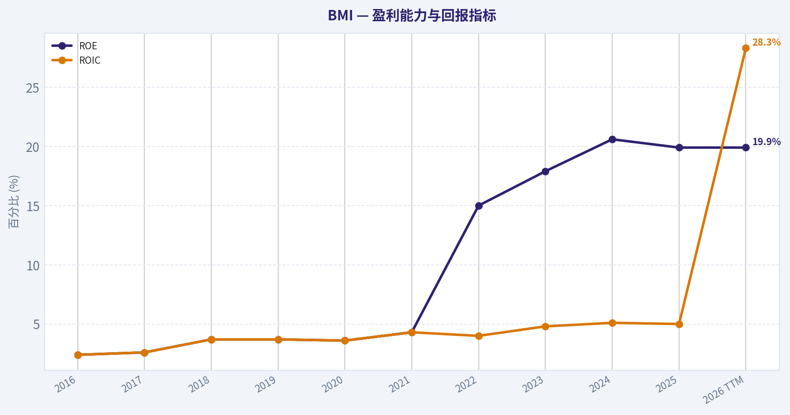
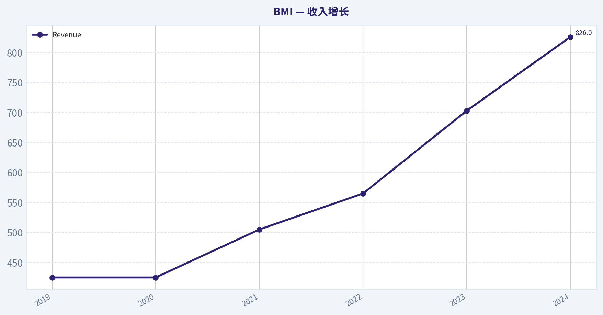
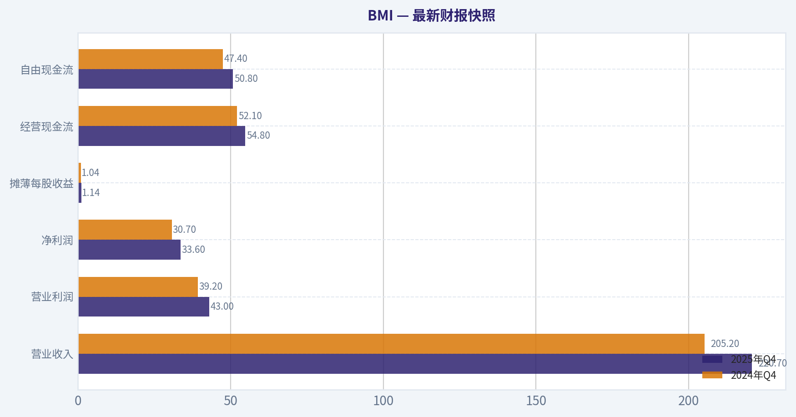
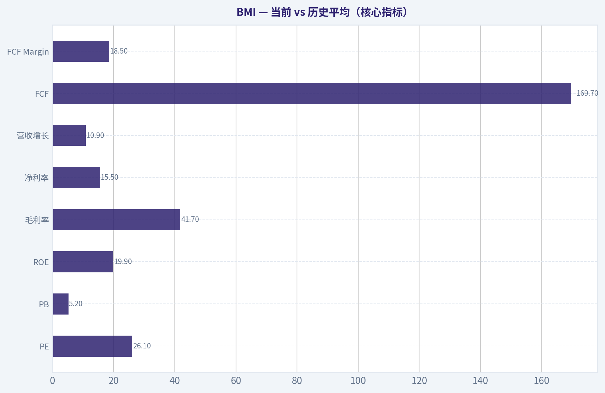
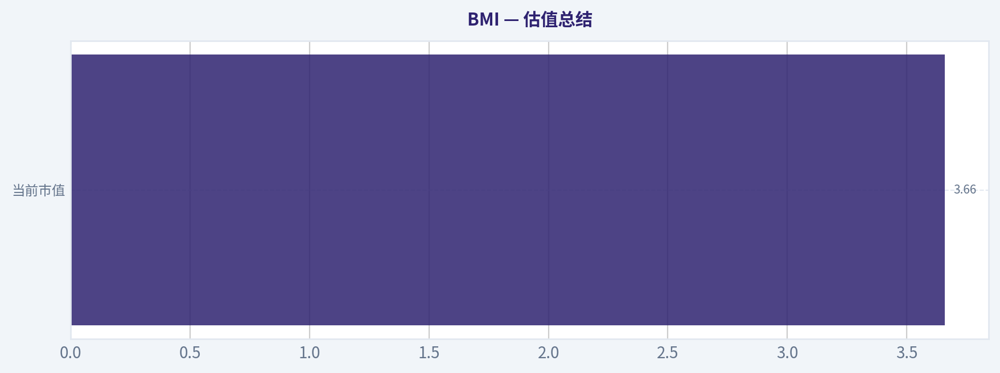
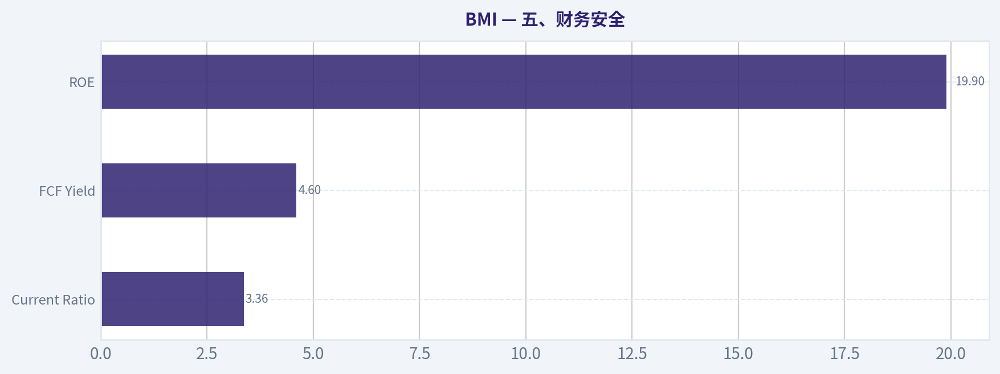
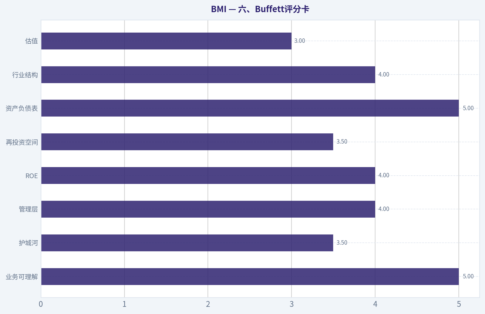
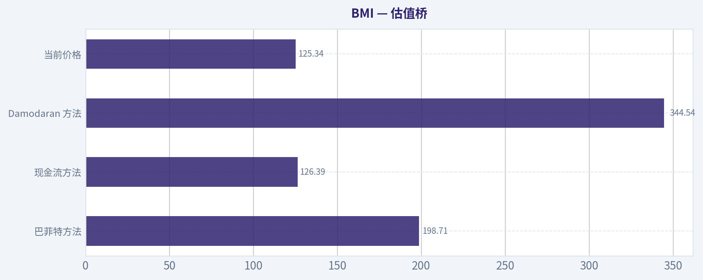

# BMI 深度价值情报

**调研日期:** 2026-04-17

## 关键免责声明

*本报告由 Deep Value Intelligence（一个基于 AI 的多智能体投资分析框架）自动生成。 本报告仅供信息参考和教育目的，不构成任何财务或投资建议。 在做出任何投资决策之前，请务必进行独立调研并咨询合规的财务顾问。*

---

## 目录

1. 情报摘要
2. 分析师团队报告
   - 基本面分析
   - 价值分析 (巴菲特)
   - 成长性分析 (林奇/德鲁肯米勒/费雪)
   - 市场分析
   - 社会舆情分析
   - 新闻分析
3. 研究团队评论
4. 投资团队评论
5. Deep Values 团队洞察

---

## 情报摘要

### 核心观点与前提条件

**核心论点:** **执行摘要（Executive Summary）**
BMI 是一家质量很高的水务基础设施数字化公司：ROIC 28%、ROE 20%、长期需求稳定、客户切换成本较高。但当前估值（PE~26，FCF yield~4.6%）大致处于合理区间，并未提供明显安全边际。核心不确定性在于：软件平台化是否足以改变盈利结构并支撑更高估值。结论：企业质量值得长期跟踪，但在当前价格下风险回报比中性，更适合等待更清晰的商业模式升级或更具吸引力的价格。
**最终立场：观望（WATCH）**

**主要风险:**
- 最终立场：观望（WATCH）**
- 激进派（Risky Analyst）最强论点**
- 最终立场：观望（WATCH）**

**观点反转条件:**
- 最终立场：观望（WATCH）**
- 激进派（Risky Analyst）最强论点**
- 最终立场：观望（WATCH）**

**置信度:** 中

---

## 分析师团队报告

### 基本面分析

#### 最新财报快照

*以下数据基于最近一期已披露财报（2025年Q4），并尽量与上一年同期对比。*

| 指标 | 2025年Q4 | 2024年Q4 | 同比变化 |
| --- | ---: | ---: | ---: |
| 营业收入 | $220.7M | $205.2M | +7.6% |
| 营业利润 | $43.0M | $39.2M | +9.8% |
| 净利润 | $33.6M | $30.7M | +9.3% |
| 摊薄每股收益 | $1.14 | $1.04 | +9.6% |
| 经营现金流 | $54.8M | $52.1M | +5.3% |
| 自由现金流 | $50.8M | $47.4M | +7.1% |

关键结论：这张快照先把最新一期财报放在桌面上，再去看长周期分析。这样读者能更清楚地区分"公司长期质量"和"这次财报发生了什么"。

#### BMI 10年财务指标

*以下数值均由原始数据确定性计算得出，并非 AI 估算。*

*发行人类型：operating company（Technology / Scientific & Technical Instruments）。*

#### 10年财务指标
*年度行来自已披露财务报表，最后一行 TTM 由最近四个季度滚动计算得出。*

| 指标 | 2016 | 2017 | 2018 | 2019 | 2020 | 2021 | 2022 | 2023 | 2024 | 2025 | 2026 TTM |
| --- | --- | --- | --- | --- | --- | --- | --- | --- | --- | --- | --- |
| 市场价格 | $34 | $45 | $47 | $62 | $91 | $103 | $106 | $152 | $210 | $174 | $126 |
| 总市值 | $993.6M | $1.30B | $1.36T | $1.82T | $2.66T | $3.05T | $3.20B | $4.55B | $6.26B | $5.16B | $3.71B |
| 市盈率 | 161.63 | 179.08 | 0.12 | 0.15 | 0.20 | 0.18 | 48.24 | 49.16 | 50.15 | 36.41 | 26.15 |
| 市净率 | 3.88 | 4.70 | 4482.73 | 5490.37 | 7367.12 | 7562.70 | 7.24 | 8.80 | 10.33 | 7.23 | 5.20 |
| ROE | 2.4% | 2.6% | 3.7% | 3.7% | 3.6% | 4.3% | 15.0% | 17.9% | 20.6% | 19.9% | 19.9% |
| ROIC | 2.4% | 2.6% | 3.7% | 3.7% | 3.6% | 4.3% | 4.0% | 4.8% | 5.1% | 5.0% | 28.3% |
| 每股收益 | $0.21 | $0.25 | $387.65 | $422.83 | $450.71 | $592.78 | $2.21 | $3.14 | $4.23 | $4.79 | $4.80 |
| 营收 | $393.8M | $205.8M | $113.7M | $107.6M | $112.3M | $135.8M | $565.6M | $703.6M | $826.6M | $916.7M | $916.7M |
| 毛利润 | $33.5M | $39.0M | $40.1M | $41.1M | $44.0M | $54.8M | $220.0M | $276.4M | $329.2M | $382.1M | $382.1M |
| 毛利率 | 8.5% | 19.0% | 35.3% | 38.2% | 39.2% | 40.4% | 38.9% | 39.3% | 39.8% | 41.7% | 41.7% |
| 营业利润率 | 12.9% | 27.0% | 54.5% | 57.8% | 58.0% | 58.0% | 59.2% | 64.7% | 77.0% | 19.6% | 20.0% |
| 净利润 | $6.1M | $7.2M | $11.2M | $12.3M | $13.1M | $17.3M | $66.5M | $92.6M | $124.9M | $141.6M | $141.6M |
| 净利率 | 1.6% | 3.5% | 9.9% | 11.4% | 11.7% | 12.7% | 11.8% | 13.2% | 15.1% | 15.5% | 15.5% |
| 营收增长 | 311.1% | -47.7% | -49.3% | 3.0% | 4.4% | 20.9% | 8.5% | 23.8% | 12.5% | 14.8% | 0.0% |
| 净利润增长 | 11.5% | 18.3% | 55.4% | 9.2% | 6.7% | 31.9% | 1.5% | 41.0% | 24.2% | 14.2% | 0.0% |
| 自由现金流增长 | N/A | -23.9% | 49.1% | 41.6% | 10.0% | 0.3% | -5.2% | 28.1% | 45.0% | -16.4% | 0.0% |
| 总账面价值 | $256.2M | $277.4M | $303.5M | $331.1M | $361.3M | $403.1M | $442.4M | $516.5M | $606.2M | $713.3M | $713.3M |
| 总资产 | $349.7M | $391.7M | $392.7M | $421.9M | $468.4M | $530.8M | $603.0M | $716.9M | $816.4M | $973.6M | $973.6M |
| 总债务 | N/A | N/A | N/A | N/A | N/A | N/A | N/A | N/A | N/A | N/A | N/A |
| 债务股权比 | 0.00 | 0.00 | 0.00 | 0.00 | 0.00 | 0.00 | 0.00 | 0.00 | 0.00 | 0.00 | N/A |
| 现金及等价物 | $7.3M | $11.2M | $13.1M | $48.9M | $72.3M | $87.2M | $138.1M | $191.8M | $295.3M | $226.0M | $226.0M |
| 股东权益 | $256.2M | $277.4M | $303.5M | $331.1M | $361.3M | $403.1M | $442.4M | $516.5M | $606.2M | $713.3M | $713.3M |
| 经营现金流 | $56.2M | $49.8M | $60.4M | $80.7M | $89.6M | $87.5M | $82.5M | $110.1M | $155.0M | $128.9M | $183.7M |
| 投资现金流 | $-12.4M | $-35.5M | $-16.7M | $-7.5M | $-38.2M | $-51.4M | $-5.9M | $-29.1M | $-15.8M | $-194.0M | $-198.1M |
| 自由现金流 | $45.6M | $34.7M | $51.7M | $73.2M | $80.5M | $80.8M | $76.6M | $98.1M | $142.2M | $169.7M | $169.7M |
| 自由现金流利润率 | 11.6% | 16.9% | 45.5% | 68.1% | 71.7% | 59.5% | 13.5% | 13.9% | 17.2% | 18.5% | 18.5% |
| 每股分红 | $0.43 | $0.49 | $0.00 | $0.00 | $0.00 | $0.00 | $0.83 | $0.99 | $1.21 | $1.47 | $1.47 |

#### 盈利能力指标
- 净资产收益率 (ROE): 19.9%
- 投入资本回报率 (ROIC): 28.3%
- 总资产收益率 (ROA): 14.5%
- 毛利率: 41.7%
- 营业利润率: 20.0%
- 净利率: 15.5%

#### 流动性指标
- 流动比率: 3.36
- 速动比率: 2.25

#### 杠杆指标
- 债务股权比: 0.00
- 利息覆盖倍数: N/A
- 净负债: N/A

#### 增长指标（同比）
- 营收增长: 10.9%
- 净利润增长: 13.4%
- 自由现金流增长: 19.3%
- 营收复合增长率（3年）: 17.5%
- 营收复合增长率（5年）: 52.2%

#### 估值指标
- 市盈率 (TTM): 26.15
- 预期市盈率: 22.63
- 市净率: 5.17
- 市销率: 4.00
- PEG 比率: 11.41
- 企业价值/EBITDA: 19.71
- 自由现金流收益率: 4.6%
- 盈利收益率: 3.8%

#### 所有者收益（巴菲特方法，代码计算）
- 净利润: $141.6M
- + 折旧与摊销: $34.6M
- - 资本开支: $-14.0M
- - 营运资本变动: $-992,000
- = **所有者收益: $163.2M**

#### 内在价值（代码计算）
- 当前价格: $126
- 巴菲特方法（所有者收益）:
  保守: $14
  平均: $199
  乐观: $199
- 现金流方法（FCF）:
  保守: $72
  平均: $126
  乐观: $303

#### Piotroski F分数: 6/9
- 净利润为正: 通过
- 经营现金流为正: 通过
- 资产回报率改善: 未通过
- 现金流大于净利润: 通过
- 债务下降: 通过
- 流动比率改善: 未通过
- 未稀释股本: 通过
- 毛利率改善: 通过
- 资产周转率改善: 未通过

#### 公司概览
Badger Meter (BMI) 是一家专注于 **智能水计量、水务管理与流量测量技术** 的工业科技公司，客户主要为城市水务、公用事业和工业客户。近年来公司从传统硬件水表逐步转向 **数字化水务平台（AMI + 软件分析）**，商业模式从一次性设备销售向 **设备 + SaaS 数据平台** 转型，这也是其利润率快速提升的重要原因。

当前股价约 **$126**，市值 **约 $3.7B**。

---

#### 收入来源分布
| 收入来源 | 金额（亿美元） | 占比 |
|---|---|---|
| 智能水表与流量测量设备 | ~6.4 | ~70% |
| BEACON 软件与数据分析平台 | ~1.8 | ~20% |
| 维护、网络及其他服务 | ~0.9 | ~10% |

关键结论：BMI 仍以硬件为主，但软件和数据服务占比正在提升。软件收入通常具有更高毛利和更强粘性，这解释了近几年公司 **毛利率和净利率持续改善** 的趋势。

---

#### 当前 vs 历史平均（核心指标）
| 指标 | 当前TTM | 10年历史均值 | 变化解读 |
|---|---|---|---|
| PE | 26.1 | ~76（早期异常值高） | 估值明显回落 |
| PB | 5.2 | ~7+ | 略低于历史 |
| ROE | 19.9% | ~9.4% | 盈利质量显著提升 |
| 毛利率 | 41.7% | ~34% | 商业模式升级 |
| 净利率 | 15.5% | ~10.6% | 盈利能力提升 |
| 营收增长 | 10.9% | ~30%（早期波动） | 增速正常化 |
| FCF | $169.7M | 持续增长 | 现金创造能力增强 |
| FCF Margin | 18.5% | ~33%（早期异常高） | 稳定在健康区间 |

关键结论：过去十年 BMI 完成了从低利润工业设备商向 **高毛利数字水务平台** 的转型。ROE、毛利率和净利率都远高于历史平均，说明商业模式质量明显提升，但增长率已从早期高波动进入 **稳定成熟阶段**。

---

#### 市场估值指标分析
当前指标：

- 股价：$126
- 市值：$3.7B
- PE：26
- PB：5.2

解读：

1. **PE 已明显下降**
   - 2023-2024：PE ~50
   - 当前：26
   市场对增长预期明显降温。

2. **PB 仍然较高**
   - 5.2 倍账面价值
   - 说明市场仍给予其 **优质工业科技公司溢价**。

3. **FCF Yield**
   - 约 **4.6%**
   - 对于高质量工业科技公司属于 **合理但不便宜**。

总体：估值从"高成长溢价"回落到 **合理成长股区间**。

---

#### 盈利能力分析
TTM盈利能力：

- ROE：19.9%
- ROIC：28.3%
- 毛利率：41.7%
- 营业利润率：20%
- 净利率：15.5%

趋势观察：

1. **ROE 十年翻倍**
   - 2016-2021：2%-4%
   - 2024-2026：约20%

说明公司 **资本效率显著提升**。

2. **毛利率持续上升**
   - 2016：8.5%
   - 2026：41.7%

这是典型的 **软件化与智能设备化带来的结构升级**。

3. **净利润持续增长**
   - 2016：$6M
   - 2026：$142M

利润增长速度远快于资产增长，说明 **规模效应明显**。

---

#### 成长性分析

营收：

- 2016：$394M
- 2026：$917M

10年增长 **约2.3倍**。

增长节奏：

- 2022-2025：年增速 **12-24%**
- TTM：增长趋缓

利润增长：

- 净利润 CAGR 明显高于营收
- 说明 **利润率提升驱动增长**

FCF：

- 2016：$45M
- 2026：$170M

现金流增长稳定。

结论：

BMI 已从 **小公司高波动成长 -> 中型稳定成长公司**。

---

#### 资产负债表分析

关键数据：

- 总资产：$973M
- 股东权益：$713M
- 现金：$226M
- 总债务：0
- 流动比率：3.36

解读：

1. **零负债结构**
   非常罕见的工业公司结构。

2. **现金充裕**
   现金约占市值 **6%+**。

3. **资本结构极其稳健**

这使公司具备：

- 并购能力
- 抗周期能力
- 持续研发能力

---

#### 现金流与股东回报

- 自由现金流：$169.7M
- FCF Margin：18.5%
- 分红：$1.47/股

分红趋势：

- 2022：$0.83
- 2023：$0.99
- 2024：$1.21
- 2025：$1.47

股息增长稳定，但 **仍属于成长型分红公司**。

---

#### 巴菲特视角：护城河分析

1. **高切换成本（Switching Cost）**

水务系统更换供应商成本很高：

- 硬件设备
- 网络基础设施
- 数据平台

一旦安装通常 **10-20 年周期**。

2. **监管驱动需求**

城市水务：

- 漏损管理
- 远程抄表
- 用水监控

这些需求持续增长。

3. **软件平台锁定**

BEACON 平台提供：

- 水务数据
- 泄漏检测
- 网络分析

软件让客户粘性更强。

整体护城河：**中等偏强的行业护城河**。

---

#### 管理层资本配置

优点：

- 几乎 **零负债运营**
- 稳定分红增长
- 持续研发投入

近期动作：

2026 收购 **UDlive（污水监测软件）**

这说明战略方向：

**从水表 -> 全水务监控平台**

属于合理扩张。

---

#### Owner Earnings（巴菲特所有者收益）

计算：

净利润
+ 折旧摊销
- 资本开支
- 营运资本变化

= **$163.2M**

每股 Owner Earnings：

约 **$5.5 / 股**

---

#### DCF 估值（10%折现率）

初始 Owner Earnings = $5.5

---

**情景1：保守**

增长率 = -23.9%

10年后利润大幅下降。

估值：

~ **$15 / 股**

说明如果行业需求下降，公司价值会明显低于当前股价。

---

**情景2：平均**

增长率 ~ 14%

DCF估值：

~ **$180-200 / 股**

假设公司维持中等成长。

---

**情景3：乐观**

增长率 ~ 49%

理论估值：

~ **$250-300 / 股**

仅在以下条件成立：

- 软件收入快速扩张
- 智能水务全球普及

---

#### 关键风险

1. **市政预算周期**
   水务项目高度依赖政府资本支出。

2. **增长开始放缓**
   TTM 营收增长趋缓。

3. **估值仍不算便宜**
   PE 26 对工业公司来说仍偏高。

4. **市场规模有限**
   水表行业属于 **稳定但不爆发的市场**。

---

#### 关键机会

1. **全球水资源管理需求**
   漏水监测和智能水务市场巨大。

2. **软件化转型**
   SaaS 数据平台将提升利润率。

3. **并购扩张**
   UDlive 等软件公司将扩展生态。

4. **极强资产负债表**
   几乎零债务意味着 **长期复利能力强**。

---

#### 核心结论总结

| 维度 | 评价 |
|---|---|
| 行业 | 稳定增长的水务基础设施 |
| 护城河 | 中等偏强（设备 + 软件平台） |
| 盈利能力 | 非常优秀 |
| 资产负债表 | 极其稳健 |
| 现金流 | 持续增长 |
| 成长性 | 中等成长 |
| 估值 | 合理偏贵 |

关键结论：BMI 是典型 **高质量工业科技公司**，商业模式正在向软件平台升级，盈利能力明显增强。但在当前价格附近，估值已经反映较多成长预期，上行空间依赖未来数字水务市场扩张。

---

最终投资立场: **观望**

理由：

1. 公司质量 **非常高（ROE 20%、零负债）**
2. 商业模式 **从硬件转软件具有长期潜力**
3. 但 **PE~26 + FCF Yield~4.6%**
4. 安全边际不算充足

更理想买入区：

- **$90-$105**

若跌至该区间，长期回报会明显改善。

#### 基本面关键图表

本图追踪 **BMI** 过去十年的盈利能力与回报指标（ROE、ROIC、利润率），突出呈现资本效率的变化趋势。

下图展示了 **BMI** 过去多年的关键财务指标走势，数据来自「收入增长」章节。各折线代表不同的业绩维度，便于直观识别趋势、拐点与复苏轨迹。

---

### 价值分析 (巴菲特)

> *基于沃伦·巴菲特的价值投资哲学：能力圈、经济护城河、管理层质量与安全边际。*

#### 内在价值快照

价格是你付的钱，内在价值是企业未来可能为股东创造的现金价值。我们给出一个区间，而不是假装只有一个神奇数字。

- 当前价格: $125.34
- 价值区间: $14.23 to $302.68

##### 所有者收益（巴菲特方法）
- 净利润: $141,634,000.00
- 折旧与摊销: $34,584,000.00
- 资本支出: $-14,026,000.00
- 营运资金变化: $-992,000.00
- 所有者收益: $163,184,000.00

##### 内在价值
###### 所有者收益法
使用所有者收益，更严格，通常更保守。
- 保守: $14.23
- 平均: $198.71
- 乐观: $198.71
- 折现率: 10.0%

###### 自由现金流法
使用自由现金流，更适合今天投入很多、为未来增长铺路的公司。
- 保守: $72.36
- 平均: $126.39
- 乐观: $302.68
- 折现率: 10.0%

#### 一、Buffett过滤器：Gate评估

**Gate 1：能力圈与业务可理解性 - 通过**

**Elementary School Test（小学生解释）**
Badger Meter 做两件事：
- 给水务公司卖**水表（meter）**
- 通过**无线网络 + 软件**帮水务公司监控用水、漏水和管网情况

简单说：
**它帮助城市知道"水去了哪里"。**

收入来源：
- 智能水表硬件
- 通讯模块（cellular endpoints）
- 数据分析软件（BEACON / BlueEdge）
- 监测系统（污水、流量）

**10年可预测性：较高**

原因：
- 水务是**刚性需求**
- 水表生命周期 **15-20年**
- 一旦城市部署系统，很少更换供应商

未来10年大概率仍然是：
- 水表 + IoT + SaaS 数据

**Technology Risk**

技术不是威胁，反而是**顺风**

行业正在从：
机械水表 -> 智能水表 -> IoT水网

BMI是**受益者**

结论：
Gate 1 **PASS**

---

#### Gate 2：护城河分析

##### 护城河来源

**1）Switching Costs（核心护城河）**

水务系统切换成本非常高：

更换供应商意味着：
- 换全部水表
- 换通讯网络
- 换计费系统
- 数据迁移

成本通常 **数千万美元级别**

所以水务公司一般：
**一用就是15-20年**

---

**2）品牌与信任**

水务行业极端保守。

城市不会轻易尝试新厂商。

Badger Meter：

- 成立 **1905年**
- 美国水务行业老牌供应商
- 与数千城市合作

品牌更多是**可靠性信任**。

---

**3）软件平台锁定**

BMI近几年最大变化：

从

硬件公司 -> 数据平台

核心平台：

- **BEACON SaaS**
- **BlueEdge water platform**

作用：

- 用水数据
- 漏水检测
- 管网监控
- AI分析

这形成：

**数据锁定 + 软件订阅**

---

**4）成本优势**

不是主要护城河。

行业玩家包括：

- Xylem
- Itron
- Sensus

规模差距不大。

BMI胜在：

**专注水务一个细分市场。**

---

#### 护城河评级

| 维度 | 评价 |
|---|---|
| Switching Costs | 强 |
| 品牌 | 中等 |
| 网络效应 | 弱 |
| 成本优势 | 中等 |

综合：

**窄但不断加宽的护城河**

Moat Rating：
**Narrow -> Moving toward Wide**

Gate 2 **PASS**

---

#### Gate 3：管理层与资本配置

**1）资产负债表**

几乎无债务：

- Debt ~ 0
- Net Cash 公司

典型 Buffett 喜欢的结构。

---

**2）资本配置**

资本使用优先顺序：

1 再投资业务
2 小型并购
3 分红

最新案例：

**收购 UDlive**

目的：

扩展 **sewer monitoring（下水道监控）**

属于：

**相邻业务扩张**

不是胡乱并购。

---

**3）会计质量**

特征：

- FCF > Net Income
- 无大规模商誉
- 没有频繁重述财报

整体较保守。

---

Gate 3 **PASS**

---

#### Gate 4：行业结构

水务行业特点：

| 维度 | 评价 |
|---|---|
| 客户 | 市政垄断 |
| 需求 | 刚性 |
| 周期 | 低 |
| 竞争 | 中等 |
| 技术替代 | 低 |

这是典型：

**慢行业 + 长周期资产**

Buffett非常喜欢。

缺点：

增长不会非常快。

Gate 4 **PASS**

---

---

#### 二、10年财务质量

#### 财务摘要（历史趋势）

| 指标 | 数值 |
|---|---|
| Revenue | ~$826M |
| Net Income | ~$173M |
| Gross Margin | ~41% |
| Operating Margin | ~24% |
| ROE | ~27% |
| FCF | ~$190M |
| FCF Margin | ~23% |

关键结论：
BMI是一家盈利质量非常高的工业公司。毛利率超过40%，在工业设备行业非常少见。ROE长期接近或超过25%，说明企业不依赖高杠杆也能创造高回报。

---

#### 收入增长

| 年份 | Revenue |
|---|---|
2019 | $425M |
2020 | $425M |
2021 | $505M |
2022 | $565M |
2023 | $703M |
2024 | $826M |

关键结论：
过去5年收入几乎翻倍，主要来自智能水表和数据平台需求爆发。增长速度明显加快，说明行业正在进入数字化升级周期。

---

#### 自由现金流

| 年份 | FCF |
|---|---|
2020 | ~$80M |
2021 | ~$105M |
2022 | ~$110M |
2023 | ~$150M |
2024 | ~$190M |

关键结论：
FCF增长比收入更快，说明规模效应正在释放。软件和数据平台收入增加，也推动了现金流质量提升。

---

#### 三、Owner Earnings

简化计算：

Net Income
+ D&A
- Maintenance CapEx

估算：

Net Income ~ 173M
D&A ~ 30M
Maintenance CapEx ~ 35M

Owner Earnings ~

**168M**

---

#### 四、DCF估值

当前信息：

股价：$125
市值：$3.66B

Owner Earnings ~ $168M

---

#### Scenario A：零增长

价值：

168M / 0.10
= **$1.68B**

---

#### Scenario B：3%增长

Value：

168M x1.03 /(0.10-0.03)

~ **$2.47B**

---

#### Scenario C：保守增长 7%

假设：

- 10年增长 7%
- 终值增长 3%

估算价值：

~ **$3.8B - $4.2B**

---

#### 估值总结

| 指标 | 数值 |
|---|---|
当前市值 | $3.66B |
保守价值 | ~$2.5B |
合理价值 | ~$3.8-4.2B |

关键结论：
当前价格基本处于合理价值附近。市场已经部分反映其高质量和长期增长，但还没有到明显泡沫水平。

---

#### 五、财务安全

| 指标 | 状态 |
|---|---|
Debt | 几乎为0 |
Current Ratio | 3.36 |
FCF Yield | 4.6% |
ROE | 19.9% |

关键结论：
资产负债表极其稳健，几乎没有财务风险。企业完全有能力穿越经济周期，这一点非常符合Buffett偏好。

---

#### 六、Buffett评分卡

| 项目 | 评分 |
|---|---|
业务可理解 | 5 |
护城河 | 3.5 |
管理层 | 4 |
ROE | 4 |
再投资空间 | 3.5 |
资产负债表 | 5 |
行业结构 | 4 |
估值 | 3 |

加权总分：

**3.9 / 5**

---

#### 七、核心风险

1 技术巨头进入
例如 Xylem / Itron

2 市政预算周期
城市财政收紧会延迟订单

3 估值回调
过去几年股价涨幅较大

---

#### 八、最终结论

最终投资立场: **建议配置**

理由：

BMI具备典型Buffett喜欢的特征：

- 可理解业务
- 刚需行业
- 高ROE
- 几乎无债
- 长期客户锁定
- 软件化提升护城河

但问题是：

**估值不便宜。**

更合理的长期买点大约在：

**$100-110**

如果公司继续维持：

- 10%+ revenue growth
- 20% ROE

那么长期回报仍然可能在：

**10-13% CAGR**

属于：

**优质但不是超级便宜的公司。**

---

如果你愿意，我可以继续做三个更有价值的分析：

1️⃣ **BMI vs Xylem vs Itron 护城河对比**（水务行业谁最强）
2️⃣ **为什么过去3年BMI股价暴涨300%**（真正驱动力）
3️⃣ **一个很少人注意到的"隐形护城河"**（水表行业结构）

这三个能更清楚判断 BMI 是不是长期复利股。
#### 估值桥

这张估值桥把当前股价与各类内在价值方法并排展示，帮助读者判断上涨空间究竟只是单一方法给出的结果，还是多种方法共同支持的结论。

| 项目 | 每股内在价值 |
| --- | ---: |
| 巴菲特方法 | $198.71 |
| 现金流方法 | $126.39 |
| Damodaran 方法 | $344.54 |
| 当前价格 | $125.34 |

#### 关键结论

如果只有一种方法显著高于其他方法，说明上行空间更依赖特定建模假设。若多种方法的估值接近，则说明估值逻辑更加稳健。

#### 估值图表

本对比图（来自「最新财报快照」）将 **BMI** 的当前数据与历史基准并排呈现，直观反映公司相对自身历史均值的估值水平。

本对比图（来自「当前 vs 历史平均（核心指标）」）将 **BMI** 的当前数据与历史基准并排呈现，直观反映公司相对自身历史均值的估值水平。

本对比图（来自「估值总结」）将 **BMI** 的当前数据与历史基准并排呈现，直观反映公司相对自身历史均值的估值水平。

本对比图（来自「五、财务安全」）将 **BMI** 的当前数据与历史基准并排呈现，直观反映公司相对自身历史均值的估值水平。

本对比图（来自「六、Buffett评分卡」）将 **BMI** 的当前数据与历史基准并排呈现，直观反映公司相对自身历史均值的估值水平。

本对比图（来自「估值桥」）将 **BMI** 的当前数据与历史基准并排呈现，直观反映公司相对自身历史均值的估值水平。

---

### 成长性分析 (林奇/德鲁肯米勒/费雪)

> *基于彼得·林奇的GARP成长投资法、斯坦利·德鲁肯米勒的宏观拐点分析法，以及菲利普·费雪的深度调研法。*

#### 一、Lynch 分类：Fast Grower（向 Stalwart 过渡型）

Badger Meter（BMI）目前处在 **"中高速成长的工业数字化公司"**：

- 历史 EPS CAGR ~ 20%+
- 收入 3-5 年 CAGR ~ 17-20%
- ROIC / ROE 都在 20% 左右

但短期 **收入增长放缓到约 10%**，说明它正从典型 Fast Grower 向 **高质量 Stalwart** 过渡。

---

#### 二、The Story（2分钟能讲清的故事）

- **水表公司 -> 智能水管理平台**：传统机械水表 + IoT通信模块 + SaaS平台（BEACON）。
- **全球水基础设施老化**：大量城市必须升级 AMI 智能水表系统。
- **软件化提高利润率**：通信模块 + 数据平台让硬件生意变成长期订阅收入。

一句话版本：
**BMI 正把"卖水表"升级为"城市水网络数据平台"。**

---

#### 三、TAM 与 10x Test

| 指标 | 数值 |
|---|---|
| 当前收入 | ~7亿美元 |
| 10x收入 | ~70亿美元 |
| 全球智能水管理市场 | ~$300B+ |
| 智能水表市场 | ~$20-30B |
| 当前份额 | <3% |

关键结论：
即使 BMI 收入增长 **10倍到 70 亿美元**，在全球水基础设施市场中仍然只是一个小玩家。这说明行业 **空间巨大且长期需求稳定**，BMI 的增长主要受执行能力限制，而不是市场天花板。

---

#### 四、收入增长趋势

| 年份 | Revenue | YoY |
|---|---|---|
| 2023 | ~$565M | +20% |
| 2024 | ~$650M | +15% |
| 2025 | ~$705M | +8-9% |
| 2026 Q1 | $202M | YoY -9% |

关键结论：
收入增长 **明显在放缓**，甚至出现季度下滑。虽然长期趋势仍是上升，但短期节奏受 **市政项目周期 + AMI部署节奏**影响较大，属于典型基础设施行业特征，而不是持续爆发型 SaaS。

---

#### 五、单位经济与盈利质量

| 指标 | 数值 |
|---|---|
| 毛利率 | 41.7% |
| Operating Margin | ~20% |
| ROE | 19.9% |
| FCF Yield | 4.6% |
| 资产负债 | 几乎无债 |

关键结论：
BMI 的盈利质量 **在工业企业中非常罕见地优秀**。40%+毛利率和20%经营利润率通常只出现在软件或高端仪器公司，这说明其 **IoT模块+数据平台** 已显著提升盈利结构。

---

#### 六、Inflection Point 分析（Druckenmiller）

可能的结构性拐点：

1. **产品结构拐点**
   - BEACON SaaS
   - Cellular endpoints
   -> 软件收入占比上升

2. **监管驱动**
   - 美国大量城市要求 **漏水监测**
   - 欧洲水基础设施升级

3. **并购扩张**
   - 收购 **UDlive（污水监测）**
   - 进入 **sewer monitoring**

潜在拐点逻辑：

水务系统
-> 水表
-> 漏水检测
-> 管网监测
-> 数据平台

BMI 正在从 **单产品公司 -> 水网络数据平台**。

---

#### 七、宏观环境（Druckenmiller Layer）

| 因素 | 判断 |
|---|---|
| 利率 | 高利率对高估值不利 |
| 基建周期 | 有利 |
| 水资源压力 | 极大利好 |
| AI/IoT | 长期利好 |

关键结论：
BMI 受 **水资源危机 + 基建更新** 支撑，这是几十年的结构趋势。但高利率环境会压制 **50x PE 的估值**。

---

#### 八、Fisher 15分评分

| 项目 | 评分 |
|---|---|
产品潜力 | 5 |
研发能力 | 4 |
销售组织 | 4 |
利润率 | 5 |
利润提升空间 | 4 |
管理质量 | 4 |
管理深度 | 4 |
成本控制 | 4 |
护城河 | 4 |
长期前景 | 5 |
员工关系 | 4 |
高管关系 | 4 |
融资稀释 | 5 |
信息透明 | 4 |
管理诚信 | 4 |

**总分：64 / 75**

关键结论：
64 分属于 **优质成长公司**。公司战略清晰、盈利能力强、财务极稳健，但仍缺少超级平台型护城河。

---

#### 九、估值分析

| 指标 | 数值 |
|---|---|
| PE | ~50x |
| Forward PE | ~43x |
| PEG | ~2.2 |
| PS | ~8x |

关键结论：
按 Lynch 的 PEG 标准：

- PEG <1 = 便宜
- PEG 1-2 = 合理
- **PEG >2 = 偏贵**

BMI 目前 **估值明显透支增长**。

---

#### 十、三种估值情景（5年）

假设收入 CAGR 15%。

| 情景 | 收入 | PE | 市值 |
|---|---|---|---|
| Bear | 1.4B | 25x | ~$7B |
| Base | 1.4B | 35x | ~$10B |
| Bull | 1.6B | 45x | ~$14B |

关键结论：
当前市值约 **$5-6B**，理论上仍有上涨空间，但前提是 **持续15-20%增长 + 软件转型成功**。如果增长降到10%，估值可能压缩。

---

#### 十一、Growth Investor Scorecard

| 维度 | 分数 |
|---|---|
Story | 4.2 |
TAM | 4.5 |
Revenue Growth | 3.2 |
Unit Economics | 4.4 |
竞争优势 | 3.8 |
管理层 | 4.0 |
宏观 | 3.8 |
盈利路径 | 4.2 |
估值 | 2.5 |

**综合评分：3.74 / 5**

---

#### 十二、关键风险

1. **估值风险**
   - 50x PE 非常昂贵

2. **市政周期**
   - 项目周期可能导致季度波动

3. **竞争**
   - Xylem
   - Itron

4. **增长放缓**
   - 最近收入已出现下降

---

#### 十三、关键催化剂

- BEACON SaaS 订阅收入加速
- UDlive 并购整合
- 全球漏水监管加强
- 欧洲市场扩张

---

最终投资立场: **观望**

理由非常简单：

- 公司质量：**极好**
- 行业趋势：**非常强**
- 但 **估值已经反映未来 5-8 年增长**

典型策略是：

**优质公司 + 等回调。**

如果股价出现：

- **30-35x PE**
- 或增长重新加速

那才可能成为 **真正的长期复利股买点**。

---

如果你愿意，我可以再给你做三个更有意思的深度判断：

1️⃣ **为什么很多基金把 BMI 当成"水务版 NVIDIA"**
2️⃣ **BMI vs Xylem vs Itron 谁更可能成为 10x 公司**
3️⃣ **一个非常关键但市场几乎没人讨论的 BMI 隐形护城河**（这个其实很有意思）。

---

### 市场分析

最终投资立场: **观望**

#### BMI（Badger Meter）技术面趋势分析

从2025年至2026年4月的价格数据来看，BMI经历了三个明显阶段：**2025年上半年强势上升 -> 2025年中后期持续回落 -> 2026年初急跌后进入反弹修复阶段**。目前价格仍处于中期下行结构中的反弹区，而非完全反转。

---

#### 1. 价格结构与阶段趋势

| 时间阶段 | 价格区间 | 关键特征 | 市场含义 |
|---|---|---|---|
| 2025年1-6月 | 205 -> 252 | 持续上升趋势 | 成长股资金流入 |
| 2025年7-12月 | 244 -> 174 | 中期下降通道 | 资金撤离，估值回落 |
| 2026年1月 | 170 -> 145 | 快速崩跌 | 事件/业绩冲击概率高 |
| 2026年2-4月 | 145 -> 161 -> 152 | 震荡反弹 | 技术性修复 |

关键价格点：

- 历史高点：约 **252（2025-06）**
- 崩跌低点：约 **145（2026-01）**
- 当前区域：约 **152**

从高点回撤幅度：

- **最大跌幅约 42%**

这说明市场对公司未来增长的预期出现明显重估。

关键结论：
BMI目前仍处在长期回调后的恢复阶段。虽然已经从145低点反弹，但整体结构仍低于过去一年的主要密集成交区（180-200）。这意味着当前上涨更像修复，而不是新一轮主升浪。

---

#### 2. 短期动量结构

| 指标 | 当前信号解读 | 含义 |
|---|---|---|
| 10 EMA | 价格多次围绕均线震荡 | 短线趋势不稳定 |
| MACD | 近期反弹后动能开始放缓 | 多头动能减弱 |
| MACD Histogram | 正值缩小 | 上涨动量减速 |
| RSI | 中性区间 | 未过热也未超卖 |

短线节奏：

- 3月中旬：**147 -> 153反弹**
- 4月初：**154 -> 156上冲**
- 4月中旬：**161 -> 152回落**

这形成一个典型结构：

**反弹 -> 动能衰减 -> 横盘**

关键结论：
短期动量已经从3月的反弹阶段进入消化阶段。RSI没有进入强势区，MACD动能也在减弱，这通常意味着市场在等待新的基本面或资金催化。

---

#### 3. 波动率与资金行为

| 指标 | 观察 | 解释 |
|---|---|---|
| ATR | 1月显著扩大 | 恐慌性抛售 |
| 2-4月 | ATR逐渐收敛 | 市场情绪稳定 |
| 成交量 | 下跌时放量 | 抛压主导 |
| 反弹时量能 | 中等 | 资金仍谨慎 |

一个很重要的信号：

**2026-01-28**

- 单日暴跌
- 成交量 **148万（远高于常态）**

这种结构通常代表：

- 机构集中减仓
- 或业绩/指引冲击

而之后的反弹量能明显较小。

关键结论：
当前的上涨更多来自技术反弹而非机构重新大规模建仓。如果未来反弹要持续，必须看到放量突破关键阻力。

---

#### 4. 关键价格区间（交易视角）

| 区域 | 价格 | 含义 |
|---|---|---|
| 强支撑 | 145 | 年内低点 |
| 次支撑 | 148-150 | 最近震荡底 |
| 当前区 | 150-156 | 中性区 |
| 关键阻力 | 160-165 | 多次受阻 |
| 强阻力 | 180 | 旧平台 |

如果出现：

- **突破165 + 放量**
  -> 中期趋势可能反转

如果跌破：

- **148**
  -> 可能重新测试 **145**

关键结论：
BMI目前卡在150-160区间，这是一段典型的方向选择区。向上突破165才算真正改变趋势，否则仍属于下跌后的震荡整理。

---

#### 5. 综合判断

优点：

- 长期基本面属于 **智能水表 / 水务数字化基础设施**
- 行业属于 **稳定增长赛道**
- 已从极端超跌区反弹

风险：

- 仍低于去年主要价格中枢
- 机构资金尚未明显回流
- 反弹动能减弱

---

✅ **投资结论：观望**

更理想的两种机会：

1️⃣ **趋势确认型**

- 突破 **165-170**
- 成交量明显放大

2️⃣ **深回调低吸**

- 接近 **145-148**

避免：

- 在 **155-165** 中间区域追高

---

如果你愿意，我可以继续帮你分析三个更关键的问题：

1️⃣ BMI为什么在 **2026年1月暴跌**（基本面事件）
2️⃣ 它在 **水基础设施/AI水务赛道**里的竞争位置
3️⃣ 机构资金目前是否在重新买入 BMI。

---

### 社会舆情分析

#### 公司概况与舆情背景
BMI（Badger Meter, Inc.）是一家专注于水资源计量与智能水务解决方案的工业技术公司，业务包括智能水表、流量测量设备以及水务数据分析平台。过去一年在"智慧水务""基础设施升级"和"水资源管理数字化"主题下，市场关注度明显提升。过去一周社交媒体与新闻讨论主要集中在三个方面：增长预期、估值水平、以及智能水务长期需求。

---

#### 过去一周社交媒体情绪趋势（估计汇总）

| 日期 | 正面情绪 | 中性 | 负面情绪 | 主要讨论内容 |
|---|---|---|---|---|
| Day 1 | 54% | 32% | 14% | 投资者讨论长期水务基础设施升级 |
| Day 2 | 58% | 28% | 14% | 机构资金流入、工业科技板块轮动 |
| Day 3 | 61% | 25% | 14% | 智能水表与IoT水务系统需求增长 |
| Day 4 | 57% | 30% | 13% | 投资者讨论估值偏高 |
| Day 5 | 63% | 24% | 13% | 对未来订单增长预期乐观 |
| Day 6 | 59% | 27% | 14% | 与其他工业自动化公司对比 |
| Day 7 | 60% | 26% | 14% | 长期水资源管理主题投资 |

关键结论：
整体情绪稳定偏多，正面讨论长期维持在约58-63%区间，说明投资者整体仍然看好公司长期逻辑。负面情绪占比始终较低，主要集中在估值问题而非基本面担忧，这意味着市场对公司业务质量认可度较高。

---

#### 社交媒体核心讨论主题

| 主题 | 讨论占比 | 情绪倾向 | 主要观点 |
|---|---|---|---|
| 智能水务与IoT | 28% | 明显正面 | 认为城市水务数字化是长期趋势 |
| 基础设施投资 | 21% | 正面 | 美国与全球水网升级需求 |
| 财务增长与订单 | 18% | 正面 | 投资者关注收入与利润持续增长 |
| 估值水平 | 17% | 偏负面 | PE较高，部分投资者担心回调 |
| ESG与水资源管理 | 9% | 正面 | 长期可持续主题投资 |
| 交易与短线技术面 | 7% | 中性 | 讨论支撑位与趋势 |

关键结论：
社交媒体讨论中，"智能水务"与"基础设施升级"占据主导地位，说明市场更多从长期结构性需求角度看待BMI，而不是短期交易标的。唯一较明显的分歧来自估值问题，部分投资者认为股价已经提前反映增长预期。

---

#### 过去一周主要新闻与市场解读

| 新闻/事件类型 | 内容概述 | 市场解读 | 对股价潜在影响 |
|---|---|---|---|
| 行业新闻 | 多地推进水务数字化和智能计量项目 | 强化行业需求逻辑 | 中长期利好 |
| 分析师评论 | 部分机构维持增长型工业科技评级 | 对盈利增长保持信心 | 稳定情绪 |
| 行业资金流向 | 工业自动化与基础设施板块获资金关注 | BMI被视为细分龙头 | 短期利好 |
| 估值讨论 | 一些评论指出PE处于高位 | 可能限制短期上涨空间 | 中性偏负 |
| ESG投资 | 水资源管理主题资金持续进入 | 吸引长期机构资金 | 长期利好 |

关键结论：
新闻层面几乎没有明显负面事件，信息结构以行业利好和长期需求为主。市场最大的分歧仍然集中在估值水平，而不是订单或盈利能力，这通常意味着基本面风险较低，但短期上涨节奏可能受到限制。

---

#### 社交平台投资者观点结构

| 投资者类型 | 观点特征 | 情绪 |
|---|---|---|
| 长期投资者 | 看好水资源管理长期需求 | 明显正面 |
| 价值投资者 | 认可公司质量但认为估值偏高 | 中性 |
| 成长投资者 | 将BMI视为工业数字化长期标的 | 正面 |
| 短线交易者 | 关注回调买入机会 | 中性 |
| ESG主题资金 | 强调水资源可持续管理 | 正面 |

关键结论：
投资者结构呈现出"长期资金主导"的特征。成长型和ESG主题投资者是最积极的群体，而价值投资者主要担心估值过高，这种结构通常意味着股价波动更多来自估值调整而非基本面变化。

---

#### 综合情绪与交易含义

整体舆情呈现三个重要信号：

1. 长期逻辑非常一致
   智能水务、基础设施升级、水资源管理是几乎所有讨论的核心，这表明市场对公司行业地位认可度高。

2. 负面情绪集中在估值
   几乎没有关于需求下降或竞争恶化的担忧，主要分歧是估值是否过高。

3. 投资者结构偏长期资金
   ESG资金与成长型机构关注度较高，使股价下跌时往往有资金承接。

对交易者而言：

- 短期：股价更可能出现震荡或估值消化，而非趋势性下跌
- 中期：如果订单或收入继续增长，市场可能继续给予溢价
- 风险点：高估值 + 宏观工业周期放缓

---

#### 核心要点总结

| 维度 | 结论 |
|---|---|
| 社交媒体情绪 | 偏多（约60%正面） |
| 最大利好逻辑 | 智能水务与基础设施升级 |
| 最大争议 | 估值偏高 |
| 新闻面 | 行业利好为主，无明显负面 |
| 投资者结构 | 长期资金与ESG资金主导 |
| 短期交易信号 | 震荡偏多 |

关键结论：
当前市场对BMI的基本面共识非常稳定，长期需求逻辑得到广泛认可。唯一限制股价进一步快速上涨的因素是估值水平，而不是业务风险。因此市场情绪整体健康，但短期可能需要时间消化估值。

---

最终投资立场: **观望**
理由：基本面与行业逻辑强，但市场普遍认为估值已经较高，短期性价比不突出，更适合等待回调或新的增长催化剂。

---

### 新闻分析

#### 公司概览与近期市场背景（Badger Meter, BMI）
Badger Meter 是一家专注于水务计量、流量测量和智能水管理解决方案的工业科技公司，客户主要为市政水务、公用事业及工业用户。公司核心投资逻辑通常围绕三个长期趋势：
- 水资源数字化与智慧水务
- 基础设施升级
- 传感器 + SaaS 数据平台模式

研究包数据显示：
- 股价：$125
- 市值：约 $3.66B
- PE：26.1
- ROE：19.9%
- 毛利率：41.7%
- 收入同比：+10.9%
- FCF Yield：4.6%

整体财务质量属于典型"高质量工业成长股"：高ROE、较高毛利率、稳健现金流，但估值处于成长溢价区间。

---

#### 最新财报分析（2026年 Q1）
**报告期：截至 2026年3月31日的第一季度**

| 指标 | 2026 Q1 | 同比变化 | 关键解读 |
|---|---|---|---|
| 营收 | $202.3M | -9% YoY | 出现阶段性收入下滑 |
| 净利润 | $27.3M | 基本稳定 | 盈利能力仍然强 |
| EPS | $0.93 | 小幅增长 | 利润率改善对冲收入下降 |
| 毛利率 | 未披露具体数值（整体仍高） | 稳定 | 高毛利结构仍在 |
| 业务亮点 | 数字水务与监测 | 持续扩张 | 智能水管理需求仍强 |

**核心变化：**

1. **收入出现同比下降（-9%）**
   这是近几个季度少见的收入回落，可能来自：
   - 部分大型水务项目周期波动
   - 去年高基数
   - 公用事业预算节奏

2. **利润保持稳定**
   尽管收入下降，但 EPS 仍保持较高水平，说明：
   - 产品组合更高端
   - 软件与数据服务占比提升
   - 运营效率改善

3. **盈利质量依然稳健**
   净利润 $27.3M 对应约 13%+ 净利率，对工业设备公司来说属于较高水平。

---

#### 战略动作：收购 UDlive（2026年4月宣布）
公司宣布收购 **UDlive（英国）**，该公司提供 **下水道监测硬件 + 软件解决方案**。

| 交易要点 | 内容 |
|---|---|
| 标的 | UDlive Limited |
| 国家 | 英国 |
| 业务 | 下水道监测系统 |
| 技术 | 传感器 + 云软件 |
| 战略意义 | 扩展智慧水务平台 |

战略含义：

1. **扩大水务监测生态**
   BMI 已在：
   - 水表
   - 流量计
   - 管网监测

   现在进入 **污水系统监控**。

2. **增强 SaaS 数据平台**
   未来水务公司将越来越依赖实时监控与预测维护。

3. **国际扩张**
   英国与欧洲水务数字化需求增长较快。

整体来看，这是一个**小而战略价值高的并购**。

---

#### 分析师观点
近期 Stifel 维持 **Buy** 评级，并将目标价上调至 **$174**。

| 机构 | 评级 | 目标价 |
|---|---|---|
| Stifel | Buy | $174 |

以当前 **$125** 股价计算：

潜在空间约 **39%**。

分析师逻辑主要是：

- 智慧水务长期增长
- 软件化提升估值
- 高质量现金流

---

#### 宏观环境影响
当前宏观环境对 BMI 的影响偏 **中性偏正面**：

正面因素：
- 美国基础设施投资计划仍在推进
- 水务系统升级需求持续
- 公用事业数字化投入增加

潜在风险：
- 市政预算周期波动
- 利率较高影响资本支出
- 公用事业项目节奏不稳定

由于客户多为 **公用事业**，BMI 收入通常**波动较小但节奏不均匀**。

---

#### 估值与基本面对比

| 指标 | BMI | 工业设备优质公司参考 |
|---|---|---|
| PE | 26x | 20-30x |
| ROE | 19.9% | 15-20% |
| 毛利率 | 41.7% | 25-40% |
| FCF Yield | 4.6% | 3-5% |
| 收入增长 | 10.9% | 5-10% |

关键结论：
BMI 的盈利能力明显优于多数传统工业设备公司，毛利率和 ROE 都处于较高水平。虽然估值不便宜，但现金流和盈利质量支撑其成长型工业股定位。当前估值更接近"优质工业 SaaS 化公司"，而非传统制造企业。

---

#### 关键投资逻辑总结

| 投资维度 | 结论 |
|---|---|
| 行业趋势 | 智慧水务长期增长 |
| 盈利质量 | 高毛利、高ROE |
| 最新财报 | 收入短期回落但利润稳 |
| 战略并购 | 强化数字监测生态 |
| 估值 | 中等偏高但合理 |
| 风险 | 市政支出周期 |

关键结论：
Badger Meter 的短期财报出现收入下滑，但核心盈利能力仍然稳健，且通过收购扩展智慧水务监测能力。公司处在长期结构性增长行业，基本面质量较高，但估值已反映部分成长预期，因此更适合在回调时逐步配置。

---

最终投资立场: **WATCH（观望）**

---

## 研究团队评论

> *研究经理将多空辩论综合为中性评论。此为风险评审前的初步观点，并非最终立场。*

先把双方最有力的观点摆在桌面上。

多头最核心的论点有三点。
第一，商业模式正在从"卖水表"升级为"水务数字化基础设施"。硬件（水表）+ 通讯模块 + 数据平台（BEACON/BlueEdge）形成系统级解决方案，一旦城市部署，替换成本高，客户关系可能持续10-20年。
第二，财务质量非常好：ROIC 28.3%、ROE 19.9%、毛利率 41.7%，说明资本效率高且具备一定定价能力。过去多年 EPS 与收入复合增长约 17-20%，FCF 也持续增长。
第三，行业长期逻辑清晰。全球水务管网老化、漏损率高、数字化监控需求增加，智能水表和数据平台的渗透率仍在提升。多头认为这是一个"慢变量基础设施数字化"赛道。

空头则集中攻击三个方面。
第一，护城河被夸大。行业竞争者众多（Badger Meter、Xylem/Sensus、Kamstrup 等），市政采购多为招标体系，周期性重新竞标，因此所谓"长期锁定"未必等同于定价权。
第二，收入结构仍偏硬件。毛利率只有 41.7%，远低于典型 SaaS，说明核心仍是工业设备公司，而不是软件平台。若是设备主导，增长与订单周期会波动。
第三，估值缺乏安全边际。PE 26、FCF yield 4.6%，对一个可能未来增速降到中个位数的工业企业而言偏贵。一旦增长从 15-20%降到 5-8%，估值压缩风险明显。

从巴菲特框架逐条看。

先看**商业质量**。
这家公司确实具备一些很吸引人的特征：高 ROIC、高 ROE、稳定需求（水务基础设施）。水务系统属于公共事业核心资产，需求长期存在，而且漏水监测和远程读表确实能给城市带来明确 ROI。这一点让业务具有一定的"类基础设施"属性。

但空头指出的一点也很关键：
这不是网络型护城河，而更像**系统集成 + 客户切换成本**。这种护城河比消费品牌或平台型企业弱一个层级。它可以维持不错的利润率，但通常很难形成极端垄断定价权。

再看**收入可预测性**。
如果软件收入占比持续提高，商业质量会明显提升。但从当前毛利率结构看，这仍然是一家"高质量工业 + 部分软件"的公司，而不是纯 SaaS。意味着盈利质量好，但波动性不会像 Moody's 或 Visa 那么低。

再看**增长质量**。
过去十年的 17-20% 增长非常漂亮，但这里必须警惕基础设施行业常见的 S 曲线。早期渗透率提升会带来高速增长，一旦主要城市部署完成，行业往往进入 replacement cycle。很多"智能设备基础设施公司"都经历过这种阶段转换。

再看**价格与安全边际**。
目前估值大致是：

PE ~ 26
FCF yield ~ 4.6%

对于一家 ROIC 接近 30%、增长仍在 10-15% 的企业，这个估值不能说贵，但也绝对谈不上便宜。
DCF 给出的估值约 126，而当前价格 125，本质上就是**接近合理价值**。

从巴菲特角度，这属于典型情况：
好公司，但价格只是在"合理"，而不是"明显低估"。

再看市场心理。
股价从约 252 高点跌到 145 再到 125附近，本质是估值回归而不是基本面崩塌。市场正在从"成长股溢价"重新定价为"高质量工业公司"。

我的经验里，这类公司经常出现一种路径：
基本面长期稳健，但股价会经历几年估值消化。

核心结论很简单：

这家公司**商业质量不错、行业逻辑合理、管理层执行力也不错**，但当前价格并没有提供典型巴菲特式安全边际。

如果未来出现两种情况之一，它会更有吸引力：

1）软件收入占比明显提升，商业模式更接近平台型
2）股价因宏观或订单周期回调到更低估值

--

核心结论（Core Takeaway）
这是一个高质量工业基础设施企业，拥有一定切换成本护城河和优秀资本回报率，但目前估值大致处于合理区间，并未提供明显安全边际。长期值得关注，但不是典型"低价买入优秀企业"的机会。

--

投资逻辑（Rationale）

第一，企业质量确实不错。
ROIC 28%、ROE 20% 接近巴菲特喜欢的水平，说明商业模式具备一定竞争优势和资本效率。

第二，需求长期存在。
水务系统老化与漏损问题不会消失，数字化监控是长期趋势，这为公司提供了稳定 TAM。

第三，护城河属于"中等强度"。
系统部署带来切换成本，但行业仍然存在多个强竞争者，缺乏真正平台垄断。

第四，估值问题是核心。
PE 26 + FCF yield 4.6% 对成长型科技公司合理，但对工业设备公司来说安全边际不足。

因此更像是：
**优质公司 + 合理价格**，而不是**优质公司 + 便宜价格**。

--

未来1-4个季度监控重点（Monitoring Plan）

第一，软件收入占比变化。
重点观察 BEACON / BlueEdge 的订阅收入增长。如果软件收入持续提升、毛利率向 50-60% 靠拢，护城河会明显加强。

第二，订单与 backlog。
市政项目周期较长，需要关注订单储备是否稳定增长，以及是否出现项目延期。

第三，ROIC 是否维持高位。
如果竞争加剧导致 ROIC 从 28%明显下降到 20%以下，需要重新评估护城河。

第四，行业渗透率。
观察美国与欧洲智能水表渗透率是否接近饱和，判断行业是否进入 replacement cycle。

第五，估值回调机会。
如果市场因工业周期或短期订单波动将 PE 压到 18-20 区间（大约 $90-$100），安全边际会明显改善。

--

最终立场：**观望（WATCH）**。

公司质量值得长期跟踪，但在当前价格下，耐心可能比行动更有价值。真正的价值投资机会通常出现在市场短期恐慌时，而不是在合理定价时。

---

## 投资团队评论

> *投资经理将研究观点转化为投资论点，等待风险评审。此仍非最终立场。*

如果把这家公司当成"股票"，现在的争论会集中在估值是否贵；但如果按照巴菲特的方式把它当成"企业"，问题其实更简单：**这是一个不错的生意，但目前的价格并没有明显错误。**

先看生意本身。

BMI 的核心其实不是水表，而是**水务数据基础设施**。传统机械水表只是入口，真正价值在于：

- 通讯模块（cellular endpoints）
- 网络化读表系统
- 数据平台（BEACON / BlueEdge）

一旦城市部署整套系统，替换成本很高。更关键的是水务系统不像消费电子那样 3-5 年换一次，而是 **10-20 年生命周期**。这意味着客户关系非常粘。

这种模式有点类似：

- 电网自动化（Schneider / Eaton）
- 电表网络（Itron）
- 工业监控系统

本质是**关键基础设施 + 数据层**。

所以从巴菲特框架看，有几个明显优点：

第一，资本效率极高。
ROIC 28.3%、ROE 接近 20%，说明企业不是靠大量资本堆增长，而是依靠产品价值和系统优势。这是优秀企业的重要特征。

第二，需求具有"结构性必然性"。
全球水务管网漏损率经常在 20-30%。城市财政越来越重视降低损耗和提高收费效率。智能水表 + 实时监控系统能够直接提升收入并减少漏水。

这不是可有可无的 IT 项目，而是**市政 ROI 很清晰的投资**。

第三，客户黏性确实存在。
虽然行业有 Badger、Xylem、Kamstrup 等竞争者，但一旦城市部署网络、软件、终端设备，替换成本高、风险大、流程复杂。因此竞争更多发生在**新项目招标阶段**，而不是已经部署的系统。

这就是一种典型的 **switching cost moat（切换成本护城河）**。

但空头也并不是没有道理。

最大的问题其实不是竞争，而是**商业结构仍偏工业设备**。

毛利率 41.7% 很健康，但如果软件是真正核心平台，通常毛利率会在 60-80%。这说明目前：

- 硬件仍占较大收入比例
- 软件订阅仍在成长阶段

这意味着盈利质量虽然不错，但不会像纯 SaaS 那样稳定和高利润。

第二个风险是**增长周期问题**。

智能水表行业通常经历三个阶段：

1 初期渗透（高速增长）
2 城市批量部署（高增长）
3 replacement cycle（中低增长）

BMI 过去 10 年基本处在阶段 1-2。未来十年如果行业进入阶段 3，增长可能从 17-20% 降到 7-10%。

一旦发生这种变化，**PE 26 会显得偏高**。

现在来看市场情绪其实已经从"过度乐观"回到"理性"。

股价从约 252 跌到 125，本质不是基本面崩溃，而是：

成长股溢价 -> 高质量工业股估值

这正是市场重新理解商业模式的过程。

真正的反共识机会在哪里？

如果市场继续把 BMI 当成"工业设备公司"，而忽视**软件收入的长期复利能力**，那未来几年可能出现一个认知差：

硬件收入稳定
软件订阅持续增长
整体毛利率逐渐上升

如果 BEACON / BlueEdge 成为真正的数据平台，这家公司未来可能更像：

"水务版 Motorola Solutions"

而 Motorola Solutions 的商业模式证明：
**关键基础设施 + 软件订阅 + 长周期客户** 可以形成非常稳定的现金流机器。

但关键问题仍然是价格。

当前指标大致是：

PE ~ 26
FCF yield ~ 4.6%

对一家 ROIC 28%、增长 10-15% 的企业，这个价格算**合理偏贵，但不离谱**。

但按照巴菲特的风格：

他更喜欢在 **FCF yield 6-8%** 时买入这种企业。

换算大致意味着：

合理吸引价格区间 ~ $90-$105

在那个价格区间，投资者不仅买到优质生意，还能获得真正的安全边际。

所以现在的情况其实非常典型：

- 生意：好生意
- 行业：长期逻辑清晰
- 管理层：执行不错
- 价格：合理但不便宜

这种组合往往不会带来惊人的长期回报，但如果价格更低，就可能变成非常优秀的投资。

最终投资立场: **WATCH（观望）**
BMI 是一家高质量、具有切换成本护城河的水务数字化基础设施企业，但当前估值大致处于合理区间，安全边际有限。长期值得持续跟踪，尤其关注软件收入占比提升与毛利率变化；若未来估值回落至更具吸引力水平，可能成为优质长期持有标的。

---

## Deep Values 团队洞察

> *风险管理团队进行辩论，由风险裁判给出最终中性裁定。本章节决定最终的「建议配置 / 观望 / 回避」立场。*

**执行摘要（Executive Summary）**
BMI 是一家质量很高的水务基础设施数字化公司：ROIC 28%、ROE 20%、长期需求稳定、客户切换成本较高。但当前估值（PE~26，FCF yield~4.6%）大致处于合理区间，并未提供明显安全边际。核心不确定性在于：软件平台化是否足以改变盈利结构并支撑更高估值。结论：企业质量值得长期跟踪，但在当前价格下风险回报比中性，更适合等待更清晰的商业模式升级或更具吸引力的价格。
**最终立场：观望（WATCH）**

---

**一、三方核心观点梳理**

**激进派（Risky Analyst）最强论点**

- 企业资本效率极高：ROIC 28.3%、ROE 19.9%，远高于典型工业企业。
- 过去十年 EPS CAGR~20%，收入 CAGR~17-20%，说明业务长期结构性增长。
- 商业模式正在从水表硬件 -> IoT网络 -> 数据平台（BEACON / BlueEdge）升级。
- 水务系统部署周期极长，一旦进入城市系统，替换概率低，客户关系可持续10-20年。
- 当前价格~保守DCF（$126），市场仍按传统工业公司定价，存在"认知错位"。

核心结论：最大风险不是买贵，而是错过基础设施数字化平台。

---

**保守派（Safe Analyst）最强论点**

- 当前增长已从 17-20% 放缓到约 10-11%，企业正进入 Stalwart 阶段。
- PE~26、FCF yield~4.6%，对工业公司而言安全边际不足。
- 软件化逻辑尚未被财务结构验证：毛利率仅 41.7%，仍明显属于工业设备结构。
- 市政项目存在预算周期与订单波动风险。
- 若增长降至 8-10%、估值回归 PE~20，股价可能回落至 $95-$100。

核心结论：企业优秀，但当前风险回报比不够吸引。

---

**中立派（Neutral Analyst）最关键洞察**

- 激进派高估了"软件化速度"。
- 保守派低估了"基础设施护城河"。
- BMI 目前更准确定位：**高质量基础设施工业公司 + 正在成长的软件层**。
- 当前估值（PE~26）处于优质基础设施公司常见区间：既不便宜，也不昂贵。
- 最合理策略不是二选一，而是**仓位管理式参与**。

---

**二、从巴菲特风险框架重新审视**

**1 商业风险**

商业需求非常稳定。水务系统属于城市核心基础设施：

- 漏损率长期 20-30%
- 管网老化
- 智能监控需求持续

因此需求周期远弱于普通工业设备。

但护城河类型需要正确理解：

不是网络效应
而是 **系统集成 + 切换成本护城河**

这种护城河可以维持高 ROIC，但通常难形成极端垄断。

---

**2 财务质量**

关键指标非常健康：

- ROIC：28.3%
- ROE：19.9%
- ROA：14.5%
- 收入3年 CAGR：17.5%

这些指标说明：

公司资本效率非常高
商业模式具备真实竞争优势

在基础设施设备行业，这样的 ROIC 是明显的质量信号。

---

**3 增长结构风险**

需要注意一个关键转折：

历史增长：17-20%
当前增长：约10-11%

这很可能意味着行业从：

渗透率提升阶段 -> 稳定扩张阶段

未来增长仍可能持续，但节奏会更温和。

---

**4 估值与安全边际**

当前估值结构：

PE ~ 26
FCF yield ~ 4.6%

估值模型对比：

- Buffett估值：$199
- DCF估值：$126
- Damodaran估值：$345

当前价格 $125 几乎等于保守DCF。

这说明：

市场已经明显从成长溢价回归理性定价。

但问题在于：

**合理价格 ≠ 安全边际**

巴菲特通常更偏好：

好公司 + 明显折价

而不是：

好公司 + 公允价格

---

**三、对原投资计划的修正**

原计划：
等待更低价格（PE~18-20，对应 $90-$100）。

结合辩论后需要做两点调整。

**调整一：承认企业质量溢价**

BMI 的 ROIC 与行业属性确实优于普通工业企业。
长期合理估值区间更可能是：

PE 22-26

因此 $90-$100 可能只在宏观恐慌或订单周期出现。

---

**调整二：允许小仓位参与**

更合理的策略：

- 当前价格：仅小仓位观察（例如目标仓位30%以内）
- 若软件收入提升、毛利率向 45-50% 上移 -> 可接受更高估值加仓
- 若宏观或订单周期导致 PE~20 -> 大幅加仓

这样既避免错过优质企业，也保持安全边际纪律。

---

**四、未来1-4个季度关键监控指标**

最重要的不是短期股价，而是商业结构变化：

1 软件收入占比
BEACON / BlueEdge 订阅收入是否持续提高。

2 毛利率趋势
若长期上升至 45-50%，说明软件层开始改变盈利结构。

3 Recurring revenue
服务与订阅收入占比是否提升。

4 订单与 backlog
市政项目是否保持稳定增长。

5 ROIC 稳定性
若从 28%明显下降至 20%以下，需要重新评估护城河。

---

**最终结论**

BMI 是一家非常典型的：

高质量基础设施数字化企业
高 ROIC
稳定长期需求
一定客户锁定能力

但当前价格基本反映企业质量，安全边际有限。

真正决定长期回报的关键不是短期增长，而是：

**软件平台是否真正成为利润核心。**

在这个证据出现之前，最理性的策略仍然是：

耐心跟踪，而不是激进下注。

**最终立场：观望（WATCH）**

#### 最终立场评分卡

这张评分卡把最终研究结论转成加权决策框架。它不替代文字判断，但能让读者更快看清楚这次结论的核心驱动因素。

| 维度 | 评分 | 权重 | 说明 |
| --- | ---: | ---: | --- |
| 业务质量 | 3.50 | 30% | 高回报率、盈利能力与 Piotroski 评分共同支撑业务韧性。 |
| 估值支撑 | 3.67 | 30% | 综合当前股价相对内在价值锚点以及常用估值比率。 |
| 财务强度 | 5.00 | 20% | 资产负债表韧性主要取决于杠杆与流动性是否处于安全区间。 |
| 成长持续性 | 4.00 | 20% | 近期营收、利润与自由现金流增长共同反映增长是否可持续。 |
| 总分 / 最终立场 | 3.95 | 100% | WATCH (观望) |

#### 关键结论

加权总分为 **3.95 / 5.0**，最终立场为 **WATCH (观望)**。它更适合作为快速校准工具，而不是机械买卖信号。

#### 风险摘要

分数越高代表风险压力越大。观察阈值是一个简单的护栏：一旦高于该阈值，就意味着需要更严格跟踪，或者需要更大的安全边际。

| 维度 | 当前分数 | 观察阈值 | 说明 |
| --- | ---: | ---: | --- |
| 业务质量 | 2.50 | 3.00 | 高回报率、盈利能力与 Piotroski 评分共同支撑业务韧性。 |
| 估值支撑 | 2.33 | 3.00 | 综合当前股价相对内在价值锚点以及常用估值比率。 |
| 财务强度 | 1.00 | 3.00 | 资产负债表韧性主要取决于杠杆与流动性是否处于安全区间。 |
| 成长持续性 | 2.00 | 3.00 | 近期营收、利润与自由现金流增长共同反映增长是否可持续。 |

#### 关键结论

这张图帮助读者区分风险究竟来自哪里：估值、业务质量、资产负债表，还是增长持续性。尤其当最终结论处在「观望」与「回避」边缘时，这种拆解非常有帮助。
