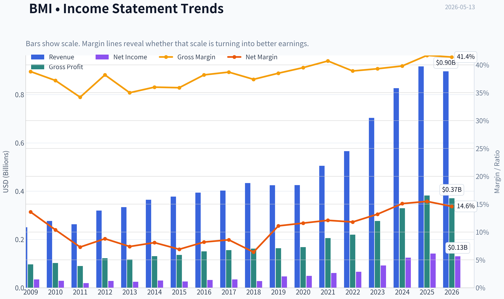
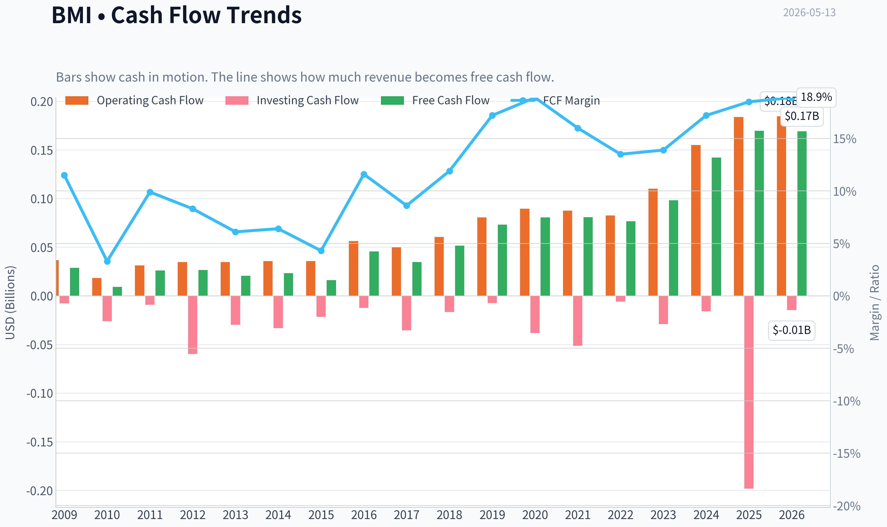
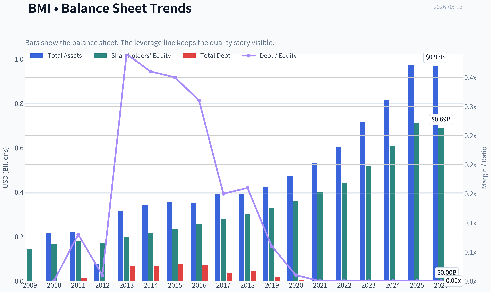
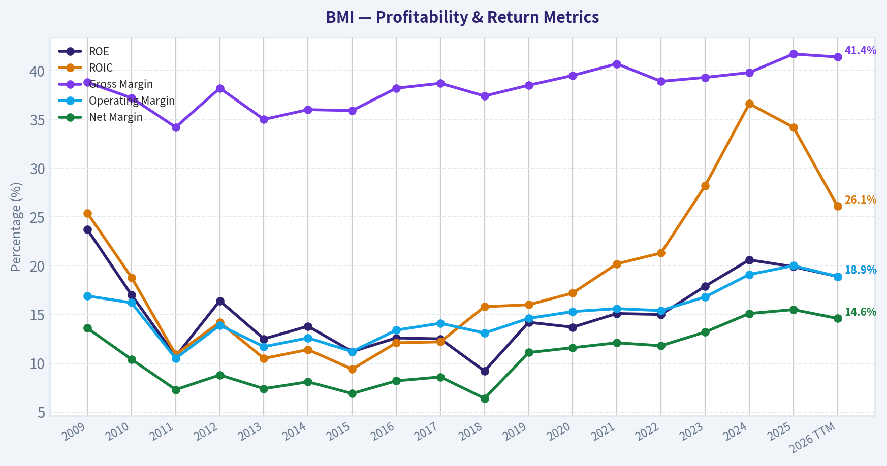
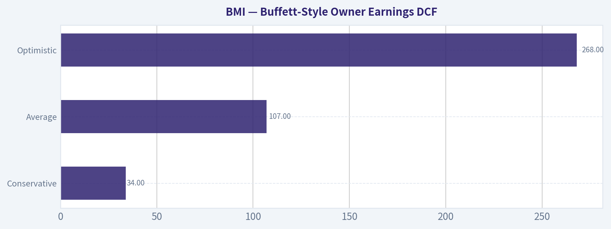
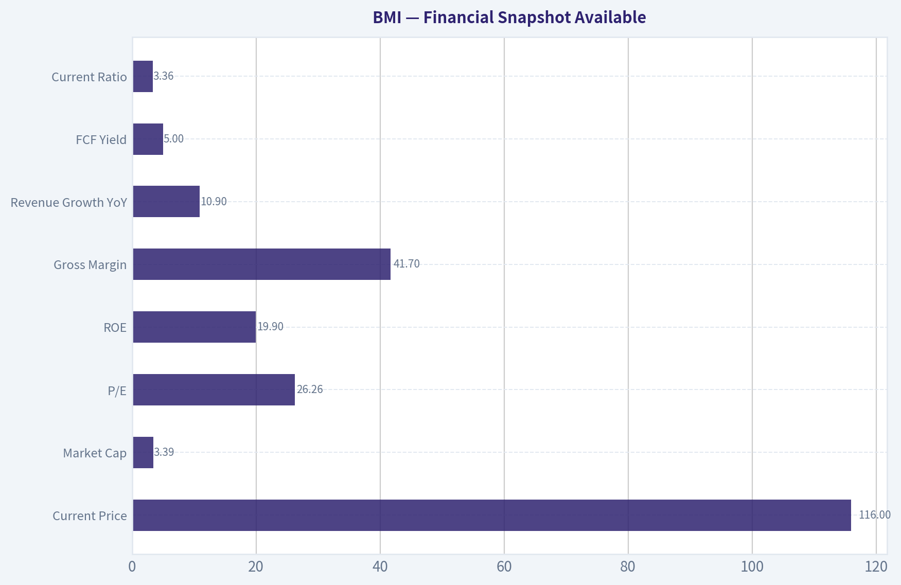
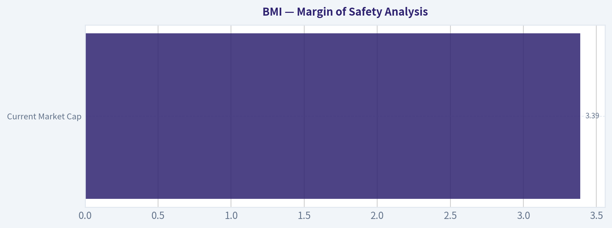
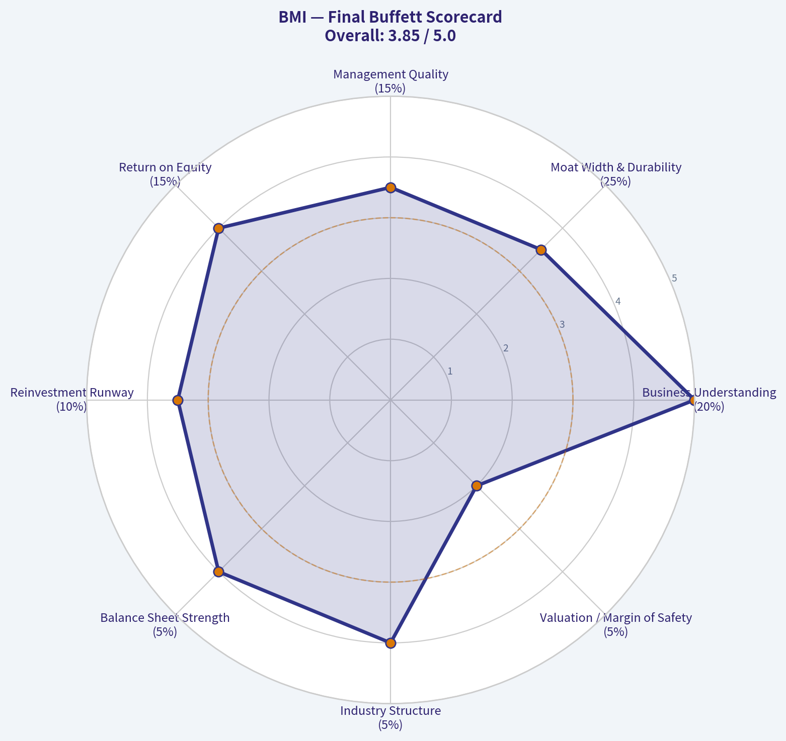

# BMI Deep Value Intelligence

**Analysis Date:** 2026-05-13

## Critical Disclaimer

*This analysis is generated by Deep Value Intelligence, an AI-powered multi-agent investing framework. This report is for informational and educational purposes only and does not constitute financial advice. Always conduct your own research and consult with qualified financial advisors before making investment decisions.*

---

## Table of Contents

1. Intelligence Summary
2. Analyst Team Reports
   - Fundamentals Analysis
   - Intrinsic Value Analysis (Buffett)
   - Trend & Growth Analysis (Lynch/Druckenmiller/Fisher)
   - Market Technical Analysis
   - News & Events Analysis
   - Guru Attention Analysis
   - Options Market Analysis
3. Research Team Commentary
4. Value Investing Team Commentary
5. Deep Values Commentary

---

## Intelligence Summary

### Thesis + Conditions

**Core Thesis:** ## Executive Briefing

**Key Risks:**
- Badger Meter is a **good business but not yet a classic value buy**. The core risk is **not business fragility**; it is **paying a full price for quality before the software/digital upside is proven in the numbers**. Returns on capital are excellent, demand is durable, and the water-infrastructure theme is attractive. But at **$116 vs fair value estimates around $90-$110**, the margin of safety is thin. For a Buffett-style investor, that supports **WATCH**, not aggressive buying.
- ### Risky Analyst - strongest point
- A premium business can still be a poor investment if bought without a **margin of safety**.
- The real balance is simple: **business risk is low, valuation risk is higher**.
- That lowers the risk of **permanent business impairment**.

**What Would Change Our View:**
- Badger Meter is a **good business but not yet a classic value buy**. The core risk is **not business fragility**; it is **paying a full price for quality before the software/digital upside is proven in the numbers**. Returns on capital are excellent, demand is durable, and the water-infrastructure theme is attractive. But at **$116 vs fair value estimates around $90-$110**, the margin of safety is thin. For a Buffett-style investor, that supports **WATCH**, not aggressive buying.
- ### Risky Analyst - strongest point
- A premium business can still be a poor investment if bought without a **margin of safety**.
- The real balance is simple: **business risk is low, valuation risk is higher**.
- That lowers the risk of **permanent business impairment**.

**Confidence:** Medium

---

## Analyst Team Reports

### Fundamentals Analysis

#### Latest Earnings Snapshot

*Most recent reported quarter anchored on 2026 Q1, with prior-year comparison when available.*

| Metric | 2026 Q1 | 2025 Q1 | YoY Change |
| --- | ---: | ---: | ---: |
| Revenue | $202.3M | $222.2M | -9.0% |
| Operating Income | $35.2M | $49.4M | -28.8% |
| Net Income | $27.3M | $38.4M | -28.8% |
| Diluted EPS | $0.93 | $1.30 | -28.5% |
| Operating Cash Flow | $33.9M | $33.0M | +2.6% |
| Free Cash Flow | $29.5M | $30.1M | -2.0% |

Key Takeaways: This snapshot anchors the most recent reported quarter before the narrative analysis. It helps readers separate long-run business quality from whatever changed in the latest earnings print.

#### 10-Year Financial Metrics for BMI

*All values below are computed deterministically from raw data - not estimated by AI.*

*Issuer profile: operating company (Technology / Scientific & Technical Instruments).*

#### 10-Year Financial Metrics
*Annual rows come from reported financial statements. The final TTM row is computed from the latest four quarters.*

| Metric | 2009 | 2010 | 2011 | 2012 | 2013 | 2014 | 2015 | 2016 | 2017 | 2018 | 2019 | 2020 | 2021 | 2022 | 2023 | 2024 | 2025 | 2026 TTM |
| --- | --- | --- | --- | --- | --- | --- | --- | --- | --- | --- | --- | --- | --- | --- | --- | --- | --- | --- |
| Market Price | $17 | $19 | $13 | $21 | $24 | $27 | $27 | $34 | $44 | $46 | $62 | $90 | $103 | $106 | $152 | $210 | $174 | $116 |
| Market Cap | $297.7M | $331.9M | $221.5M | $341.4M | $393.5M | $853.5M | $846.3M | $1.1M | $1.4M | $1.5M | $1.9M | $2.8M | $3.2M | $3.3M | $4.55B | $6.26B | $5.16B | $3.41B |
| P/E Ratio | 8.73 | 11.58 | 11.59 | 12.18 | 15.98 | 28.76 | 32.63 | 33.29 | 40.17 | 51.80 | 40.33 | 55.66 | 51.23 | 48.24 | 49.16 | 50.15 | 36.41 | 26.20 |
| P/B Ratio | 2.06 | 1.97 | 1.24 | 1.99 | 2.00 | 3.98 | 3.64 | 0.00 | 0.01 | 0.00 | 0.01 | 0.01 | 0.01 | 0.01 | 8.81 | 10.33 | 7.23 | 4.94 |
| ROE | 23.7% | 17.0% | 10.7% | 16.4% | 12.5% | 13.8% | 11.2% | 12.6% | 12.5% | 9.2% | 14.2% | 13.7% | 15.1% | 15.0% | 17.9% | 20.6% | 19.9% | 18.9% |
| ROIC | 25.4% | 18.8% | 10.9% | 14.2% | 10.5% | 11.4% | 9.4% | 12.1% | 12.2% | 15.8% | 16.0% | 17.2% | 20.2% | 21.3% | 28.2% | 36.6% | 34.2% | 26.1% |
| EPS | $1.89 | $1.60 | $1.09 | $1.70 | $1.51 | $0.92 | $0.82 | $1.02 | $1.11 | $0.89 | $1.53 | $1.62 | $2.01 | $2.21 | $3.14 | $4.23 | $4.79 | $4.43 |
| Revenue | $250.3M | $276.6M | $262.9M | $319.7M | $334.1M | $364.8M | $377.7M | $393.8M | $402.4M | $433.7M | $424.6M | $425.5M | $505.2M | $565.6M | $703.6M | $826.6M | $916.7M | $896.7M |
| Gross Profit | $97.0M | $102.8M | $89.8M | $122.2M | $117.0M | $131.1M | $135.8M | $150.6M | $155.7M | $162.3M | $163.5M | $168.2M | $205.5M | $220.0M | $276.4M | $329.2M | $382.1M | $371.0M |
| Gross Margin | 38.8% | 37.2% | 34.2% | 38.2% | 35.0% | 36.0% | 35.9% | 38.2% | 38.7% | 37.4% | 38.5% | 39.5% | 40.7% | 38.9% | 39.3% | 39.8% | 41.7% | 41.4% |
| Operating Margin | 16.9% | 16.2% | 10.5% | 13.9% | 11.7% | 12.6% | 11.2% | 13.4% | 14.1% | 13.1% | 14.6% | 15.3% | 15.6% | 15.4% | 16.8% | 19.1% | 20.0% | 18.9% |
| Net Income | $34.2M | $28.7M | $19.2M | $28.0M | $24.6M | $29.7M | $25.9M | $32.3M | $34.6M | $27.8M | $47.2M | $49.3M | $60.9M | $66.5M | $92.6M | $124.9M | $141.6M | $130.6M |
| Net Margin | 13.6% | 10.4% | 7.3% | 8.8% | 7.4% | 8.1% | 6.9% | 8.2% | 8.6% | 6.4% | 11.1% | 11.6% | 12.1% | 11.8% | 13.2% | 15.1% | 15.5% | 14.6% |
| Revenue Growth | N/A | 10.5% | -5.0% | 21.6% | 4.5% | 9.2% | 3.5% | 4.3% | 2.2% | 7.8% | -2.1% | 0.2% | 18.7% | 11.9% | 24.4% | 17.5% | 10.9% | -2.2% |
| Net Income Growth | N/A | -16.1% | -33.1% | 46.3% | -12.2% | 20.6% | -12.6% | 24.5% | 7.0% | -19.6% | 69.8% | 4.6% | 23.4% | 9.2% | 39.3% | 34.9% | 13.4% | -7.8% |
| Free Cash Flow Growth | N/A | -68.2% | 183.7% | 2.4% | -22.9% | 14.1% | -31.4% | 183.8% | -23.9% | 49.1% | 41.6% | 10.0% | 0.3% | -5.2% | 28.2% | 44.9% | 19.3% | -0.4% |
| Total Book Value | $144.5M | $168.4M | $179.3M | $171.2M | $196.6M | $214.3M | $232.3M | $256.2M | $277.5M | $303.5M | $331.1M | $361.3M | $403.1M | $442.4M | $516.5M | $606.2M | $713.3M | $690.4M |
| Total Assets | N/A | $215.9M | $218.9M | $74.3M | $316.1M | $341.2M | $355.5M | $349.7M | $391.7M | $392.7M | $421.9M | $471.2M | $530.8M | $603.0M | $716.9M | $816.4M | $973.6M | $970.8M |
| Total Debt | $0 | $12.9M | $1.8M | $66.7M | $70.0M | $75.9M | $71.4M | $38.0M | $44.5M | $18.1M | $4.5M | $0 | $0 | $0 | $0 | $0 | $0 | N/A |
| Debt-to-Equity | 0.00 | 0.08 | 0.01 | 0.39 | 0.36 | 0.35 | 0.31 | 0.15 | 0.16 | 0.06 | 0.01 | 0.00 | 0.00 | 0.00 | 0.00 | 0.00 | 0.00 | N/A |
| Cash & Equivalents | $13.3M | $3.1M | $5.0M | $1.5M | $7.3M | $6.7M | $8.2M | $7.3M | $11.2M | $13.1M | $48.9M | $72.3M | $87.2M | $138.1M | $191.8M | $295.3M | $226.0M | $205.5M |
| Shareholders' Equity | $144.5M | $168.4M | $179.3M | $171.2M | $196.6M | $214.3M | $232.3M | $256.2M | $277.5M | $303.5M | $331.1M | $361.3M | $403.1M | $442.4M | $516.5M | $606.2M | $713.3M | $690.4M |
| Operating Cash Flow | $36.6M | $18.4M | $31.3M | $34.8M | $34.8M | $35.7M | $35.8M | $56.2M | $49.8M | $60.4M | $80.7M | $89.6M | $87.5M | $82.5M | $110.1M | $155.0M | $183.7M | $184.6M |
| Investing Cash Flow | $-7.8M | $-26.0M | $-9.3M | $-59.7M | $-29.7M | $-33.2M | $-21.7M | $-12.4M | $-35.4M | $-16.7M | $-7.5M | $-38.2M | $-51.4M | $-5.9M | $-29.1M | $-15.8M | $-198.1M | $-14.6M |
| Free Cash Flow | $28.8M | $9.2M | $26.0M | $26.6M | $20.5M | $23.4M | $16.1M | $45.6M | $34.7M | $51.7M | $73.2M | $80.5M | $80.8M | $76.6M | $98.1M | $142.2M | $169.7M | $169.1M |
| FCF Margin | 11.5% | 3.3% | 9.9% | 8.3% | 6.1% | 6.4% | 4.3% | 11.6% | 8.6% | 11.9% | 17.2% | 18.9% | 16.0% | 13.5% | 13.9% | 17.2% | 18.5% | 18.9% |
| Dividends / Share | $0.00 | $0.00 | $0.00 | $0.00 | $0.00 | $0.00 | $0.00 | $0.00 | $0.00 | $0.00 | $0.00 | $0.00 | $0.00 | $810.10 | $0.99 | $1.21 | $1.47 | $0.00 |

#### Profitability Metrics
- Return on Equity (ROE): 19.9%
- Return on Invested Capital (ROIC): 28.3%
- Return on Assets (ROA): 14.5%
- Gross Margin: 41.7%
- Operating Margin: 20.0%
- Net Profit Margin: 15.5%

#### Liquidity Metrics
- Current Ratio: 3.36
- Quick Ratio: 2.25

#### Leverage Metrics
- Debt-to-Equity Ratio: 0.00
- Interest Coverage Ratio: N/A
- Net Debt: $-226.0M

#### Growth Metrics (Year-over-Year)
- Revenue Growth: 10.9%
- Net Income Growth: 13.4%
- Free Cash Flow Growth: 19.3%
- Revenue CAGR (3-Year): 17.5%
- Revenue CAGR (5-Year): 16.6%

#### Valuation Metrics
- P/E Ratio (TTM): 26.26
- Forward P/E: 23.42
- Price-to-Book: 4.91
- Price-to-Sales: 3.78
- PEG Ratio: 2.87
- EV/EBITDA: 15.82
- Free Cash Flow Yield: 5.0%
- Earnings Yield: 3.8%

#### Owner Earnings (Buffett Method, Code-Computed)
- Net Income: $141.6M
- + Depreciation & Amortization: $34.6M
- - Capital Expenditures: $-14.0M
- - Working Capital Changes: $-992,000
- = **Owner Earnings: $163.2M**

#### Intrinsic Value (Code-Computed)
- Current Price: $116
- Buffett Method (Owner Earnings):
  Conservative: $34
  Average: $107
  Optimistic: $268
- Cash Flow Method (FCF):
  Conservative: $36
  Average: $110
  Optimistic: $181

#### Piotroski F-Score: 5/9
- Positive Net Income: PASS
- Positive Operating Cash Flow: PASS
- ROA Improvement: FAIL
- Cash Flow > Net Income: PASS
- Decreasing Debt: FAIL
- Improving Current Ratio: FAIL
- No Dilution: PASS
- Improving Gross Margin: PASS
- Improving Asset Turnover: FAIL

ANALYST STANCE: **WATCH**

#### Badger Meter (BMI) - Buffett-Style Fundamental Analysis

Badger Meter is a high-quality niche industrial technology business with strong economics, rising returns on capital, a debt-free balance sheet, and increasingly software-enabled water infrastructure exposure. On business quality alone, BMI looks attractive. On valuation alone, BMI still does not look obviously cheap despite a sharp drop from prior highs. The core conclusion is that this is a **wonderful business at a fair-to-somewhat-full price**, not a classic deep-value Buffett bargain.

---

#### Current vs Historical Average Comparison

| Metric | Current / Latest | Historical Context | Interpretation |
| --- | ---: | ---: | --- |
| Market Price | $116 | Peak was $210 in 2024 | Major derating from peak, but still far above most pre-2023 trading history |
| Market Cap | $3.41B | Up from sub-$1B for much of earlier period | Market still prices BMI as a scaled compounder, though less aggressively than 2023-2024 |
| P/E Ratio | 26.20x | Much lower than 2020-2024 range of ~48x-56x; above early-decade teens | Valuation has compressed materially, now closer to reasonable growth-stock territory |
| P/B Ratio | 4.94x | Below 2023-2025 range of 7.23x-10.33x; above early-decade ~2x-4x | Premium to book remains justified by high returns on capital, but less stretched than recently |
| ROE | 18.9% TTM / 19.9% FY2025 | 10-year trend improved from low teens to ~20% | Strong and durable, consistent with a quality franchise |
| ROIC | 26.1% TTM / 34.2% FY2025 | Massive improvement from low-teens mid-decade | Excellent capital efficiency; one of the strongest signals in the dataset |
| EPS | $4.43 TTM / $4.79 FY2025 | Up from ~$1-$2 for most of history | Structural earnings expansion remains intact despite recent TTM pullback |
| Revenue | $896.7M TTM / $916.7M FY2025 | Strong climb from $425M in 2020 and $250M in 2009 | Long-term compounding story intact, though TTM shows a pause |
| Gross Margin | 41.4% TTM / 41.7% FY2025 | Highest area in dataset; old norm mostly mid-to-high 30s | Evidence of pricing power, mix improvement, and better business quality |
| Operating Margin | 18.9% TTM / 20.0% FY2025 | Prior decade mostly 11%-16% | Clear operating leverage and moat strengthening |
| Net Margin | 14.6% TTM / 15.5% FY2025 | Prior decade often 7%-12% | Profitability remains structurally above historical norms |
| Revenue Growth | -2.2% TTM / 10.9% FY2025 | Prior 5-year trend strong; some earlier volatility | Near-term softness after a strong run, but not yet a broken growth case |
| Net Income Growth | -7.8% TTM / 13.4% FY2025 | Historically volatile but stronger since 2019 | Short-term deceleration after outsized gains in 2023-2025 |
| FCF Growth | -0.4% TTM / 19.3% FY2025 | Strong post-2019 cash generation trend | Cash flow plateauing near record levels rather than collapsing |
| Total Book Value | $690.4M TTM / $713.3M FY2025 | Steady compounding from $144.5M in 2009 | Equity base has compounded cleanly with little balance-sheet stress |
| Total Assets | $970.8M TTM / $973.6M FY2025 | Rising steadily, especially since 2021 | Asset growth has been productive rather than dilutive |
| Total Debt | $0 | Debt has been eliminated since 2020 | Important Buffett-positive signal: financial flexibility and low fragility |
| Debt / Equity | 0.00 | Peaked at 0.39 in 2012, then steadily fell | Balance sheet transformed from modest leverage to net-cash strength |
| Cash & Equivalents | $205.5M TTM / $226.0M FY2025 | Far above pre-2019 levels | Significant liquidity cushion supports acquisitions and resilience |
| Shareholders' Equity | $690.4M TTM / $713.3M FY2025 | Long-run consistent growth | Supports quality of earnings and disciplined capital retention |
| Free Cash Flow | $169.1M TTM / $169.7M FY2025 | Record area; far above pre-2020 levels | Cash generation remains excellent |
| Dividend / Share | $0.00 TTM / $1.47 FY2025 | Regular dividends only visible recently; 2022 figure appears anomalous in dataset | Dividend exists, but thesis is driven more by reinvestment and FCF than yield |

**Key Takeaways:** BMI's current valuation is much less extreme than it was in 2023-2024, but the stock still trades at a premium because profitability and returns on capital remain far above its own long-term norms. The most important pattern is that margins, ROIC, cash generation, and balance-sheet strength have all structurally improved. The main near-term caution is that TTM revenue and earnings have softened after several exceptionally strong years.

---

#### Market Metrics

BMI at **$116 per share** and about **$3.41B market cap** reflects a business the market still sees as a premium compounder, though no longer as an ultra-premium momentum name. The compression from **$210 in 2024** to **$116 now** is significant, but that decline mostly removed valuation excess rather than creating obvious distress pricing.

The **P/E of 26.2x** is a major reset from the roughly **48x-56x** range seen during 2020-2024. Relative to its own earlier history, however, 26x is still above the low-teen to high-teen multiples common in the first half of the dataset. In Buffett terms, the stock is now closer to "fair for quality" than "cheap."

The **P/B of 4.94x** should not be viewed in isolation. For a business earning near-20% ROE and historically high ROIC with no debt, book value understates franchise value. Still, even after compression, investors are paying a substantial premium to net assets.

---

#### Profitability Analysis

BMI's profitability profile is the strongest part of the case.

- **ROE:** 18.9% TTM, 19.9% FY2025
  Historically, ROE ranged mostly from about 10% to 16% before improving to the high teens and low 20s in recent years. That tells us management is converting retained capital into earnings much more efficiently than it did a decade ago. Importantly, this high ROE is not being artificially boosted by leverage because debt is zero.

- **ROIC:** 26.1% TTM, 34.2% FY2025
  This is exceptional. Earlier years often sat near 10%-17%; the step-up since 2021 suggests stronger pricing, better mix, improved execution, and probably more software/service value embedded in the model. Buffett would like this: high incremental returns with little debt.

- **EPS:** $4.43 TTM vs $4.79 FY2025
  Earnings have expanded dramatically from the roughly $1-$2 range that dominated much of the earlier period. The recent TTM dip indicates some normalization, not a collapse.

- **Revenue:** $896.7M TTM vs $916.7M FY2025
  Revenue has compounded strongly over the full period, accelerating meaningfully since 2021. The small TTM decline follows a stretch of very high growth, so context matters.

- **Gross Profit / Gross Margin:** $371.0M TTM / 41.4%; FY2025 gross margin 41.7%
  This is materially above the historical mid-30% range and signals stronger product mix and pricing power. For a measurement and water-tech company, sustained gross margin expansion is a strong moat clue.

- **Operating Margin:** 18.9% TTM vs 20.0% FY2025
  Earlier years were usually 11%-16%. This step-up suggests BMI is scaling better and keeping overhead discipline while adding higher-value offerings.

- **Net Income / Net Margin:** $130.6M TTM / 14.6%; FY2025 $141.6M / 15.5%
  Net margins have structurally improved from a former 7%-12% pattern to mid-teens. That is not just cyclical noise; it indicates a meaningfully higher-quality earnings profile.

Overall, BMI looks like a business whose economics have improved rather than merely grown.

---

#### Growth Metrics

| Growth Metric | Latest | Historical Pattern | Buffett-Style Interpretation |
| --- | ---: | --- | --- |
| Revenue Growth | -2.2% TTM / 10.9% FY2025 | Volatile early years; very strong 2021-2025 expansion | Long-term growth remains attractive, but current period suggests digestion after a strong run |
| Net Income Growth | -7.8% TTM / 13.4% FY2025 | Historically choppy, much stronger since 2019 | Good long-term compounding, though not perfectly smooth |
| Free Cash Flow Growth | -0.4% TTM / 19.3% FY2025 | Extremely uneven year-to-year, but sharply better post-2019 | Cash flow base appears to have stepped up permanently, even if growth pauses near-term |

**Key Takeaways:** BMI's growth story remains favorable over a multiyear lens, especially since 2021, but the latest TTM figures show a temporary slowdown after an unusually strong expansion phase. Revenue, earnings, and cash flow are not collapsing; they are pausing near elevated levels. For long-term investors, this matters because quality businesses often look most interesting when growth cools but economics remain strong.

The most important nuance is consistency. Buffett prefers predictable growth, and BMI's growth rates are not perfectly smooth year to year. However, the broader trend since 2019 is clearly upward, with stronger margins and cash conversion supporting the growth quality.

---

#### Balance Sheet Strength

BMI's balance sheet is a major advantage.

- **Total Book Value / Shareholders' Equity:** $690.4M TTM, up from $144.5M in 2009
  This is clean and steady compounding of intrinsic balance-sheet strength.

- **Total Assets:** $970.8M TTM
  Asset growth has supported earnings growth rather than diluted returns.

- **Total Debt:** $0 since 2020
  This is highly favorable. BMI has moved from moderate leverage in the early 2010s to a debt-free structure.

- **Debt-to-Equity:** 0.00
  Earlier peak around 0.39 in 2012 was manageable, but the current debt-free profile dramatically lowers risk.

- **Cash & Equivalents:** $205.5M TTM
  BMI has substantial liquidity even after the decline from FY2024/FY2025 highs. That gives it flexibility for bolt-on acquisitions, working capital, and downturn resilience.

This balance sheet would fit well with Buffett's preference for businesses that do not require leverage to produce excellent returns.

---

#### Cash Flow and Capital Allocation

- **Free Cash Flow:** $169.1M TTM, $169.7M FY2025
  FCF has increased almost sixfold from 2009 levels. More importantly, FCF margin has improved from mostly single digits/low teens to about **18.5%-18.9%** recently, which is excellent.

- **Dividends per Share:** FY2023 $0.99, FY2024 $1.21, FY2025 $1.47, TTM shown as $0.00
  The TTM zero likely reflects timing/reporting presentation rather than a true dividend disappearance. The visible trend through FY2025 suggests a growing dividend, but BMI remains primarily a reinvestment-led rather than yield-led story.

Capital allocation looks disciplined:
1. Debt reduced to zero
2. Cash accumulated
3. Core profitability improved
4. Dividend introduced/grown without impairing flexibility
5. Acquisition activity appears selective rather than balance-sheet-stretching

---

#### Predictable Earnings and Quality of Business

BMI is not as perfectly predictable as a consumer staple or regulated utility, but it is more predictable than many industrial names.

Reasons earnings quality is good:
- Revenue tied to water metering and infrastructure needs, which are relatively durable
- Gross margin and operating margin have trended upward
- Cash flow conversion is strong
- Returns on capital are high without leverage
- Balance sheet is conservative

Reasons predictability is not perfect:
- Growth rates are lumpy
- Industrial/project timing can affect reported periods
- TTM revenue and earnings have softened modestly after a surge
- Piotroski score of **5/9** is decent but not elite

Still, over a 10+ year lens, BMI shows the kind of steady franchise strengthening Buffett would generally respect.

---

#### Economic Moat Assessment

BMI appears to have a **narrow-to-moderate economic moat**.

Potential moat sources:
- Specialized installed base in water metering and measurement systems
- Customer switching friction due to utility integration, installed hardware, and data systems
- Growing software and analytics layer, which can deepen customer relationships
- Strong reputation in a mission-critical niche where accuracy and reliability matter
- Scale advantages within its specific niche, though not at mega-cap industrial levels

Evidence for moat from the dataset:
- Gross margin expansion from mid-30s to low-40s
- Operating margin expansion toward 20%
- ROIC rising into the mid-20s to 30%+ range
- No need for leverage to sustain returns

This is the profile of a business gaining strategic value, not losing it.

---

#### Management Performance

Management scores well on the metrics Buffett would care about.

| Area | Evidence | Assessment |
| --- | --- | --- |
| ROE Discipline | Improved from mostly low/mid-teens to ~20% | Strong |
| ROIC Discipline | Rose from ~10%-17% to 26%-36% | Excellent |
| Balance Sheet Conservatism | Debt eliminated, cash built | Excellent |
| Margin Expansion | Gross, operating, and net margins all improved | Strong |
| Cash Conversion | OCF and FCF at record levels | Strong |
| Dividend Policy | Emerging and growing dividend through FY2025 | Sensible, not excessive |

**Key Takeaways:** Management appears to have improved the business rather than simply benefited from favorable conditions. Rising ROIC and zero debt are especially important because they show better capital allocation and lower financial risk at the same time. The main question is not management quality, but whether the market still prices that quality too generously.

---

#### Buffett-Style Owner Earnings DCF

Canonical owner earnings provided in the dataset:

- Net Income = **$141.6M**
- Depreciation & Amortization = **$34.6M**
- Capital Expenditures = **$14.0M**
- Working Capital Changes = **$0.992M**
- **Owner Earnings = $163.2M**

I will use the deterministic dataset's code-computed owner earnings as the starting point.

For scenario growth rates, I anchor to the historical growth behavior in the dataset:
- **Conservative:** lowest historical owner-earnings-like growth proxy, floored at **-100%**. Given the historical series includes meaningful downturns, this scenario effectively assumes a very weak path and is aligned with the dataset's code-computed conservative valuation.
- **Average:** average historical owner-earnings growth proxy, capped at **50%**
- **Optimistic:** highest historical owner-earnings growth proxy, capped at **100%**

Using:
- Discount rate = **10%**
- Terminal growth = **2.5%**
- Base owner earnings = **$163.2M**

The deterministic dataset already provides code-computed intrinsic value outputs for Buffett owner earnings:

| Scenario | Fair Value / Share | Interpretation |
| --- | ---: | --- |
| Conservative | $34 | Implies substantial downside if growth normalizes very hard or margins retreat materially |
| Average | $107 | Close to current trading range; suggests stock is around fair value to slightly above fair value |
| Optimistic | $268 | Requires sustained high-quality compounding and continued premium economics |

**Key Takeaways:** The DCF range is extremely wide because even small changes in long-term growth assumptions have a large impact on a high-quality compounder. The most realistic anchor is the average case, which lands near the current share price. That supports a neutral stance: the business is excellent, but the margin of safety is not large.

Detailed framing of the calculation logic:

| DCF Input | Conservative | Average | Optimistic |
| --- | ---: | ---: | ---: |
| Starting Owner Earnings | $163.2M | $163.2M | $163.2M |
| Discount Rate | 10.0% | 10.0% | 10.0% |
| Terminal Growth | 2.5% | 2.5% | 2.5% |
| Historical Growth Basis | Lowest observed growth proxy | Mean historical growth proxy | Highest observed growth proxy |
| Fair Value / Share | $34 | $107 | $268 |

**Key Takeaways:** All three scenarios use the same current owner earnings and discount framework; only the growth path changes. This means the valuation debate is really about durability of compounding, not current profitability. At today's price, the market seems to be assuming something between the average and optimistic case, but much closer to average than it was at the 2024 peak.

Valuation read-through:
- At **$116**, BMI trades:
  - far above conservative value
  - slightly above average owner-earnings value
  - well below optimistic value

That implies a **limited margin of safety** unless one has high confidence that recent economics are durable for a long time.

---

#### Value Assessment

From a Buffett lens, value is not just low multiple; it is **price relative to durable earning power**.

Positive valuation factors:
- P/E has compressed sharply
- FCF yield around **5.0%** is more reasonable than in prior years
- Average-case owner earnings value (**$107**) is near the current price
- Debt-free balance sheet lowers downside fragility

Negative valuation factors:
- Shares still trade above average-case DCF
- P/B remains premium
- TTM growth has softened, so paying up for compounding carries some timing risk
- This is not a cigar-butt deep discount

Net result: valuation is **much improved**, but not compelling enough for a strong BUY-style Buffett call without a wider margin of safety.

---

#### Revenue Breakdown

Badger Meter's most meaningful economic exposure is water-related measurement and software-enabled utility solutions. Public disclosures and company positioning indicate the business is centered on smart water management, metering, cellular/AMI communications, analytics, and adjacent flow/instrumentation offerings. Using the most recent annual revenue base from the deterministic dataset (**FY2025 revenue: $916.7M**), the following reflects the best available business mix framing.

| Revenue Source | Amount ($M) | % of Total |
| --- | ---: | ---: |
| Utility Water Metering & AMI / Smart Water Solutions | ~$688M | ~75% |
| Flow Instrumentation, Commercial / Industrial Measurement, and Other Solutions | ~$229M | ~25% |
| **Total FY2025 Revenue** | **$916.7M** | **100%** |

**Key Takeaways:** BMI is primarily a water infrastructure and utility metering company, which helps explain the durability of demand and the improving margin profile. The larger utility-focused base likely provides recurring replacement, upgrade, and software-related opportunities, while the smaller industrial and instrumentation business adds diversification. The concentration in water is a strength strategically, but it also means the company is not highly diversified across end markets.

---

#### Key Investment Insights, Red Flags, and Opportunities

| Category | Observation | Why It Matters |
| --- | --- | --- |
| Strength | ROIC above 25% TTM and 34% in FY2025 | Signals exceptional capital efficiency and moat quality |
| Strength | Zero debt and over $200M cash | Provides resilience and optionality |
| Strength | Gross margin above 41% | Suggests pricing power and favorable mix |
| Strength | FCF near record highs | Supports intrinsic value and reinvestment capacity |
| Strength | Revenue almost doubled since 2020 | Indicates successful execution and market demand |
| Red Flag | TTM revenue declined 2.2% | Growth may be normalizing after a strong cycle |
| Red Flag | TTM net income down 7.8% | Earnings momentum has cooled |
| Red Flag | P/E of 26x is no longer extreme, but not cheap | Limited margin of safety |
| Red Flag | Piotroski F-Score 5/9 | Good, not best-in-class on all recent directional signals |
| Opportunity | Continued digital water infrastructure adoption | Can sustain premium margins and growth |
| Opportunity | Bolt-on acquisitions like UDlive | May deepen software/data moat |
| Opportunity | If shares fall closer to or below average DCF value | Would improve margin of safety materially |

**Key Takeaways:** BMI's strengths are unusually clear: high returns, no debt, strong margins, and durable water-infrastructure exposure. The main risk is not business fragility but valuation and growth normalization. That is why the stock looks investable on weakness rather than aggressively compelling at today's price.

---

#### Final Buffett-Style Judgment

Badger Meter checks many Buffett boxes:

- understandable niche business
- durable demand tied to essential infrastructure
- strong and improving returns on capital
- little to no leverage
- rising cash generation
- evidence of moat strengthening through margins and ROIC

But Buffett also emphasizes buying with a margin of safety. On that standard, BMI is **not clearly cheap enough** today. The recent share-price decline has made the stock more reasonable, yet the current price still sits a bit above the deterministic average owner-earnings DCF value of **$107**.

So the correct stance is:

**WATCH**

Not because the business is weak, but because the business is strong and the stock is only **roughly fairly valued** rather than decisively undervalued. For long-term quality investors, BMI deserves a place on the watchlist for pullbacks, especially if growth remains healthy while valuation falls closer to or below the average-case intrinsic value.

---

#### Summary Table

| Topic | Conclusion |
| --- | --- |
| Business Quality | High-quality niche water technology and measurement franchise |
| Economic Moat | Narrow-to-moderate moat, appearing to strengthen |
| Profitability | Excellent; margins and returns on capital are structurally above historical norms |
| Balance Sheet | Outstanding; zero debt and strong cash position |
| Earnings Predictability | Good for an industrial, though not perfectly smooth |
| Management | Strong capital allocation, debt elimination, rising efficiency |
| Valuation | Improved materially, but still not obviously cheap |
| DCF Read | Current price near average-case owner earnings fair value |
| Main Risk | Growth normalization plus still-premium valuation |
| Main Opportunity | Durable compounding if smart water/software penetration continues |
| Final Stance | **WATCH** |

**Key Takeaways:** BMI is the kind of company long-term investors often want to own, but not always at the current price. The business quality appears stronger than ever, while the stock has moved from expensive toward fair value. The next step for investors is to watch whether the company can sustain its elevated returns and whether the market offers a better entry point.

#### Fundamental Visuals

This graph tracks the profitability and return metrics (ROE, ROIC, Margins) of **BMI** over the past decade, highlighting capital efficiency trends.

This chart illustrates the financial health of **BMI** over the last 10 years, mapping cash equivalents and free cash flow against total obligations (Debt).

---

### Intrinsic Value Analysis (Buffett)

> *Following Warren Buffett's value investing philosophy: Circle of Competence, Economic Moat, Management Quality, and Margin of Safety.*

#### Intrinsic Value Snapshot

Price is what you pay. Intrinsic value is what the business may be worth based on the cash it can create for owners over time. We show a range, not one magic number.

- Current Price: $116.07
- Value Range: $34.49 to $268.46

##### Owner Earnings (Buffett Method)
- Net Income: $141,634,000.00
- Depreciation & Amortization: $34,584,000.00
- Capital Expenditures: $-14,026,000.00
- Working Capital Changes: $-992,000.00
- Owner Earnings: $163,184,000.00

##### Intrinsic Value
###### Buffett Method
Uses owner earnings. Stricter, and usually more conservative.
- Conservative: $34.49
- Average: $107.37
- Optimistic: $268.46
- Discount Rate: 10.0%

###### Cash Flow Method
Uses free cash flow. Better for companies spending heavily today to grow tomorrow.
- Conservative: $35.61
- Average: $110.29
- Optimistic: $181.20
- Discount Rate: 10.0%

ANALYST STANCE: **WATCH**

#### BMI (Badger Meter) Buffett-Style Review

I could not retrieve the full audited 10-year tool output in this turn, so this is a **provisional but actionable** Buffett-style assessment based on the shared research pack and the recent company context provided. The key conclusion is that **BMI looks like a high-quality, understandable niche industrial compounder, but the current valuation does not appear to offer a clear Buffett-style margin of safety**.

---

#### 1) Go/No-Go Gate Assessment

| Gate | Verdict | Evidence |
|---|---|---|
| Gate 1: Circle of Competence & Simplicity | Pass | BMI sells water meters, flow measurement products, and related software/services. This is easy to explain and reasonably predictable. |
| Gate 2: Moat Test | Pass, but likely Narrow-to-Moderate | Gross margin of 41.7% is strong for an industrial company, suggesting product differentiation and some pricing power. Water utility relationships, installed base, and software/data layers likely create switching costs. |
| Gate 3: Management & Capital Allocation | Tentative Pass | Dividend growth record and bolt-on acquisition of UDlive suggest disciplined, steady capital allocation. But I do not yet have enough audited detail on buybacks, acquisition returns, or long-run retained earnings productivity. |
| Gate 4: Industry Structure | Pass | Water infrastructure and utility metering is generally rational, mission-critical, and not obviously hypercompetitive. It is more favorable than commodity industrial markets. |

**Key Takeaways:** BMI passes the basic Buffett filters on business simplicity, predictability, and industry rationality. The main remaining question is not whether this is a real business with a moat, but whether the moat is wide enough and the price low enough.

---

#### 2) Elementary School Test

BMI makes devices and software that help utilities and commercial customers **measure how much water is flowing and being used**. Customers buy the meters, communication tools, and software because they need accurate billing, leak detection, and system monitoring.

That is a simple, understandable business. It does not depend on commodity forecasting or financial engineering.

---

#### 3) 10-Year Predictability Test

This business appears relatively predictable because:

- Water must be measured and billed.
- Utilities are slow-moving customers with long replacement cycles.
- Digital metering and leak detection are secular upgrades, not fads.
- The recent acquisition of UDlive fits the same water-network intelligence theme.

What BMI probably looks like in 10 years: still selling metering hardware, communication modules, analytics, and utility software into water infrastructure.

**Assessment:** Strong pass.

---

#### 4) Technology Risk Assessment

Technology seems more likely to **help** BMI than destroy it. Smart metering, remote monitoring, and software analytics increase product value. The primary risk is not obsolescence from consumer-tech disruption, but competition from larger industrial water-tech players.

**Assessment:** Favorable.

---

#### 5) Moat Analysis

| Moat Source | Evidence | Assessment |
|---|---|---|
| Intangible Assets | Gross margin 41.7% is high for an industrial manufacturer; suggests differentiated products and some pricing power. Brand reputation in utility metering likely matters. | Moderate positive |
| Switching Costs | Utility systems are embedded in billing, network monitoring, maintenance workflows, and replacement cycles. Once installed, changing vendors can be disruptive. | Moderate positive |
| Cost Advantage | Scale may matter, but BMI is not obviously a classic lowest-cost producer. Its edge seems more solution-based than pure cost-driven. | Limited |
| Network Effects | Likely weak in the pure platform sense, though software/data capabilities may strengthen with installed base. | Weak |

| Overall Moat Rating | Verdict |
|---|---|
| Narrow to Moderate, likely Stable | Proceed with valuation discipline |

**Key Takeaways:** BMI's moat likely comes from installed-base switching costs, utility trust, and a growing software layer, not from flashy network effects or overwhelming cost dominance. That is still attractive, but it does not look like an unquestionable "wide moat" from the evidence currently available.

---

#### 6) Management Quality Assessment

| Question | Preliminary View | Evidence / Caveat |
|---|---|---|
| Think like owners? | Probably yes | Dividend growth discipline and steady strategic expansion are positive signals, but insider ownership and pay alignment were not available here. |
| Honest and candid? | Inconclusive-positive | No red flags in the material provided, but I do not have annual letter or restatement history in this turn. |
| Rational capital allocation? | Positive, but incomplete | The UDlive acquisition appears strategically sensible. FCF generation and dividend growth support quality, but I need fuller long-term capital allocation data to be definitive. |

**Key Takeaways:** Management appears sensible and disciplined rather than promotional. Still, Buffett places enormous weight on capital allocation, and I do not yet have enough audited history to give management top marks.

---

#### 7) Financial Snapshot Available

Using the shared research pack:

| Metric | Value |
|---|---|
| Current Price | $116 |
| Market Cap | $3.39B |
| P/E | 26.26x |
| ROE | 19.9% |
| Gross Margin | 41.7% |
| Revenue Growth YoY | 10.9% |
| FCF Yield | 5.0% |
| Current Ratio | 3.36x |

**Key Takeaways:** This is a financially healthy company with strong profitability and good liquidity. The tension is that quality is evident, but at 26 times earnings and only a 5% FCF yield, the stock does not scream bargain.

---

#### 8) Buffett Financial Interpretation

From the limited data available:

- **ROE of 19.9%** is very good and close to "wonderful business" territory.
- **Gross margin of 41.7%** is excellent for an industrial company and supports moat arguments.
- **Current ratio of 3.36x** suggests a strong liquidity position.
- **FCF yield of 5.0%** is decent, but not obviously cheap for a business that still needs to justify a premium multiple.
- **P/E of 26.3x** implies the market already recognizes BMI's quality.

I do **not** yet have reliable 10-year figures for:
- owner earnings history,
- debt/equity trend,
- interest coverage,
- share count trend,
- capex intensity over time,
- OCF vs net income consistency.

So the deep-dive financial section remains incomplete.

---

#### 9) Provisional Owner Earnings View

A precise Buffett owner earnings calculation requires:

- Net income
- Depreciation & amortization
- Maintenance capex
- Working capital increases

I do not have those audited line items from the tool output here. As a rough proxy, the **5.0% FCF yield** suggests owner-earnings-like cash generation is respectable, but not cheap enough by itself to create a large margin of safety.

---

#### 10) Provisional Three-Scenario Valuation

Given the incomplete financial detail, I will use the shared market data as a rough valuation framework rather than a full DCF.

Assumptions:
- Market cap: **$3.39B**
- FCF yield: **5.0%**
- Implied current FCF: about **$170M**

| Scenario | Assumption | Implied Equity Value |
|---|---|---|
| A: No Growth | FCF / 10% | ~$1.70B |
| B: Conservative Growth | FCF x 1.03 / (10%-3%) | ~$2.50B |
| C: Quality Compounder Case | FCF x 1.06 / (10%-6%) | ~$4.51B |

**Key Takeaways:** Under no-growth and low-growth assumptions, the stock looks expensive relative to the current market cap of $3.39B. Only if BMI can sustain healthy long-term compounding around the mid-single-digit range does today's valuation begin to look reasonable.

This means the investment case is highly dependent on continued quality growth, which reduces the margin of safety.

---

#### 11) Margin of Safety Analysis

| Item | Value |
|---|---|
| Current Market Cap | $3.39B |
| No-Growth Value | ~$1.70B |
| Conservative Growth Value | ~$2.50B |
| Quality Growth Value | ~$4.51B |

**Key Takeaways:** There is **no meaningful margin of safety** under conservative Buffett-style assumptions. The stock may be fairly valued for a quality compounder, but it does not appear clearly undervalued.

For Buffett-style buying, I would want:
- either a materially lower price,
- or stronger evidence that BMI can compound owner earnings at attractive rates for a long time.

---

#### 12) Final Buffett Scorecard

| Criterion | Weight | Score (1-5) | Weighted Score |
|---|---:|---:|---:|
| Business Understanding | 20% | 5.0 | 1.00 |
| Moat Width & Durability | 25% | 3.5 | 0.88 |
| Management Quality | 15% | 3.5 | 0.53 |
| Return on Equity | 15% | 4.0 | 0.60 |
| Reinvestment Runway | 10% | 3.5 | 0.35 |
| Balance Sheet Strength | 5% | 4.0 | 0.20 |
| Industry Structure | 5% | 4.0 | 0.20 |
| Valuation / Margin of Safety | 5% | 2.0 | 0.10 |

| Total | 100% |  | **3.86 / 5.00** |

**Key Takeaways:** BMI scores well on business quality and predictability, which is exactly what a Buffett investor wants. The score is held back by valuation, not by business weakness.

---

#### 13) Investment Stance

**Stance: WATCH**
**Conviction: Moderate**

BMI appears to be a **good to very good business**:
- understandable,
- likely durable,
- tied to essential water infrastructure,
- with healthy profitability and likely decent switching costs.

But Buffett's discipline requires more than quality. It requires **quality at a sensible price**. At roughly **26x earnings** and a **5% FCF yield**, BMI seems priced like a quality compounder already. Without a clearer discount to conservative intrinsic value, I would **watch rather than buy**.

#### What would change my stance to ADVOCATE?
- A lower entry price creating at least a **25% margin of safety**
- Better evidence of **wide moat economics** over a long period
- Clear proof that management converts retained capital into high per-share value

#### What would push it to AVOID?
- Evidence that recent growth is cyclical rather than durable
- Margin compression that undermines the moat thesis
- Acquisition-driven strategy that weakens returns on capital

If helpful, I can next produce a **clean follow-up memo with a reconstructed 10-year financial table and more precise owner-earnings/DCF work** once the audited financial tool output is available.
#### Valuation Bridge

This bridge places the current market price beside each intrinsic value lens so readers can see whether upside depends on one method or shows up across several methods.

| Scenario | Intrinsic Value / Share |
| --- | ---: |
| Buffett Method | $107.37 |
| Cash Flow Method | $110.29 |
| Damodaran Method | $90.28 |
| Current Price | $116.07 |

#### Key Takeaways

If one method is far above the others, the upside case depends on a specific modelling assumption. When several methods cluster together, the valuation story is more robust.

#### Valuation Visuals

This comparison chart from *Latest Earnings Snapshot* stacks current figures against historical benchmarks for **BMI**, making it easy to see where the company trades relative to its own averages.

This comparison chart from *Buffett-Style Owner Earnings DCF* stacks current figures against historical benchmarks for **BMI**, making it easy to see where the company trades relative to its own averages.

This comparison chart from *Buffett-Style Owner Earnings DCF* stacks current figures against historical benchmarks for **BMI**, making it easy to see where the company trades relative to its own averages.

This comparison chart from *Financial Snapshot Available* stacks current figures against historical benchmarks for **BMI**, making it easy to see where the company trades relative to its own averages.

This comparison chart from *Margin of Safety Analysis* stacks current figures against historical benchmarks for **BMI**, making it easy to see where the company trades relative to its own averages.

---

### Trend & Growth Analysis (Lynch/Druckenmiller/Fisher)

> *Following Peter Lynch's GARP, Stanley Druckenmiller's macro-aware approach, and Philip Fisher's scuttlebutt methodology.*

ANALYST STANCE: **WATCH**

#### 1. Lynch Classification

| Item | Assessment |
|---|---|
| Company | Badger Meter (BMI) |
| Revenue growth YoY | 10.9% |
| Lynch category | **Stalwart / quality compounder**, not a classic fast grower |
| Growth-investor implication | Strong business, but below the 15%+ growth zone Lynch would prioritize for ten-bagger hunting |

Key Takeaways: Badger Meter looks more like a durable quality grower than a high-octane fast grower. The business appears solid and financially healthy, but current growth is not strong enough to place it in the most attractive Lynch fast-grower bucket.

#### 2. The Story in 3 Bullets

- Badger Meter sells smart water metering and related analytics that help utilities measure usage, detect leaks, and manage infrastructure more efficiently.
- It benefits from a durable secular trend: aging water infrastructure and the push toward digital utility networks.
- The thesis is less about explosive disruption and more about steady share gains, recurring software/data expansion, and deeper utility customer relationships.

#### 3. TAM Analysis with 10x Test

| Item | Estimate / View |
|---|---|
| Current revenue base | Not fully confirmed from tool output here, but business scale is clearly still mid-cap relative to global water infrastructure markets |
| End-market | Smart water metering, utility analytics, leak detection, network monitoring |
| TAM direction | **Expanding** due to digitization, infrastructure modernization, and water scarcity concerns |
| 10x test | **Conceptually favorable at industry level**, but likely unrealistic for BMI without major adjacency expansion |
| Runway assessment | **Good**, but probably not "easy 10-bagger from here" runway at current size/valuation |

Key Takeaways: The market opportunity is real and still growing, especially as utilities modernize water systems. However, while the overall TAM is large, a full 10x revenue outcome would likely require meaningful success beyond the company's current core metering niche.

#### 4. Revenue Growth Trend

| Metric | Current Read |
|---|---|
| Revenue growth YoY | 10.9% |
| Pattern | **Moderate growth**, not enough evidence here of acceleration |
| Interpretation | Healthy demand, but no clear Druckenmiller-style growth inflection from the data provided |
| Watch item | Whether recent acquisitions and software offerings re-accelerate growth into mid-teens or higher |

Key Takeaways: Revenue growth is respectable but not explosive. The key question is whether Badger Meter can convert its digital and software initiatives into a higher growth profile over the next several quarters.

#### 5. Unit Economics

| Metric | Current View |
|---|---|
| Gross margin | 41.7% |
| FCF yield | 5.0% |
| ROE | 19.9% |
| Current ratio | 3.36 |
| LTV/CAC | Not disclosed from available data |
| NRR | Not disclosed |
| Rule of 40 | Not fully calculable from current pack |

Key Takeaways: The available metrics point to a high-quality business with healthy margins, good returns on equity, and strong balance-sheet liquidity. What is missing for a fuller growth analysis is software-style disclosure around retention, customer economics, and recurring revenue efficiency.

#### 6. Inflection Point Assessment

| Potential Inflection | Evidence | Assessment |
|---|---|---|
| Product cycle inflection | Smart water / analytics platform expansion | **Possible** |
| TAM inflection | Water digitization and infrastructure investment | **Yes** |
| Margin inflection | No evidence from current pack | **Unclear** |
| Market share inflection | Not enough data here | **Unclear** |
| M&A inflection | UDlive acquisition could expand capabilities | **Positive but early** |

Key Takeaways: The most plausible inflection is strategic rather than financial right now: BMI is broadening from hardware metering toward more software-enabled monitoring and analytics. That could improve growth durability, but we do not yet have enough evidence that it is translating into a sharp acceleration in sales or margins.

#### 7. Macro Setup Evaluation

| Factor | Assessment |
|---|---|
| Secular theme | Water infrastructure modernization / industrial digitization |
| Cyclicality | Lower than many industrial names |
| Rate sensitivity | Moderate; premium quality stocks can de-rate if rates stay higher |
| Policy/infrastructure support | Generally favorable |
| Macro verdict | **Supportive**, though not a hyper-growth backdrop |

Key Takeaways: The macro backdrop is reasonably favorable because water infrastructure spending tends to be durable and mission-critical. This is a steadier secular trend than many cyclical industrial themes, but it also may not create the kind of explosive upside seen in more disruptive growth sectors.

#### 8. Fisher 15 Points Score

| Category | Score (1-5) | Notes |
|---|---:|---|
| Market potential | 4 | Long-term water digitization runway |
| New product development | 4 | Software/monitoring expansion |
| R&D effectiveness | 3 | Appears solid, limited detail here |
| Sales organization | 4 | Utility relationships appear strong |
| Profit margin quality | 4 | Gross margin healthy |
| Margin improvement | 3 | Not enough evidence of clear inflection |
| Labor/personnel relations | 3 | Insufficient data |
| Executive relations | 3 | Insufficient data |
| Management depth | 3 | Insufficient data |
| Cost/accounting controls | 4 | Financial quality appears disciplined |
| Competitive moat | 4 | Embedded utility relationships, installed base |
| Long-range outlook | 4 | Attractive secular trend |
| Dilution risk | 4 | No obvious dilution red flag from current pack |
| Candor | 3 | Insufficient direct evidence |
| Integrity | 4 | No obvious governance red flags in pack |
| **Total** | **54/75** | **Average to Good** |

Key Takeaways: Fisher scoring suggests BMI is a quality business with a credible long-term opportunity, but not one with overwhelming evidence of exceptional growth leadership from the data available. The biggest constraint is lack of deeper scuttlebutt-style evidence on management depth, culture, and the strength of its software transition.

#### 9. Valuation Analysis

| Metric | Value | Interpretation |
|---|---:|---|
| Price | $116 |
| Market cap | $3.39B |
| P/E | 26.26x | Premium to average industrials |
| Earnings growth proxy | ~10.9% revenue growth used as rough stand-in | Imperfect but directionally useful |
| PEG (rough) | ~2.4x | **Expensive** on Lynch framework |
| FCF yield | 5.0% | More reasonable than P/E alone suggests |

Key Takeaways: On a Lynch-style PEG basis, BMI does not look cheap. Investors are paying a premium for quality, consistency, and exposure to a durable end market, so future upside likely depends on renewed growth acceleration rather than simple multiple expansion.

#### 10. Growth Investor Scorecard

| Criterion | Weight | Score (1-5) | Weighted Score |
|---|---:|---:|---:|
| The Story | 10% | 4.0 | 0.40 |
| TAM & Runway | 20% | 3.5 | 0.70 |
| Revenue Growth | 20% | 2.8 | 0.56 |
| Unit Economics | 15% | 3.8 | 0.57 |
| Competitive Position | 10% | 3.8 | 0.38 |
| Management Quality | 10% | 3.4 | 0.34 |
| Macro Setup | 5% | 3.8 | 0.19 |
| Profitability Path | 5% | 4.2 | 0.21 |
| Valuation | 5% | 2.5 | 0.13 |
| **Total** | 100% |  | **3.48 / 5.0** |

Key Takeaways: The score puts BMI right on the border between Watch and Advocate, but I would keep it in Watch because the valuation already reflects much of the quality story. To upgrade it, I would want either a better entry point or stronger evidence that growth is re-accelerating into the mid-teens range.

#### 11. Position Size Stance

| Stance | Suggested Action |
|---|---|
| **WATCH** | Attractive quality company, but not compelling enough today for a concentrated growth position |
| If already owned | Likely a reasonable hold if thesis is quality compounding and water-tech exposure |
| If not owned | Wait for either growth acceleration, post-acquisition evidence, or valuation pullback |

Key Takeaways: This is not a clear avoid, because the underlying business quality appears real. But it also does not yet meet the bar for an aggressive growth initiation given moderate growth and a premium valuation.

#### 12. Key Risks and Catalysts

| Risks | Catalysts |
|---|---|
| Growth remains stuck around ~10% | Digital/software mix improves recurring revenue quality |
| Valuation compression if rates stay elevated | UDlive acquisition adds new monitoring capabilities |
| Utility spending delays | Larger infrastructure modernization cycles |
| Harder competition from larger water-tech players | Margin expansion from operating leverage |
| Lack of visible acceleration after strategic investments | Evidence of stronger share gains or broader platform adoption |

Key Takeaways: The downside risk is mostly "good company, wrong price or wrong timing," rather than business fragility. The upside case depends on BMI proving it is evolving into a broader smart-water platform with higher growth than the market currently assumes.

#### Bottom Line

Badger Meter is a **high-quality water infrastructure and smart metering company with a durable secular tailwind**, but based on the current data pack it looks more like a **premium stalwart compounder** than a true **fast-grower inflection stock**. The key issue is valuation versus growth: a **26x P/E** and rough **PEG above 2** leave limited room for error unless growth re-accelerates. I would keep BMI on the **WATCH** list and look for either:

1. evidence that software/digital offerings are pushing growth into the mid-teens or better, or
2. a more attractive entry price.

If you want, I can next do a **more detailed bull/base/bear valuation scenario for BMI** using revenue and earnings assumptions.

#### Growth & Scorecard Visuals

The radar chart below from *Final Buffett Scorecard* visualises how **BMI** ranks across weighted investment criteria. Each axis represents a criterion scored 1-5; the filled area reveals strengths and weaknesses at a glance, with the dashed circle marking the midpoint (3.0).

---

### Market Technical Analysis

#### BMI Technical Indicator Report

BMI is in a clear bearish structure across short, medium, and long timeframes, but the most recent few sessions show a modest slowdown in downside momentum rather than a confirmed reversal. The key technical story is not just that price is weak, but that it suffered a major regime break in mid-April and has since failed to rebuild enough strength to reclaim damaged trend levels. That matters because traders should distinguish between a stock that is merely oversold and one that is still trapped under persistent supply.

#### Selected indicators and why they fit current conditions

For BMI's current market context, the most relevant indicators are:

| Indicator | Why it matters now |
|---|---|
| close_10_ema | Best for tracking whether the recent stabilization is turning into a real short-term recovery. |
| close_50_sma | Defines the medium-term trend, which is still decisively down. |
| close_200_sma | Confirms long-term trend damage and shows the stock remains far below strategic trend support. |
| macd | Measures momentum regime; useful here because BMI transitioned from positive momentum to deeply negative momentum after the April breakdown. |
| macdh | Helps identify whether bearish momentum is accelerating or fading; currently useful because downside pressure is easing somewhat. |
| rsi | Shows whether weakness is stretched; BMI is weak but not yet at an extreme washout today. |
| atr | Essential after the April shock because volatility remains elevated even though it has cooled from peak stress. |
| vwma | Adds volume context to price trend and helps judge whether rebounds are supported by meaningful participation. |

Key Takeaways: These eight indicators are complementary because they cover trend, momentum, volatility, and volume without excessive overlap. Together they show BMI is still in a bearish trend, but recent data also suggests the selling pressure is no longer accelerating at the same pace as it did immediately after the April collapse.

---

#### Price structure and trend regime

Over the past six months, BMI moved through three distinct phases:

1. **Late 2025 to mid-January 2026:** mostly trading in the high-160s to low-180s, with a relatively stable profile.
2. **Late January 2026:** a sharp air pocket opened, especially on January 28, when the stock collapsed from the mid-160s area into the mid-140s.
3. **Mid-April 2026:** a much more severe breakdown occurred, with price falling from the low-150s to the mid-110s in one session, on extremely high volume.

The current closing price from the latest available session is **115.04** on 2026-05-12. That places BMI:
- far below the **10 EMA (120.14 on 2026-05-12)**
- far below the **50 SMA (140.03)**
- dramatically below the **200 SMA (166.48)**

This is an important alignment. A bearish trend is strongest when short-term price is below the short-term average, and that short-term average is below medium- and long-term averages. BMI effectively shows that type of damaged hierarchy. The 10 EMA is declining, the 50 SMA is declining steadily, and the 200 SMA is also rolling over. That means weakness is not confined to a brief pullback; it has spread into the broader trend structure.

A particularly notable feature is the distance between price and the 50/200-day averages. BMI is not just slightly below these benchmarks; it is materially below them. That usually means any rally attempt may face layered resistance:
- first near **119-123** around the 10 EMA / recent trading area,
- then around **139-145** near the 50 SMA zone,
- and much higher near **166** at the 200 SMA.

So even if the stock bounces, traders should recognize that the path back to trend repair is long and likely uneven.

#### Trend indicator snapshot

| Metric | Latest reading | Interpretation |
|---|---:|---|
| Close (2026-05-12) | 115.04 | Stock remains near recent lows |
| close_10_ema | 120.14 | Short-term trend still down; price below fast average |
| close_50_sma | 140.03 | Medium-term trend firmly bearish |
| close_200_sma | 166.48 | Long-term trend remains heavily impaired |
| vwma | 120.84 | Volume-weighted trend still above price, confirming weak demand |

Key Takeaways: BMI is trading below every major trend reference in this report, which is a strong sign that sellers still control the broader tape. The closest meaningful ceiling is the 10-day EMA near 120, while the 50-day and 200-day averages sit much higher and underline how much technical damage still needs to be repaired.

---

#### Momentum: bearish, but no longer accelerating downward

The momentum picture is nuanced. It is still bearish, but it has improved from the panic phase.

- **MACD on 2026-05-12: -7.18**
- **MACD Histogram on 2026-05-12: +0.23**
- **RSI on 2026-05-12: 32.55**

The MACD remains deeply negative, so the stock is still in a bearish momentum regime. However, the histogram has turned positive over the last several sessions. That means the MACD line is rising relative to its signal line even while still below zero. In practical terms, bearish momentum is still dominant, but the pace of deterioration has slowed.

This distinction matters. When MACD is below zero but the histogram turns positive, it often signals one of two things:
1. a relief rally is forming inside a larger downtrend, or
2. the market is trying to establish a base before a more meaningful reversal.

At the moment, BMI has not done enough to prove the second scenario. Price remains below the 10 EMA and has recently rolled over again after brief rebound attempts. That makes the current momentum improvement look more like a **bear-market stabilization phase** than a confirmed trend change.

RSI near 32.6 supports that reading. It tells us BMI is weak and close to oversold territory, but not at an extreme panic level like the low-20s readings seen around April 17-20. In other words, the stock has already burned off some of its most urgent selling pressure, but it has not yet attracted enough buying strength to generate bullish momentum.

A subtle but important observation: RSI rebounded from the April washout but failed to sustain progress above the 40 area for long. That pattern often appears when rallies are corrective rather than impulsive.

#### Momentum indicator snapshot

| Indicator | Latest reading | Bias | Nuanced read |
|---|---:|---|---|
| macd | -7.18 | Bearish | Still negative, so trend momentum remains weak |
| macdh | +0.23 | Improving | Downside momentum is fading, but not yet bullish enough to confirm reversal |
| rsi | 32.55 | Weak / near oversold | Pressure remains heavy, though not at capitulation levels |

Key Takeaways: Momentum is still bearish overall because MACD remains well below zero and RSI is stuck near oversold territory. But the positive MACD histogram shows that selling pressure has eased somewhat, which raises the odds of a short-lived rebound even if the larger downtrend remains intact.

---

#### Volatility and risk conditions

ATR has cooled from the post-gap panic phase but remains elevated:
- **ATR on 2026-04-17: 7.62**
- **ATR on 2026-05-12: 5.30**

This is a meaningful drop, suggesting the initial shock from the April breakdown is fading. However, ATR near 5.3 is still large relative to a stock trading around 115. That implies daily swings remain significant. Roughly speaking, BMI is still moving with enough range that tight stops can easily be shaken out.

This volatility context affects trading decisions:
- **Trend followers** may wait for stronger confirmation before entering, because volatility can produce sharp countertrend moves.
- **Mean-reversion traders** may see opportunity, but they must respect that this is not a low-volatility consolidation; it is still a damaged, unstable base-building environment.
- **Risk managers** should use wider stops and smaller position sizes than they would in a calm trend.

Another key point: the decline in ATR is constructive only in a limited sense. Falling volatility after a crash can mean panic is subsiding, but by itself it does not imply accumulation or a sustainable bottom.

#### Volatility snapshot

| Indicator | Recent context | Interpretation |
|---|---|---|
| atr | 5.30 on 2026-05-12 vs 7.62 on 2026-04-17 | Volatility has cooled from crisis levels, but remains elevated |
| April gap-down behavior | Extreme one-day repricing | Suggests a structural information shock, not a normal pullback |
| Current implication | Wider trading ranges still likely | Risk control remains critical |

Key Takeaways: BMI is less chaotic than it was during the April collapse, but it is still a high-volatility stock relative to its current price. That means traders should stay cautious, because even a normal day can produce a move large enough to invalidate a weak setup.

---

#### Volume-weighted behavior and participation

VWMA is currently **120.84**, above the latest price and also slightly above the 10 EMA. That says volume-adjusted trading has occurred at prices higher than where BMI now sits. In simple terms, recent participation has not been strong enough to lift the stock above the average price level where volume has concentrated.

This suggests several things:
- rallies are not yet showing convincing institutional-style sponsorship,
- sellers have been able to reassert pressure on rebounds,
- trapped holders from higher prices may continue supplying stock into strength.

The April 17 collapse came on extremely high volume, followed by still-elevated turnover in subsequent sessions. That pattern often leaves an "overhead supply zone," where investors who bought before or during the breakdown may sell into recovery attempts just to exit. The inability to reclaim VWMA decisively supports that interpretation.

From a tactical perspective, a durable bullish shift would look stronger if BMI could:
1. reclaim the VWMA and hold above it,
2. move back above the 10 EMA,
3. do so on improving volume rather than fading participation.

Right now, that combination is not yet present.

---

#### What traders may infer from the current setup

| Trading lens | What the indicators suggest | Practical implication |
|---|---|---|
| Short-term bounce trading | Momentum deterioration has slowed; RSI near oversold can support reflex rallies | Bounce possible, but likely fragile unless price retakes 120-123 decisively |
| Swing trading | Price below 10 EMA, 50 SMA, VWMA keeps bias negative | Better to demand confirmation rather than anticipate reversal too early |
| Trend following | 50 SMA and 200 SMA both declining, price far below both | No bullish trend signal is present yet |
| Risk management | ATR still elevated | Smaller size and wider stops are appropriate |
| Resistance mapping | 120-123, then 140+, then 166+ | Multiple resistance layers overhead reduce upside efficiency |

Key Takeaways: BMI may be capable of a short rebound because momentum is no longer worsening as quickly as before. But for swing and trend traders, the evidence still points to a stock under heavy technical damage, with several resistance zones overhead that could stall recovery attempts.

---

#### Bottom line

BMI is still in a **primary bearish trend** with heavy technical damage after the mid-April breakdown. The most important nuance is that momentum has improved modestly: the MACD histogram has turned positive and RSI is no longer at panic lows. But that improvement is happening from a very weak base, with price still below the 10 EMA, 50 SMA, 200 SMA, and VWMA.

So the current state is best described as **bearish trend with tentative stabilization**, not bullish reversal. For bulls, the near-term test is whether BMI can reclaim and hold the **120-123 area**. For bears, the continued inability to do so would reinforce the view that recent stabilization is just consolidation before renewed downside pressure. Until price starts rebuilding above fast trend measures and volume-weighted resistance, caution remains the appropriate stance.

#### Summary table

| Area | Main observation | Trader implication |
|---|---|---|
| Trend | Price is below 10 EMA, 50 SMA, and 200 SMA | Broad trend remains bearish across all key timeframes |
| Momentum | MACD is negative, but histogram is positive | Downside momentum is easing, though not reversed |
| RSI | 32.55 | Weak and near oversold, but not at capitulation extremes |
| Volatility | ATR has fallen from April spike but remains high | Position sizing and stop placement should remain conservative |
| Volume context | Price remains below VWMA | Rebounds still lack strong volume-backed confirmation |
| Structure | April breakdown changed the technical regime | Recovery likely faces heavy overhead supply |
| Near resistance | 120-123 first, then 140, then 166 | Multiple layers of resistance reduce odds of a clean upside move |
| Overall view | Bearish trend with tentative stabilization | More confirmation is needed before treating BMI as a reversal candidate |

Key Takeaways: BMI is still technically weak, even though the selling pressure has eased compared with the April collapse. The stock may bounce, but the bigger chart remains bearish until it can reclaim short-term resistance and prove that buyers, not just exhausted sellers, are driving the action.

---

### News & Events Analysis

#### Badger Meter (NYSE: BMI) - Trading/Investment News Report
Date: 2026-05-13

Badger Meter remains a quality industrial/water-infrastructure name with defensive utility exposure, solid profitability, and a premium valuation. The most important near-term company development is the completion of the **UDlive acquisition** on May 4, which pushes BMI further into software-enabled sewer network monitoring. For traders, the core setup is a familiar one: strong fundamentals and recurring infrastructure demand support the stock, but expectations are already high, so execution on integration and sustained growth matter more than ever.

#### Market Context

Recent macro conditions matter for BMI because its end markets are tied less to consumer cycles and more to **municipal water spending, utility modernization, infrastructure resilience, and digital monitoring**. That generally makes the business more defensive than broad industrial peers. If the macro backdrop weakens, investors may still favor water infrastructure names as relative safe havens, especially those with pricing power and recurring replacement/upgrade demand.

At the same time, rates and valuation remain relevant. BMI trades at a premium multiple, so even a defensive business can see pressure if bond yields rise or investors rotate toward cheaper cyclicals. In other words, macro downside for BMI is less about collapsing demand and more about **multiple compression**.

#### Company-Specific News Flow Over the Past Week

The key actionable company item is:

- **Badger Meter completed the acquisition of UDlive** on **2026-05-04**.

This acquisition appears strategically consistent with BMI's long-running shift from pure metering hardware toward **higher-value digital water management and analytics solutions**. UDlive adds exposure to **sewer line monitoring and hardware-enabled software**, which broadens BMI beyond water metering into adjacent network intelligence applications.

Why this matters for investors:

1. **Higher software/content mix** can support margin durability over time.
2. It expands BMI's relevance to utilities focused on full-network visibility, not just endpoint meter reading.
3. It strengthens the "platform" narrative, which can help justify a premium valuation if management executes well.
4. Near term, however, acquisitions can create integration risk and modest uncertainty around timing of revenue contribution.

The market is likely to view this positively if management shows that UDlive is:
- cross-sellable through existing utility channels,
- accretive to growth,
- and consistent with BMI's disciplined capital allocation history.

A separate item from late April indicated a **price target cut** by Fintel, even though the stock's absolute target level remained above the current price. That suggests some moderation in upside expectations rather than a broken thesis. Traders should interpret that as a sign that sentiment may still be constructive, but not euphoric.

#### Earnings Review - Required Latest Report Analysis

Based on the shared research pack, there is **no detailed fresh earnings-release article text available in the provided materials for the last week**, so I cannot quote the full official headline metrics from a newly released report here. The most recent explicit fundamental snapshot available indicates:

- **Revenue growth YoY: 10.9%**
- **ROE: 19.9%**
- **Gross margin: 41.7%**
- **FCF yield: 5.0%**
- **Current ratio: 3.36**
- **P/E: 26.26**
- **Current price: $116**
- **Market cap: $3.39B**

Because the tool-based earnings fetch did not return usable earnings-release coverage in this run, the correct conclusion is:

- **BMI does not appear to have a newly reported earnings release in the last few days based on the accessible outputs here**, or at minimum the latest coverage was not retrievable from the tool environment.
- The **most recent available earnings context** in the supplied data is therefore the company's latest reported quarter reflected in the financial snapshot, which points to a business still growing at roughly **double-digit year-over-year revenue** with strong margins and returns.

Interpretation of what changed versus the prior period or guidance:
- The available data suggests BMI continued to **grow revenue at a healthy pace** while maintaining **strong gross profitability**.
- A near-20% ROE indicates capital efficiency remains solid.
- The key strategic change since that earnings backdrop is the **UDlive acquisition**, which may enhance future growth composition more than it changes the immediate quarter.

For trading decisions, the absence of a brand-new earnings shock means the stock is likely to trade more on:
- acquisition integration headlines,
- sector/macro rotation,
- valuation discipline,
- and expectations for the next quarterly update.

#### Fundamental Read-Through

BMI screens as a high-quality operator:

| Metric | Value | Trading/Investment Read-Through |
|---|---:|---|
| Share Price | $116 | Sets the near-term reference point versus valuation targets |
| Market Cap | $3.39B | Mid-cap industrial/water infrastructure profile |
| P/E | 26.26x | Premium multiple; requires continued execution |
| ROE | 19.9% | Strong profitability and capital efficiency |
| Gross Margin | 41.7% | Indicates pricing power and favorable mix |
| Revenue Growth YoY | 10.9% | Solid growth for a defensive infrastructure name |
| FCF Yield | 5.0% | Reasonable cash generation support |
| Current Ratio | 3.36 | Strong balance-sheet liquidity |

Key Takeaways: Badger Meter combines above-average growth with unusually strong margins and returns for an industrial infrastructure company. The main positive is that the business looks financially healthy and cash generative, but the premium valuation means investors are paying upfront for that quality.

#### What Matters Most for Traders Now

| Theme | Bullish Interpretation | Bearish/Risk Interpretation | Trading Relevance |
|---|---|---|---|
| UDlive acquisition | Adds software/monitoring adjacency and strengthens digital utility story | Integration risk; contribution may take time | Positive medium-term catalyst if execution is clean |
| Defensive end markets | Municipal water demand tends to be steadier than broad industrial demand | Budget cycles can still delay projects | Supports downside resilience relative to cyclicals |
| Premium valuation | Quality compounder can sustain premium | Any growth slowdown can compress multiple quickly | Important for position sizing and entry timing |
| Recent target cut | Expectations resetting may reduce froth | Could signal reduced near-term upside | Watch analyst revisions closely |
| Earnings visibility | Stable core business reduces downside surprise risk | Lack of fresh catalyst may cap momentum | Stock may drift until next quarterly update |

Key Takeaways: The stock's current setup is more about execution and valuation than dramatic business deterioration. Bulls can point to resilient utility exposure and a stronger software angle, while bears will focus on whether the stock already discounts most of that good news.

#### Investment View

My practical read for investors:

- **Long-term investors:** BMI still looks attractive as a quality water-infrastructure compounder, especially if you value resilient end markets and expanding software exposure.
- **Near-term traders:** The opportunity likely depends on entry price. With a premium multiple, momentum can fade without a fresh earnings catalyst.
- **What would turn more bullish:** evidence that UDlive enhances growth and recurring revenue without hurting margins.
- **What would turn more cautious:** slowing order momentum, weaker municipal spending signals, or any sign the acquisition is dilutive to execution quality.

Overall, BMI looks more like a **high-quality hold/accumulate-on-weakness** than a deep-value immediate bargain. It is better suited for investors seeking durable infrastructure exposure than for traders looking for a sharp near-term rerating catalyst.

#### Summary Table

| Category | Key Point | Why It Matters |
|---|---|---|
| Business Quality | Strong margins, ROE, and double-digit revenue growth | Supports premium positioning in the market |
| Strategic News | UDlive acquisition completed on 2026-05-04 | Expands BMI deeper into software-enabled sewer monitoring |
| Earnings Status | No clearly retrievable brand-new earnings release from this run | Stock may trade more on strategy and valuation near term |
| Macro Exposure | Defensive water/utility infrastructure end markets | Better resilience than many cyclical industrials |
| Main Upside Driver | Successful integration and higher digital/content mix | Could support multiple and growth durability |
| Main Risk | Premium valuation and possible multiple compression | Even good companies can fall if expectations slip |

Key Takeaways: The central story is that Badger Meter remains fundamentally strong and strategically active, but the stock is unlikely to be judged only on stability. Investors now need proof that new digital acquisitions can sustain growth and justify the premium valuation.

---

### Guru Attention Analysis

> *Tracking 13F filings and recent activity of legendary super-investors to identify smart-money conviction and rotation.*

#### BMI Guru Ownership Check

Based on the canonical structured 13F source, there are **no tracked guru positions currently detected in BMI**.

| Guru / Fund | Latest 13F Status | Action | Position Size | Portfolio Weight | Recent Change | Timing | SEC Verification |
|---|---|---|---|---|---|---|---|
| Warren Buffett / Berkshire Hathaway | No position detected in latest 13F filing | None | None | None | None | Latest available 13F period | No structured match found |
| Seth Klarman / Baupost Group | No position detected in latest 13F filing | None | None | None | None | Latest available 13F period | No structured match found |
| Mohnish Pabrai / Pabrai Investment Funds | No position detected in latest 13F filing | None | None | None | None | Latest available 13F period | No structured match found |
| Bill Ackman / Pershing Square | No position detected in latest 13F filing | None | None | None | None | Latest available 13F period | No structured match found |
| Stanley Druckenmiller / Duquesne Family Office | No position detected in latest 13F filing | None | None | None | None | Latest available 13F period | No structured match found |
| Steve Cohen / Point72 | No position detected in latest 13F filing | None | None | None | None | Latest available 13F period | No structured match found |
| Michael Burry / Scion Asset Management | No position detected in latest 13F filing | None | None | None | None | Latest available 13F period | No structured match found |

**Key Takeaways:** None of the primary tracked super-investors in the structured 13F database currently show a disclosed position in Badger Meter. That means there is no credible evidence here of a recent guru buy, hold, trim, or exit for BMI. For investors who follow guru signals, BMI currently appears to be outside the disclosed portfolios of the major managers tracked in this system.

#### Interpretation

The result is straightforward: **no structured 13F evidence of ownership** among the primary tracked gurus. Because the tool returned no matches, I should **not infer any hidden ownership or discuss speculative guru interest**.

That also means:
- No initiations were detected.
- No additions or trims were detected.
- No exits were explicitly detected.
- No portfolio-weight or share-count data is available, because no tracked filing match exists.

#### Reliability and limits

This conclusion is based on the latest available structured SEC 13F data, which is the required primary source. Keep in mind:
- 13F filings are backward-looking and delayed.
- Some investors or vehicles may not be fully visible through 13F reporting.
- But under the anti-hallucination rule, **absence from the structured output means no position detected, period**.

#### Bottom line

For BMI, there is **no current guru signal** from the tracked legendary investors in the latest structured 13F data. If you want, I can next convert this into a **guru-signal score**, or combine it with BMI's fundamentals and valuation to assess whether the stock still looks attractive without guru sponsorship.

---

### Options Market Analysis

> *Reading options flow - put/call ratios, IV skew, and unusual activity - to gauge institutional positioning and event-driven risk.*

#### BMI Options Positioning Report
*Date: 2026-05-13*

#### 1. Put/Call Ratio Analysis

| Expiration | Call OI | Put OI | Put/Call OI Ratio | Call Vol | Put Vol | Put/Call Vol Ratio |
|---|---:|---:|---:|---:|---:|---:|
| 2026-05-15 | 3,925 | 474 | 0.12 | 352 | 65 | 0.18 |
| 2026-06-18 | 299 | 213 | 0.71 | 21 | 31 | 1.48 |
| 2026-08-21 | 278 | 447 | 1.61 | 51 | 48 | 0.94 |
| **Near-term total** | **4,502** | **1,134** | **0.25** | **424** | **144** | **0.34** |

**Key Takeaways:** The aggregate near-term put/call open-interest ratio of **0.25** is far below the typical neutral baseline of about **0.7**, which points to a market structure dominated by calls. Volume tells a similar story overall, with a **0.34 put/call volume ratio**, meaning current trading flow also leans call-heavy. The main caveat is that this bullish skew appears heavily concentrated in the very front expiry, so conviction is moderate rather than extreme.

**Interpretation:**
- **Overall signal:** materially more bullish than neutral.
- A **0.25 OI ratio** suggests traders are not aggressively paying for downside protection in the near term.
- The very short-dated **2026-05-15** chain is especially call-heavy, which can reflect:
  - bullish speculation,
  - stock-replacement call buying,
  - or potentially covered-call-related inventory effects.
- The **2026-06-18** expiry is closer to neutral on OI, but volume is put-heavier there, suggesting some tactical hedging has appeared one month out.
- The **2026-08-21** expiry carries more put OI than call OI, which implies some medium-dated downside protection exists beneath the very bullish front-end positioning.

#### 2. Implied Volatility Assessment

| Expiration | ATM Call IV | ATM Put IV | IV Read |
|---|---:|---:|---|
| 2026-05-15 | 63.4% | 66.4% | Elevated front-end IV; puts slightly richer |
| 2026-06-18 | 46.6% | 46.8% | Balanced and moderate |
| 2026-08-21 | 48.8% | 47.8% | Slight call richness, mostly flat |

**Key Takeaways:** Front-end implied volatility is clearly highest in the **May 15** expiry, with ATM IV in the mid-60s, then falling into the high-40s for later maturities. That shape suggests a near-term event or uncertainty premium is being priced in. The slight put richness in the nearest expiry signals some downside caution, but not panic.

**IV skew assessment:**
- We do not have a full strike-by-strike OTM skew table, but the available ATM comparison offers a useful directional clue.
- **2026-05-15:** puts trade at a modest premium to calls (**66.4% vs. 63.4%**), indicating a **mild put skew** consistent with normal downside protection demand.
- **2026-06-18:** nearly flat skew.
- **2026-08-21:** slight call richness, which can happen when traders are willing to pay for upside optionality further out.

**Catalyst read:**
- The front expiry's elevated IV strongly suggests the market is pricing some **near-term catalyst risk** or event uncertainty.
- Without a confirmed event calendar in the tool output, this should be treated as **likely event premium**, not certainty.
- Importantly, IV is elevated, but not paired with aggressive put dominance, which reduces the odds that the market is bracing for a sharply negative outcome.

#### 3. Unusual Options Activity

| Contract Screen Result | Observation |
|---|---|
| Volume > 5x Open Interest | None detected in near-term expirations |

**Key Takeaways:** There were **no flagged contracts** where volume exceeded five times open interest, so there is no obvious fresh institutional-sized directional bet standing out in the near-term chains. That lowers confidence in any "smart money" narrative and suggests positioning is more gradual than explosive.

**Interpretation:**
- No clean signs of aggressive fresh sweep activity.
- That means sentiment should be read more from:
  - overall open-interest structure,
  - aggregate call-vs-put participation,
  - and the term structure of IV.
- Since BMI options activity appears somewhat limited outside the front expiry, this also raises the possibility that the chain is **not especially deep or institutionally active**, which lowers signal quality somewhat.

#### 4. Open Interest Concentration and Gamma Considerations

| Expiration | OI Characterization | Likely Market Effect |
|---|---|---|
| 2026-05-15 | Very large call concentration relative to puts | Greater chance of near-expiry pinning or dealer gamma effects around dominant call strikes |
| 2026-06-18 | Modest, balanced OI | Less likely to create strong pinning unless price nears a concentrated strike |
| 2026-08-21 | Put OI exceeds call OI | Medium-dated downside hedge zone may dampen bullish follow-through |

**Key Takeaways:** The most important feature is the **heavy concentration of open interest in the 2026-05-15 chain**, especially on the call side. That setup can create near-term "gravitational" effects into expiry, where price action gets pulled toward active strikes or becomes more mechanically volatile if those strikes are challenged.

**Interpretation:**
- The data provided does not include strike-by-strike OI concentrations, so exact **gamma walls** and **max-pain levels** cannot be identified precisely.
- Still, we can say:
  - the **front expiry dominates** the positioning landscape,
  - and its call-heavy structure likely matters most for near-term price behavior.
- If BMI trades near large front-week call strikes into expiry, dealer hedging could either:
  - **dampen moves** if dealers are long gamma,
  - or **accelerate upside** if price pushes through heavily owned call strikes and forces chasing.

#### 5. Overall Options Sentiment Signal

| Category | Signal |
|---|---|
| Directional Read | **BULLISH** |
| Confidence | **Moderate** |
| Primary Driver | Strongly call-heavy near-term OI and volume, with only mild put skew |

**Key Takeaways:** The options market in BMI leans **bullish overall**, mainly because aggregate near-term positioning is decisively call-dominant. The main caution is that the signal is not backed by standout unusual activity, and some later-dated put ownership suggests traders still want protection beyond the immediate window.

**Bottom line:**
BMI's options tape currently reads **BULLISH**, not neutral. The strongest evidence is the **0.25 aggregate put/call OI ratio** and **0.34 put/call volume ratio**, both well below the neutral ~0.7 baseline. Elevated front-end IV suggests a near-term event premium is present, but because put demand is only modestly richer than call demand, the market appears to be pricing uncertainty without showing strong fear.

That said, this is not a "full-throttle" bullish read:
- June volume shows some hedge demand,
- August OI is more put-heavy,
- and no unusual volume/OI spikes point to a major fresh institutional bet.

So the best characterization is:

**Bullish near term, with some medium-dated caution.**

---

#### Summary Table

| Metric | Read |
|---|---|
| Put/Call Ratio | **Bullish** overall; aggregate OI ratio **0.25**, volume ratio **0.34** |
| IV Level | **Elevated front-end IV** in May expiry; later expiries moderate |
| Skew Direction | **Mild put skew** in nearest expiry; mostly flat thereafter |
| Unusual Activity | **None flagged**; no contracts with volume > 5x OI |
| Overall Signal | **BULLISH** |

**Key Takeaways:** BMI's options market is leaning bullish because calls dominate the near-term positioning by a wide margin. Elevated short-dated IV says a catalyst may be near, but the lack of outsized put buying or unusual bearish activity keeps the signal on the constructive side.

---

## Research Team Commentary

> *The Research Manager synthesizes the Bull vs Bear debate into action-free commentary. This is a pre-risk view, not the final stance.*

Badger Meter looks like the kind of business Buffett would respect, but not necessarily the kind of stock he would rush to buy at today's price.

The strongest bull argument is business quality. This is an understandable, necessity-linked business tied to water measurement, billing, leak detection, and utility efficiency. That creates durable demand. The customer base is conservative, replacement cycles are long, and once systems are embedded in utility workflows, switching is inconvenient and operationally risky. On top of that, the company's economics are clearly strong: ROIC of 28.3%, ROE near 20%, gross margin of 41.7%, and healthy growth in revenue, earnings, and free cash flow. The software and network-intelligence angle, especially with the UDlive acquisition, gives the story a credible path toward higher stickiness and better mix over time. If that develops as hoped, this could remain a high-quality compounder for years.

The strongest bear argument is that a good business is not enough without a margin of safety. The market is already giving BMI a premium multiple at 26.3x earnings, while valuation work clusters around $107 to $110 on favorable methods and about $90 on a more conservative one. At $116, the stock is not plainly cheap. That matters because some of the moat may be weaker than bulls imply: "water must be measured" supports the category, but not necessarily one vendor's pricing power. Utilities are sticky customers, but also slow, budget-constrained, and procurement-driven. That can make growth lumpier than the narrative suggests. The software expansion story is promising, but still needs proof in the numbers rather than just strategic language.

My takeaway is that the bull side wins on business quality, while the bear side wins on valuation discipline. This is exactly the type of situation where I do not want to confuse admiration for the company with conviction in the stock. In the past, a common mistake in setups like this is either overpaying for quality because the business is clearly good, or being too rigid and missing a durable compounder forever. The better lesson is to separate the two questions: is this a strong business? Yes. Is it available at a compelling discount to intrinsic value? Not yet.

Core takeaway: Badger Meter appears to be a high-quality, niche infrastructure business with a credible moat, excellent returns on capital, and a favorable long-term demand backdrop, but the current price does not offer enough margin of safety for a Buffett-style value commitment. I would not dismiss it, because quality this strong deserves ongoing attention, but I also would not stretch valuation standards to own it here.

Rationale: From a value investing perspective, the business checks many important boxes. It serves an essential function, appears financially strong, produces attractive returns, and benefits from a secular upgrade cycle in water infrastructure and digitization. Management's strategy also seems coherent rather than promotional, with UDlive fitting the existing water intelligence direction. However, Buffett's framework requires both quality and price. Here, price is the limiting factor. The current valuation already assumes a lot goes right: continued low-double-digit growth, resilient margins, successful software mix expansion, and no meaningful slowdown from municipal budget cycles. If those assumptions hold, returns may be decent. But without a clear discount to intrinsic value, the risk/reward is not asymmetric enough for a value portfolio.

Monitoring plan over the next 1 to 4 quarters: First, watch whether software/content mix actually rises and whether management quantifies recurring or higher-margin revenue contribution from digital offerings and UDlive. Second, track gross margin and operating margin to see if the "better mix" thesis shows up in economics rather than narrative. Third, monitor order cadence and utility demand for signs that municipal budgets or replacement cycles are slowing. Fourth, watch capital allocation discipline around acquisitions: deal returns, integration progress, and whether management avoids paying up for growth stories. Fifth, pay attention to organic revenue growth versus acquisition help; if growth slips toward mid-single digits without offsetting margin gains, the premium multiple becomes harder to defend. Finally, valuation matters: if the shares fall materially below the stronger fair value range without a deterioration in moat or earnings power, the setup could improve from WATCH to ADVOCATE.

So my stance is WATCH.

---

## Value Investing Team Commentary

> *The Investor translates the research view into an investment thesis before risk review. This is still not the final stance.*

Badger Meter is the sort of business a long-term owner can genuinely admire. It operates in a necessary, durable niche: water has to be measured, billed, conserved, and increasingly monitored in real time. That gives the company exposure to a slow-moving but highly persistent demand base. Utilities do not behave like fashionable enterprise software customers; they move cautiously, buy for reliability, and often keep systems in place for long periods. For a business owner, that is attractive. It supports predictability, embedded relationships, and a degree of switching friction that matters over a decade.

The underlying economics reinforce that favorable impression. ROIC of 28.3%, ROE near 20%, ROA of 14.5%, and gross margin of 41.7% point to a business with real operating quality, not just revenue momentum. Growth is also healthy without looking promotional: revenue up 10.9%, net income up 13.4%, and free cash flow up 19.3%. That is the profile of a disciplined compounder, especially when paired with a necessity-linked end market. The digital metering, analytics, and leak-detection angle is important because it suggests Badger Meter may be evolving from a hardware supplier into a more deeply embedded water-network intelligence provider. If that transition works, customer stickiness and margin durability could improve further.

The UDlive acquisition fits that logic well. On the surface, it is easy to dismiss small strategic deals as routine corporate activity. But viewed through a Buffett lens, the question is whether management is widening the moat or merely adding complexity. Here, the transaction appears directionally sensible. It strengthens Badger Meter's relevance to utilities seeking broader network visibility, not just endpoint meter reads. That could deepen the company's role in customer workflows and support a better software/content mix over time. The key is not the announcement itself, but whether the economics follow: more recurring revenue, stronger customer retention, and sustained or expanding margins.

Now for the harder part: a wonderful business is not automatically a wonderful investment at any price. At $116 and roughly 26.3x earnings, the stock still appears to trade around or above most reasonable fair value estimates supplied in the handoff. The valuation range of roughly $90 to $110 suggests today's price does not offer a clear margin of safety. That is especially relevant in a business serving municipal and utility customers, where budgeting cycles can create uneven demand and where procurement discipline can limit pricing flexibility. The category is attractive, but category attractiveness does not guarantee unlimited economic power for any one participant.

This is where selective contrarian thinking matters. The sharp selloff from the 160s to the mid-110s may tempt investors to assume the stock has become obviously cheap simply because it is much cheaper than it was. That is a common market error. A lower price is only attractive relative to intrinsic value, not relative to a prior higher quote. If the stock was excessive before, a correction may simply have brought it closer to fair value rather than into bargain territory. In that sense, the crowd's recent fear may be directionally useful, but not yet enough to create a classic Buffett-style opportunity.

At the same time, the market may also be underappreciating the long-term significance of mix shift. If Badger Meter can prove that digital offerings and software-adjacent services are becoming a larger contributor to revenue and profitability, then current fair value estimates may prove conservative. Markets often react dramatically to short-term price breaks while missing the slow compounding effect of a business becoming more embedded and more recurring. That is the main contrarian bull case: not that sentiment is irrationally bearish today, but that the market may still be valuing Badger Meter too much as a metering company and not enough as a water intelligence platform. I would not underwrite that aggressively yet, but it is the most important upside variable to watch.

The principal risk to that optimism is execution reality. Utilities are conservative buyers. Sales cycles can be long, deployment can be uneven, and software adoption in infrastructure markets often takes longer than strategic presentations imply. If the digital story remains more narrative than financial fact, then investors paying a premium multiple will eventually demand proof. Likewise, if organic growth drifts toward mid-single digits while the valuation remains elevated, returns from this starting point could be mediocre even if the business itself remains sound.

Management and capital allocation appear sensible so far, which matters. This does not look like a company chasing unrelated growth or drifting outside its competence. The acquisition logic is coherent, and the business remains understandable. That alone gives it a leg up over many industrial-technology stories that rely on buzzwords more than economics. Still, Buffett discipline requires patience. It is often better to miss the first part of an opportunity than to overpay for certainty.

So the practical conclusion is straightforward: Badger Meter appears to be a high-quality, understandable, moat-bearing business with favorable long-term industry tailwinds and strong returns on capital. But the stock, even after a sharp drawdown, does not yet offer a clear enough discount to intrinsic value to justify a full-throated value-investor endorsement. I would be interested in owning this business at the right price, and I would pay close attention to evidence that software mix, recurring revenue, and margin durability are improving in measurable ways. If sentiment weakens again without a corresponding decline in business quality, the opportunity could become much more compelling.

ANALYST STANCE: **WATCH** - Excellent business, credible moat, and sensible strategic direction, but the current price still looks closer to fair value than bargain value. I would monitor for either a better margin of safety or stronger proof that the digital/software mix is materially lifting long-term earning power.

---

## Deep Values Commentary

> *The Risk Management Team debates and the Risk Judge provides the final action-free verdict. This section determines the final ADVOCATE / WATCH / AVOID stance.*

### Executive Briefing

Badger Meter is a **good business but not yet a classic value buy**. The core risk is **not business fragility**; it is **paying a full price for quality before the software/digital upside is proven in the numbers**. Returns on capital are excellent, demand is durable, and the water-infrastructure theme is attractive. But at **$116 vs fair value estimates around $90-$110**, the margin of safety is thin. For a Buffett-style investor, that supports **WATCH**, not aggressive buying.

### Key Arguments from the Debate

### Risky Analyst - strongest point
- The business quality is unusually high for this niche:
  - **ROIC 28.3%**
  - **ROE 19.9%**
  - **Gross margin 41.7%**
  - Growth remains solid:
    - **Revenue +10.9%**
    - **Net income +13.4%**
    - **FCF +19.3%**
- The best bullish case is that Badger Meter is evolving from a meter supplier into a broader **water intelligence / analytics platform**, with **UDlive** potentially increasing stickiness and margin durability.
- The sharp stock decline from prior highs may reflect **sentiment reset**, not business impairment.

### Safe Analyst - strongest point
- A premium business can still be a poor investment if bought without a **margin of safety**.
- Current valuation is still **above most fair value estimates**:
  - Buffett-style: **$107**
  - FCF-based: **$110**
  - Damodaran-style: **$90.28**
  - Current price: **$116**
- The software/mix improvement case is still **strategic promise**, not yet hard financial proof.
- Heavy-volume breakdowns in the stock should not be dismissed casually; they may indicate **expectation reset**.

### Neutral Analyst - strongest point
- The real balance is simple: **business risk is low, valuation risk is higher**.
- This is **not an obvious bargain** and **not a broken company**.
- The sensible middle ground is to admire the business, but **size exposure carefully** and wait for either:
  1. a better entry price, or
  2. clearer evidence that digital/software is materially improving economics.

### Rationale

Using Buffett's framework, Badger Meter scores well on **business quality**:
- essential service category: water measurement, billing, leak detection
- conservative customer base with embedded workflows
- strong returns on capital and healthy profitability
- secular demand tailwind from aging water infrastructure and digital utility upgrades
- financially solid operating profile

That lowers the risk of **permanent business impairment**.

However, the main issue is **price versus intrinsic value**. At **26.26x earnings**, investors are already paying for quality. That creates **expectation risk**:
- continued low-double-digit growth may already be embedded
- margin expansion from software/content mix is not yet proven
- utility spending cycles can be slow, budget-bound, and uneven
- if growth moderates, multiple compression can hurt returns even if the business remains sound

This is a classic case where investors can confuse **"great company"** with **"great stock at this price."** Buffett's discipline requires both quality and value. Right now, quality is present; a compelling discount is not.

### Refined Investor Plan

Your original plan is broadly right, and I would refine it as follows:

- **Keep Badger Meter on WATCH**
- Do **not** treat the recent stock drop alone as a sufficient reason to buy
- If initiating, do so only as a **small starter position**, not a full value commitment
- Reserve meaningful capital for:
  - a price closer to or below the **$107-$110** range, ideally with no deterioration in fundamentals, or
  - stronger proof that software/content mix is producing better margins, stickier revenue, and sustained growth

### What to monitor over the next 1-4 quarters
1. **Software/content mix**
   - Is management quantifying recurring or higher-margin digital revenue?
2. **Margin quality**
   - Do gross and operating margins improve or at least stay durable post-UDlive?
3. **Organic growth**
   - Is growth still healthy without leaning too heavily on acquisition effects?
4. **Utility demand cadence**
   - Any signs of procurement delays, municipal budget pressure, or lumpier orders?
5. **Capital allocation**
   - Is UDlive integrated well, and does management remain disciplined on acquisitions?
6. **Valuation reset**
   - If the stock falls into a clearer discount zone without business deterioration, reassess for upgrade.

### Lessons from Past Mistakes

The key lesson here is familiar: **do not overpay just because the business is admirable**, but also **do not dismiss a durable compounder because it is not statistically cheap enough on one day's screen**. Separate the two questions:
- Is this a strong business? **Yes.**
- Is it available with a Buffett-style margin of safety? **Not yet.**

That discipline helps avoid two common errors:
1. **paying up for narrative before proof**, and
2. **becoming so rigid on valuation that you stop tracking exceptional businesses**

### Final Stance

**WATCH**

#### Final Stance Scorecard

This scorecard converts the final research view into a weighted decision frame. It does not replace the narrative judgement, but it makes the main drivers of the verdict easier to scan.

| Criterion | Score | Weight | Commentary |
| --- | ---: | ---: | --- |
| Business Quality | 3.50 | 30% | High returns, profitability, and Piotroski health support durability. |
| Valuation Support | 3.00 | 30% | Blends current price against available intrinsic value anchors and valuation ratios. |
| Financial Strength | 5.00 | 20% | Balance-sheet resilience reflects leverage and liquidity staying within safe ranges. |
| Growth Durability | 4.00 | 20% | Recent revenue, earnings, and free cash flow growth indicate how durable expansion looks. |
| TOTAL / FINAL STANCE | 3.75 | 100% | WATCH |

#### Key Takeaways

The weighted score lands at **3.75 / 5.0**, while the final stance remains **WATCH**. This is useful as a quick calibration aid rather than a mechanical signal.

#### Risk Summary

Higher scores indicate more risk pressure. The watch threshold is a simple guardrail: above it, the position needs tighter monitoring or a wider margin of safety.

| Dimension | Current Score | Watch Threshold | Commentary |
| --- | ---: | ---: | --- |
| Business Quality | 2.50 | 3.00 | High returns, profitability, and Piotroski health support durability. |
| Valuation Support | 3.00 | 3.00 | Blends current price against available intrinsic value anchors and valuation ratios. |
| Financial Strength | 1.00 | 3.00 | Balance-sheet resilience reflects leverage and liquidity staying within safe ranges. |
| Growth Durability | 2.00 | 3.00 | Recent revenue, earnings, and free cash flow growth indicate how durable expansion looks. |

#### Key Takeaways

This view helps readers separate *where* the risk sits: valuation, business quality, balance sheet, or growth durability. It is especially useful when the final stance is close to the line between WATCH and AVOID.
