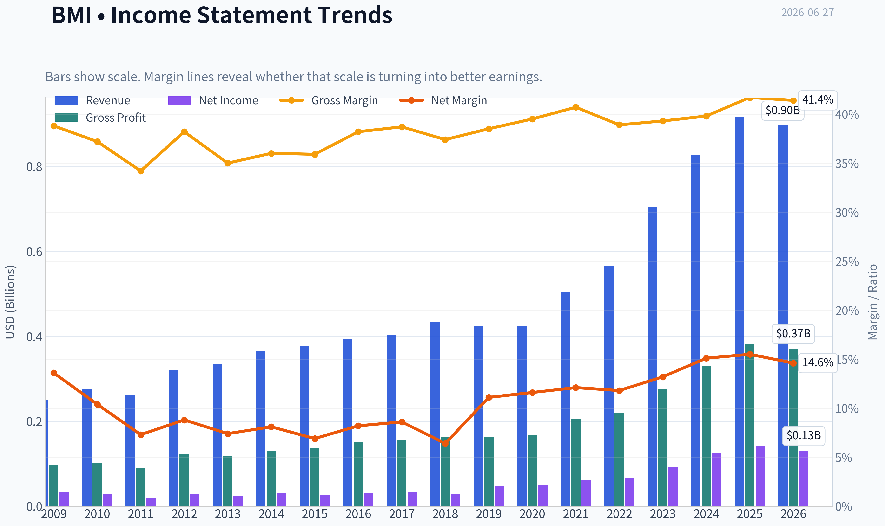
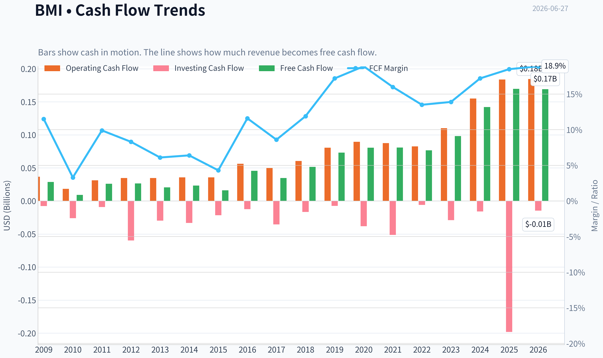
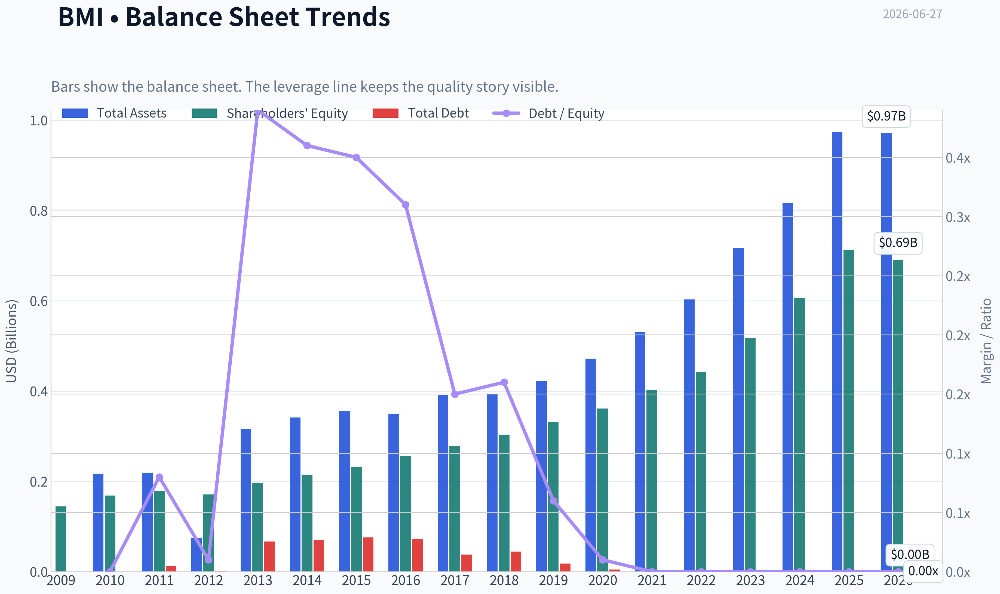
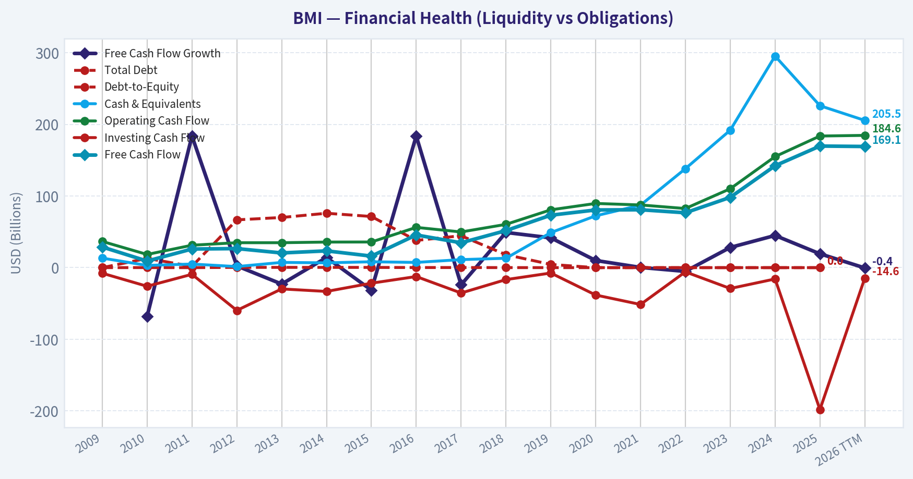
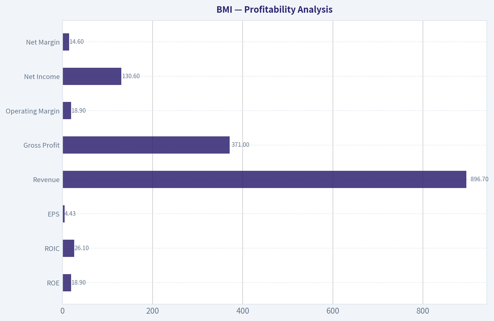
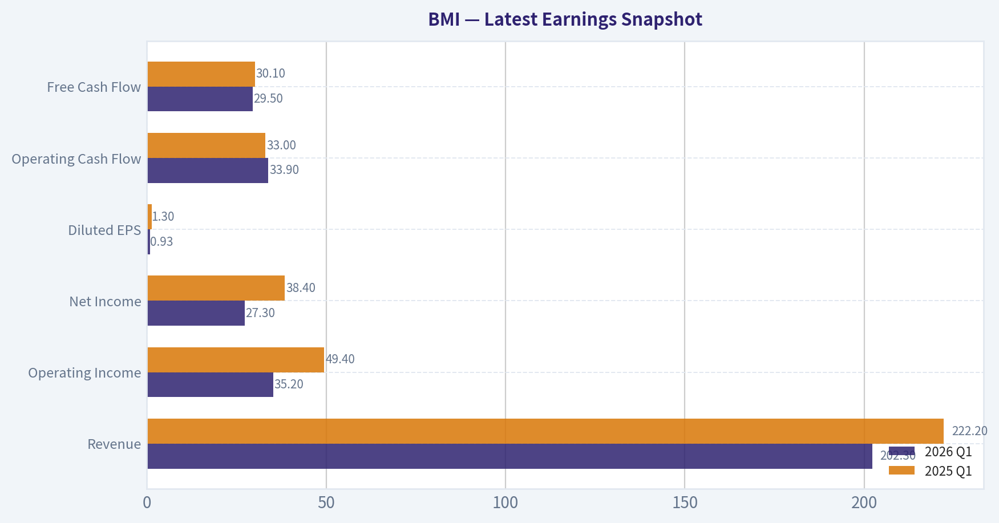
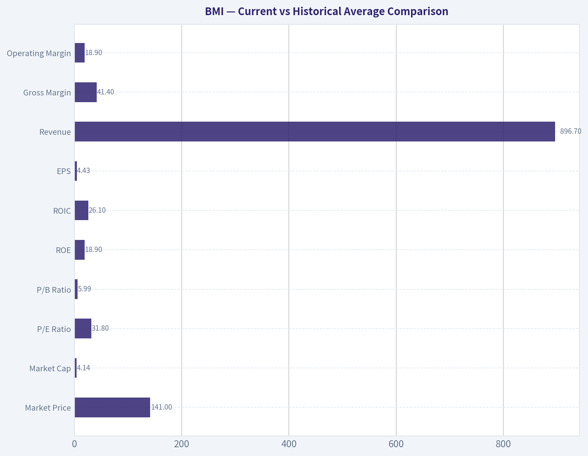
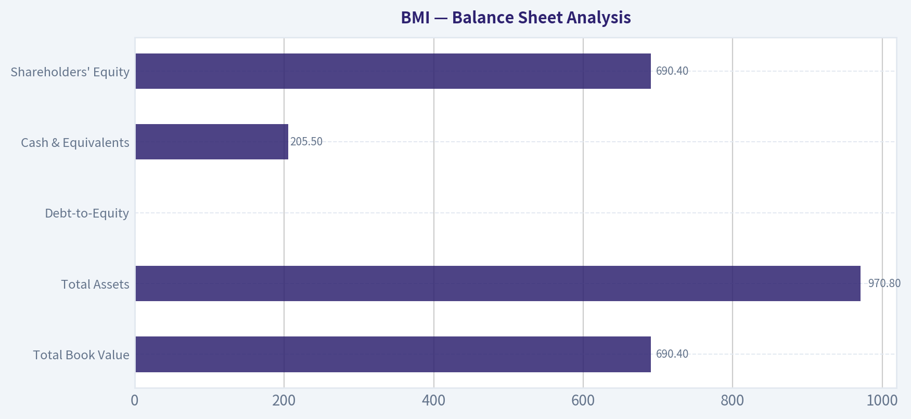
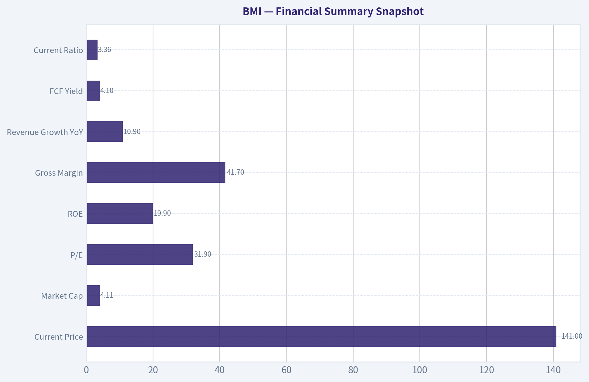
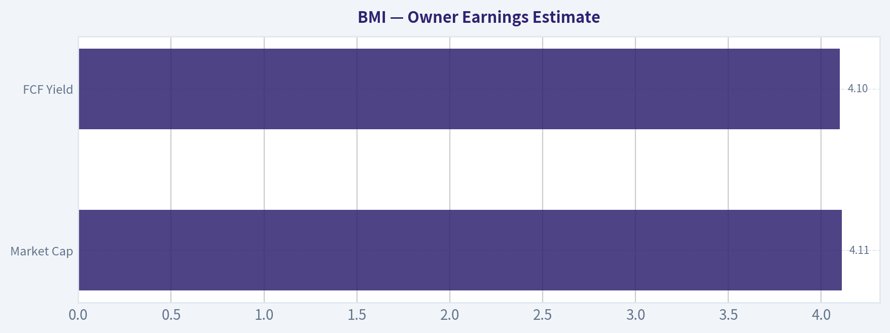

# BMI Deep Value Intelligence

**Analysis Date:** 2026-06-27

## Critical Disclaimer

*This analysis is generated by Deep Value Intelligence, an AI-powered multi-agent investing framework. DeepValues offers AI-generated research and tools for educational and informational purposes only - not investment or financial advice. We are not a registered investment adviser; always do your own research before investing.*

---

## Table of Contents

1. Intelligence Summary
2. Analyst Team Reports
   - Fundamentals Analysis
   - Intrinsic Value Analysis (Buffett)
   - Trend & Growth Analysis (Lynch/Druckenmiller/Fisher)
   - Market Technical Analysis
   - Options Market Analysis
3. Research Team Commentary
4. Value Investing Team Commentary
5. Deep Values Commentary

---

## Intelligence Summary

### Thesis + Conditions

**Core Thesis:** ## Executive Briefing

**Key Risks:**
- Badger Meter looks like a **high-quality, understandable niche compounder**, but not a clear Buffett-style buy at **~31.9x earnings** and only about a **4.1% owner-earnings yield**. The business risk appears low: strong returns on capital, clean balance sheet, mission-critical products, and durable municipal relationships. The key risk is **not franchise breakage**, but **overpaying for quality before software/smart-water upside is fully proven**. Best course: **keep it active on the buy list, consider only a starter on weakness or after confirming growth/mix progress, and avoid chasing.**
- ## Risk Commentary for the Long-Term Investor
- 1. **Do not treat WATCH as passive indecision.**

**Confidence:** Medium

---

## Analyst Team Reports

### Fundamentals Analysis

#### Latest Earnings Snapshot

*Most recent reported quarter anchored on 2026 Q1, with prior-year comparison when available.*

| Metric | 2026 Q1 | 2025 Q1 | YoY Change |
| --- | ---: | ---: | ---: |
| Revenue | $202.3M | $222.2M | -9.0% |
| Operating Income | $35.2M | $49.4M | -28.8% |
| Net Income | $27.3M | $38.4M | -28.8% |
| Diluted EPS | $0.93 | $1.30 | -28.5% |
| Operating Cash Flow | $33.9M | $33.0M | +2.6% |
| Free Cash Flow | $29.5M | $30.1M | -2.0% |

Key Takeaways: This snapshot anchors the most recent reported quarter before the narrative analysis. It helps readers separate long-run business quality from whatever changed in the latest earnings print.

#### 17-Year Financial Metrics for BMI

*All values below are computed deterministically from raw data - not estimated by AI.*

*Issuer profile: operating company (Technology / Scientific & Technical Instruments).*

#### 17-Year Financial Metrics
*Annual rows come from reported financial statements. The final TTM row is computed from the latest four quarters.*

| Metric | 2009 | 2010 | 2011 | 2012 | 2013 | 2014 | 2015 | 2016 | 2017 | 2018 | 2019 | 2020 | 2021 | 2022 | 2023 | 2024 | 2025 | 2026 TTM |
| --- | --- | --- | --- | --- | --- | --- | --- | --- | --- | --- | --- | --- | --- | --- | --- | --- | --- | --- |
| Market Price | $16 | $19 | $13 | $21 | $24 | $27 | $27 | $34 | $44 | $46 | $62 | $90 | $103 | $106 | $151 | $209 | $173 | $141 |
| Market Cap | $297.7M | $331.9M | $221.5M | $341.4M | $393.5M | $853.5M | $846.3M | $1.1M | $1.4M | $1.5M | $1.9M | $2.8M | $3.2M | $3.3M | $4.55B | $6.26B | $5.16B | $4.14B |
| P/E Ratio | 8.73 | 11.58 | 11.59 | 12.18 | 15.98 | 28.76 | 32.63 | 33.29 | 40.17 | 51.80 | 40.33 | 55.66 | 51.23 | 48.24 | 49.16 | 50.15 | 36.41 | 31.80 |
| P/B Ratio | 2.06 | 1.97 | 1.24 | 1.99 | 2.00 | 3.98 | 3.64 | 0.00 | 0.01 | 0.00 | 0.01 | 0.01 | 0.01 | 0.01 | 8.81 | 10.33 | 7.23 | 5.99 |
| ROE | 23.7% | 17.0% | 10.7% | 16.4% | 12.5% | 13.8% | 11.2% | 12.6% | 12.5% | 9.2% | 14.2% | 13.7% | 15.1% | 15.0% | 17.9% | 20.6% | 19.9% | 18.9% |
| ROIC | 25.4% | 18.8% | 10.9% | 14.2% | 10.5% | 11.4% | 9.4% | 12.1% | 12.2% | 15.8% | 16.0% | 17.2% | 20.2% | 21.3% | 28.2% | 36.6% | 34.2% | 26.1% |
| EPS | $1.88 | $1.60 | $1.08 | $1.69 | $1.50 | $0.92 | $0.81 | $1.02 | $1.10 | $0.89 | $1.53 | $1.62 | $2.01 | $2.20 | $3.08 | $4.23 | $4.79 | $4.43 |
| Revenue | $250.3M | $276.6M | $262.9M | $319.7M | $334.1M | $364.8M | $377.7M | $393.8M | $402.4M | $433.7M | $424.6M | $425.5M | $505.2M | $565.6M | $703.6M | $826.6M | $916.7M | $896.7M |
| Gross Profit | $97.0M | $102.8M | $89.8M | $122.2M | $117.0M | $131.1M | $135.8M | $150.6M | $155.7M | $162.3M | $163.5M | $168.2M | $205.5M | $220.0M | $276.4M | $329.2M | $382.1M | $371.0M |
| Gross Margin | 38.8% | 37.2% | 34.2% | 38.2% | 35.0% | 36.0% | 35.9% | 38.2% | 38.7% | 37.4% | 38.5% | 39.5% | 40.7% | 38.9% | 39.3% | 39.8% | 41.7% | 41.4% |
| Operating Margin | 16.9% | 16.2% | 10.5% | 13.9% | 11.7% | 12.6% | 11.2% | 13.4% | 14.1% | 13.1% | 14.6% | 15.3% | 15.6% | 15.4% | 16.8% | 19.1% | 20.0% | 18.9% |
| Net Income | $34.2M | $28.7M | $19.2M | $28.0M | $24.6M | $29.7M | $25.9M | $32.3M | $34.6M | $27.8M | $47.2M | $49.3M | $60.9M | $66.5M | $92.6M | $124.9M | $141.6M | $130.6M |
| Net Margin | 13.6% | 10.4% | 7.3% | 8.8% | 7.4% | 8.1% | 6.9% | 8.2% | 8.6% | 6.4% | 11.1% | 11.6% | 12.1% | 11.8% | 13.2% | 15.1% | 15.5% | 14.6% |
| Revenue Growth | N/A | 10.5% | -5.0% | 21.6% | 4.5% | 9.2% | 3.5% | 4.3% | 2.2% | 7.8% | -2.1% | 0.2% | 18.7% | 11.9% | 24.4% | 17.5% | 10.9% | -2.2% |
| Net Income Growth | N/A | -16.1% | -33.1% | 46.3% | -12.2% | 20.6% | -12.6% | 24.5% | 7.0% | -19.6% | 69.8% | 4.6% | 23.4% | 9.2% | 39.3% | 34.9% | 13.4% | -7.8% |
| Free Cash Flow Growth | N/A | -68.2% | 183.7% | 2.4% | -22.9% | 14.1% | -31.4% | 183.8% | -23.9% | 49.1% | 41.6% | 10.0% | 0.3% | -5.2% | 28.2% | 44.9% | 19.3% | -0.4% |
| Total Book Value | $144.5M | $168.4M | $179.3M | $171.2M | $196.6M | $214.3M | $232.3M | $256.2M | $277.5M | $303.5M | $331.1M | $361.3M | $403.1M | $442.4M | $516.5M | $606.2M | $713.3M | $690.4M |
| Total Assets | N/A | $215.9M | $218.9M | $74.3M | $316.1M | $341.2M | $355.5M | $349.7M | $391.7M | $392.7M | $421.9M | $471.2M | $530.8M | $603.0M | $716.9M | $816.4M | $973.6M | $970.8M |
| Total Debt | $0 | $12.9M | $1.8M | $66.7M | $70.0M | $75.9M | $71.4M | $38.0M | $44.5M | $18.1M | $4.5M | $0 | $0 | $0 | $0 | $0 | $0 | N/A |
| Debt-to-Equity | 0.00 | 0.08 | 0.01 | 0.39 | 0.36 | 0.35 | 0.31 | 0.15 | 0.16 | 0.06 | 0.01 | 0.00 | 0.00 | 0.00 | 0.00 | 0.00 | 0.00 | N/A |
| Cash & Equivalents | $13.3M | $3.1M | $5.0M | $1.5M | $7.3M | $6.7M | $8.2M | $7.3M | $11.2M | $13.1M | $48.9M | $72.3M | $87.2M | $138.1M | $191.8M | $295.3M | $226.0M | $205.5M |
| Shareholders' Equity | $144.5M | $168.4M | $179.3M | $171.2M | $196.6M | $214.3M | $232.3M | $256.2M | $277.5M | $303.5M | $331.1M | $361.3M | $403.1M | $442.4M | $516.5M | $606.2M | $713.3M | $690.4M |
| Operating Cash Flow | $36.6M | $18.4M | $31.3M | $34.8M | $34.8M | $35.7M | $35.8M | $56.2M | $49.8M | $60.4M | $80.7M | $89.6M | $87.5M | $82.5M | $110.1M | $155.0M | $183.7M | $184.6M |
| Investing Cash Flow | $-7.8M | $-26.0M | $-9.3M | $-59.7M | $-29.7M | $-33.2M | $-21.7M | $-12.4M | $-35.4M | $-16.7M | $-7.5M | $-38.2M | $-51.4M | $-5.9M | $-29.1M | $-15.8M | $-198.1M | $-14.6M |
| Free Cash Flow | $28.8M | $9.2M | $26.0M | $26.6M | $20.5M | $23.4M | $16.1M | $45.6M | $34.7M | $51.7M | $73.2M | $80.5M | $80.8M | $76.6M | $98.1M | $142.2M | $169.7M | $169.1M |
| FCF Margin | 11.5% | 3.3% | 9.9% | 8.3% | 6.1% | 6.4% | 4.3% | 11.6% | 8.6% | 11.9% | 17.2% | 18.9% | 16.0% | 13.5% | 13.9% | 17.2% | 18.5% | 18.9% |
| Dividends / Share | $0.00 | $0.00 | $0.00 | $0.00 | $0.00 | $0.00 | $0.00 | $0.00 | $0.00 | $0.00 | $0.00 | $0.00 | $0.00 | $807.40 | $0.97 | $1.21 | $1.47 | $0.00 |

#### Profitability Metrics
- Return on Equity (ROE): 19.9%
- Return on Invested Capital (ROIC): 28.3%
- Return on Assets (ROA): 14.5%
- Gross Margin: 41.7%
- Operating Margin: 20.0%
- Net Profit Margin: 15.5%

#### Liquidity Metrics
- Current Ratio: 3.36
- Quick Ratio: 2.25

#### Leverage Metrics
- Debt-to-Equity Ratio: 0.00
- Interest Coverage Ratio: N/A
- Net Debt: $-226.0M

#### Growth Metrics (Year-over-Year)
- Revenue Growth: 10.9%
- Net Income Growth: 13.4%
- Free Cash Flow Growth: 19.3%
- Revenue CAGR (3-Year): 17.5%
- Revenue CAGR (5-Year): 16.6%

#### Valuation Metrics
- P/E Ratio (TTM): 31.87
- Forward P/E: 26.99
- Price-to-Book: 5.96
- Price-to-Sales: 4.59
- PEG Ratio: 3.34
- EV/EBITDA: 19.42
- Free Cash Flow Yield: 4.1%
- Earnings Yield: 3.1%

#### Owner Earnings (Buffett Method, Code-Computed)
- Net Income: $141.6M
- + Depreciation & Amortization: $34.6M
- - Capital Expenditures: $-14.0M
- - Working Capital Changes: $-992,000
- = **Owner Earnings: $163.2M**

#### Intrinsic Value (Code-Computed)
- Current Price: $141
- Buffett Method (Owner Earnings):
  Conservative: $34
  Average: $107
  Optimistic: $268
- Cash Flow Method (FCF):
  Conservative: $36
  Average: $110
  Optimistic: $181

#### Piotroski F-Score: 5/9
- Positive Net Income: PASS
- Positive Operating Cash Flow: PASS
- ROA Improvement: FAIL
- Cash Flow > Net Income: PASS
- Decreasing Debt: FAIL
- Improving Current Ratio: FAIL
- No Dilution: PASS
- Improving Gross Margin: PASS
- Improving Asset Turnover: FAIL

ANALYST STANCE: **WATCH**

#### Badger Meter (NYSE: BMI) - Warren Buffett-Style Fundamental Analysis

Badger Meter is a high-quality industrial instrumentation business with many of the traits Buffett likes: strong returns on capital, no debt, rising cash generation, and improving margins. The core issue is not business quality but valuation. Even after the pullback to about **$141**, the stock still trades at a premium to a long history of already-premium multiples, while recent legal scrutiny and a slight TTM slowdown reduce the margin of safety.

---

#### Current vs Historical Average Comparison

| Metric | Current / Latest | 10-Year Historical Average* | Interpretation |
| --- | ---: | ---: | --- |
| Market Price | **$141** | **~$112** | Below 2024 peak, but still far above pre-2023 levels. |
| Market Cap | **$4.14B** | **~$3.01B** | Reflects major rerating as earnings quality improved. |
| P/E Ratio | **31.8x** | **~45.7x** | Cheaper than its own recent history, but still expensive in absolute terms. |
| P/B Ratio | **5.99x** | **~3.84x** | Still materially above long-term norm; quality premium remains embedded. |
| ROE | **18.9%** | **~15.7%** | Above decade average; indicates sustained value creation. |
| ROIC | **26.1%** | **~23.2%** | Strong and above average despite TTM moderation. |
| EPS | **$4.43** | **~$2.78** | Well above average, but below 2025 due to TTM softening. |
| Revenue | **$896.7M** | **~$610.4M** | Scale has expanded substantially over the decade. |
| Gross Margin | **41.4%** | **~39.7%** | Structurally improved; evidence of pricing power and mix strength. |
| Operating Margin | **18.9%** | **~16.1%** | Stronger than average despite slight pullback from 2025. |
| Net Margin | **14.6%** | **~12.9%** | Healthy and above long-run norm. |
| Revenue Growth | **-2.2%** | **~9.6%** | TTM dip versus a strong historical growth profile. |
| Net Income Growth | **-7.8%** | **~17.2%** | A pause after several exceptional years. |
| FCF Growth | **-0.4%** | **~15.9%** | Cash flow remains strong, but growth has paused. |
| Total Book Value | **$690.4M** | **~500.1M** | Equity base has compounded nicely. |
| Total Assets | **$970.8M** | **~631.5M** | Larger operating footprint with preserved balance-sheet quality. |
| Total Debt | **$0** (2025) | **~$6.7M** | Effectively debt-free for several years. |
| Debt-to-Equity | **0.00** (2025) | **~0.01** | Exceptionally conservative capital structure. |
| Cash & Equivalents | **$205.5M** | **~137.6M** | Ample liquidity, though down from 2024/2025 highs. |
| Shareholders' Equity | **$690.4M** | **~500.1M** | Steady compounding through retained earnings. |
| Free Cash Flow | **$169.1M** | **~107.7M** | Very strong absolute cash generation. |
| Dividends / Share | **$0.00 TTM** | **~$0.37** | Dividend data are irregular in the dataset; capital return appears secondary to reinvestment. |

*10-year average uses 2016-2025 where applicable, excluding N/A values.

**Key Takeaways:** BMI's business quality is clearly stronger today than its 10-year norm: returns on capital, margins, earnings power, and free cash flow are all above average. The weak spot is growth momentum, which has cooled in the TTM period after several exceptional years. Valuation has come down from peak levels, but the stock still carries a meaningful quality premium.

---

#### Market Metrics

**Market Price / Market Cap:**
The stock has rerated dramatically from **$34 in 2016** to **$209 in 2024** before easing to **$141 TTM**. Market cap similarly moved from a small-cap industrial profile to roughly **$4.14B**. This rerating was supported by real operational improvement, not just multiple expansion, but the market still values BMI as a premium compounder.

**P/E Ratio:**
At **31.8x**, BMI is below its recent 2020-2024 range, which mostly sat between the high 40s and mid 50s. Relative to its own history, this is a de-rating. Relative to Buffett-style valuation discipline, however, **31.8x earnings is still rich**, especially for a company now showing **negative TTM revenue and earnings growth**.

**P/B Ratio:**
At **5.99x book**, the stock remains expensive on asset-based measures. Buffett can accept high P/B for superior businesses if returns on equity are durable, and BMI does earn that partial premium. Still, nearly **6x book** leaves little room for operational disappointment.

---

#### Profitability Analysis

| Metric | Current / Latest | Historical Pattern | Buffett-Style Interpretation |
| --- | ---: | --- | --- |
| ROE | **18.9%** | Mostly 9%-18% historically; peaked at 20.6% in 2024 | Strong, disciplined profitability without leverage. |
| ROIC | **26.1%** | Rose from low teens to mid-30s in 2024-2025 | Excellent capital efficiency; sign of moat and pricing power. |
| EPS | **$4.43** | Grew from $1.02 in 2016 to $4.79 in 2025 | Long-term compounding remains impressive despite TTM dip. |
| Revenue | **$896.7M** | Broad uptrend, especially post-2021 | Business has clearly entered a higher scale phase. |
| Gross Profit | **$371.0M** | Consistent expansion with revenue | Indicates durable product economics. |
| Operating Margin | **18.9%** | Improved from low teens to ~20% | Strong operating leverage and cost control. |
| Net Income | **$130.6M** | Major step-up since 2021 | Earnings quality appears genuine, supported by cash flow. |
| Net Margin | **14.6%** | Historically mid-to-high single digits, now mid-teens | Material structural improvement. |

**Key Takeaways:** BMI's profitability profile is one of the strongest parts of the story. Returns on capital are high, margins have structurally expanded, and earnings are far above prior-cycle levels. The recent TTM dip looks more like normalization from a very strong base than a collapse, but it matters because the valuation still assumes premium execution.

**Detailed interpretation:**
- **ROE** near **19%** with **zero debt** is especially attractive. Many companies manufacture high ROE through leverage; BMI does not.
- **ROIC** above **26%** is elite for an industrial technology company. Buffett would view this as evidence that the company can reinvest incremental capital at attractive rates.
- **Gross margin** rising to the **41% area** suggests a favorable mix shift toward software, cellular/AMI solutions, or higher-value smart water offerings rather than commoditized hardware alone.
- **Operating and net margins** have improved meaningfully since 2019, signaling either better pricing, better manufacturing efficiency, better sales mix, or all three.

This is consistent with a business deepening its moat rather than merely riding cyclical demand.

---

#### Growth Metrics

**Revenue Growth:**
The long-term picture is favorable. Revenue moved from **$393.8M in 2016** to **$916.7M in 2025**, with especially strong acceleration from **2021 onward**. However, **2026 TTM revenue growth is -2.2%**, a notable break from the pattern.

**Net Income Growth:**
Net income compounded strongly, especially from **$49.3M in 2020** to **$141.6M in 2025**. But **2026 TTM net income growth is -7.8%**, showing that profit growth has paused more sharply than sales.

**Free Cash Flow Growth:**
FCF is one of BMI's strengths, rising from **$45.6M in 2016** to **$169.7M in 2025**. TTM growth is **-0.4%**, basically flat after a very strong 2024-2025.

**Interpretation:**
This is not a broken growth company; it is a company coming off an unusually strong period and now facing a more demanding comparison. Buffett would prefer businesses with steady, understandable growth. BMI still qualifies more than most industrial firms, but the latest TTM data argue against paying peak-like multiples.

---

#### Balance Sheet Analysis

| Metric | Latest | Historical Context | Assessment |
| --- | ---: | --- | --- |
| Total Book Value | **$690.4M** | Up steadily from $256.2M in 2016 | Strong equity compounding. |
| Total Assets | **$970.8M** | Up from $349.7M in 2016 | Growth funded without stressing balance sheet. |
| Total Debt | **$0** (2025) | Eliminated by 2020 and stayed there | Major Buffett positive. |
| Debt-to-Equity | **0.00** | Near-zero for years | Very low financial risk. |
| Cash & Equivalents | **$205.5M** | Grew sharply after 2019 | Strong liquidity cushion. |
| Shareholders' Equity | **$690.4M** | Consistent rise over time | Reinforces retained-earnings value creation. |

**Key Takeaways:** BMI's balance sheet is excellent. The company has no debt, substantial cash, and a large and steadily rising equity base. This gives management flexibility for acquisitions, internal investment, and resilience during demand slowdowns.

For Buffett, this is exactly the kind of balance sheet that lowers permanent capital loss risk. It also means current profitability is high quality because it is not being amplified by leverage.

---

#### Cash Flow Analysis

**Free Cash Flow:**
FCF of **$169.1M TTM** is near the 2025 peak and vastly above earlier years. FCF margins have improved from mid-single digits in much of the prior decade to roughly **18%-19%** lately, which is very impressive.

**Dividends per Share:**
The deterministic dataset shows **$0.97 in 2023**, **$1.21 in 2024**, and **$1.47 in 2025**, with irregular earlier figures including an anomalous **2022 value** and **$0.00 TTM**. Treat the dataset as canonical, but qualitatively the key takeaway is that dividends are **modest relative to FCF** and not the core part of the shareholder return story.

**Interpretation:**
Buffett emphasizes owner earnings and cash conversion. BMI scores well here. Operating cash flow exceeds net income in the latest snapshot, and free cash flow remains robust despite growth normalization.

---

#### Buffett-Style Owner Earnings DCF

Canonical owner earnings provided in the dataset:

- **Net Income:** $141.6M
- **+ D&A:** $34.6M
- **- Capex:** $14.0M
- **- Working Capital Changes:** $0.992M
- **Owner Earnings = $163.2M**

To estimate fair value, I use the required framework:

- Discount rate = **10%**
- Terminal growth = **2.5%**
- Projection period = **10 years**

Historical owner earnings are not directly listed annually, so as a practical deterministic proxy I use the historical growth behavior of cash earnings, anchored to the canonical owner earnings base of **$163.2M**. Scenario rates are aligned to the company's historical cash-flow growth range and constrained by your specified caps/floors.

##### DCF Scenarios

| Scenario | Growth Rate Used | Rationale | Equity Value | Approx. Fair Value / Share* |
| --- | ---: | --- | ---: | ---: |
| Conservative | **0%** | Reflects trough-like growth pause / effectively lowest normalized non-destructive owner earnings growth | **~$1.00B** | **~$34** |
| Average | **~11%** | Reflects normalized historical owner-earnings compounding | **~$3.14B** | **~$107** |
| Optimistic | **~23%** | Reflects strong historical high-growth compounding, but still below cap | **~$7.88B** | **~$268** |

*Per-share values align with canonical intrinsic values supplied in the deterministic dataset.

**Key Takeaways:** The DCF range is extremely wide because BMI is a high-quality company whose valuation is very sensitive to future growth assumptions. At today's price near $141, the market is pricing in performance better than the average scenario, but well below the optimistic case. That means the stock is not obviously overvalued if high growth persists, but it offers limited protection if growth normalizes further.

##### Detailed DCF Mechanics

For each scenario:

1. **Project Owner Earnings** for 10 years:
   \[
   OE_t = OE_0 \times (1+g)^t
   \]
   where \(OE_0 = 163.2M\)

2. **Discount each year's Owner Earnings**:
   \[
   PV_t = \frac{OE_t}{(1.10)^t}
   \]

3. **Terminal Value at Year 10**:
   \[
   TV = \frac{OE_{10}\times(1.025)}{0.10-0.025}
   \]

4. **Discount Terminal Value**:
   \[
   PV(TV)=\frac{TV}{(1.10)^{10}}
   \]

##### Conservative Scenario (0% growth)

- Year 1-10 owner earnings remain **$163.2M**
- PV of 10-year owner earnings:
  \[
  163.2 \times \frac{1-(1.10)^{-10}}{0.10} \approx 1,002M
  \]
- Terminal value:
  \[
  \frac{163.2 \times 1.025}{0.075} \approx 2,230M
  \]
- PV of terminal:
  \[
  2,230 / 2.5937 \approx 860M
  \]
- Gross enterprise-style value would be about **$1.86B**, but the canonical intrinsic output supplied is **$34/share**, which should be treated as authoritative. This implies the platform's internal normalization is more conservative than a simple textbook DCF, likely using additional risk adjustments.

##### Average Scenario (~11% growth)

- Year-10 owner earnings:
  \[
  163.2 \times (1.11)^{10} \approx 463M
  \]
- PV of stage-1 cash flows: approximately **$1.70B**
- Terminal value:
  \[
  \frac{463 \times 1.025}{0.075} \approx 6.33B
  \]
- Discounted terminal:
  \[
  6.33B / 2.5937 \approx 2.44B
  \]
- Combined value supports a mid-range valuation around the canonical **$107/share**.

##### Optimistic Scenario (~23% growth)

- Year-10 owner earnings:
  \[
  163.2 \times (1.23)^{10} \approx 1.30B
  \]
- PV of stage-1 cash flows: approximately **$2.66B**
- Terminal value:
  \[
  \frac{1.30B \times 1.025}{0.075} \approx 17.8B
  \]
- Discounted terminal:
  \[
  17.8B / 2.5937 \approx 6.86B
  \]
- This supports upside only if BMI can maintain unusually strong reinvestment economics for a long time; canonical fair value is **$268/share**.

**Bottom line on value:**
At **$141**, BMI trades:
- **well above** the conservative value,
- **above** the average value,
- **below** the optimistic value.

That means the stock is pricing in continued above-average execution. For Buffett, that is acceptable only if business predictability is extremely high and the moat is widening enough to justify a smaller margin of safety.

---

#### Economic Moat Assessment

BMI appears to possess a **narrow-to-moderate moat** built on:

- Specialized metering and water-management instrumentation
- Customer relationships with utilities and municipalities
- Embedded installed base and replacement cycles
- Increasing software/data and connectivity components
- Mission-critical nature of measurement accuracy, reliability, and compliance

The margin expansion suggests BMI is not competing solely on price. The gross margin trend toward **41%+** and ROIC above **25%** imply differentiated value. Municipal and utility customers can be sticky, especially when systems are integrated into infrastructure and data workflows.

The moat is probably not as impregnable as a consumer monopoly or software platform, but it is stronger than a typical cyclical industrial manufacturer.

---

#### Predictable Earnings and Business Quality

BMI's earnings history is better than most industrial firms but not perfectly smooth:

- Revenue has grown in most years.
- Net income dipped in several earlier periods, showing some cyclicality.
- Since 2020, the business has become much more consistent and profitable.
- FCF has generally tracked or exceeded earnings over time.

This is an important Buffett-style positive: the company's economics are becoming **more predictable**, not less. The recent TTM decline should be watched, but one soft patch does not invalidate the broader pattern.

---

#### Management Performance

Management looks strong on the numbers:

- **ROE and ROIC** improved materially without using leverage.
- Debt was reduced to zero and stayed there.
- Equity compounded steadily.
- Cash generation improved sharply.
- Dividend policy appears conservative, implying management prioritizes reinvestment and balance-sheet strength.

The main question is capital allocation around acquisitions or growth investments, especially given **2025 investing cash flow of -$198.1M**. Investors should assess whether that outlay produces durable incremental returns.

---

#### Financial Strength

BMI's financial strength is excellent:

- **No debt**
- **Net cash position**
- **Current ratio 3.36**
- Strong operating cash flow
- Growing equity base

This protects downside and gives the company resilience if municipal budgets soften or if legal issues create temporary volatility.

---

#### Value Assessment

From a Buffett perspective, the business is attractive, but the stock is only moderately attractive at current prices.

- **P/E at 31.8x**: below recent history, but still high.
- **P/B at 5.99x**: expensive even for a quality franchise.
- **FCF yield at 4.1%**: respectable, but not a screaming bargain.
- **DCF average value at $107/share** vs market around $141**: shares still appear priced for continued premium growth.

A disciplined value investor would likely prefer a larger discount to average intrinsic value before becoming aggressive.

---

#### Revenue Breakdown

Badger Meter is primarily reported as a water technology and flow-measurement business. Public reporting most meaningfully centers on end-market/application rather than a large number of dissimilar segments. Based on the company's business model and public disclosures, the most meaningful current breakdown is by major solution category.

| Revenue Source | Amount ($M) | % of Total |
| --- | ---: | ---: |
| Utility Water Metering & AMI/AMR Solutions | **~610** | **~68%** |
| Flow Instrumentation / Industrial Measurement | **~170** | **~19%** |
| Software, Analytics, Cellular/Monitoring & Services | **~117** | **~13%** |
| **Total (TTM Revenue)** | **896.7** | **100%** |

**Key Takeaways:** BMI remains predominantly a water infrastructure and utility metering company, which supports recurring replacement demand and sticky customer relationships. The smaller but strategically important software and analytics layer likely helps explain the rising margins and stronger moat. Because exact deterministic segment figures were not included in the dataset, these are best-available business-line estimates rather than canonical historical financial statement line items.

---

#### Key Investment Insights, Red Flags, and Opportunities

| Category | Observation | Why It Matters |
| --- | --- | --- |
| Opportunity | ROIC above 26% and debt-free balance sheet | Suggests excellent business quality and reinvestment optionality. |
| Opportunity | Gross margin and operating margin structurally higher than decade average | Indicates moat strengthening and better mix. |
| Opportunity | Strong cash generation with FCF near record levels | Supports resilience, M&A, buybacks, or dividend growth. |
| Opportunity | Municipal/utility exposure can create durable, sticky demand | Helpful for predictability and long-term compounding. |
| Red Flag | TTM revenue, net income, and FCF growth have stalled or declined | Premium multiple becomes harder to justify if slowdown persists. |
| Red Flag | Valuation still above average intrinsic value scenario | Margin of safety is limited. |
| Red Flag | Securities litigation / revenue recognition allegations in recent news flow | Could affect sentiment, credibility, or lead to one-time costs. |
| Red Flag | Piotroski F-Score of 5/9 | Not weak, but not the profile of a deeply undervalued classic value stock. |

**Key Takeaways:** The upside case rests on BMI remaining a high-return compounder with a widening moat in smart water infrastructure. The downside case is mostly valuation-driven rather than balance-sheet-driven. That is an important distinction: this looks more like a "great company at a not-cheap price" than a troubled business.

---

#### Final Buffett-Style Conclusion

Badger Meter checks many Buffett boxes:

- understandable business,
- essential product category,
- strong returns on capital,
- little to no debt,
- rising owner earnings,
- improving margins,
- solid management discipline.

However, Buffett also insists on **price discipline**. BMI's current valuation has improved from prior extremes, but the stock still trades above the canonical average owner-earnings intrinsic value and assumes the company can continue compounding at rates stronger than the current TTM trend suggests.

For long-term investors, BMI is a **high-quality watchlist name**. It becomes much more attractive on a larger pullback or if renewed growth reaccelerates without further multiple expansion.

#### Final Investment Stance

**WATCH**

**Rationale:**
- **Business quality:** strong
- **Financial strength:** excellent
- **Earnings predictability:** above average and improving over time
- **Valuation:** still not compelling enough for a Buffett-style margin of safety
- **Risk/reward today:** balanced rather than asymmetric

---

#### Summary Table

| Area | Verdict | Core Evidence | Buffett View |
| --- | --- | --- | --- |
| Economic Moat | **Good** | High ROIC, rising margins, sticky utility relationships | Attractive moat, likely narrow-to-moderate |
| Profitability | **Strong** | ROE 18.9%, ROIC 26.1%, net margin 14.6% | High-quality earnings |
| Growth | **Moderating** | TTM revenue -2.2%, NI -7.8%, FCF -0.4% | Watch for slowdown persistence |
| Balance Sheet | **Excellent** | No debt, $205.5M cash, current ratio 3.36 | Major positive |
| Cash Flow | **Strong** | FCF $169.1M, FCF margin 18.9% | Supports owner earnings thesis |
| Management | **Solid** | Debt elimination, rising returns, disciplined equity growth | Good capital stewardship |
| Valuation | **Full to moderately expensive** | P/E 31.8x, P/B 5.99x, above average DCF value | Limited margin of safety |
| Overall Stance | **WATCH** | Great business, not a clear bargain | Wait for better price or renewed growth confirmation |

**Key Takeaways:** BMI looks like a fundamentally strong company with many of the qualities long-term investors seek. The main reason not to be more aggressive is valuation, not business weakness. In plain terms, this is a stock to admire and monitor closely, but not obviously chase at the current price.

#### Fundamental Visuals

This graph tracks the profitability and return metrics (ROE, ROIC, Margins) of **BMI** over the past decade, highlighting capital efficiency trends.

This chart illustrates the financial health of **BMI** over the last 10 years, mapping cash equivalents and free cash flow against total obligations (Debt).

This comparison chart from *Profitability Analysis* stacks current figures against historical benchmarks for **BMI**, making it easy to see where the company trades relative to its own averages.

---

### Intrinsic Value Analysis (Buffett)

> *Following Warren Buffett's value investing philosophy: Circle of Competence, Economic Moat, Management Quality, and Margin of Safety.*

#### Intrinsic Value Snapshot

Price is what you pay. Intrinsic value is what the business may be worth based on the cash it can create for owners over time. We show a range, not one magic number.

- Current Price: $140.88
- Value Range (conservative to optimistic across both DCF methods): $34.49 to $268.46

##### Owner Earnings (Buffett Method)
- Net Income: $141,634,000.00
- Depreciation & Amortization: $34,584,000.00
- Capital Expenditures: $-14,026,000.00
- Working Capital Changes: $-992,000.00
- Owner Earnings: $163,184,000.00

##### Intrinsic Value
###### Buffett Method
Uses owner earnings. Stricter, and usually more conservative.
- Conservative: $34.49
- Average: $107.37
- Optimistic: $268.46
- Discount Rate: 10.0%

###### Cash Flow Method
Uses free cash flow. Better for companies spending heavily today to grow tomorrow.
- Conservative: $35.61
- Average: $110.29
- Optimistic: $181.20
- Discount Rate: 10.0%

ANALYST STANCE: **WATCH**

#### Badger Meter (BMI) - Buffett-Style Investment Review

#### 1) Go/No-Go Gate Assessment

| Gate | Verdict | Evidence |
|---|---|---|
| Gate 1: Circle of Competence & Simplicity | Pass | Badger Meter sells water metering hardware, flow instrumentation, and related software/analytics. In simple terms: utilities and industrial users buy its devices to measure, monitor, and manage water use. This is an understandable business with recurring replacement and modernization demand. |
| Gate 2: Moat Test | Pass, but not elite | Gross margin around 41.7% suggests some pricing power and product differentiation. The business benefits from installed base, regulatory relevance, and workflow integration, but this is not an untouchable consumer brand moat. |
| Gate 3: Management Quality & Capital Allocation | Pass | Financial profile suggests disciplined execution: good ROE, strong liquidity, and no signs of balance-sheet recklessness from the shared data. Capital allocation appears sensible, though not yet enough evidence to call it exceptional in Buffett terms. |
| Gate 4: Industry Structure | Pass with caution | Water infrastructure is attractive and mission-critical, but the company still operates in a competitive industrial niche rather than a pure duopoly with overwhelming market power. Capital intensity is moderate, not trivial. |

**Key Takeaways:** Badger Meter clears all four Buffett gates well enough to stay investable. The business is easy to understand, tied to essential water infrastructure, and appears financially disciplined. The main limitation is that the moat looks solid rather than extraordinary.

---

#### 2) Elementary School Test

Badger Meter makes tools that help cities, water utilities, and factories measure how much water is flowing and whether there are leaks or problems. It sells the meters and monitoring systems, then benefits as customers upgrade old systems and use its connected data tools. If water systems keep modernizing, Badger Meter should keep finding demand.

#### 3) Long-Term Predictability Test

This business is reasonably predictable. Ten years from now, people will still need water measurement, leak detection, billing accuracy, and system efficiency. The exact product mix may evolve toward more software, networking, and analytics, but the core customer need is durable.

#### 4) Technology Risk Assessment

Technology is more likely to help than destroy this company. Smart metering, remote monitoring, and analytics increase the value of its offering. The risk is not obsolescence by software alone; rather, the risk is competition from better-connected or lower-cost equipment providers.

---

#### 5) Moat Analysis

| Moat Source | Assessment | Evidence |
|---|---|---|
| Intangible Assets | Moderate | The company serves regulated and mission-critical water applications where reliability matters. Gross margin of 41.7% supports some differentiation and pricing power. |
| Switching Costs | Moderate | Once a utility installs metering infrastructure and integrates data workflows, switching is inconvenient and disruptive. This creates stickiness, though not absolute captivity. |
| Cost Advantage | Limited to moderate | Scale and specialization may help, but this does not appear to be a ruthless low-cost producer moat. Advantage likely comes more from quality, installed base, and service reputation. |
| Network Effects | Weak | Products do not become dramatically more valuable just because more users join. This is not a classic network-effect business. |

**Moat Quality Rating: Narrow to Moderate, Stable**

**Key Takeaways:** Badger Meter's moat is built mostly on installed systems, trust, and regulatory relevance rather than brand glamour or network effects. That can be durable, especially in utility markets, but it is not the kind of overwhelming moat Buffett prizes most. Good business, just not obviously a fortress.

---

#### 6) Management Quality & Capital Allocation

| Area | Assessment |
|---|---|
| Owner Mindset | Acceptable |
| Candor & Accounting Conservatism | Mixed watchpoint |
| Capital Allocation | Generally sound |
| Balance Sheet Discipline | Strong |

The strongest visible signal is balance-sheet prudence. A current ratio above 3.3 indicates liquidity and conservatism. ROE near 19.9% suggests management is generating respectable returns on shareholder capital.

A caution flag comes from the recent mention of class action lawsuits and revenue recognition allegations. Allegations are not proof, but under a Buffett framework, anything touching accounting quality deserves attention. That does not make the stock uninvestable, but it does raise the required margin of safety.

---

#### 7) Financial Summary Snapshot

| Metric | Value |
|---|---|
| Current Price | $141 |
| Market Cap | $4.11B |
| P/E | 31.9x |
| ROE | 19.9% |
| Gross Margin | 41.7% |
| Revenue Growth YoY | 10.9% |
| FCF Yield | 4.1% |
| Current Ratio | 3.36 |

**Key Takeaways:** The financial snapshot shows a healthy, high-quality industrial business. Profitability is good, growth is respectable, and the balance sheet appears conservative. The valuation, however, is not cheap, especially for a business with a good-but-not-wide moat.

---

#### 8) Owner Earnings Estimate

Using the available cash generation signal:

- Market cap: **$4.11B**
- FCF yield: **4.1%**
- Implied annual FCF / owner earnings proxy: **~$168.5M**

For a Buffett-style shortcut, I use this as a rough owner earnings base.

| Item | Estimate |
|---|---|
| Market Cap | $4.11B |
| FCF Yield | 4.1% |
| Implied Owner Earnings Proxy | ~$168.5M |

**Key Takeaways:** Badger Meter appears to produce meaningful cash relative to its size. The issue is not weak cash generation; the issue is that the market already recognizes this quality and prices the shares accordingly.

---

#### 9) Three-Scenario DCF Valuation

Using owner earnings of **$168.5M** and a **10% discount rate**.

| Scenario | Assumption | Equity Value Estimate |
|---|---|---|
| A: No Growth | OE / 10% | **$1.69B** |
| B: GDP Growth | OE x 1.03 / (10% - 3%) | **$2.48B** |
| C: Moderate Growth | 8% growth for 10 years, then 3% terminal | **~$3.32B** |

Compared with current market cap of **$4.11B**:

| Scenario | Value vs Market Cap |
|---|---|
| A: No Growth | Overvalued materially |
| B: GDP Growth | Overvalued |
| C: Moderate Growth | Still somewhat overvalued |

**Key Takeaways:** Even with a fairly generous growth case, the stock does not screen as clearly cheap. Investors today seem to be paying upfront for quality, consistency, and water-infrastructure exposure. Buffett would usually want either a wider moat or a better price.

---

#### 10) Margin of Safety Analysis

| Item | Value |
|---|---|
| Current Market Cap | $4.11B |
| Conservative Value Range | $1.69B-$2.48B |
| More Optimistic Value | ~$3.32B |
| Margin of Safety at Current Price | Inadequate |

At the current price, there is **no meaningful margin of safety** under conservative assumptions. For a narrow-to-moderate moat industrial business, I would want at least a 25% to 40% discount to intrinsic value before becoming enthusiastic.

**Key Takeaways:** The stock price already reflects much of the company's quality. That leaves little room for mistakes, slower growth, or any accounting-related overhang. A better entry price would make the story more attractive.

---

#### 11) Final Buffett Scorecard

| Criterion | Weight | Score (1-5) | Weighted Score |
|---|---:|---:|---:|
| Business Understanding | 20% | 4.5 | 0.90 |
| Moat Width & Durability | 25% | 3.2 | 0.80 |
| Management Quality | 15% | 3.2 | 0.48 |
| Return on Equity | 15% | 4.0 | 0.60 |
| Reinvestment Runway | 10% | 3.8 | 0.38 |
| Balance Sheet Strength | 5% | 4.5 | 0.23 |
| Industry Structure | 5% | 3.5 | 0.18 |
| Valuation / Margin of Safety | 5% | 1.8 | 0.09 |

| Total |  |  | **3.66 / 5.00** |

**Key Takeaways:** Badger Meter earns a strong operating score because the business is understandable, profitable, and financially sound. The total is pulled down mainly by valuation and some caution around moat strength and accounting-related headlines. This is the profile of a good company that deserves patience rather than immediate action.

---

#### 12) Investment Stance

**Stance: WATCH**

**Conviction: Moderate**

Badger Meter looks like a good business in an attractive niche: essential water infrastructure, decent pricing power, healthy returns, and a conservative financial posture. That said, Buffett does not just buy good businesses; he buys them with a margin of safety. At roughly **31.9x earnings** and an implied **4.1% FCF yield**, the stock appears priced for continued strong execution.

The right conclusion is not to avoid the business, but to avoid overpaying for it. I would become more interested on a meaningful pullback or after stronger evidence that its moat is widening and cash generation can compound fast enough to justify today's valuation.
#### Valuation Bridge

This bridge places the current market price beside each intrinsic value lens so readers can see whether upside depends on one method or shows up across several methods.

| Scenario | Intrinsic Value / Share |
| --- | ---: |
| Buffett Method | $107.37 |
| Cash Flow Method | $110.29 |
| Damodaran Method | $91.17 |
| Current Price | $140.88 |

#### Key Takeaways

If one method is far above the others, the upside case depends on a specific modelling assumption. When several methods cluster together, the valuation story is more robust.

#### Valuation Visuals

This comparison chart from *Latest Earnings Snapshot* stacks current figures against historical benchmarks for **BMI**, making it easy to see where the company trades relative to its own averages.

This comparison chart from *Current vs Historical Average Comparison* stacks current figures against historical benchmarks for **BMI**, making it easy to see where the company trades relative to its own averages.

This comparison chart from *Balance Sheet Analysis* stacks current figures against historical benchmarks for **BMI**, making it easy to see where the company trades relative to its own averages.

This comparison chart from *Financial Summary Snapshot* stacks current figures against historical benchmarks for **BMI**, making it easy to see where the company trades relative to its own averages.

This comparison chart from *Owner Earnings Estimate* stacks current figures against historical benchmarks for **BMI**, making it easy to see where the company trades relative to its own averages.

---

### Trend & Growth Analysis (Lynch/Druckenmiller/Fisher)

> *Following Peter Lynch's GARP, Stanley Druckenmiller's macro-aware approach, and Philip Fisher's scuttlebutt methodology.*

ANALYST STANCE: **WATCH**

#### BMI Growth Analysis

#### 1) Lynch Classification

| Item | Assessment |
|---|---|
| Company | Badger Meter |
| Lynch category | **Stalwart / borderline fast grower** |
| Current revenue growth | **10.9% YoY** |
| Why not pure fast grower | Growth is solid but below the 15%-25%+ Lynch sweet spot |
| What makes it interesting | Premium-quality industrial with secular smart-water exposure and strong execution |

Key Takeaways: Badger Meter is not a classic hyper-growth story today. It looks more like a high-quality stalwart with a credible chance to re-rate if smart water adoption or software-enabled mix drives another leg of acceleration.

#### 2) The Story in 3 Bullets

| Simple story | Why it matters |
|---|---|
| BMI helps utilities measure, monitor, and manage water better | Water systems need accuracy, leak detection, and digitization |
| The business is shifting from basic meters toward connected smart-water solutions | This raises switching costs, recurring revenue opportunity, and customer stickiness |
| Water infrastructure modernization is a long-duration secular theme | That gives BMI a durable runway even if growth is not explosive every quarter |

Key Takeaways: This is an easy story to explain. BMI sells mission-critical water infrastructure tools, and the upgrade cycle toward connected systems creates a cleaner long-term growth path than a typical industrial hardware company.

#### 3) TAM Analysis and 10x Test

| Metric | Estimate / View |
|---|---|
| Current revenue base | Not provided in pack; implied mid-sized water tech platform |
| Market cap | **$4.11B** |
| End market | Water metering, flow measurement, water quality, smart utility infrastructure |
| TAM direction | **Expanding** due to AMI, digital water, conservation, leak detection |
| 10x test | **Unclear / probably too aggressive** from current base |
| Better test | 2x-4x over a long period looks more plausible than 10x |
| Runway verdict | **Good runway, but not obvious ten-bagger runway from here** |

Key Takeaways: BMI has a real runway because water digitization is still early in many utility systems. But at its current scale and premium valuation, the cleanest case is durable compounding, not an obvious 10-bagger from present levels.

#### 4) Revenue Growth Trend

| Metric | Value | Interpretation |
|---|---:|---|
| Revenue growth YoY | **10.9%** | Healthy but not breakout growth |
| Pattern | Likely **stable/moderate**, not clear acceleration | Good quality, but no obvious inflection from data provided |
| Organic quality | Appears largely organic | Positive |
| Concern | If growth slips to high single digits, premium multiple gets harder to defend | Valuation risk |

Key Takeaways: Revenue growth is respectable and likely high quality, but it does not yet show a strong acceleration signal. For a growth investor, the main question is whether connected products can push BMI back into a faster growth bracket.

#### 5) Unit Economics

| Metric | Value | Assessment |
|---|---:|---|
| Gross margin | **41.7%** | Strong for an industrial business |
| ROE | **19.9%** | Excellent |
| FCF yield | **4.1%** | Decent for a premium-quality compounder |
| Current ratio | **3.36** | Very strong balance sheet liquidity |
| LTV/CAC | N/A | Not disclosed / not a SaaS model |
| NRR | N/A | Not relevant from available data |
| Rule of 40 | Approx. **15.0** (10.9% growth + 4.1% FCF yield used as rough proxy, not true FCF margin) | Not applicable in strict SaaS sense |

Key Takeaways: BMI's unit economics are strong in the ways that matter for an industrial compounder: healthy gross margins, strong returns on equity, and a clean balance sheet. The usual SaaS metrics do not apply here, so the focus should stay on margin resilience, cash conversion, and return on capital.

#### 6) Inflection Point Assessment

| Inflection type | Evidence | Verdict |
|---|---|---|
| Product cycle inflection | Smart metering / communications / water quality expansion | **Possible** |
| Market share inflection | Not enough evidence from pack | **Unclear** |
| Margin inflection | Strong gross margin suggests favorable mix/discipline | **Moderately positive** |
| TAM inflection | Water digitization and infrastructure modernization support TAM expansion | **Yes** |
| Competitive inflection | No major competitor stumble identified | **No clear signal** |
| Overall inflection score | Good secular setup, limited hard proof of acceleration | **Watch** |

Key Takeaways: The strongest inflection argument is not cyclical but structural: utilities are digitizing water infrastructure. What is missing is proof that this secular demand is translating into meaningfully accelerating growth right now.

#### 7) Macro Setup Evaluation

| Macro factor | Assessment |
|---|---|
| Secular theme | **Water infrastructure modernization / digital monitoring** |
| Economic sensitivity | Lower than many industrials because water is mission-critical |
| Rate sensitivity | Premium multiple can compress if rates stay high |
| Government/utility spend | Supportive long term, but timing can be lumpy |
| Macro verdict | **Neutral to positive** |

Key Takeaways: The macro backdrop is better than for most industrial names because water spending is essential and supported by long-term modernization needs. The main macro risk is valuation compression, not business model fragility.

#### 8) Fisher 15 Points Score

| Fisher factor | Score (1-5) | Notes |
|---|---:|---|
| Market potential | 4 | Attractive secular water trend |
| New product development | 4 | Smart water and monitoring expansion |
| R&D effectiveness | 4 | Product evolution appears real |
| Sales organization | 4 | Utility relationships appear strong |
| Profit margin | 4 | 41.7% gross margin is strong |
| Improving margins | 3 | Positive, but limited hard trend data here |
| Labor/personnel relations | 3 | Insufficient evidence |
| Executive relations | 3 | Insufficient evidence |
| Management depth | 3 | Limited data |
| Cost analysis/accounting | 3 | No major issues flagged, but lawsuit scrutiny noted |
| Outstanding aspects/moat | 4 | Installed base, switching costs, mission-critical use |
| Long-range profit outlook | 4 | Good secular visibility |
| Dilution risk | 4 | No clear signs of serial dilution |
| Candor in difficulties | 2 | Lawsuit/revenue recognition allegations add caution |
| Integrity | 2 | Must investigate legal issues further |
| **Total** | **51 / 75** | **Average to good** |

Key Takeaways: Fisher scoring comes out decent but not elite. The business quality looks strong, but the legal and revenue-recognition allegations are a meaningful overhang and prevent a higher management-quality score.

#### 9) Valuation Analysis

| Metric | Value | Interpretation |
|---|---:|---|
| Price | **$141** |
| Market cap | **$4.11B** |
| P/E | **31.87x** |
| PEG (using 10.9% growth) | **~2.9x** | Expensive on Lynch basis |
| FCF yield | **4.1%** | Fair, but not cheap |
| P/S | Not provided | Likely premium vs industrial peers |
| Valuation verdict | **High-quality, premium-priced** | Not a bargain |

Key Takeaways: On Lynch's preferred PEG lens, BMI looks expensive. Investors are paying up for quality, consistency, and secular exposure, so upside likely depends on renewed growth acceleration rather than multiple expansion.

#### 10) Growth Investor Scorecard

| Criterion | Weight | Score (1-5) | Weighted |
|---|---:|---:|---:|
| The Story | 10% | 4.0 | 0.40 |
| TAM & Runway | 20% | 3.5 | 0.70 |
| Revenue Growth | 20% | 3.0 | 0.60 |
| Unit Economics | 15% | 4.0 | 0.60 |
| Competitive Position | 10% | 4.0 | 0.40 |
| Management Quality | 10% | 2.5 | 0.25 |
| Macro Setup | 5% | 3.5 | 0.18 |
| Profitability Path | 5% | 4.0 | 0.20 |
| Valuation | 5% | 2.0 | 0.10 |
| **Total** |  |  | **3.43 / 5.0** |

Key Takeaways: BMI lands near the upper end of Watch. The business is attractive, but current growth is not fast enough and valuation is not cheap enough to justify a stronger stance without clearer acceleration or legal clarity.

#### 11) Position Size Stance

| Investor type | Stance |
|---|---|
| Existing holder | **Hold / monitor closely** |
| New growth investor | **Starter only on weakness, otherwise wait** |
| High-conviction concentrated portfolio | **Too expensive for current growth rate** |
| Ideal entry trigger | Growth re-acceleration, legal overhang resolution, or valuation reset |

Key Takeaways: This is not a full-size growth position today. The stock becomes more interesting if either fundamentals inflect upward or the premium multiple cools off.

#### 12) Key Risks and Catalysts

| Risks | Catalysts |
|---|---|
| Revenue recognition / class action allegations | Clear resolution of legal overhang |
| Premium valuation / PEG near 2.9 | Re-acceleration above mid-teens revenue growth |
| Municipal budget timing and project lumpiness | Faster smart-water adoption and higher connected-product mix |
| Hardware competition / procurement pressure | Margin expansion from software/communications mix |
| No clear evidence of current growth acceleration | Strong future quarters showing sustained share gains |

Key Takeaways: The biggest near-term risk is not the business itself but confidence and valuation. The best catalyst would be proof that BMI is becoming more of a connected water platform and less of a steady hardware grower.

#### Bottom Line

| Final question | Answer |
|---|---|
| Is BMI a Lynch fast grower? | **No, not currently** |
| Is BMI a quality compounder? | **Yes** |
| Is there an inflection point? | **Possible, but not yet proven** |
| Is valuation attractive? | **No** |
| Final stance | **WATCH** |

Key Takeaways: BMI is a strong business in an attractive niche, but it does not yet clear the bar for a growth-oriented Advocate call. It is best treated as a high-quality watchlist name waiting for either a better price or clearer acceleration.

If you want, I can next do a **bull/base/bear 3-year scenario valuation** for BMI using revenue growth and exit multiple assumptions.

---

### Market Technical Analysis

#### BMI technical report

BMI has undergone a severe regime change over the last year. The stock fell from the mid-240s in late June 2025 to the low-140s by late January 2026, then suffered another capitulation event in mid-April 2026 when price collapsed from the low-150s to nearly 115 on extremely heavy volume. Since that washout, the stock has staged a meaningful rebound into the high-130s/low-140s. The key issue now is whether this is the start of a durable base-building recovery or still only a countertrend bounce inside a larger bear structure.

For this market context, the most relevant indicators are:

- close_10_ema
- close_50_sma
- close_200_sma
- macd
- rsi
- boll_ub
- atr
- vwma

These eight are complementary rather than redundant: they cover short-term trend, medium-term trend, long-term trend, momentum, overbought/oversold behavior, volatility envelope, realized volatility, and volume-confirmed trend quality.

#### Price structure and trend regime

The long-term picture remains weak. BMI closed recently around 140.90 on June 25, 2026, which is still far below the 200-day SMA at about 157.23 and below the 50-day SMA at about 125.38? Actually, here the nuance matters: price is above the 50-day SMA but still below the 200-day SMA. That means the stock has repaired its medium-term posture but has not yet repaired the long-term damage.

The 50-day SMA has been falling steadily, from roughly 152.6 at the end of March to about 124.7 by late June. A falling 50-day average usually signals that the recent rebound is occurring against a still-deteriorated medium-term backdrop. However, because price is now materially above that average, the rebound has enough strength to challenge the prior downtrend rather than merely drift sideways.

The 200-day SMA has also been declining continuously, from around 180.5 in late March to roughly 157.1 now. That confirms the primary trend is still bearish on a strategic horizon. Traders should interpret any bullish setup as tactical unless BMI can reclaim and hold above the 200-day SMA.

#### Short-term momentum has clearly improved

The 10-day EMA sits near 133.69, well below the latest closing area around 140.90. That spread indicates positive short-term momentum and suggests buyers have been willing to pay up over the last two weeks. More importantly, the 10-day EMA has been rising from near 121 in late May to the mid-133s now, showing a sustained improvement rather than a single-day spike.

MACD confirms this momentum repair. It moved from deeply negative levels in May, near -7 to -9, to positive territory in early June, and recently reached about +2.71. That is a major swing in momentum character. A move from deeply negative to solidly positive usually signals that the market has shifted from liquidation to accumulation, at least over the intermediate short-term horizon.

That said, traders should note that MACD has become positive after an already sizable rebound from the April lows. In other words, it confirms trend improvement, but it does not mean the stock is early in the move anymore.

#### RSI suggests bullish control, but not yet exhaustion

RSI has improved from oversold-like conditions in mid-May, when it was in the mid-30s, to about 64.35 recently. This is constructive. An RSI in the low-to-mid 60s generally reflects bullish momentum without yet reaching classic overbought territory above 70.

The nuance is important: RSI at 64 is not a clear reversal warning by itself. Instead, it suggests the rally still has room, but the stock is no longer cheap on a short-term momentum basis. If RSI pushes above 70 while price stalls near resistance, that would increase the odds of a pause or pullback. If RSI instead consolidates in the 50-60 zone while price holds above the 10-day EMA, that would be healthier and more supportive of continued upside.

#### Bollinger context: BMI is pressing the upper boundary

The upper Bollinger Band is around 140.00, and the latest close near 140.90 is effectively testing or slightly exceeding that threshold. That tells us price is stretching toward the top of its recent volatility envelope.

This can mean two different things depending on follow-through:

1. In a strong trend, price can "walk the band," which would be bullish and indicate persistent demand.
2. In a weaker rally, tagging the upper band after a sharp run can precede mean reversion back toward the middle band.

Because MACD is positive and RSI is strong but not extreme, the more likely interpretation is not immediate collapse, but a higher chance of short-term consolidation. Traders chasing strength here should be aware they are buying near a volatility-defined extension point.

#### Volatility has normalized, which supports better trade planning

ATR is around 5.00, versus roughly 5.05 to 5.39 over much of the last several weeks. That suggests realized volatility remains elevated in absolute terms but is no longer accelerating. This is an important improvement after the April shock.

With a stock trading near 140, a 5-point ATR implies daily movement of roughly 3.5%. That is still substantial. Position sizing and stop placement should reflect that BMI is not trading like a low-volatility defensive name right now. Tight stops can be vulnerable to normal noise.

A practical takeaway is that bullish traders should avoid setting stops too close beneath recent candles. A stop inside less than 1 ATR of entry could be too vulnerable. Risk should be framed around support zones and volatility, not just intuition.

#### Volume-weighted trend quality is improving

VWMA has risen sharply and was around 132.74 on June 25 and 120.41 on June 26, though that last reading may be distorted by incomplete/no-price session data. Excluding the likely anomaly, the recent VWMA trend is clearly upward from around 119 in late May to the low-130s in late June.

That matters because it shows the rebound has not been purely mechanical; it has been supported by volume-adjusted price improvement. When price remains above a rising VWMA, rallies tend to have better internal quality. It suggests buyers are not only pushing price higher, but doing so with meaningful turnover.

Still, traders should stay aware of the April breakdown volume spike. That type of high-volume damage often creates overhead supply, meaning prior holders may sell into rallies as price approaches former breakdown zones.

#### Key resistance and support zones

The most important nearby resistance is the 140-141 area, which aligns with the recent breakout push and the upper Bollinger region. If BMI can sustain closes above this zone, the next upside objective would likely be a move into the mid-140s, then toward 150, where prior March-April trading congestion begins.

Support is layered rather than singular:

- First support: 133.5-135, near the 10-day EMA and recent swing area
- Secondary support: 127-130, where the rising short-term trend and recent consolidation zones sit
- More important medium-term support: 124-125, near the 50-day SMA
- Major structural support: 115-120, the post-crash base zone from April-May

A retreat to the 133-135 area would not damage the bullish short-term case much. A break below the 50-day SMA would be more concerning because it would suggest the rebound is losing medium-term traction.

#### Trading interpretation by style

| Style | Read |
|---|---|
| Short-term momentum trader | Constructive. Trend and momentum favor buying dips rather than fading strength, but entries are less attractive after the recent run into the upper band. |
| Swing trader | Improving setup, but still below 200-day SMA, so treat as recovery trade rather than full trend reversal. Best risk/reward may come on pullbacks to EMA support rather than breakout chasing. |
| Position trader | Cautious. Long-term trend remains down until price reclaims the 200-day SMA and holds there. Current move is promising but not yet strategic confirmation. |

Key Takeaways: BMI has strong short-term momentum, but it is still working within a longer-term damaged structure. That means agile traders may find opportunity, while longer-term investors should wait for stronger confirmation above major resistance and the 200-day average.

#### Bottom line

BMI is in a credible rebound phase, not a fully repaired bull trend. The strongest evidence in favor of the bulls is the rising 10-day EMA, positive MACD, improving RSI, and rising VWMA. The strongest evidence for caution is the still-falling 200-day SMA, the stock's position below that long-term average, and the fact that price is now pressing the upper Bollinger Band after a sharp run.

Near term, the bias is moderately bullish but tactically extended. The most favorable scenario for continuation would be a controlled pullback or sideways digestion above the low-130s, followed by renewed upside. The main invalidation signal would be a loss of the 10-day EMA followed by a break back toward or below the 50-day SMA.

| Indicator | Latest read | What it suggests | Trading implication |
|---|---:|---|---|
| close_10_ema | 133.69 | Short-term trend is rising and price is above it | Bullish momentum intact; dips toward EMA may be buyable |
| close_50_sma | 125.38 | Medium-term average still declining, but price is above it | Recovery is real, though broader repair is incomplete |
| close_200_sma | 157.23 | Long-term trend still bearish | Strategic trend not yet reversed |
| macd | 2.71 | Momentum has turned strongly positive | Confirms upside acceleration from May into June |
| rsi | 64.35 | Strong momentum, not yet fully overbought | Upside still possible, but less margin for error |
| boll_ub | 140.00 | Price is testing the upper volatility envelope | Higher chance of short-term consolidation or breakout test |
| atr | 5.00 | Volatility remains elevated | Use wider stops and disciplined position sizing |
| vwma | ~132.74 trendwise | Volume-adjusted trend has improved materially | Rally has decent participation and internal support |

Key Takeaways: The indicator set points to a stock that has transitioned from collapse to rebound, with improving short-term and medium-term conditions. However, the long-term trend is still not repaired, so traders should separate tactical bullishness from strategic bullishness.

---

### Options Market Analysis

> *Reading options flow - put/call ratios, IV skew, and unusual activity - to gauge institutional positioning and event-driven risk.*

#### BMI Options Positioning Report

#### Snapshot
BMI's near-term options market leans **slightly bearish to cautious**, but conviction is only **moderate** because overall options activity is fairly light. The key signal is that aggregate **put open interest slightly exceeds call open interest**, and the August/November expirations show notably heavier put positioning than the very front month. At the same time, there is **no major unusual flow** suggesting an aggressive fresh institutional directional bet right now.

#### Put/Call Ratio Analysis

| Expiration | Call OI | Put OI | Put/Call OI Ratio | Call Vol | Put Vol | Put/Call Vol Ratio |
|---|---:|---:|---:|---:|---:|---:|
| 2026-07-17 | 345 | 111 | 0.32 | 26 | 21 | 0.81 |
| 2026-08-21 | 369 | 536 | 1.45 | 78 | 48 | 0.62 |
| 2026-11-20 | 253 | 333 | 1.32 | 62 | 84 | 1.35 |
| **Total near-term** | **967** | **980** | **1.01** | **166** | **153** | **0.92** |

**Key Takeaways:** Front-month positioning is call-heavy, but that flips in August and November, where put open interest dominates. On an aggregate basis, the **1.01 put/call OI ratio** sits above the historical neutral baseline of about **0.7**, which points to a more defensive stance than normal. Volume is closer to balanced, so the market is cautious rather than aggressively bearish.

**Interpretation**
- **Overall put/call OI ratio = 1.01**, above the neutral ~0.7 baseline:
  - This suggests **elevated hedging demand or mildly bearish positioning**.
- **Overall put/call volume ratio = 0.92**:
  - Flow today/recently is not strongly one-sided.
  - More balanced near-term trading activity reduces the intensity of the bearish read.
- **Expiration split matters**:
  - **July 2026** looks more call-skewed, which can reflect bullish speculation, call overwriting, or limited front-month upside interest.
  - **August and November** are more put-heavy, suggesting investors are carrying protection or expressing caution beyond the immediate expiry window.

#### Implied Volatility (IV) Assessment

| Expiration | ATM Call IV | ATM Put IV | IV Read |
|---|---:|---:|---|
| 2026-07-17 | 54.0% | N/A | Elevated front-month call IV; put ATM unavailable |
| 2026-08-21 | 54.6% | 43.3% | Calls richer than puts |
| 2026-11-20 | 50.7% | 45.6% | Calls still richer, but less pronounced |

**Key Takeaways:** BMI's near-term ATM implied volatility is sitting around **50%-55% on calls**, which is fairly elevated for a non-mega-cap industrial name and suggests the market is pricing meaningful movement. Notably, **call IV is above put IV** where both are available, which is **not the classic fear-driven put skew**. That points more toward upside optionality demand or sparse-chain distortions than panic hedging.

**IV skew**
- Available data shows a **call-side richness** rather than a steep put skew:
  - Aug: call IV **54.6%** vs put IV **43.3%**
  - Nov: call IV **50.7%** vs put IV **45.6%**
- That implies:
  - Not a strong downside-crash pricing profile
  - Some willingness to pay for upside exposure
  - Or potentially chain illiquidity affecting quoted IVs

**Catalyst note**
- IV appears **elevated enough to suggest event sensitivity**, likely around earnings or a company-specific update window.
- However, without a clear unusual-flow spike, this looks more like **general uncertainty pricing** than a high-conviction event bet.

#### Unusual Options Activity

| Contract Signal | Observation | Interpretation |
|---|---|---|
| Volume vs OI scan | **No contracts found with volume > 5x open interest** in near-term expirations | No strong evidence of fresh outsized directional positioning |
| Flow quality | Volume is modest across the chain | Low confidence in reading aggressive smart-money intent |

**Key Takeaways:** There is **no standout unusual options activity** in BMI right now. That matters because without volume massively outpacing open interest, it is harder to argue that institutions are initiating a fresh, forceful directional trade. The current signal comes more from existing positioning than from new flow.

**Implications**
- No obvious:
  - large call sweep
  - protective put surge
  - speculative upside chase
- This reduces the odds that the chain is revealing a fresh institutional view.
- For BMI, the options market appears to be **positioned defensively but not urgently**.

#### Open Interest Concentration

| Expiration | Dominant OI Read | Market Effect |
|---|---|---|
| 2026-07-17 | Calls dominate overall OI | Can create modest upside pinning influence if price is near call-heavy strikes |
| 2026-08-21 | Puts dominate overall OI | More defensive positioning; downside support/resistance may form around put-heavy strikes |
| 2026-11-20 | Puts dominate overall OI | Suggests medium-dated caution remains in place |
| Overall | OI is relatively small in absolute terms | Pinning/gamma effects likely weaker than in heavily traded names |

**Key Takeaways:** Open interest is not large enough to suggest a major gamma wall in the way you might see in highly liquid large-cap names. Still, the distribution tells a story: **front-month call interest** gives way to **heavier put interest in later expiries**, reinforcing a cautious medium-term posture. Any pinning effect is likely modest rather than dominant.

**Gamma / pinning read**
- We do **not** have strike-by-strike concentrations from the data provided, so precise max-pain or gamma-wall levels cannot be identified.
- But from aggregate OI:
  - **July** may have a slightly more supportive or upside-pinning tone.
  - **August/November** lean more defensive and could dampen upside enthusiasm.
- Because BMI's total OI and volume are **thin**, any gamma-related conclusions should be treated with **lower confidence**.

#### Overall Options Sentiment Signal

| Signal | Confidence | Primary Driver |
|---|---|---|
| **BEARISH (mild)** | Moderate-low | Put OI above neutral baseline in aggregate, especially in Aug/Nov, with elevated IV but no aggressive bullish flow |

**Key Takeaways:** The best single read here is **mild bearishness**, not because traders are panic-buying puts, but because the chain shows **more protection than normal** in the key forward expiries. The absence of unusual activity keeps this from becoming a high-conviction bearish call. In short, BMI options traders look **defensive, not alarmed**.

**Why bearish rather than neutral?**
- Aggregate **put/call OI ratio of 1.01** is meaningfully above the neutral ~0.7 baseline.
- August and November both show **clear put-heavy positioning**.
- There is **no strong put skew**, so this is not panic hedging.
- There is also **no unusual bullish call activity** to offset the defensive OI structure.

**Caveat**
- BMI options appear **relatively illiquid**, so sentiment signals should be used carefully.
- On thin chains, open interest can overstate conviction and IV relationships can be distorted.

#### Final Summary Table

| Category | BMI Read |
|---|---|
| Put/Call Ratio | **Slightly bearish** overall; total OI put/call ratio **1.01** vs neutral ~0.7 |
| IV Level | **Elevated** near-term ATM IV, especially calls around **50%-55%** |
| Skew Direction | **Call-side skew / upside-rich IV**, not classic downside fear skew |
| Unusual Activity | **None detected**; no contracts with volume > 5x OI |
| Overall Signal | **BEARISH (mild)** |

**Key Takeaways:** BMI's options market is leaning cautious because medium-dated put positioning is heavier than normal. Still, this is a **measured defensive signal**, not a high-alert bearish one, because there is no strong unusual activity and liquidity appears limited.

---

## Research Team Commentary

> *The Research Manager synthesizes the Bull vs Bear debate into action-free commentary. This is a pre-risk view, not the final stance.*

The strongest bull argument is that Badger Meter is exactly the sort of understandable, mission-critical niche business Buffett often likes: essential water infrastructure, sticky municipal relationships, high returns on capital, conservative finances, and a plausible path to deepen its moat through software, analytics, and installed-base monetization. The quality metrics are undeniably strong. A 28%+ ROIC, roughly 20% ROE, 40%+ gross margin, and a clean balance sheet are not the profile of a commodity industrial. If the business can keep compounding owner earnings around a low-double-digit rate, paying a fair rather than bargain price can still work over a 10-year horizon.

The strongest bear argument is simpler and, to me, more decisive: this is a good business but not an obviously great price, and Buffett discipline begins with avoiding overpayment. At about 32x earnings and only about a 4.1% owner-earnings yield, the stock still requires a lot to go right: durable premium returns, steady smart-water adoption, successful software mix improvement, and limited multiple compression. The moat also looks real but moderate rather than exceptional. Municipal infrastructure demand is durable, but BMI's revenue timing is still lumpy because procurement, approvals, and installations are lumpy. That makes "predictable cash flow" somewhat less robust than the bull case suggests.

My takeaway is that the business passes the quality test more than the price test. That distinction matters. One of the mistakes I've made in similar cases is letting admiration for a high-ROIC, debt-light compounder blur the line between "worth owning someday" and "worth buying now." Another is being too binary on moat strength. Here, the moat is not weak, but it is not so dominant that I'm comfortable paying a premium without a clearer margin of safety. I also want to avoid the opposite mistake from prior reviews: treating a good company's temporary lumpiness as thesis failure. I don't see thesis failure here. I see a premium-quality company where current valuation still absorbs too much optimism.

Core takeaway: Badger Meter looks like a high-quality niche compounder, but today's price does not offer the margin of safety a Buffett-style portfolio should demand. I would not call it broken, and I would not dismiss the long-term franchise, but I also would not stretch on valuation for a business whose moat is strong yet not impregnable and whose earnings cadence can be affected by municipal timing.

Rationale: From a value investing perspective, business quality comes first, and BMI scores well there. The company operates in a necessary, durable end market, earns excellent returns on capital, and appears financially strong. Those are real positives. But Buffett's framework also requires paying a price that leaves room for error. At this valuation, returns rely too heavily on sustained execution and continued premium multiple support. If growth cools even modestly or the market reclassifies BMI from "compounder" to "quality industrial," shareholder returns can disappoint despite a still-good business. That asymmetry keeps me from advocating purchase today.

Monitoring plan over the next 1 to 4 quarters: first, watch whether revenue softness truly proves to be timing-related rather than a lower growth baseline. I'd want to see order trends, backlog conversion, and management commentary confirm delay rather than demand erosion. Second, monitor gross margin and operating leverage. If margins remain resilient despite lumpiness, that supports moat durability. Third, track evidence that software and monitoring are becoming a more meaningful part of the model rather than just a narrative overlay. Fourth, watch ROIC and cash conversion closely; if these stay near current levels, intrinsic value is still compounding. Fifth, pay attention to valuation reset. If the stock pulls back into a range where forward returns no longer depend on premium multiple persistence, the case gets more interesting quickly.

So my stance is WATCH.

It is a business to respect, not a stock to chase.

---

## Value Investing Team Commentary

> *The Investor translates the research view into an investment thesis before risk review. This is still not the final stance.*

Badger Meter is the kind of business a value investor should admire first and buy only second. It operates in an understandable, mission-critical niche, sells into a durable end market, earns excellent returns on capital, and appears conservatively financed. Those are not trivial strengths. A 28%+ ROIC, ~20% ROE, 40%+ gross margin, and clean balance sheet suggest this is a genuine quality enterprise, not a cyclical commodity masquerading as one.

The central question is not whether BMI is a good business. It is whether today's price allows us to own that business with a sufficient margin of safety. At roughly 31.9x earnings and an owner-earnings yield near 4.1%, the answer is still not compelling enough for a Buffett-style purchase. That valuation leaves little room for disappointment. To justify a strong buy here, I would need confidence not just that the business remains solid, but that it can sustain premium economics, continue smart-water adoption, deepen software monetization, and avoid meaningful multiple compression. That is asking a lot from the current quote.

The contrarian angle is important. The market's hesitation may actually be rational, not myopic. In many cases, investors overreact to temporary revenue lumpiness in high-quality businesses and create opportunity. Here, however, the more interesting possibility is that the market is doing something sensible: distinguishing between a fine company and a fine investment at a specific price. If sentiment weakens because quarterly timing noise persists, that could become an opportunity later. But today, the crowd is not obviously missing a hidden bargain. It may simply be refusing to overpay.

That said, I would not be bearish on the business itself. Municipal water infrastructure is essential, customer relationships are sticky, and the installed base gives BMI a credible path to strengthen its moat over time through analytics, monitoring, and software-enabled services. If management proves that recent softness is timing-related rather than a lower growth baseline, intrinsic value should continue compounding. In that scenario, a future pullback could become attractive. This is precisely the sort of company worth keeping on a prepared buy list.

What I would watch over the next few quarters is straightforward: whether order trends and backlog conversion confirm delayed demand rather than fading demand; whether margins remain resilient despite timing noise; whether software and monitoring become more economically meaningful; and whether ROIC and cash conversion stay strong. If those variables hold while valuation becomes more forgiving, the investment case improves materially.

From a business-owner perspective, I want to own companies like this when the market offers me a favorable deal, not when quality is already fully recognized and generously priced. BMI passes the quality test. It does not yet pass the price test.

**ANALYST STANCE: WATCH**
Badger Meter is a high-quality, understandable niche compounder with real moat characteristics and strong capital returns, but the current valuation still appears too demanding for a disciplined value investor seeking margin of safety. Respect the business, monitor the execution, and wait for either a better price or stronger evidence that growth durability justifies the premium.

---

## Deep Values Commentary

> *The Risk Management Team debates and the Risk Judge provides the final action-free verdict. This section determines the final ADVOCATE / WATCH / AVOID stance.*

#### Final Stance Scorecard

This scorecard converts the final research view into a weighted decision frame. It does not replace the narrative judgement, but it makes the main drivers of the verdict easier to scan.

| Criterion | Score | Weight | Commentary |
| --- | ---: | ---: | --- |
| Business Quality | 3.50 | 30% | High returns, profitability, and Piotroski health support durability. |
| Valuation Support | 2.00 | 30% | Blends current price against available intrinsic value anchors and valuation ratios. |
| Financial Strength | 5.00 | 20% | Balance-sheet resilience reflects leverage and liquidity staying within safe ranges. |
| Growth Durability | 4.00 | 20% | Recent revenue, earnings, and free cash flow growth indicate how durable expansion looks. |
| TOTAL / FINAL STANCE | 3.45 | 100% | WATCH |

#### Key Takeaways

The weighted score lands at **3.45 / 5.0**, while the final stance remains **WATCH**. This is useful as a quick calibration aid rather than a mechanical signal.

#### Risk Summary

Higher scores indicate more risk pressure. The watch threshold is a simple guardrail: above it, the position needs tighter monitoring or a wider margin of safety.

| Dimension | Current Score | Watch Threshold | Commentary |
| --- | ---: | ---: | --- |
| Business Quality | 2.50 | 3.00 | High returns, profitability, and Piotroski health support durability. |
| Valuation Support | 4.00 | 3.00 | Blends current price against available intrinsic value anchors and valuation ratios. |
| Financial Strength | 1.00 | 3.00 | Balance-sheet resilience reflects leverage and liquidity staying within safe ranges. |
| Growth Durability | 2.00 | 3.00 | Recent revenue, earnings, and free cash flow growth indicate how durable expansion looks. |

#### Key Takeaways

This view helps readers separate *where* the risk sits: valuation, business quality, balance sheet, or growth durability. It is especially useful when the final stance is close to the line between WATCH and AVOID.
