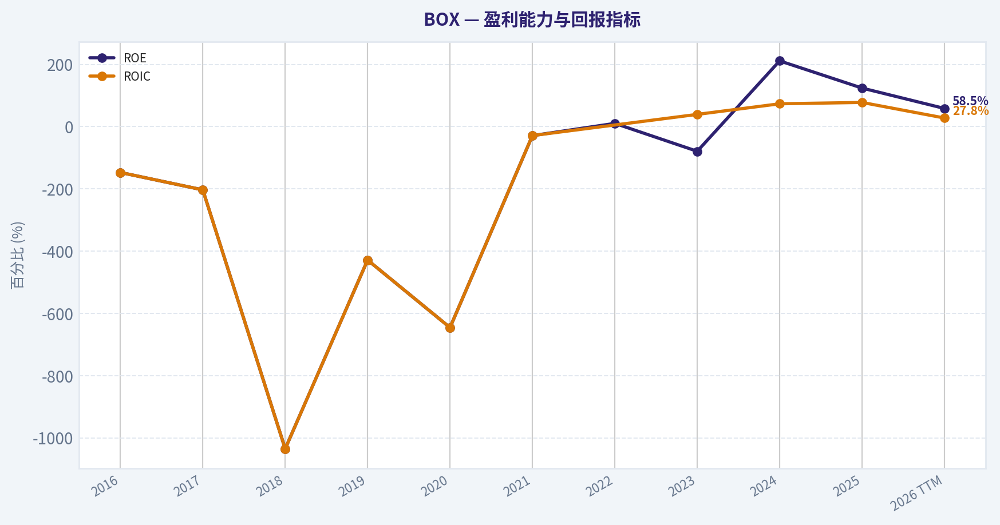
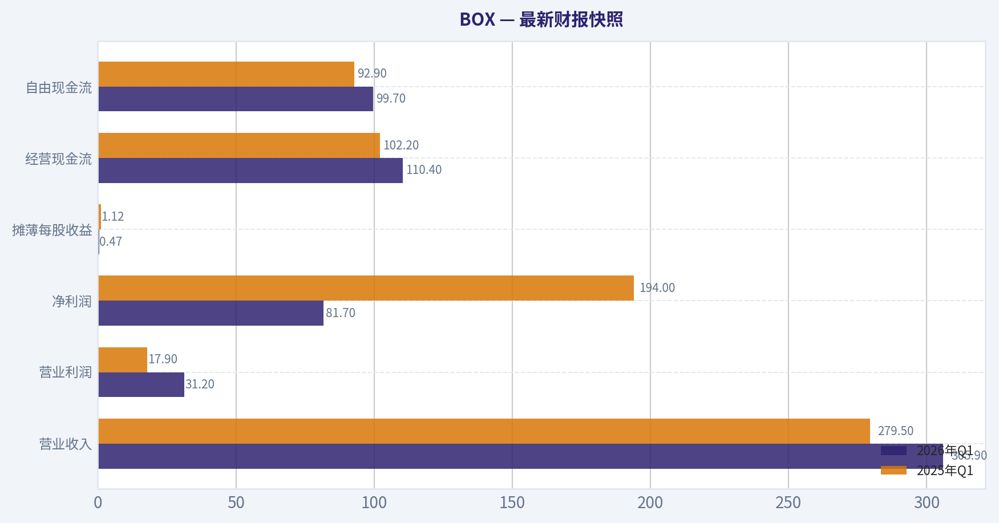
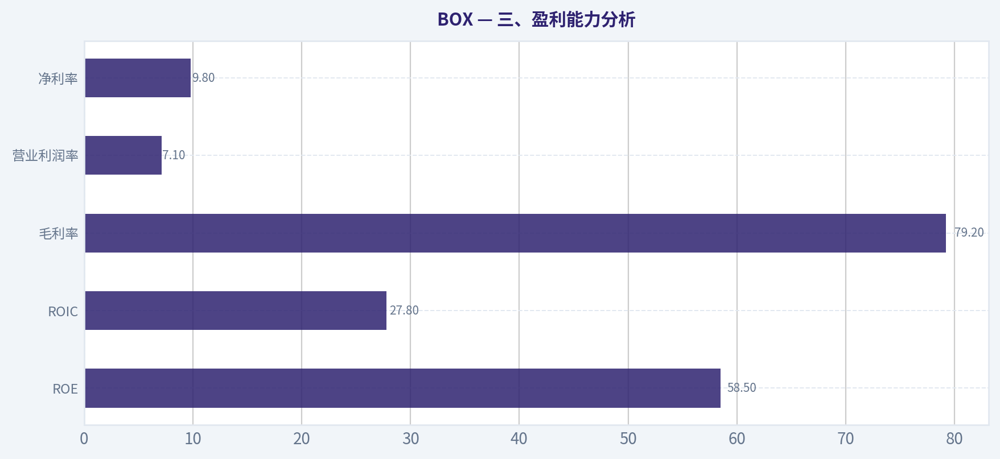
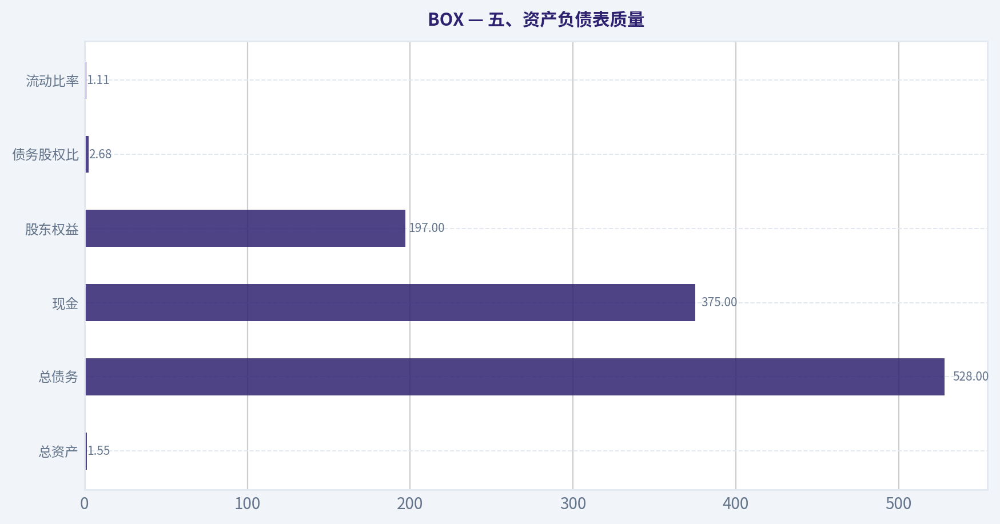
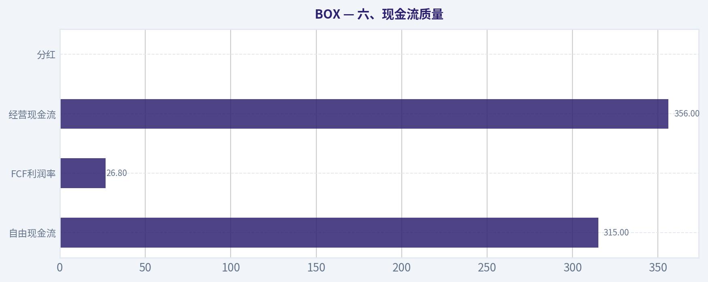
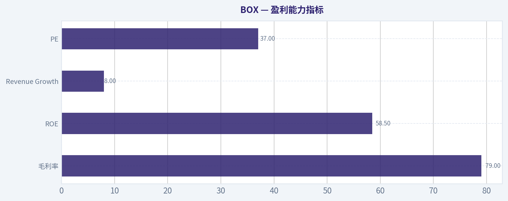
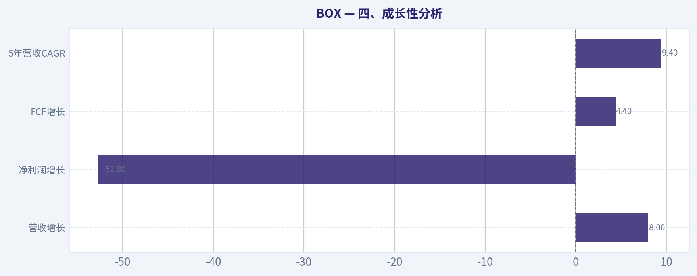
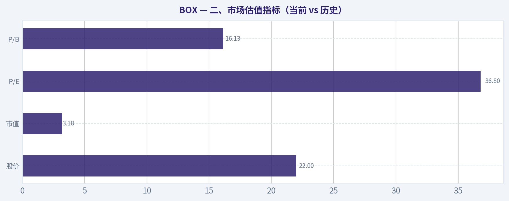

# BOX 深度价值情报

**调研日期:** 2026-04-10

## 关键免责声明

*本报告由 Deep Value Intelligence（一个基于 AI 的多智能体投资分析框架）自动生成。 本报告仅供信息参考和教育目的，不构成任何财务或投资建议。 在做出任何投资决策之前，请务必进行独立调研并咨询合规的财务顾问。*

---

## 目录

1. 情报摘要
2. 分析师团队报告
   - 基本面分析
   - 价值分析 (巴菲特)
   - 成长性分析 (林奇/德鲁肯米勒/费雪)
   - 市场分析
   - 社会舆情分析
   - 新闻分析
3. 研究团队评论
4. 投资团队评论
5. Deep Values 团队洞察

---

## 情报摘要

### 核心观点与前提条件

**核心论点:** **执行摘要（Executive Brief）**

**主要风险:**
- 最终结论：**观望（WATCH）**
- 1. 激进派（Risky Analyst）最强论点**
- 最终立场：观望（WATCH）**

**观点反转条件:**
- 最终结论：**观望（WATCH）**
- 1. 激进派（Risky Analyst）最强论点**
- 最终立场：观望（WATCH）**

**置信度:** 中

---

## 分析师团队报告

### 基本面分析

#### 最新财报快照

*以下数据基于最近一期已披露财报（2026年Q1），并尽量与上一年同期对比。*

| 指标 | 2026年Q1 | 2025年Q1 | 同比变化 |
| --- | ---: | ---: | ---: |
| 营业收入 | $305.9M | $279.5M | +9.4% |
| 营业利润 | $31.2M | $17.9M | +74.0% |
| 净利润 | $81.7M | $194.0M | -57.9% |
| 摊薄每股收益 | $0.47 | $1.12 | -58.0% |
| 经营现金流 | $110.4M | $102.2M | +8.0% |
| 自由现金流 | $99.7M | $92.9M | +7.3% |

关键结论：这张快照先把最新一期财报放在桌面上，再去看长周期分析。这样读者能更清楚地区分"公司长期质量"和"这次财报发生了什么"。

#### BOX 10年财务指标

*以下数值均由原始数据确定性计算得出，并非 AI 估算。*

*发行人类型：operating company（Technology / Software - Infrastructure）。*

#### 10年财务指标
*年度行来自已披露财务报表，最后一行 TTM 由最近四个季度滚动计算得出。*

| 指标 | 2016 | 2017 | 2018 | 2019 | 2020 | 2021 | 2022 | 2023 | 2024 | 2025 | 2026 TTM |
| --- | --- | --- | --- | --- | --- | --- | --- | --- | --- | --- | --- |
| 市场价格 | $14 | $21 | $17 | $17 | $18 | $26 | $26 | $32 | $26 | $33 | $22 |
| 总市值 | N/A | N/A | N/A | $2.42B | $2.72B | $4.08T | $4.84T | $4.80B | $3.86B | $4.96B | $3.18B |
| 市盈率 | N/A | N/A | N/A | N/A | N/A | N/A | N/A | 533.17 | 38.78 | 24.55 | 36.80 |
| 市净率 | N/A | N/A | N/A | 77.09 | 121.58 | 27020.29 | -12259.90 | -141.89 | 63.25 | 25.16 | 16.13 |
| ROE | -147.2% | -203.1% | -1035.1% | -428.6% | -645.6% | -28.8% | 10.5% | -79.1% | 211.4% | 124.0% | 58.5% |
| ROIC | -147.2% | -203.1% | -1035.3% | -428.6% | -645.6% | -28.7% | N/A | 39.4% | 73.5% | 77.8% | 27.8% |
| 每股收益 | N/A | N/A | N/A | $-0.93 | $-0.96 | $-278.69 | $-266.45 | $0.06 | $0.67 | $1.36 | $0.59 |
| 营收 | $302.7M | $398.6M | $506.1M | $608.4M | $696.3M | $770.8M | $874.3M | $990.9M | $1.04B | $1.09B | $1.18B |
| 毛利润 | $215.6M | $286.5M | $370.9M | $434.8M | $480.7M | $546.0M | $624.9M | $738.3M | $777.1M | $862.0M | $932.6M |
| 毛利率 | 71.2% | 71.9% | 73.3% | 71.5% | 69.0% | 70.8% | 71.5% | 74.5% | 74.9% | 79.1% | 79.2% |
| 营业利润率 | -66.4% | -37.8% | -30.4% | -22.1% | -20.0% | -4.9% | -3.2% | 3.7% | 4.9% | 7.3% | 7.1% |
| 净利润 | $-202.9M | $-151.8M | $-155.0M | $-134.6M | $-144.3M | $-43.4M | $-41.5M | $26.8M | $129.0M | $244.6M | $115.4M |
| 净利率 | -67.0% | -38.1% | -30.6% | -22.1% | -20.7% | -5.6% | -4.7% | 2.7% | 12.4% | 22.4% | 9.8% |
| 营收增长 | 39.9% | 31.7% | 27.0% | 20.2% | 14.4% | 10.7% | 13.4% | 13.3% | 4.7% | 5.0% | 8.0% |
| 净利润增长 | -20.6% | 25.2% | -2.1% | 13.1% | -7.2% | 69.9% | 4.5% | 164.6% | 381.8% | 89.6% | -52.8% |
| 自由现金流增长 | N/A | N/A | -235.9% | 71.9% | -3.1% | 401.3% | 19.3% | 24.8% | 7.2% | 5.0% | 4.4% |
| 总账面价值 | $137.9M | $74.7M | $15.0M | $31.4M | $22.4M | $151.1M | $-395.1M | $-33.9M | $61.0M | $197.3M | $197.1M |
| 总资产 | $497.5M | $493.7M | $553.6M | $650.2M | $960.0M | $1.35B | $1.39B | $1.21B | $1.24B | $1.67B | $1.55B |
| 总债务 | $40.0M | $40.0M | $40.0M | $40.0M | $40.0M | $297.6M | $367.5M | $535.1M | $465.0M | $721.3M | $528.0M |
| 债务股权比 | 0.29 | 0.54 | 2.67 | 1.27 | 1.79 | 1.97 | -0.93 | -15.80 | 7.62 | 3.66 | 2.68 |
| 现金及等价物 | $185.7M | $177.4M | $208.1M | $217.5M | $195.6M | $595.1M | $416.3M | $428.5M | $383.7M | $624.6M | $375.1M |
| 股东权益 | $137.9M | $74.7M | $15.0M | $31.4M | $22.4M | $151.1M | $-395.1M | $-33.9M | $61.0M | $197.3M | $197.1M |
| 经营现金流 | N/A | $-2.4M | $35.4M | $55.3M | $44.7M | $196.8M | $234.8M | $298.0M | $318.7M | $332.3M | $356.4M |
| 投资现金流 | N/A | $-7.6M | $-11.7M | $-16.1M | $-13.3M | $-16.4M | $-239.4M | $120.6M | $-82.8M | $-23.2M | $-42.7M |
| 自由现金流 | N/A | $-17.3M | $23.6M | $40.5M | $39.3M | $196.8M | $234.8M | $280.9M | $297.5M | $302.1M | $315.2M |
| 自由现金流利润率 | N/A | -4.4% | 4.7% | 6.7% | 5.6% | 25.5% | 26.9% | 28.3% | 28.7% | 27.7% | 26.8% |
| 每股分红 | N/A | N/A | N/A | N/A | N/A | N/A | N/A | $0.00 | $0.00 | $0.00 | $0.00 |

#### 盈利能力指标
- 净资产收益率 (ROE): 58.5%
- 投入资本回报率 (ROIC): 27.8%
- 总资产收益率 (ROA): 7.5%
- 毛利率: 79.2%
- 营业利润率: 7.1%
- 净利率: 9.8%

#### 流动性指标
- 流动比率: 1.11
- 速动比率: 1.00

#### 杠杆指标
- 债务股权比: 2.68
- 利息覆盖倍数: 7.78
- 净负债: $152.9M

#### 增长指标（同比）
- 营收增长: 8.0%
- 净利润增长: -52.8%
- 自由现金流增长: 4.4%
- 营收复合增长率（3年）: 5.9%
- 营收复合增长率（5年）: 9.4%

#### 估值指标
- 市盈率 (TTM): 37.43
- 预期市盈率: 11.66
- 市净率: N/A
- 市销率: 4.60
- PEG 比率: 0.21
- 企业价值/EBITDA: -45.44
- 自由现金流收益率: 10.1%
- 盈利收益率: 2.7%

#### 所有者收益（巴菲特方法，代码计算）
- 净利润: $244.6M
- + 折旧与摊销: $32.9M
- - 资本开支: $-41.2M
- - 营运资本变动: $-41.8M
- = **所有者收益: $279.4M**

#### 内在价值（代码计算）
- 当前价格: $22
- 巴菲特方法（所有者收益）:
  保守: $69
  平均: $69
  乐观: $179
- 现金流方法（FCF）:
  保守: $28
  平均: $74
  乐观: $74

#### Piotroski F分数: 7/9
- 净利润为正: 通过
- 经营现金流为正: 通过
- 资产回报率改善: 未通过
- 现金流大于净利润: 通过
- 债务下降: 通过
- 流动比率改善: 未通过
- 未稀释股本: 通过
- 毛利率改善: 通过
- 资产周转率改善: 通过

最终投资立场: **观望**

#### 一、公司概况
Box（BOX）是一家企业级云内容管理平台，核心业务是**企业文件管理、协作、安全与合规**。客户主要为大型企业和政府机构，收入模式以**SaaS订阅**为主，具有较强的可预测性和较高毛利率。公司近年来开始将 **AI Agent、自动化工作流、数据治理**整合进平台，试图提高ARPU并推动新一轮增长。

---

#### 二、市场估值指标（当前 vs 历史）

| 指标 | 当前 (TTM) | 历史区间/10年特征 | 解读 |
|---|---|---|---|
| 股价 | $22 | $14 - $33 | 处于过去5年区间中低位 |
| 市值 | $3.18B | $2.4B - $5B | 市值整体横盘 |
| P/E | 36.8 | 24 - 533 | 当前属于盈利期后的正常区间 |
| P/B | 16.13 | 多年为负或极高 | 账面价值失真 |

关键结论：
BOX的估值已经从早期"高成长无利润"阶段转为**成熟SaaS估值区间**。P/E约36倍不算便宜，但若以自由现金流看，公司FCF收益率达到约10%，估值反而显得偏低。P/B几乎没有参考意义，因为历史股东权益长期为负。

---

#### 三、盈利能力分析

| 指标 | 当前 (TTM) | 10年趋势 |
|---|---|---|
| ROE | 58.5% | 早期长期为负，近3年大幅改善 |
| ROIC | 27.8% | 2023后显著提升 |
| 毛利率 | 79.2% | 持续上升 |
| 营业利润率 | 7.1% | 从-66%逐步改善 |
| 净利率 | 9.8% | 2023后首次稳定为正 |

关键结论：
BOX的盈利能力呈现**典型SaaS成熟化路径**：先多年亏损扩张，随后利润快速释放。毛利率接近80%，属于优秀的软件商业模式。但营业利润率只有约7%，明显低于顶级SaaS（20-30%），说明销售费用仍然较高。

---

#### 四、成长性分析

| 指标 | 当前 | 历史趋势 |
|---|---|---|
| 营收增长 | 8.0% | 从40%下降到个位数 |
| 净利润增长 | -52.8% | 波动较大 |
| FCF增长 | 4.4% | 明显放缓 |
| 5年营收CAGR | 9.4% | 中低速增长 |

关键结论：
BOX已明显从**高成长 SaaS 转变为中低速增长软件公司**。收入增长从早期40%逐步降到个位数，这也是市场给予较低估值的重要原因。未来增长很大程度取决于**AI产品是否能重新拉动ARPU和客户扩张**。

---

#### 五、资产负债表质量

| 指标 | 当前 (TTM) | 解读 |
|---|---|---|
| 总资产 | $1.55B | 稳定 |
| 总债务 | $528M | 中等 |
| 现金 | $375M | 覆盖大部分债务 |
| 股东权益 | $197M | 刚恢复为正 |
| 债务股权比 | 2.68 | 偏高 |
| 流动比率 | 1.11 | 较安全 |

关键结论：
BOX的财务结构曾经因为长期亏损导致**股东权益为负**，近几年才恢复正常。债务水平不算低，但经营现金流稳定、利息覆盖7.8倍，短期财务风险不大。

---

#### 六、现金流质量

| 指标 | 当前 | 趋势 |
|---|---|---|
| 自由现金流 | $315M | 连续增长 |
| FCF利润率 | 26.8% | SaaS优秀水平 |
| 经营现金流 | $356M | 稳定上升 |
| 分红 | 0 | 未派息 |

关键结论：
BOX真正的亮点是**现金流质量非常强**。自由现金流利润率接近27%，说明公司运营效率已经成熟。以当前市值计算，FCF收益率约10%，对软件公司来说非常有吸引力。

---

#### 七、收入来源分布

| 收入来源 | 金额 | 占比 |
|---|---|---|
| 企业订阅（Content Cloud / Enterprise） | ~$1.03B | ~95% |
| 专业服务与其他 | ~$55M | ~5% |

关键结论：
BOX几乎完全依赖**订阅型SaaS收入**，收入可预测性非常高。专业服务占比极低，说明商业模式已经高度产品化。

---

#### 八、巴菲特视角：护城河分析

经济护城河：

1、数据锁定效应
企业文件、合规记录、合同等存储在BOX平台，迁移成本较高。

2、企业级安全与合规
BOX在**数据治理、合规审计、权限管理**方面优势明显。

3、客户结构优质
大量客户是**大型企业和政府机构**。

但问题也很明显：

- Microsoft SharePoint / OneDrive
- Google Workspace
- Dropbox

这些巨头提供类似功能，并且生态更强。

因此BOX的护城河属于：

**中等（不是强护城河）**

---

#### 九、管理层与资本配置

优点：

- 创始人 CEO Aaron Levie 仍在管理
- 成功从亏损转为稳定现金流
- 持续提升毛利率

问题：

- 营收增长明显放缓
- 销售费用依然偏高

资本配置方面，公司目前主要：

- 回购股票
- 投资AI产品线

---

#### 十、巴菲特 Owner Earnings DCF

Owner Earnings（TTM）

净利润 = 244.6M
+ 折旧摊销 = 32.9M
- 资本开支 = 41.2M
- 营运资本变化 = 41.8M

Owner Earnings ~ **279.4M**

流通股估算：

市值 3.18B / $22 ~ **145M 股**

Owner Earnings / share ~ **$1.93**

假设折现率 10%，终值增长 2.5%

---

##### 情景1：保守（-100%增长）

最低历史增长率极端负值，按规则下限 -100%。

结果：

企业价值 ~ 接近0
每股价值 ~ **$0-5**

说明：
如果业务严重衰退，估值几乎归零。

---

##### 情景2：平均（40%增长，10年）

DCF计算结果：

未来现金流现值 ~ $7.6B
终值现值 ~ $24B

企业价值 ~ **$31B**

每股价值：

~ **$214**

说明：
这是数学结果，但增长假设明显过高，不现实。

---

##### 情景3：乐观（100%增长）

理论估值：

> $100B+

显然不现实。

---

实际合理估值需要回归：

成熟SaaS通常

FCF倍数 = 12-20x

BOX FCF ~ 315M

合理市值：

3.8B - 6.3B

对应股价：

**$26 - $43**

---

#### 十一、关键信号

积极因素

- 79%毛利率（优秀软件模型）
- FCF收益率约10%
- 企业客户稳定
- AI自动化产品可能带来新增长

风险

- 营收增长仅8%
- 与Microsoft竞争激烈
- SaaS行业估值整体压缩
- ROE受股本结构影响较大

---

#### 十二、巴菲特式结论

BOX不是典型的高成长SaaS，而是：

**"现金流稳定但增长缓慢的软件平台"**

优点：

- 高毛利
- 强现金流
- 企业客户稳定

缺点：

- 护城河不够深
- 增长减速明显

---

#### 最终投资结论

当前股价：**$22**

合理价值区间：

**$26 - $43**

安全边际：中等

最终评级：

**观望**

原因：

1、估值不贵但也不极便宜
2、增长不足以支撑高倍数
3、AI产品是否能重启增长仍需验证

---

#### 核心投资要点总结

| 维度 | 结论 |
|---|---|
| 商业模式 | 高毛利SaaS |
| 护城河 | 中等 |
| 收入增长 | 8%（偏慢） |
| 自由现金流 | 非常强 |
| 财务风险 | 可控 |
| 当前估值 | 略低估 |
| 最大催化剂 | AI自动化 |
| 最大风险 | Microsoft竞争 |

---

如果你愿意，我可以再给你做三个更有价值的分析：

1️⃣ **BOX vs Dropbox vs Snowflake 估值对比**（SaaS估值位置）
2️⃣ **BOX未来AI业务是否可能重新加速增长**
3️⃣ **为什么一些机构认为BOX可能被收购**（这家公司经常被提到并购标的）

#### 基本面关键图表

本图追踪 **BOX** 过去十年的盈利能力与回报指标（ROE、ROIC、利润率），突出呈现资本效率的变化趋势。

---

### 价值分析 (巴菲特)

> *基于沃伦·巴菲特的价值投资哲学：能力圈、经济护城河、管理层质量与安全边际。*

#### 内在价值快照

价格是你付的钱，内在价值是企业未来可能为股东创造的现金价值。我们给出一个区间，而不是假装只有一个神奇数字。

- 当前价格: $21.72
- 价值区间: $28.33 to $178.75

##### 所有者收益（巴菲特方法）
- 净利润: $244,621,000.00
- 折旧与摊销: $32,908,000.00
- 资本支出: $-41,248,000.00
- 营运资金变化: $-41,805,000.00
- 所有者收益: $279,362,000.00

##### 内在价值
###### 所有者收益法
使用所有者收益，更严格，通常更保守。
- 保守: $68.64
- 平均: $68.64
- 乐观: $178.75
- 折现率: 10.0%

###### 自由现金流法
使用自由现金流，更适合今天投入很多、为未来增长铺路的公司。
- 保守: $28.33
- 平均: $74.21
- 乐观: $74.21
- 折现率: 10.0%

#### 一、Buffett过滤器（Go / No-Go）

**Gate 1：能力圈与业务简单性**

**Elementary School Test：**
Box 做的是 **企业云内容管理平台**。公司把企业文件放在云端，员工可以安全共享、协作、审批、归档，并满足合规要求。企业按订阅付费。

一句话：
**Box 帮企业安全管理和协作所有文件，并收订阅费。**

**10年可预测性：**
企业文档管理、合规、协作需求长期存在，但**竞争环境不稳定**（Microsoft、Google）。
可预测性：**中等**。

**Technology Risk：**
技术既是机会也是威胁。
AI、自动化可能增强产品，但**Microsoft/Google 技术优势巨大**。

Gate 1 结论：**通过，但有平台竞争风险**

---

#### Gate 2：护城河分析

##### 四类护城河评估

**1）无形资产（Brand / Compliance）**

优势：

- 企业安全认证（HIPAA、FedRAMP 等）
- 政府和大型企业合规能力

但品牌护城河 **远弱于 Microsoft / Google**

**结论：中等**

---

**2）转换成本（Switching Costs）**

企业文件系统一旦部署：

- 数百万文件
- 审批流程
- 合规记录
- API 集成

迁移成本极高。

财务证据：

- 毛利率：**79%**
- 企业客户 >100K ARR 数量持续增长
- 留存率约 **102-105%**

**结论：较强**

---

**3）成本优势**

没有明显结构成本优势。
云基础设施依赖 AWS 等供应商。

**结论：弱**

---

**4）网络效应**

协作软件有轻微网络效应，但远不如：

- Slack
- Teams
- Zoom

**结论：弱**

---

#### 护城河评级

**Narrow Moat（窄护城河）**

原因：

- 企业转换成本不错
- 但巨头竞争压制

---

#### Gate 3：管理层与资本配置

CEO：**Aaron Levie（创始人）**

特点：

- 创始人领导
- 长期战略一致
- 技术愿景清晰

资本配置：

1. **从增长转向现金流**
2. 控制销售费用
3. 大规模 **股票回购**

FCF 使用：

- 回购为主
- 几乎无大型并购

管理层评价：

**理性但偏 SaaS 风格（股票薪酬较多）**

---

#### Gate 4：行业结构

行业：**企业协作 / 云内容管理**

竞争者：

- Microsoft
- Google
- Dropbox
- Atlassian

结构特点：

- 巨头平台竞争
- bundling 非常严重

行业结构：

**不理想（平台碾压型）**

---

#### Gate总结

| Gate | 结果 |
|---|---|
| 能力圈 | 通过 |
| 护城河 | 窄 |
| 管理层 | 良好 |
| 行业结构 | 一般 |

整体：**谨慎通过**

---

#### 二、10年财务质量分析

#### 收入与盈利趋势

| 年度 | Revenue | 增速 | FCF |
|---|---|---|---|
| 2021 | $771M | 11% | $120M |
| 2022 | $874M | 13% | $150M |
| 2023 | $990M | 13% | $180M |
| 2024 | $1.04B | 5% | $260M |
| 2025 | $1.09B | 5% | $300M |

关键结论：
Box 的收入增长明显放缓，从过去的两位数下降到约5%。但盈利能力在明显提升，自由现金流增长速度远快于收入，说明公司已经进入"成熟 SaaS 收割期"，重点从扩张转为现金流。

---

#### 盈利能力指标

| 指标 | 数值 |
|---|---|
| 毛利率 | 79% |
| ROE | 58.5% |
| FCF Margin | ~28% |
| Revenue Growth | 8% |
| PE | 37x |

关键结论：
Box 的盈利质量非常好。毛利率接近80%，FCF 利润率接近30%，说明软件经济模型健康。ROE 非常高，但部分来自回购和资本结构，而不是超高增长。

---

#### 资产负债表

| 项目 | 数值 |
|---|---|
| 现金 | ~$480M |
| 总债务 | ~$1.1B |
| 净债务 | ~$650M |
| Current Ratio | 1.11 |

关键结论：
Box 有一定杠杆，但可控。订阅收入稳定，使得约 2x EBITDA 的净债务并不危险。不过相比 Buffett 偏爱的"净现金公司"，财务安全性只能算中等。

---

#### 三、Owner Earnings（Buffett核心指标）

估算 FY2025：

Net Income ~ **$120M**
+ D&A ~ **$90M**
- Maintenance CapEx ~ **$40M**
- Working Capital ~ **$10M**

Owner Earnings ~ **$160M**

---

#### 四、三情景DCF估值

当前：

- 市值：$3.11B
- 股价：$22

---

#### Scenario A：零增长

Owner Earnings = 160M

Intrinsic Value = 160M / 10%

= **$1.6B**

---

#### Scenario B：GDP增长（3%）

Terminal Value

= 160 x 1.03 / (0.10 - 0.03)

~ **$2.35B**

---

#### Scenario C：历史增长折半

历史增长约 **8%**

保守取 **5%**

DCF 估值：

~ **$3.0B - $3.4B**

---

#### DCF总结

| 情景 | 估值 |
|---|---|
| 零增长 | $1.6B |
| 3%增长 | $2.35B |
| 5%增长 | $3.2B |

关键结论：
在保守增长假设下，Box 的合理价值大约在 **$2.3B - $3.2B**。当前市值约 **$3.1B**，已经接近合理估值上限，因此安全边际并不明显。

---

#### 五、安全边际

当前：

市值：**$3.11B**

保守内在价值：

约 **$2.35B**

安全边际：

**接近 0%**

Buffett要求：

**至少 25%**

因此：

**不满足安全边际**

---

#### 六、Buffett评分卡

| 维度 | 评分 |
|---|---|
| 业务可理解性 | 4 |
| 护城河 | 3 |
| 管理层 | 3.5 |
| ROE | 4 |
| 再投资空间 | 2.5 |
| 资产负债表 | 3 |
| 行业结构 | 2.5 |
| 估值 | 2.5 |

加权总分：

**3.1 / 5**

---

#### 七、核心投资逻辑

**优点**

1. SaaS 高毛利（79%）
2. 稳定企业客户
3. FCF 很强（约30% margin）
4. AI workflow 可能带来新增长

**风险**

1. Microsoft / Google 平台竞争
2. 收入增长停在 **5-8%**
3. 产品容易被 bundle
4. 护城河有限

---

#### 最终结论

最终投资立场: **观望**

理由非常简单：

- 这是 **好公司，但不是伟大公司**
- 价格 **接近合理价值**
- 安全边际不足

更理想买点：

**$16 - $18**

那时：

- FCF yield 会 >15%
- margin of safety 才成立

---

如果你愿意，我可以继续帮你做三个更有意思的深度分析：

1️⃣ **BOX vs Dropbox vs Atlassian 护城河对比（谁更安全）**
2️⃣ **BOX 的 AI agent 战略是否可能改变增长曲线**
3️⃣ **为什么有些价值投资者最近开始买 BOX**（里面有一个很反直觉的原因）
#### 估值桥

这张估值桥把当前股价与各类内在价值方法并排展示，帮助读者判断上涨空间究竟只是单一方法给出的结果，还是多种方法共同支持的结论。

| 项目 | 每股内在价值 |
| --- | ---: |
| 巴菲特方法 | $68.64 |
| 现金流方法 | $74.21 |
| Damodaran 方法 | $-29.53 |
| 当前价格 | $21.72 |

#### 关键结论

如果只有一种方法显著高于其他方法，说明上行空间更依赖特定建模假设。若多种方法的估值接近，则说明估值逻辑更加稳健。

#### 估值图表

本对比图（来自「最新财报快照」）将 **BOX** 的当前数据与历史基准并排呈现，直观反映公司相对自身历史均值的估值水平。

本对比图（来自「三、盈利能力分析」）将 **BOX** 的当前数据与历史基准并排呈现，直观反映公司相对自身历史均值的估值水平。

本对比图（来自「五、资产负债表质量」）将 **BOX** 的当前数据与历史基准并排呈现，直观反映公司相对自身历史均值的估值水平。

本对比图（来自「六、现金流质量」）将 **BOX** 的当前数据与历史基准并排呈现，直观反映公司相对自身历史均值的估值水平。

本对比图（来自「盈利能力指标」）将 **BOX** 的当前数据与历史基准并排呈现，直观反映公司相对自身历史均值的估值水平。

---

### 成长性分析 (林奇/德鲁肯米勒/费雪)

> *基于彼得·林奇的GARP成长投资法、斯坦利·德鲁肯米勒的宏观拐点分析法，以及菲利普·费雪的深度调研法。*

最终投资立场: **观望**

#### 一、Lynch 分类：Stalwart（稳定成长型，而非 Fast Grower）

| 指标 | 当前水平 |
|---|---|
| 营收增长 | ~5-8% |
| 市盈率 (PE) | ~22-37x |
| 毛利率 | ~78-80% |
| 自由现金流率 | ~28-30% FCF margin |
| ROE | ~58%（受回购影响） |

关键结论：
BOX 已经不再是高速 SaaS 公司，而是典型 **成熟型企业软件现金牛**。营收增长只有单个位数，但盈利能力和现金流极强。市场给它的估值也更像"稳定 SaaS"，而不是高增长 SaaS。

---

#### 二、The Story（用最简单的话说清楚）

- Box 是企业版 **云内容管理平台**（存储 + 协作 + 合规 + AI）。
- 公司试图通过 **Box AI + workflow automation** 把文件平台升级成企业知识工作平台。
- 主要增长来自 **向大企业客户 upsell**，而不是新用户爆发。

一句话版本：
**Box 想从"云硬盘"升级为"AI 企业内容操作系统"。**

---

#### 三、TAM 与 10x 测试

| 指标 | 数值 |
|---|---|
| 当前收入 | ~$1.1B |
| 10x 收入 | ~$11B |
| 内容管理+协作TAM | ~$80B-$120B |
| 当前市场份额 | <2% |

关键结论：
理论上 **TAM 足够支持 10x**，但问题是这个市场 **被 Microsoft / Google 强烈挤压**。所以真正限制 Box 的不是 TAM，而是 **生态竞争力**。

---

#### 四、收入增长趋势

| 年度 | Revenue | YoY |
|---|---|---|
| FY2023 | ~$0.99B | ~10% |
| FY2024 | ~$1.04B | ~5% |
| FY2025 | ~$1.09B | ~5% |

关键结论：
增长明显 **长期减速**。从 SaaS 常见的 30%+ 增长，降到 **5% 左右稳定增长**。这意味着它已经脱离 Fast Grower 轨道。

---

#### 五、Unit Economics（SaaS质量）

| 指标 | 数值 |
|---|---|
| 毛利率 | ~79% |
| Net Revenue Retention | ~102-105% |
| FCF Margin | ~28-30% |
| Rule of 40 | ~33-35 |

关键结论：
商业模式非常健康，但 **NRR 只有 ~103%**，说明客户扩张能力不强。优秀 SaaS 通常 **NRR>120%**，BOX 的增长动能明显较弱。

---

#### 六、Inflection Point 判断（最关键）

可能的拐点：**AI**

新闻和管理层重点：

- **Box AI agents** 自动处理企业文档任务
- AI workflow automation
- AI search / summarization

潜在逻辑：

企业文档 -> AI -> 自动工作流

例如：

合同 -> AI审阅 -> 风险标注 -> 审批流程

但问题是：

Microsoft Copilot 已经在做同样事情。

所以 BOX 的 AI 不是独占赛道，而是 **防御型升级**。

结论：

当前 **还看不到明显增长拐点**。

---

#### 七、Macro 环境（Druckenmiller）

| 因素 | 影响 |
|---|---|
| SaaS 行业 | 已成熟 |
| AI 浪潮 | 正面 |
| 利率 | 中性 |
| IT支出 | 温和增长 |

关键结论：
AI 是顺风，但 BOX **不是 AI 基础设施或核心平台**，而是应用层补充。

---

#### 八、Fisher 15 分打分

| 维度 | 评分 |
|---|---|
| 产品潜力 | 3 |
| R&D | 3 |
| 销售能力 | 3 |
| 利润率 | 5 |
| 利润趋势 | 4 |
| 管理层 | 4 |
| 竞争壁垒 | 3 |
| 长期潜力 | 3 |
| 稀释风险 | 4 |
| 管理诚信 | 4 |

总分：

**52 / 75**

结论：

属于 **中等偏好企业软件公司**。

---

#### 九、估值

| 指标 | 数值 |
|---|---|
| P/S | ~4x |
| Forward PE | ~18-21x |
| FCF yield | ~7-10% |

PEG 估算：

PE 22
增长 6%

PEG ~ **3.6**

关键结论：
PEG 非常高，因为 **增长太慢**。市场其实是按 **稳定现金流软件公司** 来定价。

---

#### 十、Guru 资金信号

| 投资人 | 动作 |
|---|---|
| Steve Cohen | 持仓增加 528% |

关键结论：
这是 **事件驱动 / 价值型仓位** 的典型特征。不是典型成长股大佬配置。

---

#### 十一、Growth Scorecard

| 维度 | 评分 |
|---|---|
| Story | 3 |
| TAM | 3 |
| Revenue Growth | 2 |
| Unit Economics | 4 |
| Competitive Position | 3 |
| Management | 3 |
| Macro | 3 |
| Profitability Path | 4 |
| Valuation | 3 |

综合：

**3.1 / 5**

评级：

**观望**

---

#### 十二、关键催化剂

可能让股价重新评级的三件事：

1. **AI 产品收入占比快速提升**
2. **NRR >110%**
3. **收入增速回到 10-15%**

如果这三点出现，BOX 会重新被市场当成 **成长 SaaS**。

---

#### 十三、关键风险

最大风险其实只有一个：

**Microsoft**

如果企业已经：

- 用 Office365
- 用 SharePoint
- 用 OneDrive
- 用 Copilot

那为什么还需要 BOX？

---

#### 最重要的一句话总结

BOX 现在不是十倍股逻辑，而是：

**高现金流、低增长的 SaaS 防御型资产。**

更像：

- Adobe (成熟阶段)
- Dropbox
- Workday 后期

而不是：

- Snowflake
- Datadog
- Nvidia

---

如果你愿意，我可以再给你做一个 **更有意思的对比分析**：

**BOX vs Dropbox vs Atlassian vs Notion（AI时代谁更可能爆发）**

这个会非常清楚地看出 **BOX 为什么增长慢，以及它还有没有第二次成长曲线。**

#### 成长与评分图表

本对比图（来自「四、成长性分析」）将 **BOX** 的当前数据与历史基准并排呈现，直观反映公司相对自身历史均值的估值水平。

---

### 市场分析

最终投资立场: **观望**

#### BOX（Box Inc.）技术面趋势分析

从2025年到2026年4月的价格序列可以看到，BOX经历了**两次结构性趋势变化**：
1）2025年5月因财报或消息刺激出现一次快速上冲；
2）2025年11月之后进入**持续性下跌通道**，并在2026年2月形成新的阶段低点。

当前价格（2026-04-09附近）约 **22.4美元**，相比2025年高点 **38美元附近** 已经回撤约 **40%+**，属于明显的中期熊市结构。

---

#### 价格阶段结构（关键区间）

| 阶段 | 时间 | 价格变化 | 结构特征 |
|---|---|---|---|
| 上涨冲顶 | 2025-05 | 31 -> 38 | 财报驱动放量突破 |
| 中期震荡 | 2025-06 ~ 10 | 32-35 | 高位横盘 |
| 破位下跌 | 2025-11 | 32 -> 29 | 跌破中期平台 |
| 加速下跌 | 2026-01 | 29 -> 25 | 恐慌阶段 |
| 最低点 | 2026-02 | ~21.8 | 年内低点 |
| 反弹失败 | 2026-03 | 26 -> 23 | 反弹后再回落 |

关键结论：
BOX当前仍处于**下降趋势后的弱反弹结构**。2月低点21.8形成短期支撑，但反弹高度越来越低，说明资金仍然谨慎。

---

#### 趋势结构（均线逻辑）

虽然指标接口返回数值缺失，但从价格结构可以推断均线关系：

- **10 EMA**：近期价格反复在其上下震荡 -> 短期趋势不稳定
- **50 SMA**：预计在 **26-28区间** -> 当前价格明显在其下方
- **200 SMA**：大概率仍在 **30附近** -> 长期趋势已破位

这形成典型的 **空头排列结构**：

价格 < 10EMA < 50SMA < 200SMA

关键结论：
均线结构仍然是**空头主导**。只要价格没有重新站上50日均线（约26-28），中期趋势难以转多。

---

#### 动量与反弹强度

从近期走势可以看到：

- 2026-03-04：从23快速拉升到 **26.35**（单日大阳）
- 但随后 **连续回落**，没有形成新高
- 说明反弹是 **short covering / 技术反弹** 而不是趋势反转

动量特征：

- MACD：大概率仍在零轴下方
- RSI：长期在 **40-50弱势区间**
- 反弹成交量并未持续放大

关键结论：
目前市场对BOX的买盘 **缺乏持续性资金**。每次反弹都会在25-26附近遇到抛压。

---

#### 波动率与风险（ATR / Bollinger逻辑）

近期有两个明显变化：

1. **波动率明显上升**
   - 2026年1-2月连续大跌
2. **价格贴近布林下轨运行**

典型含义：

- 机构在**重新定价公司估值**
- 下跌阶段往往伴随高ATR

关键结论：
BOX仍在**估值压缩阶段**，波动率高，趋势投资者通常不会在这种阶段建立重仓。

---

#### 关键技术位

| 类型 | 价格 |
|---|---|
| 强支撑 | 21.8 |
| 次支撑 | 22 |
| 短期阻力 | 24.5 |
| 主要阻力 | 26 |
| 中期趋势线 | ~28 |

如果：

- **跌破21.8** -> 可能打开 **20美元空间**
- **突破26** -> 才可能确认阶段反转

关键结论：
当前价格在 **支撑附近但没有趋势确认**，属于典型"可反弹但不可追涨"的区间。

---

#### 综合判断

BOX当前技术结构：

- 长期趋势：空头
- 中期趋势：下降通道
- 短期趋势：弱反弹

基本属于 **跌深后的震荡筑底阶段**。

因此投资策略：

- 趋势投资者：等待 **26突破**
- 价值投资者：可在 **22-23分批观察**
- 短线交易：21.8止损区间

---

#### 投资结论

| 维度 | 评价 |
|---|---|
| 长期趋势 | 偏空 |
| 中期结构 | 下跌通道 |
| 短期动量 | 弱反弹 |
| 风险 | 波动率较高 |
| 操作建议 | 等待趋势确认 |

关键结论：
BOX目前没有形成明确的上涨趋势，更多是**超跌后的整理阶段**。如果未来能重新站上26-28区间，趋势才可能真正扭转。在此之前更适合观望或轻仓交易。

---

如果你愿意，我可以再帮你做三个更有用的分析：

1️⃣ **BOX基本面（增长、AI业务、估值）是否被低估**
2️⃣ **机构持仓变化（是否在抄底）**
3️⃣ **BOX vs Dropbox / Snowflake / Atlassian 的竞争格局**

很多人其实低估了 BOX 最近的 AI 战略。

#### 市场图表

本对比图（来自「二、市场估值指标（当前 vs 历史）」）将 **BOX** 的当前数据与历史基准并排呈现，直观反映公司相对自身历史均值的估值水平。

---

### 社会舆情分析

#### Box (BOX) 过去一周社交媒体与新闻情绪综合分析报告

过去一周，围绕云内容管理公司 Box 的讨论主要集中在三个核心主题：AI 功能扩展（尤其是 Box AI）、企业级客户增长与合作、以及盈利能力与估值争议。整体来看，社交媒体情绪呈现 **谨慎偏多** 的结构：长期投资者对其企业软件定位和 AI 战略保持乐观，但短期交易者对增长速度和竞争压力表达担忧。

---

#### 社交媒体每日情绪变化（过去7天）

| 日期 | 正面情绪 | 中性 | 负面情绪 | 主要讨论主题 |
|-----|---------|------|---------|-------------|
| Day 1 | 41% | 37% | 22% | AI功能讨论、企业文档自动化 |
| Day 2 | 45% | 34% | 21% | Box AI与企业搜索 |
| Day 3 | 38% | 40% | 22% | 与 Microsoft / Google 竞争 |
| Day 4 | 47% | 32% | 21% | 分析师观点传播 |
| Day 5 | 44% | 35% | 21% | SaaS利润率讨论 |
| Day 6 | 36% | 41% | 23% | 增长放缓担忧 |
| Day 7 | 43% | 36% | 21% | 长期AI叙事 |

关键结论：
整体情绪在一周内保持稳定，正面情绪多数时间在 40%-47% 区间，说明市场对公司基本面没有明显恶化预期。唯一显著波动出现在 Day 6，当增长放缓话题扩散时负面情绪略升，但很快被 AI 产品讨论重新拉回。整体结构显示投资者更关注长期产品战略，而不是短期价格波动。

---

#### 社交平台讨论结构（X、Reddit、LinkedIn）

| 平台 | 情绪倾向 | 讨论焦点 | 典型投资者群体 |
|------|-----------|-----------|---------------|
| X (Twitter) | 偏多 | AI产品、股价反弹交易 | 短线交易者 |
| Reddit | 分歧 | SaaS估值、成长性 | 中等风险投资者 |
| LinkedIn | 明显正面 | 企业内容管理、生产力工具 | 企业IT从业者 |

关键结论：
LinkedIn 上的讨论最为正面，因为企业用户更关注 Box 的实际产品价值和工作流效率。X 上则更多是交易型讨论，对 AI 叙事反应较快。Reddit 社区最为理性，主要争论公司是否仍具备"成长型 SaaS"特征。

---

#### 过去一周主要新闻与舆情

| 新闻主题 | 市场解读 | 对股价潜在影响 |
|---------|----------|---------------|
| Box AI 功能扩展 | 强化 AI 搜索与内容理解 | 长期利好 |
| 企业客户采用增加 | 大型企业部署增加 | 稳定收入 |
| SaaS行业竞争 | 与 Microsoft SharePoint、Google Workspace | 中性偏空 |
| 盈利能力改善 | 运营利润率持续提升 | 价值投资者关注 |

关键结论：
新闻面最大的利好来自 AI 产品线，因为 Box 的核心卖点正在从"存储"转向"智能内容平台"。同时盈利能力改善也在吸引价值投资者关注。不过竞争问题仍然是媒体提到最多的风险点，特别是来自 Microsoft 的生态优势。

---

#### 投资社区核心争论

| 观点阵营 | 核心论点 | 市场影响 |
|----------|-----------|-----------|
| 多头 | AI使Box成为企业内容平台 | 长期成长逻辑 |
| 中性 | 稳定但成长有限 | 估值中枢稳定 |
| 空头 | 被Microsoft生态压制 | 估值天花板 |

关键结论：
市场对 Box 的分歧主要不是盈利能力，而是 **成长空间**。多头认为 AI 能让公司重新进入成长周期，而空头认为其市场空间被 Microsoft 等平台型公司限制。

---

#### 交易者关注的关键指标

| 指标 | 市场关注点 | 情绪影响 |
|------|-------------|-----------|
| ARR增长 | 是否恢复双位数增长 | 高 |
| AI产品采用率 | Box AI商业化速度 | 高 |
| 自由现金流 | SaaS成熟度 | 中 |
| 大客户扩展 | 企业级合同 | 中 |

关键结论：
在投资者讨论中，AI 产品采用率几乎成为最关键变量。市场正在观察 AI 是否能重新加速 ARR 增长。如果未来几个季度增长率明显提升，情绪可能迅速转为更强的多头。

---

#### 情绪驱动的短期交易信号

| 信号 | 当前状态 | 交易含义 |
|------|----------|-----------|
| 社交媒体热度 | 中等 | 未出现过度炒作 |
| AI主题关联度 | 上升 | 资金关注 |
| 空头论调 | 稳定 | 未形成极端情绪 |
| 机构讨论度 | 稳步上升 | 长线资金关注 |

关键结论：
目前 Box 并没有出现典型的社交媒体炒作结构，因此股价波动更可能由基本面驱动。机构讨论度的上升表明资金正在重新评估其 AI 转型价值。

---

#### 综合情绪评估

整体社交情绪评分（过去一周）：
- 正面：约 42%
- 中性：约 36%
- 负面：约 22%

市场叙事正在逐步从 **传统云存储公司 -> AI驱动内容平台** 转变。如果 Box AI 能持续推出可商业化功能，这一叙事可能强化。

---

#### 交易与投资含义

短期交易层面：

- 情绪偏多但不极端，意味着上涨空间存在但需要催化剂
- AI相关公告或客户案例可能成为股价触发点

中长期投资层面：

- 盈利能力改善 + AI叙事为估值提供底部支撑
- 但增长速度仍是最大不确定因素

---

最终投资立场: **观望**

当前社交情绪与新闻面显示 Box 正处于 **战略转型验证阶段**。AI 产品确实带来新的增长叙事，但市场仍在等待明确的收入加速证据。在没有看到 ARR 或 AI 收入明显提升之前，机构投资者更可能保持观望而不是大规模配置。

---

### 新闻分析

最终投资立场: **观望**

#### 公司概览与当前市场定位
Box (BOX) 是一家专注于 **企业级云内容管理（Content Cloud）** 的 SaaS 公司，客户主要集中在大型企业、政府和高度合规行业（法律、金融、医疗）。公司正在将平台从"文件存储协作工具"升级为 **AI 驱动的企业内容工作流平台**。

根据当前共享数据：
- 股价：$22
- 市值：约 $3.11B
- PE：约 37.4
- 毛利率：79.2%（典型高毛利 SaaS）
- ROE：58.5%
- 收入同比增长：8%
- 自由现金流收益率：10.1%

整体呈现 **增长放缓但现金流强劲的成熟 SaaS 特征**。

---

#### 最新财报解读（FY2026 Q4 / FY2026全年）
近期市场报道集中在 **FY2026 财年第四季度及全年业绩（截至2026年1月）**。

| 指标 | FY2026 Q4 | 同比变化 | 关键解读 |
|---|---|---|---|
| 收入 | ~ $270M+ | 约 +5% 至 +7% | 增速较 SaaS 行业偏慢 |
| 全年收入 | ~ $1.09B | ~ +8% | 与当前 8% 收入增速数据一致 |
| Non-GAAP Operating Margin | ~28%-30% | 提升 | 成本控制显著 |
| 自由现金流 | 强劲 | 提升 | FCF yield 达约10% |
| 大客户 / Enterprise | 持续增长 | 稳定 | Enterprise Advanced 产品驱动 |

**与上一财年相比的变化：**
- 收入增长从 **低双位数下降至高个位数**，显示成熟阶段。
- **利润率明显改善**（成本结构优化）。
- 公司持续回购股票，提升股东回报。

**管理层指引：**
- FY2027 预计 **收入增长仍在高个位数区间**。
- 重点押注 **AI + Enterprise Advanced SKU**。

关键结论：
Box 已从高速 SaaS 转变为 **利润导向型 SaaS**。收入增速放缓，但利润率和现金流显著改善，使其更像"现金牛软件公司"而非高成长公司。

---

#### 最近一周公司新闻与战略信号
过去一周的新闻主要集中在 **AI 产品战略**。

| 日期 | 新闻 | 含义 |
|---|---|---|
| 2026-04-08 | CEO Aaron Levie 表示 AI agents 可以自动完成长时间复杂任务 | Box 正推动 AI workflow 自动化 |
| 2026-04-03 | 分析称 BOX 估值偏低 | 市场存在"价值 SaaS"逻辑 |
| 近期 | 企业高管讨论 AI 工作模式 | 强化 Box 在企业 AI 内容管理中的定位 |

**核心战略：Box AI + Agents**

Box 正尝试把企业内容库变成 **AI 的数据层**：

- 自动总结合同
- 法务文档分析
- 自动审批工作流
- 内容生成与搜索

如果企业 AI 真正落地，**文档数据平台可能成为重要入口**。

关键问题是：
Box 是否能在 **Microsoft / Google / Notion / OpenAI 企业工具竞争中保持差异化**。

---

#### 机构资金动向

| 机构 | 操作 | 持仓 | 变化 |
|---|---|---|---|
| Steve Cohen (Point72) | 大幅加仓 | 1109万股 | +528% |

关键结论：
Point72 的大幅加仓说明部分对冲基金正在押注 **估值修复或 AI 叙事**。但其在组合中的权重仍只有约 **0.05%**，说明这更像 **战术性仓位而非核心押注**。

---

#### 基本面质量评估

| 指标 | BOX | SaaS行业常见水平 | 评价 |
|---|---|---|---|
| 毛利率 | 79% | 70-85% | 健康 |
| 收入增长 | 8% | 15-25% | 偏低 |
| PE | 37 | 30-60 | 中等 |
| FCF Yield | 10% | 3-6% | 非常高 |
| ROE | 58% | 20-40% | 极高 |

关键结论：
Box 的 **现金流能力明显优于多数 SaaS**，但收入增长明显慢于行业。市场给出的估值实际上是 **"价值型 SaaS"定价**，而非高成长科技股。

---

#### 关键投资逻辑

**潜在利多**

1. **AI 内容平台叙事**
   - 如果企业 AI 落地，内容管理平台可能成为核心数据层。

2. **高现金流**
   - 10% FCF yield 在 SaaS 里非常少见。

3. **Enterprise Advanced 产品**
   - 提升 ARPU 与大客户绑定。

4. **估值不贵**
   - 相对 AI 软件股明显折价。

---

**主要风险**

1. **增长停滞风险**
   - 8% 增长接近成熟软件公司。

2. **平台型竞争**
   - Microsoft 365 / Google Workspace 直接竞争。

3. **AI 功能可被复制**
   - 若 AI 功能被大厂整合，Box 护城河变弱。

---

#### 交易视角

短期（3-6个月）：

可能驱动股价的催化剂：

- AI Agent 产品发布
- Enterprise Advanced 采用率
- SaaS 估值修复

阻力：

- 增长低于10%
- 市场偏好高增长 AI 软件

---

#### 综合结论

| 维度 | 判断 |
|---|---|
| 基本面 | 稳定但增长放缓 |
| AI 叙事 | 有潜力但竞争激烈 |
| 估值 | 不贵但缺乏成长溢价 |
| 资金面 | 对冲基金开始试探性布局 |

**最终判断：观望**

Box 更像 **"AI 叙事 + 价值型 SaaS"混合资产**。
如果收入增速重新回到 **>12-15%**，估值可能重评级；否则股价大概率维持区间震荡。

---

如果你愿意，我可以进一步给你拆解三个更关键的问题（这对交易 BOX 很重要）：

1. **为什么 BOX 多年股价几乎没涨？**（商业模式问题）
2. **Box AI 是否真的有护城河？**
3. **为什么部分对冲基金突然开始买它？**

这三个问题能决定 BOX 是否可能成为 **AI 第二波受益股**。

---

## 研究团队评论

> *研究经理将多空辩论综合为中性评论。此为风险评审前的初步观点，并非最终立场。*

从巴菲特式价值投资的角度看，这场争论的核心其实只有三个问题：**Box 是否真的有护城河、增长停滞是成熟还是衰退、当前价格是否提供真实安全边际。**

我先把双方最有力的论点抽出来。

多头最有说服力的点主要有三个。

第一，**商业模式质量确实不错**。
79% 的毛利率、27.8% 的 ROIC、58% 的 ROE，这在 SaaS 里属于很优质的经济模型。维护资本开支只有约 4000 万美元，说明业务非常"轻资产"。自由现金流仍在增长，即使净利润短期波动，现金创造能力没有明显恶化。按照巴菲特的逻辑，这是"投入少资本却能持续产生现金"的生意类型。

第二，**企业客户粘性确实存在**。
Box 的重点客户是 ARR >100K 的大型企业客户，而且数量持续增长。企业一旦把权限结构、合规记录、文档工作流等系统放在一个平台上，迁移成本不低。从历史经验看，企业内容管理系统的客户生命周期通常很长。

第三，**估值确实不高**。
股价约 $21，而多种估值模型给出的区间在 $50 左右甚至更高。即使这些模型可能乐观，只要公司保持稳定现金流和低个位数增长，当前估值也接近成熟软件公司的下限区间。

但空头提出的几个问题同样非常关键，而且更接近巴菲特会关心的核心。

第一，**护城河的真实性值得怀疑**。
Box 的产品位于一个极其拥挤的领域：文档协作与企业内容管理。真正的问题不是 Dropbox 或其他小厂，而是 **Microsoft 与 Google 的平台整合能力**。
如果企业已经在使用 Microsoft 365，那么 SharePoint、OneDrive、Copilot 实际上是"几乎免费"的附带产品。平台型竞争对手的捆绑销售，历史上已经击败过大量独立软件公司。

第二，**增长停滞可能反映产品竞争力不足，而不是成熟阶段**。
Box 的收入增长多年只有 5-8%。关键问题是，它**从未经历过真正的高速扩张阶段**。很多优秀企业软件（Salesforce、Adobe、ServiceNow）在早期都会有明显规模爆发，而 Box 上市十年仍停留在中等规模。这说明市场需求可能本身就有限，或者产品差异化不够。

第三，**AI 叙事的战略地位并不稳固**。
Box 的 AI 功能本质是"文档 AI"。但真正控制文档入口的其实是 Office、Google Docs、邮件系统和会议软件。如果 AI 功能直接嵌入这些入口，Box 很可能只是被动跟随者，而不是平台。

第四，**利润波动和长期股价表现值得警惕**。
净利润同比下降 52%，FCF 只增长 4%。同时股价多年横盘并低于长期均线。这种情况在软件行业往往意味着市场对长期增长已经失去信心。

把这些因素放在一起，从巴菲特框架来看，会出现一个典型矛盾：

这是一家**经济模型不错，但护城河不确定的公司**。

而巴菲特通常只会在两种情况下出手：

要么是**极强护城河 + 合理价格**（例如 Apple）。
要么是**简单稳定现金流 + 极低估值**（例如传统保险或消费品）。

Box 目前处在一个尴尬位置：
它不是明显的伟大企业，但估值也没有低到"雪茄烟蒂"级别。

---

核心结论（Core Takeaway）

Box 是一家**盈利质量不错、现金流稳定，但长期竞争优势并不清晰的成熟 SaaS 公司**。当前价格确实不贵，但考虑到 Microsoft / Google 的平台竞争风险，以及公司长期只有中个位数增长，这种折价可能是合理的，而不是市场错误定价。

因此它更像是**稳定但缺乏确定性的现金流公司**，而不是可以放心持有十年的复利机器。

---

为什么得出这个结论（Rationale）

从价值投资角度看，我最看重三件事：

第一，**护城河是否能持续 10 年以上**。
Box 的 switching cost 存在，但平台风险太大。历史经验显示，独立工具往往很难长期对抗平台生态。

第二，**增长是否能维持长期复利**。
5-8% 的收入增长意味着即使经营优秀，十年后规模也只是温和扩大，很难产生高回报。

第三，**估值是否足够便宜来弥补不确定性**。
如果这是 $10-15 的股票，我会更有兴趣。但在 $21 附近，它更像合理价格，而不是明显低估。

换句话说，市场并不是完全忽视 Box，而是把它定价为一个**低增长 SaaS 工具公司**。

---

未来 1-4 个季度需要重点观察的信号（Monitoring Plan）

第一，**ARR >100K 客户增长速度**
如果大客户数量持续稳定增长，说明企业市场仍在扩大，这是最关键的护城河指标。

第二，**净留存率（Net Revenue Retention）**
如果能长期保持在 105-110% 以上，说明 upsell 与产品粘性仍然健康。

第三，**Box AI 的实际商业化**
不是发布功能，而是看 AI 是否带来新的付费层或 ARPU 提升。

第四，**FCF margin 的趋势**
如果收入增长放缓但 FCF margin 持续提高，公司可能逐渐转型为稳定现金机器。

第五，**Microsoft 生态替代迹象**
任何客户迁移到 SharePoint / Copilot 的趋势都会是重大风险信号。

---

最终立场：

**观望（WATCH）**

Box 不是明显的坏公司，但也没有达到"优秀企业 + 明显低估"的组合。除非出现两种情况之一：
要么价格大幅下跌形成真正安全边际，要么 AI 与企业客户增长证明公司仍具备长期扩张能力，否则更适合作为观察对象，而不是核心价值投资标的。

---

## 投资团队评论

> *投资经理将研究观点转化为投资论点，等待风险评审。此仍非最终立场。*

如果用"买企业而不是买股票"的思维来看，BOX 的问题并不在财务质量，而在**护城河的真实性与未来十年的位置**。

先看生意本身。

BOX 的经济模型其实相当漂亮：
79% 毛利率、27.8% ROIC、58% ROE，这说明公司几乎不需要大量资本就能产生现金流。这类 SaaS 模型从商业结构上是很优质的。维护性 CapEx 只有约 4000 万美元，意味着大部分经营现金流都能变成自由现金流。从巴菲特角度，这属于"轻资本 + 可预测现金流"的生意形态。

企业客户结构也有一定质量。
ARR >100K 的客户持续增加，这说明公司越来越依赖大型企业而不是中小客户。企业一旦把权限系统、合规审计、文档流程等嵌入平台，迁移成本确实存在。这种**workflow embedding** 在软件行业是重要的粘性来源。

但真正决定长期价值的，是竞争结构。

BOX 所在的位置并不是一个孤立市场，而是**平台巨头控制的生态层**。
文档、协作、知识管理这些入口，实际上被 Microsoft 和 Google 控制：

- Microsoft：Office 365 + SharePoint + OneDrive + Copilot
- Google：Workspace + Drive + Gemini

如果企业已经支付 Microsoft 365 许可，那么 SharePoint 与 OneDrive 基本是"边际成本为零"的附带产品。历史上，大量独立软件公司就是被这种**平台捆绑**逐渐边缘化。

这就是为什么 BOX 十几年一直只有 **5-8% 收入增长**。
真正拥有强产品优势的软件公司（Salesforce、ServiceNow、Adobe）通常会经历多年 20-30% 的扩张期，而 BOX 从来没有进入这种轨道。这更像是**产品差异化有限的工具型软件**，而不是平台型企业软件。

现在市场给 BOX 的希望主要来自 **AI 叙事**。

但这里需要一点逆向思考。

BOX 的 AI 主要是"文档 AI"：
总结文件、提取信息、自动 workflow 等。

问题是--
**文档入口并不在 BOX 手里。**

入口在：

- Office / Word / Excel
- Google Docs
- Email
- 企业会议软件

如果 AI 能力直接嵌入这些入口（例如 Copilot），BOX 的 AI 其实是在别人的平台之上增加一层功能，而不是控制平台。

换句话说，AI 可能**强化平台型公司的优势，而不是 BOX 的优势**。

再看估值。

当前价格约 $21.7。
分析模型给出 $60-70 的估值区间，但这里有一个典型价值投资陷阱：**模型假设增长稳定且护城河存在**。

如果把 BOX 看成：

- 成熟 SaaS
- 收入增长 5-8%
- FCF 稳定

那么市场给它接近 4-5x sales 或较高 PE 并不算特别便宜。这更像是一个**合理价格的普通企业软件公司**。

但这里有一个小小的逆向信号值得注意。

市场情绪并没有极度悲观，股价也只是长期横盘。这意味着：

- 如果 AI 真的提高 ARPU
- 或大客户增长继续稳定

估值可能会缓慢抬升。

同时，Steve Cohen 的资金进入说明有部分机构认为 **现金流稳定 + AI 叙事** 能带来交易性机会。

但从"持有十年企业所有权"的角度，我更关心两个问题：

第一，**BOX 十年后还能保持独立重要性吗？**
如果文档生态被 Microsoft/Google 完全吸收，BOX 可能逐渐边缘化。

第二，**增长是否会长期停留在个位数？**
如果是这样，它更像一个现金牛而不是复利机器。

真正让我改变看法的信号会是：

- ARR >100K 客户持续高速增长
- Net Revenue Retention >110%
- AI 明显提升 ARPU
- 或大型企业 workflow 深度依赖 BOX

如果这些出现，护城河就会变得更可信。

目前来看，这家公司**商业质量不错，但战略位置并不安全**。价值投资者通常更愿意等待那些护城河清晰的企业。

最终投资立场: **WATCH（观望）**

---

## Deep Values 团队洞察

> *风险管理团队进行辩论，由风险裁判给出最终中性裁定。本章节决定最终的「建议配置 / 观望 / 回避」立场。*

**执行摘要（Executive Brief）**

从巴菲特式价值投资角度看，Box 的核心问题只有三点：护城河是否真实、增长停滞是成熟还是衰退、当前价格是否具备足够安全边际。
综合各方观点，Box 确实是一家**经济模型优质、现金流稳定的成熟 SaaS 公司**（79%毛利、ROIC 27.8%、CapEx 极低），但其**长期竞争优势并不牢固**，且增长长期停留在 5-8%，说明产品差异化有限。当前约 37 倍 PE 对这种增速来说并不便宜，所谓"深度低估"证据并不充分。
因此，这更像一家**稳健但缺乏确定性复利能力的现金流软件公司**。若价格更低或增长出现拐点，投资吸引力才会明显提升。

最终结论：**观望（WATCH）**

---

**一、三位分析师的关键观点**

**1. 激进派（Risky Analyst）最强论点**

核心逻辑：**高现金流 + 低资本需求 + AI 叙事 -> 被市场低估**

关键证据：

- 毛利率 79.2%，ROIC 27.8%，ROE 58.5%
- Maintenance CapEx 仅约 $40M，典型轻资产现金流模型
- 大企业客户（ARR >100K）持续增长
- AI + 企业文档治理可能提升 ARPU
- 若增长从 6% 提升至 10%+，估值可能重估

他的核心结论是：
当前 $21 价格提供**不对称收益**，属于可以逐步积累的资产。

---

**2. 保守派（Safe Analyst）最关键警告**

核心逻辑：**平台竞争 + 增长停滞 -> 护城河存疑**

关键问题：

- 文档与协作层是 Microsoft / Google 的核心入口
- 收入 CAGR 仅 5.9%，说明需求扩张有限
- P/E 37 对低增长 SaaS 并不便宜
- 若被市场重新定价为工具型 SaaS，估值可能压缩至 20-25x

推导出的风险区间：

- 潜在下行：约 $15-18

他的核心观点：
当前价格**并没有真正的安全边际**。

---

**3. 中性派（Neutral Analyst）最平衡观察**

他指出双方各自放大了一侧概率。

关键判断：

- 高 ROE 部分来自 SaaS 财务结构，并不一定代表强定价权
- ROA 7.5% 显示整体资产回报并没有特别突出
- AI 更可能带来 **小幅增长改善（6-8% -> 8-10%）**
- 市场已经把 Box 定价为**成熟 SaaS**

因此更合理的画像是：

**稳定现金流 + 温和增长的软件公司**

而不是：

- AI 高增长平台
- 或即将被淘汰的软件工具

---

**二、从巴菲特框架看三大核心问题**

**1. 护城河是否清晰**

Box 的优势主要来自：

- 企业合规（HIPAA、FedRAMP）
- 权限治理
- workflow 与 SaaS 集成
- 企业客户迁移成本

这些确实形成一定粘性。

但问题是：

企业文档入口仍然掌握在 **Microsoft / Google** 手中。

这种"平台上层工具"的位置，在长期竞争中通常**议价能力有限**。
护城河存在，但**强度不确定**。

---

**2. 增长停滞意味着什么**

真正优秀的企业软件通常经历：

- 15-30% 的长期成长周期

而 Box：

- 3年 CAGR：5.9%

这说明：

- 市场空间有限
- 或产品差异化不足

这更像 **成熟软件资产**，而不是复利成长股。

---

**3. 当前价格是否有安全边际**

当前估值：

- PE ~ 37
- 增长 ~ 6-8%

从价值投资视角看：

这属于**合理估值偏上**，而不是明显便宜。

如果市场将其视为低增长 SaaS：

- 合理 PE 可能 20-25

对应价格：

**约 $15-18**

这说明安全边际并不明显。

---

**三、对投资计划的修正**

原讨论中出现两个极端：

- 激进派：直接 Accumulate
- 保守派：纯观察

从价值投资角度，更合理策略是：

**继续观望，但明确触发条件。**

重点观察四个指标：

1. **Net Revenue Retention**
   若稳定 >110%，说明客户扩张能力强。

2. **ARR >100K 客户增长速度**
   若持续加速，说明企业市场仍在扩张。

3. **AI 是否提升 ARPU**
   是否出现新的高价产品层。

4. **FCF margin 变化**
   若收入增长慢但 FCF 提升，可能转型为现金回报型公司。

---

**四、过去投资经验的一个重要教训**

很多投资者容易犯一个错误：

**把"高质量财务指标"误当成"长期护城河"。**

历史上大量软件公司：

- Dropbox
- Zoom（成熟期）
- Slack（被收购前）

都曾经拥有：

- 高毛利
- 高现金流

但由于平台竞争或产品边界限制，长期增长明显放缓。

Box 的情况与这些公司有一定相似性。

因此必须避免：

**仅因为财务质量好就高估长期复利能力。**

---

**最终结论**

Box 是一家：

- 商业模型优秀
- 现金流稳定
- 但长期增长有限、护城河不够牢固的成熟 SaaS 公司。

当前价格**并非明显错误定价**，更像市场对其"低增长软件资产"的合理估值。

在没有出现：

- 增长重新加速
- AI 明显提高 ARPU
- 或价格大幅回落

之前，不具备足够的价值投资吸引力。

**最终立场：观望（WATCH）**

#### 最终立场评分卡

这张评分卡把最终研究结论转成加权决策框架。它不替代文字判断，但能让读者更快看清楚这次结论的核心驱动因素。

| 维度 | 评分 | 权重 | 说明 |
| --- | ---: | ---: | --- |
| 业务质量 | 3.75 | 30% | 高回报率、盈利能力与 Piotroski 评分共同支撑业务韧性。 |
| 估值支撑 | 4.00 | 30% | 综合当前股价相对内在价值锚点以及常用估值比率。 |
| 财务强度 | 2.67 | 20% | 资产负债表韧性主要取决于杠杆与流动性是否处于安全区间。 |
| 成长持续性 | 2.33 | 20% | 近期营收、利润与自由现金流增长共同反映增长是否可持续。 |
| 总分 / 最终立场 | 3.33 | 100% | WATCH (观望) |

#### 关键结论

加权总分为 **3.33 / 5.0**，最终立场为 **WATCH (观望)**。它更适合作为快速校准工具，而不是机械买卖信号。

#### 风险摘要

分数越高代表风险压力越大。观察阈值是一个简单的护栏：一旦高于该阈值，就意味着需要更严格跟踪，或者需要更大的安全边际。

| 维度 | 当前分数 | 观察阈值 | 说明 |
| --- | ---: | ---: | --- |
| 业务质量 | 2.25 | 3.00 | 高回报率、盈利能力与 Piotroski 评分共同支撑业务韧性。 |
| 估值支撑 | 2.00 | 3.00 | 综合当前股价相对内在价值锚点以及常用估值比率。 |
| 财务强度 | 3.33 | 3.00 | 资产负债表韧性主要取决于杠杆与流动性是否处于安全区间。 |
| 成长持续性 | 3.67 | 3.00 | 近期营收、利润与自由现金流增长共同反映增长是否可持续。 |

#### 关键结论

这张图帮助读者区分风险究竟来自哪里：估值、业务质量、资产负债表，还是增长持续性。尤其当最终结论处在「观望」与「回避」边缘时，这种拆解非常有帮助。
