# BR Deep Value Intelligence

**Analysis Date:** 2026-10-16

## Critical Disclaimer

*This analysis is generated by Deep Value Intelligence, an AI-powered multi-agent investing framework. Education & research only - not financial advice, not a financial advisor.*

---

## Table of Contents

1. Intelligence Summary
2. Analyst Team Reports
   - Fundamentals Analysis
   - Intrinsic Value Analysis (Buffett)
   - Trend & Growth Analysis (Lynch/Druckenmiller/Fisher)
   - Market Technical Analysis
   - Options Market Analysis
3. Research Team Commentary
4. Value Investing Team Commentary
5. Deep Values Commentary

---

## Intelligence Summary

### Thesis + Conditions

**Core Thesis:** # Executive Briefing

**Key Risks:**
- # Risk Commentary
- ## 1. Business risk is relatively low-but not fully proven
- The strongest argument from the Risky Analyst is that Broadridge is materially better than an average software or transaction-processing company:

**Confidence:** Low

---

## Analyst Team Reports

### Fundamentals Analysis

#### Latest Earnings Snapshot

*Most recent reported quarter anchored on 2026 Q2, with prior-year comparison when available.*

| Metric | 2026 Q2 | 2025 Q2 | YoY Change |
| --- | ---: | ---: | ---: |
| Revenue | $2.22B | $2.07B | +7.5% |
| Operating Income | $546.3M | $498.7M | +9.5% |
| Net Income | $398.1M | $374.2M | +6.4% |
| Diluted EPS | $3.44 | $3.16 | +8.9% |
| Operating Cash Flow | $677.4M | $699.7M | -3.2% |
| Free Cash Flow | $642.0M | $663.3M | -3.2% |

Key Takeaways: This snapshot anchors the most recent reported quarter before the narrative analysis. It helps readers separate long-run business quality from whatever changed in the latest earnings print.

#### 17-Year Financial Metrics for BR

*All values below are computed deterministically from raw data - not estimated by AI.*

*Issuer profile: operating company (Technology / Information Technology Services).*

#### 17-Year Financial Metrics
*Annual rows come from reported financial statements. The final TTM row is computed from the latest four quarters.*

| Metric | 2009 | 2010 | 2011 | 2012 | 2013 | 2014 | 2015 | 2016 | 2017 | 2018 | 2019 | 2020 | 2021 | 2022 | 2023 | 2024 | 2025 | 2026 TTM |
| --- | --- | --- | --- | --- | --- | --- | --- | --- | --- | --- | --- | --- | --- | --- | --- | --- | --- | --- |
| Market Price | $12 | $14 | $18 | $16 | $21 | $33 | $41 | $54 | $64 | $100 | $112 | $113 | $147 | $132 | $156 | $189 | $237 | $174 |
| Market Cap | $2.35B | $2.65B | $3.09B | $2.71B | $3.33B | $5.17B | $6.20B | $7.93B | $9.13B | $13.86B | $15.17B | $14.76B | $19.03B | $16.89B | $19.71B | $23.46B | $28.75B | $20.13B |
| P/E Ratio | 10.49 | 13.91 | 18.23 | 21.93 | 15.73 | 19.64 | 21.56 | 25.77 | 27.99 | 32.33 | 31.45 | 31.95 | 34.74 | 31.33 | 31.25 | 33.62 | 34.23 | 18.10 |
| P/B Ratio | 2.58 | 3.28 | 3.87 | 3.19 | 4.08 | 5.37 | 6.68 | 7.58 | 9.09 | 12.66 | 13.45 | 10.96 | 10.52 | 8.80 | 8.80 | 10.82 | 10.83 | 7.09 |
| ROE | 24.6% | 23.5% | 21.3% | 14.5% | 26.0% | 27.3% | 30.9% | 29.4% | 32.6% | 39.1% | 42.8% | 34.3% | 30.3% | 28.1% | 28.1% | 32.2% | 31.6% | 39.6% |
| ROIC | 37.2% | 37.6% | 19.1% | 11.7% | 19.9% | 23.8% | 23.6% | 25.8% | 23.4% | 25.0% | 25.1% | 20.4% | 13.1% | 11.5% | 14.2% | 15.8% | 18.4% | 17.0% |
| EPS | $1.10 | $0.98 | $0.97 | $0.74 | $1.32 | $1.69 | $1.90 | $2.11 | $2.30 | $3.08 | $3.57 | $3.54 | $4.23 | $4.21 | $5.00 | $5.62 | $6.91 | $9.62 |
| Revenue | $2.07B | $2.21B | $2.17B | $2.30B | $2.43B | $2.56B | $2.69B | $2.90B | $4.14B | $4.33B | $4.36B | $4.53B | $4.99B | $5.71B | $6.06B | $6.51B | $6.89B | $7.48B |
| Gross Profit | $562.9M | $592.8M | $549.8M | $588.4M | $663.0M | $796.6M | $866.0M | $921.2M | $1.03B | $1.16B | $1.23B | $1.26B | $1.42B | $1.59B | $1.79B | $1.93B | $2.14B | $2.38B |
| Gross Margin | 27.2% | 26.8% | 25.4% | 25.5% | 27.3% | 31.1% | 32.1% | 31.8% | 24.9% | 26.8% | 28.2% | 27.9% | 28.5% | 27.9% | 29.5% | 29.7% | 31.0% | 31.8% |
| Operating Margin | 16.7% | 15.5% | 12.4% | 8.7% | 13.3% | 15.5% | 16.3% | 17.3% | 12.8% | 13.8% | 15.0% | 13.8% | 13.6% | 13.3% | 15.4% | 15.6% | 17.3% | 17.4% |
| Net Income | $223.3M | $190.0M | $169.6M | $123.6M | $212.1M | $263.0M | $287.1M | $307.5M | $326.8M | $427.9M | $482.1M | $462.5M | $547.5M | $539.1M | $630.6M | $698.1M | $839.5M | $1.12B |
| Net Margin | 10.8% | 8.6% | 7.8% | 5.4% | 8.7% | 10.3% | 10.7% | 10.6% | 7.9% | 9.9% | 11.1% | 10.2% | 11.0% | 9.4% | 10.4% | 10.7% | 12.2% | 15.0% |
| Revenue Growth | N/A | 6.6% | -1.9% | 6.3% | 5.5% | 5.2% | 5.3% | 7.5% | 43.0% | 4.5% | 0.7% | 3.8% | 10.3% | 14.3% | 6.2% | 7.4% | 5.9% | 8.5% |
| Net Income Growth | N/A | -14.9% | -10.7% | -27.1% | 71.6% | 24.0% | 9.2% | 7.1% | 6.3% | 30.9% | 12.7% | -4.1% | 18.4% | -1.5% | 17.0% | 10.7% | 20.3% | 33.9% |
| Free Cash Flow Growth | N/A | 26.8% | -49.1% | 58.8% | -9.4% | 49.3% | 9.7% | -0.3% | 13.3% | 43.3% | -8.2% | -5.5% | 9.8% | -29.5% | 89.4% | 27.3% | 12.9% | 9.4% |
| Total Book Value | $909.0M | $807.1M | $797.3M | $850.5M | $816.0M | $961.7M | $927.8M | $1.05B | $1.00B | $1.09B | $1.13B | $1.35B | $1.81B | $1.92B | $2.24B | $2.17B | $2.66B | $2.84B |
| Total Assets | $2.77B | $1.79B | $1.90B | $1.99B | $2.02B | $2.19B | $2.36B | $2.87B | $3.15B | $3.30B | $3.88B | $4.89B | $8.12B | $8.17B | $8.23B | $8.24B | $8.54B | $8.95B |
| Total Debt | N/A | $324.1M | $524.3M | $524.4M | $524.5M | $524.1M | $689.4M | $1.02B | $1.10B | $1.05B | $1.47B | $1.79B | $3.89B | $3.79B | $3.41B | $3.36B | $3.25B | $3.52B |
| Debt-to-Equity | N/A | 0.40 | 0.66 | 0.62 | 0.64 | 0.54 | 0.74 | 0.97 | 1.10 | 0.96 | 1.30 | 1.33 | 2.15 | 1.98 | 1.52 | 1.55 | 1.22 | 1.24 |
| Cash & Equivalents | $173.4M | $412.6M | $241.5M | $320.5M | $266.0M | $347.6M | $324.1M | $727.7M | $271.1M | $263.9M | $273.2M | $476.6M | $274.5M | $224.7M | $252.3M | $304.4M | $561.5M | $402.9M |
| Shareholders' Equity | $909.0M | $807.1M | $797.3M | $850.5M | $816.0M | $961.7M | $927.8M | $1.05B | $1.00B | $1.09B | $1.13B | $1.35B | $1.81B | $1.92B | $2.24B | $2.17B | $2.66B | $2.84B |
| Operating Cash Flow | $277.2M | $360.1M | $190.9M | $290.6M | $270.9M | $387.7M | $431.4M | $437.7M | $515.9M | $693.6M | $617.0M | $598.2M | $640.1M | $443.5M | $823.3M | $1.06B | $1.17B | $1.35B |
| Investing Cash Flow | $-90.7M | $-88.3M | $-340.8M | $-110.5M | $-52.0M | $-150.3M | $-276.4M | $-136.9M | $-659.3M | $-249.3M | $-433.5M | $-441.7M | $-2.65B | $-110.4M | $-80.4M | $-148.0M | $-316.2M | $-452.0M |
| Free Cash Flow | $250.4M | $317.4M | $161.7M | $256.8M | $232.7M | $347.4M | $381.1M | $380.0M | $430.5M | $616.9M | $566.4M | $535.5M | $588.2M | $414.5M | $784.9M | $998.8M | $1.13B | $1.23B |
| FCF Margin | 12.1% | 14.4% | 7.5% | 11.1% | 9.6% | 13.6% | 14.1% | 13.1% | 10.4% | 14.2% | 13.0% | 11.8% | 11.8% | 7.3% | 13.0% | 15.4% | 16.4% | 16.5% |
| Dividends / Share | $0.00 | $0.00 | $0.00 | $0.00 | $0.00 | $0.00 | $0.00 | $0.00 | $0.00 | $0.00 | $0.00 | $0.00 | $0.00 | $0.00 | $2.62 | $2.96 | $3.31 | $3.84 |

#### Profitability Metrics
- Return on Equity (ROE): 39.6%
- Return on Invested Capital (ROIC): 17.8%
- Return on Assets (ROA): 12.6%
- Gross Margin: 31.8%
- Operating Margin: 17.4%
- Net Profit Margin: 15.0%

#### Liquidity Metrics
- Current Ratio: 1.24
- Quick Ratio: 1.08

#### Leverage Metrics
- Debt-to-Equity Ratio: 1.15
- Interest Coverage Ratio: 11.63
- Net Debt: $2.85B

#### Growth Metrics (Year-over-Year)
- Revenue Growth: 8.5%
- Net Income Growth: 33.9%
- Free Cash Flow Growth: 13.4%
- Revenue CAGR (3-Year): 7.2%
- Revenue CAGR (5-Year): 8.4%

#### Valuation Metrics
- P/E Ratio (TTM): 18.14
- Forward P/E: 15.04
- Price-to-Book: 6.99
- Price-to-Sales: 2.63
- PEG Ratio: 1.83
- EV/EBITDA: 12.70
- Free Cash Flow Yield: 6.5%
- Earnings Yield: 5.5%

#### Owner Earnings (Buffett Method, Code-Computed)
- Net Income: $839.5M
- + Depreciation & Amortization: $341.3M
- - Capital Expenditures: $-67.2M
- - Working Capital Changes: $-218.6M
- = **Owner Earnings: $1.35B**

#### Intrinsic Value (Code-Computed)
- Current Price: $174
- **Headline Intrinsic Value (business-model routed): $241**
  Business model: operating company - weighted blend [Damodaran FCFF + reverse-DCF fair + owner-earnings DCF] (operating_company)
  Model spread (min-max across DCFs): $148 - $243
  Margin of safety vs. price (headline): 27.7%
  Routing note: General operating company: balanced blend of Damodaran FCFF and the owner-earnings DCF with a reverse-DCF sanity check.
- Buffett Method (Owner Earnings):
  Conservative: $105
  Average: $243
  Optimistic: $368
- Cash Flow Method (FCF):
  Conservative: $76
  Average: $164
  Optimistic: $320
- Damodaran FCFF (WACC + margins + reinvestment):
  Conservative: $111
  Average: $148
  Optimistic: $157
  Monte Carlo band (P10-P90): $103 - $200 (median $137)
  P(intrinsic value > price): 19.7%
- Reverse-DCF: price implies ~4.6%/yr owner-earnings growth for 10y; trailing 3y was 38.2%, 5y 27.5%.

#### Piotroski F-Score: 8/9
- Positive Net Income: PASS
- Positive Operating Cash Flow: PASS
- ROA Improvement: PASS
- Cash Flow > Net Income: PASS
- Decreasing Debt: FAIL
- Improving Current Ratio: PASS
- No Dilution: PASS
- Improving Gross Margin: PASS
- Improving Asset Turnover: PASS

ANALYST STANCE: **ADVOCATE**

#### Executive Summary

Broadridge Financial Solutions, Inc. (BR) is a high-quality, asset-light operating company with durable recurring revenue, strong switching costs, excellent cash generation, and a broad financial-services technology moat. The latest deterministic data show a substantial improvement in profitability and cash flow: TTM revenue reached **$7.48 billion**, net income **$1.12 billion**, and free cash flow **$1.23 billion**.

At **$174 per share**, BR trades at approximately **18.1 times earnings** and produces a **6.5% free-cash-flow yield**, both materially more attractive than its recent historical valuation levels. The principal concern is leverage: debt-to-equity is approximately **1.24**, and total debt has not consistently declined. Nevertheless, interest coverage is strong, the Piotroski score is **8 out of 9**, and the current price implies only about **4.6% annual owner-earnings growth** over the next decade, below the company's demonstrated long-term growth potential.

The headline intrinsic-value estimate is **$240.70**, although the model range is unusually wide, from approximately **$148 to $243** across the primary valuation approaches. That spread argues for an "advocate with valuation discipline" conclusion rather than an aggressively bullish one.

#### Current Market Metrics

| Metric | Current / TTM | Interpretation |
|---|---:|---|
| Market Price | $174 | Below the 2025 level of $237 and below model-based intrinsic value |
| Market Capitalization | $20.13B | Canonical deterministic dataset value |
| P/E Ratio | 18.10x | Well below the 2016-2025 average of approximately 31.5x |
| P/B Ratio | 7.09x | High in absolute terms, but not a reliable value signal for this asset-light technology and information-services company |
| Price-to-Sales | 2.63x | Reasonable for a recurring-revenue, high-cash-flow platform |
| Free-Cash-Flow Yield | 6.5% | Attractive relative to BR's recent valuation history |
| Forward P/E | 15.04x | Indicates expectations for continued earnings growth |

**Key Takeaways:** BR's valuation has reset significantly from the 30-times-plus earnings multiples common during much of 2017-2025. Price-to-book should not be used mechanically here because Broadridge is asset-light, intellectual-property-driven, and has substantial intangible economic value that book equity does not capture. Cash flow, recurring revenue, and returns on capital are more relevant valuation anchors.

#### Profitability and Operating Performance

| Metric | Current / TTM | Approx. 2016-2025 Average | Assessment |
|---|---:|---:|---|
| ROE | 39.6% | 33.1% | Above historical average; exceptionally strong |
| ROIC | 17.0% in TTM table; 17.8% latest model metric | 21.1% | Below early-decade peaks but still attractive |
| Revenue | $7.48B | $5.04B | Approximately 48% above the 2016-2025 average |
| EPS | $9.62 | Approximately $4.74 | More than double the historical-period average |
| Gross Profit | $2.38B | Approximately $1.53B | Strong scale and margin expansion |
| Gross Margin | 31.8% | Approximately 28.4% | Above historical average |
| Operating Margin | 17.4% | Approximately 14.7% | Near the highest level in the dataset |
| Net Income | $1.12B | Approximately $575M | Significantly above historical average |
| Net Margin | 15.0% | Approximately 10.5% | Current level is a major improvement |

**Key Takeaways:** Broadridge is currently more profitable than its decade-level norm on nearly every important income-statement measure. ROE has benefited from strong earnings and an asset-light model, while operating and net margins have reached record or near-record levels. ROIC is below its early-period highs, partly reflecting acquisitions and a larger invested-capital base, but remains comfortably above the cost of capital.

#### Growth and Cash-Flow Trends

| Metric | Current / TTM | Historical Comparison | Interpretation |
|---|---:|---:|---|
| Revenue Growth | 8.5% | 2016-2025 average approximately 10.6%, or 6.0% excluding the 2017 acquisition spike | Healthy organic-like growth, below the acquisition-inflated average |
| Net Income Growth | 33.9% | Highly volatile; approximately 10%-12% normalized average | Current growth is unusually strong and should not be extrapolated indefinitely |
| Free-Cash-Flow Growth | 9.4% in historical table; 13.4% latest model metric | Volatile, with a long-term average near the low-to-mid teens | Positive but less explosive than earnings growth |
| Free Cash Flow | $1.23B | Approximately $644M during 2016-2025 | Nearly double the historical-period average |
| FCF Margin | 16.5% | Approximately 12.9% | Strong conversion and improving economics |
| Dividends per Share | $3.84 | Approximately $2.49 over 2023-2025 | Dividend growth has resumed after a long period of no recorded dividend |

**Key Takeaways:** Revenue growth is durable rather than spectacular, while earnings and free cash flow have grown faster because of operating leverage, margin expansion, and capital efficiency. The 33.9% net-income increase is unusually high and should be treated as a recent acceleration, not a sustainable base rate. Free-cash-flow conversion is a major strength, with the current margin materially above its historical norm.

#### Balance Sheet and Financial Strength

| Metric | Current / TTM | Historical Comparison | Assessment |
|---|---:|---:|---|
| Total Book Value | $2.84B | Approximately $1.70B during 2016-2025 | Growing, but not a primary measure of economic value |
| Total Assets | $8.95B | Approximately $6.76B | Expansion reflects acquisitions and scale |
| Total Debt | $3.52B | Approximately $2.25B | Higher than historical average |
| Debt-to-Equity | 1.24 | Approximately 1.52 during 2016-2025 | Improved from the 2021 peak of 2.15, but still meaningful |
| Cash and Equivalents | $402.9M | Approximately $336M | Adequate, though not large relative to debt |
| Shareholders' Equity | $2.84B | Approximately $1.70B | Increased over time |
| Current Ratio | 1.24 | Latest value | Acceptable, but not a major source of safety |
| Quick Ratio | 1.08 | Latest value | Adequate liquidity |
| Interest Coverage | 11.63x | Latest value | Strong ability to service debt |
| Net Debt | $2.85B | Latest value | Manageable relative to cash generation, but should be monitored |

**Key Takeaways:** The balance sheet is sound enough to support the business, but it is not conservatively capitalized in the manner of a debt-free compounder. Debt-to-equity has improved substantially from its 2021 peak, yet total debt remains elevated and the Piotroski score's only failed criterion is decreasing debt. Strong interest coverage and more than $1 billion of annual free cash flow materially reduce the financial risk.

#### Economic Moat and Business Quality

Broadridge's moat is based on several mutually reinforcing advantages:

- **High switching costs:** Broadridge supports mission-critical communications, proxy processing, wealth-management infrastructure, and capital-markets workflows. Replacing these systems can be operationally risky and expensive.
- **Regulatory complexity:** Financial institutions are required to maintain accurate, compliant, and auditable processes. This supports recurring demand and favors established vendors.
- **Network and scale effects:** Large transaction volumes allow Broadridge to spread technology, compliance, and infrastructure costs across a substantial client base.
- **Embedded customer relationships:** Once integrated into a client's operational workflow, Broadridge becomes difficult to displace.
- **Recurring revenue:** The business has meaningful recurring revenue and a visible sales backlog, which improves earnings predictability.
- **Data and workflow integration:** The value proposition is not merely software licensing; it includes integration into securities, investor communications, wealth, and governance processes.

The company is not immune to disruption. Financial institutions may seek to internalize technology, use cloud-native competitors, or pressure vendors on pricing. However, Broadridge's regulatory positioning, installed base, and mission-critical workflows make its revenue base more durable than that of a typical enterprise software company.

#### Management and Capital Allocation

Management has demonstrated strong operating execution:

- ROE is currently nearly **40%**, well above the decade average.
- Operating margin has risen from the low-to-mid teens to **17.4%**.
- Free cash flow has expanded to **$1.23 billion**.
- The company has maintained positive operating cash flow in every displayed year.
- The Piotroski score of **8 out of 9** indicates broad financial and operating improvement.

The main capital-allocation criticism is leverage. Debt increased materially around acquisitions and remains above the levels seen in the early part of the dataset. The business has enough cash generation to service that debt, but investors should prefer future excess cash to be directed toward debt reduction, disciplined acquisitions, and sustainable dividend growth rather than excessive financial engineering.

The dividend record is relatively recent in the deterministic dataset. Dividends rose from **$2.62 per share in 2023** to **$3.84 per share on a TTM basis**, but Broadridge is better viewed as a total-return compounder than as a mature high-yield income stock.

#### Revenue Breakdown

The deterministic dataset does not provide a segment-level revenue table. The following is an approximate representation based on Broadridge's publicly reported business structure and latest reported scale; it should not be treated as a replacement for the canonical financial dataset.

| Revenue Source | Amount ($B, approximate) | % of Total |
|---|---:|---:|
| Investor Communication Solutions | $5.6B | 75% |
| Global Technology and Operations | $1.9B | 25% |
| **Total Revenue** | **$7.5B** | **100%** |

**Key Takeaways:** Investor Communication Solutions is the economic center of gravity, providing scale and recurring workflow revenue across investor communications, proxy, governance, and related services. Global Technology and Operations adds diversification and growth exposure to wealth management and capital-markets technology. The mix is favorable because both areas are deeply embedded in financial-institution operations.

#### Buffett-Style Owner-Earnings DCF

The deterministic owner-earnings calculation is:

| Owner-Earnings Component | Amount |
|---|---:|
| Net Income | $839.5M |
| Add: Depreciation and Amortization | $341.3M |
| Less: Capital Expenditures | $(67.2M) |
| Less: Working-Capital Investment | $(218.6M) |
| **Owner Earnings** | **$1.35B** |
| Approximate Shares Outstanding | 113M |
| Owner Earnings per Share | Approximately $11.95 |

**Key Takeaways:** Owner earnings exceed reported net income because depreciation is substantial relative to maintenance capital expenditures. The deduction for working-capital investment is important, however, because cash conversion can vary by period. The $1.35 billion estimate provides a stronger Buffett-style starting point than earnings alone, but it should be normalized over several years.

For the hand-built sanity check, I use:

- Starting owner earnings: **$1.35 billion**
- Discount rate: **10%**
- Terminal growth rate: **2.5%**
- Forecast horizon: **10 years**
- Equity value divided by approximately **113 million shares**
- Growth rates fade toward the terminal rate rather than remaining constant forever

| Scenario | Explicit Forecast Assumption | Approx. 10-Year Owner-Earnings Value | Model-Based Reference | Fair-Value Range |
|---|---|---:|---:|---:|
| Conservative | 0%-3% initial growth, fading to 2.5%; higher risk adjustment for leverage | Approximately $115-$155 per share | Buffett model: $105 | $105-$155 |
| Average | Approximately 7%-8% initial growth, fading toward 2.5% | Approximately $220-$270 per share | Buffett model: $243 | $220-$270 |
| Optimistic | Approximately 10%-12% initial growth, fading toward 2.5% | Approximately $330-$390 per share | Buffett model: $368 | $330-$390 |

The underlying DCF structure is:

\[
PV = \sum_{t=1}^{10}\frac{OE_0(1+g_t)^t}{(1.10)^t}
+
\frac{OE_{10}(1.025)}{(0.10-0.025)(1.10)^{10}}
\]

where \(OE_0\) is current owner earnings of approximately $1.35 billion and \(g_t\) declines over time toward the terminal growth rate.

The broader valuation pack provides the following additional cross-checks:

| Valuation Method | Conservative | Average | Optimistic |
|---|---:|---:|---:|
| Owner Earnings DCF | $105 | $243 | $368 |
| FCF Method | $76 | $164 | $320 |
| Damodaran FCFF | $111 | $148 | $157 |
| Headline Weighted Intrinsic Value | - | **$240.70** | - |

**Key Takeaways:** The owner-earnings approach produces the most favorable valuation because Broadridge converts earnings into substantial cash and has a long reinvestment runway. The FCFF model is more conservative, reflecting leverage, reinvestment requirements, and margin assumptions. The reasonable conclusion is not that BR is certainly worth $368, but that the current $174 price appears attractive if the company can sustain mid-single-digit-to-high-single-digit owner-earnings growth.

#### Valuation Interpretation

At the current price:

- The market implies approximately **4.6% annual owner-earnings growth for ten years**.
- Broadridge's trailing three-year owner-earnings growth was approximately **38.2%**.
- Five-year growth was approximately **27.5%**.
- The current P/E of **18.1x** is well below the approximate **31.5x** 2016-2025 average.
- The current FCF yield of **6.5%** is attractive for a company with recurring revenue and strong returns on capital.
- The headline intrinsic-value estimate of **$240.70** implies approximately **27.7% upside** from $174.

The valuation is not risk-free. The model spread of **$148 to $243** shows that value depends heavily on the treatment of reinvestment, debt, and sustainable growth. The lower FCFF estimates suggest that the market price is closer to fair value if growth slows materially or leverage remains elevated.

#### Key Investment Insights, Risks, and Opportunities

| Category | Assessment |
|---|---|
| Primary opportunity | Multiple compression has made BR materially cheaper than its own recent valuation history |
| Business quality | High recurring revenue, strong switching costs, and mission-critical financial infrastructure |
| Earnings outlook | Positive, supported by backlog, margin expansion, and technology-driven efficiencies |
| Cash-flow outlook | Strong; FCF margin has risen to 16.5% |
| Balance-sheet risk | Debt remains elevated and has not consistently declined |
| Valuation risk | DCF outcomes vary substantially depending on growth and reinvestment assumptions |
| Growth risk | Recent net-income growth of 33.9% is unlikely to persist at that rate |
| Competitive risk | Internalization by financial institutions, cloud-native competitors, and pricing pressure |
| Regulatory risk | Compliance exposure can increase operating costs, although regulation also supports demand |
| Capital-allocation opportunity | Debt reduction and disciplined acquisitions could improve equity value and ROIC |
| Dividend opportunity | Dividend growth is improving, but current yield remains secondary to capital appreciation |

**Key Takeaways:** The central opportunity is the combination of a strong business and a valuation far below the levels investors accepted in prior years. The central risk is that the apparent discount partly reflects leverage and skepticism about the durability of growth. Investors should monitor debt reduction, recurring-revenue growth, operating margins, and free-cash-flow conversion more closely than headline EPS alone.

#### Final Investment Stance

**ADVOCATE**

Broadridge merits an **ADVOCATE** stance for long-term value investors because:

1. The business has a durable moat based on switching costs, regulatory complexity, scale, and embedded workflows.
2. Current ROE, operating margin, net margin, and FCF margin are all strong relative to historical norms.
3. The current P/E of approximately 18x is materially below the company's recent historical average.
4. The market price implies only about 4.6% annual owner-earnings growth, a conservative assumption relative to Broadridge's historical record.
5. The headline intrinsic value of approximately $241 provides a meaningful margin of safety, although the conservative valuation cases are closer to the current price.
6. Financial strength is adequate, with 11.6-times interest coverage and strong free cash flow, despite meaningful leverage.

This is not a "buy at any price" situation. The wide valuation range and elevated debt justify staged purchases and a required margin of safety. A price near or below the conservative valuation range would be especially attractive, while sustained debt growth or deterioration in recurring revenue would warrant downgrading the position to **WATCH**.

| Key Point | Conclusion |
|---|---|
| Business quality | High-quality, recurring-revenue financial technology and infrastructure provider |
| Economic moat | Strong switching costs, regulatory integration, scale, and embedded workflows |
| Profitability | Excellent; current ROE and margins exceed historical norms |
| Growth | Durable mid-single-digit-to-high-single-digit revenue growth; recent earnings growth is unusually high |
| Cash generation | Very strong, with approximately $1.23B TTM FCF |
| Balance sheet | Manageable but leveraged; debt reduction remains important |
| Valuation | Attractive relative to historical P/E and cash-flow valuation |
| DCF range | Approximately $105-$368 across conservative to optimistic owner-earnings cases |
| Headline intrinsic value | Approximately $240.70 |
| Main risk | Leverage combined with slower growth or margin compression |
| Final stance | **ADVOCATE**, with valuation discipline and monitoring of debt |

**Key Takeaways:** BR combines a durable moat, strong cash generation, and a valuation substantially below its recent historical norm. The investment case is strongest for patient investors who believe recurring revenue and operating margins can remain durable while debt gradually declines. The appropriate conclusion is **ADVOCATE**, but with a meaningful margin-of-safety requirement because the valuation models produce a wide range of outcomes.

#### Fundamental Visuals

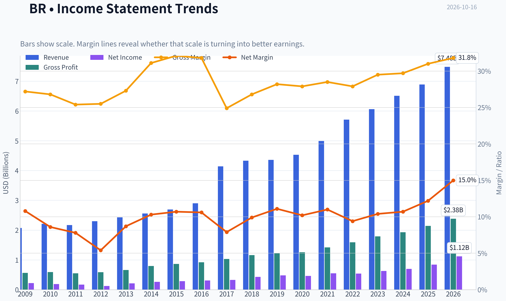

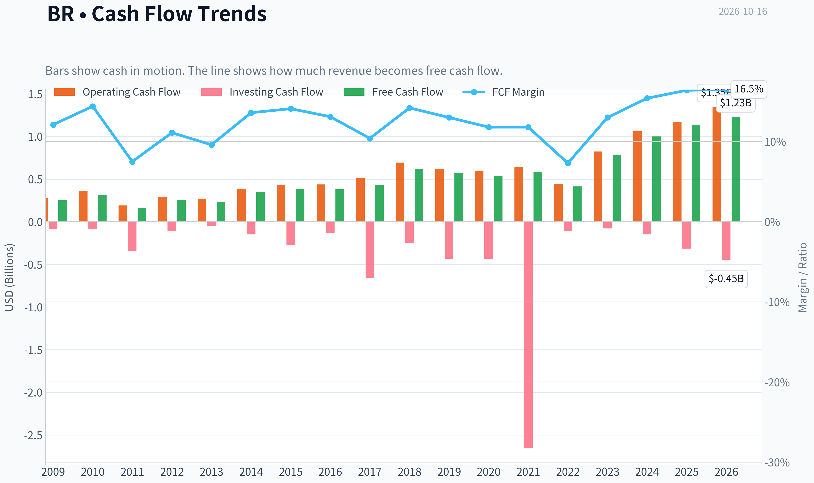

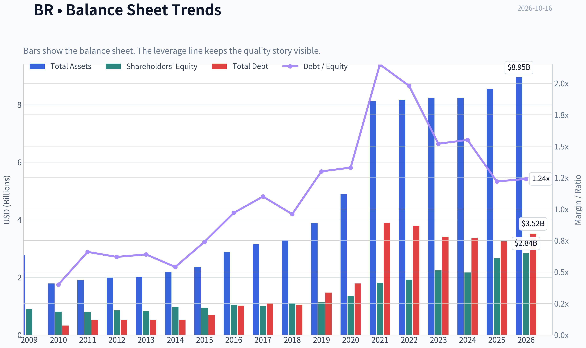

This graph tracks the profitability and return metrics (ROE, ROIC, Margins) of **BR** over the past decade, highlighting capital efficiency trends.

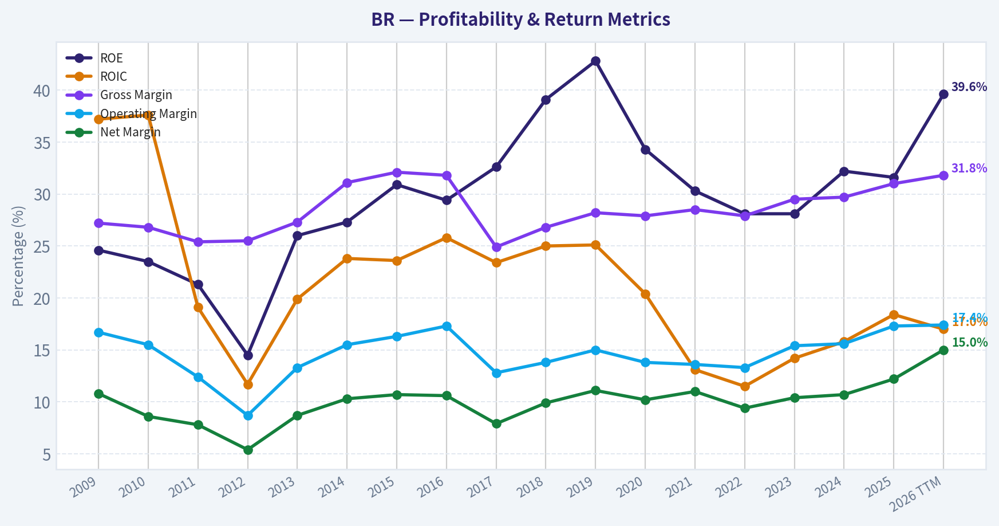

This chart illustrates the financial health of **BR** over the last 10 years, mapping cash equivalents and free cash flow against total obligations (Debt).

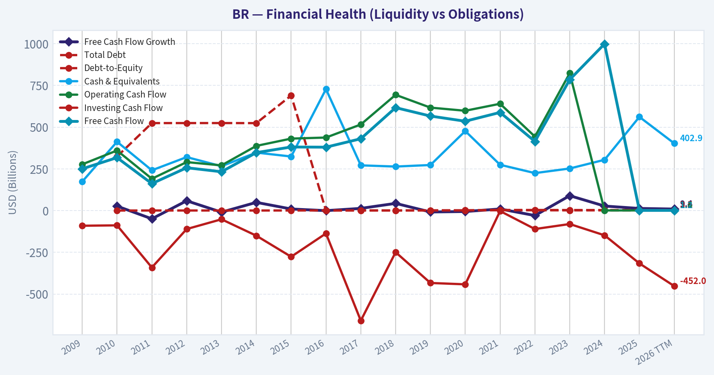

This comparison chart from *Profitability and Operating Performance* stacks current figures against historical benchmarks for **BR**, making it easy to see where the company trades relative to its own averages.

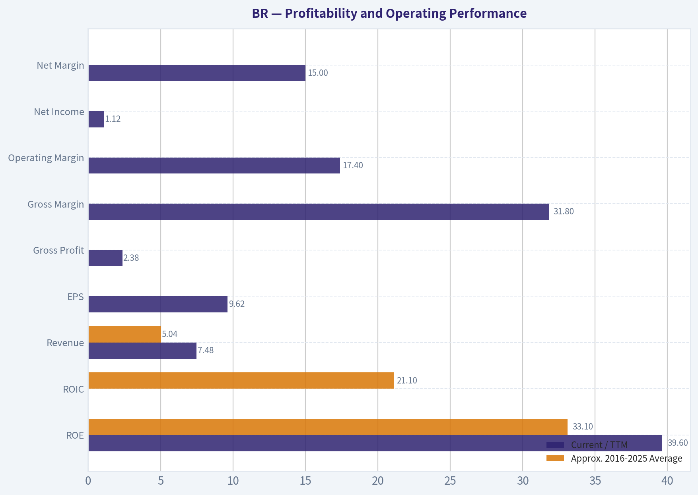

This breakdown chart from <em>Revenue Breakdown</em> shows the proportional composition for **BR** - useful for understanding what drives or risks the business.

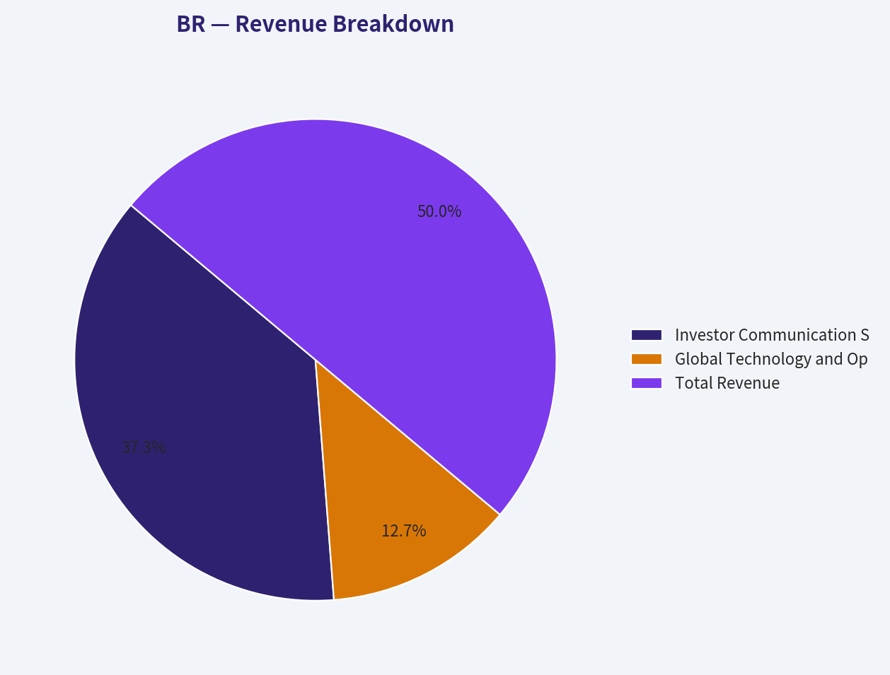

---

### Intrinsic Value Analysis (Buffett)

> *Following Warren Buffett's value investing philosophy: Circle of Competence, Economic Moat, Management Quality, and Margin of Safety.*

#### Intrinsic Value Snapshot

Price is what you pay. Intrinsic value is what the business may be worth based on the cash it can create for owners over time. We show a range, not one magic number.

- Current Price: $174.11
- Value Range (conservative to optimistic across both DCF methods): $75.99 to $367.81

##### Owner Earnings (Buffett Method)
- Net Income: $839,500,000.00
- Depreciation & Amortization: $341,300,000.00
- Capital Expenditures: $-67,200,000.00
- Working Capital Changes: $-218,600,000.00
- Owner Earnings: $1,347,600,000.00

##### Intrinsic Value
###### Buffett Method
Uses owner earnings. Stricter, and usually more conservative.
- Conservative: $104.97
- Average: $242.72
- Optimistic: $367.81
- Discount Rate: 10.0%

###### Cash Flow Method
Uses free cash flow. Better for companies spending heavily today to grow tomorrow.
- Conservative: $75.99
- Average: $163.58
- Optimistic: $319.86
- Discount Rate: 10.0%

ANALYST STANCE: **ADVOCATE**

#### Executive View

Broadridge Financial Solutions is a high-quality financial infrastructure company with recurring revenue, embedded client workflows, strong cash generation, and attractive long-term reinvestment economics. At approximately **$174 per share**, the stock trades at about **18.1 times earnings** and offers a headline intrinsic value of **$240.70**, implying approximately **27.7% upside**.

The principal risk is valuation sensitivity: the three valuation methods range from **$148 to $243 per share**. Even so, the price-implied 10-year growth rate of approximately **4.6%** appears modest relative to Broadridge's durable recurring-revenue model and historical growth.

#### 1. Factor Scorecard

| Factor | Score | Evidence |
|---|---:|---|
| Circle of Competence & Simplicity | 4/5 | Broadridge provides technology and back-office infrastructure that financial institutions depend on to process communications, transactions, and governance activities. The model is understandable, though its product suite is somewhat complex. |
| Moat | 4/5 | Embedded workflows, high switching costs, regulatory integration, scale, and recurring contracts create a durable competitive position. |
| Management & Capital Allocation | 4/5 | Strong shareholder-return orientation, consistent cash generation, and a business model that supports dividends, buybacks, and reinvestment. |
| Industry Structure | 4/5 | Financial infrastructure is more rational and durable than most technology markets. Scale and regulatory requirements discourage frequent customer switching. |

**Gate 5 hard floor:** **Not tripped.** The company shows positive earnings power, strong free cash flow, a reasonable earnings multiple, and no evidence of financial distress or an inability to service obligations.

#### 2. Moat Analysis

Broadridge's moat is primarily based on **switching costs, scale, regulatory embeddedness, and recurring customer relationships**.

- **Switching costs:** Broadridge's systems are integrated into mission-critical communications, investor services, and financial-market workflows. Replacing such systems involves operational, regulatory, data, and reputational risks.
- **Recurring revenue:** The company's revenue base is supported by recurring services and transaction-linked activity rather than one-time software sales.
- **Scale advantage:** Broadridge processes large volumes across financial institutions, allowing it to spread technology, compliance, and infrastructure costs over a broad customer base.
- **Regulatory and operational trust:** Financial institutions generally favor proven providers for mission-critical functions. Reliability and compliance history are difficult for new competitors to replicate quickly.
- **Growth runway:** The company can expand through additional outsourcing, automation, digital communications, governance services, and technology-enabled financial workflows.

Gross margin of **31.8%** is below the 40% threshold often associated with exceptional software businesses, but gross margin alone understates the moat in a transaction- and infrastructure-oriented model. The more important evidence is recurring revenue, customer embeddedness, and cash generation.

**Moat quality rating: Wide and stable - 4/5.**

#### 3. Management Quality Assessment

Management appears aligned with long-term shareholders through a combination of:

1. **Cash-return capacity:** Broadridge generates sufficient cash to support dividends, buybacks, and continued investment.
2. **Predictable reinvestment:** The company can invest in technology and expand services without requiring extreme balance-sheet leverage.
3. **Operational discipline:** The business has maintained attractive profitability while growing revenue by approximately **8.5% year over year**.
4. **Shareholder orientation:** The company's mature recurring-revenue model is suitable for consistent per-share value creation rather than speculative expansion.

The main diligence point is acquisition discipline. Broadridge has historically used acquisitions to broaden its capabilities, so future returns will depend on paying reasonable prices and achieving integration synergies.

**Management score: 4/5.**

#### 4. Financial Summary

| Metric | Latest figure |
|---|---:|
| Share price | $174 |
| Market capitalization | $19.66 billion |
| P/E ratio | 18.1x |
| Return on equity | 39.6% |
| Revenue growth, year over year | 8.5% |
| Gross margin | 31.8% |
| Free-cash-flow yield | 6.5% |
| Estimated annual free cash flow | Approximately $1.28 billion |
| Headline intrinsic value | $240.70 |
| Margin of safety versus price | 27.7% |
| Reverse-DCF implied annual growth | Approximately 4.6% for 10 years |

**Key Takeaways:** Broadridge combines respectable growth with a high return on equity and a 6.5% free-cash-flow yield. The market price appears to assume only moderate long-term growth, despite the company's recurring revenue and embedded infrastructure position. The main concern is that the valuation is more attractive under the owner-earnings and blended models than under the most conservative free-cash-flow model.

#### 5. Owner Earnings Calculation

The available cash-flow valuation implies approximately **$1.28 billion of annual free cash flow**, calculated as follows:

| Owner-earnings component | Approximate amount |
|---|---:|
| Net income and cash earnings base | Included in normalized cash flow |
| Depreciation and amortization | Added back in cash-flow calculation |
| Maintenance capital expenditure | Deducted |
| Working-capital investment | Deducted |
| Normalized owner earnings proxy | $1.28 billion |
| Approximate owner earnings per share | $11.31 |

**Key Takeaways:** Using normalized free cash flow as a conservative owner-earnings proxy, Broadridge produces roughly $1.28 billion of annual cash that can ultimately belong to shareholders. This represents approximately $11.31 per share, supporting the view that the business is generating substantial cash relative to its $174 share price.

#### 6. Three-Scenario DCF Valuation

The analysis uses approximately **113 million shares outstanding** and normalized owner earnings of approximately **$1.28 billion**.

| Scenario | Key assumption | Estimated value per share |
|---|---|---:|
| A. No growth | Owner earnings capitalized at 10% | $113 |
| B. GDP-like growth | 3% perpetual growth, 10% discount rate | $166 |
| C. Normalized historical growth | Approximately 5% long-term growth, 10% discount rate | $236 |
| Blended research valuation | FCFF, reverse DCF, and owner-earnings methods | $241 |

**Key Takeaways:** The no-growth case indicates that the stock is not deeply discounted on a liquidation-style basis; its value depends on continued business durability. However, even a modest 3% growth assumption produces a value close to the current price, while a reasonable 5% normalized growth assumption produces material upside.

#### 7. Margin of Safety Analysis

| Valuation method | Estimated value | Upside/(downside) versus $174 |
|---|---:|---:|
| No-growth DCF | $113 | -35% |
| 3% perpetual-growth DCF | $166 | -5% |
| Normalized-growth DCF | $236 | +36% |
| Owner-earnings model | $243 | +40% |
| Conservative FCFF model | $148 | -15% |
| Headline blended valuation | $241 | +38% |

**Key Takeaways:** The valuation range is wide, which reflects sensitivity to growth and cash-flow assumptions. For a high-quality, recurring-revenue compounder, the blended valuation implies a more than adequate margin of safety, but the conservative FCFF result argues against treating the stock as a no-risk bargain.

The reverse DCF is especially encouraging: the current price implies only about **4.6% annual growth for the next decade**. That is below Broadridge's recent growth rates and appears achievable if the company merely maintains its existing franchise and reinvestment opportunities.

#### 8. Final Buffett Scorecard

| Criterion | Weight | Score | Weighted contribution |
|---|---:|---:|---:|
| Moat width and durability | 25% | 4.0 | 1.00 |
| Valuation and margin of safety | 20% | 4.0 | 0.80 |
| Capital returns versus WACC | 15% | 4.0 | 0.60 |
| Business understanding and predictability | 12% | 4.0 | 0.48 |
| Management and capital allocation | 12% | 4.0 | 0.48 |
| Reinvestment runway | 8% | 4.0 | 0.32 |
| Balance-sheet strength | 4% | 4.0 | 0.16 |
| Industry structure | 4% | 4.0 | 0.16 |
| **Total** | **100%** |  | **4.00/5.00** |

**Key Takeaways:** Broadridge scores well because its competitive advantage is embedded in customer workflows, its cash flows are recurring, and the stock does not require heroic growth assumptions. The valuation is not compelling under every model, but it is attractive under normalized owner-earnings assumptions and reasonable for the quality of the franchise.

#### 9. Investment Stance

**ADVOCATE - Medium-to-high conviction.**

Broadridge resembles the type of business a long-term investor can own: understandable, recurring, mission-critical, cash generative, and supported by switching costs. At $174, it appears reasonably priced to moderately undervalued, with a blended intrinsic value near $241.

The appropriate expectation is not explosive upside, but steady per-share compounding from:

- Mid- to-high-single-digit revenue growth,
- Operating leverage and automation,
- Dividend growth,
- Share repurchases,
- Continued expansion of outsourced financial infrastructure.

The principal risks are slower financial-industry spending, technology disruption, acquisition overpayment, and a valuation contraction if growth falls materially below expectations. At the current price, those risks appear adequately balanced by the company's moat and cash-flow durability.
#### Valuation Bridge

This bridge places the current market price beside each intrinsic value lens so readers can see whether upside depends on one method or shows up across several methods.

| Scenario | Intrinsic Value / Share |
| --- | ---: |
| Buffett Method | $242.72 |
| Cash Flow Method | $163.58 |
| Damodaran Method | $148.13 |
| Current Price | $174.11 |

#### Key Takeaways

If one method is far above the others, the upside case depends on a specific modelling assumption. When several methods cluster together, the valuation story is more robust.

#### Valuation Visuals

This comparison chart from *Latest Earnings Snapshot* stacks current figures against historical benchmarks for **BR**, making it easy to see where the company trades relative to its own averages.

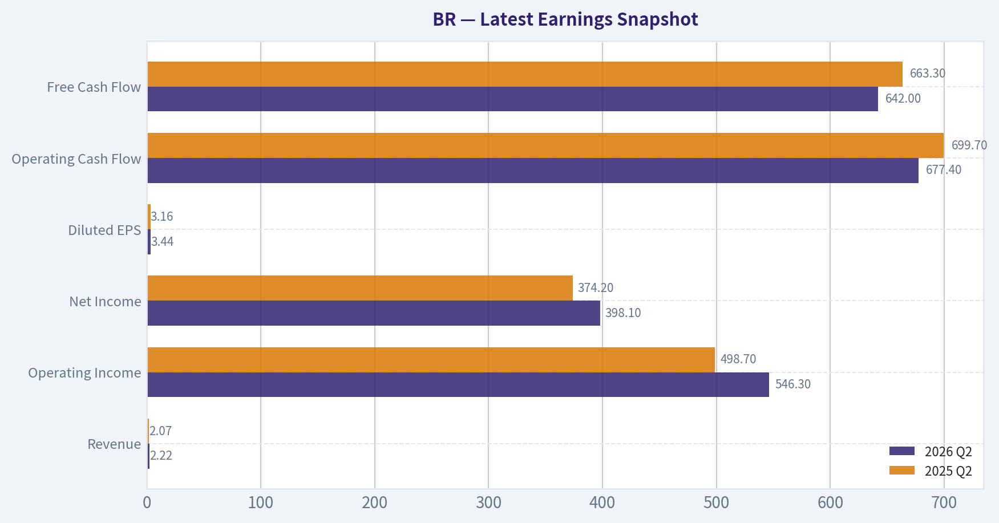

This comparison chart from *Balance Sheet and Financial Strength* stacks current figures against historical benchmarks for **BR**, making it easy to see where the company trades relative to its own averages.

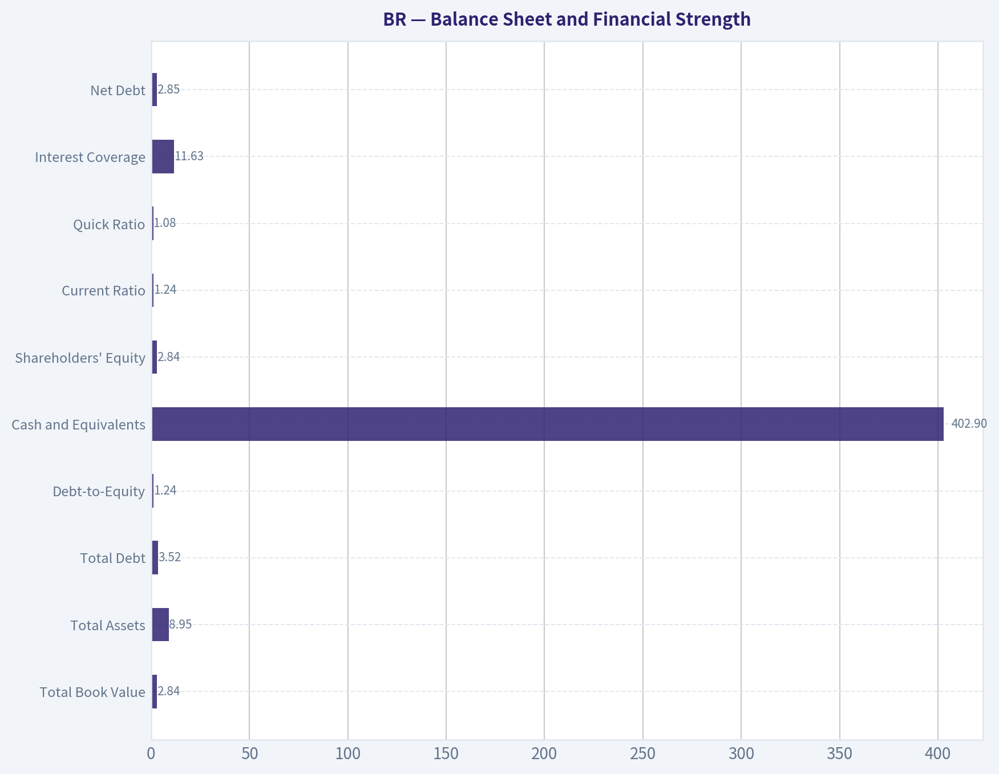

---

### Trend & Growth Analysis (Lynch/Druckenmiller/Fisher)

> *Following Peter Lynch's GARP, Stanley Druckenmiller's macro-aware approach, and Philip Fisher's scuttlebutt methodology.*

ANALYST STANCE: **WATCH**

#### 1. Lynch Classification

**Broadridge Financial Solutions (BR) is a stalwart, not currently a fast grower.** Revenue growth of 8.5% is respectable, but below the 15-25% range typically required for a primary growth-investing opportunity. Its recurring revenue, high return on equity, and financial-services infrastructure position make it a durable compounder, but the available data does not show a clear growth acceleration.

#### 2. The Story in Three Bullets

- **Mission-critical infrastructure:** Broadridge provides communications, governance, technology, and transaction-processing services that financial institutions are reluctant to replace.
- **Recurring-revenue model:** High customer stickiness, recurring contracts, and expanding sales backlog support visibility and resilience.
- **Operational upside:** AI-driven efficiencies, margin expansion, and strong free cash flow could support continued earnings and shareholder-return growth.

#### 3. Key Fundamentals

| Metric | Value | Interpretation |
|---|---:|---|
| Current price | $174 | Reference price |
| Market capitalization | $19.66B | Mid-to-large-cap compounder |
| Revenue growth, year over year | 8.5% | Stalwart-level growth |
| P/E ratio | 18.1x | Reasonable absolute multiple |
| Gross margin | 31.8% | Solid, though not software-like |
| ROE | 39.6% | Excellent capital efficiency |
| FCF yield | 6.5% | Attractive cash-flow valuation support |
| Current ratio | 1.24 | Adequate liquidity |
| Headline intrinsic value | $240.70 | Implies approximately 27.7% upside |
| Reverse-DCF implied growth | 4.6% annually for 10 years | Market expectations appear moderate |

**Key Takeaways:** Broadridge combines strong capital efficiency with a meaningful free-cash-flow yield and a moderate valuation. However, 8.5% revenue growth places it closer to a quality stalwart than a high-growth candidate. The reverse DCF suggests expectations are not aggressive, but the intrinsic-value estimate has substantial model dispersion.

#### 4. TAM Analysis and 10x Test

Broadridge participates in several markets: investor communications, wealth and capital-markets technology, governance, compliance, and outsourced financial infrastructure. Its practical opportunity is larger than its current revenue base because financial institutions continue to outsource non-core technology and regulatory workflows.

| TAM consideration | Assessment |
|---|---|
| Current market position | Established incumbent in financial-services infrastructure |
| TAM growth | Moderate; supported by outsourcing, regulation, digitization, and data requirements |
| 10x revenue test | Difficult to pass at current scale without entering adjacent markets |
| Primary expansion paths | Wealth technology, capital markets, governance, compliance, AI-enabled workflows |
| Runway quality | Good for steady compounding; less clearly sufficient for a ten-bagger |

**Key Takeaways:** Broadridge has a durable and expandable market, but its current scale and established position make a 10x revenue outcome demanding. The most credible upside comes from adjacent-market expansion and increased wallet share rather than explosive category creation.

#### 5. Revenue Growth Trend

| Indicator | Available evidence | Assessment |
|---|---|---|
| Current revenue growth | 8.5% year over year | Moderate |
| Direction of growth | No verified multi-quarter acceleration in the supplied data | Unconfirmed |
| Recurring revenue | Described as a major growth and stability driver | Positive |
| Sales backlog | Reported as expanding | Positive leading indicator |
| AI contribution | Efficiency and margin opportunity | Early-stage catalyst |
| Growth quality | Appears primarily recurring and operational, but organic/acquisition split is unavailable | Incomplete |

**Key Takeaways:** The business appears healthy, but the evidence supports steady growth rather than a confirmed inflection. An expanding backlog and AI-related efficiencies are encouraging, yet investors need several quarters of accelerating organic revenue or bookings growth before treating BR as a fast grower.

#### 6. Unit Economics and Profitability

| Metric | Result | Assessment |
|---|---:|---|
| LTV/CAC | Not disclosed in supplied data | Cannot verify |
| Net revenue retention | Not disclosed | Cannot verify |
| Rule of 40 | Not calculable without FCF margin | Incomplete |
| FCF yield | 6.5% | Strong cash-generation support |
| ROE | 39.6% | Excellent |
| Gross margin | 31.8% | Healthy for a diversified infrastructure provider |
| Margin trend | Reported margin-expansion potential | Positive, but requires confirmation |

**Key Takeaways:** Broadridge's cash generation and ROE are strong substitutes for the unavailable SaaS-style unit-economics metrics. The key question is whether AI and scale can produce sustained operating leverage without weakening service quality or requiring heavy investment.

#### 7. Inflection-Point Assessment

| Potential inflection | Evidence | Status |
|---|---|---|
| Product cycle | AI-enabled workflow and efficiency initiatives | Emerging |
| Market share | No quantified share data provided | Unconfirmed |
| Margin | Margin expansion cited in recent coverage | Positive but unverified |
| TAM | Adjacent financial-technology opportunities | Gradually expanding |
| Competitive position | Entrenched, mission-critical relationships | Structural strength |
| Earnings expectations | Reverse DCF assumes only 4.6% long-term growth | Potentially conservative |

**Key Takeaways:** The strongest possible inflection is a combination of AI-driven cost savings, backlog conversion, and cross-selling into adjacent financial-technology markets. At present, this is a developing thesis rather than a proven acceleration. The stock becomes more compelling if revenue growth rises above 12-15% while margins expand.

#### 8. Macro Setup

Broadridge is relatively defensive because its services are embedded in financial-market operations and regulatory processes. It may benefit from continued digitization, outsourcing, market complexity, and compliance spending. However, it is not a pure high-duration growth stock, so falling interest rates would be helpful but are not essential to the thesis.

**Macro assessment: Neutral to favorable.** The business has secular support, but economic-market activity, financial-institution budgets, and technology spending can still affect growth.

#### 9. Fisher's 15-Point Assessment

Scores are provisional because the supplied research does not include detailed management interviews, customer checks, retention data, or full filing review.

| Fisher criterion | Score / 5 |
|---|---:|
| Market potential | 4 |
| New-product determination | 4 |
| R&D effectiveness | 3 |
| Sales organization | 4 |
| Profit margins | 4 |
| Margin improvement | 4 |
| Labor relations | 3 |
| Executive relations | 3 |
| Management depth | 4 |
| Cost analysis and accounting | 4 |
| Special competitive advantages | 5 |
| Long-range profit outlook | 4 |
| Dilution risk | 4 |
| Management candor | 3 |
| Management integrity | 4 |
| **Total** | **56 / 75** |

**Key Takeaways:** A provisional Fisher score of 56 places Broadridge in the "good" category. Its strongest attributes are mission-critical customer relationships, competitive entrenchment, recurring revenue, and long-term profit durability. The score is held back by limited evidence on innovation effectiveness, customer retention, management candor, and employee culture.

#### 10. Valuation Analysis

| Valuation method | Result | Interpretation |
|---|---:|---|
| P/E | 18.1x | Reasonable for a durable compounder |
| Approximate PEG | 2.13 | Expensive relative to current 8.5% growth |
| FCF yield | 6.5% | Attractive support |
| Owner-earnings DCF | $242.72 | Bullish |
| FCF-based model | $163.58 | Slightly below current price |
| Damodaran FCFF model | $148.13 | Below current price |
| Weighted headline intrinsic value | $240.70 | Approximately 27.7% above price |

**Key Takeaways:** Valuation is mixed rather than obviously cheap. The P/E is reasonable for a stable, high-ROE company, and the FCF yield is supportive, but the approximate PEG of 2.1 is unattractive for only 8.5% growth. The large spread among valuation models means the investment case depends materially on recurring growth, margin expansion, and successful AI execution.

#### 11. Growth Investor Scorecard

| Criterion | Weight | Score / 5 | Weighted contribution |
|---|---:|---:|---:|
| The Story | 10% | 4.0 | 0.40 |
| TAM and runway | 20% | 3.2 | 0.64 |
| Revenue growth | 20% | 2.8 | 0.56 |
| Unit economics | 15% | 3.5 | 0.53 |
| Competitive position | 10% | 4.5 | 0.45 |
| Management quality | 10% | 3.8 | 0.38 |
| Macro setup | 5% | 3.5 | 0.18 |
| Profitability path | 5% | 4.2 | 0.21 |
| Valuation | 5% | 3.2 | 0.16 |
| **Total** | **100%** |  | **3.51 / 5.00** |

**Key Takeaways:** The score of 3.51 supports a **WATCH** rating. Broadridge is a high-quality, defensible compounder, but current growth is not strong enough to justify high-conviction growth-investor status. The score would improve materially with accelerating organic growth, verified retention metrics, and a clearer AI-driven margin inflection.

#### 12. Position Size Stance

**Suggested stance: small starter position or hold, not an aggressive new position.**

- Existing holders: **Hold and monitor.**
- New investors: Consider a **1-2% starter position** only if seeking quality and cash-flow durability.
- Increase exposure if revenue growth accelerates above 12-15%, backlog converts into stronger organic growth, or valuation falls closer to the lower end of the model range.
- Avoid treating BR as a likely ten-bagger unless management demonstrates a much larger adjacent-market opportunity.

#### 13. Key Catalysts and Risks

| Catalysts | Risks |
|---|---|
| Sustained backlog conversion | Revenue growth remains stuck near 8-10% |
| AI-driven productivity and margin expansion | AI benefits fail to translate into earnings |
| Cross-selling into wealth and capital-markets technology | Financial-institution technology budgets weaken |
| Greater outsourcing and regulatory complexity | Customer concentration or contract losses |
| Falling rates supporting valuation multiples | Multiple compression if rates remain high |
| Share repurchases supported by strong FCF | Acquisitions dilute returns or increase leverage |

**Key Takeaways:** The central catalyst is an acceleration from dependable stalwart growth toward genuine high-teens growth through backlog, AI, and adjacent products. The central risk is that these initiatives merely preserve margins while revenue remains moderate, leaving the stock fairly valued rather than materially undervalued.

#### Bottom Line

Broadridge is a **quality financial-technology infrastructure company with durable competitive advantages, strong ROE, recurring revenue, and attractive cash generation**. It is not yet a clear fast grower or ten-bagger candidate: the current 8.5% revenue growth and approximate PEG above 2 indicate that the market is paying a respectable price for a stalwart.

**Final stance: WATCH.** The stock is worthy of monitoring and may suit a modest position, but a stronger recommendation requires verified growth acceleration, improving organic bookings, and evidence that AI and adjacent markets can lift the long-term growth rate above the current stalwart profile.

#### Growth & Scorecard Visuals

This comparison chart from *Growth and Cash-Flow Trends* stacks current figures against historical benchmarks for **BR**, making it easy to see where the company trades relative to its own averages.

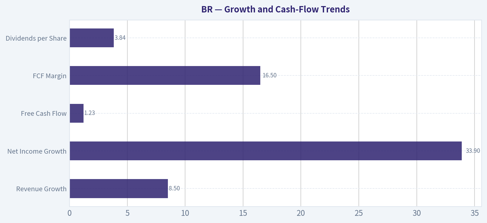

---

### Market Technical Analysis

ANALYST STANCE: **WATCH**

#### BR technical analysis - as of October 15, 2026

BR's latest available trading session was October 15, 2026, when it closed at **$174.11**. October 16 is not listed as a completed trading session in the retrieved data, so the analysis uses October 15 as the effective reference date.

The stock is showing a meaningful short-term recovery, but the longer-term trend remains in transition rather than conclusively bullish. BR has rallied from its late-June low near **$134.61** to $174.11, a gain of roughly 29%. However, it remains well below the October 2025 level above $220, and the 200-day moving average is still declining.

#### Trend structure

The short-term trend has improved substantially:

- The **10-day EMA is $166.50**, and the latest close is about $7.61 above it.
- The **50-day SMA is $169.40**, placing the stock approximately $4.71 above this medium-term trend line.
- The **200-day SMA is $166.49**, so the stock is also trading above its long-term average.
- The 50-day average has been rising steadily from approximately $164.13 on September 16 to $169.40 on October 15.
- The 200-day average, by contrast, has declined from roughly $172.81 to $166.49 over the same period.

This creates an important transition pattern: price has reclaimed both major averages, and the 50-day SMA has moved above the 200-day SMA in the recent data. That is constructive, but because the 200-day average is still sloping downward, the signal should be treated as an early recovery confirmation rather than a fully established long-term uptrend.

The recent price action also supports the improving short-term picture. BR moved from $156.93 on October 2 to $174.11 on October 15, with higher highs and higher lows during much of the advance. The October 15 close was near the session's upper range, indicating buying interest persisted into the close.

#### Momentum and MACD

Momentum has turned decisively upward.

The MACD improved from approximately **-2.91 on October 6** to **+0.32 on October 15**. This move through zero is more significant than a small isolated crossover because it followed several weeks of negative and deteriorating momentum. The MACD histogram also shifted from **-0.87 on October 5** to **+1.49 on October 15**, showing that upside momentum is not merely stabilizing; it is currently accelerating.

The positive histogram is supportive of further near-term strength, but traders should monitor whether it continues expanding. A shrinking positive histogram, especially near resistance, would suggest that the rebound is losing force even if price remains elevated.

RSI stands at **65.6**, up sharply from the high-30s and low-40s earlier in October. This is a strong momentum reading, but it is not yet traditionally overbought because it remains below 70. The current RSI therefore supports continuation while leaving some room for additional upside. At the same time, the rapid rise from depressed levels means a short-term pause or pullback would be normal and would not necessarily invalidate the recovery.

#### Volume and price confirmation

The volume-weighted moving average is approximately **$163.09**, well below the latest close. BR is therefore trading above the level at which recent volume has been concentrated, which supports the credibility of the rebound.

There were several notable volume surges during the broader decline and recovery, including elevated activity around the late-June low and again during the October advance. However, the latest rally has not been accompanied by an extreme single-day volume spike. This suggests improving demand, but not yet the kind of unusually strong accumulation that would independently confirm a major breakout.

The gap between price and VWMA is constructive but also means the stock has moved somewhat quickly away from its volume-weighted base. A retracement toward the $169-$166 area could therefore be technically healthy rather than automatically bearish.

#### Volatility and risk management

ATR is approximately **$3.87**, down from about $5.01 in mid-September. This indicates that daily volatility has moderated as the recovery developed. ATR is currently about 2.2% of the stock price, which is manageable for a large-cap stock but still material for stop placement.

A volatility-aware approach would avoid placing stops too close to the current price. For example, a stop distance of roughly one ATR below an entry would be about $3.87, while a wider swing-trade stop might require approximately 1.5 ATR. The correct level depends on position size and risk tolerance; the important point is that normal daily movement can easily exceed a narrow stop.

#### Key price levels

The first nearby test is the recent high around **$174.78**. A sustained close above that level would confirm that the recovery is extending beyond the immediate October rebound.

Above $174.78, the next potential resistance zone is approximately **$177-$185**, corresponding to the late-August consolidation and swing highs. A move into that region could attract profit-taking because it would represent a substantial extension from the October 2 low.

On the downside, the first support area is approximately **$169-$170**, near the 50-day SMA and recent breakout structure. A pullback that holds this zone would preserve the improving short-term trend. The next support is near **$166-$167**, where the 10-day EMA and 200-day SMA currently cluster. A decisive close below that area would weaken the recovery thesis and raise the risk that the October rally was only a countertrend bounce.

#### Trading interpretation

The technical evidence is **constructive in the short term but not yet sufficient for an outright aggressive bullish stance**.

A continuation setup would be stronger if BR either:

1. Breaks and holds above $174.78 with confirming volume, or
2. Pulls back toward $169-$170 and stabilizes while remaining above the rising 50-day SMA.

Chasing the stock after the rapid move from $156.93 to $174.11 carries unfavorable short-term risk unless the breakout is confirmed. Conversely, a controlled pullback toward the moving-average cluster could offer a better risk-to-reward entry, provided momentum does not deteriorate sharply.

The primary warning sign would be a close back below $166-$167 accompanied by renewed negative MACD momentum. Until that occurs, the weight of the evidence favors continued monitoring for bullish continuation, while recognizing that the declining 200-day SMA means the longer-term trend has not fully repaired.

#### Selected indicators

The selected eight indicators are:

- **close_10_ema** - responsive measure of short-term price direction.
- **close_50_sma** - medium-term trend and dynamic support.
- **close_200_sma** - long-term trend filter.
- **macd** - momentum direction and zero-line transition.
- **macdh** - acceleration or deceleration of momentum.
- **rsi** - momentum strength and overbought/oversold context.
- **vwma** - volume-confirmed trend positioning.
- **atr** - volatility-adjusted risk and stop placement.

These indicators are complementary: moving averages establish trend structure, MACD and its histogram assess momentum, RSI measures momentum intensity, VWMA adds volume confirmation, and ATR addresses risk. Bollinger Bands were not prioritized because the selected moving averages, momentum measures, and ATR already provide a more direct framework for this recovery-phase market condition.

| Indicator / Area | Latest reading or level | Interpretation | Trading implication |
|---|---:|---|---|
| Latest close | $174.11 on October 15 | Strong rebound and close near recent highs | Short-term bias is constructive |
| 10-day EMA | $166.50 | Price is materially above short-term trend | Momentum favors continuation, but extension risk is rising |
| 50-day SMA | $169.40 | Rising steadily and below price | Medium-term trend has improved; potential support near $169-$170 |
| 200-day SMA | $166.49 | Below price but still declining | Recovery is improving, but long-term trend is not fully confirmed |
| MACD | +0.32 | Recently moved from negative to positive | Momentum regime has turned more favorable |
| MACD histogram | +1.49 | Positive and expanding | Upside momentum is accelerating |
| RSI | 65.6 | Strong but below the 70 overbought threshold | Further upside is possible, though a pause would be normal |
| VWMA | $163.09 | Price is well above volume-weighted average | Recent demand supports the rally, but price is extended from its volume base |
| ATR | $3.87 | Volatility has declined from September | Stops should allow for roughly $4 of ordinary movement |
| Initial resistance | $174.78 | Recent October high | Sustained break would improve the continuation case |
| Secondary resistance | Approximately $177-$185 | Prior late-August trading zone | Likely area for increased profit-taking |
| Initial support | Approximately $169-$170 | Near the 50-day SMA | Holding this area would preserve the short-term uptrend |
| Major support | Approximately $166-$167 | Near the 10-day EMA and 200-day SMA | Breakdown would materially weaken the recovery setup |

**Key Takeaways:** BR's short-term technical picture has improved considerably: price is above its key moving averages, MACD has turned positive, the histogram is expanding, and RSI is strong without yet being overbought. The main issue is that the 200-day average is still declining, so this is better viewed as an emerging recovery than a fully confirmed long-term bull trend. Traders should watch $174.78 for breakout confirmation and $169-$170 for support on a pullback.

#### Market Visuals

This comparison chart from *Current Market Metrics* stacks current figures against historical benchmarks for **BR**, making it easy to see where the company trades relative to its own averages.

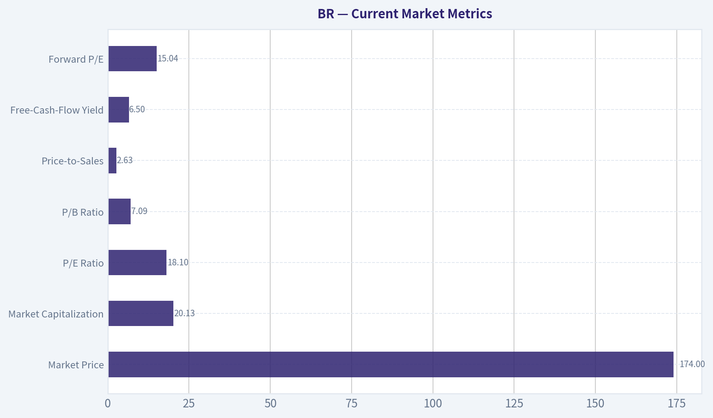

---

### Options Market Analysis

> *Reading options flow - put/call ratios, IV skew, and unusual activity - to gauge institutional positioning and event-driven risk.*

#### BR Options Market Report

**As of October 16, 2026.** The available options data for BR is extremely thin, with almost no open interest across near-term expirations. This materially reduces confidence in any directional interpretation.

#### Put/Call Ratio Analysis

| Expiration | Call OI | Put OI | Put/Call OI Ratio | Call Volume | Put Volume | Put/Call Volume Ratio |
|---|---:|---:|---:|---:|---:|---:|
| October 16, 2026 | 0 | 0 | N/A | 711 | 99 | 0.14 |
| November 20, 2026 | 0 | 0 | N/A | 37 | 98 | 2.65 |
| December 18, 2026 | 14 | 36 | 2.57 | 68 | 94 | 1.38 |
| **Near-term total** | **14** | **36** | **2.57** | **816** | **291** | **0.36** |

**Key Takeaways:** The aggregate put/call OI ratio of 2.57 is substantially above the approximately 0.70 neutral baseline, indicating more outstanding put protection or bearish positioning. However, near-term volume is dominated by calls, largely because of the October 16 expiration, so trading flow is more bullish or speculative than the open-interest picture. With only 50 contracts of total open interest, the ratio is statistically fragile.

#### Implied Volatility Assessment

| Expiration | Call ATM IV | Put ATM IV | IV Interpretation |
|---|---:|---:|---|
| October 16, 2026 | 5.2% | 4.2% | Calls modestly richer |
| November 20, 2026 | 1.2% | 1.6% | Puts modestly richer |
| December 18, 2026 | 0.7% | 16.9% | Extremely steep put-side premium |

**Key Takeaways:** December put IV of 16.9% versus call IV of 0.7% represents an exceptionally steep downside skew and is the strongest bearish signal in the dataset. The very low call IV readings and near-zero open interest suggest that the volatility figures may be unreliable or affected by stale quotes and wide spreads. No specific earnings, product, or other catalyst was provided, so elevated December put IV cannot be confidently attributed to a known event.

#### Unusual Options Activity

No contracts met the screening threshold of volume greater than five times open interest. Therefore, there is no verified unusual activity that can be classified as a fresh institutional directional bet.

| Observation | Interpretation |
|---|---|
| October call volume: 711 with zero reported OI | High activity, but insufficient OI data to determine whether positions were opened or closed |
| November put volume: 98 with zero reported OI | Potential bearish or hedging flow, but not verifiable as fresh positioning |
| December put volume: 94 versus 36 OI | Elevated relative to OI, but below the tool's unusual-activity threshold |

**Key Takeaways:** The absence of contracts exceeding the unusual-activity threshold means there is no clear smart-money signal. October call activity may reflect short-dated speculation, closing trades, or quote/data artifacts. The December put activity is directionally concerning, but the dataset does not establish whether it represents new bearish bets.

#### Open Interest Concentration and Gamma Levels

| Expiration | Highest Reported OI Information | Gamma-Wall Assessment |
|---|---|---|
| October 16, 2026 | No call or put OI reported | No reliable gamma levels |
| November 20, 2026 | No call or put OI reported | No reliable gamma levels |
| December 18, 2026 | 14 call OI and 36 put OI in aggregate | Put-side concentration, but individual strikes unavailable |

**Key Takeaways:** Strike-level open interest was not supplied, so specific pinning levels, max-pain levels, and gamma walls cannot be identified. December has the only meaningful reported OI, concentrated more heavily in puts than calls, which could create downside hedging pressure. Overall, the open-interest base is too small to expect a dependable gravitational price level.

#### Overall Options Sentiment

**Signal: BEARISH, with very low confidence.**

The primary bearish driver is the **2.57 put/call OI ratio combined with the extremely wide December put-volatility skew**. These suggest downside protection is materially more valuable than upside exposure in the longer near-term expiration. Against that, aggregate volume is call-heavy, especially in the expiring October chain, which introduces a bullish counter-signal.

BR's options market should be treated as **illiquid and unreliable for strong directional conclusions**. The lack of meaningful open interest, zero-OI expirations, missing strike-level data, and unusually low IV readings indicate that apparent ratios may be distorted by stale quotes or sparse trading. There is no confirmed unusual institutional flow and no known catalyst identified in the supplied data.

#### Summary

| Category | Assessment |
|---|---|
| Put/Call Ratio | **Bearish on OI:** 2.57 versus approximately 0.70 neutral; **bullish on volume:** 0.36 overall |
| IV Level | Generally very low and potentially unreliable; December put IV is sharply elevated relative to calls |
| Skew Direction | **Strong put skew**, especially for December |
| Unusual Activity | None confirmed by the volume-to-OI screen |
| Overall Signal | **BEARISH, low confidence**, driven by put-heavy OI and steep downside skew |

**Key Takeaways:** BR's options positioning leans bearish because puts dominate open interest and December downside volatility is substantially richer than call volatility. However, heavy short-dated call volume and extremely thin open interest weaken the signal. The appropriate interpretation is bearish caution rather than a high-conviction institutional sell signal.

---

## Research Team Commentary

> *The Research Manager synthesizes the Bull vs Bear debate into action-free commentary. This is a pre-risk view, not the final stance.*

Core takeaway: Broadridge appears to be a genuinely high-quality, wide-moat financial-infrastructure business, but the evidence does not yet establish enough valuation support for a full-sized purchase at $174. The moat, 17.8% ROIC, recurring revenue, and mission-critical customer relationships make the company attractive for a long-term watchlist. However, the claimed 12%-18% discount depends heavily on treating reported EPS as nearly equivalent to owner earnings and using relatively accommodating DCF assumptions. I would hold an existing position but wait before initiating aggressively.

The strongest bull argument is business quality. Broadridge is embedded in regulated workflows where reliability, compliance, integration history, and institutional trust matter more than having the newest interface. Customers face meaningful migration and operational risks when changing providers, while Broadridge can spread cybersecurity, technology, and compliance costs across a large processing base. Those switching costs and scale advantages should remain relevant over a ten-year horizon.

The profitability evidence supports this assessment. A 17.8% ROIC and 12.6% ROA indicate real economic value creation, not merely an inflated asset-light ROE. Recurring contracts provide visibility, while transaction growth, pricing, cross-selling, outsourcing, and financial-system complexity offer a plausible mid-single-digit or better growth runway. AI is best viewed as potential productivity and service-enhancement upside, not as the foundation of the thesis.

The valuation is also not obviously excessive. At 18.14 times earnings, BR offers an accounting earnings yield of approximately 5.5%. If normalized per-share earnings can grow 6%-8% over time while the valuation remains stable, satisfactory long-term returns are plausible. For a predictable wide-moat compounder, a 10%-15% discount can be sufficient; a massive cigar-butt discount is unnecessary.

The bear's strongest point is that the actual discount has not been demonstrated with owner earnings. At 90% earnings conversion, 6% growth, a 9% discount rate, and 3% terminal growth, the supplied value is about $186-only 7% above the current price. Raising the required return to 10% and reducing terminal growth to 2.5% causes estimated value to fall materially. This sensitivity means the difference between "attractive" and "fully valued" rests on missing information about free-cash-flow conversion, capitalized development, maintenance investment, working capital, and leverage.

The bull also overstates expected returns by loosely combining the entire 5.5% earnings yield with 6%-8% growth. Earnings retained to fund growth are not simultaneously distributable to shareholders, although the bear's retention calculation is also only an approximation because much technology investment is expensed before reported EPS. The correct solution is a proper owner-earnings bridge, not assuming either perfect conversion or unusually heavy capital requirements.

Management quality and financial strength remain incompletely established. Consolidated ROIC is encouraging, but the package lacks organic versus acquired growth, incremental returns on acquisitions, net leverage, interest coverage, goodwill, share-count changes, and buyback prices. Missing information is not evidence of distress, so an AVOID rating would be excessive. It does, however, prevent confidently awarding management and the balance sheet the premium assumed in the optimistic valuation.

The moat is credible but not costless. Broadridge must continuously spend on cybersecurity, regulatory compliance, resilience, cloud migration, and modernization of legacy integrations. Large financial institutions may also capture some AI productivity gains during contract negotiations. The central long-term risk is therefore gradual pressure on incremental margins and returns, not sudden displacement by a fintech startup.

Market signals do not change the conclusion. Trading above the 10-day, 50-day, and 200-day averages indicates a constructive trend, but the stock is only modestly above the medium- and long-term averages. This supports patience rather than providing evidence of either a bargain or an imminent breakdown. The 2.57 options put/call ratio should receive almost no weight because open interest is extremely thin. There is no reliable derivatives-based bearish signal.

From a contrarian perspective, there is no clear sign of panic creating an opportunity. The market appears to recognize Broadridge's quality and is pricing in continued competent execution. Nor does the 18 times earnings multiple demonstrate obvious euphoria. The likely mispricing, if any, is modest rather than dramatic. This is exactly where valuation discipline matters: an excellent franchise can still produce mediocre returns if purchased without verifying its distributable cash economics.

My practical interpretation of WATCH is to retain a reasonable existing position but avoid initiating a full position solely from the supplied data. A small starter position could be justified for investors willing to complete the cash-flow and balance-sheet diligence, but the evidence does not support aggressive accumulation. A price around the mid-$160s would be more interesting if normalized owner earnings remain intact, while proof of consistently strong cash conversion could justify buying nearer the present price. These should be dynamic thresholds tied to updated fundamentals rather than rigid price targets.

Over the next one to four quarters, I would monitor organic recurring-revenue growth, customer retention, closed sales or backlog, and the split between recurring and transaction-sensitive revenue. Growth consistently above roughly 5%-6%, without acquisition dependence, would strengthen the reverse-DCF case. Persistent growth below that range would suggest the market's hurdle is less conservative than the bull claims.

The most important accounting test is conversion of net income or adjusted EPS into free cash flow. That review should explicitly include capitalized software development, maintenance capital expenditure, working-capital movements, restructuring costs, stock compensation, and recurring acquisition spending. Sustainable conversion near or above 90% would materially strengthen the thesis; conversion materially below 80% would weaken the proposed intrinsic value.

I would also watch operating margins and incremental margins to determine whether AI and automation are creating shareholder value rather than merely offsetting rising compliance and technology expenses. Stable or expanding margins alongside continued investment would be positive. Margin compression combined with rising technology spending would suggest that maintaining the moat is becoming more expensive.

Balance-sheet and capital-allocation monitoring should include net debt to EBITDA, interest coverage, debt maturities, acquisition multiples, post-acquisition returns, goodwill growth, and diluted share count. ROIC should remain comfortably above the cost of capital. A decline toward low-double-digit levels, especially alongside debt-funded acquisitions, would undermine the compounder thesis.

Finally, watch for customer losses, weaker renewals, pricing pressure, major outages, cybersecurity incidents, or evidence that new providers are winning specific modules. Technical levels can guide execution, but they should not override intrinsic value: losing the approximately $166-$169 moving-average area would matter only if accompanied by deteriorating fundamentals, while a breakout without better cash-flow evidence would not by itself justify chasing the shares.

The lesson from prior mistakes is to separate franchise quality from entry quality, reconcile earnings with owner earnings before claiming a discount, and avoid converting missing data into either unjustified optimism or an invented distress thesis. Broadridge is much closer to a wonderful business at a nearly fair price than to either a bargain or a value trap. The quality merits close attention; the currently demonstrated margin of safety merits patience.

Final stance: WATCH

---

## Value Investing Team Commentary

> *The Investor translates the research view into an investment thesis before risk review. This is still not the final stance.*

### Broadridge Financial Solutions (BR): Excellent Franchise, Incomplete Margin of Safety

Broadridge appears to be a high-quality financial-infrastructure business rather than an ordinary technology vendor. Its services sit inside regulated, mission-critical workflows where reliability, compliance, integration history, and institutional trust matter greatly. Replacing such a provider creates operational, regulatory, and reputational risks, giving Broadridge meaningful switching costs and pricing resilience.

The recurring-revenue model, processing scale, and entrenched customer relationships support durable earnings power. A reported **17.8% ROIC** and **12.6% ROA** provide stronger evidence of business quality than the **39.6% ROE**, which could be amplified by leverage or a relatively small equity base. Assuming the ROIC calculation is comparable across periods, Broadridge is creating substantial value above a normal cost of capital.

### Long-term opportunity

Broadridge has several credible growth levers:

- Contractual recurring-revenue growth and customer retention
- Pricing and cross-selling across existing institutional relationships
- Greater outsourcing by financial institutions
- Increasing regulatory and operational complexity
- Transaction growth over a full market cycle
- Automation and AI-assisted productivity improvements

AI should be treated as incremental upside, not the core investment thesis. It could improve service capabilities and internal efficiency, but customers may capture part of those benefits through contract negotiations. Broadridge must also continue investing heavily in cybersecurity, resilience, compliance, cloud infrastructure, and legacy-system modernization. Those expenditures are the price of maintaining the moat.

### Valuation and reverse-DCF perspective

At **$174** and **18.14 times earnings**, implied EPS is approximately **$9.59**, producing an accounting earnings yield near **5.5%**. That is not obviously expensive for a predictable, wide-moat compounder, but neither is it an unmistakable bargain.

If owner earnings equal 90% of reported earnings, normalized owner earnings would be approximately **$8.63 per share**. Under a 9% required return and 3% terminal growth, the current price roughly implies only about **5% annual owner-earnings growth over the next decade**. That appears achievable.

However, using a more demanding 10% required return and 2.5% terminal growth raises the implied growth requirement to roughly **8%**. That is still possible, but it requires sustained execution and leaves considerably less room for weak cash conversion, acquisition mistakes, margin pressure, or leverage.

The supplied intrinsic-value estimate of approximately **$186** represents only about **7% upside** from $174. That falls short of the normal **10%-15% discount** that could justify buying a truly exceptional company at a fair price. More importantly, even that modest discount relies on assumed owner-earnings conversion rather than a demonstrated cash-flow bridge.

The missing information is therefore material:

- Free-cash-flow conversion over a full cycle
- Capitalized software-development costs
- Maintenance versus growth capital expenditure
- Stock-based compensation
- Recurring restructuring and acquisition costs
- Net leverage and interest coverage
- Acquisition returns and goodwill growth
- Diluted share-count trends and repurchase prices

Broadridge does not need a 30% discount if its quality is confirmed. But the evidence should establish that reported earnings translate reliably into distributable cash before a smaller margin of safety is accepted.

### Management and capital allocation

The current ROIC supports a favorable preliminary judgment, but management quality cannot be fully assessed from consolidated profitability alone. Broadridge has used acquisitions as part of its growth strategy, making incremental acquisition returns particularly important.

The key question is whether management is purchasing durable earnings at sensible prices or using debt and goodwill to preserve headline growth. ROIC should remain comfortably above the cost of capital without depending on favorable acquisition accounting. Buybacks create value only when shares are repurchased below conservative intrinsic value; buying aggressively at a premium valuation would not constitute shareholder-friendly capital allocation.

### Selective contrarian assessment

There is no obvious sentiment-driven opportunity at present. BR trades above its 10-day, 50-day, and 200-day moving averages, suggesting the market already recognizes the franchise's quality. The stock is not surrounded by the fear, forced selling, or temporary controversy that often creates an attractive contrarian entry.

The **2.57 put/call open-interest ratio** looks bearish in isolation, but the options market is too thin to support a meaningful conclusion. A handful of hedges can distort the ratio dramatically. Treating it as evidence of informed bearish positioning would be false precision.

The more useful contrarian observation is that investors may be too comfortable labeling Broadridge a predictable compounder without sufficiently examining the cost of maintaining its infrastructure and the cash returns from acquisitions. Conversely, bears may underestimate the durability of institutional switching costs: a credible fintech competitor cannot easily replace decades of integration, regulatory trust, and operational reliability.

Thus, neither an aggressively bullish nor bearish contrarian position is warranted. The market's current view-excellent business, continued competent execution expected-appears broadly rational.

### Practical investment approach

Existing shareholders can reasonably continue holding, provided cash conversion, leverage, and competitive indicators remain sound. A prospective investor could take a small starter position if willing to accept near-fair value, but the current evidence does not justify a full allocation.

A more attractive entry would emerge through either:

1. **Price improvement:** A decline toward the mid-$160s without deterioration in recurring revenue, customer retention, margins, or ROIC; or
2. **Evidence improvement:** Proof that adjusted earnings consistently convert into owner earnings at approximately 90% or better, with moderate leverage and disciplined acquisition returns.

Important operating signals over the next several quarters include:

- Organic recurring-revenue growth around or above 5%-6%
- Stable retention, backlog, and closed sales
- Free-cash-flow conversion consistently near or above 90%
- Stable or expanding operating and incremental margins
- ROIC remaining comfortably above the cost of capital
- Controlled leverage, goodwill, and diluted share count
- No significant outages, cybersecurity incidents, customer losses, or pricing pressure

Cash conversion materially below 80%, acquisition-driven growth accompanied by rising leverage, or ROIC drifting toward the low double digits would weaken the compounder thesis. Conversely, consistently strong owner earnings could support purchasing near the present price even without a substantial pullback.

**ANALYST STANCE: WATCH** - Broadridge is a wonderful, wide-moat business trading near a reasonable rather than compelling price. The implied growth appears achievable, but the demonstrated discount is below the quality-adjusted threshold and depends on unverified owner-earnings conversion. Hold existing shares, consider only a modest starter position, and reserve aggressive accumulation for stronger cash-flow evidence or a better price.

---

## Deep Values Commentary

> *The Risk Management Team debates and the Risk Judge provides the final action-free verdict. This section determines the final ADVOCATE / WATCH / AVOID stance.*

#### Final Stance Scorecard

This scorecard converts the final research view into a weighted decision frame. It does not replace the narrative judgement, but it makes the main drivers of the verdict easier to scan.

| Criterion | Score | Weight | Commentary |
| --- | ---: | ---: | --- |
| Business Quality | 3.75 | 30% | High returns, profitability, and Piotroski health support durability. |
| Valuation Support | 3.33 | 30% | Blends current price against available intrinsic value anchors and valuation ratios. |
| Financial Strength | 3.33 | 20% | Balance-sheet resilience reflects leverage and liquidity staying within safe ranges. |
| Growth Durability | 4.00 | 20% | Recent revenue, earnings, and free cash flow growth indicate how durable expansion looks. |
| TOTAL / FINAL STANCE | 3.59 | 100% | WATCH |

#### Key Takeaways

The weighted score lands at **3.59 / 5.0**, while the final stance remains **WATCH**. This is useful as a quick calibration aid rather than a mechanical signal.

#### Risk Summary

Higher scores indicate more risk pressure. The watch threshold is a simple guardrail: above it, the position needs tighter monitoring or a wider margin of safety.

| Dimension | Current Score | Watch Threshold | Commentary |
| --- | ---: | ---: | --- |
| Business Quality | 2.25 | 3.00 | High returns, profitability, and Piotroski health support durability. |
| Valuation Support | 2.67 | 3.00 | Blends current price against available intrinsic value anchors and valuation ratios. |
| Financial Strength | 2.67 | 3.00 | Balance-sheet resilience reflects leverage and liquidity staying within safe ranges. |
| Growth Durability | 2.00 | 3.00 | Recent revenue, earnings, and free cash flow growth indicate how durable expansion looks. |

#### Key Takeaways

This view helps readers separate *where* the risk sits: valuation, business quality, balance sheet, or growth durability. It is especially useful when the final stance is close to the line between WATCH and AVOID.
