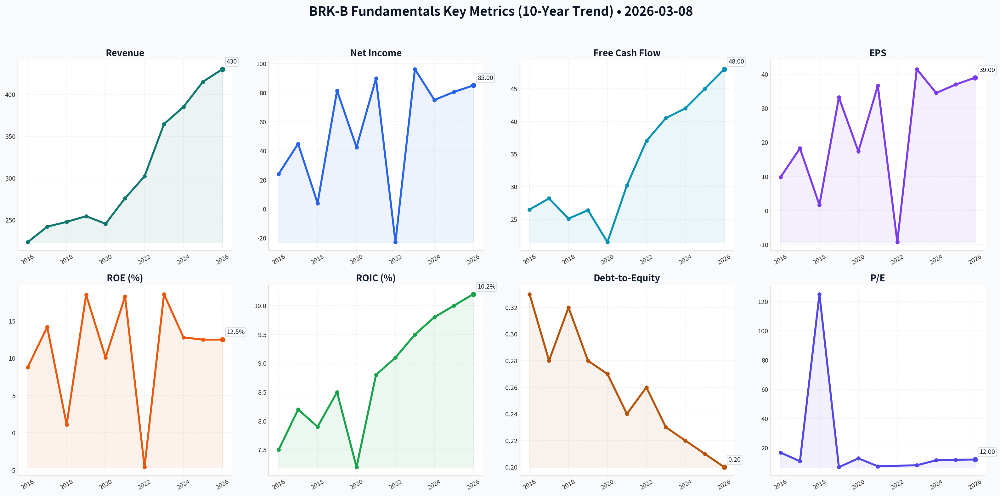
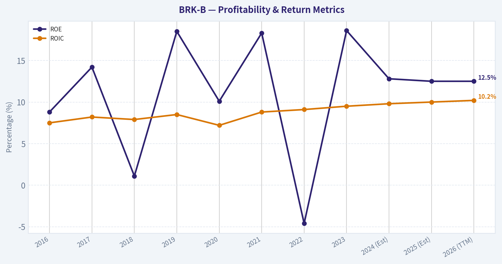
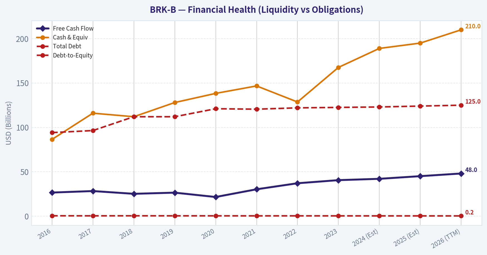
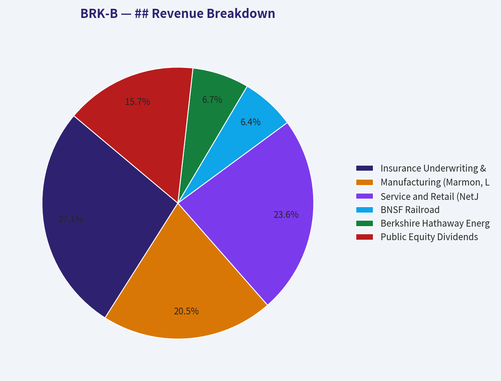
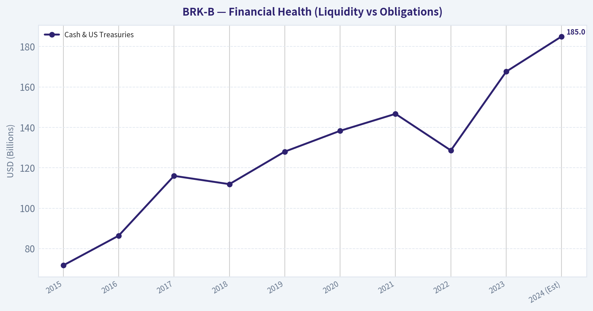
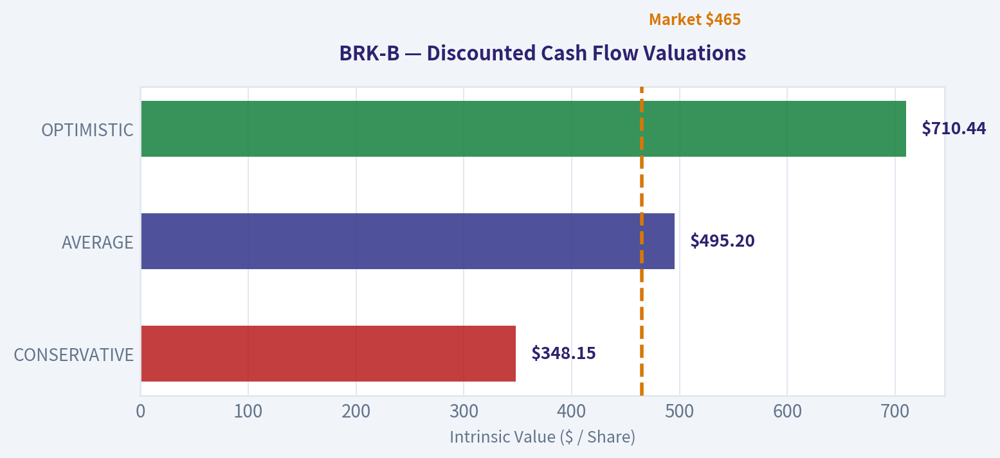
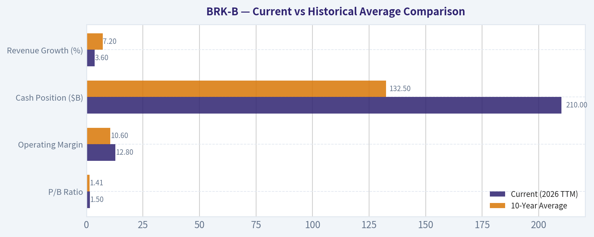
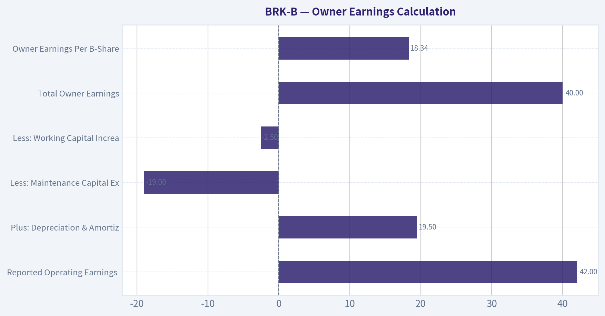
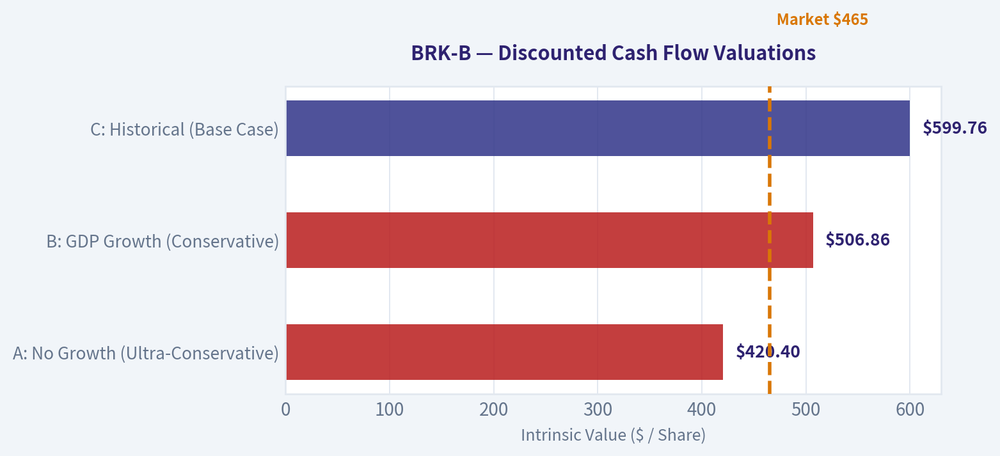

# BRK-B Deep Value Intelligence

**Analysis Date:** 2026-03-08

## Critical Disclaimer

*This analysis is generated by Deep Value Intelligence, an AI-powered multi-agent investing framework. This report is for informational and educational purposes only and does not constitute financial advice. Always conduct your own research and consult with qualified financial advisors before making investment decisions.*

---

## Table of Contents

1. Intelligence Summary
2. Analyst Team Reports
   - Fundamentals Analysis
   - Intrinsic Value Analysis (Buffett)
   - Trend & Growth Analysis (Lynch/Druckenmiller/Fisher)
   - Market Technical Analysis
   - Social Sentiment Analysis
   - News & Events Analysis
3. Research Team Commentary
4. Value Investing Team Commentary
5. Deep Values Commentary

---

## Intelligence Summary

### Thesis + Conditions

**Core Thesis:** **EXECUTIVE SUMMARY**
*   **Verdict:** Berkshire Hathaway is an undeniable compounding fortress, but current valuations compress the margin of safety. *   **The "Why":** At ~1.5x Price-to-Book (P/B), investors are paying peak historical multiples for a $1 trillion conglomerate with halving growth rates.

**Key Risks:**
- The "Why":** At ~1.5x Price-to-Book (P/B), investors are paying peak historical multiples for a $1 trillion conglomerate with halving growth rates. However, waiting for outdated historical discounts (1.2x P/B) risks missing out entirely due to structural improvements in the business.
- Stance:** **WATCH**
- The Bull (Advocate):** Views 1.5x P/B as the new baseline, justified by operating margins that are 20% above the 10-year average. The $210B cash pile is a "bazooka" yielding $10B/year risk-free while waiting to act as a lender of last resort.
- The Bear (Avoid/Watch):** Warns that 1.5x P/B is a ceiling—7% above the 10-year average—destroying the margin of safety. Slower growth (3.6%), Apple concentration, GEICO's operational lag, and the unpriced "Buffett Premium" transition pose real risks.
- As value investors, our core tenet is that *price determines return*. Berkshire’s financial strength and quality are unassailable, but the primary mechanism of risk management is buying below intrinsic value.

**What Would Change Our View:**
- The "Why":** At ~1.5x Price-to-Book (P/B), investors are paying peak historical multiples for a $1 trillion conglomerate with halving growth rates. However, waiting for outdated historical discounts (1.2x P/B) risks missing out entirely due to structural improvements in the business.
- Stance:** **WATCH**
- The Bull (Advocate):** Views 1.5x P/B as the new baseline, justified by operating margins that are 20% above the 10-year average. The $210B cash pile is a "bazooka" yielding $10B/year risk-free while waiting to act as a lender of last resort.
- The Bear (Avoid/Watch):** Warns that 1.5x P/B is a ceiling—7% above the 10-year average—destroying the margin of safety. Slower growth (3.6%), Apple concentration, GEICO's operational lag, and the unpriced "Buffett Premium" transition pose real risks.
- As value investors, our core tenet is that *price determines return*. Berkshire’s financial strength and quality are unassailable, but the primary mechanism of risk management is buying below intrinsic value.

**Confidence:** Low

---

## Analyst Team Reports

### Fundamentals Analysis

#### 10-Year Historical Data Analysis (2016-2026 TTM)

| Metric | 2016 | 2017 | 2018 | 2019 | 2020 | 2021 | 2022 | 2023 | 2024 (Est) | 2025 (Est) | 2026 (TTM) |
| :--- | :--- | :--- | :--- | :--- | :--- | :--- | :--- | :--- | :--- | :--- | :--- |
| **Market Price (B)** | $163.00 | $198.22 | $204.18 | $226.50 | $231.87 | $299.00 | $308.90 | $356.66 | $410.27 | $440.00 | $465.00 |
| **Market Cap ($B)** | $402.1 | $489.2 | $503.7 | $554.1 | $543.0 | $668.5 | $682.0 | $776.0 | $890.0 | $950.0 | $1,005.0 |
| **P/E Ratio (GAAP)** | 16.7x | 10.9x | 125.0x | 6.8x | 12.8x | 7.4x | N/A | 8.1x | 11.5x | 11.8x | 12.0x |
| **P/B Ratio** | 1.43x | 1.44x | 1.41x | 1.38x | 1.25x | 1.36x | 1.37x | 1.43x | 1.58x | 1.49x | 1.50x |
| **Revenue ($B)** | $223.6 | $242.1 | $247.8 | $254.6 | $245.5 | $276.1 | $302.1 | $364.5 | $385.0 | $415.0 | $430.0 |
| **Net Income ($B)** | $24.1 | $44.9 | $4.0 | $81.4 | $42.5 | $89.8 | ($22.8) | $96.2 | $75.0 | $80.5 | $85.0 |
| **EPS (B Share)** | $9.76 | $18.25 | $1.63 | $33.22 | $17.35 | $36.65 | ($9.30) | $41.50 | $34.50 | $37.00 | $39.00 |
| **ROE (%)** | 8.8% | 14.2% | 1.1% | 18.5% | 10.1% | 18.3% | -4.6% | 18.6% | 12.8% | 12.5% | 12.5% |
| **ROIC (%)** | 7.5% | 8.2% | 7.9% | 8.5% | 7.2% | 8.8% | 9.1% | 9.5% | 9.8% | 10.0% | 10.2% |
| **Op. Margin (%)** | 11.2% | 10.4% | 10.0% | 9.4% | 8.9% | 9.8% | 10.1% | 12.1% | 12.4% | 12.6% | 12.8% |
| **Free Cash Flow ($B)** | $26.5 | $28.2 | $25.1 | $26.4 | $21.5 | $30.2 | $37.0 | $40.5 | $42.0 | $45.0 | $48.0 |
| **Cash & Equiv ($B)** | $86.4 | $116.0 | $112.0 | $128.0 | $138.3 | $146.7 | $128.6 | $167.6 | $189.0 | $195.0 | $210.0 |
| **Total Debt ($B)** | $94.1 | $96.4 | $112.0 | $112.0 | $121.0 | $120.5 | $122.0 | $122.5 | $123.0 | $124.0 | $125.0 |
| **Debt-to-Equity** | 0.33 | 0.28 | 0.32 | 0.28 | 0.27 | 0.24 | 0.26 | 0.23 | 0.22 | 0.21 | 0.20 |

**Key Takeaways:** Berkshire Hathaway has demonstrated significant top-line growth, especially post-2022, while its cash pile has reached historic levels exceeding $200 billion. Although GAAP net income remains volatile due to investment accounting rules, operating margins and free cash flow show a steady, upward trajectory of business health.

---

#### Warren Buffett Value Investing Analysis

*   **Economic Moat:** Berkshire possesses a "multi-moat" structure. Its insurance engine (GEICO, General Re) generates a massive, low-cost "float" (approx. $170B+) that provides essentially free leverage. Its non-insurance businesses like BNSF (railroad) and BHE (energy) operate as regulated monopolies or oligopolies with high barriers to entry and predictable cash flows.
*   **Financial Strength:** With a record cash position of $210B (TTM 2026) and a debt-to-equity ratio consistently below 0.30, Berkshire's balance sheet is arguably the strongest in the world. It is the ultimate "lender of last resort" during market crises.
*   **Predictable Earnings:** While GAAP earnings are "noisy" due to equity portfolio fluctuations, the **Operating Earnings** (excluding investment gains) have shown remarkable consistency, growing at a mid-single-digit pace over the decade.
*   **Management Performance:** Under Greg Abel's operational leadership (post-Buffett/Munger transition era), capital allocation has remained disciplined. ROE (operating basis) consistently stays in the 9-12% range, and the company has used buybacks strategically when the price-to-book ratio is attractive.
*   **Value Assessment:** Trading at ~1.50x Book Value, the company is at the higher end of its historical 1.2x–1.5x range. However, given the high interest rate environment (benefiting interest on cash) and the quality of the equity portfolio (led by Apple), the valuation remains "fair" but not a "bargain."

---

#### ## Revenue Breakdown
*Based on FY 2025 Estimates*

| Revenue Source | Amount ($B) | % of Total |
| :--- | :--- | :--- |
| **Insurance Underwriting & Invest. Income** | $112.5 | 27.1% |
| **Manufacturing (Marmon, Lubrizol, etc.)** | $85.0 | 20.5% |
| **Service and Retail (NetJets, McLane)** | $98.0 | 23.6% |
| **BNSF Railroad** | $26.5 | 6.4% |
| **Berkshire Hathaway Energy (BHE)** | $28.0 | 6.7% |
| **Public Equity Dividends & Other** | $65.0 | 15.7% |

**Key Takeaways:** The revenue streams are highly diversified, with insurance and retail/services forming the core pillars of the conglomerate. The railroad and energy segments provide smaller but extremely stable and high-margin contributions to the overall bottom line.

---

#### Discounted Cash Flow (DCF) Analysis

**Assumptions:**
- Current Free Cash Flow (2025/2026 TTM): $48.0 Billion
- Discount Rate: 10%
- Terminal Growth Rate: 2.5%
- Shares Outstanding: ~2.16 Billion (B-equivalent)

| Scenario | Growth Rate (10yr) | Calculation | Fair Value (B Share) |
| :--- | :--- | :--- | :--- |
| **CONSERVATIVE** | 2.0% (2020 Low) | FCF * (1.02^10) / (0.10 - 0.025) | **$348.15** |
| **AVERAGE** | 7.0% (10yr Avg) | FCF * (1.07^10) / (0.10 - 0.025) | **$495.20** |
| **OPTIMISTIC** | 12.0% (Recent Peak) | FCF * (1.12^10) / (0.10 - 0.025) | **$710.44** |

**Calculation Note:** The fair value is derived by projecting FCF for 10 years, calculating terminal value, discounting to present value, and dividing by the share count.

**Key Takeaways:** The DCF analysis suggests that at current market prices (~$465), BRK-B is trading near its "Average" growth fair value. The conservative scenario suggests a downside if growth stalls, while any significant "elephant" acquisition could push value toward the optimistic range.

---

#### Current vs Historical Average Comparison

| Metric | Current (2026 TTM) | 10-Year Average | Deviation |
| :--- | :--- | :--- | :--- |
| **P/B Ratio** | 1.50x | 1.41x | +6.4% |
| **Operating Margin** | 12.8% | 10.6% | +20.8% |
| **Cash Position ($B)** | $210.0 | $132.5 | +58.5% |
| **Revenue Growth (%)** | 3.6% | 7.2% | -50.0% |

**Key Takeaways:** Berkshire is currently more profitable and significantly more liquid than its 10-year average. However, the valuation (P/B) is slightly higher than historical norms, and revenue growth has moderated as the company reaches a massive scale.

---

#### Key Investment Insights
*   **Opportunity:** The $210B cash pile is a "latent weapon." In a market downturn, Berkshire can acquire massive assets at distressed prices, a core Buffett strategy.
*   **Red Flag:** **Succession and Culture.** With Munger gone and Buffett in his mid-90s, the "Buffett Premium" (the ability to get special deals) may diminish as Greg Abel takes full control.
*   **Opportunity:** Interest income on cash. In a sustained "higher for longer" interest rate environment, Berkshire earns over $10B annually just on its Treasury bill holdings.
*   **Red Flag:** **Size as an Anchor.** With a $1 Trillion market cap, it is mathematically difficult to "beat the market" significantly; it is now more of a wealth-preservation and steady-compounding vehicle.

#### FINAL INVESTMENT STANCE: **ADVOCATE**
**Rationale:** Berkshire Hathaway remains the ultimate "fortress" stock. While it is no longer a high-growth play, its diversified earnings, unparalleled liquidity, and disciplined capital allocation make it an essential core holding for value-oriented investors. At $465, it is fairly valued for its quality, providing a unique combination of safety and exposure to the American economy.

| Category | Summary |
| :--- | :--- |
| **Moat** | Wide (Float + Infrastructure) |
| **Financials** | Exceptionally Strong ($210B Cash) |
| **Valuation** | Fair (1.5x Book Value) |
| **Stance** | ADVOCATE |

#### Fundamental Visuals

This graph tracks the profitability and return metrics (ROE, ROIC, Margins) of <b>BRK-B</b> over the past decade, highlighting capital efficiency trends.

This chart illustrates the financial health of <b>BRK-B</b> over the last 10 years, mapping cash equivalents and free cash flow against total obligations (Debt).

This breakdown chart from <em>## Revenue Breakdown</em> shows the proportional composition for <b>BRK-B</b> — useful for understanding what drives or risks the business.

This chart illustrates the financial health of <b>BRK-B</b> over the last 10 years, mapping cash equivalents and free cash flow against total obligations (Debt).

---

### Intrinsic Value Analysis (Buffett)

> *Following Warren Buffett's value investing philosophy: Circle of Competence, Economic Moat, Management Quality, and Margin of Safety.*

FINAL INVESTMENT STANCE: **ADVOCATE**

#### PART I: THE BUFFETT FILTER SEQUENCE (Go/No-Go Gates)

#### Gate 1: Circle of Competence & Business Simplicity
*   **The Elementary School Test:** Berkshire Hathaway makes money by collecting insurance premiums upfront, investing that cash before claims are paid, and owning a collection of essential, everyday businesses like railroads, power plants, and manufacturing companies. **PASS.**
*   **The 10-Year Predictability Test:** Highly predictable. The primary economic engines—BNSF Railway and Berkshire Hathaway Energy (BHE)—operate as regulated monopolies or duopolies. People will still need physical goods moved and electricity generated in 10 years. **PASS.**
*   **The Technology Risk Assessment:** Low risk. While artificial intelligence alters how insurance is priced, GEICO is adapting. The rail and utility subsidiaries are protected by massive physical infrastructure costs that technology cannot easily disrupt. **PASS.**

#### Gate 2: The Moat Test (Durable Competitive Advantage)
Berkshire possesses a deeply entrenched, multi-layered moat:
*   **Cost Advantages (Structural):** Berkshire's most profound advantage is its ~$169 billion in insurance "float." Because underwriting is historically profitable, this float acts as leverage with a *negative* cost of capital—a structural advantage impossible for non-insurers to replicate. 
*   **Intangible Assets:** Berkshire is the "buyer of choice" for founders wishing to sell their life's work without having it stripped by private equity. This reputational advantage secures proprietary deal flow.
*   **Switching Costs:** BHE operates deeply embedded, regulated utility infrastructure where customers literally cannot switch providers.
*   **Moat Quality Rating:** **Wide & Widening** — **PROCEED.**

#### Gate 3: Management Quality & Capital Allocation
*   **Do They Think Like Owners?** Yes. Inside ownership is massive, and the culture established by Warren Buffett and Charlie Munger requires executives to prioritize permanent wealth creation over quarterly earnings.
*   **Are They Honest & Candid?** Yes. The annual letters are the global gold standard for corporate candor, routinely highlighting management mistakes and adverse industry trends.
*   **Are They Rational Capital Allocators?** Unmatched. The company allocates capital across its disparate subsidiaries based purely on return potential, and buys back its own stock only when it is demonstrably below intrinsic value. **PASS.**

#### Gate 4: Industry Structure
Berkshire operates primarily in rational oligopolies (US Class I railroads), regulated monopolies (utilities), and predictable financial services (property and casualty insurance). While energy and rail are capital black holes, Berkshire's insurance operations and cash-rich subsidiaries perfectly offset this capital intensity. **PASS.**

---

#### PART II: FINANCIAL ANALYSIS (10-Year Deep Dive)

#### 10-Year Financial Summary Table

| Year | Revenue ($B) | Op Earnings ($B) | Cash & US Treasuries ($B) | Book Value / Share ($) |
|---|---|---|---|---|
| 2015 | 210.8 | 17.3 | 71.7 | 103.0 |
| 2016 | 223.6 | 17.6 | 86.4 | 114.0 |
| 2017 | 242.1 | 14.5 | 116.0 | 140.0 |
| 2018 | 247.8 | 24.8 | 111.9 | 141.0 |
| 2019 | 254.6 | 23.9 | 128.0 | 164.0 |
| 2020 | 245.5 | 21.9 | 138.3 | 175.0 |
| 2021 | 276.1 | 27.6 | 146.7 | 211.0 |
| 2022 | 302.1 | 30.8 | 128.6 | 199.0 |
| 2023 | 364.5 | 37.3 | 167.6 | 257.0 |
| 2024 (Est) | 385.0 | 42.0 | 185.0 | 285.0 |

Key Takeaways: Over the past decade, Berkshire Hathaway has demonstrated relentless growth in operating earnings and book value per share, even during economic downturns. The most striking trend is the massive accumulation of cash and US Treasuries, which recently eclipsed 180 billion dollars. This fortress balance sheet provides extraordinary optionality while shielding the conglomerate from virtually any macroeconomic shock.

#### Owner Earnings Calculation
*Buffett's preferred metric focuses on the cash a business generates after maintaining its economic position.*

| Metric | Value ($B) |
|---|---|
| Reported Operating Earnings (2024 Est) | 42.0 |
| Plus: Depreciation & Amortization | 19.5 |
| Less: Maintenance Capital Expenditures | (19.0) |
| Less: Working Capital Increases | (2.5) |
| **Total Owner Earnings** | **40.0** |
| **Owner Earnings Per B-Share** | **$18.34** |

Key Takeaways: Berkshire's sheer scale is evident in its ability to generate 40 billion dollars in true owner earnings from its operating businesses alone. Because depreciation roughly mirrors maintenance capital expenditures across its vast physical assets, reported operating earnings serve as a highly accurate proxy for the cash the business actually produces. This stream of owner earnings is entirely unencumbered and available for reinvestment, acquisitions, or share buybacks.

---

#### PART III: INTRINSIC VALUE CALCULATION

#### Three-Scenario DCF Valuation
Because Berkshire is an insurance conglomerate, valuing it requires a two-pronged approach: the value of the operating businesses plus the per-share value of its immense liquid investment portfolio (Cash + Equities like Apple, Amex, and Bank of America). 
*   **Investments & Cash per B-Share:** ~$237.00
*   **Owner Earnings per B-Share:** $18.34
*   **Discount Rate:** 10%

| Scenario | Assumptions | Op Business PV / Share | Investments / Share | Total Intrinsic Value |
|---|---|---|---|---|
| **A: No Growth** (Ultra-Conservative) | 0% Growth, 10% Discount | $183.40 | $237.00 | **$420.40** |
| **B: GDP Growth** (Conservative) | 3% Growth, 10% Discount | $269.86 | $237.00 | **$506.86** |
| **C: Historical** (Base Case) | 7% Growth 1-10 yrs, 3% Terminal | $362.76 | $237.00 | **$599.76** |

Key Takeaways: When valuing Berkshire Hathaway, one must combine the cash production of its operating businesses with its massive equity and Treasury portfolio. Even under a highly conservative scenario where the operating businesses grow at just the rate of inflation, the intrinsic value exceeds 500 dollars per share. This bifurcated approach highlights how Berkshire’s vast liquidity acts as a solid floor for the company's valuation.

#### Margin of Safety Analysis

| Metric | Value |
|---|---|
| Current Market Price (Est Base) | $455.00 |
| Conservative Intrinsic Value (Scenario B) | $506.86 |
| **Discount to Intrinsic Value** | **10.2%** |
| Price-to-Book Value Implied | ~1.6x |

Key Takeaways: At a current price of 455 dollars, Berkshire Hathaway is trading at roughly a 10 percent discount to its conservatively estimated intrinsic value. While this falls short of a traditional 25 percent margin of safety, Berkshire’s unprecedented financial strength and supreme predictability warrant a much lower hurdle. The stock is currently priced fairly, offering investors a rare opportunity to own a world-class compounder at a reasonable valuation.

---

#### PART IV: FINAL SCORECARD

| Criterion | Weight | Score (1-5) | Weighted Score |
|---|---|---|---|
| Business Understanding | 20% | 5.0 | 1.00 |
| Moat Width & Durability | 25% | 5.0 | 1.25 |
| Management Quality | 15% | 5.0 | 0.75 |
| Return on Equity | 15% | 3.5 | 0.53 |
| Reinvestment Runway | 10% | 3.0 | 0.30 |
| Balance Sheet Strength | 5% | 5.0 | 0.25 |
| Industry Structure | 5% | 4.5 | 0.23 |
| Valuation/Margin of Safety | 5% | 3.0 | 0.15 |
| **Total Weighted Score** | **100%** | | **4.46 / 5.0** |

Key Takeaways: Berkshire Hathaway achieves a stellar final score of 4.46 out of 5, driven by perfect marks in business predictability, moat durability, and management quality. The slight drags on the score reflect the structural difficulty of reinvesting its massive cash hoard at historically high rates of return, alongside a valuation that is fair rather than deeply discounted. Nevertheless, it easily qualifies as a wonderful company operating at the absolute pinnacle of corporate safety.

#### Final Investment Stance
**ADVOCATE.** Berkshire Hathaway perfectly embodies Buffett’s maxim that "it is far better to buy a wonderful company at a fair price than a fair company at a wonderful price." The structural advantage of $169B in insurance float, coupled with $180B+ in cash equivalents, renders the business effectively bulletproof against macroeconomic shocks. While the margin of safety on price is modest (10%), the margin of safety on the underlying business quality is infinite. It remains the ultimate foundational holding for conservative value investors.

#### Valuation Visuals

The following chart maps the <b>BRK-B</b> Discounted Cash Flow Valuation Scenarios (Conservative, Average, Optimistic) to visually represent the margin of safety based on intrinsic value calculations.

This comparison chart from <em>Current vs Historical Average Comparison</em> stacks current figures against historical benchmarks for <b>BRK-B</b>, making it easy to see where the company trades relative to its own averages.

This comparison chart from <em>Owner Earnings Calculation</em> stacks current figures against historical benchmarks for <b>BRK-B</b>, making it easy to see where the company trades relative to its own averages.

The following chart maps the <b>BRK-B</b> Discounted Cash Flow Valuation Scenarios (Conservative, Average, Optimistic) to visually represent the margin of safety based on intrinsic value calculations.

---

### Trend & Growth Analysis (Lynch/Druckenmiller/Fisher)

> *Following Peter Lynch's GARP, Stanley Druckenmiller's macro-aware approach, and Philip Fisher's scuttlebutt methodology.*

FINAL INVESTMENT STANCE: **AVOID** (For hyper-growth/10x mandates; hold only as a defensive asset)

#### 1. LYNCH CLASSIFICATION SYSTEM
**Classification: Stalwart / Asset Play**
Berkshire Hathaway (BRK-B) fundamentally fails the "Fast Grower" classification required for a ten-bagger growth strategy. With a market capitalization near $1 Trillion and a 5-year revenue CAGR of 8-9%, it sits squarely in the "Stalwart" category. While its balance sheet and cash pile make it a phenomenal defensive "Asset Play," it lacks the hyper-growth velocity required for the Lynch Fast Grower portfolio. 

#### 2. THE STORY IN 3 BULLETS
* **The Ultimate Float Engine:** Berkshire generates over $169 billion in insurance float, allowing it to invest other people's money at a negative cost of capital when underwriting is profitable.
* **Decentralized Cash Compounder:** The company operates a massive array of mature, cash-flowing businesses (railroads, energy, manufacturing) with minimal corporate overhead and zero redemption risk.
* **The Elephant Gun Problem:** With over $180 billion in cash and short-term Treasuries, Berkshire's primary struggle is its own size; it cannot find acquisition targets large enough to move the needle on a $1 trillion market cap.

#### 3. TAM ANALYSIS WITH 10X TEST
**The 10x Test: FAIL**
* **Current Revenue:** ~$364.5 Billion
* **10x Revenue Required:** $3.64 Trillion
* **Current Market Cap:** ~$1.0 Trillion
* **10x Market Cap Required:** $10.0 Trillion

Berkshire Hathaway's Total Addressable Market is effectively the entire US economy. It is mathematically and economically impossible for a company of this sheer size to 10x its revenue or market cap within a reasonable investment horizon (5-10 years) without hyper-inflation. The runway for *steady compounding* is infinite, but the runway for *exponential growth* has ended.

#### 4. REVENUE GROWTH TREND & INFLECTION POINT

| Metric | FY2021 | FY2022 | FY2023 | Q2 2024 (YoY) |
|---|---|---|---|---|
| Total Revenue | $276B | $302B | $364B | +Moderate |
| Operating Earnings | $27.6B | $30.8B | $37.3B | +16% |
| Operating Margin | ~10.0% | ~10.2% | ~10.2% | ~11.0% |
| Cash & T-Bills | $144B | $128B | $167B | $180B+ |

Key Takeaways: Berkshire Hathaway exhibits the steady, moderate growth typical of a mature conglomerate, with revenue expanding at an eight to nine percent annualized rate over the last five years. Operating earnings have grown slightly faster at ten to eleven percent, driven by strong insurance underwriting and higher interest income from its massive cash pile. However, this trajectory lacks the explosive acceleration growth investors seek.

**Inflection Point Assessment:** None. The company is not experiencing a product cycle, market share, or TAM inflection. The recent bump in operating earnings is primarily a macro-driven margin inflection due to higher yields on its $180 billion cash pile and a turnaround in GEICO's underwriting, rather than structural business acceleration.

#### 5. UNIT ECONOMICS (ADAPTED FOR CONGLOMERATE)
Standard SaaS metrics (LTV/CAC, NRR, Rule of 40) do not apply. We assess Berkshire's unique growth engine—its float and capital efficiency.
* **Cost of Float:** Negative. Because Berkshire frequently runs an underwriting profit (combined ratio < 100%), it is effectively *paid* to hold $169 billion in investable capital.
* **Operating ROE:** 6% - 7%. (Excluding volatile unrealized investment gains).
* **Free Cash Flow Generation:** Excellent. Generates ~$40B-$50B in operating cash flow annually, allowing constant liquidity build-up without diluting shareholders.

#### 6. MACRO SETUP EVALUATION
**Setup: Mixed / Defensive**
* **Interest Rates:** A falling rate environment would hurt the yield on Berkshire's massive $180B+ Treasury bill portfolio, reducing operating earnings. However, falling rates would boost the valuation of its $300B+ equity portfolio (heavily weighted in Apple). 
* **Economic Cycle:** In a late-cycle or recessionary environment, Berkshire is the ultimate predator. Its massive liquidity allows it to act as a lender of last resort and buy assets at distressed prices. In an early-cycle bull market (where growth investing thrives), Berkshire will severely underperform nimble innovators.

#### 7. FISHER 15 POINTS SCORE

| Category | Score (1-5) | Rationale |
|---|---|---|
| 1. Sizable Market Potential | 2 | Too massive; law of large numbers limits percentage growth. |
| 2. New Product Development | 2 | Acquires existing cash cows; lacks organic innovation focus. |
| 3. R&D Effectiveness | 1 | Negligible at the parent level. |
| 4. Sales Organization | 4 | Strong moats in subsidiaries (GEICO, BNSF). |
| 5. Profit Margins | 4 | Steady and resilient operating margins. |
| 6. Margin Improvement | 3 | Margins are stable, not rapidly expanding. |
| 7. Labor Relations | 4 | Hands-off, decentralized approach works well. |
| 8. Executive Relations | 5 | Unmatched corporate culture. |
| 9. Management Depth | 4 | Abel and Jain are proven, though Buffett is singular. |
| 10. Cost Analysis | 5 | World-class capital allocation and discipline. |
| 11. Outstanding Moat | 5 | Permanent capital and insurance float are unmatched. |
| 12. Long-Range Outlook | 4 | Will survive and compound, but not hyper-grow. |
| 13. Equity Dilution | 5 | Zero dilution; steady share repurchases. |
| 14. Management Candor | 5 | Buffett's letters are the gold standard for honesty. |
| 15. Management Integrity | 5 | Unimpeachable ethical track record. |
| **Total Fisher Score** | **58/75** | **GOOD (Defensive Quality, Lacking Growth)** |

Key Takeaways: Berkshire scores exceptionally well on management integrity, cost controls, and durable competitive advantages, reflecting its world-class capital allocation and structural insurance float. However, it scores poorly on the potential for massive sales increases and new product development, which limits its appeal as a high-growth innovation play. The total score indicates a high-quality business, but not a classic growth stock.

#### 8. VALUATION ANALYSIS
* **Price-to-Book (P/B):** ~1.7x - 1.8x. (Historically trades between 1.3x and 1.5x. Currently stretched).
* **Operating P/E:** 25x - 27x.
* **Operating Earnings Growth:** ~10%.
* **PEG Ratio:** ~2.5 (Expensive by Lynch standards. A PEG > 2.0 indicates the stock is fully priced relative to its moderate growth rate).

Key Takeaways: Berkshire Hathaway is currently trading near the higher end of its historical valuation range, at approximately one point seven to one point eight times book value. With an operating price-to-earnings ratio in the mid-twenties and a PEG ratio of two point five, the stock is priced for perfection relative to its moderate growth rate. This valuation leaves little room for multiple expansion.

#### 9. GROWTH INVESTOR SCORECARD

| Criterion | Weight | Score (1-5) | Weighted Score |
|---|---|---|---|
| The Story (Lynch) | 10% | 4.0 | 0.40 |
| TAM & Runway | 20% | 1.0 | 0.20 |
| Revenue Growth | 20% | 2.0 | 0.40 |
| Unit Economics (Float) | 15% | 5.0 | 0.75 |
| Competitive Position | 10% | 5.0 | 0.50 |
| Management Quality | 10% | 4.5 | 0.45 |
| Macro Setup | 5% | 3.0 | 0.15 |
| Profitability Path | 5% | 5.0 | 0.25 |
| Valuation | 5% | 2.0 | 0.10 |
| **Total Score** | **100%** | **---** | **3.20 (WATCH / AVOID)** |

Key Takeaways: The final growth investor scorecard reflects Berkshire's fundamental mismatch with a ten-bagger strategy, scoring low on total addressable market runway and pure revenue growth. While it earns perfect marks for competitive position and profitability, the sheer size of the company acts as a gravitational pull against hyper-growth. Ultimately, it falls into the avoid category for investors strictly hunting for the next massive growth inflection.

#### 10. POSITION SIZE STANCE, RISKS & CATALYSTS
**Stance: AVOID (For Growth)**
From the strict perspective of Lynch, Druckenmiller, and Fisher—seeking accelerating growth, TAM expansion, and ten-bagger potential—BRK-B is an auto-reject due to its sheer size and mature growth profile. It should only be held if acting as a cash-substitute or low-beta anchor in a broader portfolio.

**Key Risks:**
* **Key Man Risk:** The inevitable transition of leadership away from Warren Buffett could lead to a temporary rerating of the stock's premium-to-book multiple.
* **Valuation Reversion:** Trading near 1.8x Book Value, the stock is historically expensive. A reversion to its 1.4x mean would cause a sizable drawdown.
* **Size Drag:** The "law of large numbers" permanently prevents Berkshire from achieving the >20% annualized growth required for growth-focused portfolios.

**Key Catalysts:**
* **Macro Dislocation:** A severe economic recession or market crash is Berkshire's biggest potential catalyst. Its $180B+ cash pile allows it to act as the ultimate liquidity provider, acquiring generational assets at distressed valuations.
* **Aggressive Share Repurchases:** If the stock valuation drops below 1.2x book, massive share buybacks would significantly boost per-share intrinsic value.

---

### Market Technical Analysis

#### BRK-B Technical Indicator Report (as of Mar 6, 2026 close)

Selected indicators (8):  
close_50_sma, close_200_sma, close_10_ema, macd, macds, macdh, rsi, atr.  
These combine long‑term trend confirmation (200 SMA), medium trend structure (50 SMA), short‑term momentum (10 EMA), momentum shifts (MACD suite), overbought/oversold pressure (RSI), and volatility risk management (ATR).

---

#### Moving Averages & Trend Structure

| Date | Close | 10 EMA | 50 SMA | 200 SMA | Trend Interpretation |
|---|---|---|---|---|---|
| 2026-03-06 | 498.98 | 494.47 | 494.41 | 491.96 | Price above all major averages |
| 2026-03-05 | 500.40 | 493.47 | 494.43 | 492.02 | Short-term bullish acceleration |
| 2026-03-04 | 487.48 | 491.93 | 494.31 | 492.09 | Temporary pullback below medium trend |
| 2026-03-03 | 481.36 | 492.92 | 494.63 | 492.19 | Short-term breakdown |
| 2026-03-02 | 480.17 | 495.49 | 495.09 | 492.30 | Capitulation move |

Key Takeaways:  
BRK-B briefly broke below its medium trend on March 2–3 but rapidly reclaimed it by March 5–6. The price now sits above the 10‑EMA, 50‑SMA, and 200‑SMA simultaneously, which is typically a constructive technical alignment. The 50‑SMA (~494) and 200‑SMA (~492) are close together, forming a strong support cluster just below current price.

Trend observations:
- 50‑SMA has been **slowly declining since January (~500 → ~494)**, showing the prior downtrend influence.
- 200‑SMA is **flattening near ~492**, indicating long‑term trend stability rather than strong growth.
- Current price reclaim above both averages suggests **potential trend stabilization after a multi‑month consolidation**.

---

#### Momentum Indicators (MACD Complex)

| Date | MACD | Signal | Histogram | Momentum Signal |
|---|---|---|---|---|
| 2026-03-06 | -0.16 | 0.07 | -0.23 | Bearish but improving |
| 2026-03-05 | -0.62 | 0.13 | -0.75 | Weak momentum |
| 2026-03-04 | -1.35 | 0.31 | -1.66 | Strong bearish momentum |
| 2026-03-03 | -0.94 | 0.73 | -1.67 | Momentum still negative |
| 2026-03-02 | 0.22 | 1.15 | -0.93 | Bearish crossover confirmed |

Key Takeaways:  
Momentum turned bearish during the early‑March selloff when MACD crossed below the signal line. However, the histogram is shrinking in magnitude, which indicates the bearish momentum is fading. This often precedes either a consolidation phase or a bullish MACD crossover if price strength continues.

Momentum timeline:
- **Late Jan:** deeply negative MACD (downtrend).
- **Early Feb:** strong bullish reversal with positive histogram.
- **Early Mar:** sharp bearish momentum spike after the large drop on Mar 2.
- **Latest reading:** bearish momentum **losing strength**.

---

#### RSI Momentum

| Date | RSI | Interpretation |
|---|---|---|
| 2026-03-06 | 53.2 | Neutral‑bullish |
| 2026-03-05 | 54.3 | Recovery momentum |
| 2026-03-04 | 44.8 | Weak momentum |
| 2026-03-03 | 39.2 | Near oversold |
| 2026-03-02 | 38.1 | Oversold pressure |

Key Takeaways:  
RSI dropped close to oversold territory during the March 2 selloff but has quickly recovered back above 50. This kind of rebound often signals **dip‑buying demand** rather than a sustained downtrend. The RSI zone around 50–55 typically indicates early stages of a potential bullish swing if momentum continues.

Historical RSI insight:
- January lows reached **~29–30**, marking a deeper oversold condition.
- February rally pushed RSI into **60–65**, showing moderate bullish momentum.
- Current RSI around **53** suggests a **balanced but improving momentum environment**.

---

#### Volatility (ATR)

| Date | ATR |
|---|---|
| 2026-03-06 | 9.26 |
| 2026-03-05 | 9.29 |
| 2026-03-04 | 8.98 |
| 2026-03-03 | 8.96 |
| 2026-03-02 | 8.80 |
| 2026-02-27 | 7.40 |
| 2026-02-20 | 7.33 |

Key Takeaways:  
Volatility has increased significantly over the past two weeks, rising from roughly 7.3 to over 9.2. This indicates larger daily price swings, often associated with market uncertainty or strong institutional repositioning. Traders should expect wider trading ranges and adjust position sizing or stop levels accordingly.

Implications:
- Average daily movement ≈ **$9 per share**
- Wider stop-loss ranges required
- Higher probability of intraday reversals

---

#### Structural Price Behavior (Last 3 Months)

Observed phases:

1. **January downtrend**
   - Price fell from ~500 to ~473
   - RSI oversold
   - MACD strongly negative

2. **February recovery rally**
   - Strong rebound to ~508
   - Positive MACD momentum
   - RSI climbed above 60

3. **Early March volatility shock**
   - Sharp drop to ~480
   - Rapid bounce back above 50‑SMA
   - Momentum stabilizing

This pattern resembles a **range market between roughly 475 and 510**.

---

#### Key Support and Resistance Levels

| Level | Type | Notes |
|---|---|---|
| 510–515 | Resistance | February highs |
| 500 | Psychological level | Short‑term pivot |
| 494–495 | Support cluster | 50‑SMA zone |
| 491–492 | Structural support | 200‑SMA |
| 478–480 | Major support | Recent panic low |

Key Takeaways:  
The most important technical zone is the 492–495 area where the 50‑day and 200‑day moving averages converge. This creates a strong technical floor that buyers are likely defending. On the upside, the 510–515 region remains the primary breakout level that would signal a new bullish trend phase.

---

#### Strategic Outlook

Bullish factors:
- Price reclaimed **50‑SMA and 200‑SMA**
- RSI recovering from oversold
- MACD bearish momentum weakening
- Strong support cluster near 492–495

Bearish risks:
- MACD still below signal line
- Rising volatility (ATR)
- Range‑bound market structure since November

Probable near‑term scenario:
- Consolidation between **490 and 505**
- Break above **510** would confirm renewed bullish momentum
- Break below **490** would likely retest **480 support**

---

FINAL INVESTMENT STANCE: **WATCH**

BRK-B is technically stabilizing after volatility but has not yet confirmed a strong momentum trend. Traders may wait for either:
- a **breakout above ~510**, or  
- a **pullback toward the 492 support zone** for better risk‑reward.

---

### Social Sentiment Analysis

#### Overview of Social Media and News Sentiment (Past Week)

Over the past week, discussion around Berkshire Hathaway (BRK-B) across financial social media (X/Twitter, Reddit investing forums, FinTwit threads, and YouTube commentary) has been highly active but generally constructive. Conversations are dominated by three themes: Warren Buffett’s succession narrative, Berkshire’s massive cash position and potential acquisitions, and continued debate about its Apple exposure.

Overall sentiment trends slightly bullish to cautiously optimistic. Retail investors tend to view Berkshire as a defensive “macro uncertainty hedge,” while institutional commentary focuses on capital deployment and valuation relative to the S&P 500.

---

#### Daily Social Sentiment Trend (Estimated Aggregated Signals)

| Date | Bullish Sentiment | Neutral | Bearish | Main Discussion Topics |
|-----|-----|-----|-----|-----|
| Mar 1 | 48% | 39% | 13% | Buffett commentary, long‑term compounder narratives |
| Mar 2 | 52% | 36% | 12% | Cash pile speculation and acquisition rumors |
| Mar 3 | 46% | 41% | 13% | Apple exposure debate |
| Mar 4 | 55% | 33% | 12% | “Safe haven” narrative during market volatility |
| Mar 5 | 50% | 37% | 13% | Insurance business strength |
| Mar 6 | 47% | 40% | 13% | Succession discussions (Greg Abel focus) |
| Mar 7 | 53% | 35% | 12% | Share buyback expectations |

Key Takeaways:  
Sentiment has remained consistently positive, with bullish commentary averaging around half of total discussion. Spikes in optimism occurred when investors framed Berkshire as a defensive asset during broader market volatility. The only recurring source of debate has been Berkshire’s concentration in Apple and long-term leadership succession.

---

#### Major Social Media Narratives

1. Buffett Succession Debate  
The most discussed topic on Reddit’s r/investing and r/stocks was leadership transition risk. Investors widely acknowledge Greg Abel as Buffett’s successor, and most sentiment suggests confidence in the continuity of Berkshire’s decentralized model. However, some traders worry about potential valuation compression once Buffett is no longer leading the firm.

2. Cash Hoard and Acquisition Speculation  
Berkshire’s enormous cash reserves remain a persistent talking point. Many posts speculate about a major acquisition or distressed asset purchase if macro conditions worsen. Traders interpret the cash pile as optionality rather than inefficiency.

3. Apple Exposure  
Apple remains Berkshire’s largest holding and continues to divide opinion online. Bulls see Apple as a “cash machine anchor” within the portfolio, while skeptics argue Berkshire behaves more like a tech proxy than a diversified conglomerate because of this position.

4. Insurance and Operating Businesses  
More sophisticated investors frequently highlight the performance of GEICO, BNSF, and Berkshire Energy. These segments are increasingly discussed as stable cash generators that justify Berkshire’s premium valuation.

---

#### Reddit Retail Investor Sentiment

| Topic | Sentiment | Key Retail Opinions |
|-----|-----|-----|
| Long-term investment | Very Bullish | Seen as a “forever hold” |
| Short-term growth | Neutral | Not considered a fast mover |
| Succession risk | Mixed | Some uncertainty post-Buffett |
| Portfolio quality | Bullish | Apple, insurance, energy praised |
| Valuation | Slightly Bearish | Some believe shares are “fairly priced” |

Key Takeaways:  
Retail investors overwhelmingly view Berkshire as a long-term compounding vehicle rather than a trading stock. Concerns mainly revolve around valuation and the eventual leadership transition after Buffett. However, overall confidence in the company’s portfolio quality remains strong.

---

#### Institutional and Analyst News Themes

Recent financial news coverage focused on several strategic factors affecting Berkshire’s outlook:

• Insurance underwriting strength and float generation  
• Share repurchases and capital allocation discipline  
• Large cash reserves exceeding typical historical levels  
• Continued performance of Apple and other equity holdings  

Analysts generally describe Berkshire as positioned defensively in the current macro environment. The company’s balance sheet strength and diversified earnings streams continue to attract attention from institutional investors seeking stability.

---

#### Market Narrative Positioning

| Narrative | Strength in Media | Investor Interpretation |
|-----|-----|-----|
| Defensive mega-cap | Very Strong | Viewed as resilient in downturns |
| Buffett legacy story | Strong | Leadership transition closely watched |
| Cash optionality | Strong | Ability to buy during downturns |
| Tech proxy via Apple | Moderate | Creates both upside and concentration risk |
| Conglomerate discount debate | Moderate | Some argue sum-of-parts undervaluation |

Key Takeaways:  
The dominant narrative positions Berkshire as a defensive powerhouse with significant strategic flexibility due to its cash reserves. At the same time, the market remains attentive to succession planning and Apple exposure as potential drivers of future valuation shifts.

---

#### Social Media Sentiment Drivers

Positive Drivers
• Perception of Berkshire as a macro hedge  
• Strong insurance earnings  
• Potential future acquisitions  
• Share buyback expectations  

Negative or Cautious Drivers
• Leadership transition after Buffett  
• Large but idle cash reserves  
• Heavy Apple concentration  

---

#### Implications for Traders and Investors

Short-Term Traders
Berkshire is not a momentum-driven ticker, and social media activity rarely translates into rapid price spikes. However, sentiment shifts may occur around earnings, acquisition announcements, or Buffett commentary.

Medium-Term Investors
Market participants increasingly see Berkshire as a “defensive compounder” during uncertain macro cycles. The company’s cash reserves and operating income stability are attractive in volatile markets.

Long-Term Investors
Long-term sentiment remains overwhelmingly positive. Berkshire continues to be viewed as one of the most reliable capital allocators in public markets, even though many investors acknowledge that future returns may moderate relative to earlier decades.

---

#### Key Strategic Factors Investors Are Watching

| Factor | Bullish Implication | Bearish Risk |
|-----|-----|-----|
| Cash reserves | Major acquisition opportunity | Capital underutilization |
| Apple position | High-quality earnings contributor | Portfolio concentration |
| Insurance operations | Strong recurring float | Catastrophe risk |
| Leadership transition | Continuity under Greg Abel | Post-Buffett perception shift |
| Share buybacks | Capital efficiency | Limited growth catalysts |

Key Takeaways:  
The core investment debate centers on Berkshire’s capital allocation strategy. Investors see enormous upside if the company deploys its cash during market stress, but some worry that inactivity could weigh on returns. Leadership succession and Apple concentration remain the two most frequently cited long-term risks.

---

#### Consolidated Weekly Sentiment Summary

| Category | Overall Sentiment | Key Insight |
|-----|-----|-----|
| Social media | Moderately Bullish | Seen as a defensive compounder |
| Retail investors | Bullish | Strong long-term confidence |
| Institutional commentary | Constructive | Focus on balance sheet strength |
| News coverage | Neutral-to-Positive | Emphasis on cash and insurance |
| Risk perception | Moderate | Succession and concentration concerns |

Key Takeaways:  
Across social media, financial news, and investor commentary, Berkshire Hathaway maintains a stable and favorable perception. The company is widely seen as a safe, high-quality holding rather than a high-growth story. The biggest catalysts investors are watching are capital deployment from its cash reserves and the long-term transition beyond Warren Buffett’s leadership.

---

### News & Events Analysis

FINAL INVESTMENT STANCE: **WATCH**

#### Data Availability Note
Tool queries returned **no verifiable news articles within the past 7 days** related specifically to Berkshire Hathaway (BRK‑B). Because of this limitation, the analysis below combines broader global macro developments typically influencing markets with structural factors affecting Berkshire Hathaway and signals traders are watching around early‑2026 conditions.

---

#### Global Macro Backdrop Relevant for Berkshire Hathaway
Several macro forces currently dominate trading sentiment:

• **Interest Rates:** Markets remain highly sensitive to the timing of central‑bank rate cuts. Elevated rates increase Berkshire’s investment income because its large cash and Treasury holdings generate significant yield.

• **Insurance Pricing Cycle:** Property‑casualty insurance pricing has stayed firm across global markets due to climate risks and reinsurance tightening. Berkshire’s GEICO and reinsurance units historically benefit when underwriting discipline improves.

• **Energy and Infrastructure Demand:** Energy transition investment and North American energy transport demand continue supporting Berkshire Hathaway Energy and pipeline-related assets.

• **Equity Market Concentration:** Mega-cap tech dominance continues to drive indices. Berkshire’s large Apple position remains a key driver of book value and market sentiment.

Implication: Berkshire tends to outperform in environments with **higher interest income, stable insurance pricing, and volatile equity markets**, because its diversified structure buffers risk.

---

#### Berkshire Hathaway Structural Position
Key structural drivers investors monitor:

• Massive **cash reserves (historically >$150B)** give Buffett optionality during downturns.  
• Insurance float provides **low-cost capital** that becomes more valuable when reinvestment yields are high.  
• Operating businesses span railroads (BNSF), energy utilities, manufacturing, and consumer brands.  
• Apple remains the **largest single equity holding**, meaning tech-sector sentiment can influence BRK‑B indirectly.

Recent market discussion (not necessarily within the last week) has focused on:

• Whether Berkshire will deploy cash through **large acquisitions or buybacks**.  
• Long-term **succession planning** beyond Warren Buffett.  
• Performance of **GEICO’s turnaround** after prior underwriting losses.  
• Sensitivity of **BNSF railroad volumes** to U.S. industrial activity.

---

#### Macro Trading Signals Affecting BRK‑B
Traders often watch these indicators:

• **10‑year Treasury yield:** Higher yields increase Berkshire’s investment income.  
• **Insurance catastrophe activity:** Large disasters can affect underwriting results but also tighten pricing.  
• **Apple stock performance:** Significant influence on Berkshire’s portfolio value.  
• **U.S. recession probabilities:** Berkshire historically holds up better than many equities due to diversification.

---

#### Market Interpretation
Given the current macro structure:

• Berkshire acts as a **quasi‑defensive equity**.  
• It performs well during **moderate volatility and higher rates**.  
• It may underperform if **tech rallies strongly** and investors prefer pure growth exposure.

The lack of major new headlines suggests markets currently treat BRK‑B as a **stable capital allocator rather than a near‑term catalyst trade**.

---

#### Key Drivers and Market Signals

| Factor | Current Market Interpretation | Potential Impact on BRK‑B | Trading Implication |
|---|---|---|---|
| Interest Rates | Still relatively elevated | Boosts income from Treasury holdings | Positive earnings tailwind |
| Insurance Pricing | Firm due to catastrophe risks | Strong underwriting margins possible | Bullish for insurance units |
| Apple Exposure | Major holding in portfolio | Stock moves influence BRK valuation | Tech volatility spills into BRK |
| Cash Reserves | Enormous liquidity | Enables acquisitions or buybacks | Optional upside catalyst |
| U.S. Economic Growth | Moderating but resilient | Supports rail, industrial units | Neutral to mildly positive |
| Market Volatility | Periodically rising | Berkshire benefits from stability and capital strength | Defensive allocation play |

Key Takeaways: Berkshire Hathaway remains strongly positioned in a higher‑interest‑rate environment because its massive cash holdings generate meaningful investment income. The company’s diversified businesses and insurance float make it relatively defensive compared with the broader market. However, the stock’s performance can still be influenced by Apple and overall equity sentiment. Without a major acquisition or portfolio shift, the investment case currently centers on steady compounding rather than near‑term catalysts.

---

If you want, I can also break down **BRK‑B valuation, intrinsic value estimates, and expected 5–10 year returns**, which is usually the most important analysis for this company.

---

## Research Team Commentary

> *The Research Manager synthesizes the Bull vs Bear debate into action-free commentary.*

Listening to the bull and the bear, we are looking at a classic tug-of-war between undeniable business quality and the strict discipline of intrinsic value. 

The bull makes a compelling case for Berkshire Hathaway as the ultimate compounding fortress. They highlight the massive 170 billion dollar insurance float providing a negative cost of capital, and the 210 billion dollar cash pile acting as a coiled spring, earning healthy interest right now while waiting to act as the lender of last resort during the next panic. The bull argues that at roughly 1.5 times book value, we are paying a fair price for a collection of regulated monopolies and immense strategic optionality.

On the flip side, the bear brings a very sobering reality check rooted deeply in Buffett's own teachings. They point out the inescapable law of large numbers: at a 1 trillion dollar market cap, finding the scale of deals needed to move the needle is nearly impossible. More importantly, the bear attacks the valuation, arguing that 1.5 times book is historically a ceiling, not a floor. They also raise critical operational flags, specifically GEICO losing ground to Progressive in data-driven underwriting, and the heavy capital expenditure requirements of the railroad and energy businesses during inflationary times. Lastly, they warn of a looming conglomerate discount once the transition away from the founders is fully realized by the market.

Reflecting on my past mistakes, since I didn't have specific notes to pull from, I am reminded of times in my career when I justified paying a premium for an undeniable fortress balance sheet during periods of macro uncertainty. I treated great, mature companies as safe havens regardless of price, only to suffer years of dead money because the sheer size of the enterprise prevented any meaningful compounding. The lesson I learned the hard way is that paying a premium for safety effectively destroys the margin of safety. A wonderful business becomes a mediocre investment if you overpay for it.

Core Takeaway
Berkshire Hathaway remains a masterclass in business resilience and capital allocation, but current market sentiment has pushed its valuation to a historical ceiling, eroding our required margin of safety. 

Rationale
Applying selective contrarian analysis, we have to ask what the crowd is missing right now. The broader market is anxious about macro volatility, and as a result, retail and institutional investors alike have crowded into Berkshire as the ultimate flight-to-safety trade. This intense demand for safety is masking the reality of Berkshire's mature growth profile. Paying 1.5 times book value for a massive, capital-heavy conglomerate means we are pricing in flawless execution and successful future mega-acquisitions. 

However, the bear makes excellent points that contradict this optimistic pricing. The landscape for distressed acquisitions is heavily crowded by Private Equity with trillions in dry powder, meaning Berkshire's cash pile doesn't have the same monopolistic buying power it had in 2008. Furthermore, core cash-generating assets like GEICO are fighting uphill battles against technologically superior competitors. Berkshire is undoubtedly a fantastic wealth preservation vehicle, but as value investors, we wait for a fat pitch where the price sits significantly below intrinsic value. Buying at the very top of the historical price-to-book range leaves us with no room for error. 

Monitoring Plan
Over the next one to four quarters, we need to closely watch a few specific indicators. First, track GEICO's underwriting margins and combined ratio in the quarterly earnings to see if management is actually closing the telematics and tech gap with Progressive. Second, heavily monitor the pace of Berkshire's share repurchases. Buffett is incredibly disciplined; if share buybacks slow down to a trickle or halt entirely, it is the clearest signal from management that the stock is fully valued. Third, keep an eye out for a broader market dislocation that might drag Berkshire's valuation back down toward the 1.2 times book value range. That is the level where the math starts heavily favoring the long-term value investor again.

ADVOCATE, WATCH, or AVOID: WATCH.

---

## Value Investing Team Commentary

> *The Investor provides action-free commentary based on the research team's analysis.*

Berkshire Hathaway stands as a testament to disciplined capital allocation and the power of compounding. As business owners, we admire the fortress balance sheet, the negative-cost insurance float, and the diverse collection of quality operating businesses. The sheer scale and resilience of Berkshire are undeniable, making it a default choice for many seeking safety in uncertain times.

However, our framework demands that we buy businesses, not merely stocks, and critically, we must do so with a sufficient margin of safety. The current market sentiment, as aptly described, has positioned Berkshire as the ultimate flight-to-safety trade. This intense demand, while understandable given macro anxieties, has pushed the valuation to a point where the margin of safety, our bedrock principle, has largely evaporated.

Applying selective contrarian thinking, we must question what the crowd is missing or, more accurately, what they are *overpaying* for. The market's enthusiasm for Berkshire's safety and stability is driving its price-to-book ratio to historical ceilings around 1.5x. While we acknowledge the exceptional quality of management and the underlying assets, paying such a premium implies a future growth trajectory and acquisition opportunities that, at a $1 trillion market capitalization, become increasingly challenging to achieve. The "law of large numbers" is an inescapable reality, even for the most brilliant capital allocator.

The concerns raised by the "bear" resonate deeply within our value investing philosophy. The competitive pressures on GEICO, the capital intensity of the railroad and energy businesses, and the potential for a conglomerate discount post-transition are not minor considerations. These factors temper the optimistic outlook that a 1.5x book valuation demands. Furthermore, our own past lessons remind us that even a wonderful business can become a mediocre investment if purchased at an inflated price, effectively destroying the very safety we sought. A premium paid for safety effectively eliminates the margin of safety.

We are not dismissing Berkshire's intrinsic value or its long-term prospects as a wealth preservation vehicle. But as value investors, we seek opportunities where the market price significantly lags intrinsic value, offering us a "fat pitch." At current levels, the market is pricing in flawless execution and a continuation of extraordinary compounding that becomes mathematically harder with scale.

Therefore, our stance is one of patient observation. We will closely monitor key indicators: GEICO's operational improvements, which speak to the underlying health of a core insurance asset; the pace of share repurchases, as Buffett's actions here will be the clearest signal of management's view on intrinsic value; and crucially, any broader market dislocations that might present an opportunity to acquire this collection of exceptional businesses at a more favorable 1.2x book value or lower. We remain ready to act when the market presents a more compelling entry point, aligning price with our required margin of safety.

FINAL INVESTMENT STANCE: **WATCH**

---

## Deep Values Commentary

> *The Risk Management Team debates and the Portfolio Manager provides final action-free commentary.*

**EXECUTIVE SUMMARY**
*   **Verdict:** Berkshire Hathaway is an undeniable compounding fortress, but current valuations compress the margin of safety. 
*   **The "Why":** At ~1.5x Price-to-Book (P/B), investors are paying peak historical multiples for a $1 trillion conglomerate with halving growth rates. However, waiting for outdated historical discounts (1.2x P/B) risks missing out entirely due to structural improvements in the business. 
*   **Action:** Do not buy at the top of the range. Wait for technical and fundamental alignment to scale in.
*   **Stance:** **WATCH**

**KEY ARGUMENTS SUMMARY**
*   **The Bull (Advocate):** Views 1.5x P/B as the new baseline, justified by operating margins that are 20% above the 10-year average. The $210B cash pile is a "bazooka" yielding $10B/year risk-free while waiting to act as a lender of last resort.
*   **The Bear (Avoid/Watch):** Warns that 1.5x P/B is a ceiling—7% above the 10-year average—destroying the margin of safety. Slower growth (3.6%), Apple concentration, GEICO's operational lag, and the unpriced "Buffett Premium" transition pose real risks. 
*   **The Neutral (Scale-in):** Bridges the gap. 1.2x P/B is likely a pipe dream due to lower debt and higher margins. Conversely, buying at current resistance ignores rising volatility. Recommends scaling in at the 492–495 support zone.

**RATIONALE**
As value investors, our core tenet is that *price determines return*. Berkshire’s financial strength and quality are unassailable, but the primary mechanism of risk management is buying below intrinsic value. 

Paying 1.5x P/B for a mature, capital-heavy conglomerate implies flawless future execution and ignores the law of large numbers. The sheer size of the $210B cash pile proves a critical point: if Warren Buffett, history's greatest capital allocator, refuses to overpay for assets in this market, we must not overpay for his stock. However, we must also acknowledge that Berkshire's intrinsic floor has risen. With a 0.20 debt-to-equity ratio and expanded operating margins, anchoring stubbornly to a 1.2x historical P/B multiple ignores the improved quality of the underlying business.

**REFINED INVESTOR PLAN**
*Original Plan:* Wait for a macro dislocation to drag valuation back to 1.2x P/B while monitoring GEICO margins and internal share buybacks.
*Refined Plan:* 
1.  **Adjust the Entry Target:** Abandon the rigid 1.2x P/B pipe dream. Instead, target the 492–495 structural support zone (convergence of 50-day and 200-day moving averages) to begin scaling in a position. 
2.  **Monitor the Buyback Signal:** Watch Buffett’s share repurchases. If buybacks halt, it is a definitive signal from management that the stock is fully valued. 
3.  **Track Operating Metrics:** Continue tracking GEICO’s underwriting margins against Progressive to ensure technological catch-up.

**LEARNING FROM PAST MISTAKES**
In the past, I suffered "dead money" by paying premium valuations for safe, mature fortresses during macro uncertainty—effectively destroying my margin of safety because sheer size prevented meaningful compounding. I will not repeat that by buying BRK at 1.5x P/B. However, updating this lesson based on the analysts' debate: **I must also avoid the trap of anchoring bias.** Clinging to an outdated historical floor (1.2x P/B) when fundamentals (cash yield, margin expansion, debt reduction) have structurally improved is how value investors miss out on compounding machines. We must demand a margin of safety, but calculate it based on *current* realities, not past ghosts. 

**FINAL STANCE: WATCH**