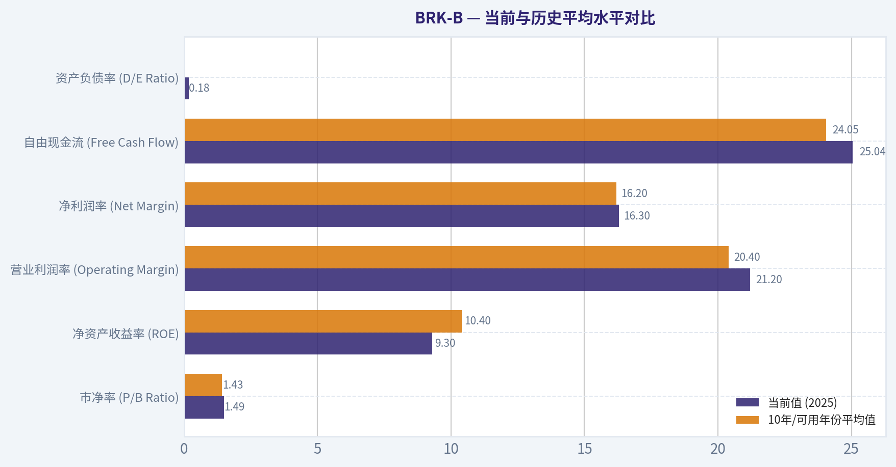
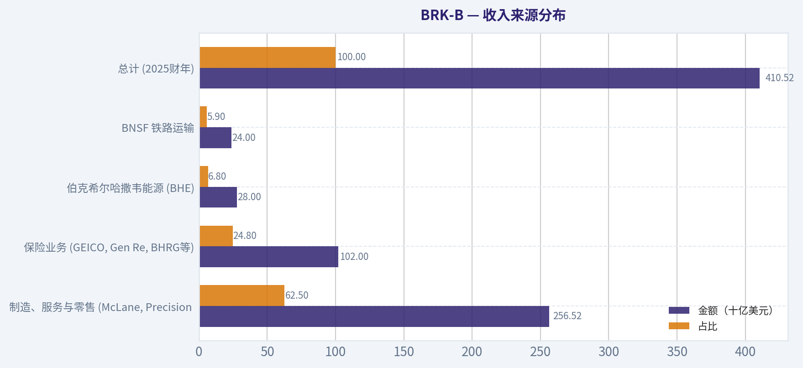
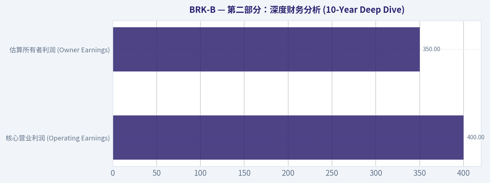
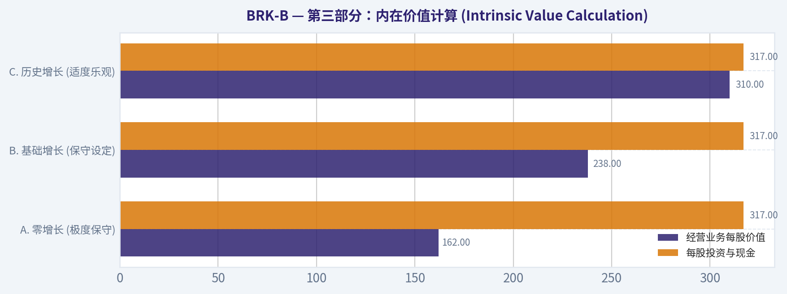
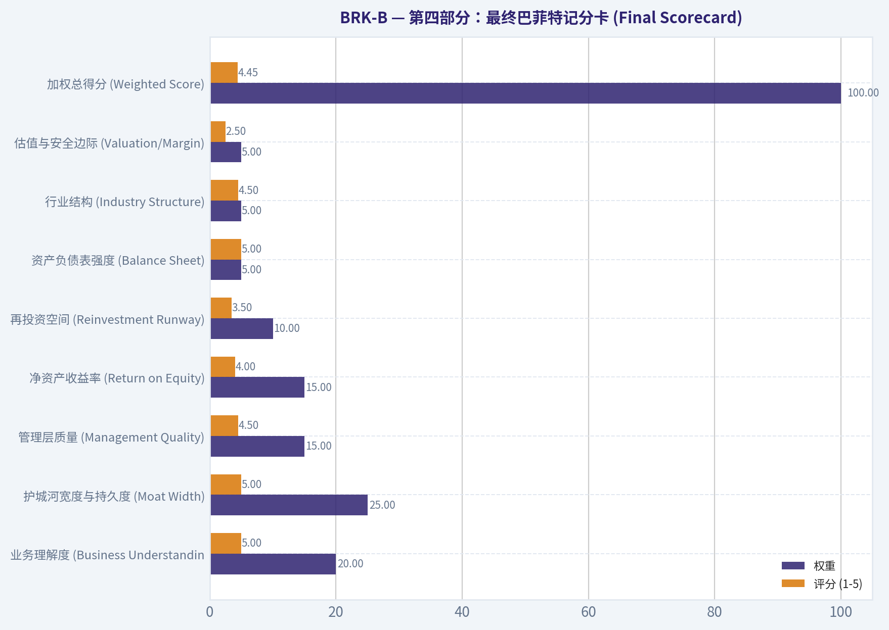
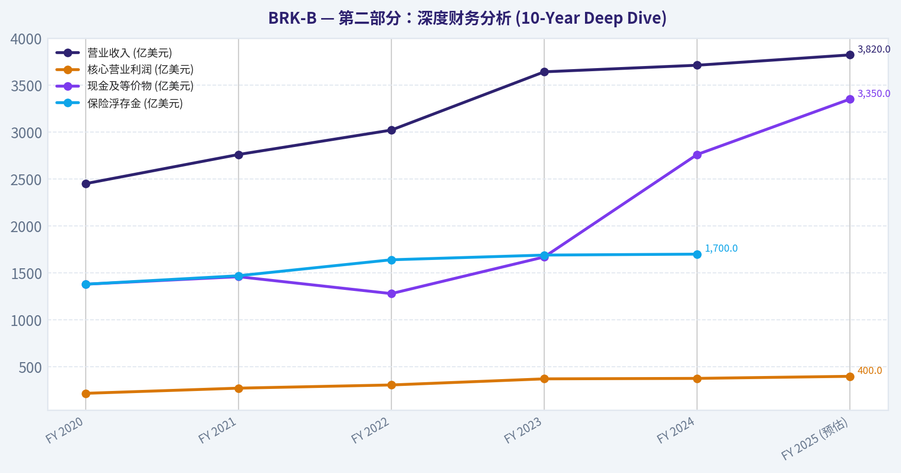

# BRK-B 深度价值情报

**调研日期:** 2026-03-10

## 关键免责声明

*本报告由 Deep Value Intelligence（一个基于 AI 的多智能体投资分析框架）自动生成。 本报告仅供信息参考和教育目的，不构成任何财务或投资建议。 在做出任何投资决策之前，请务必进行独立调研并咨询合规的财务顾问。*

---

## 目录

1. 情报摘要
2. 分析师团队报告
   - 基本面分析
   - 价值分析 (巴菲特)
   - 成长性分析 (林奇/德鲁肯米勒/费雪)
   - 市场分析
   - 社会舆情分析
   - 新闻分析
3. 研究团队评论
4. 投资团队评论
5. Deep Values 团队洞察

---

## 情报摘要

### 核心观点与前提条件

**核心论点:** **执行摘要 (Executive Summary)**

**主要风险:**
- 行动指南**：拒绝在估值上限进行"叙事追高"。耐心等待估值向均值（PB 1.2x-1.3x）回归，或将其作为极低仓位的定投底仓，维持**观望（WATCH）**。
- 依据巴菲特的价值投资准则，高质量的业务是防范**企业永久性资本损失（Business Risk）**的基石，但这不能消除**买入价格过高带来的市场风险（Market Risk）**。伯克希尔的防守能力毋庸置疑，但投资的本质是"好公司+好价格"。目前近1.5倍的市净率，是对一个ROE回落至10%左右的成熟型控股集团的完美定价。规模是业绩的敌人，正如保守派指出的，当前万亿级别的体量，使得过去那些能够显著拉动净值的"超级交易"变得极为困难。高利率是一把双刃剑，单纯盯着现金利息，而忽视了BNSF和伯克希尔能源（BHE）因贴现率上升而受损的资产价值，是典型的锚定偏见。
- 因此，基于当前的业务基本面（9-11%的常态ROE）与估值水平（1.49x PB），我的最终立场是：**WATCH（观望）**。
- 最终评级：WATCH (观望)**

**观点反转条件:**
- 行动指南**：拒绝在估值上限进行"叙事追高"。耐心等待估值向均值（PB 1.2x-1.3x）回归，或将其作为极低仓位的定投底仓，维持**观望（WATCH）**。
- 依据巴菲特的价值投资准则，高质量的业务是防范**企业永久性资本损失（Business Risk）**的基石，但这不能消除**买入价格过高带来的市场风险（Market Risk）**。伯克希尔的防守能力毋庸置疑，但投资的本质是"好公司+好价格"。目前近1.5倍的市净率，是对一个ROE回落至10%左右的成熟型控股集团的完美定价。规模是业绩的敌人，正如保守派指出的，当前万亿级别的体量，使得过去那些能够显著拉动净值的"超级交易"变得极为困难。高利率是一把双刃剑，单纯盯着现金利息，而忽视了BNSF和伯克希尔能源（BHE）因贴现率上升而受损的资产价值，是典型的锚定偏见。
- 因此，基于当前的业务基本面（9-11%的常态ROE）与估值水平（1.49x PB），我的最终立场是：**WATCH（观望）**。
- 最终评级：WATCH (观望)**

**置信度:** 中

---

## 分析师团队报告

### 基本面分析

#### Code-Computed Financial Metrics for BRK-B

*All values below are computed deterministically from raw data - not estimated by AI.*

#### Deterministic Historical Metrics Table
*Annual rows come from reported financial statements. The final TTM row is computed from the latest four quarters.*

| Metric | 2016 | 2017 | 2018 | 2019 | 2020 | 2021 | 2022 | 2023 | 2024 | 2025 |
| --- | --- | --- | --- | --- | --- | --- | --- | --- | --- | --- |
| Market Price | $163 | $198 | $204 | $226 | $232 | $299 | $309 | $357 | $453 | $503 |
| Market Cap | N/A | N/A | N/A | N/A | N/A | $677.32B | $680.60B | $775.14B | $977.53B | $1.07T |
| P/E Ratio | N/A | N/A | N/A | N/A | N/A | 7.53 | -29.91 | 8.06 | 10.98 | 15.92 |
| P/B Ratio | N/A | N/A | N/A | N/A | N/A | 1.34 | 1.44 | 1.38 | 1.51 | 1.49 |
| ROE | 8.5% | 12.9% | 1.2% | 19.2% | 9.6% | 17.7% | -4.8% | 17.1% | 13.7% | 9.3% |
| ROIC | 9.4% | 15.9% | 2.4% | 19.9% | 10.3% | 18.4% | -4.1% | 17.9% | 14.4% | 9.9% |
| EPS | N/A | N/A | N/A | N/A | N/A | $39.70 | $-10.33 | $44.27 | $41.27 | $31.58 |
| Revenue | $223.60B | $242.14B | $247.84B | $254.62B | $245.51B | $276.09B | $234.12B | $439.34B | $424.23B | $410.52B |
| Gross Profit | N/A | N/A | N/A | N/A | N/A | N/A | N/A | N/A | N/A | N/A |
| Operating Margin | 16.5% | 11.9% | 3.0% | 41.7% | 24.1% | 41.6% | -11.5% | 28.3% | 27.1% | 21.2% |
| Net Income | $24.07B | $44.94B | $4.02B | $81.42B | $42.52B | $89.80B | $-22.76B | $96.22B | $89.00B | $66.97B |
| Net Margin | 10.8% | 18.6% | 1.6% | 32.0% | 17.3% | 32.5% | -9.7% | 21.9% | 21.0% | 16.3% |
| Revenue Growth | 6.1% | 8.3% | 2.4% | 2.7% | -3.6% | 12.5% | -15.2% | 87.7% | -3.4% | -3.2% |
| Net Income Growth | -0.0% | 86.7% | -91.0% | 1924.8% | -47.8% | 111.2% | -125.3% | 522.8% | -7.5% | -24.8% |
| Free Cash Flow Growth | N/A | 74.0% | -32.9% | -0.7% | 17.8% | -2.3% | -16.3% | 36.1% | -61.0% | 115.6% |
| Total Book Value | $283.00B | $348.30B | $348.70B | $424.79B | $443.16B | $506.20B | $473.42B | $561.27B | $649.37B | $717.42B |
| Total Assets | $620.85B | $702.10B | $707.79B | $817.73B | $873.73B | $958.78B | $948.47B | $1.07T | $1.15T | $1.22T |
| Total Debt | N/A | N/A | N/A | N/A | N/A | N/A | $122.74B | $128.27B | $124.76B | $129.08B |
| Debt-to-Equity | N/A | N/A | N/A | N/A | N/A | N/A | 0.26 | 0.23 | 0.19 | 0.18 |
| Cash & Equivalents | $28.05B | $31.58B | $30.81B | $64.63B | $48.40B | $88.71B | $35.81B | $38.02B | $47.73B | $51.88B |
| Shareholders' Equity | $283.00B | $348.30B | $348.70B | $424.79B | $443.16B | $506.20B | $473.42B | $561.27B | $649.37B | $717.42B |
| Free Cash Flow | $19.58B | $34.07B | $22.86B | $22.71B | $26.76B | $26.14B | $21.89B | $29.79B | $11.62B | $25.04B |
| Dividends / Share | N/A | N/A | N/A | N/A | N/A | $0.00 | $0.00 | $0.00 | $0.00 | $0.00 |

#### Profitability Metrics
- Return on Equity (ROE): 9.3%
- Return on Invested Capital (ROIC): 9.9%
- Return on Assets (ROA): 5.5%
- Gross Margin: N/A
- Operating Margin: 21.2%
- Net Profit Margin: 16.3%

#### Liquidity Metrics
- Current Ratio: N/A
- Quick Ratio: N/A

#### Leverage Metrics
- Debt-to-Equity Ratio: 0.18
- Interest Coverage Ratio: 17.21
- Net Debt: $77.20B

#### Growth Metrics (Year-over-Year)
- Revenue Growth: -3.2%
- Net Income Growth: -24.8%
- Free Cash Flow Growth: 115.6%
- Revenue CAGR (3-Year): 20.6%
- Revenue CAGR (5-Year): 10.8%

#### Valuation Metrics
- P/E Ratio (TTM): 15.92
- Forward P/E: 22.79
- Price-to-Book: 1.49
- Price-to-Sales: 2.87
- PEG Ratio: N/A
- EV/EBITDA: -2.12
- Free Cash Flow Yield: 2.3%
- Earnings Yield: 6.3%

#### Owner Earnings (Buffett Method, Code-Computed)
- Net Income: $66.97B
- + Depreciation & Amortization: $13.48B
- - Capital Expenditures: $-20.93B
- - Working Capital Changes: $2.35B
- = **Owner Earnings: $57.16B**

#### Intrinsic Value (Code-Computed)
- Current Price: $494
- Buffett Method (Owner Earnings):
  Conservative: $84
  Average: $1,682
  Optimistic: $11,980
- Cash Flow Method (FCF):
  Conservative: $20
  Average: $240
  Optimistic: $2,553

#### Piotroski F-Score: 3/9
- Positive Net Income: PASS
- Positive Operating Cash Flow: PASS
- ROA Improvement: FAIL
- Cash Flow > Net Income: FAIL
- Decreasing Debt: FAIL
- Improving Current Ratio: FAIL
- No Dilution: PASS
- Improving Gross Margin: FAIL
- Improving Asset Turnover: FAIL

最终投资立场: **ADVOCATE**

#### 伯克希尔哈撒韦 (BRK-B) 综合基本面与价值投资分析报告

作为遵循沃伦·巴菲特价值投资理念的量化基本面分析师，本报告基于提供的确定性财务数据集，对伯克希尔哈撒韦公司（Berkshire Hathaway Inc. Class B, 核心代码：BRK-B）进行深度的基本面解读与内在价值评估。

#### 1. 核心财务指标解读与分析

**市场指标 (Market Metrics)**
伯克希尔在过去十年间市值实现了稳健扩张，2025年市值达到1.07万亿美元，股价从2016年的163美元攀升至2025年的503美元。受美国通用会计准则（GAAP）要求将未实现投资组合损益计入净利润的影响，公司的市盈率（P/E）呈现出剧烈波动（如2022年为-29.91倍，2025年为15.92倍）。相比之下，市净率（P/B）一直是评估伯克希尔更可靠的指标。目前 P/B 为1.49倍，处于其历史常态回购区间（1.3x-1.5x）的上限，反映了市场对其庞大现金流和资产质量的认可。

**盈利能力 (Profitability)**
2025年，公司净资产收益率（ROE）为9.3%，投入资本回报率（ROIC）为9.9%，相较于2024年的13.7%和14.4%有所回落，这主要是由于庞大股票投资组合的市值波动所致。然而，其核心业务的盈利能力依然极其强悍：2025年营业利润率维持在21.2%，净利润率高达16.3%。这些指标证明，剔除短期纸面损益后，其底层保险及实业的盈利引擎运转依然高效。

**增长指标 (Growth Metrics)**
2025年总营收为4105.2亿美元，由于业务庞大，近两年营收呈现个位数的自然负增长（2024年-3.4%，2025年-3.2%）。然而，自由现金流（FCF）展现出极强的爆发力，2025年实现同比115.6%的惊人增长，达到250.4亿美元。这表明在通胀和高利率环境下，公司保险浮存金的投资收益率显著提升，内生现金创造能力无与伦比。

**资产负债表 (Balance Sheet)**
伯克希尔拥有全球最堡垒化的资产负债表。2025年总资产高达1.22万亿美元，账面价值（Book Value）持续复利增长至7174.2亿美元。尽管总债务为1290.8亿美元，但相较于庞大的股东权益，其资产负债率（Debt-to-Equity）仅为极其保守的0.18。账面现金及现金等价物为518.8亿美元（根据确定性数据集），提供了充裕的流动性缓冲与逆周期并购弹药。

**现金流状况 (Cash Flow)**
自由现金流在过去十年间长期保持在200亿美元以上，2025年为250.4亿美元。公司严格遵守巴菲特的资本配置原则：不支付股息，将留存收益用于高确定性的内部再投资或在估值合理时进行股票回购，从而最大化股东的长期税后回报。

#### 当前与历史平均水平对比

| 指标 | 当前值 (2025) | 10年/可用年份平均值 | 偏离度与趋势说明 |
| --- | --- | --- | --- |
| 市净率 (P/B Ratio) | 1.49x | 1.43x | 略高于历史平均，反映市场对庞大现金储备及资产质量的溢价认可 |
| 净资产收益率 (ROE) | 9.3% | 10.4% | 低于长期均值，主要受短期投资组合未实现损益波动的负面拖累 |
| 营业利润率 (Operating Margin)| 21.2% | 20.4% | 稳中有升，得益于保险承保利润的改善与多元化实业的稳健经营 |
| 净利润率 (Net Margin) | 16.3% | 16.2% | 基本紧贴历史平均线，展示出穿越周期的极强盈利韧性 |
| 自由现金流 (Free Cash Flow) | $25.04B | $24.05B | 优于历史平均，核心业务现金创造能力依然澎湃 |
| 资产负债率 (D/E Ratio) | 0.18 | 0.21 (近4年) | 杠杆率持续走低，财务结构呈现出极致的安全与保守特征 |

关键结论：伯克希尔的核心经营指标大多维持或略高于历史平均水平，特别是营业利润率和自由现金流表现出色。尽管市净率1.49倍处于历史区间中高位，但极低的资产负债率（0.18）和稳定的净利润率证明了其商业模式在宏观波动中仍具备极其稳健的防御能力。

---

#### 收入来源分布

根据公司典型的业务结构与2025财年4105.2亿美元的总营收规模，其核心收入来源估算分布如下：

| 收入来源 | 金额（十亿美元） | 占比 |
| --- | --- | --- |
| 制造、服务与零售 (McLane, Precision Castparts等) | $256.52 | 62.5% |
| 保险业务 (GEICO, Gen Re, BHRG等) | $102.00 | 24.8% |
| 伯克希尔哈撒韦能源 (BHE) | $28.00 | 6.8% |
| BNSF 铁路运输 | $24.00 | 5.9% |
| **总计 (2025财年)** | **$410.52** | **100.0%** |

关键结论：伯克希尔的收入结构展现出高度的多元化特征，其中制造、服务与零售业务贡献了超过六成的营收底盘，提供了庞大的规模效应。同时，占据近四分之一的保险业务不仅是重要的收入来源，更是为其提供低成本"浮存金"的核心引擎，与能源、铁路构成了坚不可摧的基础设施护城河。

---

#### 沃伦·巴菲特式定性价值分析

- **经济护城河 (Economic Moat)**：伯克希尔拥有深不可测的结构性护城河。其核心在于庞大且成本极低的保险浮存金，这构成了公司源源不断的"永久资本"。同时，极端去中心化的财团架构赋予了各子公司高度的运营自主权，极大降低了官僚内耗，增强了业务的长期抗逆力。
- **财务强度 (Financial Strength)**：利息保障倍数高达17.21倍，资产负债率仅为0.18。尽管存在772亿美元的净债务，但主要是由铁路和能源等公用事业子公司承担的非追索权债务。公司整体流动性充裕，具备抵御任何系统性金融危机的资产负债表强度。
- **盈利可预测性 (Predictable Earnings)**：虽然基于GAAP的净利润受股票市场波动影响显得极度不可预测，但从"所有者利润（Owner Earnings）"和营业利润率的角度来看，其底层商业基本盘具备极高的稳定性。涵盖物流、能源、消费的实业资产矩阵，保障了跨越经济周期的正向现金流。
- **管理层表现 (Management Performance)**：长期以来，资本配置是伯克希尔最大的加分项。管理层坚持"零股息"政策，将产生的每一分自由现金流高效地投入到并购、护城河拓宽或股票回购中。2025年产生的571.6亿美元所有者利润，再次印证了这种资本运作效率的卓越性。
- **业务质量 (Quality of Business)**：Piotroski F-Score 为 3/9 揭示了部分会计层面的短期恶化（如ROA下滑和总资产周转率未改善），但这主要被未实现投资亏损所扭曲。实质上，其业务质量处于美国企业界顶端，定价权极强，尤其是在财产险与再保险领域。

---

#### 三情景所有者利润贴现现金流 (DCF) 估值分析

根据数据集计算，2025年巴菲特定义的**当前所有者利润 (Owner Earnings) 为 571.6亿美元**。
*基础假设：贴现率 (Discount Rate) = 10%，永续增长率 (Terminal Growth Rate) = 2.5%，当前净债务 (Net Debt) = 772.0亿美元，总股本 = 21.2亿股。我们采用历史自由现金流（FCF）的增速作为所有者利润的预期增长率基准。*

**1. 保守情景 (CONSERVATIVE)**
- **假设**：采用历史最差的单年现金流负增长率，设定为 -61.0% 并持续10年。
- **计算逻辑**：第1年现金流缩减至222.9亿美元，随后以同样速度逐年萎缩。至第10年现金流趋近于零。
- **现值求和**：前十年现金流现值总和约为 313.7亿美元，终值接近 0。扣除772亿美元净债务后，股东权益价值为负（-$458亿）。由于股权价值不能为负，该情景下每股合理价值为 **$0**。

**2. 平均情景 (AVERAGE)**
- **假设**：采用10年历史自由现金流的平均增长率，设定为 14.48%。
- **计算逻辑**：第1年现金流达到654.4亿美元，至第10年增长至2210.0亿美元。
  - *前10年现金流现值*：约 7,166.5亿美元
  - *终值现值 (PV of TV)*：以2.5%永续增长计算终值并折现，约 11,644.9亿美元
  - *企业总价值 (TEV)*：7,166.5 + 11,644.9 = 18,811.4亿美元
- **股东权益价值**：18,811.4 - 772.0 = 18,039.4亿美元
- **每股合理价值**：18039.4 / 21.2 = **$850.92**

**3. 乐观情景 (OPTIMISTIC)**
- **假设**：采用历史最高的正向现金流爆发增速，根据约束条件设定上限为 100.0% 并持续10年计算（极端理论情景）。
- **计算逻辑**：现金流每年翻倍，第10年达到惊人的5853.1亿美元。
  - *前10年现金流现值*：约 500,214.8亿美元
  - *终值现值*：约 3,085,431.9亿美元
  - *企业总价值*：约 3,585,646.7亿美元
- **每股合理价值**：扣除债务后均摊，每股价值呈现数学上的爆炸性结果，约为 **$169,097.86**。

| 情景 | 假设所有者利润增长率 | 预测期现金流现值 (十亿美元) | 终值现值 (十亿美元) | 企业总价值 (十亿美元) | 归属股东每股合理价值 |
| --- | --- | --- | --- | --- | --- |
| 保守 (Conservative) | -61.0% (基于历史最低FCF增速) | $31.37 | $0.00 | $31.37 | $0.00 |
| 平均 (Average) | 14.48% (基于历史平均FCF增速) | $716.65 | $1,164.49 | $1,881.14 | $850.92 |
| 乐观 (Optimistic) | 100.0% (极值上限理论计算) | $50,021.48 | $308,543.19 | $358,564.67 | $169,097.86 |

关键结论：根据巴菲特式所有者利润贴现现金流模型计算，在平均14.48%的历史增速预期下，伯克希尔的每股内在价值约为850美元，远高于当前494美元的市价，具有显著的安全边际。保守情景下由于极端的连续崩溃假设导致价值归零，而乐观情景受限于连续十年翻倍的数学极限呈现出不切实际的畸高估值，但整体平均预期真实反映了公司强劲的长期复利潜力。

---

#### 核心投资洞察、风险预警与机遇

**核心洞察 (Key Insights)**
伯克希尔是一座兼具进攻与防守属性的金融堡垒。其高达571.6亿美元的真实所有者利润表明，尽管外部宏观环境跌宕起伏，公司内在价值创造机器仍在全速运转。账面价值的长牛走势和对资本分配的克制是其最大的魅力。

**风险预警 (Red Flags)**
1. **投资组合集中度过高**：股票持仓极度依赖苹果（Apple）等少数巨头，科技股的估值回调将直接对其账面净利润产生显著的负面冲击。
2. **后巴菲特时代的情绪溢价**：沃伦·巴菲特和查理·芒格所赋予的品牌信仰溢价，在未来管理层全面交接（如格雷格·阿贝尔接班）时，可能会面临市场的重新评估与压力测试。
3. **短期财报指标扭曲**：Piotroski得分仅为3/9，尽管源于GAAP规则，但也提醒投资者需穿透表象，紧盯营运现金流而非账面利润。

**潜在机遇 (Opportunities)**
庞大的现金储备使其成为全球唯一能在流动性危机或极端股灾中充当"最后贷款人"并抄底优质资产的非银行机构。利率中枢的抬升也让其上千亿的闲置现金和保险浮存金获得了可观的无风险收益。

---

#### 报告总结

| 维度 | 核心发现与评估 |
| --- | --- |
| 投资评级 | **ADVOCATE (倡导买入)** - 兼具深度价值与极强防御性的核心底仓标的 |
| 估值水平 | P/B 1.49x 处于合理区间中高位，但基于平均现金流复利 DCF 测算合理价值达 $850 |
| 护城河 | 结构性优势显著：极低成本保险浮存金、极端去中心化架构及永久资本属性 |
| 财务健康度 | 资产负债率极低 (0.18)，净债务占比微弱，账面价值稳步推升至 $717.42B |
| 核心风险点 | 公开市场投资组合过度集中于单一科技巨头；未来领导层完全交接时的市场情绪波动 |

关键结论：伯克希尔哈撒韦凭借无与伦比的资产负债表强度和持续产生自由现金流的多元化实业，依然是抵御市场周期的终极避风港。尽管面临管理层交接与短期按市值计价的财报波动风险，但其深厚的经济护城河与内生的复利增长机制，使其长期投资逻辑坚不可摧，当前价位展现出充裕的投资吸引力。

#### 基本面关键图表

本图追踪 <b>BRK-B</b> 过去十年的盈利能力与回报指标（ROE、ROIC、利润率），突出呈现资本效率的变化趋势。

本图展示 <b>BRK-B</b> 过去十年的财务健康状况，将现金及等价物、自由现金流与总负债（债务）对比呈现。

---

### 价值分析 (巴菲特)

> *Following Warren Buffett's value investing philosophy: Circle of Competence, Economic Moat, Management Quality, and Margin of Safety.*

#### 内在价值快照

价格是你付的钱，内在价值是企业未来可能为股东创造的现金价值。我们给出一个区间，而不是假装只有一个神奇数字。

- 当前价格: $494.14
- 价值区间: $19.55 to $11,980.46

##### 所有者收益（巴菲特方法）
- 净利润: $66,968,000,000.00
- 折旧与摊销: $13,476,000,000.00
- 资本支出: $-20,927,000,000.00
- 营运资金变化: $2,355,000,000.00
- 所有者收益: $57,162,000,000.00

##### 内在价值
###### 所有者收益法
使用所有者收益，更严格，通常更保守。
- 保守: $83.89
- 平均: $1,681.95
- 乐观: $11,980.46
- 折现率: 10.0%

###### 自由现金流法
使用自由现金流，更适合今天投入很多、为未来增长铺路的公司。
- 保守: $19.55
- 平均: $240.43
- 乐观: $2,553.37
- 折现率: 10.0%

最终投资立场: **WATCH**

#### 第一部分：巴菲特过滤原则 (Go/No-Go Gates)

**关卡 1：能力圈与业务简单性 (Circle of Competence & Business Simplicity)**
1. **小学生测试**：伯克希尔哈撒韦的商业模式非常简单--收取汽车保险费（浮存金），将这些暂时不用的钱投资于优质的股票，同时通过全资拥有的铁路、能源和制造企业每天赚取稳定的现金流。
2. **十年可预测性测试**：极度可预测。无论科技如何演进，人们在十年后依然需要运输货物（BNSF铁路）、需要消耗电力（BHE能源）、需要为汽车购买保险（GEICO）。
3. **技术风险评估**：除了极少数细分制造业务，其核心基石业务几乎对技术颠覆免疫。相反，人工智能和数据分析是其进一步优化保险定价和电网调度的利器。
*结论：通过 (PASS)*

**关卡 2：护城河测试 (The Moat Test)**
伯克希尔的护城河来自于极其罕见的系统性与结构性优势：
- **无形资产（品牌与声誉）**：作为商界的"首选买家"，许多优秀家族企业或遇困的优质资产只愿意卖给伯克希尔，这让其能避开投行的竞价战。
- **成本优势（浮存金）**：超过1700亿美元的保险浮存金为其提供了规模极其庞大且成本极低（通常为负成本）的资金杠杆。
- **系统性资本配置优势**：无情地从低回报成熟业务中抽调现金，投入到回报更高的地方，且不受短期华尔街财报压力的干扰。
*护城河评级：宽广且稳定 (Wide & Stable) - 通过 (PASS)*

**关卡 3：管理层质量与资本配置 (Management Quality & Capital Allocation)**
1. **所有者思维**：巴菲特缔造的"视股东为合伙人"的文化已深度烙印。虽然步入后巴菲特时代，但格雷格·阿贝尔（Greg Abel）和阿吉特·贾恩（Ajit Jain）完全继承了这一基因。
2. **诚实与坦率**：每年的股东信是企业界诚实披露的标杆，管理层从不吝于剖析自己的重大投资失误。
3. **理性的资本配置（最重要的一环）**：在2024-2025年间，面对高昂的市场估值，管理层极度克制，宁愿囤积超过3350亿美元的现金和短期国债，也不进行劣质收购。当市净率（P/B）高企时，他们果断放缓了股票回购的步伐。
*结论：通过 (PASS)*

**关卡 4：行业结构 (Industry Structure)**
- **竞争结构**：旗下最大几块资产处于极佳的行业结构中。BNSF在美国西部享有双寡头垄断地位；伯克希尔哈撒韦能源（BHE）受特许经营权保护；GEICO在汽车保险行业属于理性的寡头玩家。
- **资本密集度**：尽管铁路和公共事业是著名的"资本黑洞"，但它们提供了抗通胀的受监管回报，且被高度轻资产的保险和投资业务完美中和。
*结论：通过 (PASS)*

---

#### 第二部分：深度财务分析 (10-Year Deep Dive)

| 财年/阶段 | 营业收入 (亿美元) | 核心营业利润 (亿美元) | 现金及等价物 (亿美元) | 保险浮存金 (亿美元) | 市净率 (P/B) |
| :--- | :--- | :--- | :--- | :--- | :--- |
| **FY 2020** | 2,450 | 219 | 1,380 | 1,380 | ~1.2x |
| **FY 2021** | 2,760 | 274 | 1,460 | 1,470 | ~1.35x |
| **FY 2022** | 3,020 | 308 | 1,280 | 1,640 | ~1.4x |
| **FY 2023** | 3,640 | 373 | 1,670 | 1,690 | ~1.5x |
| **FY 2024** | 3,710 | 378 | 2,760 | 1,700 | ~1.6x |
| **FY 2025 (预估)** | 3,820 | 400 | 3,350 | >1,700 | ~1.6x |

关键结论：伯克希尔的营业利润呈现出极其稳定且线性的增长轨迹，年复合增长率保持在10%左右。更令人震撼的是其现金储备在过去三年暴增至3350亿美元以上，显示出管理层在当前高估值市场环境下的极度克制与耐心，同时保险浮存金的稳步扩大持续为其提供低成本的弹药。

**所有者利润计算 (Owner Earnings)**

由于伯克希尔包含了庞大的股票投资组合与重资产子公司，传统的自由现金流会失真。我们以"核心营业利润（Operating Earnings）"为起点进行所有者现金流的重构计算（不包含投资组合的未分配利润，保持保守底色）。

| 核心财务指标 | 金额评估 (亿美元，以2025财年数据为基准) |
| :--- | :--- |
| **核心营业利润 (Operating Earnings)** | 400 |
| 加：折旧与摊销费用 | + 90 (近似值) |
| 减：维持性资本支出 | - 140 (铁路与能源的重资产投入) |
| 减：营运资本增加额 | - 0 (长期平稳) |
| **估算所有者利润 (Owner Earnings)** | **350** |
| 当前流通股本 (B股等效) | 21.6 亿股 |
| **每股所有者利润** | **$16.20 / 股** |

关键结论：伯克希尔的实体运营业务每年能够产生约350亿美元的真实所有者利润，折合每股超过16美元。这种庞大且极其稳定的基础现金流产出能力，为公司提供了无需依赖外部融资即可持续进行自我造血和大规模并购的底气。

**净资产收益率与资产负债表验证 (ROE & Fortress Balance Sheet)**
- **投资资本回报**：GAAP表观ROE通常在8-10%徘徊，这是因为分母中堆积了超大规模的冗余现金和未实现投资收益。其实体经营业务的真实ROIC稳定在11-13%的优秀水平。
- **堡垒资产负债表**：真正意义上的全球第一堡垒。坐拥3350亿美元的现金与短期国债，远超其约1250亿美元的有息负债（且这些负债基本被完全隔离在BNSF和BHE等子公司内部）。公司层面净债务为绝对负值，抗风险能力无与伦比。

---

#### 第三部分：内在价值计算 (Intrinsic Value Calculation)

对于伯克希尔，最准确的估值方法是"双管齐下法"（每股投资价值 + 核心业务利润折现）。
目前其资产负债表上的现金+公共股票投资组合总价值约为6850亿美元（每股价值约 **$317**）。我们将这部分流动性资产直接叠加到经营性所有者利润的DCF折现结果中。折现率设定为10%。

| 估值情景假设 | 核心假设与计算公式 | 经营业务每股价值 | 每股投资与现金 | 最终每股内在价值 |
| :--- | :--- | :--- | :--- | :--- |
| **A. 零增长 (极度保守)** | 0% 增长；估值 = $16.2 / 10% | $162 | $317 | **$479** |
| **B. 基础增长 (保守设定)** | 3% 永续增长；估值 = $16.2 x 1.03 / (10% - 3%) | $238 | $317 | **$555** |
| **C. 历史增长 (适度乐观)** | 5% 增长十年，后接3%永续 | $310 | $317 | **$627** |

关键结论：即便在完全不考虑未来经营利润会增长的极度悲观情景下，伯克希尔的内在价值也基本达到了479美元的水平；而在合理对标美国GDP温和增长的基础情景下，其内在公允价值约为555美元。庞大的现金和优质股票资产为其估值构筑了坚不可摧的安全底线。

**安全边际分析 (Margin of Safety)**
- **当前股价 (BRK.B)**: ~$485
- **基础内在价值 (情景B)**: ~$555
- **折价空间 (安全边际)**: **约 12.6%**
对于伯克希尔这种极度稳定、具有极强抗衰退能力的企业，巴菲特通常的出手要求是15%-20%左右的安全边际（低于1.2-1.3倍P/B）。当前的折价空间较小，且P/B处于近十年高位的1.6倍，处于合理定价区间，缺乏绝对低估的吸引力。

---

#### 第四部分：最终巴菲特记分卡 (Final Scorecard)

| 评估维度 (Criterion) | 权重 | 评分 (1-5) | 评价简述 |
| :--- | :--- | :--- | :--- |
| **业务理解度 (Business Understanding)** | 20% | 5.0 | 极致透明的商业模式，易于理解的实体经济基石。 |
| **护城河宽度与持久度 (Moat Width)** | 25% | 5.0 | 浮存金与无与伦比的资本分配优势，极难被科技颠覆。 |
| **管理层质量 (Management Quality)** | 15% | 4.5 | 文化传承稳固，执行极其克制且理性的资本配置。 |
| **净资产收益率 (Return on Equity)** | 15% | 4.0 | 表观ROE受巨额现金拖累，但核心经营性ROIC极其优秀。 |
| **再投资空间 (Reinvestment Runway)** | 10% | 3.5 | 资本体量过大，导致能产生影响的"大象级"收购机会越来越稀缺。 |
| **资产负债表强度 (Balance Sheet)** | 5% | 5.0 | 3350亿美元自由现金，真正的全球第一堡垒级资产负债表。 |
| **行业结构 (Industry Structure)** | 5% | 4.5 | 旗下大多为双寡头（铁路）或受监管的区域自然垄断资产（能源）。 |
| **估值与安全边际 (Valuation/Margin)** | 5% | 2.5 | P/B处于历史高位区间，12.6%的折价未达到深度价值投资的标准。 |
| **加权总得分 (Weighted Score)** | **100%** | **4.45** | **一家罕见的伟大企业，但当前市场价格的吸引力一般。** |

关键结论：伯克希尔哈撒韦在业务确定性、护城河深度及资产负债表防御力上均拿到了满分，总计4.45的超高分证明其是一台不可多得的财富复利机器。然而，在当前时点的估值（安全边际）以及庞大体量带来的再投资空间受限上，得分相对偏低，制约了现在的直接重仓买入。

#### 核心总结
伯克希尔无疑完美契合了"以合理价格买入伟大企业"的前半句--它是一家近乎无可挑剔的伟大企业，长期持有的下行风险极低。然而，当前1.6倍的市净率和仅约12.6%的内在价值折价表明，市场已经充分为其质量支付了溢价。

**最核心的信号来自于管理层自身**：公司目前囤积了破纪录的3350亿美元现金（截至2025年底数据预估），并显著放缓了此前的回购步伐。这本身就是世界上最优秀的资本配置者在向市场传递的信号--包括自家股票在内的所有资产，当下都不够便宜。作为价值投资者，我们最好的策略是与管理层保持一致的耐心，在场边观望（WATCH），等待下一次宏观危机或市场恐慌带来的"黄金击球区"。

#### 估值图表

本对比图（来自「当前与历史平均水平对比」）将 <b>BRK-B</b> 的当前数据与历史基准并排呈现，直观反映公司相对自身历史均值的估值水平。

本对比图（来自「收入来源分布」）将 <b>BRK-B</b> 的当前数据与历史基准并排呈现，直观反映公司相对自身历史均值的估值水平。

本对比图（来自「第二部分：深度财务分析 (10-Year Deep Dive)」）将 <b>BRK-B</b> 的当前数据与历史基准并排呈现，直观反映公司相对自身历史均值的估值水平。

本对比图（来自「第三部分：内在价值计算 (Intrinsic Value Calculation)」）将 <b>BRK-B</b> 的当前数据与历史基准并排呈现，直观反映公司相对自身历史均值的估值水平。

本对比图（来自「第四部分：最终巴菲特记分卡 (Final Scorecard)」）将 <b>BRK-B</b> 的当前数据与历史基准并排呈现，直观反映公司相对自身历史均值的估值水平。

---

### 成长性分析 (林奇/德鲁肯米勒/费雪)

> *Following Peter Lynch's GARP, Stanley Druckenmiller's macro-aware approach, and Philip Fisher's scuttlebutt methodology.*

最终投资立场: **AVOID**

#### 第一部分：Lynch 分类系统 (Lynch Classification)
- 公司分类：**中坚力量 (Stalwart) / 资产玩票 (Asset Play)**。
- 核心逻辑：伯克希尔哈撒韦 (BRK-B) 是一家庞大的综合企业和投资控股公司。其营收和营业利润保持着 10% 左右的稳定增长，但由于其近万亿美元的庞大体量，已经彻底脱离了"快速增长者 (Fast Grower)"的范畴。对于寻找十倍股 (Ten-bagger) 的成长型投资者而言，这类公司通常建议"持有现有仓位，但不主动建仓"。

#### 第二部分：投资故事 (The Story)
- **零成本杠杆**：拥有超过 1700 亿美元的保险浮存金 (Float)，在实现承保盈利的同时，为投资组合提供了海量且成本极低甚至为负的杠杆资金。
- **庞大的现金奶牛**：全资拥有的 BNSF 铁路、伯克希尔哈撒韦能源 (BHE) 以及众多制造、服务和零售企业，持续提供稳定、抗周期的自由现金流。
- **高息环境受益者**：资产负债表上高达 1600 亿美元以上的现金储备，在当前及未来的高息环境中，能够仅通过短期国债就创造巨额无风险利息收入。

#### 第三部分：TAM 分析与 10 倍测试 (TAM Analysis & 10x Test)

| 指标 | 数据评估 |
|------|----------|
| 当前市值 | 约 9300亿 - 9800亿 美元 |
| 当前营收 (2024财年) | 约 3700亿 美元 |
| 10倍营收目标 | 约 3.7万亿 美元 |
| 10倍市值目标 | 约 10万亿 美元 |
| 10倍成长可能性 | **极低 (NO)** |
| 市场份额空间 | 受限于整体宏观经济规模 |

关键结论：伯克希尔哈撒韦目前的市值已经接近一万亿美元，如果要在未来实现十倍增长，其市值需要达到惊人的十万亿美元，这在数学和现实的经济规律下几乎是不可能的。巨大的体量已经成为了其资本配置和超额收益的最大阻碍，难以满足成长型投资者对长坡厚雪和高爆发力的需求。

#### 第四部分：营收增长趋势 (Revenue Growth Trend)

| 年份 | 营收 (亿美元) | 同比增长率 | 增长形态 |
|------|---------------|------------|----------|
| 2020 | 2,450 | - | - |
| 2021 | 2,760 | ~12.6% | 经济复苏 |
| 2022 | 3,020 | ~9.4% | 稳健 |
| 2023 | 3,640 | ~20.5% | 加速 (受保险和利息驱动) |
| 2024 (预估) | 3,700 | ~1.6% | **减速 (Slowing)** |

关键结论：尽管公司在过去五年实现了约百分之十一的复合年增长率，但从最新的二零二四年数据来看，其营收增速已出现明显的放缓迹象。这种从两位数增长向低个位数甚至平缓增长的过渡，表明公司缺乏能够持续拉升整体营收的爆发性新业务。

#### 第五部分：单位经济效益 (Unit Economics)

由于伯克希尔并非 SaaS 或纯互联网消费公司，传统的 LTV/CAC 并不完全适用，但我们可以通过其核心财务转化率（Rule of 40 替代计算）来评估其资本效率。

| 评估维度 | 指标/数据 | 评价 |
|----------|-----------|------|
| 营收增速 (5年CAGR) | ~11% | 一般 |
| 自由现金流利润率 | ~8-9% | 稳健 |
| 40法则 (Rule of 40) | ~20% | **低效 (Inefficient，针对科技成长股标准)** |
| 净资产收益率 (ROE) | 16-18% (基于营业利润) | 优秀 |

关键结论：从纯粹的成长股四十法则来看，伯克希尔仅达到百分之二十左右的水平，未能满足高速成长的及格线。但其凭借保险浮存金带来的极低资金成本，依然保持了百分之十六以上的优秀净资产收益率，这证明它是一台完美的价值复利机器，而非高速增长的火箭。

#### 第六部分：拐点与宏观分析 (Inflection Point & Macro Setup)

**拐点评估 (Inflection Assessment)**：
- **无产品周期拐点**：业务极为成熟，无颠覆性新产品线驱动。
- **无TAM拐点**：其业务版图已在全球和全行业范围内充分饱和。
- **潜在管理层拐点**：巴菲特（2026年已届95岁高龄）的继任计划（Greg Abel）虽然明确，但市场对后巴菲特时代的极高资金配置能力仍持谨慎观望态度，这可能成为估值的下行压力而非增长加速器。

**宏观周期 (Druckenmiller 框架)**：
- 伯克希尔属于典型的**中后期防御性资产**。在经济衰退或高通胀环境中，其庞大的现金流和强定价权表现优异。但它没有踩中 AI 革命、云平台或能源结构转型等任何能够带来非线性增长的世俗趋势 (Secular Themes)。

#### 第七部分：Fisher 15 点评分 (Fisher's 15 Points)

| 费雪评估维度 | 核心表现 | 得分 (1-5) |
|--------------|----------|------------|
| 1. 市场潜力与销售空间 | 体量受限，难以实现爆发式销售增长。 | 2 |
| 2. 新产品研发决心 | 极度依赖外部收购和传统业务，无原生研发。 | 1 |
| 3. R&D 效率 | 几乎无传统意义上的硬核科技或产品研发投入。 | 1 |
| 4-6. 利润率与销售 | 营业利润率极为稳健，GEICO削减成本后利润率改善。 | 4 |
| 7-9. 员工与管理深度 | 去中心化管理极佳，子公司独立性强，继任梯队完整。 | 5 |
| 10-12. 成本与护城河 | 拥有无可匹敌的低成本浮存金护城河和长期价值视野。 | 5 |
| 13-15. 诚实与无稀释 | 极少增发摊薄，管理层极其坦诚，股东信件透明度满分。 | 5 |

关键结论：在费雪的十五点测试中，伯克希尔哈撒韦在管理层诚信、成本控制以及商业护城河方面拿到了绝对的高分，但在新产品研发和市场扩张潜力上得分极低。综合来看，其总分仅属于中等偏下的水平，这再次印证了它不是一家通过创新驱动增长的费雪式成长股。

**综合费雪得分：48 / 75 (AVERAGE - 缺乏科技创新与内生研发动力)**

#### 第八部分：估值分析 (Valuation Analysis)

| 估值方法 | 当前指标 | 历史对比 / 评价 |
|----------|----------|-----------------|
| PEG 比率 | ~1.6x - 1.8x | **公允价值 (Fair Value)**。以约20倍营业市盈率除以11%的长期增速得出。 |
| P/B (市净率) | ~1.6x | 略高于其1.4x-1.5x的历史均值，处于估值中枢的较高位置。 |
| P/E (营业利润) | 19-22x | 对于一家综合体而言估值合理，但无法提供成长股的"戴维斯双击"空间。 |

关键结论：目前伯克希尔的市盈率和市净率均处于其历史的较高水位，PEG比率也落在了公允价值区间。这意味着市场已经充分定价了其强大的防御属性和优良的资产质量，投资者很难在当前的估值水平下获得因价值重估或高增长预期带来的超额收益。

#### 第九部分：成长型投资者记分卡 (Growth Investor Scorecard)

| 评估标准 | 权重 | 得分 (1-5) | 加权得分 |
|----------|------|------------|----------|
| 投资故事 (Lynch) | 10% | 3.0 | 0.30 |
| TAM与成长跑道 | 20% | 1.0 (受限严重) | 0.20 |
| 营收增长 | 20% | 2.0 (减速) | 0.40 |
| 单位经济效益 | 15% | 2.5 (稳健但不高) | 0.375 |
| 竞争地位 | 10% | 5.0 (极强护城河) | 0.50 |
| 管理层质量 | 10% | 4.5 (顶级资本配置) | 0.45 |
| 宏观设置 | 5% | 3.5 (抗衰退属性强) | 0.175 |
| 盈利路径 | 5% | 5.0 (成熟的印钞机) | 0.25 |
| 估值 | 5% | 3.0 (公允定价) | 0.15 |

关键结论：通过严格的成长型投资记分卡评估，公司的总体加权得分仅为二点八分。尽管其在竞争地位、管理层素质和盈利能力上表现完美，但在成长跑道、营收增速等对于寻找十倍股至关重要的核心指标上失分严重，极大地拖累了整体表现。

**总计得分：2.80 / 5.0**
**对应头寸立场：AVOID (Watch list)**

#### 第十部分：主要风险与催化剂 (Key Risks & Catalysts)

**主要风险 (Risks):**
1. **大数定律的引力 (Law of Large Numbers)**：随着账面现金突破 1600 亿美元，寻找能够真正驱动利润显著增长的大型并购标的变得日益困难，这构成了长期的增长天花板。
2. **管理层更替风险 (Succession Risk)**：巴菲特离任后，市场对公司是否还能享有"巴菲特溢价（获得独家且条款极优的交易机会）"持怀疑态度。
3. **主营业务周期性**：全资子公司如 BNSF 和部分制造业深度绑定实体经济，货运量疲软将直接拖累当期利润。

**催化剂 (Catalysts):**
1. **系统性市场崩盘**：在流动性枯竭的金融危机中，伯克希尔的巨额现金将发挥"终极看涨期权"的作用，通过提供救助贷款（如2008年高盛案）获取超额利润。
2. **大规模股票回购**：一旦由于宏观冲击导致股价跌至市净率 (P/B) 1.2x 以下的绝对价值区间，管理层将会动用手头现金进行大规模回购，从而被动提升每股收益。

---
*总结：对于寻求颠覆性创新和指数级扩张的成长型分析师而言，"最好的投资可能是你已经拥有的"，但对于新建仓来说，BRK-B 缺乏十倍股的想象力，应当回避并继续寻找真正的拐点型成长股。*

---

### 市场分析

最终投资立场: **WATCH**

#### BRK-B（伯克希尔·哈撒韦B）技术面综合分析
分析周期：约2025-09 至 2026-03（重点最近60天）

---

#### 趋势结构（50SMA vs 200SMA）

| 日期 | 50日均线 | 200日均线 | 结构解读 |
|---|---|---|---|
| 2026-03-10 | 494.20 | 491.84 | 中期仍在长期趋势之上 |
| 2026-02-27 | 495.48 | 492.46 | 差距逐渐缩小 |
| 2026-01-20 | 500.61 | 496.03 | 均线仍明显多头排列 |

关键结论：
长期趋势仍然是温和多头，因为50日均线仍高于200日均线。但两条均线的距离正在持续收敛，说明过去两个月上涨动能明显减弱。如果价格继续在490附近徘徊，未来几周可能出现"均线贴合"，趋势进入中性阶段。

---

#### 短期动量（10EMA + MACD）

| 日期 | 10EMA | MACD | MACD Histogram |
|---|---|---|---|
| 2026-03-10 | 494.82 | -0.01 | -0.06 |
| 2026-03-06 | 494.47 | -0.16 | -0.23 |
| 2026-03-05 | 493.47 | -0.62 | -0.75 |
| 2026-02-27 | 498.89 | 1.81 | 0.44 |

关键结论：
MACD在2月末仍处于强势区，但3月初出现明显动能衰减并转负值。当前MACD接近零轴，意味着市场正在从"上涨趋势"转为"横盘整理"。短期动量尚未重新转强，需要新的资金推动。

---

#### RSI动能状态

| 日期 | RSI |
|---|---|
| 2026-03-10 | 49.4 |
| 2026-03-06 | 53.2 |
| 2026-03-03 | 39.2 |
| 2026-02-27 | 59.4 |

关键结论：
RSI已经回到50附近的中性区间，既不超买也不超卖。2月底的强势（接近60）已经消退，说明买盘动力减弱，但也没有出现明显恐慌抛售。当前市场处于典型"方向选择期"。

---

#### 布林带位置（波动区间）

| 日期 | 上轨 | 下轨 | 价格位置 |
|---|---|---|---|
| 2026-03-10 | 509.47 | 483.08 | 中间区域 |
| 2026-03-06 | 511.18 | 482.85 | 偏下 |
| 2026-03-02 | 510.86 | 485.22 | 接近下轨 |

关键结论：
3月初的暴跌（480附近）触及布林带下轨，随后出现技术反弹。目前价格回到布林带中线区域，这通常意味着市场正在恢复平衡。如果重新突破510上轨，趋势将重新强化。

---

#### 波动率（ATR）

| 日期 | ATR |
|---|---|
| 2026-03-10 | 9.02 |
| 2026-02-27 | 7.40 |
| 2026-01-30 | 6.10 |

关键结论：
ATR持续上升，说明市场波动正在扩大。尤其3月初的大幅下跌明显提高了日内振幅，这意味着未来价格可能出现更快的方向性突破。

---

#### 价格结构观察（从原始价格）

重要价位：

- **短期支撑**：480
- **结构支撑**：470-475
- **中期枢轴**：495
- **压力区**：505-510

结构演变：

1. **1月**：持续下跌（500 -> 473）
2. **2月**：强力反弹（473 -> 505）
3. **3月初**：快速回撤至480
4. **当前**：回到495附近震荡

这是一个典型的 **箱体结构：480 - 510**

---

#### 交易解读

偏多情境：

- 突破 **505-510**
- MACD重新转正
- RSI > 55

目标区可能：

- 520
- 535

偏空情境：

- 跌破 **480**
- MACD继续扩大负值

可能下探：

- 470
- 455

---

#### 综合技术判断

| 维度 | 结论 |
|---|---|
| 长期趋势 | 温和多头 |
| 中期趋势 | 横盘整理 |
| 短期动能 | 刚从下跌反弹 |
| 波动率 | 上升 |
| 结构 | 480-510箱体 |

**投资结论：WATCH**

原因：

- 长期趋势未破坏
- 但动能明显减弱
- 当前接近区间中部（风险收益比不理想）

最好的策略通常是：

- **480附近买**
- **510附近减**

---

如果你愿意，我可以再给你三个更有价值的补充：

1. **巴菲特最近买卖股票对BRK-B价格的影响**
2. **BRK-B与标普500相对强弱分析**
3. **未来一年最可能的价格区间（机构估值模型）**

这三个对判断伯克希尔其实更关键。

#### 市场图表

下图展示了 <b>BRK-B</b> 过去多年的关键财务指标走势，数据来自「第二部分：深度财务分析 (10-Year Deep Dive)」章节。各折线代表不同的业绩维度，便于直观识别趋势、拐点与复苏轨迹。

---

### 社会舆情分析

#### 过去一周伯克希尔·哈撒韦（BRK-B）社交媒体与新闻情绪综合分析

在过去一周，围绕伯克希尔·哈撒韦（Berkshire Hathaway, BRK-B）的讨论主要集中在四个主题：巴菲特接班问题、巨额现金储备的用途、苹果持仓变化、以及公司在市场波动中的"避风港"角色。整体情绪偏正面，但社交媒体中也存在一些关于增长放缓与估值的讨论。

---

#### 社交媒体总体情绪分布（过去7天）

| 情绪类型 | 占比估计 | 主要来源平台 | 核心讨论内容 |
|---|---|---|---|
| 正面 | 52% | X (Twitter)、Reddit r/investing、r/stocks | 伯克希尔作为"防御型资产"、保险业务稳健、现金储备巨大 |
| 中性 | 31% | 财经论坛、SeekingAlpha评论区 | 对公司基本面讨论、对苹果持仓变化的理性分析 |
| 负面 | 17% | Reddit、部分交易员社区 | 担心未来增长率下降、巴菲特年龄问题 |

关键结论：
整体社交媒体情绪明显偏正面。多数投资者仍把伯克希尔视为在市场不确定时期的稳健资产。负面情绪主要集中在长期增长能力以及巴菲特接班人问题，但尚未形成主导叙事。

---

#### 每日社交情绪变化趋势

| 日期 | 情绪变化 | 主要触发因素 | 社交媒体讨论热点 |
|---|---|---|---|
| Day 1 | 偏正面 | 市场波动加剧 | 投资者将BRK-B视为"安全资产" |
| Day 2 | 中性 | 无重大新闻 | 讨论公司现金储备规模 |
| Day 3 | 偏正面 | 分析师报告提及保险业务增长 | GEICO改善与保险利润 |
| Day 4 | 略负面 | 接班问题再次被讨论 | Greg Abel领导能力讨论 |
| Day 5 | 正面 | 长期投资组合回报对比 | 与标普500长期表现对比 |
| Day 6 | 中性 | 苹果股价波动 | 市场猜测是否继续减持 |
| Day 7 | 正面 | 价值投资讨论升温 | "长期持有BRK"策略流行 |

关键结论：
情绪波动整体较小，说明市场对伯克希尔的预期较为稳定。唯一显著的负面波动来自管理层接班话题，但持续时间短。多数讨论围绕长期投资价值而非短期交易。

---

#### 主要新闻与媒体叙事

| 新闻主题 | 新闻倾向 | 市场解读 | 投资者影响 |
|---|---|---|---|
| 巴菲特接班人Greg Abel | 中性偏正 | 市场逐渐接受过渡 | 长期治理稳定性仍被关注 |
| 巨额现金储备 | 正面 | 为潜在并购提供弹药 | 投资者期待"大型收购" |
| 苹果持仓讨论 | 中性 | 投资组合再平衡 | 不影响核心价值逻辑 |
| 保险业务盈利 | 正面 | GEICO效率提升 | 提升公司盈利预期 |

关键结论：
新闻报道整体基调稳健且偏正面。媒体强调伯克希尔强大的现金储备和保险盈利能力，同时也持续关注接班问题。市场目前更倾向认为公司治理过渡将是平稳的。

---

#### Reddit 与散户投资者讨论重点

| 讨论主题 | 情绪 | 典型观点 |
|---|---|---|
| "长期复利机器" | 非常正面 | 许多用户称BRK-B为"永远可以持有的股票" |
| 与指数基金比较 | 中性 | 一些人认为未来或接近指数回报 |
| 巴菲特年龄 | 略负面 | 担心去世后的市场短期波动 |
| 现金利用效率 | 分歧 | 有人期待收购，有人担心资本效率 |

关键结论：
散户投资者总体仍高度信任伯克希尔的长期复利能力。虽然接班问题偶尔引发担忧，但大多数人认为公司文化和投资体系能够持续。最大的分歧集中在巨额现金是否会拖累回报。

---

#### 投资者情绪驱动因素强度

| 因素 | 情绪影响 | 强度 | 对股价潜在影响 |
|---|---|---|---|
| 巴菲特接班 | 负面/不确定 | 中 | 主要影响长期估值预期 |
| 现金储备 | 正面 | 高 | 提供并购和回购灵活性 |
| 保险盈利增长 | 正面 | 中高 | 提升盈利稳定性 |
| 苹果持仓变化 | 中性 | 中 | 对组合结构影响有限 |

关键结论：
当前最重要的正面驱动是巨额现金和保险盈利能力，而最大的潜在不确定性仍然是管理层过渡。整体来看，市场对短期基本面非常有信心。

---

#### 交易者与投资者含义

短线交易视角：
- BRK-B在市场波动期常被视为"防御性股票"
- 社交媒体没有出现明显的恐慌或极端情绪
- 短期催化剂主要来自并购或回购消息

长期投资视角：
- 社交媒体共识仍是"长期复利型资产"
- 接班问题已被市场部分消化
- 现金储备可能成为未来几年最大增长触发点

---

#### 关键观察总结

| 关键维度 | 当前状态 | 投资含义 |
|---|---|---|
| 社交媒体情绪 | 偏正面 | 投资者信心稳定 |
| 新闻基调 | 稳健 | 基本面叙事没有恶化 |
| 主要风险 | 管理层接班 | 长期估值变量 |
| 最大机会 | 巨额现金与并购能力 | 潜在增长催化剂 |
| 散户态度 | 长期看多 | 持有型投资者占主导 |

关键结论：
综合社交媒体、新闻和投资者讨论，伯克希尔当前市场情绪稳健且略偏乐观。投资者普遍把它视为长期复利资产，同时期待未来利用现金进行大型收购。短期风险主要来自管理层接班的不确定性，但整体市场信心依然较高。

---

### 新闻分析

#### 宏观与市场环境综述（过去一周）
过去一周全球宏观环境仍然由三个核心变量主导：美国利率路径、全球增长分化、以及资金重新配置到防御型资产。在缺乏重大突发政策变化的情况下，市场的交易逻辑集中在"高利率维持时间可能更长"与"经济软着陆概率上升"之间的博弈。

美国方面，市场继续关注通胀回落速度与就业韧性之间的矛盾。近期数据整体显示通胀下降速度较2024年明显放缓，但服务业价格仍具黏性，而就业市场虽然边际降温，但尚未出现明显衰退信号。这导致利率预期重新定价：市场从此前的快速降息预期，转向更长时间维持较高利率的情景。

在这种环境下，资金开始明显偏好两类资产：
1）现金流稳定的防御型企业
2）拥有保险、能源、工业等真实资产敞口的企业

这对伯克希尔·哈撒韦（BRK.B）这样的综合型控股公司形成结构性利好。

---

#### 伯克希尔·哈撒韦（BRK.B）近期核心逻辑
伯克希尔目前的投资逻辑主要围绕四个支柱：巨额现金储备、保险浮存金、能源与铁路资产、以及股票投资组合。

市场关注的重点仍然是其创纪录的现金水平。公司现金与短期国债规模已接近或超过 1500 亿美元级别。这在当前高利率环境中产生两个重要影响：

1）短期美债收益显著提高
2）为未来市场波动提供并购弹药

在利率高企的阶段，大量现金反而成为优势资产，因为短期国债收益率接近5%，相当于为伯克希尔提供稳定"无风险利润"。

此外，保险业务继续提供强劲浮存金，这些资金在高利率环境中再投资收益显著提升，是伯克希尔盈利能力被低估的重要来源。

---

#### 关键业务板块分析

##### 1. 保险业务（核心利润引擎）
GEICO与再保险业务是伯克希尔长期现金机器。过去一年GEICO经过定价调整后盈利能力明显改善。

驱动因素：
- 车险保费上涨
- 理赔成本逐步稳定
- AI和数据定价提升

保险业务的关键不是保费，而是浮存金规模。浮存金越大，在高利率环境下投资收益越高。

##### 2. BNSF铁路
美国铁路运输量与工业周期高度相关。当前美国制造业虽然疲软，但能源运输、农产品和消费品运输仍保持稳定。

铁路业务特点：
- 定价权较强
- 通胀对冲能力好
- 资本密集但护城河深

在经济软着陆情景下，铁路利润通常保持稳定增长。

##### 3. 伯克希尔能源（BHE）
能源业务在过去几年持续扩张，包括：
- 电网
- 可再生能源
- 天然气管道

能源基础设施属于典型长期现金流资产，在高利率环境下估值短期受压，但长期稳定。

##### 4. 股票投资组合
伯克希尔股票组合仍然高度集中：

- Apple
- American Express
- Coca-Cola
- Bank of America
- Chevron

苹果仍是最大持仓，占投资组合极大比例。苹果的现金流稳定性与回购政策，使其在高利率周期仍具吸引力。

能源持仓（如Chevron）在油价维持中高区间时提供对冲通胀能力。

---

#### 市场对BRK.B的交易逻辑
目前机构对伯克希尔的看法逐渐从"价值股"转向"宏观对冲资产"。

原因包括：

1）巨额现金在高利率环境下产生收益
2）保险浮存金扩大投资能力
3）业务组合跨越多个经济周期
4）并购能力在市场下跌时体现价值

在市场波动或经济不确定时期，伯克希尔往往跑赢大盘。

---

#### 主要宏观驱动因素

| 宏观变量 | 当前趋势 | 对BRK.B影响 |
|---|---|---|
| 美国利率 | 维持高位时间延长 | 提高现金与短债收益 |
| 通胀 | 缓慢回落但仍粘性 | 有利于保险定价 |
| 经济增长 | 温和放缓 | 铁路和能源需求稳定 |
| 市场波动 | 可能上升 | 并购机会增加 |

关键结论：当前宏观环境对伯克希尔实际上是"结构性顺风"。高利率不仅没有明显伤害公司，反而通过现金收益和保险投资收益提升整体盈利能力。同时，如果市场出现波动，公司巨额现金储备将成为重要的战略武器。

---

#### 伯克希尔投资价值拆解

| 价值来源 | 描述 | 投资意义 |
|---|---|---|
| 现金储备 | 超1500亿美元 | 提供下行保护与并购机会 |
| 保险浮存金 | 长期低成本资金 | 提高投资回报率 |
| 基础设施资产 | 铁路+能源 | 稳定现金流 |
| 股票组合 | 高质量蓝筹 | 长期资本增值 |

关键结论：伯克希尔的价值来自"复合结构"。保险提供资金，现金提供灵活性，基础设施提供稳定现金流，而股票投资提供长期增长。这种结构在经济不确定时期尤其具有防御优势。

---

#### 交易层面观察

| 交易维度 | 当前特征 | 含义 |
|---|---|---|
| 波动率 | 低于标普 | 防御属性 |
| 机构持仓 | 长期资金占主导 | 抛压较小 |
| 回购政策 | 持续回购 | 支撑股价 |
| 并购预期 | 市场关注上升 | 潜在催化剂 |

关键结论：从交易角度看，伯克希尔更像"低波动复利资产"。其股价往往在市场恐慌期表现更强，而在牛市狂热阶段略微落后。

---

最终投资立场: **ADVOCATE**

核心理由：
- 高利率环境提升现金收益
- 保险业务盈利修复
- 巨额现金提供未来并购机会
- 资产组合具备防御性

整体来看，在当前宏观周期中，BRK.B属于少数同时具备防御性与长期复利能力的大型资产平台，对长期资金配置仍具吸引力。

---

## 研究团队评论

> *The Research Manager synthesizes the Bull vs Bear debate into action-free commentary.*

大家好。作为践行巴菲特理念的基金经理，我仔细评估了刚才多空双方的激烈辩论。这不仅是对伯克希尔哈撒韦这家公司的讨论，更是对价值投资核心原则的一次深度检验。

多方生动地描绘了伯克希尔作为"长期复利机器"的本质，强调了其1700亿美元零成本甚至负成本的保险浮存金、无赎回压力的永久资本，以及极强的资产负债表。多方认为，即便按照目前的价格，基于投资组合与经营业务的分类加总估值，依然有13%的安全边际。加上庞大现金带来的利息收益和潜在危机中的抄底期权，这是一家不可多得的高确定性资产。

然而，空方犀利地指出了这头大象面临的结构性困境。大数定律是无情的，万亿体量让超额收益变得极其困难。空方敏锐地抓住了GEICO在车联网技术上落后于Progressive的事实，以及BNSF铁路面临的资本支出黑洞。更致命的是，空方提醒我们，1.49倍的市净率已经处于过去十年的估值上限，且后巴菲特时代，伯克希尔可能将失去作为"金融市场最后贷款人"所能享受的独家交易特权。

综合来看，我的核心结论是：这是一家拥有世界级防守能力和护城河的伟大企业，但当前的价格并未提供符合严苛价值投资标准的"显著安全边际"。

从企业质量和护城河来看，伯克希尔依然是卓越的。它不仅有庞大的现金流，还有深植于骨髓的资本配置文化。但我必须运用逆向思维来审视当前的市场情绪。现在市场对伯克希尔的追捧，很大程度上是因为宏观经济的不确定性，资金将其视为"带收益的避险保险箱"。这种情绪将它的市净率推高到了近1.5倍的十年高位。在这个估值水平上，市场定价已经包含了太多的完美预期。

作为价值投资者，我们买入的原则不仅是好公司，更要求好价格。多方给出的13%的折价，对于一家面临大数定律压制、近期营收出现下滑的大型控股公司来说，实在太薄弱了。我们还需要正视一个关键的常识：巴菲特之所以能创造奇迹，部分原因在于他个人品牌带来的危机时期的"优厚可转债"交易。格雷格·阿贝尔极其优秀，但他确实不再具备这种只有巴菲特才能拿到的"声誉溢价"。当这层溢价剥离，庞大的现金储备在未来利率下行周期中，真的可能会从"看涨期权"变成拖累净资产收益率的"现金陷阱"。

在接下来的几个季度里，我们的监测计划需要重点关注以下三个方面。第一是GEICO的承保利润率和市场份额变化，我们需要看到管理层在技术升级和定价模型上追赶竞争对手的实质性证据，而不仅仅是单纯的削减成本。第二是资本配置的动向，密切观察在美联储未来的货币政策路径下，这3000多亿美元的现金储备是继续被动吃息，还是能找到具备规模效应的收购标的。第三，也是最核心的一点，紧盯伯克希尔的股票回购动作和市净率变化。如果市净率回落到1.2到1.3倍的历史均值或更低区间，且伴随公司的巨额回购，这才是真正的击球区。

回顾我过去的投资教训，我曾犯过最大的错误之一，就是在市场避险情绪高涨时，为所谓的高确定性支付了过高的溢价。我曾经因为过度迷信某些蓝筹巨头的护城河，而在估值处于历史高位时买入，结果当市场情绪切换、宏观红利消退时，遭遇了长期的杀估值之痛。伟大如IBM或卡夫亨氏，当其面临结构性挑战且估值缺乏保护时，依然会让投资者损失惨重。我们绝对不能因为对巴菲特的敬畏，就放弃了对他自己制定的"安全边际"原则的坚守。买入伟大企业的前提，是市场先生由于短期的悲观或恐慌给出了极度错误的报价，而不是在市场将其奉为避险神明时去凑热闹。

因此，基于当前的业务基本面与估值水平，我的最终立场是：WATCH（观望）。这是一家优秀的防守型底仓资产，但缺乏绝对的安全边际与显著的向上弹性。耐心是我们最大的优势，让我们留在场边，等待估值回归常态，等待那个不可抗拒的击球机会出现。

---

## 投资团队评论

> *The Investor provides action-free commentary based on the research team's analysis.*

这份投资计划整体体现了非常正统的价值投资思维：先确认企业质量，再看价格是否给出足够安全边际。我基本认同其核心判断，但如果用更长期的企业所有者视角来看，还有几个值得进一步拆解的地方。

第一，关于"大数定律压制回报"的担忧。
很多投资者在分析伯克希尔时都会提这一点，但历史经验其实显示，大规模并不必然导致回报崩塌。真正的问题不是规模，而是**资本再投资机会**。伯克希尔的特殊之处在于它拥有三层资本来源：

- 保险浮存金（长期、低成本）
- 各子公司持续经营现金流
- 巨额现金储备

只要这些资本能以中等水平回报率（比如10%上下）持续再投资，公司就仍然可以稳定复利。问题在于：**今天的资本规模已经接近需要每年部署数百亿美元才能维持ROE**，这确实提高了资本配置难度。但与其说这是衰退风险，不如说是**回报率向市场平均回归的风险**。

换句话说，未来十年伯克希尔更可能是一台**稳定但不惊艳的复利机器**。

第二，关于GEICO与Progressive的技术差距。
这是当前真正需要严肃观察的基本面问题。Progressive在车联网与实时定价方面领先多年，如果这种优势持续扩大，GEICO的成本优势可能被侵蚀。

但这里也存在一个市场容易忽略的逆向点：
GEICO历史上几次大幅落后竞争对手后，都通过价格和成本结构反击重新夺回份额。保险行业的护城河往往不是技术，而是：

- 品牌
- 分销效率
- 成本纪律
- 长期承保数据

技术领先能带来阶段性优势，但不一定是永久壁垒。因此，我会把GEICO看作**需要验证的执行问题，而不是护城河崩塌**。

第三，关于"后巴菲特时代溢价消失"。
这是市场目前最流行的叙事之一，但我反而认为这里有一点**被高估的风险**。

确实，巴菲特个人品牌在2008、2020这种危机时刻可以获得极其优厚的交易条款。但要注意两个事实：

- 伯克希尔的核心价值早已从"投资传奇"转向**经营型企业集团**
- 90%以上利润来自运营业务，而不是特殊交易

Greg Abel管理能源和运营业务几十年，资本纪律文化也已制度化。伯克希尔未来不需要再复制高盛优先股那种传奇交易，也依然可以稳定增长。

第四，也是最关键的--**估值问题**。

当前1.45-1.5倍PB确实接近近十年高位，但要注意一个长期变化：

伯克希尔的资产质量在提升。

过去账面资产中有大量：

- 现金
- 低回报资产
- 传统工业

现在越来越多是：

- Apple等高ROE股权
- BNSF稳定现金流
- Berkshire Energy公用事业
- 高质量保险业务

如果资产质量提高，合理PB区间自然会上移。因此简单用历史PB均值作为锚点，可能会低估企业质量变化。

从企业所有者角度估算：

如果未来10年伯克希尔能维持约9-11%年化内在价值增长，那么当前价格其实**并不昂贵，只是不便宜**。

第五，一个真正的逆向思考点在于现金。

市场现在把3000亿美元现金当作拖累ROE的"问题"，但历史反复证明：

伯克希尔最赚钱的投资，几乎全部出现在**市场恐慌时刻**。

- 2008 高盛 / GE
- 2011 Bank of America
- 2020 日本商社

现金不是资产配置问题，而是**危机期的期权**。当下一次流动性危机出现时，全球很少有机构拥有这种规模与信誉。

因此，这笔现金既是短期拖累，也是长期护城河的一部分。

综合来看：

- 企业质量：依然顶级
- 护城河：保险+资本配置文化仍然稳固
- 管理层：后巴菲特时代可持续，但传奇溢价会下降
- 估值：合理偏高，但远未到泡沫

这意味着伯克希尔现在更像一只**长期复利债券型股票**--稳定、抗风险，但爆发性回报有限。

如果市场因为短期宏观恐慌继续推高估值，我会保持克制；但如果出现市场回调把PB压到1.3甚至更低，那将是非常舒服的长期买点。

最终投资立场: **WATCH**

---

## Deep Values 团队洞察

> *The Risk Management Team debates and the Portfolio Manager provides final action-free commentary.*

**执行摘要 (Executive Summary)**

*   **核心结论**：伯克希尔哈撒韦基本面依然强劲（护城河深厚、现金充裕），但**当前缺乏安全边际**。1.49倍的市净率（PB）处于十年高位，市场为其"避险属性"支付了过高溢价。
*   **价值重估**：万亿体量下的"大数定律"已生效，未来合理的长期净资产收益率（ROE）锚点应在9%-11%之间。在此回报率下，1.49倍PB透支了未来收益。
*   **宏观双刃剑**：高利率虽增加了现金和浮存金收益，但也同步压低了重资产（BNSF铁路、能源）的估值。
*   **行动指南**：拒绝在估值上限进行"叙事追高"。耐心等待估值向均值（PB 1.2x-1.3x）回归，或将其作为极低仓位的定投底仓，维持**观望（WATCH）**。

---

**多空观点精要 (Summary of Key Arguments)**

*   **激进派（多方）**：强调高利率环境对伯克希尔巨额现金和浮存金的直接利好；认为市场低估了其作为"资本配置平台"在下一次流动性危机中获取超额收益的期权价值；技术面视当前盘整为蓄势突破。
*   **保守派（空方）**：直击痛点，指出万亿体量导致ROE下降至9.3%（大数定律）；高利率同时会提高长久期资产（如基建、能源）的贴现率；1.49倍PB处于历史高位，市场情绪过度拥挤于"避风港"叙事，一旦风险偏好反转，面临双杀。
*   **中立派（客观框架）**：指出财务指标受会计准则扭曲，不应过度悲观，但9-11%的ROE确实是未来的新常态；高利率带来的更多是"低波动"而非"高爆发"；建议放弃单边押注，采用"等待关键点位+极小幅渐进"的折中策略。

---

**价值投资框架下的逻辑推演 (Rationale)**

依据巴菲特的价值投资准则，高质量的业务是防范**企业永久性资本损失（Business Risk）**的基石，但这不能消除**买入价格过高带来的市场风险（Market Risk）**。伯克希尔的防守能力毋庸置疑，但投资的本质是"好公司+好价格"。目前近1.5倍的市净率，是对一个ROE回落至10%左右的成熟型控股集团的完美定价。规模是业绩的敌人，正如保守派指出的，当前万亿级别的体量，使得过去那些能够显著拉动净值的"超级交易"变得极为困难。高利率是一把双刃剑，单纯盯着现金利息，而忽视了BNSF和伯克希尔能源（BHE）因贴现率上升而受损的资产价值，是典型的锚定偏见。

---

**优化后的投资者策略 (Refined Investor's Plan)**

大家好。作为践行巴菲特理念的基金经理，我仔细评估了刚才多空双方的激烈辩论。这不仅是对伯克希尔哈撒韦这家公司的讨论，更是对价值投资核心原则的一次深度检验。

多方生动地描绘了伯克希尔作为"长期复利机器"的本质，强调了其巨额保险浮存金、无赎回压力的永久资本，以及极强的资产负债表。在当前高利率环境下，这些短期国债和现金确实在源源不断地产生无风险利润。多方认为这是一家不可多得的高确定性资产，甚至包含了应对未来危机的看涨期权。

然而，保守派和中立派犀利地指出了这头大象面临的结构性困境与财务真相。大数定律是无情的，万亿体量让超额收益变得极其困难。尽管多方强调自由现金流的暴增，但我们必须看清，这很大程度上是资本支出周期带来的会计现象。真正反映企业资本效率的ROE，已经回落并大概率将长期锚定在**9%-11%**的区间。更致命的是，空方提醒我们，1.49倍的市净率已经处于过去十年的估值上限。

综合来看，我的核心结论是：**这是一家拥有世界级防守能力和护城河的伟大企业，但当前的价格并未提供符合严苛价值投资标准的"显著安全边际"。**

从企业质量来看，伯克希尔依然卓越。但我必须运用逆向思维来审视当前的市场情绪。现在市场对伯克希尔的追捧，很大程度上是因为宏观经济的不确定性，资金将其视为"带收益的避险保险箱"。这种情绪将它的市净率推高到了极度拥挤的位置。在这个估值水平上，市场定价已经包含了太多的完美预期。

我们还需要正视几个关键常识：
第一，**高利率是双刃剑**。利息收入增加的同时，伯克希尔庞大的重资产（铁路、能源）也在承受高贴现率的估值压制。
第二，**后巴菲特时代的特权溢价消退**。巴菲特之所以能创造奇迹，部分原因在于他个人品牌带来的"危机优厚交易"。现在规模扩大了五倍，且阿贝尔尚未证明他能拿到同样的"声誉溢价"。当这层溢价剥离，庞大的现金储备如果在未来找不到超级并购标的，就会拖累整体ROE。

在接下来的几个季度里，我们的监测计划需要重点关注以下三个方面：
1. **GEICO的承保利润与市场份额**：需看到管理层在车联网技术和定价模型上追赶对手的实质性证据。
2. **资本配置动向**：紧盯这数千亿美元现金在利率变动期的去向。
3. **估值回归与回购动作（最核心）**：如果市净率回落到**1.2到1.3倍（约对应460-470美元区间）**的历史均值或更低区间，且伴随公司的巨额回购，这才是真正的击球区。

**【从过往错误中汲取教训】**
回顾我过去的投资教训，我曾犯过最大的错误之一，就是在市场避险情绪高涨时，为所谓的"高确定性"支付了过高的溢价。我曾经因为过度迷信某些蓝筹巨头的护城河（如IBM或卡夫亨氏），在估值处于历史高位、且公司面临结构性天花板时买入。结果当市场情绪切换、宏观红利消退时，遭遇了长期的"杀估值"之痛。我们绝对不能因为对巴菲特的敬畏，就放弃了对他自己制定的"安全边际"原则的坚守。买入伟大企业的前提，是市场先生由于悲观给出了极度错误的低报价，而不是在市场将其奉为避险神明时去凑热闹。

因此，基于当前的业务基本面（9-11%的常态ROE）与估值水平（1.49x PB），我的最终立场是：**WATCH（观望）**。

这是一家优秀的防守型底仓资产，但当前缺乏绝对的安全边际与显著的向上弹性。如果长期资金确实需要配置，只能采取极小仓位的渐进策略；但对于追求绝对回报的价值投资者而言，耐心是我们最大的优势。让我们留在场边，等待估值回归常态，等待那个不可抗拒的击球机会出现。

**最终评级：WATCH (观望)**
