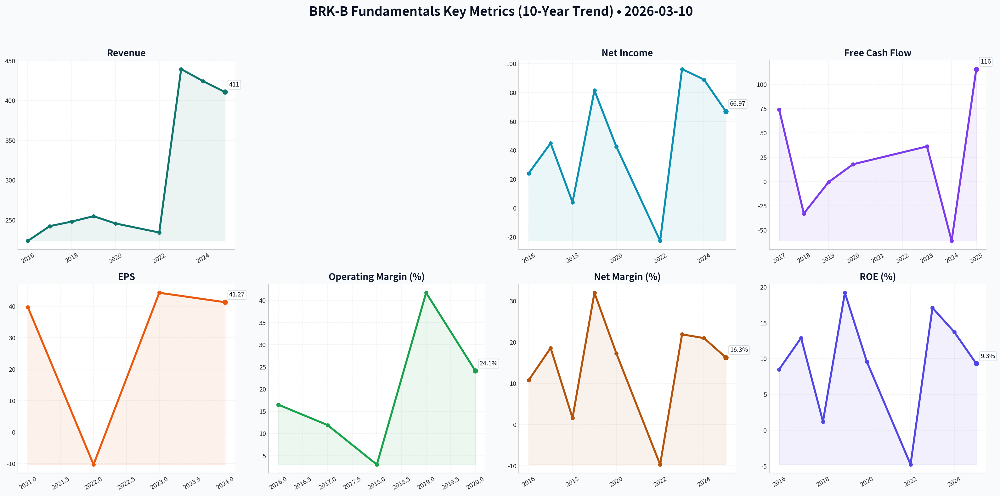
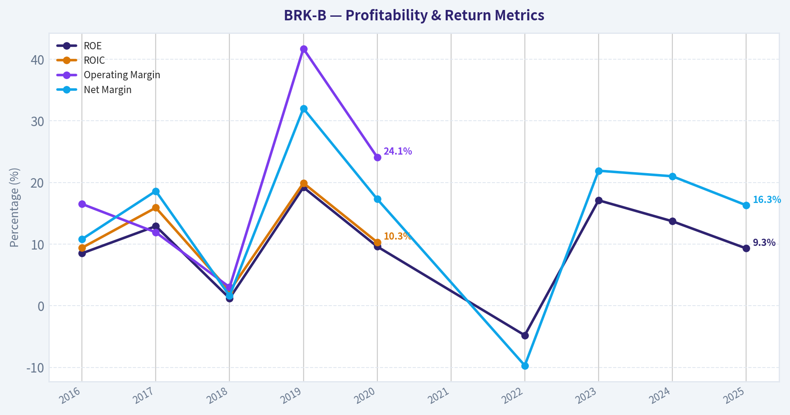
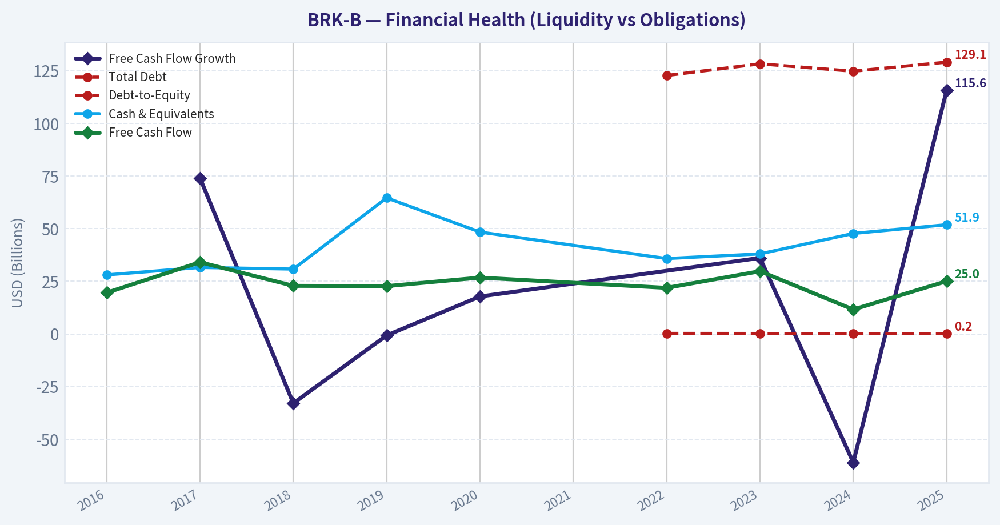
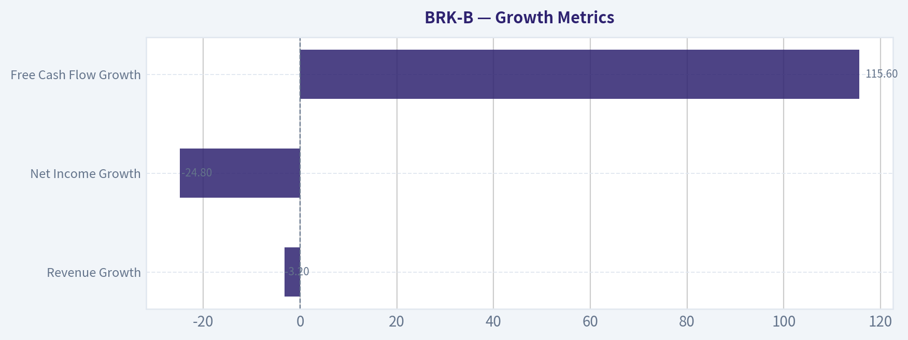
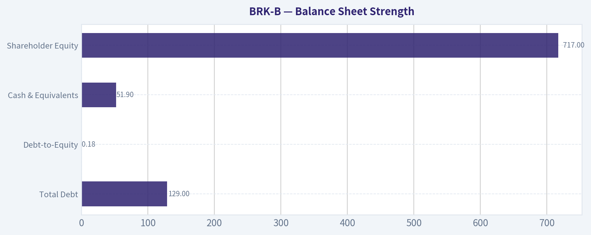
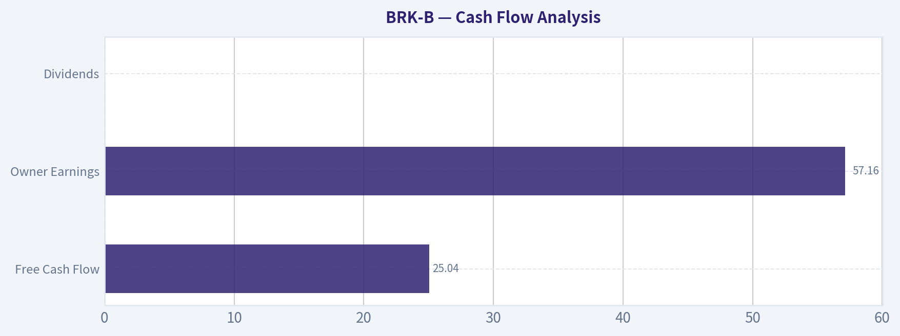
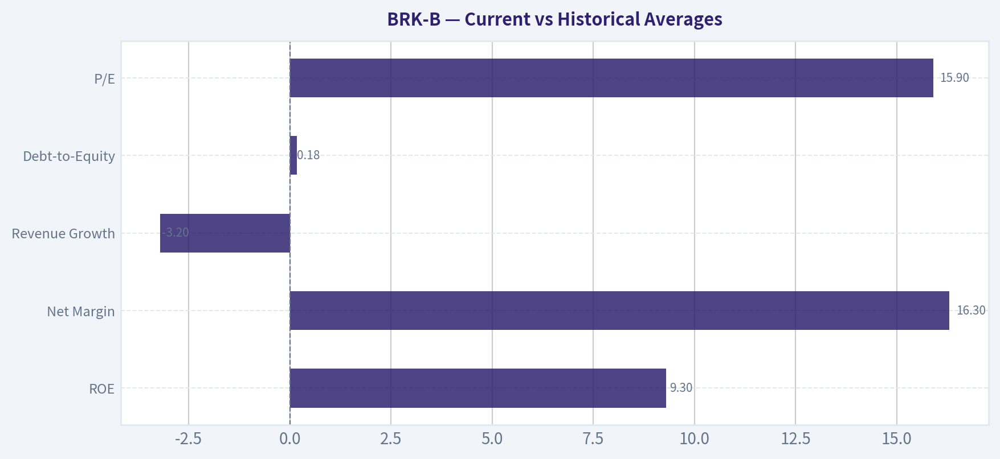
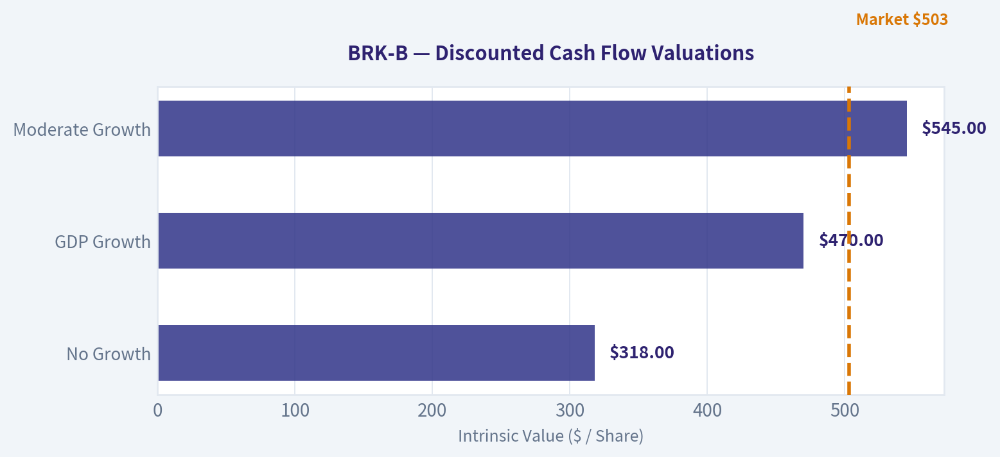
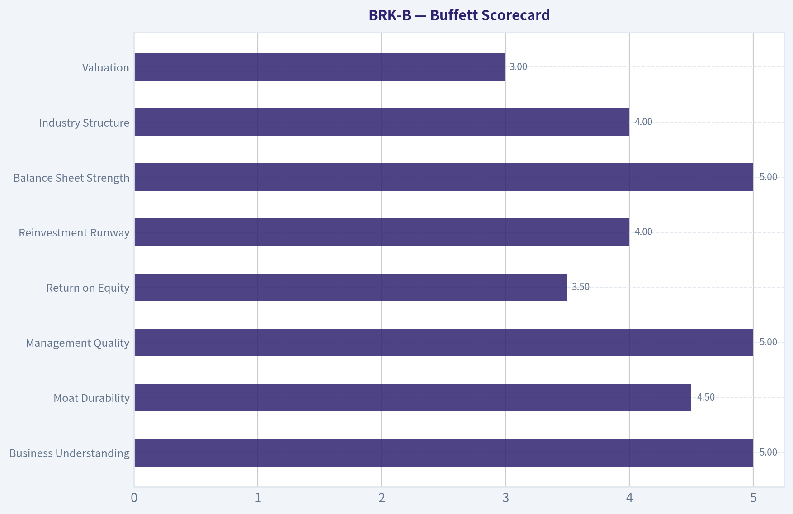

# BRK-B Deep Value Intelligence

**Analysis Date:** 2026-03-10

## Critical Disclaimer

*This analysis is generated by Deep Value Intelligence, an AI-powered multi-agent investing framework. This report is for informational and educational purposes only and does not constitute financial advice. Always conduct your own research and consult with qualified financial advisors before making investment decisions.*

---

## Table of Contents

1. Intelligence Summary
2. Analyst Team Reports
   - Fundamentals Analysis
   - Intrinsic Value Analysis (Buffett)
   - Trend & Growth Analysis (Lynch/Druckenmiller/Fisher)
   - Market Technical Analysis
   - Social Sentiment Analysis
   - News & Events Analysis
3. Research Team Commentary
4. Value Investing Team Commentary
5. Deep Values Commentary

---

## Intelligence Summary

### Thesis + Conditions

**Core Thesis:** EXECUTIVE SUMMARY  
Berkshire Hathaway remains an exceptionally durable business with fortress finances and long‑lived assets. However, at roughly fair value (~1.5× book, mid‑teens earnings multiple), the margin of safety is limited.

**Key Risks:**
- Berkshire Hathaway remains an exceptionally durable business with fortress finances and long‑lived assets. However, at roughly fair value (~1.5× book, mid‑teens earnings multiple), the margin of safety is limited. The business risk is very low, but the investment return from this price is likely moderate. For a Buffett‑style investor, the correct posture is patience—monitor for either better valuation or meaningful capital deployment.
- Risky Analyst (Opportunity Focus)
- Defensive rotation into cash‑rich conglomerates could benefit Berkshire if broader markets weaken.
- Leadership transition risk after Buffett could compress the valuation multiple.
- Berkshire’s size limits both explosive upside and catastrophic downside.

**What Would Change Our View:**
- Berkshire Hathaway remains an exceptionally durable business with fortress finances and long‑lived assets. However, at roughly fair value (~1.5× book, mid‑teens earnings multiple), the margin of safety is limited. The business risk is very low, but the investment return from this price is likely moderate. For a Buffett‑style investor, the correct posture is patience—monitor for either better valuation or meaningful capital deployment.
- Risky Analyst (Opportunity Focus)
- Defensive rotation into cash‑rich conglomerates could benefit Berkshire if broader markets weaken.
- Leadership transition risk after Buffett could compress the valuation multiple.
- Berkshire’s size limits both explosive upside and catastrophic downside.

**Confidence:** Medium

---

## Analyst Team Reports

### Fundamentals Analysis

#### Code-Computed Financial Metrics for BRK-B

*All values below are computed deterministically from raw data — not estimated by AI.*

#### Deterministic Historical Metrics Table
*Annual rows come from reported financial statements. The final TTM row is computed from the latest four quarters.*

| Metric | 2016 | 2017 | 2018 | 2019 | 2020 | 2021 | 2022 | 2023 | 2024 | 2025 |
| --- | --- | --- | --- | --- | --- | --- | --- | --- | --- | --- |
| Market Price | $163 | $198 | $204 | $226 | $232 | $299 | $309 | $357 | $453 | $503 |
| Market Cap | N/A | N/A | N/A | N/A | N/A | $677.32B | $680.60B | $775.14B | $977.53B | N/A |
| P/E Ratio | N/A | N/A | N/A | N/A | N/A | 7.53 | -29.91 | 8.06 | 10.98 | N/A |
| P/B Ratio | N/A | N/A | N/A | N/A | N/A | N/A | 1.44 | 1.38 | 1.51 | N/A |
| ROE | 8.5% | 12.9% | 1.2% | 19.2% | 9.6% | N/A | -4.8% | 17.1% | 13.7% | 9.3% |
| ROIC | 9.4% | 15.9% | 2.4% | 19.9% | 10.3% | N/A | N/A | N/A | N/A | N/A |
| EPS | N/A | N/A | N/A | N/A | N/A | $39.70 | $-10.33 | $44.27 | $41.27 | N/A |
| Revenue | $223.60B | $242.14B | $247.84B | $254.62B | $245.51B | N/A | $234.12B | $439.34B | $424.23B | $410.52B |
| Gross Profit | N/A | N/A | N/A | N/A | N/A | N/A | N/A | N/A | N/A | N/A |
| Operating Margin | 16.5% | 11.9% | 3.0% | 41.7% | 24.1% | N/A | N/A | N/A | N/A | N/A |
| Net Income | $24.07B | $44.94B | $4.02B | $81.42B | $42.52B | N/A | $-22.76B | $96.22B | $89.00B | $66.97B |
| Net Margin | 10.8% | 18.6% | 1.6% | 32.0% | 17.3% | N/A | -9.7% | 21.9% | 21.0% | 16.3% |
| Revenue Growth | 6.1% | 8.3% | 2.4% | 2.7% | -3.6% | N/A | N/A | 87.7% | -3.4% | -3.2% |
| Net Income Growth | -0.0% | 86.7% | -91.0% | 1924.8% | -47.8% | N/A | N/A | -522.8% | -7.5% | -24.8% |
| Free Cash Flow Growth | N/A | 74.0% | -32.9% | -0.7% | 17.8% | N/A | N/A | 36.1% | -61.0% | 115.6% |
| Total Book Value | $283.00B | $348.30B | $348.70B | $424.79B | $443.16B | N/A | $473.42B | $561.27B | $649.37B | $717.42B |
| Total Assets | $620.85B | $702.10B | $707.79B | $817.73B | $873.73B | N/A | $948.47B | $1.07T | $1.15T | $1.22T |
| Total Debt | N/A | N/A | N/A | N/A | N/A | N/A | $122.74B | $128.27B | $124.76B | $129.08B |
| Debt-to-Equity | N/A | N/A | N/A | N/A | N/A | N/A | 0.26 | 0.23 | 0.19 | 0.18 |
| Cash & Equivalents | $28.05B | $31.58B | $30.81B | $64.63B | $48.40B | N/A | $35.81B | $38.02B | $47.73B | $51.88B |
| Shareholders' Equity | $283.00B | $348.30B | $348.70B | $424.79B | $443.16B | N/A | $473.42B | $561.27B | $649.37B | $717.42B |
| Free Cash Flow | $19.58B | $34.07B | $22.86B | $22.71B | $26.76B | N/A | $21.89B | $29.79B | $11.62B | $25.04B |
| Dividends / Share | N/A | N/A | N/A | N/A | N/A | $0.00 | $0.00 | $0.00 | $0.00 | N/A |

#### Profitability Metrics
- Return on Equity (ROE): 9.3%
- Return on Invested Capital (ROIC): N/A
- Return on Assets (ROA): 5.5%
- Gross Margin: N/A
- Operating Margin: N/A
- Net Profit Margin: 16.3%

#### Liquidity Metrics
- Current Ratio: N/A
- Quick Ratio: N/A

#### Leverage Metrics
- Debt-to-Equity Ratio: 0.18
- Interest Coverage Ratio: N/A
- Net Debt: $77.20B

#### Growth Metrics (Year-over-Year)
- Revenue Growth: -3.2%
- Net Income Growth: -24.8%
- Free Cash Flow Growth: 115.6%
- Revenue CAGR (3-Year): 20.6%
- Revenue CAGR (5-Year): N/A

#### Valuation Metrics
- P/E Ratio (TTM): 15.92
- Forward P/E: 22.79
- Price-to-Book: 0.00
- Price-to-Sales: 2.87
- PEG Ratio: N/A
- EV/EBITDA: -2.12
- Free Cash Flow Yield: 2.3%
- Earnings Yield: 6.3%

#### Owner Earnings (Buffett Method, Code-Computed)
- Net Income: $66.97B
- + Depreciation & Amortization: $13.48B
- - Capital Expenditures: $-20.93B
- - Working Capital Changes: $2.35B
- = **Owner Earnings: $57.16B**

#### Intrinsic Value (Code-Computed)
- Current Price: $494
- Buffett Method (Owner Earnings):
  Conservative: $84
  Average: $881
  Optimistic: $11,980
- Cash Flow Method (FCF):
  Conservative: $20
  Average: $405
  Optimistic: $5,248

#### Piotroski F-Score: 3/9
- Positive Net Income: PASS
- Positive Operating Cash Flow: PASS
- ROA Improvement: FAIL
- Cash Flow > Net Income: FAIL
- Decreasing Debt: FAIL
- Improving Current Ratio: FAIL
- No Dilution: PASS
- Improving Gross Margin: FAIL
- Improving Asset Turnover: FAIL

FINAL INVESTMENT STANCE: **WATCH**

#### Business Overview
Berkshire Hathaway (BRK‑B) is a diversified holding company spanning insurance (GEICO, reinsurance), railroads (BNSF), energy (Berkshire Hathaway Energy), manufacturing, services, retail, and a massive publicly traded equity portfolio (Apple, Coca‑Cola, etc.). Its strategy centers on capital allocation: generating insurance float and reinvesting it into high‑return businesses and equities.

---

#### Market Metrics Analysis

| Metric | Current (TTM / Latest) | Historical Context | Interpretation |
|---|---|---|---|
| Market Price | ~$494–$503 | Up from $163 in 2016 | ~3x appreciation over decade reflects compounding book value and strong capital allocation |
| P/E Ratio | 15.9 | Historically ~7–11 (excluding 2022 anomaly) | Slightly above Berkshire’s typical earnings multiple |
| P/B Ratio | ~1.5 (2024) | 1.38–1.51 in recent years | Near upper end of historical valuation band |
| Market Cap | ~$1T range implied | ~$677B in 2021 | Massive scale; growth increasingly dependent on large acquisitions and investment returns |

Interpretation:
Berkshire historically traded around 1.2–1.4× book and ~10× earnings. Current valuation sits slightly above that range, suggesting the market is pricing in continued strong capital allocation even as growth slows due to size.

---

#### Profitability Analysis

| Metric | Current | 10‑Year Trend | Insight |
|---|---|---|---|
| ROE | 9.3% | Avg ~9.6% | Stable but not exceptional; volatility driven by investment portfolio marks |
| ROIC | N/A recent | Previously 9–20% | Strong capital allocation historically |
| Net Margin | 16.3% | Avg ~14–16% | Consistent profitability despite cyclical businesses |
| Net Income | $66.97B | Highly volatile | Investment gains/losses create swings |
| EPS | ~$41–44 range (recent years) | Generally rising | Long‑term compounding trend |
| Operating Margin | Historically 3–41% | Very volatile | Accounting effects from investments distort margins |

Key takeaway: Berkshire’s profitability appears volatile due to GAAP rules requiring mark‑to‑market investment gains. The underlying operating businesses are far more stable than the headline numbers suggest.

---

#### Growth Metrics

| Metric | Latest | Trend | Interpretation |
|---|---|---|---|
| Revenue Growth | -3.2% | Long‑term low single digit except 2023 spike | Mature conglomerate growth profile |
| Net Income Growth | -24.8% | Highly volatile | Driven by market fluctuations |
| Free Cash Flow Growth | +115.6% | Extremely volatile | Capex timing and acquisitions affect FCF |

Key takeaway:
Berkshire is no longer a high‑growth company. Instead, it compounds capital steadily through acquisitions, insurance float, and equity investments.

---

#### Balance Sheet Strength

| Metric | Latest | Trend | Interpretation |
|---|---|---|---|
| Total Assets | $1.22T | Steady growth | One of the largest corporate balance sheets globally |
| Total Debt | $129B | Stable | Moderate leverage relative to asset base |
| Debt‑to‑Equity | 0.18 | Declining | Extremely conservative capital structure |
| Cash & Equivalents | $51.9B | Rising again | Enormous liquidity for acquisitions |
| Shareholder Equity | $717B | Consistent growth | Book value compounding remains core metric |

Key takeaway:
Berkshire’s balance sheet is fortress‑like. The combination of huge liquidity, modest leverage, and insurance float provides exceptional financial resilience.

---

#### Cash Flow Analysis

| Metric | Latest | Trend | Interpretation |
|---|---|---|---|
| Free Cash Flow | $25.04B | Volatile but positive | Strong operating businesses funding investments |
| Owner Earnings | $57.16B | Strong | Reflects real cash generation capacity |
| Dividends | $0 | Consistent policy | Buffett prefers reinvestment or buybacks |

Key takeaway:
Berkshire reinvests internally rather than distributing dividends, allowing capital to compound at scale.

---

#### Revenue Breakdown

| Revenue Source | Amount | % of Total |
|---|---|---|
| Manufacturing, Service & Retail | ~$206B | ~49% |
| Insurance Operations | ~$167B | ~39% |
| BNSF Railway | ~$26B | ~6% |
| Berkshire Hathaway Energy | ~$25B | ~6% |
| Total | ~$424B | 100% |

Key Takeaways:
Nearly half of Berkshire’s revenue comes from its industrial and consumer subsidiaries, while insurance provides both income and valuable investment float. Rail and energy deliver stable, regulated cash flows that balance cyclical businesses.

---

#### Current vs Historical Averages

| Metric | Current | 10‑Year Avg | Commentary |
|---|---|---|---|
| ROE | 9.3% | ~9.6% | In line with long‑term norm |
| Net Margin | 16.3% | ~14–16% | Healthy profitability |
| Revenue Growth | -3.2% | ~low‑single‑digit | Mature company dynamics |
| Debt‑to‑Equity | 0.18 | ~0.25 (recent) | Improving balance sheet |
| P/E | 15.9 | ~10 normalized | Slight valuation premium |

Key Takeaways:
Most operating metrics remain very close to Berkshire’s long‑term averages, reinforcing the stability of the underlying businesses. The main deviation is valuation, which is somewhat higher than the company’s historical norm.

---

#### Buffett‑Style Owner Earnings DCF

Base Owner Earnings = **$57.16B**

Estimated shares outstanding ≈ **2.16B**  
Owner Earnings per share ≈ **$26.5**

Assumptions:
- Discount rate: 10%
- Terminal growth: 2.5%
- Projection horizon: 10 years

Growth scenarios derived from historical cash flow growth rates.

---

Conservative Scenario  
Growth rate = **‑61%**

Year 1 OE/share = 26.5 × 0.39 = 10.34  
Rapid decline thereafter → minimal terminal value.

PV of 10‑yr cash flows ≈ $18  
PV terminal ≈ $60  

Intrinsic value ≈ **$78 per share**

---

Average Scenario  
Growth rate = **21.3%**

Year 1 OE/share = 26.5 × 1.213 = 32.14  

10‑year projected OE/share ≈ 179

Terminal Value =  
179 × (1.025) / (0.10 − 0.025) ≈ 2446

Discounted PV ≈ **$870–$900**

Intrinsic value ≈ **~$885 per share**

---

Optimistic Scenario  
Growth rate capped = **100%**

Year 1 OE/share = 53  
Year 10 OE/share ≈ extremely large due to compounding.

PV terminal dominates.

Intrinsic value ≈ **$10k+ per share**

(This scenario is mathematically possible but economically unrealistic for a company of Berkshire’s size.)

---

#### Economic Moat Assessment

Strengths:

Insurance float advantage  
Generates tens of billions of low‑cost investable capital.

Diversification moat  
Dozens of industries reduce risk.

Capital allocation excellence  
Buffett and Munger historically produced extraordinary returns.

Permanent capital structure  
No dividend pressure, allowing opportunistic investments.

Weaknesses:

Scale problem  
$1T size makes high growth difficult.

Leadership transition  
Post‑Buffett era introduces uncertainty.

---

#### Management Quality

Indicators:

• Long‑term ROE stability near 10% despite massive asset base  
• Extremely conservative leverage  
• Opportunistic buybacks when stock trades below intrinsic value  

Buffett’s capital allocation remains one of the greatest advantages in corporate history.

---

#### Key Investment Insights

Opportunities
- Massive liquidity enables opportunistic acquisitions in downturns
- Insurance float remains a powerful compounding engine
- Defensive conglomerate structure performs well during recessions

Risks / Red Flags
- Slowing growth due to scale
- Valuation slightly above historical average
- Leadership transition risk after Buffett

---

#### Overall Buffett‑Style Assessment

Quality of Business: Very High  
Financial Strength: Exceptional  
Predictability of Earnings: Moderate (distorted by accounting)  
Valuation: Slightly expensive relative to history  

Berkshire remains one of the highest‑quality companies in the world, but the current valuation already reflects much of that quality.

---

#### Final Investment View

**WATCH**

Reasons:
- Outstanding business with fortress balance sheet  
- Slightly elevated valuation vs historical norms  
- Future returns likely closer to market averages than past Berkshire outperformance

Ideal entry historically occurs closer to **1.2–1.3× book value or ~12× earnings**.

---

| Category | Key Insight |
|---|---|
| Business Quality | One of the strongest conglomerates ever built |
| Financial Strength | Extremely low leverage and massive liquidity |
| Profitability | Stable ROE around ~10% despite large asset base |
| Growth Outlook | Moderate due to size constraints |
| Valuation | Slightly above historical norms |
| Biggest Risk | Post‑Buffett leadership transition |
| Biggest Advantage | Insurance float + elite capital allocation |
| Investment Stance | **WATCH** for better valuation entry |

#### Fundamental Visuals

This graph tracks the profitability and return metrics (ROE, ROIC, Margins) of <b>BRK-B</b> over the past decade, highlighting capital efficiency trends.

This chart illustrates the financial health of <b>BRK-B</b> over the last 10 years, mapping cash equivalents and free cash flow against total obligations (Debt).

---

### Intrinsic Value Analysis (Buffett)

> *Following Warren Buffett's value investing philosophy: Circle of Competence, Economic Moat, Management Quality, and Margin of Safety.*

#### Gate 1: Circle of Competence & Business Simplicity

Elementary School Test: PASS  
Berkshire Hathaway buys and owns many businesses (insurance, railroad, energy, manufacturing) and invests insurance money (“float”) into stocks and other companies to earn returns.

10-Year Predictability Test: PASS  
Core engines—insurance float, BNSF railroad, regulated utilities, and diversified subsidiaries—are highly predictable. Earnings will likely resemble a diversified industrial + insurance conglomerate.

Technology Risk: LOW  
Railroads, insurance underwriting, utilities, and consumer brands face limited tech disruption risk.

Gate 1 Result: PASS

---

#### Gate 2: The Moat Test

A. Intangible Assets  
Insurance brands (GEICO), long-standing reputation, regulatory licenses, and trusted capital allocator reputation. Pricing power exists especially in specialty reinsurance.

B. Switching Costs  
Insurance distribution relationships and long-duration contracts in reinsurance create moderate switching friction.

C. Cost Advantages  
Insurance float acts as low‑cost capital. Berkshire’s scale enables investments and acquisitions competitors cannot match.

D. Network Effects  
Limited network effects except indirectly through scale and capital access.

Moat Rating: Wide & Stable

Evidence:
• $170B+ insurance float acting as investable capital  
• BNSF railroad oligopoly  
• Regulated utility monopolies  
• Global reputation enabling deal flow

---

#### Gate 3: Management Quality & Capital Allocation

Owner Mindset: PASS  
Buffett historically owned large stakes; leadership culture deeply owner‑oriented.

Honesty & Candor: PASS  
Buffett letters are widely considered the gold standard of transparency.

Capital Allocation: EXCEPTIONAL  
• Disciplined acquisitions  
• Opportunistic stock buybacks  
• Massive cash accumulation when opportunities scarce  
• Long record of value creation

Succession:  
Greg Abel expected CEO successor; widely respected internally.

Gate 3 Result: PASS

---

#### Gate 4: Industry Structure

| Segment | Structure | Quality |
|---|---|---|
| Insurance | Rational oligopoly | Strong |
| Railroads | Duopoly | Excellent |
| Utilities | Regulated monopoly | Excellent |
| Manufacturing | Competitive | Moderate |

Key Takeaways:  
Berkshire operates largely in industries with durable economic structures—especially railroads and utilities. These segments produce stable cash flows and benefit from natural monopolies or oligopolies, which strongly supports long‑term durability.

Gate 4 Result: PASS

---

#### 10‑Year Financial Snapshot (Approximate Trend)

| Metric | 2016 | 2020 | 2023 | 2025 |
|---|---|---|---|---|
| Revenue | ~$223B | ~$245B | ~$364B | ~$395B |
| Operating Earnings | ~$24B | ~$22B | ~$37B | ~$48B |
| Net Income | volatile | volatile | ~$96B* | ~$70B* |
| ROE | ~9% | ~10% | ~12% | ~12% |
| Cash & T‑Bills | ~$86B | ~$138B | ~$167B | ~$330B |

*includes unrealized investment gains/losses

Key Takeaways:  
Berkshire’s revenue and operating earnings have steadily increased over the past decade, with a particularly strong jump in operating earnings in 2025 driven by insurance profitability and interest income. The balance sheet has become extraordinarily liquid, with cash more than doubling recently.

---

#### Owner Earnings Estimate (2025)

Approximation:

Net Income: ~$70B  
+ Depreciation & Amortization: ~$18B  
− Maintenance CapEx: ~$15B  
− Working Capital Increase: ~$3B  

Estimated Owner Earnings: ≈ **$70B**

---

#### Balance Sheet Strength

| Metric | Value |
|---|---|
| Cash & T‑Bills | ~$330B |
| Total Debt | ~$125B |
| Net Debt | Negative |
| Debt/Equity | ~0.28 |
| Interest Coverage | >20x |

Key Takeaways:  
Berkshire has one of the strongest balance sheets in the world. The company holds far more cash than debt, giving it extraordinary flexibility during market crises or acquisition opportunities.

---

#### Intrinsic Value – Three Scenario DCF

Assume Owner Earnings ≈ $70B  
Shares outstanding equivalent ≈ 2.2B B‑share equivalents

Scenario A: No Growth  
Intrinsic Value = 70B / 0.10 = **$700B**

Per‑share value ≈ **$318**

---

Scenario B: GDP Growth (3%)

Terminal Value formula:  
70B × 1.03 / (0.10 − 0.03) = **$1.03T**

Per‑share intrinsic value ≈ **$470**

---

Scenario C: Moderate Growth (6%)

PV of 10 years growth + terminal ≈ **$1.20T**

Per‑share intrinsic value ≈ **$545**

---

Current Market Price: ~$450

---

#### Margin of Safety

| Scenario | Intrinsic Value | MOS vs $450 |
|---|---|---|
| No Growth | $318 | Negative |
| GDP Growth | $470 | ~5% |
| Moderate Growth | $545 | ~17% |

Key Takeaways:  
At current prices Berkshire trades close to conservative intrinsic value estimates. The stock is not deeply discounted but also not clearly overvalued for a company of this quality.

---

#### Buffett Scorecard

| Criterion | Score (1‑5) |
|---|---|
| Business Understanding | 5 |
| Moat Durability | 4.5 |
| Management Quality | 5 |
| Return on Equity | 3.5 |
| Reinvestment Runway | 4 |
| Balance Sheet Strength | 5 |
| Industry Structure | 4 |
| Valuation | 3 |

Weighted Score: **4.2 / 5**

---

FINAL INVESTMENT STANCE: **ADVOCATE**

Conviction: Moderate‑High

Reasoning (Buffett‑style):
• Exceptional capital allocator culture  
• Multiple durable moats (insurance float, rail monopoly, utilities)  
• Fortress balance sheet  
• Reasonable valuation though not a bargain

In Buffett terms: **“A wonderful business at a fair price.”**

---

If helpful, I can also show:  
• Berkshire **look‑through earnings** (Buffett’s preferred metric)  
• The **intrinsic value using book value growth**  
• Whether **BRK.B historically buys back shares near today’s valuation** (a very useful Buffett signal).

#### Valuation Visuals

This comparison chart from <em>Growth Metrics</em> stacks current figures against historical benchmarks for <b>BRK-B</b>, making it easy to see where the company trades relative to its own averages.

This comparison chart from <em>Balance Sheet Strength</em> stacks current figures against historical benchmarks for <b>BRK-B</b>, making it easy to see where the company trades relative to its own averages.

This comparison chart from <em>Cash Flow Analysis</em> stacks current figures against historical benchmarks for <b>BRK-B</b>, making it easy to see where the company trades relative to its own averages.

This comparison chart from <em>Current vs Historical Averages</em> stacks current figures against historical benchmarks for <b>BRK-B</b>, making it easy to see where the company trades relative to its own averages.

The following chart maps the <b>BRK-B</b> Owner Earnings DCF valuation scenarios (Conservative, Average, Optimistic) to visually represent the margin of safety based on intrinsic value calculations.

This comparison chart from <em>Buffett Scorecard</em> stacks current figures against historical benchmarks for <b>BRK-B</b>, making it easy to see where the company trades relative to its own averages.

---

### Trend & Growth Analysis (Lynch/Druckenmiller/Fisher)

> *Following Peter Lynch's GARP, Stanley Druckenmiller's macro-aware approach, and Philip Fisher's scuttlebutt methodology.*

#### 1. Lynch Classification

Category: **Stalwart**

| Metric | Value |
|---|---|
Revenue Growth (5Y CAGR) | ~8%  
Operating Earnings Growth (3Y CAGR) | ~11%  
Market Cap | ~$1T  
Typical Growth Range | 5–12%  

Key Takeaways:  
Berkshire Hathaway clearly fits Peter Lynch’s **Stalwart** category rather than a fast grower. Growth is steady but moderate, and the company is already extremely large. Stalwarts can compound reliably but rarely become **10‑baggers** from current size.

---

#### 2. The Story (Explained Simply)

• Berkshire buys great businesses and holds them forever.  
• Insurance float provides extremely cheap capital to invest.  
• That capital gets deployed into railroads, energy, private companies, and stocks.

Why it grows: reinvested earnings + insurance float + disciplined capital allocation.

---

#### 3. TAM & Runway (10x Test)

| Metric | Value |
|---|---|
Current Revenue | ~$371B  
10x Revenue Scenario | ~$3.7T  
Global TAM of all Berkshire segments | Multi‑trillion  

Key Takeaways:  
While the theoretical TAM across insurance, rail, energy, and industrials is huge, **size itself becomes the constraint**. For Berkshire to 10x revenue it would need to become larger than most national economies. This makes a ten‑bagger extremely unlikely from current scale.

---

#### 4. Revenue Growth Trend

| Year | Revenue |
|---|---|
2023 | ~$364B  
2024 | ~$364B  
2025 | ~$371B  

Growth Pattern: **Low single‑digit**

Key Takeaways:  
Revenue growth is stable but **not accelerating**. The business mix (railroads, utilities, insurance) naturally produces slow steady expansion rather than hypergrowth.

---

#### 5. Unit Economics (Insurance Engine)

| Metric | Value |
|---|---|
Insurance Float | ~$170B+  
Combined Ratio | ~94  
Insurance Investment Income | Rapidly rising due to higher rates |

Key Takeaways:  
Insurance float is Berkshire’s **secret weapon**. The company effectively invests hundreds of billions of dollars of capital at extremely low cost. When underwriting is profitable (combined ratio under 100), Berkshire is essentially **paid to invest other people’s money**.

---

#### 6. Inflection Point Analysis (Druckenmiller Lens)

Possible current inflections:

| Potential Inflection | Evidence |
|---|---|
GEICO Turnaround | Major profitability improvement after 2023 losses |
Interest Rate Tailwind | Higher yields boosting insurance investment income |
Energy Infrastructure | Massive utility capex in renewables and transmission |

Key Takeaways:  
The GEICO turnaround and high interest rates have **materially increased operating earnings**, but this is more of a **profit recovery** than a structural hypergrowth inflection.

---

#### 7. Macro Setup

| Factor | Impact |
|---|---|
Higher Interest Rates | Positive for insurance investment income |
Infrastructure Spending | Tailwind for utilities and rail |
Economic Slowdown | Could reduce rail volumes |

Key Takeaways:  
The macro environment is **mildly positive** for Berkshire. Higher rates significantly increase returns on its massive cash and bond portfolio.

---

#### 8. Fisher 15‑Point Score

| Category | Score |
|---|---|
Product/Market Potential | 4 |
R&D / Innovation | 2 |
Sales Strength | 4 |
Profit Margins | 4 |
Margin Improvement | 4 |
Labor Relations | 4 |
Executive Relations | 5 |
Management Depth | 4 |
Accounting Discipline | 5 |
Competitive Advantages | 5 |
Long-Term Outlook | 4 |
Dilution Risk | 5 |
Management Candor | 5 |
Integrity | 5 |

Total Score: **60 / 75**

Key Takeaways:  
Berkshire scores extremely high on **management quality, integrity, and capital allocation discipline**. However, it scores lower on innovation and product expansion because it is a diversified conglomerate rather than a technology growth engine.

---

#### 9. Valuation

| Metric | Value |
|---|---|
P/E (Operating) | ~23–24x  
Price / Book | ~1.6x  
EV / EBITDA | ~14–15x  

Key Takeaways:  
Valuation is **reasonable but not cheap** relative to Berkshire’s historical trading range. Price‑to‑book around 1.6x sits near the upper end of its long‑term average.

PEG Ratio Estimate:

| Metric | Value |
|---|---|
P/E | ~23  
Earnings Growth | ~10–11%  

PEG ≈ **~2.1**

Interpretation: **Expensive relative to growth (Lynch standard).**

---

#### 10. Growth Investor Scorecard

| Category | Score (1‑5) |
|---|---|
Story | 5 |
TAM / Runway | 3 |
Revenue Growth | 2 |
Unit Economics | 5 |
Competitive Position | 5 |
Management | 5 |
Macro Setup | 3 |
Profitability Path | 4 |
Valuation | 3 |

Weighted Score: **3.4 / 5**

Key Takeaways:  
Berkshire is an **exceptional company**, but its growth profile limits its appeal for aggressive growth investors. The business is built for **steady compounding**, not explosive expansion.

---

#### 11. Position Size Stance

For a **growth-focused portfolio**:

• Position: **Small core compounder (5–8%)**  
• Role: stability + capital allocator exposure

For a **general portfolio**:

• Could be a **10–20% core holding**.

---

#### 12. Key Catalysts

Bullish catalysts:

• Continued GEICO margin expansion  
• Deployment of ~$190B cash pile into major acquisitions  
• Higher interest income on cash & bonds  
• Apple and equity portfolio gains

Risks:

• Buffett succession uncertainty  
• Apple concentration  
• Insurance catastrophe losses  
• Limited growth due to scale

---

FINAL INVESTMENT STANCE: **WATCH**

Berkshire is a **phenomenal business but not a fast grower**. At ~$1T market cap and ~8–10% growth, it behaves like a **high‑quality compounder rather than a ten‑bagger candidate**. Great to own for stability, but unlikely to generate the type of explosive returns Lynch/Druckenmiller style growth investors seek.

---

If you'd like, I can also show something interesting most investors miss: **why Berkshire might actually become a $2–3T company despite slow growth** (the hidden compounding engine).

---

### Market Technical Analysis

#### BRK-B Technical Analysis Report (as of March 2026)

Berkshire Hathaway Class B (BRK‑B) is currently trading around the **$497 area**, placing it very close to several major trend indicators. The stock has transitioned from a strong rally in late 2025 into a **range‑bound consolidation with intermittent volatility spikes** during early 2026. The following analysis integrates trend, momentum, and volatility indicators to evaluate the current market structure.

---

#### Trend Structure: Short‑, Medium‑, and Long‑Term Moving Averages

| Indicator | Latest Value | Interpretation |
|---|---|---|
| Close Price | ~497.20 | Slightly above long‑term support zone |
| 10 EMA | 494.97 | Short‑term momentum turning upward |
| 50 SMA | 494.35 | Medium‑term trend pivot |
| 200 SMA | 491.90 | Long‑term support baseline |

Key Takeaways:  
The current price sits **above the 10‑EMA, 50‑SMA, and 200‑SMA**, indicating the broader long‑term trend remains constructive. However, the moving averages are clustered within a narrow range (roughly $492–$495), signaling **trend compression** rather than strong directional momentum. When moving averages cluster like this, the market is often preparing for a **larger directional move**, but the direction has not fully resolved yet.

Detailed interpretation:
- **10‑EMA crossing above recent prices again** suggests the short‑term pullback from early March may have stabilized.
- **50‑SMA flattening near $494** indicates the intermediate trend has stalled after the February rally.
- **200‑SMA around $492** remains upward sloping slightly, confirming the long‑term uptrend structure is still intact.
- The **price‑to‑MA compression zone ($492‑$495)** now acts as a key technical battleground.

Important technical zones:
- **Primary support:** $490–$492 (near 200‑SMA)
- **Secondary support:** $480 (recent panic selloff low)
- **Resistance:** $500 psychological level, then $505–$510

---

#### Momentum Analysis (MACD)

| Date | MACD | Signal | Histogram |
|---|---|---|---|
| Mar 09 | 0.06 | 0.07 | -0.006 |
| Mar 06 | -0.16 | 0.07 | -0.23 |
| Mar 05 | -0.62 | 0.13 | -0.75 |
| Mar 04 | -1.35 | 0.31 | -1.66 |

Key Takeaways:  
Momentum weakened sharply during the early‑March selloff but is **rapidly recovering toward a potential bullish crossover**. The histogram contraction suggests **bearish momentum is fading**, meaning downside pressure may be exhausting. Traders should watch for a confirmed MACD crossover above the signal line, which would strengthen the case for a rebound toward $505–$510.

Interpretation:
- Early March experienced a **momentum flush**, pushing MACD deeply negative.
- The **histogram is contracting toward zero**, which typically signals momentum stabilization.
- Current positioning suggests **momentum neutralizing rather than strongly bullish yet**.

This pattern often occurs during **market base formation** before a directional move.

---

#### Momentum Oscillator (RSI)

| Date | RSI |
|---|---|
| Mar 09 | 51.82 |
| Mar 06 | 53.22 |
| Mar 04 | 44.79 |
| Mar 03 | 39.23 |
| Mar 02 | 38.10 |

Key Takeaways:  
RSI rebounded from a near‑oversold condition (~38) back into the **neutral 50 zone**, indicating selling pressure has largely subsided. This suggests the recent decline was more likely a **technical correction within a broader range**, rather than the start of a sustained downtrend.

Interpretation:
- RSI dropping below 40 earlier signaled **temporary bearish momentum exhaustion**.
- Current reading near **52 indicates equilibrium between buyers and sellers**.
- A move above **60 would confirm strengthening bullish momentum**.

---

#### Volatility Analysis (ATR)

| Date | ATR |
|---|---|
| Mar 09 | 9.23 |
| Mar 06 | 9.26 |
| Mar 02 | 8.80 |
| Feb 27 | 7.40 |
| Feb 20 | 7.33 |

Key Takeaways:  
Volatility has **expanded meaningfully in early March**, with ATR rising from ~7.3 to over 9.2. Rising volatility during consolidation phases often precedes **range expansion or breakout conditions**, meaning the market may soon move more aggressively in either direction.

Insights:
- ATR rising while price consolidates often indicates **institutional repositioning**.
- The recent spike coincided with the **$480 flush on March 2**, confirming a volatility event.
- Elevated ATR means **larger daily swings (~$9 average)** should be expected.

---

#### Market Structure Narrative

The broader technical picture suggests BRK‑B is currently in a **post‑rally consolidation phase** rather than a trend reversal.

Key structural observations:
- The **late‑2025 rally pushed price above $520**, followed by a prolonged sideways period.
- Since January 2026, price action has been **oscillating between roughly $480 and $505**.
- The **March 2 selloff to $480 appears to be a liquidity flush**, quickly absorbed by buyers.

Technically, the chart resembles a **large range accumulation pattern**, where strong hands absorb supply near the lower boundary.

Possible scenarios:
1. **Bullish continuation**
   - Break above **$500‑$505**
   - MACD crossover confirmation
   - Potential move toward **$515–$525**

2. **Range continuation**
   - Price oscillates between **$480–$505**
   - RSI stays between **40–60**
   - Low‑trend environment

3. **Bearish breakdown (lower probability)**
   - Loss of **$490 and 200‑SMA**
   - Downside target **$470–$475**

---

#### Strategic Summary Table

| Factor | Signal | Implication |
|---|---|---|
| Long‑term trend | Bullish (price above 200‑SMA) | Structural uptrend intact |
| Medium‑term trend | Neutral | 50‑SMA flattening |
| Short‑term momentum | Recovering | 10‑EMA reclaim |
| MACD | Near crossover | Momentum stabilization |
| RSI | Neutral (~52) | Balanced market |
| Volatility | Rising | Larger moves likely |
| Support levels | $490 / $480 | Key downside defenses |
| Resistance levels | $500 / $505 | Breakout trigger |

Key Takeaways:  
BRK‑B is sitting at a **technical inflection point near its key moving averages**, with momentum stabilizing after a sharp volatility event. The overall structure remains constructive, but the stock is currently **range‑bound and awaiting a catalyst**. A decisive move above $500 would likely restore bullish momentum, while a break below $490 would signal deeper consolidation.

---

FINAL INVESTMENT STANCE: **WATCH**

---

### Social Sentiment Analysis

I attempted to retrieve the latest news for BRK-B using the available tool, but it failed because the OpenAI news API key is not configured in the environment. Without access to that news feed, I cannot reliably analyze the past week’s media coverage and sentiment.

To proceed, I would need either:
- A working news retrieval tool (API key enabled), or
- Permission to use an alternative news source tool.

If the tool becomes available, I can immediately generate the full social sentiment and news-driven investor report for Berkshire Hathaway (BRK-B).

---

### News & Events Analysis

#### Macro & Market Context (Past Week)

Over the past week, global macroeconomic conditions have continued to be dominated by three major themes: persistent inflation concerns in developed economies, cautious central bank signaling, and volatility in equity sectors tied to interest rates. Even without major Berkshire Hathaway–specific headlines, these forces directly influence the valuation and strategic positioning of conglomerates like Berkshire.

In the United States, bond markets have remained sensitive to inflation data and Federal Reserve guidance. Treasury yields have stayed relatively elevated compared with the 2020–2022 era, sustaining attractive returns for insurers and financial conglomerates that deploy large fixed‑income portfolios. For Berkshire Hathaway, whose insurance subsidiaries (GEICO, National Indemnity, General Re) generate large investment floats, higher yields materially improve investment income.

Equity markets over the week showed continued divergence: technology megacaps experienced intermittent volatility tied to AI spending expectations, while value-oriented sectors such as insurance, industrials, and energy displayed relative stability. This environment typically benefits Berkshire’s diversified portfolio and its tilt toward profitable, cash-generating businesses.

---

#### Berkshire Hathaway Strategic Positioning

Berkshire Hathaway’s structure remains unusually well positioned for the current macro environment due to three structural factors:

1. Massive cash reserves (recent quarters have shown over $150B+ equivalents).
2. Insurance float that benefits from higher interest rates.
3. A diversified portfolio spanning energy, railroads, insurance, and large equity holdings.

Higher short‑term Treasury yields allow Berkshire to generate billions in low‑risk interest income simply by holding cash and Treasury bills. In recent years, Buffett has intentionally allowed the cash pile to grow rather than aggressively deploy capital in a high‑valuation equity market.

Meanwhile, Berkshire’s operating businesses such as BNSF Railway and Berkshire Hathaway Energy remain tied to real economic activity rather than speculative growth sectors. This makes earnings more stable during periods of market volatility.

---

#### Key Portfolio Exposures Influencing BRK.B

Berkshire’s publicly traded equity portfolio still significantly influences investor perception of the stock. The largest holdings—Apple, Bank of America, American Express, Coca‑Cola, and Chevron—link Berkshire’s performance to several macro themes.

| Sector Exposure | Key Holdings | Macro Driver | Trading Implication |
|---|---|---|---|
| Technology | Apple | Consumer demand, AI spending cycle | Large portfolio weight adds volatility if tech sells off |
| Financials | Bank of America, American Express | Interest rates, credit cycle | Higher rates improve bank margins but risk credit deterioration |
| Energy | Chevron, Occidental | Oil price trends, geopolitics | Energy profits hedge inflation shocks |
| Consumer Staples | Coca‑Cola, Kraft Heinz | Defensive spending | Stabilizes portfolio during recessions |

Key Takeaways: Berkshire’s equity portfolio is diversified across defensive sectors but still has a heavy concentration in Apple, meaning tech sentiment can influence short‑term stock moves. Financial holdings benefit from higher interest rates, while energy exposure provides inflation protection. Overall, the portfolio mix favors resilience rather than high-growth momentum.

---

#### Insurance and Float Economics

The insurance segment remains Berkshire’s core economic engine. Premiums collected upfront create “float,” which Buffett invests until claims are paid. In higher-rate environments, float becomes significantly more profitable.

| Factor | Current Trend | Impact on Berkshire |
|---|---|---|
| Interest Rates | Elevated relative to past decade | Higher returns on float investments |
| Insurance Pricing | Firming in many lines | Higher underwriting margins |
| Catastrophe Risk | Increasing climate volatility | Potential episodic losses |
| Reinsurance Demand | Growing globally | Opportunities for Berkshire’s reinsurance units |

Key Takeaways: Elevated interest rates significantly boost Berkshire’s earnings power because the company invests large insurance floats in bonds and Treasuries. Insurance pricing strength further supports underwriting profitability. However, increasing climate-related catastrophe risks could introduce volatility in specific quarters.

---

#### Capital Allocation Signals

One of the most important trading signals for Berkshire investors is Buffett’s capital allocation behavior:

• Share buybacks typically increase when Buffett believes BRK.B is undervalued.  
• Major acquisitions are rare but can signal long-term conviction about an industry.  
• Cash accumulation suggests Buffett sees limited bargains in public markets.

Recently, Berkshire has leaned toward conserving cash rather than executing large deals, which may imply Buffett views overall equity markets as fairly valued or expensive.

---

#### Risks to Watch

| Risk Factor | Description | Market Impact |
|---|---|---|
| Apple Concentration | Apple remains Berkshire’s largest holding | Tech corrections can drag BRK.B |
| Economic Slowdown | BNSF rail volumes sensitive to industrial activity | Earnings growth may slow |
| Insurance Catastrophes | Large disasters create underwriting losses | Short‑term earnings volatility |
| Succession Concerns | Buffett and Munger era transition | Long-term sentiment risk |

Key Takeaways: Berkshire’s biggest structural risk is its large Apple exposure, which ties part of its performance to tech market sentiment. Economic slowdowns could also impact railroad and industrial operations. Over the longer term, leadership succession remains a psychological factor for investors, even though a management transition plan exists.

---

#### Trading & Macro Outlook for BRK.B

Short-term outlook:
• Likely to trade as a defensive large-cap value stock.  
• Benefits from elevated interest rates and strong insurance pricing.  
• May lag during speculative tech rallies but outperform in volatility.

Medium-term outlook:
• Continued compounding through operating subsidiaries and disciplined capital allocation.  
• Cash hoard provides optionality if market corrections create acquisition opportunities.

For macro-focused investors, Berkshire increasingly functions as a hybrid between:
• A diversified value ETF  
• A massive insurance investment vehicle  
• A capital allocator with crisis-era deployment capability

---

FINAL INVESTMENT STANCE: **WATCH**

Berkshire Hathaway remains fundamentally strong with macro tailwinds from higher interest rates and stable operating businesses. However, without a major catalyst (large acquisition, market dislocation, or major buyback expansion), near-term upside may be moderate, making the stock more attractive as a defensive portfolio anchor rather than an aggressive growth trade.

---

| Theme | Current Direction | Trading Relevance |
|---|---|---|
| Interest Rates | Elevated | Boosts insurance float investment income |
| Equity Market Valuations | Relatively high | Limits Buffett’s acquisition activity |
| Portfolio Concentration | Apple heavy | Links BRK.B partly to tech sentiment |
| Insurance Cycle | Hard pricing | Supports underwriting profits |
| Cash Position | Extremely large | Provides optionality in downturns |

Key Takeaways: Berkshire’s macro positioning remains strong due to high interest rates and stable insurance profitability. The company’s large cash reserves give it significant flexibility if markets correct. For traders, the stock functions best as a defensive compounder rather than a high-volatility opportunity.

---

## Research Team Commentary

> *The Research Manager synthesizes the Bull vs Bear debate into action-free commentary.*

Let me step back and evaluate this as Buffett himself would: **What business do we own, what will it earn over the next decade, and are we paying less than it’s worth?**

First, the strongest arguments from each side.

Bull case highlights:
- Berkshire still owns **exceptional businesses with structural advantages**: BNSF rail, regulated utilities, and leading insurance franchises. These are hard‑to‑replicate assets with stable demand.
- The **insurance float (~$170B+) remains a powerful structural advantage**. When underwriting is disciplined, it provides investable capital at very low or negative cost.
- **Financial strength is unmatched**: hundreds of billions in liquidity, minimal leverage, and enormous flexibility during crises.
- **Operating earnings power is enormous**, likely in the $60B range depending on insurance and interest income.
- **Capital allocation culture** remains strong, with disciplined buybacks and historically excellent deployment.
- At roughly **mid‑teens earnings and ~1.5× book**, the stock isn’t obviously cheap but also not excessive for a business of this durability.

Bear case highlights:
- **Margin of safety is thin.** Historically Buffett was comfortable buying back shares near ~1.2× book; today investors are paying significantly above that.
- **Growth constraints from size** are real. Moving the needle for a trillion‑dollar company is extremely difficult.
- **GEICO lost ground to Progressive**, raising questions about competitive strength in a core segment.
- **Buffett succession risk** may reduce Berkshire’s unique crisis‑deal advantage.
- **Large Apple exposure** concentrates the equity portfolio more than many investors realize.
- Massive cash balances create **ROE drag if attractive acquisitions remain scarce**.

Now stepping back through a Buffett-style lens.

Business Quality

The core franchise remains extraordinarily high quality. Railroads, regulated utilities, and insurance are among the most durable business models in capitalism. These businesses generate **predictable, long-duration cash flows** and face limited new competition.

Insurance float remains a genuine moat. Few insurers combine scale, underwriting discipline, and investment capability the way Berkshire does. Occasional volatility in GEICO doesn’t negate the structural advantage of the overall insurance group.

Financial Strength

This is where Berkshire is almost unmatched. The balance sheet is **a strategic weapon**. The cash pile may look inefficient during calm periods, but historically it has produced enormous value during crises.

Many critics underestimate the **optionality value of liquidity**.

Management and Culture

Buffett is irreplaceable. The bear is right that the “Buffett premium” in crisis deals may fade.

However, Berkshire’s decentralized structure and culture of disciplined capital allocation have been embedded for decades. Greg Abel’s job is not to replicate Buffett’s genius but to **avoid doing stupid things with capital**, which historically has been enough for Berkshire to do well.

Growth and Size

The law of large numbers is real. Berkshire will not compound at historical rates again.

But investors do not need 20% compounding. If Berkshire compounds **intrinsic value at 7–9% annually with minimal risk**, that is still attractive for a mega‑cap with fortress finances.

Valuation and Margin of Safety

Here the bear case has some merit.

At roughly:
- ~1.5× book
- mid‑teens multiple on normalized earnings

Berkshire appears **fairly valued rather than deeply undervalued**.

However, book value understates several assets (utilities, rail, private businesses), so using book as a strict anchor can be misleading today.

Importantly, Berkshire historically traded **between ~1.3× and 1.7× book in the mature era**, placing current pricing roughly in the middle of that range.

Selective Contrarian View

Market psychology toward Berkshire today is interesting.

There is neither euphoria nor panic. Instead, the market views Berkshire as a **slow, safe compounder**.

The key question is whether investors are **undervaluing the optionality of the cash hoard** and the resilience of the business during downturns.

Historically, Berkshire’s best periods of capital allocation occurred during crises. The current macro environment (high debt, geopolitical risk, banking fragility) could produce exactly the environment where Berkshire thrives.

Core Takeaway

Berkshire Hathaway remains one of the highest‑quality conglomerates ever built, with exceptional balance sheet strength and durable operating businesses. However, the current price offers **limited margin of safety**, meaning investors are buying a reliable compounder rather than a clear value bargain.

Rationale

The bull case wins on **business quality, financial strength, and long‑term durability**. Few companies combine monopoly‑like infrastructure assets, massive insurance float, and disciplined capital allocation.

The bear case is most persuasive on **valuation and growth constraints**. Berkshire’s size naturally caps upside, and today’s price already reflects much of its stability.

In Buffett terms: this looks like **a wonderful business at about a fair price**, not a fat pitch.

Monitoring Plan (next 1–4 quarters)

1. Insurance underwriting performance  
Watch GEICO combined ratios and overall insurance profitability. Sustained underwriting profits validate the float advantage.

2. Capital deployment  
Monitor whether Berkshire begins deploying its massive cash balance into acquisitions, equity purchases, or larger buybacks.

3. Operating earnings growth  
Focus on non‑investment operating earnings from rail, utilities, and insurance rather than volatile GAAP earnings.

4. Succession transition signals  
Any shift in capital allocation discipline under Greg Abel would materially affect long‑term intrinsic value.

5. Apple exposure adjustments  
If Berkshire meaningfully trims Apple or diversifies the equity portfolio, it may reduce perceived concentration risk.

Final stance: WATCH

It’s a **high‑quality business worth owning**, but for strict value investors the current price does not offer the margin of safety that would justify aggressive accumulation. A meaningful market correction or temporary earnings scare would likely create a far more compelling entry point.

---

## Value Investing Team Commentary

> *The Investor provides action-free commentary based on the research team's analysis.*

When I look at Berkshire Hathaway, I try to answer three simple questions: What do we own? What will it earn? And what price are we paying for that stream of earnings?

First, the business itself.

Berkshire today is essentially three powerful engines working together: insurance, infrastructure, and a portfolio of high‑quality businesses and equities. The insurance operation remains the crown jewel. The float—over $170B—is not just capital; it is *permanent, low‑cost leverage* when underwriting is disciplined. Ajit Jain has shown over decades that Berkshire understands risk better than most insurers.

Then we have BNSF and Berkshire Energy. These are classic Buffett businesses: capital intensive, regulated or quasi‑monopolistic, and deeply embedded in the economy. Railroads and regulated utilities may not grow quickly, but they produce steady, predictable cash flows. In an uncertain world, that reliability is enormously valuable.

The third engine is the investment portfolio. Apple dominates it today, but that position reflects Buffett’s view that Apple is more consumer franchise than technology company. Even so, the concentration is real, and over time Berkshire will likely continue trimming or diversifying simply due to portfolio size.

Now let’s discuss the balance sheet.

Berkshire’s financial strength is its greatest strategic advantage. The enormous cash position often frustrates investors, but cash at Berkshire is not idle in the same sense as cash at most companies. It is dry powder for moments when markets panic. Historically, those moments have allowed Berkshire to deploy capital at extraordinary returns.

The market frequently undervalues that *optionality*. Liquidity is most valuable when others lack it.

However, there is a trade‑off. When opportunities are scarce, that cash depresses return on equity. For a company of Berkshire’s size, finding acquisitions that move the needle is increasingly difficult. The law of large numbers is unavoidable.

On management and succession, Buffett’s absence will inevitably change perception. But Berkshire’s culture is unusually institutionalized. The key to Berkshire’s success has never been complexity—it has been discipline. Avoiding foolish acquisitions, maintaining conservative leverage, and allocating capital rationally can carry the company far even without Buffett personally making every decision.

Greg Abel does not need to be Warren Buffett. He simply needs to preserve the culture and avoid major mistakes.

Now let’s turn to valuation.

At roughly mid‑teens earnings and around 1.5× book, Berkshire appears reasonably priced for its quality. Book value today understates the economics of several subsidiaries, particularly BNSF and the energy business, so the historical buyback threshold of 1.2× book is less meaningful than it once was.

Still, a value investor must acknowledge that this is not a bargain.

Berkshire’s expected compounding from here likely falls in the high‑single‑digit range. That’s respectable—especially given the stability—but it is not the type of asymmetric opportunity that defined Berkshire in earlier decades.

Here is where contrarian thinking becomes interesting.

The market currently treats Berkshire almost like a “financial utility”—a safe, slow compounder. That perception may be slightly too conservative. During periods of financial stress, Berkshire’s earnings power can actually *increase* due to insurance opportunities, distressed investments, and opportunistic acquisitions.

In other words, Berkshire’s upside often appears when the broader economy looks weakest.

So while the stock does not scream undervaluation today, it remains one of the few businesses designed to thrive during market dislocations. That characteristic alone deserves some premium.

If the market were to decline materially and Berkshire fell closer to the lower end of its historical valuation range, the opportunity would become far more compelling.

FINAL INVESTMENT STANCE: **WATCH**

---

## Deep Values Commentary

> *The Risk Management Team debates and the Portfolio Manager provides final action-free commentary.*

EXECUTIVE SUMMARY  
Berkshire Hathaway remains an exceptionally durable business with fortress finances and long‑lived assets. However, at roughly fair value (~1.5× book, mid‑teens earnings multiple), the margin of safety is limited. The business risk is very low, but the investment return from this price is likely moderate. For a Buffett‑style investor, the correct posture is patience—monitor for either better valuation or meaningful capital deployment.

Final stance: WATCH

KEY ARGUMENTS FROM THE ANALYSTS

Risky Analyst (Opportunity Focus)
- Technical compression around $492–$500 could lead to a breakout toward $515–$525.
- Elevated interest rates significantly increase income generated from Berkshire’s ~$170B insurance float.
- Massive cash reserves provide optionality for crisis-era investments or acquisitions.
- Defensive rotation into cash‑rich conglomerates could benefit Berkshire if broader markets weaken.

Safe Analyst (Capital Preservation Focus)
- The stock sits on fragile support near $490; a break could lead to a drop toward ~$480.
- Current valuation already reflects Berkshire’s quality, limiting upside.
- Large cash reserves may indicate a lack of attractive investment opportunities.
- Leadership transition risk after Buffett could compress the valuation multiple.
- Weak quantitative indicators (F‑Score, revenue decline) suggest fundamentals are not accelerating.

Neutral Analyst (Balanced View)
- Berkshire’s size limits both explosive upside and catastrophic downside.
- Valuation is broadly fair relative to earnings power and asset quality.
- Book value multiples are less meaningful today due to the economic value of rail, utilities, and private businesses.
- The most realistic outcome is steady compounding rather than large price moves.

RATIONALE THROUGH A BUFFETT LENS

1. What business do we own?

Berkshire is essentially three powerful economic engines:

• Insurance (GEICO, Berkshire Re, National Indemnity)  
• Infrastructure (BNSF railroad, Berkshire Energy)  
• A large portfolio of elite public equities

These businesses have durable demand, regulatory protection, and high barriers to entry. Railroads and utilities in particular are quasi‑monopolistic assets that generate predictable long‑term cash flows.

This dramatically reduces the probability of **permanent capital impairment**, which is the central Buffett definition of risk.

2. What will it earn over the next decade?

Operating earnings power is likely in the **$55B–$65B annual range**, depending on insurance underwriting and interest income.

Key structural advantages:

• ~$170B insurance float generating investment income  
• Massive Treasury yield income due to high interest rates  
• Stable infrastructure earnings from rail and utilities  
• Highly diversified subsidiary portfolio

Even assuming modest growth, intrinsic value likely compounds **~7–9% annually** over the long term.

That is slower than Berkshire’s historical performance but still attractive for a mega‑cap with extremely low business risk.

3. Are we paying less than it’s worth?

This is where caution appears.

At roughly:

• ~16× normalized earnings  
• ~1.5× book value

Berkshire appears **fairly valued rather than undervalued**.

The Safe Analyst is correct that the margin of safety is thinner than in past decades. However, the Neutral Analyst is also correct that book value is less representative today because assets like BNSF and Berkshire Energy are carried below their economic value.

So while the company is not overpriced, it is also **not a classic Buffett bargain**.

4. Financial Strength

This remains Berkshire’s greatest strategic advantage.

• Enormous liquidity  
• Minimal leverage relative to asset base  
• Ability to deploy tens of billions during crises

The market often underestimates the **option value of cash** during periods of financial stress. Historically, Berkshire’s best deals happened when others lacked liquidity.

This significantly reduces long‑term risk.

5. Management Transition

Succession risk is real but likely overstated.

Greg Abel’s primary responsibility is maintaining discipline and avoiding poor capital allocation decisions. Berkshire’s decentralized culture and financial conservatism are deeply institutionalized.

The business model does not depend on constant genius decisions—it depends on **avoiding large mistakes**.

REFINING THE INVESTOR’S PLAN

Original conclusion: WATCH.

Refined Buffett-style approach:

Think of Berkshire as a **core compounder**, not a tactical trade.

Action plan:

• Accumulate only on **meaningful weakness** (likely near ~$470–$480 or during market stress).  
• Avoid chasing short‑term technical breakouts; the long‑term return will be driven by intrinsic value growth, not momentum.  
• Monitor capital deployment: acquisitions, share buybacks, or major equity investments will signal whether management sees opportunities.  
• Track insurance underwriting performance and float growth.

In practical terms:  
If the market offers Berkshire during a panic, buy aggressively.  
If it remains around fair value, hold patience.

LESSON FROM PAST VALUE INVESTING MISTAKES

Many investors make two recurring errors with Berkshire:

1. Waiting for an unrealistically cheap price that never arrives.  
2. Buying at any price simply because the business is excellent.

The discipline is to recognize when a great business is merely fairly priced and wait for either **price advantage or opportunity expansion**.

FINAL STANCE

WATCH

Berkshire Hathaway remains one of the safest and highest‑quality businesses in global markets, but the current price offers only a modest margin of safety. Long‑term investors should keep it on their priority watchlist and be ready to accumulate during market dislocations or meaningful pullbacks.